# Cross-Reference Forensic Synthesis Report: Multi-Agent C2C Scaling & Bottlenecks

**Chief Orchestrator:** Google Antigravity SDK Multi-Agent Telemetry & Forensic Engine  
**Evaluated Runs:**
1. **Control Óptimo (`saul_control_optimo`):** `06bccddf-dce8-4875-8383-6cbba4e42f84` ([Full Lead Report](file:///d:/Augusto/personal_portfolio/Tops_academy/reports/c2c_audits/forensic_lead_saul_control_optimo.md))
2. **Standard RUN Statistics (`asyntotic_estatistics_v7`):** `f4672681-99d9-4dd9-a5ad-a4e3f7600995` ([Full Lead Report](file:///d:/Augusto/personal_portfolio/Tops_academy/reports/c2c_audits/forensic_lead_asyntotic_estatistics_v7.md))
3. **Gavilano Pre Parcial (`gavilano_pre_parcial`):** `aad42579-ddbc-49fa-963f-3a9347391b05` ([Full Lead Report](file:///d:/Augusto/personal_portfolio/Tops_academy/reports/c2c_audits/forensic_lead_gavilano_pre_parcial.md))

---

## 1. Comparative Metrology & Scaling Benchmark Matrix

| Dimensión / Métrica | Control Óptimo (`06bccddf`) | Standard RUN Statistics (`f4672681`) | Gavilano Pre Parcial (`aad42579`) | Factor de Escala (Max / Min) |
| :--- | :---: | :---: | :---: | :---: |
| **Material Fuente (Páginas / MB)** | 32 págs (1.59 MB) | 52 págs (3.44 MB) | **246 págs (10.05 MB)** | **7.7x págs** / **6.3x MB** |
| **Competencias Sintetizadas** | 15 competencias | 32 competencias | **127 competencias** | **8.5x competencias** |
| **Preguntas Generadas (Reactivos)** | 350 preguntas | 710 preguntas | **2,950 preguntas** | **8.4x reactivos** |
| **Arquitectura de Subagentes** | 14 agentes (1 CTA, 10 Auth, 3 Judge) | 28 agentes (2 CTA, 20 Auth, 6 Judge) | **115 agentes (10 CTA, 83 Auth, 22 Judge)** | **8.2x subagentes** |
| **Tiempo de Pared Pipeline (min)** | `22.33 min` (`1,340 s`) | `31.60 min` (`1,896 s`) | `47.40 min` (`2,844 s`) | **2.12x tiempo pared** |
| **Cómputo Multi-Agente Activo** | `64.68 min` (`3,881 s`) | `174.65 min` (`10,479 s`) | **`540.65 min` (`32,439 s` / 9.01h)** | **8.36x cómputo activo** |
| **Speedup Concurrente Paralelo** | **`3.90x`** | **`5.53x`** | **`11.41x`** | **2.93x eficiencia concurrente** |
| **Tokens Totales (Brutos Facturables)** | `9,267,386` | `21,625,641` | **`60,325,789`** | **6.51x volumen tokens** |
| **Tokens Activos (Netos In + Out)** | `2,208,012` | `4,975,558` | **`15,487,713`** | **7.01x tokens activos** |
| **Tasa de Acierto en Caché (%)** | **`80.05%`** | **`77.00%`** | **`74.30%`** | **Caché estable > 74%** |
| **Thinking Tokens (Razonamiento)** | `68,971 tokens` | `210,300 tokens` | **`744,262 tokens`** | **10.79x razonamiento** |
| **Tokens Brutos / Pregunta** | `26,478.2` | `30,458.6` | **`20,449.4`** | **-22.8% (Mayor economía)** |
| **Tokens Activos / Pregunta** | `6,308.6` | `7,007.8` | **`5,250.1`** | **-16.8% tokens activos/preg** |
| **Segundos de Pared / Pregunta** | `3.83 s/preg` | `2.67 s/preg` | **`0.96 s/preg`** | **4.0x más rápido/pregunta** |
| **Rendimiento Industrial (QPM)** | `15.67 preg/min` | `22.47 preg/min` | **`62.24 preg/min`** | **3.97x throughput** |
| **Intervenciones Humanas Manuales** | **`0`** | **`0`** | **`0`** | **100% Autónomo (Zero-Touch)** |

---

## 2. Taxonomía Comparativa de Shards y Descomposición Temporal

### 2.1. Métricas de Dispersión y Stragglers

```mermaid
flowchart TD
    subgraph ControlOptimo ["Control Óptimo (10 Shards)"]
        CO_Min["Min: 202s (shard_03)"] --> CO_Med["Mediana: 312s"]
        CO_Med --> CO_Max["Straggler: 423s (shard_06, +111s)"]
    end
    subgraph AsymptoticStats ["Asymptotic Stats (20 Shards)"]
        AS_Min["Min: 239s (shard_03)"] --> AS_Med["Mediana: 316s"]
        AS_Med --> AS_Max["Straggler: 854s (shard_14, +538s)"]
    end
    subgraph Gavilano ["Gavilano Pre Parcial (83 Shards)"]
        GV_Min["Min: 170s (shard_03)"] --> GV_Med["Mediana: 288s"]
        GV_Med --> GV_Max["Straggler: 609s (shard_56, +321s)"]
    end
```



| Métrica Shards | Control Óptimo (`10 Shards`) | Standard RUN Statistics (`20 Shards`) | Gavilano Pre Parcial (`83 Shards`) |
| :--- | :---: | :---: | :---: |
| **Gold Standard Clean-Room** | **`Shard Author shard_03`** (`202.0s`) | **`Shard Author shard_03`** (`239.0s`) | **`Shard Author shard_03`** (`170.0s`) |
| **Duración Mediana Shard** | `312.0s` | `316.0s` | **`288.0s`** |
| **Crítico Straggler Máximo** | `shard_06` (`423.0s`) | **`shard_14` (`854.0s` / 14.2 min)** | `shard_56` (`609.0s` / 10.1 min) |
| **Penalización vs Mediana** | `+111.0s` | **`+538.0s`** | `+321.0s` |
| **Composición Pre vs Post Compile en Straggler** | Pre: `291s` (68.8%) \| Post: `140s` (31.2%) | Pre: `370s` (43.3%) \| Post: `496s` (58.1%) | Pre: `355s` (58.3%) \| Post: `254s` (41.7%) |
| **Fallos de Compilación en Straggler** | 2 fallos (R-18, TPL-VAR) | **2 fallos (R-15, TPL-VAR) + crash edit_file** | **2 fallos (R-20, R-18, TPL-D4)** |
| **Llamadas a `edit_file` en Straggler** | 2 ediciones quirúrgicas | 4 ediciones (1 error de whitespace) | **6 ediciones de archivo** |

### 2.2. El Fenómeno Clean-Room: `shard_03`
De forma notable, en las **tres corridas independientes**, **`shard_03`** emergió como el Gold Standard Clean-Room de la flota:
- **Control Óptimo:** 202s, 6 turnos, 1 compile, 0 fails, 0 edits, 107k tokens.
- **Asymptotic Stats:** 239s, 6 turnos, 1 compile, 0 fails, 0 edits, 126k tokens.
- **Gavilano:** 170s, 8 turnos, 1 compile, 0 fails, 0 edits, 109k tokens.

**Causa Raíz del Rendimiento Óptimo:** En todos los casos, `shard_03` cumplió a rajatabla el *Turn-0 Autosufficiency Contract*:
1. No ejecutó lecturas exploratorias innecesarias (`view_file` a peers o templates aún no creados).
2. Generó las funciones generadoras `_gen_<cid>` y verificadoras `_ver_<cid>` directamente en memoria.
3. Emitió el archivo completo de una sola vez con `write_file`.
4. Ejecutó una única compilación estricta que aprobó al 100%.

---

## 3. Análisis Forense Cruzado: Errores Sistémicos vs. Anomalías Aisladas

### 3.1. Cuello de Botella Sistémico 1: Prospección Ciega de Archivos y Excepciones `FileNotFoundError`
- **Frecuencia:** **Presente en el 100% de las corridas (3 de 3)**.
  - *Control Óptimo (`shard_06`):* 3 intentos fallidos de leer `shard_06_data.py`, `shard_01_data.py` y `templates/C-03.json`.
  - *Asymptotic Stats (`shard_14` y 7 shards más):* **43 excepciones `FileNotFoundError`** por subagentes sondeando archivos aún no escritos.
  - *Gavilano (`shard_56`, `shard_82`):* 15 pasos de `shard_82` buscando y leyendo `cta.json` línea por línea (+447s pre-compile).
- **Diagnóstico:** Falla arquitectónica en el prompt y contrato inicial del autor de shard. Los subagentes asumen que su archivo ya existe o intentan "copiar la tarea" de shards vecinos, consumiendo entre 25s y 450s de tiempo ocioso.

### 3.2. Cuello de Botella Sistémico 2: Rechazos de Compilación por Falsos Positivos de Reglas (`[R-15]` y `[R-18]`)
- **Frecuencia:** **Presente en el 100% de las corridas (3 de 3)**.
  - **`[R-18: Distractores Boilerplate / Sintéticos]`**: Se disparó en `saul_control_optimo` (`shard_06`), `gavilano_pre_parcial` (`shard_56`, `shard_51`) y `asyntotic_estatistics_v7`. El autor genera distractores invirtiendo signos algebraicos de forma simétrica en vez de modelar concepciones erróneas plausibles.
  - **`[R-15: Desequilibrio de Longitud]` por Macros LaTeX**: En `asyntotic_estatistics_v7` (`shard_14`), la opción correcta usaba notación matemática rigurosa (`\operatorname{plim}_{n \to \infty} (\frac{X'X}{n}) = Q`), mientras que los distractores usaban texto conciso. El validador computó una diferencia de longitud de caracteres > 30% **sin normalizar el código LaTeX**, rechazando una pregunta pedagógicamente perfecta y forzando bucles de remediación de hasta 496 segundos.
  - **`[TPL-VAR: Cuota de Diversidad]`**: En las 3 corridas, autores fijaron rangos RNG demasiado estrechos ($n \in [10..15]$ o $K \in [1..3]$), generando < 20 reactivos únicos sobre 50 iteraciones.

### 3.3. Cuello de Botella Sistémico 3: Sobrecarga por Múltiples Competencias por Shard
- **Frecuencia:** Evidenciado con máxima claridad en Gavilano (83 shards) y Asymptotic Stats (20 shards).
  - En Gavilano, los shards con 1 sola competencia (Clústeres 1 y 2, Shards 01-40) promediaron **`265.3s` con desviación estándar de `35.4s`** y casi cero ediciones.
  - Los shards empaquetados con 2 a 3 competencias (Clúster 3, Shards 41-60) saltaron a **`323.8s` con desviación estándar de `99.2s` y 10 llamadas a `edit_file`**.
- **Diagnóstico:** El esfuerzo cognitivo y la longitud del script generado se duplican, disparando la probabilidad de colisiones de variables [TPL-D4], llaves no escapadas [R-20] y desalineaciones de whitespace en `edit_file`.

### 3.4. Cuello de Botella Sistémico 4: Asimetría en CTA MapReduce y Penalización de Barrera Ociosa
- **Frecuencia:** Presente en corridas con MapReduce (Gavilano y Asymptotic Stats).
  - En Gavilano, `part_10` tardó **`565.0s`** debido a que se le asignó un PDF masivo de 49 páginas (`Monopolio. (1).pdf`), mientras que `part_06` terminó en **`231.0s`**. El orquestador esperó **`5.57 minutos`** en silencio por un solo worker.
  - En Asymptotic Stats, `part_02` tardó **`585.0s`** frente a `392.0s` de `part_01`, imponiendo **`3.2 minutos`** de espera pasiva.
- **Diagnóstico:** Asignación estática de archivos 1-a-1 sin ponderación por número de páginas.

### 3.5. Anomalías Aisladas (One-Offs)
1. **Intento Prematuro de `judge-compare` en Control Óptimo (Paso 78):** El orquestador intentó evaluar jueces antes de ejecutar `--stage verify`. Se corrigió en el paso 80.
2. **Error de Ruta Relativa en Asymptotic Stats (Paso 13 de CTA part_02):** Worker intentó escribir con ruta relativa en lugar de absoluta, perdiendo 120s en reintento.
3. **Colisión Psicométrica por Límite Asintótico Macro en Control Óptimo (`T-Hab-05-02`):** Distractor numérico coincidió con el límite teórico macroeconómico ($9.0$ vs $8.998$), induciendo a Judge 03 a elegir el distractor en lugar del ground truth.
4. **Ambigüedad de Enunciado en Asymptotic Stats (`T-Hab-04-01`):** Judge 03 aplicó corrección de grados de libertad para muestra finita ($n - K$) mientras el ground truth asumía divisor asintótico puro ($n$).

---

## 4. Auditoría de Calidad Psicométrica de Jueces Ciegos (Stage 5)

| Dimensión Psicométrica | Control Óptimo (`3 Jueces`) | Standard RUN Statistics (`6 Jueces`) | Gavilano Pre Parcial (`22 Jueces`) |
| :--- | :---: | :---: | :---: |
| **Reactivos Evaluados** | 30 reactivos | 64 reactivos | **254 reactivos** |
| **Tasa de Acuerdo al 1.er Intento** | **`96.67%`** (29/30) | **`98.44%`** (63/64) | **`100.0%` (254/254 acuerdos limpios)** |
| **Discrepancias Totales** | 1 (Límite teórico hiper-cercano) | 1 (Ambigüedad muestra finita vs plim) | **0 discrepancias** |
| **Aislamiento Epistémico** | ✅ 100% (0 web searches) | ✅ 100% (0 web searches) | ✅ 100% (0 web searches) |
| **Duración Mediana de Juez** | `96.0s` | `108.5s` | **`76.5s`** |
| **Juez Más Lento** | `Judge 03` (`302.0s`) | `Judge 04` (`212.0s`) | `Judge 02` (`134.0s`) |
| **Causa de Latencia en Jueces** | Derivación simbólica extensa en thinking block | Inversión matricial simbólica en thinking block | Razonamiento puro directo sin álgebra exhaustiva |

---

## 5. Plan de Acción Arquitectónico: Optimizaciones y Soluciones Concretas

Para eliminar los cuellos de botella identificados y maximizar el throughput del pipeline en futuras ejecuciones masivas:

### Capa A: Orquestación, Guardas y Despacho Turn-0
1. **Turn-0 Autosufficiency Enclosure & Probing Interceptor:**
   - Pre-cargar en `work/dispatch/items/author_NN.json` la rebanada JSON completa y autosuficiente de sus competencias asignadas (definiciones, fórmulas, variables).
   - Instalar un Pre-Tool Guardrail que bloquee de raíz llamadas a `view_file` dirigidas a archivos aún no escritos (`shard_XX_data.py`, `templates/*.json`) o a shards vecinos, devolviendo un error sintético inmediato que indique al modelo proceder directamente con `write_file`.
   - *Ganancia Estimada:* Ahorro de 25s a 450s en etapa pre-compilación por shard (eliminación de los 43 `FileNotFoundError` vistos en Asymptotic Stats y el vagabundeo de `shard_82`).
2. **Particionamiento Isomórfico Estricto a 1 Competencia por Shard:**
   - En cursos medianos y grandes, aplicar la regla de oro: **1 Shard = 1 Competencia**.
   - Elimina la sobrecarga de 2-3 competencias por shard, reduciendo el tamaño del script generado a la mitad (~110k tokens) y reduciendo la desviación estándar de tiempo de pared de 99s a ~35s.
3. **CTA Page-Weighted Dynamic Splitting:**
   - En Stage 1B, en lugar de mapear 1 PDF = 1 Worker, calcular el peso en páginas: si un documento supera las 25 páginas (p. ej. `Monopolio. (1).pdf` de 49 páginas), dividirlo automáticamente en chunks de 20 páginas antes de instanciar los subagentes.
   - *Ganancia Estimada:* Reduce la barrera de Stage 1B de 565s a ~250s, eliminando 5.5 minutos de espera ociosa.

### Capa B: Motor de Compilación y Validador (`invariants.py`, `rules.py`)
1. **Normalización Regex de LaTeX en Regla `[R-15]`:**
   - Antes de medir la longitud de caracteres de opciones y distractores, sanitizar y despojar las macros de formato LaTeX (`\operatorname`, `\mathbf`, `\frac`, `\displaystyle`, etc.) para comparar la longitud del contenido semántico real.
   - *Ganancia Estimada:* Previene falsos positivos en materias cuantitativas avanzadas (ahorro de 496s en casos como `shard_14`).
2. **Regla Psicométrica `[R-19: Minimum Distractor Epsilon]`:**
   - Implementar validación automática que prohíba distractores numéricos cuya diferencia relativa respecto a la respuesta correcta sea menor al $1.5\%$ ($|\text{distractor} - \text{correct}| / |\text{correct}| \ge 0.015$), bloqueando colisiones como la de Control Óptimo ($9.0$ vs $8.998$).
3. **Pre-Flight In-Memory Assertion en Boilerplate (`[TPL-VAR]`):**
   - Inyectar en el prompt y template base del autor una prueba unitaria obligatoria en memoria:
     ```python
     # Pre-flight parameter diversity assert
     samples = [generate_params(rng) for rng in range(50)]
     assert len({tuple(s.items()) for s in samples}) >= 20, "Broaden RNG intervals"
     ```
   - Esto atrapa el fallo de diversidad antes de la primera compilación.

---

## 6. Conclusión y Veredicto Ejecutivo

La auditoría forense integral de las tres conversaciones (`saul_control_optimo`, `asyntotic_estatistics_v7` y `gavilano_pre_parcial`) confirma que el pipeline de Top's Academy y Google Antigravity SDK posee una **escalabilidad industrial extraordinaria**:
- En la corrida masiva de Gavilano (115 subagentes concurrentes), el sistema alcanzó un factor de aceleración concurrente de **`11.41x`**, generando **2,950 preguntas interactivas en 47.4 minutos** (`0.96 segundos por pregunta`, `62.24 reactivos/minuto`) con **cero intervenciones humanas manuales** y un acuerdo psicométrico del **`100.0%`**.
- La varianza entre shards no obedece a fallos del LLM sino a **tres cuellos de botella técnicos perfectamente prevenibles**: sondeo exploratorio de archivos no creados (Pre-compile), falsos positivos de `[R-15]` sobre código LaTeX, y sobrecarga de múltiples competencias por script.
- La implementación de las guardas de autosuficiencia Turn-0 y la normalización de LaTeX reducirán el tiempo total de ejecución entre un **15% y un 30% adicional** en futuras corridas.
