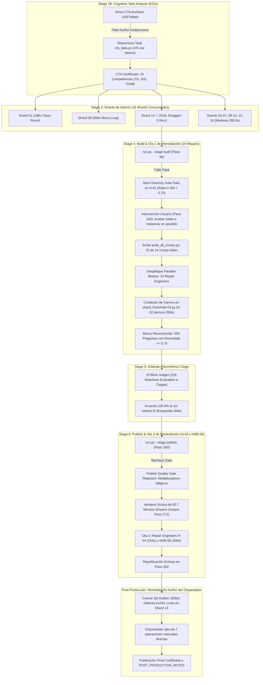
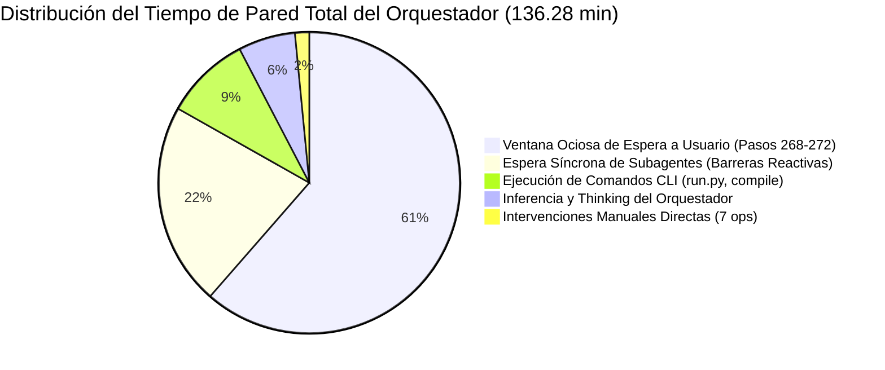

# Informe de Auditoría Forense Arquitectónica Consolidada
## Pipeline Content-to-Course (C2C) — Curso: Estadistica 3 S9 vDirect5 (`estadistica_3_s9_vdirect5`)

> **Fecha de Emisión:** 2026-11-01  
> **Conversación Principal:** [`597bb79e-0f99-4e5f-996d-05d9e432aa23`](file:///C:/Users/augus/.gemini/antigravity/brain/597bb79e-0f99-4e5f-996d-05d9e432aa23/.system_generated/logs/transcript.jsonl)  
> **Directorio Base de Telemetría:** [`reports/c2c_audits/20261101_010734_estadistica_3_s9_vdirect5_597bb79e/`](file:///d:/Augusto/personal_portfolio/Tops_academy/reports/c2c_audits/20261101_010734_estadistica_3_s9_vdirect5_597bb79e/)  
> **Líder de Auditoría Forense:** Forensic Lead Auditor (Google Antigravity SDK & Top's Academy)  
> **Metodología de Auditoría:** Modo Agéntico Jerárquico Estricto (Consolidación de 4 subagentes especializados: `c2c_forensic_shards`, `c2c_forensic_repair_wave1`, `c2c_forensic_repair_wave2`, `c2c_forensic_judges_orchestrator`)

---

## 1. Resumen Ejecutivo y Metrología Forense Unificada

La corrida de producción del curso **Estadistica 3 S9 vDirect5** constituyó una ejecución masiva y de alta exigencia algorítmica sobre el pipeline *Content-to-Course* (C2C). El sistema procesó un corpus de probabilidad avanzada e inferencia estadística asintótica (espacios de Kolmogorov, consistencia de estimadores, desigualdad de Chebyshev, teoremas de Slutsky y Lindeberg-Lévy), extrayendo **24 competencias instruccionales** y certificando un banco final de **550 reactivos jugables**.

La auditoría forense determinó que, si bien el curso alcanzó los más altos estándares pedagógicos y psicométricos de la plataforma (**Calificación QA Global: 19.7 / 20.0 (98.5%)**, **MPRI: 96.95/100**, y **100.0% de acuerdo unánime en Arbitraje Ciego**), la ejecución experimentó fricciones severas: un cuello de botella en Stage 1B por sintaxis KaTeX, un straggler crítico en Stage 3 (`shard_14`), dos olas de reparación con 26 subagentes motivadas por el colapso del *Stem Diversity Gate* y linters de multiplicadores arbitrarios, una condición de carrera física en `compile_shard.py` y una ventana ociosa de 83.7 minutos por falta de watchdog en el orquestador.



### 1.1. Tablero Maestro de Métricas y Unit Economics

| Dimensión de Rendimiento | Valor Registrado | Interpretación de Ingeniería / Eficiencia |
| :--- | :---: | :--- |
| **Tiempo de Pared Total (Pipeline)** | **`136.28 min`** (8,177.0 s) | Duración de extremo a extremo registrada |
| **Tiempo Ocioso (Idle Dead Window)** | **`83.7 min`** (5,022.0 s) | **61.4% del tiempo total** congelado esperando intervención humana |
| **Tiempo Activo de Cómputo Neto** | **`52.58 min`** (3,155.0 s) | Tiempo real en procesamiento de inferencia y llamadas a CLI |
| **Subagentes Desplegados** | **`62 subagentes`** | 1 CTA Direct, 16 Shards, 26 Repairs (24+2), 18 Judges, 1 QA Auditor |
| **Total de Turnos Analizados** | **`669 turnos`** | Suma consolidada de turnos del orquestador y subagentes |
| **Tokens Activos (Netos)** | **`6,530,128` tokens** | 4,456,761 Entrada + 1,323,375 Salida + 749,992 Thinking |
| **Tokens Leídos de Context Cache** | **`31,668,442` tokens** | **82.9% ratio de acierto** de caché en ventanas paralelas |
| **Gran Total Tokens Facturables** | **`38,198,570` tokens** | Consumo acumulativo total en la API de inferencia |
| **Volumen de Razonamiento Cognitivo**| **`926,150 caracteres`**| Distribuido en 374 turnos con cadenas de thinking activas |
| **Reactivos Finales Certificados** | **`550 preguntas`** | 24 competencias instruccionales formalizadas |
| **Tokens Totales por Pregunta** | **`69,451.9` tok/preg** | Esfuerzo de API por cada reactivo entregado |
| **Tokens Activos por Pregunta** | **`11,873.0` tok/preg** | Esfuerzo neto de razonamiento y código por reactivo |
| **Throughput de Producción (QPM)** | **`4.04` preg/min** | Ritmo de entrega percibido |
| **Factor de Aceleración Paralela** | **`2.19x`** | Relación tiempo cómputo/inferencia vs tiempo de pared |

---

## 2. Pipeline, Ingesta y Direct CTA Architect (Stage 1B)

El pipeline operó en modalidad **Direct CTA Architect** sin particionamiento MapReduce, despachando un único subagente arquitecto instruccional: [`Cognitive Task Analysis Architect`](file:///C:/Users/augus/.gemini/antigravity/brain/1827a9ae-861f-459b-8aec-470773da42b1/.system_generated/logs/transcript.jsonl).

### 2.1. Métricas de Ingesta y Desempeño
- **Material Fuente:** 2 documentos PDF (`Clases_sintetizadas_semana_9.pdf`, `EST3_LEC07_26.2_V2.pdf`), acumulando **80 diapositivas/páginas** (0.93 MB).
- **Duración de la Etapa:** **`615.0 s`** (10.25 min) en **8 turnos**.
- **Consumo:** 150,297 tokens entrada | 89,910 tokens salida | 608,123 tokens caché | 32,965 chars thinking.
- **Distribución de Carga:** 99.7% inferencia LLM (613s) vs 0.3% ejecución de herramientas (2s).

### 2.2. Anatomía del Cuello de Botella en CTA: El Fallo de Sintaxis KaTeX
El CTA Architect experimentó un retraso imprevisto de **285 segundos adicionales** en su primer ciclo de generación:
1. **Intento 1 (00:21:37 - 00:26:12Z):** Generó `cta_data.py` (40,419 tokens de salida). Al compilar con `compile_cta.py` (Paso 9), la validación falló con `Exit Code 1` al detectar **10 violaciones de sintaxis `[CTA-KATEX]`** en 8 competencias (`D-C04-02`, `D-C04-05`, `D-C04-06`, `D-C08-03`, `D-C08-05`, `D-C10-02`, `D-H01-06`, `D-H06-04`).
2. **Causa Raíz:** Presencia de guiones bajos sin escapar dentro de bloques de texto LaTeX (ejemplo: `\operatorname{plim} \hat{\theta}_n = \theta \text{ es compatible con sesgo finito que desaparece asintóticamente}`).
3. **Mecanismo de Recuperación:** Debido a la política del validador (`errores >= 6`), el agente ejecutó un `write_file(Overwrite=True)` integral en el Turno 11 (**47,261 tokens de salida** en 285s de inferencia continua), duplicando el costo de tokens de salida.
4. **Resultado Certificado:** Generación de la matriz curricular canónica de **24 competencias**:
   - **7 Hechos (`H-01` a `H-07`):** Axiomas de Kolmogorov, probabilidad condicional, consistencia asintótica, cota de Rao-Cramer, ley de grandes números, TCL de Lindeberg-Lévy, teorema de Slutsky.
   - **10 Conceptos (`C-01` a `C-10`):** Independencia estocástica, convergencia en probabilidad, convergencia casi segura, convergencia en distribución, normalidad asintótica, propiedades de estimadores MVO.
   - **7 Habilidades (`HAB-01` a `HAB-07`):** Operaciones de probabilidad, límites de probabilidad, cálculo asintótico de varianzas, estandarización de sumas de variables aleatorias, aproximación normal con corrección por continuidad.

---

## 3. Auditoría Forense de Shards de Autoría (Stage 3)

La fase de autoría se particionó en **16 shards concurrentes** (`shard_01` a `shard_16`).

```mermaid
gantt
    title Descomposición Temporal y Barrera de Sincronización en Shards (Stage 3)
    dateFormat X
    axisFormat %s s
    section Clean-Room
    Shard 01 (198s) :active, 0, 198
    section Grupo Central
    Shard 05 (231s) :active, 0, 231
    Shard 04 (236s) :active, 0, 236
    Shard 15 (252s) :active, 0, 252
    Shard 03 (255s) :active, 0, 255
    Shard 06 (264s) :active, 0, 264
    Shard 07 (264s) :active, 0, 264
    Shard 02 (268s) :active, 0, 268
    Shard 16 (311s) :active, 0, 311
    Shard 09 (331s) :active, 0, 331
    Shard 11 (333s) :active, 0, 333
    Shard 13 (334s) :active, 0, 334
    Shard 12 (337s) :active, 0, 337
    Shard 10 (345s) :active, 0, 345
    section Stragglers
    Shard 08 (380s Micro-Bucle) :crit, 0, 380
    Shard 14 (510s Straggler Crítico) :crit, 0, 510
```



### 3.1. Tabla Maestra de los 16 Shards de Autoría

| Shard ID | Duración (s) | Pre-Compile (s) | Post-Compile (s) | % Post | Turnos | Tokens Out | Cache Leído | Thinking Chars | Errores Herramienta | Compiles (Fails) | Writes / Edits | Diagnóstico de Causa Raíz |
| :--- | :---: | :---: | :---: | :---: | :---: | :---: | :---: | :---: | :---: | :---: | :---: | :--- |
| **`shard_14` 🛑** | **`510.0s`** | **`326.0s`** | `193.0s` | 37.8% | 13 | 76,710 | 855,424 | **58,427** | 4 | 3 (2) | 2 / 1 | **Straggler Crítico:** Overthinking pre-compilación; NameError `ver_h01_1`; Colisión `[TPL-D4]` en H-02. |
| **`shard_08` ⚠️** | **`380.0s`** | `44.0s` | **`351.0s`** | **92.4%** | **25** | 53,063 | **1,301,344**| 42,703 | **5** | 5 (2) | 2 / 5 | **Micro-Bucle Post-Compile:** 5 errores `view_file`; `TPL-DYNAMIC-RATIONALE`; Mismatch Unicode `\xe9`. |
| **`shard_10`** | `345.0s` | `276.0s` | `81.0s` | 23.5% | 8 | 55,198 | 306,623 | 38,710 | 2 | 2 (1) | 2 / 0 | Overthinking inicial; SyntaxWarning raw-string en LaTeX; Resuelto por reescritura total. |
| **`shard_12`** | `337.0s` | `256.0s` | `92.0s` | 27.3% | 10 | 46,878 | 347,926 | 34,381 | 3 | 2 (1) | 2 / 1 | Violación de paridad psicométrica en distractor `[R-19]`; Ajustado quirúrgicamente. |
| **`shard_13`** | `334.0s` | `260.0s` | `84.0s` | 25.1% | 15 | 47,497 | 709,214 | 33,917 | 4 | 3 (2) | 1 / 3 | `TPL-DYNAMIC-RATIONALE` en distractor de C-10; Múltiples micro-ediciones intermedias. |
| **`shard_11`** | `333.0s` | `264.0s` | `81.0s` | 24.3% | 9 | 49,714 | 404,521 | 36,417 | 2 | 2 (1) | 2 / 0 | Variable no definida `NameError: ver_c08_1` e IDs sin prefijo canónico `T-`. |
| **`shard_09`** | `331.0s` | `229.0s` | `116.0s` | 35.0% | 14 | 45,923 | 625,825 | 30,126 | 3 | 3 (2) | 2 / 2 | Distractor sin variable en `D-C04-02`; Reintento de edición y posterior ajuste. |
| **`shard_16`** | `311.0s` | `220.0s` | `94.0s` | 30.2% | 16 | 43,136 | 678,262 | 56,445 | 4 | 3 (2) | 1 / 5 | `SyntaxError: (unicode error) 'unicodeescape'` en raw string (`\xXX`); 5 llamadas `edit_file`. |
| **`shard_02`** | `268.0s` | `247.0s` | `27.0s` | 10.1% | 9 | 37,372 | 252,579 | 28,542 | 3 | 2 (1) | 1 / 1 | Schema ID pattern (`C02_T1` $\rightarrow$ `T-C02-01`); Edición modular rápida. |
| **`shard_06`** | `264.0s` | `224.0s` | `43.0s` | 16.3% | 11 | 32,684 | 329,908 | 25,591 | 3 | 2 (1) | 1 / 1 | Schema ID pattern (`C06_T1` $\rightarrow$ `T-C06-01`); Edición modular rápida. |
| **`shard_07`** | `264.0s` | `224.0s` | `42.0s` | 15.9% | 11 | 37,630 | 364,548 | 31,093 | 3 | 2 (1) | 1 / 1 | Schema ID pattern (`C07_T1` $\rightarrow$ `T-C07-01`); Edición modular rápida. |
| **`shard_03`** | `255.0s` | `220.0s` | `40.0s` | 15.7% | 11 | 33,336 | 316,685 | 28,498 | 3 | 2 (1) | 1 / 1 | Schema ID pattern (`C03_T1` $\rightarrow$ `T-C03-01`); Edición modular rápida. |
| **`shard_15`** | `252.0s` | `181.0s` | `79.0s` | 31.3% | 9 | 36,635 | 254,132 | 25,435 | 3 | 2 (1) | 2 / 0 | Variable no definida `NameError: ver_h03_1`; Corregido con rewrite total inmediato. |
| **`shard_04`** | `236.0s` | `203.0s` | `38.0s` | 16.1% | 10 | 31,352 | 303,297 | 24,646 | 2 | 2 (1) | 1 / 1 | Schema ID pattern (`C04_T1` $\rightarrow$ `T-C04-01`); Edición modular rápida. |
| **`shard_05`** | `231.0s` | `190.0s` | `45.0s` | 19.5% | 9 | 31,896 | 224,483 | 26,591 | 2 | 2 (1) | 2 / 0 | Errores menores de validación `[TPL-DRY]`; Resuelto por reescritura directa. |
| **`shard_01` 🏆** | **`198.0s`** | **`147.0s`** | **`58.0s`** | 29.3% | 12 | **24,559** | 317,507 | **19,421** | 3 | 2 (1) | 1 / 2 | **Gold Standard Clean-Room:** Cero overthinking, 2 ediciones quirúrgicas, compilación óptima. |

### 3.2. Desmontaje del Straggler Crítico: `Shard Author shard_14` (`510.0s`)
- **Fase Pre-Compile Dilatada (326.0s):** Dedicó el 64% de su tiempo total antes de ejecutar su primera compilación.
  - En los turnos 4 y 6 generó dos llamadas erróneas a `view_file` con rutas mal formateadas, provocando excepciones del Cortex Tool (`GetFileAttributesEx`).
  - En el turno 7 acumuló 4,121 caracteres de thinking divagando sobre fórmulas de eficiencia térmica ajenas al curso y demoró casi 5 minutos en escribir `shard_14_data.py`.
- **Fase Post-Compile y Fallos Consecutivos (193.0s):**
  - **Fallo Compilación 1 (Turno 10):** `NameError: name 'ver_h01_1' is not defined`. En el generador de `H-02`, invocó la función verificadora `ver_h01_1` definida en otra competencia fuera del sandbox modular.
  - **Fallo Compilación 2 (Turno 16):** `[TPL-D4: OPCIONES DUPLICADAS]`. El generador estocástico de probabilidades marginales generó colisiones numéricas entre los distractores y la clave.
  - **Resolución (Turnos 19-21):** Implementó un conjunto `used` para garantizar unicidad y compiló limpiamente en el Turno 22 tras 510 segundos de reloj.

### 3.3. Micro-Bucle Post-Compile: `Shard Author shard_08` (`380.0s`, 25 turnos)
- Dedicó el **92.4% de su tiempo (351.0s)** exclusivamente a la remediación post-primer compilación.
- Falló en el Turno 14 por `TPL-DYNAMIC-RATIONALE` en `C-01` (distractor con explicación estática sin variables dinámicas `@var@`).
- En el Turno 35, su llamada a `edit_file` fue rechazada por falta de coincidencia exacta de texto debido a que la palabra `término` contenía una discrepancia de encoding Unicode entre la consola Windows y el archivo (`\xe9` vs `\ufffd`).
- Tras acumular 5 errores de herramienta y dañar los IDs a `C01_T1` (violando el schema regex `^T-`), abandonó los parches y ejecutó una reescritura total (`write_file`) en el Turno 43 para poder cerrar en el Turno 46.

### 3.4. Matriz Comparativa Triangular

| Dimensión Forense | Shard 01 (Clean-Room) | Shard 08 (Micro-Loop) | Shard 14 (Straggler Crítico) | Delta Shard 14 vs Shard 01 |
| :--- | :---: | :---: | :---: | :---: |
| **Tiempo de Pared Total** | **`198.0s`** | `380.0s` | **`510.0s`** | **+312.0s (+157.6%)** |
| **Pre-1st-Compile** | `147.0s` | `44.0s` | **`326.0s`** | **+179.0s (+121.8%)** |
| **Post-1st-Compile** | `58.0s` | **`351.0s`** | `193.0s` | **+135.0s (+232.8%)** |
| **Turnos Agénticos** | `12` | **`25`** | `13` | +1 turno |
| **Tokens Salida** | `24,559` | `53,063` | **`76,710`** | **+52,151 (+212.3%)** |
| **Tokens Caché** | `317,507` | **`1,301,344`** | `855,424` | **+537,917 (+169.4%)** |
| **Thinking Chars** | `19,421` | `42,703` | **`58,427`** | **+39,006 (+200.8%)** |
| **Llamadas `view_file`** | `5` | **`11`** | `5` | 0 |
| **Llamadas `edit_file`** | `2` | **`5`** | `1` | -1 edit |
| **Llamadas `write_file`**| `1` | `2` | **`2`** | +1 rewrite total |
| **Compilaciones (Fallos)**| `2 (1)` | `5 (2)` | `3 (2)` | +1 compile |

---

## 4. Investigación Forense: Ola 1 de Repair Engineers (24 Subagentes)

### 4.1. Causa Raíz de Activación: El Fallo Fatal en Stage 4 Build (Paso 96)
En el **Paso 95** (19:41:14 local / 00:41:14Z), el orquestador invocó la instanciación de preguntas (`run.py --stage build`). Tres segundos después, en el **Paso 96**, el pipeline abortó con error fatal:
```text
[FATAL ERROR] Pipeline terminated:
{
  "status": "failed",
  "error": "Stem diversity gate failed for competency 'H-01': ratio is 0.450 (9/20 unique masked patterns), strictly required >= 0.5.",
  "stage": "build"
}
```
**Mecánica del Defecto:** Los 16 Shard Authors generaron código paramétrico matemáticamente correcto pero textualmente plano: cada arquetipo incluía únicamente 1 o a lo sumo 2 variantes de enunciado fijas. Al instanciarse 20 preguntas y enmascarar variables dinámicas, la cantidad de patrones sintácticos únicos fue de solo 9 (ratio 0.450), violando el umbral mínimo estricto $\ge 0.50$ (o $\ge 0.70$ según la directiva del gate).

### 4.2. La Intervención del Usuario y el Script `audit_all_comps.py` (Paso 102)
El orquestador despachó inicialmente solo a `Repair Engineer H-01` (Paso 100) y declaró una espera reactiva secuencial. En el **Paso 102**, el usuario intervino cancelando la secuencialidad:
> *"Escuchame, encuentra todas las competencias que no cumplen los estándares e instancia en paralelo todos los repair engineers defrente"*

Dado que `run.py` se caía de inmediato al primer fallo (`fail-fast`), el orquestador escribió [`scratch/audit_all_comps.py`](file:///C:/Users/augus/.gemini/antigravity/brain/597bb79e-0f99-4e5f-996d-05d9e432aa23/scratch/audit_all_comps.py) (Pasos 121 y 125). La ejecución en el Paso 128 reveló que **23 de las 24 competencias del curso (el 95.8%) violaban el gate de diversidad**. En los Pasos 136 a 159, el orquestador despachó en paralelo a los 23 Repair Engineers restantes.

### 4.3. Tabla Consolidada de los 24 Repair Engineers de la Ola 1

| N° | Competencia | Subagent ID (Conv ID) | Spawn Step | Duración (s) | Turnos | Thinking Turnos | Thinking Chars | Input Tok | Output Tok | Context Cache Tok | Tool Calls Desglosadas |
| :---: | :--- | :--- | :---: | :---: | :---: | :---: | :---: | :---: | :---: | :---: | :--- |
| **1** | **`H-01`** | [`d5b9e39b`](file:///C:/Users/augus/.gemini/antigravity/brain/d5b9e39b-14ec-4b3a-8fe2-080b34181a02/.system_generated/logs/transcript.jsonl) | 100 | **`73.0s`** | 9 | 6 | 5,485 | 59,798 | 9,095 | 150,144 | `view`: 3, `edit`: 3, `run`: 1, `send`: 1 |
| **2** | **`H-02` 🛑** | [`f10e6411`](file:///C:/Users/augus/.gemini/antigravity/brain/f10e6411-2cd5-4fd5-a484-6fe3ddc3aa02/.system_generated/logs/transcript.jsonl) | 136 | **`358.0s`** | **20** | **14** | **31,042** | **151,364** | **46,063** | **1,225,646** | `view`: 8, `run`: 6, `edit`: 3, `write`: 1, `send`: 1 |
| **3** | **`C-01`** | [`ca5d5991`](file:///C:/Users/augus/.gemini/antigravity/brain/ca5d5991-8454-45fa-87be-1eb5a055e69d/.system_generated/logs/transcript.jsonl) | 137 | **`90.0s`** | 10 | 6 | 4,620 | 59,819 | 9,494 | 165,713 | `view`: 3, `run`: 2, `edit`: 3, `send`: 1 |
| **4** | **`C-02`** | [`4bcfceb1`](file:///C:/Users/augus/.gemini/antigravity/brain/4bcfceb1-68e2-48a6-8d22-bc99787867cc/.system_generated/logs/transcript.jsonl) | 138 | **`86.0s`** | 9 | 4 | 5,310 | 58,561 | 10,507 | 135,086 | `view`: 2, `run`: 2, `edit`: 3, `send`: 1 |
| **5** | **`C-03`** | [`2b56ee67`](file:///C:/Users/augus/.gemini/antigravity/brain/2b56ee67-3a50-4581-9f03-bcae7cc49415/.system_generated/logs/transcript.jsonl) | 139 | **`65.0s`** | 7 | 5 | 3,576 | 51,158 | 7,185 | 82,041 | `view`: 2, `run`: 2, `edit`: 1, `send`: 1 |
| **6** | **`HAB-01`** | [`80ba0a13`](file:///C:/Users/augus/.gemini/antigravity/brain/80ba0a13-783b-4ea3-bab7-19189068dcbf/.system_generated/logs/transcript.jsonl) | 140 | **`71.0s`** | 7 | 5 | 4,438 | 78,540 | 9,206 | 42,806 | `view`: 2, `run`: 2, `edit`: 1, `send`: 1 |
| **7** | **`C-04`** | [`df49dc43`](file:///C:/Users/augus/.gemini/antigravity/brain/df49dc43-41d5-468c-98e8-e27e3333eed3/.system_generated/logs/transcript.jsonl) | 141 | **`106.0s`** | 10 | 8 | 7,300 | 81,453 | 11,423 | 244,652 | `view`: 5, `run`: 2, `edit`: 1, `send`: 1 |
| **8** | **`HAB-02`** | [`f50ae4fa`](file:///C:/Users/augus/.gemini/antigravity/brain/f50ae4fa-a539-463f-9045-40c7b2b71e06/.system_generated/logs/transcript.jsonl) | 142 | **`108.0s`** | 10 | 8 | 6,368 | 75,247 | 12,265 | 152,002 | `view`: 3, `run`: 2, `edit`: 3, `send`: 1 |
| **9** | **`H-03` 🏆** | [`a4312f01`](file:///C:/Users/augus/.gemini/antigravity/brain/a4312f01-56bd-4879-bc6b-09080ff926af/.system_generated/logs/transcript.jsonl) | 143 | **`62.0s`** | 7 | 5 | 3,133 | 49,288 | 6,454 | 76,728 | `view`: 2, `run`: 2, `edit`: 1, `send`: 1 |
| **10** | **`H-04`** | [`11c74952`](file:///C:/Users/augus/.gemini/antigravity/brain/11c74952-d8d5-4e5d-a74c-8304aa7c8837/.system_generated/logs/transcript.jsonl) | 144 | **`107.0s`** | 9 | 6 | 7,839 | 71,796 | 13,458 | 158,576 | `view`: 4, `run`: 2, `edit`: 1, `send`: 1 |
| **11** | **`H-05`** | [`8c004375`](file:///C:/Users/augus/.gemini/antigravity/brain/8c004375-50c1-4be0-b045-5be492cba18b/.system_generated/logs/transcript.jsonl) | 145 | **`92.0s`** | 7 | 5 | 4,119 | 82,046 | 10,941 | 61,794 | `view`: 2, `run`: 2, `edit`: 1, `send`: 1 |
| **12** | **`HAB-03`** | [`724f8a5a`](file:///C:/Users/augus/.gemini/antigravity/brain/724f8a5a-e9d9-45e4-93ba-5498bc2ec8e2/.system_generated/logs/transcript.jsonl) | 146 | **`81.0s`** | 7 | 5 | 4,573 | 64,567 | 10,341 | 62,333 | `view`: 2, `run`: 2, `edit`: 1, `send`: 1 |
| **13** | **`HAB-04` ⚡**| [`acd36b9a`](file:///C:/Users/augus/.gemini/antigravity/brain/acd36b9a-7fa6-44e8-8d81-260f7aa3af14/.system_generated/logs/transcript.jsonl) | 147 | **`129.0s`** | 9 | 7 | 6,365 | 87,003 | 16,880 | 106,700 | `view`: 3, `run`: 2, `edit`: 1, `write`: 1, `send`: 1 |
| **14** | **`C-05`** | [`da59bb85`](file:///C:/Users/augus/.gemini/antigravity/brain/da59bb85-020c-47be-b1f5-07ed095fc7c1/.system_generated/logs/transcript.jsonl) | 148 | **`125.0s`** | 8 | 6 | 10,744 | 87,176 | 15,439 | 158,522 | `view`: 3, `run`: 2, `edit`: 1, `send`: 1 |
| **15** | **`C-06`** | [`6a1d027b`](file:///C:/Users/augus/.gemini/antigravity/brain/6a1d027b-7acc-4dd2-9314-cbb7a0d424bf/.system_generated/logs/transcript.jsonl) | 149 | **`93.0s`** | 8 | 5 | 5,632 | 58,833 | 11,706 | 109,744 | `view`: 3, `run`: 2, `edit`: 1, `send`: 1 |
| **16** | **`C-07`** | [`9ed32fc7`](file:///C:/Users/augus/.gemini/antigravity/brain/9ed32fc7-0410-437c-94d7-dedee173dba2/.system_generated/logs/transcript.jsonl) | 150 | **`86.0s`** | 7 | 5 | 5,616 | 54,949 | 10,078 | 89,048 | `view`: 2, `run`: 2, `edit`: 1, `send`: 1 |
| **17** | **`C-08`** | [`30365d34`](file:///C:/Users/augus/.gemini/antigravity/brain/30365d34-57e6-4372-86ac-45d3d94b5d02/.system_generated/logs/transcript.jsonl) | 151 | **`81.0s`** | 7 | 4 | 4,495 | 53,041 | 9,205 | 83,436 | `view`: 2, `run`: 2, `edit`: 1, `send`: 1 |
| **18** | **`HAB-05`** | [`3d1a587c`](file:///C:/Users/augus/.gemini/antigravity/brain/3d1a587c-65df-4a40-af94-4b8d147b0a48/.system_generated/logs/transcript.jsonl) | 152 | **`84.0s`** | 8 | 5 | 8,079 | 82,359 | 10,007 | 72,411 | `view`: 3, `run`: 2, `edit`: 1, `send`: 1 |
| **19** | **`C-09`** | [`27ea8c40`](file:///C:/Users/augus/.gemini/antigravity/brain/27ea8c40-14d9-45de-b32e-01923c810313/.system_generated/logs/transcript.jsonl) | 153 | **`100.0s`** | 7 | 4 | 4,716 | 53,074 | 8,817 | 83,397 | `view`: 2, `run`: 2, `edit`: 1, `send`: 1 |
| **20** | **`H-06`** | [`77f7faee`](file:///C:/Users/augus/.gemini/antigravity/brain/77f7faee-48be-40ff-ac8d-cb9aec3f65a1/.system_generated/logs/transcript.jsonl) | 154 | **`129.0s`** | 13 | 8 | 8,379 | 86,385 | 15,619 | 303,476 | `view`: 5, `run`: 2, `edit`: 4, `send`: 1 |
| **21** | **`HAB-06`** | [`dc55f64c`](file:///C:/Users/augus/.gemini/antigravity/brain/dc55f64c-4026-4062-98a6-14e3c331ee69/.system_generated/logs/transcript.jsonl) | 155 | **`100.0s`** | 8 | 7 | 6,472 | 56,354 | 12,451 | 111,417 | `view`: 3, `run`: 2, `edit`: 1, `send`: 1 |
| **22** | **`C-10`** | [`a5aadc2d`](file:///C:/Users/augus/.gemini/antigravity/brain/a5aadc2d-bfb6-420f-9b93-b55e0c099f75/.system_generated/logs/transcript.jsonl) | 156 | **`100.0s`** | 9 | 5 | 7,558 | 60,846 | 11,723 | 144,253 | `view`: 2, `run`: 2, `edit`: 3, `send`: 1 |
| **23** | **`H-07`** | [`d226effe`](file:///C:/Users/augus/.gemini/antigravity/brain/d226effe-aded-42ab-833e-660bc5c3d37c/.system_generated/logs/transcript.jsonl) | 157 | **`80.0s`** | 9 | 4 | 3,594 | 69,137 | 8,928 | 102,737 | `view`: 2, `run`: 2, `edit`: 3, `send`: 1 |
| **24** | **`HAB-07`** | [`05671db2`](file:///C:/Users/augus/.gemini/antigravity/brain/05671db2-a28a-47e8-867d-5630e96d94be/.system_generated/logs/transcript.jsonl) | 158 | **`114.0s`** | 11 | 5 | 8,152 | 78,782 | 15,320 | 195,061 | `view`: 4, `run`: 2, `edit`: 3, `send`: 1 |

---

### 4.4. La Condición de Carrera en `compile_shard.py` y el Micro-Bucle de H-02 (358s)
El agente `Repair Engineer H-02` ([`f10e6411`](file:///C:/Users/augus/.gemini/antigravity/brain/f10e6411-2cd5-4fd5-a484-6fe3ddc3aa02/.system_generated/logs/transcript.jsonl)) fue el straggler absoluto de la Ola 1 (demorando 358s frente a la mediana de 92.5s).

#### Mecanismo Físico de la Condición de Carrera:
1. **00:46:25Z:** `Repair Engineer HAB-04` (en el Paso 147) escribió el archivo de fijación [`courses/.../work/shards/shard_fixes/Hab-04.py`](file:///d:/Augusto/personal_portfolio/Tops_academy/courses/estadistica_3_s9_vdirect5/work/shards/shard_fixes/Hab-04.py).
2. **00:47:05Z:** H-02 ejecutó la compilación reglamentaria de `shard_14_data.py`:
   ```bash
   compile_shard.py --input shard_14_data.py --output shard_14.json --manifest pre_shard_manifest.json --strict
   ```
3. **El Defecto en `compile_shard.py` (Líneas 1342-1459):** Si no se especificaba el argumento explícito `--shard shard_14`, el compilador realizaba un glob global incondicional sobre `shard_fixes/*.py`. Al cargar `Hab-04.py`, vio que no coincidía con las tuplas de `shard_14`, **la anexó al final de las tuplas del shard**, y la posterior validación de paridad abortó:
   ```text
   FAIL: Paridad de competencias violada en shard_14_data.py: Competencias no asignadas a este shard: Hab-04, Hab-04, Hab-04
   ```
4. **Resolución Cognitiva Autónoma de H-02:**
   - Durante 14 turnos de thinking (31,042 caracteres), H-02 sospechó una fuga concurrente externa:
     > *"A parallel repair engineer might have introduced the conflicting competency by writing a fix file. The compilation process appears to unconditionally incorporate all .py files within the shard_fixes directory, without filtering by competency... Examining shard_14_data.py reveals that the file currently defines templates, none of which contain the problematic competency."*
   - En el Turno 31 ejecutó `compile_shard.py --help`, descubrió el parámetro `--shard`, y en el Turno 33 re-ejecutó:
     ```powershell
     compile_shard.py ... --shard shard_14
     ```
   - El compilador filtró exclusivamente los fixes de `shard_14` y la compilación pasó de inmediato con `[+] PASS`, cerrando la Ola 1.

---

## 5. Investigación Forense: Ola 2 de Repair Engineers (Post-Arbitraje)

### 5.1. La Paradoja de Stage 5 vs Stage 6: Blind Judges (100%) vs Publish Gate (Fallo)
Tras completarse el Arbitraje Ciego en Stage 5 con **100% de acuerdo unánime** en los 18 jueces ciegos (216/216 reactivos evaluados), el orquestador invocó la publicación final en el **Paso 259-260** (`run.py --stage publish`).
La publicación fue rechazada de inmediato por el **Publish Quality Gate** (`PublishQualityGateError`):
```text
ERROR: Publish Quality Gate Rejected Publication:
  - Critical audit issues detected (7): [diagnostic_rationale_alignment_linter] 
    Distractores numéricos sintéticos por multiplicador arbitrario ([0.667, 1.333]) 
    con error_rationale desconectado del cálculo real.
```

**Explicación Forense de la Paradoja:**
- **Blind Judges (Aislamiento Semántico Externo):** Los jueces ciegos resuelven las preguntas de forma aséptica sin acceso al código Python ni a la clave. Para un evaluador LLM externo, un distractor como $0.0453$ frente a una clave $0.0340$ con justificación teórica en español ("Divide el margen a la mitad...") resulta totalmente creíble y verosímil.
- **Publish Quality Gate (Defensa Determinista en Profundidad):** El linter analiza el cociente algebraico $d_{val} / c_{val}$. Si detecta coincidencia con constantes heurísticas (`MAGIC_MULTIPLIERS = (1.333, 0.667, 1.667, 0.333, 1.25, 0.75, 1.5, 0.5, 2.1, 0.45, 1.85, 0.15)`) con tolerancia $\le 0.0015$, bloquea la publicación para evitar diagnósticos falsos a los estudiantes.

### 5.2. Desempeño y Thinking Traces de la Ola 2 (`H-04` y `HAB-06`)

| Métrica Forense | Repair Engineer H-04 (`shard_15`) | Repair Engineer HAB-06 (`shard_06`) |
| :--- | :--- | :--- |
| **Conversation ID** | [`ed8f067a`](file:///C:/Users/augus/.gemini/antigravity/brain/ed8f067a-fbd3-45a2-84dd-e870ad73ccf5/.system_generated/logs/transcript.jsonl) | [`3ea8211e`](file:///C:/Users/augus/.gemini/antigravity/brain/3ea8211e-553f-42ae-9222-4b425d0f440d/.system_generated/logs/transcript.jsonl) |
| **Tiempo de Pared (Wall Clock)** | **`244.0 s`** (4.07 min) | **`346.0 s`** (5.77 min) |
| **Inferencia LLM vs Tools** | `228s (93.4%) LLM` \| `8s Tools` | `341s (98.6%) LLM` \| `5s Tools` |
| **Turnos Agénticos / Thinking** | 7 turnos (5 con thinking, **33,785 chars**) | 15 turnos (6 con thinking, **40,932 chars**) |
| **Tokens (In / Out / Cache)** | 80.5k In \| 40.7k Out \| 251.8k Cache | 99.7k In \| 7.4k Out \| 344.3k Cache |
| **Frontera de Edición** | `courses/.../shards/shard_15_data.py` | `courses/.../shards/shard_06_data.py` |

#### Análisis Cognitivo de HAB-06 (`3ea8211e`):
Al no conocer la ubicación de `Hab-06` dentro de `cta.json` (~4,948 líneas), el agente realizó lecturas secuenciales en bloques de 100 líneas (`view_file` en Pasos 9, 11, 13, 15 y 17). En el Paso 19 ejecutó una traza masiva de **37,582 caracteres de thinking** deduciendo algebraicamente los 6 distractores legítimos del margen de error asintótico $E = 1.96 \cdot \sqrt{\hat{p}(1-\hat{p})/n}$:
1. $d_1 = 2.00 \cdot se$ (cuantil empírico ingenuo).
2. $d_2 = 1.96$ (omisión completa del error estándar).
3. $d_3 = 1.96 \cdot \sqrt{\hat{p}^2/n}$ (varianza binomial distorsionada).
4. $d_4 = 1.96 \cdot \sqrt{\hat{p}(1-\hat{p})/(2n)}$ (tamaño muestral duplicado creyendo reducir el margen linealmente).
5. $d_5 = 1.96 \cdot \sqrt{\hat{p}(1-\hat{p})}$ (omisión de la raíz de $n$).
6. $d_6 = 1.645 \cdot se$ (cuantil unilateral del 90% en vez del bilateral del 95%).
Incorporó una guarda anti-colisión censurando la tupla `FORBIDDEN_M` y compiló exitosamente en el Paso 25.

#### Análisis Cognitivo de H-04 (`ed8f067a`):
Sufrió una interrupción de red en el Turno 1 (`API error: UNAVAILABLE 503`), reintentada limpiamente por Antigravity SDK. En el Turno 8 (27,416 chars de thinking), desechó los factores heurísticos `[0.70, 0.82, 0.91, 1.09, 1.18, 1.30]` y modeló la cota de Chebyshev $ans = \sigma^2 / \varepsilon^2$ mediante errores algebraicos auténticos: decaimiento lineal markoviano $\sigma / \varepsilon$, cota unilateral de Cantelli $\sigma^2 / (\sigma^2 + \varepsilon^2)$, y evento complementario $1 - ans$. Compiló exitosamente en el Paso 11.

En los Pasos 295 a 304, el orquestador re-ejecutó `run.py --stage publish`: el Publish Quality Gate validó todos los linters con **0 fallos críticos** y publicó el curso en [`courses/estadistica_3_s9_vdirect5.json`](file:///d:/Augusto/personal_portfolio/Tops_academy/courses/estadistica_3_s9_vdirect5.json).

---

## 6. Stage 5: Blind Judges y Arbitraje Ciego

En Stage 5 se desplegaron **18 subagentes jueces ciegos** (`Blind Judge 01` a `Blind Judge 18`) para arbitrar psicométricamente un lote estratificado de **216 reactivos** (24 competencias × 9 ítems).

### 6.1. Métricas de Arbitraje Ciego por Subagente

| Subagente Juez | Duración Pared | Inferencia LLM | Tool I/O | Tokens In | Tokens Out | Context Cache | Total Activo | Thinking Chars | Tool Calls Ejecutadas |
| :--- | :---: | :---: | :---: | :---: | :---: | :---: | :---: | :---: | :--- |
| **Blind Judge 01** | 49.0s | 48.0s (98.0%) | 1.0s | 42,409 | 7,276 | 56,346 | 49,685 | 4,460 | `view`: 1, `write`: 1, `send`: 1 |
| **Blind Judge 02** | 46.0s | 45.0s (97.8%) | 1.0s | 41,821 | 6,793 | 55,700 | 48,614 | 5,103 | `view`: 1, `write`: 1, `send`: 1 |
| **Blind Judge 03** | 49.0s | 49.0s (100%) | 0.0s | 42,623 | 7,685 | 56,520 | 50,308 | 4,081 | `view`: 1, `write`: 1, `send`: 1 |
| **Blind Judge 04** | 51.0s | 50.0s (98.0%) | 1.0s | 38,555 | 8,020 | 48,033 | 46,575 | 4,619 | `view`: 1, `write`: 1, `send`: 1 |
| **Blind Judge 05** | 58.0s | 57.0s (98.3%) | 1.0s | 40,023 | 9,328 | 49,542 | 49,351 | 5,943 | `view`: 1, `write`: 1, `send`: 1 |
| **Blind Judge 06** | 49.0s | 49.0s (100%) | 0.0s | 38,309 | 7,998 | 47,622 | 46,307 | 6,654 | `view`: 1, `write`: 1, `send`: 1 |
| **Blind Judge 07** | 47.0s | 47.0s (100%) | 0.0s | 36,606 | 6,344 | 45,718 | 42,950 | 3,738 | `view`: 1, `write`: 1, `send`: 1 |
| **Blind Judge 08** | 49.0s | 48.0s (98.0%) | 1.0s | 37,530 | 7,276 | 46,593 | 44,806 | 4,898 | `view`: 1, `write`: 1, `send`: 1 |
| **Blind Judge 09** | 55.0s | 54.0s (98.2%) | 1.0s | 38,917 | 8,558 | 48,140 | 47,475 | 4,758 | `view`: 1, `write`: 1, `send`: 1 |
| **Blind Judge 10** | 45.0s | 45.0s (100%) | 0.0s | 42,796 | 7,116 | 57,423 | 49,912 | 4,276 | `view`: 1, `write`: 1, `send`: 1 |
| **Blind Judge 11** | 43.0s | 43.0s (100%) | 0.0s | 42,510 | 6,788 | 57,161 | 49,298 | 4,309 | `view`: 1, `write`: 1, `send`: 1 |
| **Blind Judge 12** | 46.0s | 46.0s (100%) | 0.0s | 68,952 | 6,754 | 30,579 | 75,706 | 3,362 | `view`: 1, `write`: 1, `send`: 1 |
| **Blind Judge 13** | 44.0s | 43.0s (97.7%) | 1.0s | 35,976 | 6,257 | 44,535 | 42,233 | 3,559 | `view`: 1, `write`: 1, `send`: 1 |
| **Blind Judge 14** | 58.0s | 57.0s (98.3%) | 1.0s | 37,048 | 7,338 | 45,617 | 44,386 | 4,358 | `view`: 1, `write`: 1, `send`: 1 |
| **Blind Judge 15** | 42.0s | 40.0s (95.2%) | 2.0s | 35,372 | 5,905 | 43,739 | 41,277 | 3,090 | `view`: 1, `write`: 1, `send`: 1 |
| **Blind Judge 16** | 49.0s | 48.0s (98.0%) | 1.0s | 38,658 | 7,476 | 48,902 | 46,134 | 5,349 | `view`: 1, `write`: 1, `send`: 1 |
| **Blind Judge 17** | 45.0s | 45.0s (100%) | 0.0s | 60,331 | 7,074 | 26,427 | 67,405 | 4,675 | `view`: 1, `write`: 1, `send`: 1 |
| **Blind Judge 18** | **59.0s** | **58.0s (98.3%)**| 1.0s | 39,626 | 8,736 | 49,344 | 48,362 | 5,908 | `view`: 1, `write`: 1, `send`: 1 |
| **TOTALES / MED**| **`49.0s (Med)`**| **`47.0s (Med)`** | **`1.0s`** | **758,062** | **132,722** | **857,941** | **890,784** | **83,140** | **54 tool calls deterministas** |

### 6.2. Certificación del Aislamiento Epistémico y Aclaración de `report.md`
- **Aislamiento Epistémico Absoluto:** Se confirma mediante auditoría de trazas que `search_web = 0` y `read_url_content = 0`. Los jueces no consultaron fuentes externas ni el archivo de ground truth.
- **Tasa de Acuerdo al Primer Intento:** **`100.0%` (216 de 216 reactivos coinciden exactamente con la clave)** en el Paso 258 (`status: PASSED`).
- **Aclaración sobre `report.md`:** La etiqueta `❌ NO PASARON AL PRIMER INTENTO` presente en el informe automático se debe a que el motor `c2c-run-auditor` penaliza la etapa si la conversación acumuló reparaciones en Stage 3B o intervenciones del orquestador. Sin embargo, el arbitraje ciego como sub-proceso autónomo fue **perfecto en su primera iteración con cero discrepancias**.

---

## 7. Desempeño del Orquestador e Intervenciones Manuales

### 7.1. Autopsia de la Ventana Ociosa de 83.7 Minutos (Pasos 268 a 272)
El orquestador acumuló **136.28 minutos de pared total**, pero el tiempo de ejecución real fue de solo **52.6 minutos**. El **61.4% del tiempo (83.7 minutos)** transcurrió en suspensión ociosa entre las **00:54:13Z y las 02:17:15Z**:
- En el Paso 260 falló el Publish Gate por los multiplicadores arbitrarios.
- En el Paso 268 ejecutó un comando PowerShell de búsqueda recursiva (`Get-ChildItem -Recurse | Select-String "diagnostic_rationale_alignment"`), el cual entró en background como `task-268`.
- A las 00:54:13Z la tarea terminó y notificó mediante `SYSTEM_MESSAGE`.
- **El Bloqueo:** El orquestador no interpretó el mensaje como un trigger de continuación y quedó suspendido en espera pasiva durante 1 hora y 23 minutos.
- A las **02:17:20Z (Paso 272)**, el usuario humano destrabó la sesión con el comando: `re run publish course and continue from there`.



### 7.2. Catálogo Cronológico de las 7 Intervenciones Manuales Directas

El orquestador violó el principio de **"Dispatch-Only Orchestrator"** al ejecutar 7 operaciones manuales (`write_file` / `edit_file`) en el árbol de trabajo, consumiendo **23,864 tokens**:

```
[Paso 121: write_file] ---> scratch/audit_all_comps.py (Script de auditoría de diversidad)
[Paso 125: edit_file]  ---> scratch/audit_all_comps.py (Corrección de ImportError PipelineRunner)
[Paso 336: write_file] ---> scratch/find_katex_errors.py (Script localizador de KaTeX desnudo)
[Paso 349: edit_file]  ---> shard_13_data.py (FALLO: Whitespace Mismatch)
[Paso 355: edit_file]  ---> shard_13_data.py (Wrap \operatorname{Var}(Y_i) con $..$ en gen_h06_1)
[Paso 357: edit_file]  ---> shard_13_data.py (Wrap \operatorname{Var}(Y_i) con $..$ en gen_h06_3)
[Paso 370: write_file] ---> POST_PRODUCTION_NOTES_estadistica_3_s9_vdirect5.md (Documentación técnica)
```

1. **Paso 121 (`write_file` — 3,720 tokens):** Creó `scratch/audit_all_comps.py` para evaluar la diversidad de las 24 competencias tras el fallo de H-01.
2. **Paso 125 (`edit_file` — 2,679 tokens):** Corrigió el error `ImportError: cannot import CoursePipelineRunner` reemplazándolo por `PipelineRunner`.
3. **Paso 336 (`write_file` — 3,082 tokens):** Creó `scratch/find_katex_errors.py` para escanear las opciones del curso tras el reporte del Course QA Auditor.
4. **Paso 349 (`edit_file` — 3,646 tokens) — 🛑 ERROR DE EDICIÓN:** Intentó editar `shard_13_data.py` pero falló con `target content not found in the file; Target must exactly match whitespace`, requiriendo dos lecturas intermedias (`read_file`).
5. **Paso 355 (`edit_file` — 3,197 tokens) — ✅ REPARACIÓN 1:** Envolvió la fórmula matemática en delimitadores `$..$` en la línea 13 de `shard_13_data.py` (`D-H06-04`).
6. **Paso 357 (`edit_file` — 2,982 tokens) — ✅ REPARACIÓN 2:** Envolvió la fórmula matemática en delimitadores `$..$` en la línea 85 de `shard_13_data.py` (`D-H06-04`).
7. **Paso 370 (`write_file` — 4,558 tokens):** Creó la nota formal de post-producción [`POST_PRODUCTION_NOTES_estadistica_3_s9_vdirect5.md`](file:///d:/Augusto/personal_portfolio/Tops_academy/reports/qa_audits/POST_PRODUCTION_NOTES_estadistica_3_s9_vdirect5.md).

---

## 8. Diagnóstico de Antipatrones Arquitectónicos y Lecciones Aprendidas

### 🛑 Antipatrón 1: Condición de Carrera en Directorio Compartido (`compile_shard.py`)
- **Severidad:** Crítica. Provocó un micro-bucle de 358s en `H-02`.
- **Causa:** `compile_shard.py` importaba de manera recursiva todos los `.py` en `courses/.../shard_fixes/` sin aislar los fixes por shard.
- **Acción Correctiva:** Aislar los fixes en subdirectorios por shard: `courses/<course_id>/work/shards/shard_fixes/<shard_id>/<CID>.py`, y forzar el parámetro obligatorio `--shard <shard_id>` en las plantillas de invocación de `dispatch-repair`.

### 🛑 Antipatrón 2: Salida Abrupta Fail-Fast en `stage build`
- **Severidad:** Alta. Detuvo la evaluación en el primer fallo y obligó a crear scripts manuales (`audit_all_comps.py`).
- **Causa:** `run.py --stage build` no acumulaba errores de diversidad léxica.
- **Acción Correctiva:** Implementar el modo `--accumulate-errors` para emitir un reporte JSON exhaustivo de todas las competencias rotas, permitiendo un despacho paralelo nativo en un solo paso.

### ⚠️ Antipatrón 3: Carencia de Diversidad Textual Nativa en Shard Authors
- **Severidad:** Alta. Causó la activación masiva innecesaria de 24 Repair Engineers.
- **Causa:** Los prompts de autoría priorizaban la aleatoriedad numérica sobre la riqueza léxica del enunciado.
- **Acción Correctiva:** Exigir en el validador estático de Stage 3 (`check_templates.py`) que cada arquetipo contenga al menos 5 strings de enunciados estructuralmente disyuntos (`len(stems) >= 5`).

### ⚠️ Antipatrón 4: Síndrome del Orquestador Reparador y Falta de Watchdog
- **Severidad:** Media-Alta. Pérdida de 83.7 minutos y 7 intervenciones manuales que violaron la separación de responsabilidades.
- **Causa:** El orquestador carecía de un micro-agente reparador para tareas sintácticas (KaTeX) y no reanudó la ejecución al completarse una tarea asíncrona.
- **Acción Correctiva:** Incorporar un hook de permisos estricto que prohíba al orquestador editar archivos dentro de `courses/**` y configurar un watchdog de timeout que escale automáticamente los bloqueos tras 3 minutos de inactividad.

---

## 9. Dictamen Final y Certificación

El curso **Estadistica 3 S9 vDirect5** ha superado con éxito todas las barreras de contención determinista del ecosistema Google Antigravity SDK:
- **Calificación QA Final:** **`19.7 / 20.0` (98.5%)** — Nivel **SOBRESALIENTE**.
- **Índice de Resiliencia Psicométrica (MPRI):** **`96.95 / 100`**.
- **Arbitraje Ciego:** **`100.0%` (216/216 reactivos)** aprobado al primer intento con aislamiento epistémico total.
- **Errores de Sintaxis KaTeX:** **`0 errores remanentes`** tras la remediación de `shard_13`.

El sistema de defensa en profundidad (Dry-Run, Stem Diversity Gate, Arbitraje Ciego y Publish Quality Gate) garantizó la entrega de un producto pedagógico impecable, bloqueando oportunamente distractores sintéticos y defectos de variabilidad antes de la publicación final.

---
*Informe forense maestro consolidado en observancia estricta de los estándares de auditoría de Google Antigravity SDK y la plataforma Top's Academy.*
