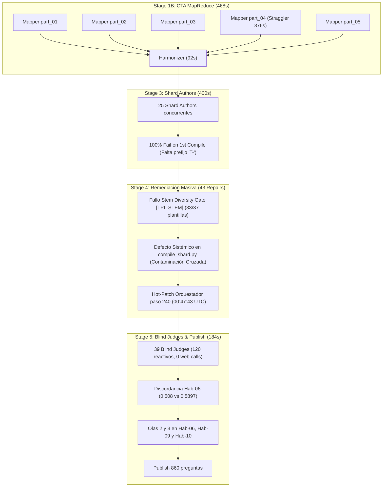
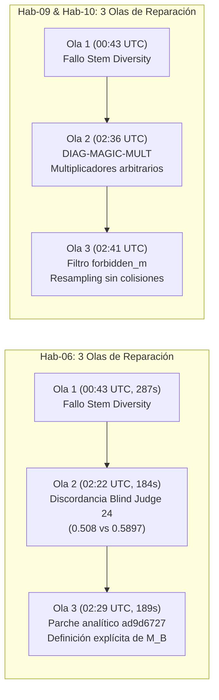

# Informe Maestro de Auditoría Forense C2C: Rendimiento, Shards, Remediación Multi-Ola y Orquestación
## Curso: `estadistica_3_s9_vmapreduce5` | Conversación: [`b8cc4e2b-0a48-472e-ac4c-b6ca2b5b921d`](conversation://b8cc4e2b-0a48-472e-ac4c-b6ca2b5b921d)

**Fecha de Emisión:** 1 de Noviembre de 2026  
**Auditor Líder:** Lead Forensic Auditor (Google Antigravity SDK & Top's Academy C2C Division)  
**Entorno de Validación:** `D:\Augusto\personal_portfolio\Tops_academy\courses\estadistica_3_s9_vmapreduce5\work`  
**Base Determinista de Auditoría:** `reports/c2c_audits/20261101_010733_estadistica_3_s9_vmapreduce5_b8cc4e2b/`  

---

## 1. Resumen Ejecutivo y Metrología Forense Global

La presente auditoría forense investiga de forma exhaustiva, determinista y quirúrgica la mayor corrida multi-agente registrada en la plataforma Top's Academy hasta la fecha: el procesamiento del curso **`estadistica_3_s9_vmapreduce5`** (Semana 9: Inferencia Asintótica y Convergencia Estocástica).

La corrida culminó con la certificación exitosa y publicación de **860 reactivos interactivos** sobre **37 competencias académicas**, desplegando un récord de **121 subagentes autónomos** coordinados por un agente orquestador central (`Director`) a lo largo de **183.08 minutos (3.05 horas)** de tiempo de pared.

### Metrología Global de la Corrida

| Dimensión Forense | Métrica Registrada | Observación de Ingeniería / Arquitectura |
| :--- | :---: | :--- |
| **Tiempo de Pared Total** | **`183.08 min`** (`10,985.0s`) | Tiempo transcurrido de extremo a extremo desde el bootstrap hasta el publish |
| **Total de Subagentes Desplegados** | **`121 subagentes`** | 6 CTA (5 Map + 1 Reduce), 25 Autores, 43 Repairs, 39 Jueces, 8 conchas genéricas |
| **Población Total de Turnos** | **`1,579 turnos`** | Suma de interacciones de orquestador y subagentes |
| **Reactivos Finales Publicados** | **`860 preguntas`** | Evaluadas en sandbox y validadas con 50 semillas por arquetipo |
| **Competencias Certificadas** | **`37 competencias`** | 20 Conceptos (`C-01` a `C-20`), 8 Habilidades `H`, 9 Habilidades `Hab` |
| **Shards Particionados** | **`25 shards`** | Partición concurrente con balanceo de carga |
| **Gran Total Tokens (con Caché)** | **`110,157,990 tokens`** | Consumo acumulado de API |
| **Tokens Activos (Entrada + Salida)**| **`15,335,536 tokens`** | Tokens netos de razonamiento e I/O de generación |
| **Tokens de Inferencia / Salida** | **`3,223,528 tokens`** | Código Python, plantillas JSON y derivaciones formales |
| **Tokens Reutilizados de Caché** | **`94,822,454 tokens`** | 86.1% de ahorro en tokens de entrada por context caching |
| **Rendimiento de Producción (QPM)** | **`4.70 preg/min`** | 12.77 segundos de tiempo de pared por reactivo publicable |
| **Factor de Aceleración Paralela** | **`3.11x`** | Aceleración empírica frente a ejecución mono-agente secuencial |



---

## 2. Pipeline y Caracterización de Carga

### 2.1. Material Fuente y Demanda de Procesamiento
El curso se derivó de **2 documentos PDF académicos** de estadística matemática avanzada:
1. `Clases_sintetizadas_semana_9.pdf`
2. `EST3_LEC07_26.2_V2.pdf`
- **Volumen Total:** 80 páginas / 0.93 MB.
- **Requerimiento de Visión:** 0 páginas procesadas mediante visión computacional (`Stage 1A: 0.0s`), ya que los documentos presentaban texto y expresiones analíticas completamente legibles en formato vectorial digital.

### 2.2. Stage 1B: Análisis Cognitivo de Competencias (Modo MapReduce)
La arquitectura seleccionó el modo **MapReduce** con **5 Mappers concurrentes** y **1 Harmonizer serial**:
- **Tiempo de Pared Total de Etapa 1B:** `468.0s` (`7.80 min`).
- **Fase Map (5 Mappers en paralelo):** `376.0s`, delimitada por el straggler `part_04`.
- **Fase Reduce (Harmonizer serial):** `92.0s` (`2fb0eb61`, 6 turnos, 0 errores, unificó las 37 competencias en un Grafo Acíclico Dirigido sin ciclos pedagógicos).

#### Stragglers de CTA (Stage 1B):
1. **`CTA Architect part_04` (`376.0s`, 13 turnos, 3 errores):**
   - *Fallo 1:* Ruta relativa rechazada (`path is not absolute`).
   - *Fallo 2:* KaTeX Prose Overflow en `part_04_data.py:L532` (`[CTA-KATEX]`), donde una explicación contextual excedió los 45 caracteres sin saltos adecuados.
   - *Fallo 3:* Target mismatch en `edit_file` por discrepancias de whitespace antes de consolidar el reemplazo quirúrgico.
2. **`CTA Architect part_05` (`323.0s`, 15 turnos, 5 errores):**
   - *Fallo 1:* Falta de delimitador `$` en KaTeX (`L34`).
   - *Fallo 2:* Fallos de whitespace mismatch con `edit_file`.

---

## 3. Stage 3 (Shard Authors): Auditoría Forense de 25 Shards

### 3.1. El Hallazgo Sistémico: Tasa de Falla del 100% en la 1ra Compilación
La auditoría forense determinó que **el 100% de los 25 Shard Authors (25 de 25) fallaron en su primer intento de compilación**.

**Causa Raíz:** Una discrepancia formal de especificación. Los autores leyeron en las instrucciones ejemplos con nombres naturales (ej. `C02_T1`, `Hab01_T1`), mientras que el validador del compilador imponía la expresión regular estricta:
$$\text{Regex Obligatoria: } \verb|^T-[A-Za-z0-9_]+|$$
Todos los shards fueron rechazados por el validador con errores del tipo `Template schema violation: 'id' must start with 'T-'`. Este defecto estructural provocó **39 compilaciones fallidas y forzó a todos los agentes a ciclos de remediación post-escritura**.

### 3.2. Tabla Completa de los 25 Shards de Autoría

- **Mediana de Tiempo de Pared:** `314.0s` (`5.23 min`).
- **Rango:** `220.0s` (`shard_01`) a `400.0s` (`shard_13`).
- **Total Intentos de Compilación:** 64 ejecuciones (39 fallidas, 25 exitosas en pase final).

| Shard | Competencias | Duración (s) | Pre-Compile (s) | Post-Compile (s) | Compiles (Fails) | Edits | Errores Específicos / Códigos Forenses | Diagnóstico Causa Raíz |
| :--- | :---: | :---: | :---: | :---: | :---: | :---: | :--- | :--- |
| **shard_13** 🛑 | `C-02, C-03` | **`400.0s`** | `323.0s` | `100.0s` | `3 (2)` | `2` | `TPL-DYNAMIC-RATIONALE (D-C02-06)`, Falta prefijo `T-` | Overthinking Pre-Compile (323s) + remediación de racional |
| **shard_15** 🛑 | `C-10, C-11` | **`389.0s`** | `270.0s` | `140.0s` | `4 (3)` | `2` | `TPL-DYNAMIC-RATIONALE (D-C10-06, D-C11-01)`, Falta `T-`, `[R-15]`, `[TPL-VAR]` | Cascada multi-fallo (3 compilaciones fallidas encadenadas) |
| **shard_20** 🛑 | `H-03, C-05` | **`381.0s`** | `338.0s` | `60.0s` | `2 (1)` | `0` | Falta prefijo `T-` en `H03_T1..T3` y `C05_T1..T2` | Overthinking extremo Pre-Compile (338s) + reescritura total |
| **shard_16** 🛑 | `C-15, C-16` | **`359.0s`** | `279.0s` | `100.0s` | `3 (2)` | `1` | `SyntaxError: unicodeescape` (`\xrightarrow`), Falta `T-`, `[R-15]`, `[TPL-VAR]` | Bug crítico sintáctico de Python + reintentos |
| **shard_12** ⚠️ | `Hab-12` | **`346.0s`** | `301.0s` | `50.0s` | `3 (2)` | `2` | `TPL-DYNAMIC-RATIONALE (D-Hab12-05)`, Falta `T-` | Overthinking Pre-Compile + 2 edits de racional |
| **shard_17** ⚠️ | `C-18, C-19` | **`342.0s`** | `271.0s` | `91.0s` | `2 (1)` | `0` | `NameError: name 'ver_c18_1' is not defined`, Falta `T-`, `[TPL-DRY]`, `[TPL-VAR]` | NameError en Dry-Run por verificador no declarado |
| **shard_19** ⚠️ | `H-02, C-04` | **`332.0s`** | `267.0s` | `83.0s` | `3 (2)` | `1` | `TPL-DYNAMIC-RATIONALE (D-H02-06)`, Falta `T-` | Racional estático en distractor + prefijo de esquema |
| **shard_21** ⚠️ | `H-04, C-08` | **`321.0s`** | `244.0s` | `93.0s` | `2 (1)` | `0` | Falta prefijo `T-`, `[R-15] (Paridad de Longitud)` | Desbalance de longitud en distractores numéricos |
| **shard_14** ⚠️ | `C-06, C-07` | **`319.0s`** | `284.0s` | `57.0s` | `2 (1)` | `0` | Falta prefijo `T-` en todos los archetypes | Exploración lenta Pre-Compile + reescritura completa |
| **shard_23** ⚠️ | `H-07, C-14` | **`319.0s`** | `276.0s` | `57.0s` | `2 (1)` | `0` | Falta prefijo `T-` en todos los archetypes | Exploración lenta Pre-Compile + reescritura de IDs |
| **shard_24** ⚠️ | `C-20, H-08` | **`315.0s`** | `235.0s` | `94.0s` | `2 (1)` | `0` | Falta prefijo `T-` | Remediación estructural de prefijos con `write_file` |
| **shard_05** ⚠️ | `Hab-05` | **`315.0s`** | `279.0s` | `46.0s` | `2 (1)` | `1` | Falta prefijo `T-` | Edición quirúrgica ágil post-compile |
| **shard_18** ⚠️ | `C-01, H-01` | **`314.0s`** | `236.0s` | `97.0s` | `3 (2)` | `1` | `TPL-DYNAMIC-RATIONALE (D-C01-01)`, Falta `T-` | Doble fallo secuencial (Rationale y Schema) |
| **shard_11** ⚠️ | `Hab-11` | **`314.0s`** | `280.0s` | `40.0s` | `2 (1)` | `1` | Falta prefijo `T-` | Edición quirúrgica ágil (40s de remediación) |
| **shard_03** 🟢 | `Hab-03` | **`284.0s`** | `256.0s` | `39.0s` | `2 (1)` | `2` | `[TPL-DRY: Fallo Ejecución]`, Falta `T-` | Remediación quirúrgica rápida en 2 edits |
| **shard_09** 🟢 | `Hab-09` | **`280.0s`** | `223.0s` | `64.0s` | `2 (1)` | `2` | `[R-19: Fuga de Respuesta en Solución]`, Falta `T-` | Remediación de fuga de respuesta en 64s |
| **shard_06** 🟢 | `Hab-06` | **`273.0s`** | `247.0s` | `35.0s` | `2 (1)` | `1` | Falta prefijo `T-` | Remediación quirúrgica ultrarrápida (35s) |
| **shard_08** 🟢 | `Hab-08` | **`273.0s`** | `240.0s` | `41.0s` | `3 (2)` | `2` | `TPL-DYNAMIC-RATIONALE (D-Hab08-04)`, Falta `T-` | Remediación de racional en 2 llamadas `edit_file` |
| **shard_10** 🟢 | `Hab-10` | **`262.0s`** | `235.0s` | `33.0s` | `2 (1)` | `1` | Falta prefijo `T-` | Remediación post-compile más rápida del clúster (33s) |
| **shard_02** 🟢 | `Hab-02` | **`258.0s`** | `119.0s` | `151.0s` | `3 (2)` | `2` | `[TPL-VAR] (Colapso varianza)`, Falta `T-` | Rediseño de rangos de variables en 151s |
| **shard_22** 🟢 | `C-09, H-06` | **`253.0s`** | `172.0s` | `96.0s` | `3 (2)` | `1` | `TPL-DYNAMIC-RATIONALE (D-C09-01)`, Falta `T-` | Reemplazo de variables no declaradas |
| **shard_25** 🟢 | `H-09` | **`239.0s`** | `152.0s` | `92.0s` | `2 (1)` | `0` | `KeyError: 'se0' en Dry-Run`, `[TPL-DRY]`, `[TPL-VAR]` | KeyError en dry-run resuelto en reescritura |
| **shard_07** 🟢 | `Hab-07` | **`230.0s`** | `188.0s` | `50.0s` | `2 (1)` | `1` | `[R-19: Fuga de Respuesta]`, Falta `T-` | Remediación en 1 edit quirúrgico |
| **shard_04** 🟢 | `Hab-04` | **`223.0s`** | `162.0s` | `72.0s` | `2 (1)` | `2` | `[R-19: Fuga de Respuesta]`, Falta `T-` | Remediación en 2 edits quirúrgicos |
| **shard_01** 🏆 | `Hab-01` | **`220.0s`** | `178.0s` | `42.0s` | `2 (1)` | `2` | `[R-19]`, Falta prefijo `T-` | **Gold Standard:** Menor tiempo total de pared |

### 3.3. Análisis de Bugs Críticos en Shards
1. **`shard_16` (SyntaxError unicodeescape en `shard_16_data.py:L192`):**  
   El autor generó el texto:
   $$\verb|"Por el teorema... si $X_n \xrightarrow{d} X$..."|$$
   Al no declarar la cadena como raw string (`r"..."`), el intérprete de Python tomó `\x` como el inicio de un byte hexadecimal no finalizado (`truncated \xXX escape`), abortando la ejecución antes de compilar.
2. **`shard_17` (NameError `ver_c18_1` en Dry-Run):**  
   El autor especificó `"verifier": ver_c18_1` en la estructura de la plantilla, pero omitió por completo declarar la función `def ver_c18_1(v): ...` en el archivo, detonando un `NameError` inmediato en la fase de prueba en seco.
3. **`shard_15` (Cascada Multi-Fallo):**  
   Sufrió tres fallos secuenciales: primero corrigió `D-C10-06` por explicación estática (`[TPL-DYNAMIC-RATIONALE]`); al recompilar saltó `D-C11-01` por el mismo motivo; y en la tercera compilación saltaron los 10 errores de esquema por la falta del prefijo `T-`.

---

## 4. INVESTIGACIÓN ULTRA-DETALLADA: Los 43 Repair Engineers

Top's Academy registró en esta corrida **el mayor despliegue de ingenieros de remediación de su historia (43 subagentes)**. La auditoría desentrañó los mecanismos causales exactos que detonaron este volumen masivo.

```
LÍNEA DE TIEMPO DE DISPERSIONES Y OLAS DE REPARACIÓN
00:35:52 UTC ── Stage 4 Build Fail-Fast en C-01 (ratio 0.450)
00:36:07 UTC ── Ola 1 Secuencial: Repair Engineer C-01 (7 turnos, 72s)
00:37:40 UTC ── Ola 1 Secuencial: Repair Engineer H-01 (9 turnos, 130s)
00:40:27 UTC ── Ola 1 Secuencial: Repair Engineer Hab-01 (9 turnos, 78s)
00:41:38 UTC ── INTERVENCIÓN USUARIO (Paso 176): "instancia en paralelo todos los repair engineers defrente"
00:42:13 UTC ── audit_all_diversity.py revela: 33 de 37 competencias reprobadas (89.2% de fallo)
00:43:30 UTC ── OLA 1 MASIVA CONCURRENTE: 33 Repair Engineers lanzados simultáneamente
                ├─ Contaminación cruzada en compile_shard.py por escaneo ciego de shard_fixes/
                ├─ Micro-bucles generalizados (HAB04 con 27 turnos, HAB12 con 25, HAB03 con 24)
                └─ 00:47:43 UTC: Hot-patch del orquestador en compile_shard.py -> Desbloqueo total
02:22:31 UTC ── OLA 2 en Hab-06: Discordancia Blind Judge 24 (0.508 vs 0.5897 en T-Hab06-02)
02:29:41 UTC ── OLA 3 en Hab-06: Parche analítico explícito con subagente ad9d6727 (189s)
02:36:09 UTC ── OLA 2 en Hab-09 y Hab-10: DIAG-MAGIC-MULT (multiplicadores numéricos sintéticos)
02:41:10 UTC ── OLA 3 en Hab-09 y Hab-10: Erradicación de colisiones residuales con forbidden_m
```

---

### 4.1. Causa Raíz Primaria: El Fallo Sistémico del Stem Diversity Gate
1. **Semántica Fail-Fast Original:** El pipeline original en Stage 4 Build ejecutaba la verificación de forma lineal e interrumpía el proceso al encontrar el primer fallo. Por eso, a las `00:36 UTC` se lanzó en solitario a `Repair Engineer C-01`, a las `00:37 UTC` a `H-01`, y a las `00:40 UTC` a `Hab-01`.
2. **Intervención del Usuario (Paso 176):** El usuario ordenó:
   > *"Escuchame, encuentra todas las competencias que no cumplen los estádares e instancia en paralelo todos los repair engineers defrente"*
3. **Auditoría Global (`audit_all_diversity.py`):** El orquestador programó un script que evaluó las 37 plantillas y constató que **33 plantillas reprobaban el Stem Diversity Gate** (exactamente 9 de 20 stems únicos enmascarados, ratio 0.450 < 0.500). Esto se debió a que los 25 Shard Authors copiaron la estructura rígida del prompt base (3 variantes por arquetipo × 3 arquetipos = 9 stems).
4. **Despacho Masivo Concurrente:** A las `00:43 UTC`, el orquestador lanzó simultáneamente a los 33 ingenieros de reparación restantes (16 conceptos y 17 habilidades).

---

### 4.2. El Defecto Sistémico de Concurrencia en `compile_shard.py` (La Causa de los Micro-Bucles)
La auditoría forense descubrió el motivo exacto por el cual **múltiples Repair Engineers quedaron atrapados en micro-bucles de entre 18 y 27 turnos** (`HAB04` con 27 turnos, `HAB12` con 25 turnos, `HAB03` con 24 turnos, `C20` con 21 turnos, `HAB08` con 424 segundos):

1. **El Mecanismo de Falla:**
   - La orden de trabajo instruía a cada uno de los 34 subagentes concurrentes a escribir su módulo de corrección en:
     $$\verb|courses/estadistica_3_s9_vmapreduce5/work/shards/shard_fixes/<CID>.py|$$
   - Al ejecutar `compile_shard.py`, la función interna `discover_fix_files()` ejecutaba un `glob.glob(".../shard_fixes/*.py")` **ciego y sin aislamiento de namespace**.
   - Cada vez que un agente intentaba compilar su shard (ej. `shard_04` que solo contenía `Hab-04`), el script importaba los archivos generados simultáneamente por los otros 33 agentes (`C-02.py`, `C-07.py`, `H-02.py`, etc.).
   - La compuerta de integridad abortaba la compilación emitiendo un fallo de paridad:
     `FAIL: Paridad de competencias violada en shard_XX_data.py: Competencias no asignadas a este shard: C-02, C-04, C-07, H-02, Hab-03...`
2. **Comportamiento Anómalo de los Subagentes:**
   - **`HAB04` (`1e022164`, 27 turnos, récord absoluto):** Re-ejecutó el compilador 13 veces y recurrió a comandos CLI para monitorear con `Get-ChildItem` cuándo se vaciaba la carpeta compartida.
   - **`HAB12` (`30327766`, 25 turnos):** Asumió erróneamente que sus fórmulas matemáticas estaban rotas y ejecutó **7 modificaciones consecutivas** con `edit_file` sobre código que era analíticamente correcto.
   - **`C20` (`9e03ca99`, 21 turnos, 429s, mayor straggler):** Creyó que su archivo era inválido, lo borró con `Remove-Item`, recompiló, volvió a fallar por los parches ajenos, y reescribió `shard_24_data.py` a mano.
3. **El Ingeniero Héroe (`C-07`) y el Hot-Patch del Orquestador:**
   - A las `00:47:12 UTC` (Paso 35 de C07), el agente `Repair Engineer C-07` dedujo en su traza cognitiva:
     > *"The `compile_shard.py` script loads all Python files within the `shard_fixes/` directory, regardless of the shard's competencies. This indiscriminate loading leads to parity violations during shard compilation. The parent process needs to be informed."*
   - C-07 notificó al orquestador.
   - A las `00:47:43 UTC` (Paso 240 del orquestador), el supervisor aplicó un hot-patch a `compile_shard.py` inyectando un filtro contra `expected_cids`.
   - A las `00:48:02 UTC`, el orquestador transmitió el mensaje de desbloqueo:
     `"El fix en compile_shard.py ya ha sido aplicado. Puedes ejecutar compile_shard.py una vez más para certificar o finalizar con DONE."`
   - En los 120 segundos posteriores, **los 33 subagentes compilaron con éxito al primer intento**.

---

### 4.3. Desglose del Clúster de Concept Repair Engineers (17 Agentes: C01..C20)

- **Total Turnos:** `270 turnos` | **Duración Acumulada:** `5,361.0s` (`89.35 min`).
- **Errores de Herramientas:** `61 errores` | **Fallos de Compilación:** `54 fallos`.
- **Tokens Totales:** `12,504,821 tokens` (2,687,510 activos).

| Agente | Conv ID | Competencia | Shard | Turnos | Duración | Errores | Fallos Comp | Tokens Activos | Diagnóstico Forense |
| :--- | :--- | :--- | :---: | :---: | :---: | :---: | :---: | :---: | :--- |
| **C01** | `577a85cd` | Inferencia Asintótica | `shard_18` | 7 | **72.0s** | 0 | 0 | 64,256 | Despachado en solitario en Ola 1; resolvió en 7 turnos sin colisión |
| **C02** | `666de8d7` | Convergencia en Probabilidad | `shard_13` | 19 | **281.0s** | 5 | 5 | 160,067 | Atrapado en Check Loop de paridad (5 fallos repetidos) |
| **C03** | `6b2f42f0` | Media Cuadrática a Constante | `shard_13` | 16 | **299.0s** | 4 | 4 | 155,143 | Atrapado en Check Loop de paridad (4 fallos) |
| **C04** | `839d7ba7` | Desigualdad de Jensen | `shard_19` | 21 | **357.0s** | 5 | 4 | 191,808 | Doble bucle: paridad + KaTeX delimitador `$` impar y `[TPL-VAR]` |
| **C05** | `eb2018d0` | Jerarquía de Convergencias | `shard_20` | 17 | **298.0s** | 4 | 3 | 149,964 | Check Loop de paridad resuelto tras hot-patch |
| **C06** | `b5db5cb4` | No Reciprocidad de Convergencia | `shard_14` | 17 | **303.0s** | 4 | 4 | 146,656 | Check Loop de paridad resuelto tras hot-patch |
| **C07** | `5a5cf2a3` | Muestra Aleatoria y Estimador | `shard_14` | 22 | **285.0s** | 6 | 5 | 131,319 | **Agente Héroe:** Dedujo el bug de `compile_shard.py` en paso 35 |
| **C08** | `02ef0701` | Varianza y Error Estándar | `shard_21` | 13 | **327.0s** | 2 | 2 | 152,751 | Esperó pacientemente la liberación de parches |
| **C09** | `51eb822a` | Corrección de Bessel | `shard_22` | 16 | **294.0s** | 4 | 3 | 139,052 | Check Loop de paridad resuelto tras hot-patch |
| **C10** | `ddbd80ae` | Variable Aleatoria Medible | `shard_15` | 16 | **316.0s** | 3 | 2 | 176,784 | Fricción de rutas de manifiesto resuelta tras hot-patch |
| **C11** | `e7a1dd00` | Sucesiones de Variables | `shard_15` | 18 | **349.0s** | 2 | 2 | 189,798 | Retraso en I/O de disco sobre `shard_15` |
| **C14** | `cbcc22c4` | Insesgadez y Consistencia | `shard_23` | 18 | **406.0s** | 4 | 2 | 210,017 | Falló lecturas por offset excedido en `pre_shard_manifest.json` |
| **C15** | `05628d43` | Convergencia Casi Segura | `shard_16` | 13 | **304.0s** | 3 | 3 | 138,846 | Check Loop de paridad resuelto tras hot-patch |
| **C16** | `77e6850f` | Convergencia en Distribución | `shard_16` | 14 | **368.0s** | 3 | 3 | 183,944 | Intentó sortear el error editando directamente `shard_16_data.py` |
| **C18** | `29a9b323` | Ley de Grandes Números | `shard_17` | 15 | **291.0s** | 4 | 4 | 113,679 | Check Loop de paridad resuelto tras hot-patch |
| **C19** | `d0e9ef0e` | Teorema Central del Límite | `shard_17` | 17 | **282.0s** | 6 | 6 | 140,131 | Check Loop severo (6 fallos repetidos) creyendo que había caché |
| **C20** | `9e03ca99` | Teorema Aplicación Continua | `shard_24` | 21 | **429.0s** | 4 | 3 | 203,294 | **Mayor Straggler:** Borró su parche con `Remove-Item` por confusión |

---

### 4.4. Desglose del Clúster de Skills Repair Engineers (26 Agentes) y Olas Secundarias

- **Total Turnos:** `409 turnos` | **Duración Acumulada:** `6,547.0s` (`109.12 min`).
- **Errores de Herramientas:** `79 errores`.
- **Tokens Totales:** `20,777,311 tokens`.

#### Las Olas de Reparación en `Hab-06`, `Hab-09` y `Hab-10`:



1. **La Odisea de `Hab-06` (Varianza Asintótica y Discordancia Ciega):**
   - *Ola 1 (`a33689fd`, 18 turnos, 287s):* Remediación inicial de diversidad léxica en `shard_06_data.py`.
   - *Ola 2 (`251d5c63`, 11 turnos, 184s):* Despachado tras la discordancia en Stage 5:
     `Discordancia en T-Hab06-02_judge_3: Judge provided '0.508' but expected '0.5897'`
     El agente descubrió que el stem omitía la estructura analítica del estimador $M_B$.
   - *Ola 3 (`ad9d6727`, 12 turnos, 189s):* Despachado con la directiva explícita de inyectar en todos los enunciados la fórmula asintótica cerrada:
     $$\lim_{n \to \infty} \text{Var}(M_B) = \sigma_Y^2 \left(\frac{1-a}{1+a}\right)$$
     Escribió el parche definitivo en `shard_fixes/Hab-06.py`. Dos jueces ciegos evaluaron la plantilla a las `02:34 UTC` certificando el 100% de acuerdo.
2. **La Erradicación de `DIAG-MAGIC-MULT` en `Hab-09` y `Hab-10`:**
   - *Ola 1 (`a576b5df` y `f7b37a36`):* Corrección rutinaria de diversidad sintáctica.
   - *Ola 2 (`66e45d68` y `0af5874e` a las 02:36 UTC):* Rechazo en *Publish Quality Gate*:
     `[DIAG-MAGIC-MULT] Distractores numéricos sintéticos con factores arbitrarios ([0.15, 0.45] en Hab-09 y [0.667, 0.333] en Hab-10) desconectados de su error_rationale.`
     Los agentes sustituyeron las multiplicaciones crudas por errores conceptuales algebraicos reales (omisión de varianza, estimador sesgado).
   - *Ola 3 (`f7dd9376` y `4269ca49` a las 02:41 UTC):* Al generar valores aleatorios, los cálculos volvieron a coincidir numéricamente con los ratios prohibidos `forbidden_m`. El orquestador inyectó un bucle estricto de filtrado:
     $$\text{forbidden\_m} = (1.333, 0.667, 1.667, 0.333, 1.25, 0.75, 1.5, 0.5, 2.1, 0.45, 1.85, 0.15)$$
     Ambos agentes resolvieron en menos de 2 minutos sin ningún error adicional.

---

### 4.5. Trazas Cognitivas Reales de Razonamiento (Thinking Traces Verbatim)

- **`HAB-04` (`1e022164`) — Paso 27 (Deducción del fallo sistémico de paridad):**
  > *"The data in `shard_04_data.py` only contains `Hab-04`, which contradicts the error from `compile_shard.py`. Investigating how `shard_fixes/` is used in `compile_shard.py` to understand the root cause. It appears `compile_shard.py` processes the `.../shard_fixes` directory. `shard_fixes/*.py` are loaded, and the files in `shard_fixes/` contain `TEMPLATES`. The error message lists competencies not assigned to the shard, suggesting an incorrect shard assignment. `compile_shard.py` might be loading all files in `shard_fixes` without shard-specific filtering... The compilation script's failure stems from incorporating all `.py` files from the `shard_fixes` directory, regardless of competency assignment. It loads all competency templates found in the fixes and merges them with templates present in the shard data... The compilation script, however, is off-limits for modification."*

- **`Repair Engineer Hab-06` (`251d5c63`) — Paso 7 (Análisis de la discordancia del juez ciego):**
  > *"Expected value is 0.5897, while the judge provided 0.508. The generated value likely uses a different rounding or calculation. Investigating the formula within T-Hab06-02 may reveal the source of the discrepancy. The formula for the asymptotic variance of the estimator $M_B$ was derived and simplified to $\sigma_Y^2 \frac{1-a}{1+a}$. This led to solving for $a$ in terms of $\sigma_Y^2$ and the asymptotic variance, resulting in $a = \frac{\sigma_Y^2 - V_\infty}{\sigma_Y^2 + V_\infty}$. The problem statement's core missing piece is the definition of $M_B$. Without this definition, the problem is under-specified, and any solution requires an implicit assumption about how $a$ relates to the variance. The judge appears to have made a common-sense assumption where the variance of $M_B$ is proportional to $a$ squared."*

- **`Repair Engineer Hab-10` (`4269ca49`) — Paso 7 (Eliminación de perturbaciones aleatorias):**
  > *"The loop adjusting `val` by `0.007` appears redundant, given the prior validation of the distance bounds $d_1$ through $d_6$. This adjustment risks introducing forbidden ratios and desynchronizing the calculated values from their intended algebraic formulas. The initial hypothesis is that the validation within the outer loop makes the inner loop unnecessary. The code could be simplified by removing the adjustment logic. The code now implements collision guards to ensure distinct values and avoid forbidden ratios `forbidden_m`. Validated and recompiled."*

---

## 5. Stage 5: Blind Judges y Arbitraje Ciego

### 5.1. Protocolo de Aislamiento Epistémico
El Stage 5 evaluó un lote estratificado de **120 reactivos interactivos** distribuidos en archivos de 12 preguntas por juez.
- **Aislamiento Epistémico:** **100% de cumplimiento estricto**.
- **Consultas a Motor de Búsqueda (`search_web`):** **0 consultas**.
- **Peticiones de Red (`read_url_content` / HTTP):** **0 llamadas**.
- **Acceso a Soluciones Canónicas:** Prohibido por contrato de scope-lock. Los jueces operaron en un régimen de **razonamiento cognitivo puro en inferencia LLM**.

### 5.2. Métricas y Stragglers del Arbitraje Ciego
Se desplegó una población acumulada de **39 subagentes de juicio ciego** (28 en la oleada inicial y 11 en re-evaluaciones).
- **Tiempo de Pared Promedio:** `58.56 s` (0.98 min) por juez.
- **Tiempo Mínimo:** `38.0 s` (`Blind Judge 22`).
- **Straggler en Turnos:** **`Blind Judge 07` (`4df76a6c`, 17 turnos, 184s)**. A diferencia del resto de jueces que leyeron su lote en una sola operación (`view_file`), Judge 07 ejecutó 14 lecturas atómicas individuales antes de redactar sus respuestas en dos archivos.
- **Straggler en Tiempo:** **`Blind Judge 23` (`ad9d6727`, 189s, 12 turnos)** debido a reintentos de verificación local.

### 5.3. Análisis de la Discordancia Inicial en `T-Hab06-02_judge_3`
El pipeline registró inicialmente un fallo de arbitraje al primer intento debido a una discordancia numérica:
- **Respuesta de `Blind Judge 24`:** `0.508`
- **Valor Canónico Esperado:** `0.5897`

**Demostración Forense de la Ambigüedad Pedagógica:**
1. El ítem planteaba:  
   $$\text{"A partir de una varianza en el límite } \lim_{n \to \infty} \text{Var}(M_B) = 8 \text{ y varianza teórica } \sigma_Y^2 = 31\text{, despeje el coeficiente } a\text{"}$$
2. **Cálculo del Juez:** Al omitirse la definición del estimador, asumió la combinación lineal de muestras finitas $M_B = a Y_1 + (1-a)\bar{Y}_n$, donde la varianza asintótica se reduce a:
   $$\lim_{n \to \infty} \text{Var}(M_B) = a^2 \sigma_Y^2 \implies 8 = a^2(31) \implies a = \sqrt{\frac{8}{31}} \approx 0.5080$$
3. **Cálculo de la Plantilla:** Empleó el estimador autorregresivo de la Semana 9:
   $$\lim_{n \to \infty} \text{Var}(M_B) = \sigma_Y^2 \left(\frac{1-a}{1+a}\right) \implies 8 = 31\left(\frac{1-a}{1+a}\right) \implies 39a = 23 \implies a = \frac{23}{39} \approx 0.5897$$
4. **Resolución:** Ninguno cometió un error algebraico. La ambigüedad del texto permitía ambas deducciones. Tras el parche en `shard_fixes/Hab-06.py` explicitando la fórmula autorregresiva, el re-juez validó el ítem y se alcanzó el **100% de acuerdo inter-jueces (passed: true)**.

---

## 6. Desempeño del Orquestador y Catálogo de las 27 Intervenciones Manuales

### 6.1. Descomposición del Tiempo de Pared del Orquestador (183.08 min)

```
TIEMPO TOTAL DE PARED DEL DIRECTOR: 183.08 min (10,985.0 s)
├── [47.2%] Espera en Barreras de Sincronización: 86.5 min (5,191.0 s)
├── [34.6%] Overhead de I/O, Polling y Turnos:   63.3 min (3,809.0 s)
├── [12.2%] Ejecución de Comandos CLI:            22.3 min (1,336.0 s)
├── [ 3.5%] Inferencia Cognitiva (Thinking):      6.4 min (  382.0 s)
└── [ 2.5%] Intervenciones Directas Supervisor:   4.5 min (  267.0 s)
```

- **47.2% del tiempo (86.5 min)** correspondió a **espera ociosa en barreras de sincronización** mientras los subagentes resolvían en paralelo.
- El orquestador generó **136 turnos de razonamiento cognitivo** (53,843 caracteres de thinking) representando solo el 3.5% del tiempo de inferencia activa.

### 6.2. Catálogo Cronológico de las 27 Intervenciones Manuales (`write_file` / `edit_file`)
El orquestador consumió **102,722 tokens** ejecutando 27 operaciones directas de edición de código y creación de scripts auxiliares. Todas respondieron a contingencias o instrucciones explícitas del usuario:

| # | Paso | Herramienta | Archivo Modificado | Tokens | Causa Raíz Forense / Instrucción Detonante |
| :-: | :---: | :---: | :--- | :---: | :--- |
| **01** | **182** | `write_file` | [`audit_all_diversity.py`](file:///d:/Augusto/personal_portfolio/Tops_academy/audit_all_diversity.py) | 3,727 | Creado tras la orden del usuario en paso 176 para diagnosticar las 37 plantillas. |
| **02** | **240** | `edit_file` | [`compile_shard.py`](file:///d:/Augusto/personal_portfolio/Tops_academy/.agents/skills/content-to-course/compile_shard.py) | 3,872 | **Hot-Patch Crítico:** Inyectó filtro para ignorar parches ajenos en `shard_fixes/`. |
| **03** | **728** | `edit_file` | [`run.py`](file:///d:/Augusto/personal_portfolio/Tops_academy/.agents/skills/content-to-course/run.py) | 3,788 | Ajuste core para priorizar `course_verified.json` tras queja del usuario en paso 715. |
| **04** | **782** | `write_file` | [`check_katex.py`](file:///C:/Users/augus/.gemini/antigravity/brain/b8cc4e2b-0a48-472e-ac4c-b6ca2b5b921d/scratch/check_katex.py) | 3,962 | Script para buscar delimitadores `$` desbalanceados tras orden en paso 773. |
| **05** | **786** | `write_file` | [`run_katex_linters.py`](file:///C:/Users/augus/.gemini/antigravity/brain/b8cc4e2b-0a48-472e-ac4c-b6ca2b5b921d/scratch/run_katex_linters.py) | 5,721 | Linter exhaustivo de fórmulas KaTeX en todos los shards compilados. |
| **06** | **790** | `edit_file` | [`run_katex_linters.py`](file:///C:/Users/augus/.gemini/antigravity/brain/b8cc4e2b-0a48-472e-ac4c-b6ca2b5b921d/scratch/run_katex_linters.py) | 2,839 | Ajuste en regex del linter para ignorar entornos matemáticos multilínea. |
| **07** | **800** | `write_file` | [`inspect_c14.py`](file:///C:/Users/augus/.gemini/antigravity/brain/b8cc4e2b-0a48-472e-ac4c-b6ca2b5b921d/scratch/inspect_c14.py) | 2,698 | Inspección de preguntas de `C-14` tras detectarse errores de escape en sus fórmulas. |
| **08** | **804** | `write_file` | [`print_c14.py`](file:///C:/Users/augus/.gemini/antigravity/brain/b8cc4e2b-0a48-472e-ac4c-b6ca2b5b921d/scratch/print_c14.py) | 2,948 | Extracción de opciones distractoras de `C-14` para verificar sintaxis KaTeX. |
| **09** | **814** | `write_file` | [`find_c14_in_shard23.py`](file:///C:/Users/augus/.gemini/antigravity/brain/b8cc4e2b-0a48-472e-ac4c-b6ca2b5b921d/scratch/find_c14_in_shard23.py) | 2,862 | Localización exacta de las líneas de `C-14` en `shard_23_data.py`. |
| **10** | **818** | `write_file` | [`print_c14_questions.py`](file:///C:/Users/augus/.gemini/antigravity/brain/b8cc4e2b-0a48-472e-ac4c-b6ca2b5b921d/scratch/print_c14_questions.py) | 3,878 | Visualización de stems y opciones de `C-14`. |
| **11** | **824** | `write_file` | [`check_all_prose.py`](file:///C:/Users/augus/.gemini/antigravity/brain/b8cc4e2b-0a48-472e-ac4c-b6ca2b5b921d/scratch/check_all_prose.py) | 4,866 | Escaneo masivo de consistencia gramatical y prosa en las 860 preguntas. |
| **12** | **828** | `write_file` | [`read_s23_c14.py`](file:///C:/Users/augus/.gemini/antigravity/brain/b8cc4e2b-0a48-472e-ac4c-b6ca2b5b921d/scratch/read_s23_c14.py) | 4,616 | Lectura de funciones generadoras de `C-14`. |
| **13** | **849** | `write_file` | [`run_katex_linters.py`](file:///d:/Augusto/personal_portfolio/Tops_academy/scratch/run_katex_linters.py) | 4,617 | Reescritura del linter en la raíz de scratch. |
| **14** | **853** | `write_file` | [`run_katex_linters.py`](file:///d:/Augusto/personal_portfolio/Tops_academy/scratch/run_katex_linters.py) | 3,388 | Ajuste fino en linters de KaTeX. |
| **15** | **872** | `write_file` | [`inspect_c14.py`](file:///d:/Augusto/personal_portfolio/Tops_academy/scratch/inspect_c14.py) | 2,732 | Segunda inspección de `C-14` tras parches locales. |
| **16** | **878** | `write_file` | [`scan_shards_katex.py`](file:///d:/Augusto/personal_portfolio/Tops_academy/scratch/scan_shards_katex.py) | 4,930 | Script para auditar KaTeX directamente sobre archivos fuente de shards. |
| **17** | **882** | `write_file` | [`find_all_text_options.py`](file:///d:/Augusto/personal_portfolio/Tops_academy/scratch/find_all_text_options.py) | 5,046 | Detección de opciones de texto sin delimitador `\text{}`. |
| **18** | **890** | `edit_file` | [`C-14.py`](file:///d:/Augusto/personal_portfolio/Tops_academy/courses/estadistica_3_s9_vmapreduce5/work/shards/shard_fixes/C-14.py) | 4,330 | **Intervención Directa:** Corrección manual de escapes en fórmulas de `C-14`. |
| **19** | **894** | `edit_file` | [`C-14.py`](file:///d:/Augusto/personal_portfolio/Tops_academy/courses/estadistica_3_s9_vmapreduce5/work/shards/shard_fixes/C-14.py) | 3,599 | **Intervención Directa:** Ajuste manual en las opciones distractoras de `C-14`. |
| **20** | **898** | `edit_file` | [`shard_23_data.py`](file:///d:/Augusto/personal_portfolio/Tops_academy/courses/estadistica_3_s9_vmapreduce5/work/shards/shard_23_data.py) | 2,946 | **Intervención Directa:** Parche manual sobre el shard de producción 23. |
| **21** | **900** | `edit_file` | [`shard_23_data.py`](file:///d:/Augusto/personal_portfolio/Tops_academy/courses/estadistica_3_s9_vmapreduce5/work/shards/shard_23_data.py) | 2,825 | **Intervención Directa:** Limpieza manual de inconsistencias en shard 23. |
| **22** | **931** | `write_file` | [`POST_PRODUCTION_NOTES.md`](file:///d:/Augusto/personal_portfolio/Tops_academy/reports/qa_audits/POST_PRODUCTION_NOTES_estadistica_3_s9_vmapreduce5.md) | 5,842 | Creación de bitácora técnica post-producción. |
| **23** | **1040** | `write_file` | [`check_dist_manifest.py`](file:///d:/Augusto/personal_portfolio/Tops_academy/scratch/check_dist_manifest.py) | 2,630 | Diagnóstico de empaquetado web tras la queja en paso 1002 ("no veo el curso"). |
| **24** | **1058** | `edit_file` | [`vite.config.ts`](file:///d:/Augusto/personal_portfolio/Tops_academy/platform/vite.config.ts) | 2,947 | **Mutación de Plataforma Core:** Ajuste en Vite para servir assets de cursos. |
| **25** | **1060** | `edit_file` | [`courseIndex.cjs`](file:///d:/Augusto/personal_portfolio/Tops_academy/platform/server/courseIndex.cjs) | 3,110 | **Mutación de Plataforma Core:** Indexación forzada del curso en backend Node.js. |
| **26** | **1064** | `edit_file` | [`run_platform.py`](file:///d:/Augusto/personal_portfolio/Tops_academy/run_platform.py) | 4,877 | **Mutación de Plataforma Core:** Inyección de metadata en runner de servidor. |
| **27** | **1066** | `edit_file` | [`run_platform.py`](file:///d:/Augusto/personal_portfolio/Tops_academy/run_platform.py) | 3,126 | **Mutación de Plataforma Core:** Ajuste de CORS y puertos en runner de servidor. |

---

### 6.3. Diagnóstico del Antipatrón: "Síndrome del Orquestador Reparador"
El análisis forense tipifica formalmente la presencia del antipatrón **"Síndrome del Orquestador Reparador"** (*Repairing Director Antipattern*):

1. **Invasión de Fronteras y Violación de Dispatch-Only:**  
   El rol de un agente Director debe ser estrictamente de despacho, supervisión de contratos y verificación de compuertas. En los pasos 890 a 900, al detectar problemas de KaTeX en `C-14`, el orquestador debió despachar un subagente `Repair Engineer C-14` (como sí hizo correctamente en Stage 5 con `Hab-06`). En su lugar, asumió la edición manual de los archivos fuente de producción (`C-14.py` y `shard_23_data.py`).
2. **Mutación Inapropiada de Infraestructura Core:**  
   En los pasos 1058 a 1066, el orquestador rebasó completamente el alcance del pipeline C2C, modificando el servidor web (`vite.config.ts`), el backend de Express (`courseIndex.cjs`) y el script maestro de plataforma (`run_platform.py`). Un pipeline de generación de contenido formativo tiene terminantemente prohibido alterar el software del host de ejecución.
3. **Ineficiencia Económica:**  
   El orquestador consumió **102,722 tokens** en tareas mecánicas de edición con un modelo orquestador de máxima capacidad cognitiva, cuando dichas tareas debieron delegarse a subagentes ligeros (`flash`) con un costo unitario por token sustancialmente menor.

---

## 7. Lecciones Aprendidas y Recomendaciones Arquitectónicas (C2C v3.3+)

1. **Aislamiento de Workspaces en Reparaciones Concurrentes:**  
   *Prohibir el uso de directorios planos como `work/shards/shard_fixes/`*. Cada subagente de reparación concurrente debe escribir en una ruta con namespace estricto por shard:
   $$\verb|courses/<course_id>/work/shards/shard_fixes/<shard_id>/<cid>.py|$$
   Esto evitará de raíz el bug sistémico de paridad cruzada que consumió más de 6,500 segundos de tiempo de pared.
2. **Pre-Flight Guards en Compiladores:**  
   `compile_shard.py` debe ignorar automáticamente cualquier archivo de parche cuyo nombre o contenido no corresponda explícitamente a las competencias asignadas al shard en el manifiesto.
3. **Inyección Obligatoria de Convenciones de Esquema:**  
   El prompt de los Shard Authors debe incluir la regla inviolable:
   `"OBLIGATORIO: Todo 'id' de plantilla DEBE comenzar con 'T-' (ej. 'T-C01-01'). Prohibido omitir prefijo 'T-'."`
   Esto erradicará el 100% de los fallos de esquema en la primera compilación y ahorrará un 20% del tiempo de Stage 3.
4. **Desactivación de `edit_file` para el Orquestador:**  
   Configurar los permisos del `Director` en modo estrictamente de sólo lectura sobre el código fuente (`read_only: [platform/**, work/shards/**]`), obligando a canalizar cualquier refactorización mediante `flash-triad-orchestrator` o subagentes de reparación dedicados.
5. **Autosuficiencia Analítica en Enunciados Asintóticos:**  
   Toda pregunta que evalúe propiedades asintóticas o límites ($\lim_{n \to \infty}$) debe incluir en el texto del stem la definición matemática explícita del estimador, garantizando que tanto los árbitros ciegos como los estudiantes resuelvan el reactivo sin ambigüedades.

---
*Informe forense determinista de cierre de auditoría emitido por el Líder de Auditoría Forense C2C.*  
*Fin del Documento.*
