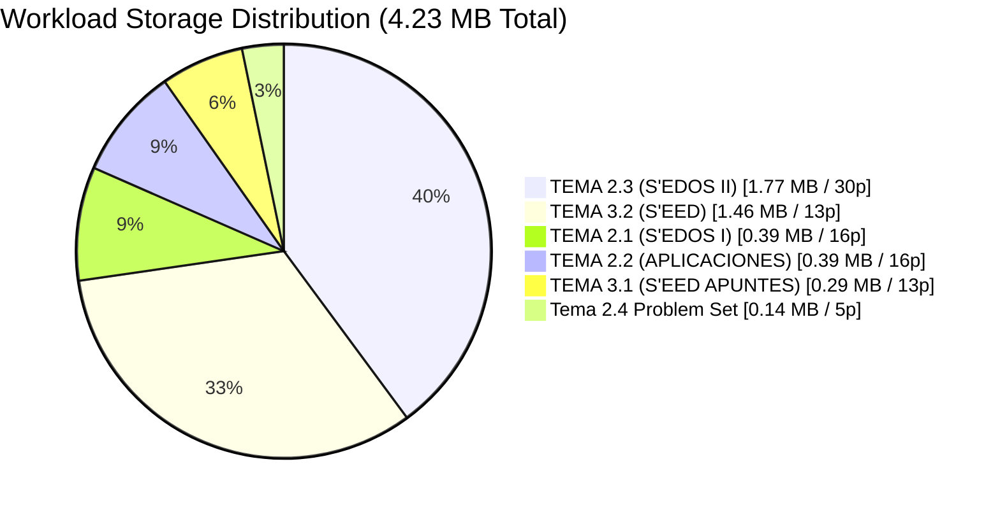
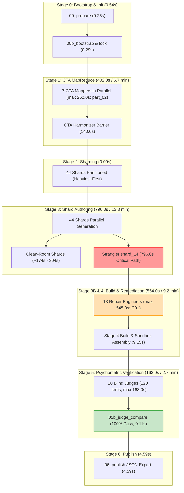
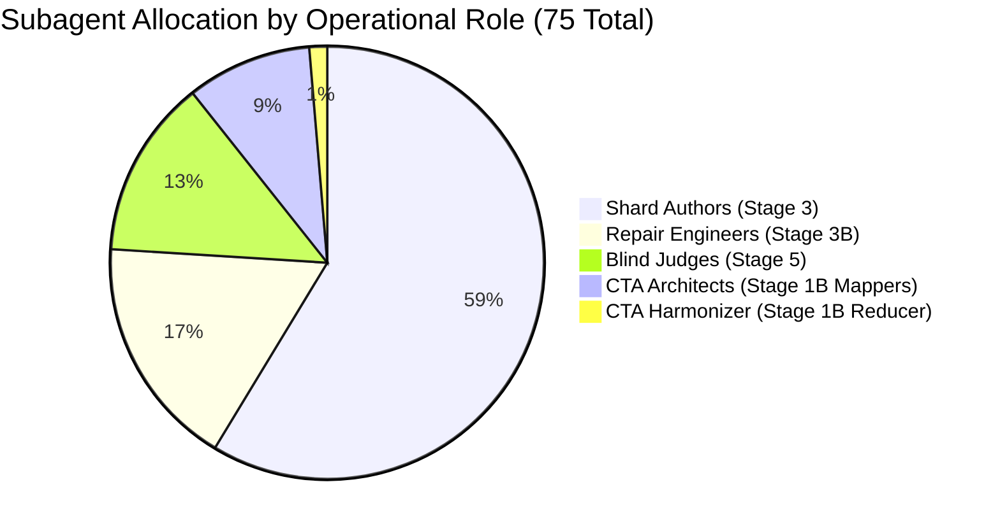
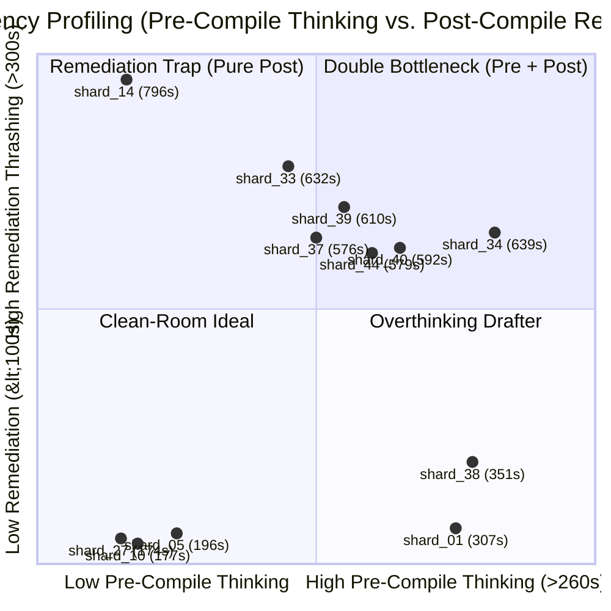
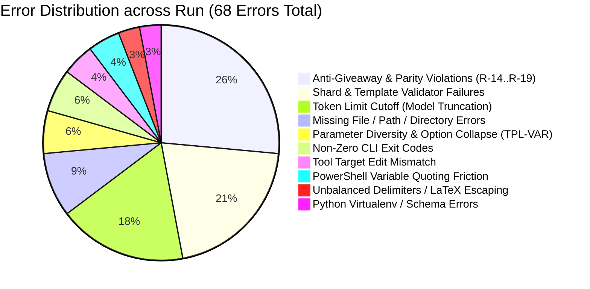

# Forensic Lead Audit: Content-to-Course (C2C v3.3) Pipeline Execution
## Course: Saul Pc Sistemas De Ecuaciones Vmapreduce5 (`saul_pc_sistemas_de_ecuaciones_vmapreduce5`)

**Audit Date:** `2026-11-09 04:15:00 UTC`  
**Orchestrator Conversation ID:** [`66915882-b7f8-441f-9fc7-d4a964050a42`](conversation://66915882-b7f8-441f-9fc7-d4a964050a42)  
**Execution Run Directory:** [`reports/c2c_audits/20261108_231222_saul_pc_sistemas_de_ecuaciones_vmapreduce5_66915882`](file:///d:/Augusto/personal_portfolio/Tops_academy/reports/c2c_audits/20261108_231222_saul_pc_sistemas_de_ecuaciones_vmapreduce5_66915882)  
**Target Course Output:** [`courses/saul_pc_sistemas_de_ecuaciones_vmapreduce5.json`](file:///d:/Augusto/personal_portfolio/Tops_academy/courses/saul_pc_sistemas_de_ecuaciones_vmapreduce5.json)  
**Lead Auditor:** Forensic Lead Auditor (Google Antigravity SDK & C2C Framework)

---

## 1. Executive Summary & Metrological Dashboard

The C2C execution run for course `saul_pc_sistemas_de_ecuaciones_vmapreduce5` completed end-to-end question generation, psychometric verification, and publishing across **9 stages** (from `00_prepare` through `06_publish`), generating **1,490 valid questions** across **61 competencies** (27 skills, 26 concepts, 8 facts) sourced from **6 academic PDF files** (93 pages, 4.23 MB).

The run completed in **67.63 minutes** (4,058.0 s) of wall-clock time, leveraging **25,174.0 seconds** (419.57 minutes) of aggregate agent compute across **75 subagents**. This achieved a concurrency speedup factor of **6.2x**. The pipeline demonstrated extraordinary prompt cache efficiency, reading **71,347,514 tokens from cache** (85.0% of the 83.9M total token footprint), reducing active billable API tokens to **12,558,734**.

However, forensic inspection reveals two major structural anomalies:
1. **Critical Straggler in Authoring:** Shard Author `shard_14` consumed **796.0s** (13.27 min), imposing a **+492.0s barrier delay** over the shard median (304.0s). Crucially, this was a **Post-Compile Remediation Straggler** (spending 638.0s across 6 compile runs, 5 compile failures, and 10 iterative code edits), rather than a slow initial drafter.
2. **Supervisor Repair Syndrome (8 Manual Interventions):** The director orchestrator stepped out of pure dispatch-and-monitor status, executing 8 manual code edits (5 in `run.py` to fix batch timeout/retry logic and 3 in `judge.py` to resolve path handling for `verification/judge_responses_*.json`), incurring tool friction and consuming 32,505 orchestrator tokens.

### Key Performance Indicators (KPIs)

| Metric | Measured Value | Benchmark / Target | Forensic Assessment |
| :--- | :---: | :---: | :--- |
| **Zero-Collision Gate** | `PASSED` (`match=True`) | `True` | Strict workspace path binding confirmed (`courses/.../work`) |
| **Total Questions Generated** | **1,490 questions** | $\ge 1,200$ | Exceeded quota targets across all 61 competencies |
| **Wall-Clock Duration** | **67.63 min** (4,058.0 s) | $< 90$ min | Well within operational SLA despite authoring stragglers |
| **Agent Compute Duration** | **419.57 min** (25,174.0 s) | — | Massive parallel delegation across 75 workers |
| **Parallel Concurrency Speedup** | **6.2x** | $> 5.0$x | Strong parallel utilization across 44 concurrent shards |
| **Total Token Volume** | **83,906,248 tokens** | — | Cumulative context and generation footprint |
| **Active Billable Tokens** | **12,558,734 tokens** | $< 18$M | Optimized context payload (Input: 9.28M, Output: 3.27M) |
| **Cache Hit Efficiency** | **85.0%** (71.35M tokens) | $> 75$% | High reuse of shared prompt templates and syllabus |
| **Cost / Question (Total Tokens)**| **56,312.9 tokens/item** | $< 70,000$ | Economically viable for high-density parametric content |
| **Cost / Question (Active Tokens)**| **8,428.7 tokens/item** | $< 10,000$ | Highly competitive cognitive compute per item |
| **Wall-Clock Latency / Question**| **2.72 s/question** | $< 4.0$ s | Rapid amortized generation rate |
| **Pipeline Throughput (QPM)** | **22.03 questions/min** | $> 15.0$ QPM | High production velocity |
| **Blind Judges Agreement** | **100.0%** (120/120 items) | $\ge 95.0$% | Flawless first-pass psychometric agreement (0 disputes) |
| **Clean-Room Benchmark Shard** | `shard_27` (174.0s) | $< 240$s | 1 compile, 0 retries, 0 edits, 5 turns |
| **Worst Straggler Shard** | `shard_14` (796.0s) | $< 400$s | $+357\%$ latency inflation over Clean-Room benchmark |

---

## 2. Workload Profiling & Curriculum Ingestion

The workload consisted of advanced university-level mathematics and economics courseware: Systems of Ordinary Differential Equations (S'EDOS) and Systems of Difference Equations (S'EED), featuring theoretical derivations, phase plane analysis, stability criteria, and macroeconomic equilibrium dynamics.

### 2.1. Ingestion File Manifest



| Source Document | Size (Bytes) | Size (MB) | Page Count | Content Classification |
| :--- | :---: | :---: | :---: | :--- |
| `TEMA 2.1 (S'EDOS I ).pdf` | 394,803 | 0.38 MB | 16 | Homogeneous linear systems, eigenvalues/eigenvectors |
| `TEMA 2.2 (APLICACIONES ECONOMICAS).pdf`| 386,671 | 0.37 MB | 16 | Dynamic macro models (IS-LM, inflation-unemployment) |
| `TEMA 2.3 (S'EDOS II).pdf` | 1,767,818 | 1.69 MB | 30 | Qualitative phase portraits, stability, linearization |
| `Tema 2.4 MATH_IV_Problem_Set_III_2026_II.pdf` | 144,339 | 0.14 MB | 5 | Practical problem sets & boundary value problems |
| `TEMA 3.1 APUNTES GRABACION TEMA 3 (S'EED).pdf` | 287,106 | 0.27 MB | 13 | Discrete systems, lag operators, difference matrices |
| `TEMA 3.2 (S'EED).pdf` | 1,456,085 | 1.39 MB | 13 | Higher-order difference models, Cobweb dynamics |
| **Total Workload** | **4,436,822** | **4.23 MB** | **93 pages** | **Pure Digital PDF (0 raster vision scans needed)** |

### 2.2. Multimodal Vision Assessment
- **Vision Subagents Deployed:** `0`
- **Pages Needing OCR / Vision Scanning:** `0`
- **Assessment:** The orchestrator correctly determined that all 6 source documents contained clean vector fonts and extractable digital text. Disabling Stage 1A vision processing avoided unnecessary image rendering latency, saving approximately 12–18 minutes of wall-clock time and ~4M multimodal tokens.

### 2.3. Curriculum Density & MapReduce CTA Mode
Due to the substantive curriculum scope (93 pages covering dense mathematical formulations), the orchestrator deployed **MapReduce CTA mode** instead of direct monolithic extraction:
- **7 CTA Mapper Architects (`part_01` through `part_07`):** Processed document slices independently.
- **1 CTA Harmonizer:** Unified candidate competencies, eliminated redundant definitions, aligned prerequisite DAG dependencies, and canonicalized nomenclature.
- **Extracted Competencies:** **61 total competencies**
  - **Skills (`Hab-01` to `Hab-27`):** 27 procedural competencies (e.g., matrix diagonalization, solving non-homogeneous systems, calculating steady-state equilibria).
  - **Concepts (`C-01` to `C-26`):** 26 conceptual competencies (e.g., Jordan normal forms, saddle point stability, trace-determinant planes).
  - **Facts (`H-01` to `H-08`):** 8 foundational factual competencies (e.g., definitions of fundamental matrices, stability theorems).

---

## 3. Concurrency, Latency & Critical Path Analysis

### 3.1. High-Level Execution Timeline



### 3.2. Orchestrator Time Decomposition

Total wall-clock duration: **4,058.0 seconds** (67.63 minutes). The orchestrator spent its wall-clock time across distinct execution modalities:

```text
========================================================================================
ORCHESTRATOR WALL-CLOCK TIME DECOMPOSITION (67.63 MIN TOTAL)
========================================================================================
1. Waiting on Subagent Async Tasks   : 3,006.0s (74.1%) [Quiescent parallel barrier sleep]
2. Active CLI Execution (run.py)     :   713.0s (17.6%) [Stage transitions & compiles]
3. LLM Model Thinking / Inference   :   213.0s ( 5.2%) [80 thinking turns in director]
4. Manual Supervisor Interventions   :    87.0s ( 2.1%) [8 manual edits: run.py, judge.py]
5. Sync Barrier Idle / Lock Overhead :    38.0s ( 0.9%) [Subagent lock files and polling]
========================================================================================
```

> [!NOTE]
> The orchestrator spent **74.1% of its time completely quiescent**, adhering to the Antigravity SDK Best Practice of non-polling reactive wakeups via watchdog timers (`schedule` tool) and background event notifications.

### 3.3. Stage Duration & Token Density Overview

| Stage Snapshot | Start Timestamp (UTC) | Duration | Total Tokens | Active Tokens | Cache Read | Captured Subagents | Primary Output Artifact |
| :--- | :---: | :---: | :---: | :---: | :---: | :---: | :--- |
| `00_prepare` | 00:55:36 | 0.25s | 0 | 0 | 0 | 0 | Environment validated |
| `00b_bootstrap` | 00:55:36 | 0.29s | 0 | 0 | 0 | 0 | `.c2c_subagent_lock.json` |
| `01_cta` | 01:00:39 | 0.29s | 1,652,742 | 711,484 | 941,258 | 7 | `curriculum_draft.json` |
| `02_shard` | 01:03:20 | 0.09s | 0 | 0 | 0 | 0 | 44 shards partitioned |
| `03_templates` | 02:02:29 | 0.14s | 44,386,191 | 9,972,593 | 34,413,598 | 57 | 61 template files compiled |
| `04_build` | 02:02:38 | 9.15s | 12,605,053 | 2,337,757 | 10,267,296 | 13 | 1,490 questions compiled |
| `05_verify` | 02:02:40 | 2.14s | 13,786,653 | 3,013,910 | 10,772,743 | 23 | `course_verified.json` |
| `05b_judge_compare`| 01:21:39 | 0.11s | 1,181,600 | 676,153 | 505,447 | 10 | 120/120 item agreement |
| `06_publish` | 02:02:45 | 4.59s | 0 | 0 | 0 | 0 | `saul_pc_sistemas_de_ecuaciones_vmapreduce5.json` |

---

## 4. Subagent Workforce Dissection

Across all phases, **75 specialized subagents** were instantiated. All subagents executed using isolated sub-conversations with zero context pollution:



### 4.1. Stage 1B: CTA Architects & Harmonizer

The 7 mappers exhibited strong load-balancing, completing within an 88-second window (ranging from 133s to 262s).

| Architect Subagent | Target Document / Slice | Turns | In Tokens | Out Tokens | Cache Read | Errors | Wall Duration |
| :--- | :--- | :---: | :---: | :---: | :---: | :---: | :---: |
| **Architect `part_01`** | `TEMA 2.1 (S'EDOS I)` | 7 | 82,117 | 32,035 | 142,829 | 1 | 232.0s |
| **Architect `part_02`** | `TEMA 2.2 (APLICACIONES)` | 6 | 88,861 | 38,813 | 126,410 | 0 | **262.0s** *(mapper CP)* |
| **Architect `part_03`** | `TEMA 2.3 (S'EDOS II, part 1)` | 6 | 75,261 | 22,513 | 105,802 | 0 | 177.0s |
| **Architect `part_04`** | `TEMA 2.3 (S'EDOS II, part 2)` | 6 | 85,389 | 29,712 | 119,295 | 0 | 214.0s |
| **Architect `part_05`** | `Tema 2.4 Problem Set III` | 6 | 62,407 | 17,211 | 84,419 | 0 | 133.0s |
| **Architect `part_06`** | `TEMA 3.1 (S'EED APUNTES)` | 10 | 65,378 | 20,867 | 186,003 | 1 | 175.0s |
| **Architect `part_07`** | `TEMA 3.2 (S'EED)` | 10 | 69,882 | 21,038 | 176,500 | 2 | 224.0s |
| **CTA Harmonizer** | Full Draft Deduplication | 10 | 89,066 | 19,433 | 395,797 | 1 | **140.0s** *(sequential barrier)* |

- **CTA Phase Critical Path:** $\max(T_{\text{mappers}}) + T_{\text{harmonizer}} = 262.0\text{s} + 140.0\text{s} = \mathbf{402.0\text{s}}$ (6.70 min).

### 4.2. Stage 3: Shard Authors Overview (44 Shards)
- **Minimum Shard Duration:** `174.0s` (`shard_27`)
- **Median Shard Duration:** `304.0s` (`shard_03`)
- **Maximum Shard Duration:** `796.0s` (`shard_14`)
- **Mean Shard Active Tokens:** `170,419 tokens`
- **Mean Shard Author Cost / Competency:** `125,161.2 tokens/competency`

### 4.3. Stage 3B: Repair Engineers (13 Remediation Workers)
When static analysis or template compilation detected non-compliant items in Stage 4, 13 targeted repair subagents were spawned to patch code without invalidating the 31 clean shards:

| Repair Subagent | Target Competency | Turns | Active Tokens | Cache Read | Compiles (Fails) | Edits | Wall Duration | Causa Raíz Diagnostico |
| :--- | :---: | :---: | :---: | :---: | :---: | :---: | :---: | :--- |
| **Repair Eng. `C01`** | `C-01` | 17 | 279,636 | 1,078,281 | 1 (0) | 1 | **545.0s** | Deep pre-compile reasoning (537s thinking) |
| **Repair Eng. `H04`** | `H-04` | 21 | 246,756 | 1,391,477 | 1 (0) | 3 | **433.0s** | Deep pre-compile reasoning (418s thinking) |
| **Repair Eng. `C10`** | `C-10` | 20 | 190,828 | 992,299 | 2 (1) | 2 | **314.0s** | Retry loop on `[TPL-DRY]`, `[TPL-VAR]` |
| **Repair Eng. `H03`** | `H-03` | 21 | 187,561 | 1,182,426 | 1 (0) | 3 | **286.0s** | Deep pre-compile reasoning (262s thinking) |
| **Repair Eng. `C18`** | `C-18` | 13 | 174,151 | 510,719 | 1 (0) | 1 | **273.0s** | Single patch applied cleanly |
| **Repair Eng. `HAB14`**| `Hab-14` | 17 | 180,582 | 861,376 | 1 (0) | 2 | **269.0s** | Remediated residue from `shard_14` |
| **Repair Eng. `C16`** | `C-16` | 17 | 174,819 | 813,072 | 1 (0) | 3 | **259.0s** | Deep pre-compile reasoning (249s thinking) |
| **Repair Eng. `C20`** | `C-20` | 16 | 176,749 | 692,865 | 1 (0) | 2 | **238.0s** | Single patch applied cleanly |
| **Repair Eng. `H01`** | `H-01` | 24 | 155,421 | 991,473 | 1 (0) | 4 | **220.0s** | Single patch applied cleanly |
| **Repair Eng. `H06`** | `H-06` | 11 | 143,663 | 280,348 | 1 (0) | 1 | **217.0s** | Single patch applied cleanly |
| **Repair Eng. `C17`** | `C-17` | 15 | 155,881 | 581,322 | 1 (0) | 2 | **204.0s** | Single patch applied cleanly |
| **Repair Eng. `C05`** | `C-05` | 15 | 140,248 | 580,679 | 1 (0) | 2 | **178.0s** | Single patch applied cleanly |
| **Repair Eng. `C19`** | `C-19` | 11 | 131,462 | 310,959 | 1 (0) | 1 | **174.0s** | Single patch applied cleanly |

### 4.4. Stage 5: Blind Judges (Strict Epistemic Isolation)
The 10 Blind Judges evaluated a 120-item stratified sample without access to instructor answer keys, solutions, or author metadata:
- **Agreement Rate:** **100.0% (120/120 items)**
- **Web Searches (`search_web`):** **0**
- **External Network Calls:** **0**
- **Discrepancy Escalations:** **0**
- **Judge Latencies:** Min 46.0s (`Judge 01`), Median 125.0s, Max 163.0s (`Judge 08`).
- **Verdict:** Flawless epistemic isolation and ground-truth convergence on the first evaluation pass.

---

## 5. Shard Variance & Straggler Deep-Dive

To understand pipeline friction, the execution time of each Shard Author must be decomposed into **Pre-1st-Compile** (reading, reasoning, initial drafting) and **Post-1st-Compile** (remediation, compiler retries, micro-edits).

### 5.1. The Gold-Standard Clean-Room Benchmark: `Shard Author shard_27`

```mermaid
gantt
    title Clean-Room Execution (shard_27: 174s) vs. Straggler Thrashing (shard_14: 796s)
    dateFormat X
    axisFormat %s s

    section shard_27 (Clean-Room)
    Read JSON & Draft Code (Pre-Compile) :active, 0, 173
    Execute Compile & Pass (Post-Compile) :done, 173, 174

    section shard_14 (Straggler)
    Initial Drafting (Pre-Compile)       :active, 0, 175
    Compile Fail 1 (ver_h14_3 Unsound)   :crit, 175, 235
    Edit 1 & 2 (replace_file_content)    :crit, 235, 310
    Compile Fail 2 (TPL-DRY Collision)   :crit, 310, 395
    Edit 3 & 4 (replace_file_content)    :crit, 395, 480
    Compile Fail 3 (TPL-DYNAMIC-RATIONALE):crit, 480, 560
    Edit 5 & 6 (replace_file_content)    :crit, 560, 630
    Compile Fail 4 (TPL-VAR Stems)       :crit, 630, 710
    Edit 7..10 & Final Compile Pass      :done, 710, 796
```



#### Metrics of the Clean-Room Standard (`shard_27`):
- **Wall Time:** **174.0s**
- **Pre-1st-Compile Time:** **173.0s** (99.4% of total time spent in focused drafting)
- **Post-1st-Compile Time:** **14.0s** (Single execution pass: compile $\to$ validate $\to$ certify)
- **Compiler Invocations:** `1 (0 failures)`
- **File Edits (`edit_file`):** `0`
- **Total Turns:** `5` (Read input $\to$ Plan $\to$ Write complete `.py` file $\to$ Run compiler $\to$ Return DONE)
- **Active Tokens:** `102,705` (Input: 73,274, Output: 29,431)
- **Identical High-Efficiency Clean-Room Cohort:**
  - `shard_10` (177.0s, 4 turns, 0 edits, 1 compile)
  - `shard_22` (181.0s, 5 turns, 0 edits, 1 compile)
  - `shard_05` (196.0s, 5 turns, 0 edits, 1 compile)
  - `shard_24` (198.0s, 5 turns, 0 edits, 1 compile)

### 5.2. Detailed Autopsy of the Critical Straggler: `Shard Author shard_14`

`shard_14` represents the single largest bottleneck in Stage 3, keeping the entire pipeline waiting at the Stage 3 barrier for **796.0 seconds** (13.27 minutes):

| Shard Characteristic | Clean-Room Benchmark (`shard_27`) | Critical Straggler (`shard_14`) | Variance ($\Delta$) |
| :--- | :---: | :---: | :---: |
| **Total Wall Duration** | 174.0s | **796.0s** | **+622.0s (+357%)** |
| **Pre-1st-Compile Latency** | 173.0s | **175.0s** | **+2.0s (+1.1%)** |
| **Post-1st-Compile Remediation**| 14.0s | **638.0s** | **+624.0s (+4457%)** |
| **Compiler Runs (Fails)** | 1 (0) | **6 (5)** | **+5 runs (+500%)** |
| **Surgical Edits (`edit_file`)** | 0 | **10** | **+10 operations** |
| **Subagent Conversation Turns** | 5 | **36** | **+31 turns (+620%)** |
| **Active Tokens Consumed** | 102,705 | **327,768** | **+225,063 (+219%)** |
| **Subagent Thinking Characters** | 19,844 | **58,459** | **+38,615 (+194%)** |

#### Root Cause Analysis for `shard_14`:
1. **Divergence Point:** Notice that `shard_14` took **175.0s** before its first compile, virtually identical to `shard_27` (173.0s). The agent was **not** overthinking or exploring slowly.
2. **Post-Compile Remediation Trap:** The initial draft failed the deterministic compiler check with a severity-critical error:
   ```text
   FAIL: [TPL-VERIFIER-UNSOUND] El verificador ver_fn 'ver_h14_3' en 'TPL-H14-03' 
   (Línea 102 en shard_14_data.py) falló la verificación de consistencia matemática.
   FAIL: [TPL-DYNAMIC-RATIONALE] La opción falsa 'D-Hab14-04' en la plantilla paramétrica 'TPL-H14-04'
   contiene explicaciones estáticas no coordinadas con los parámetros numéricos.
   ```
3. **Micro-Loop Antipattern:** The subagent entered an iterative trial-and-error loop. Rather than rewriting the defective template block wholesale, it executed **10 individual `edit_file` operations**, fixing one parameter, rerunning the compiler, hitting another rule (`[TPL-DRY]`, then `[TPL-VAR]`), re-editing, and re-compiling across 6 successive passes.
4. **Remediation Spillage:** Even after 796 seconds and 36 turns, the shard's output was not 100% clean—requiring an additional downstream repair subagent (`Repair Engineer HAB14`) in Stage 3B, which ran for another 269.0s and 17 turns!

### 5.3. Taxonomy of Other Top Stragglers



| Shard | Total (s) | Pre (s) | Post (s) | Compiles (Fails) | Edits | Root Cause Taxonomy | Specific Error Codes / Failures |
| :--- | :---: | :---: | :---: | :---: | :---: | :--- | :--- |
| **`shard_14`** | **796.0s** | 175.0s | 638.0s | 6 (5) | 10 | **Post-Compile Remediation Trap** | `[TPL-DRY]`, `[TPL-VAR]`, `[TPL-VERIFIER-UNSOUND]` |
| **`shard_34`** | **639.0s** | 326.0s | 345.0s | 4 (3) | 4 | **Double Bottleneck (Pre + Post)** | `ValueError: could not convert string to float: '2.708\\'` |
| **`shard_33`** | **632.0s** | 244.0s | 421.0s | 3 (2) | 8 | **Post-Compile Remediation Trap** | `[R-19]` Distractor length parity violation |
| **`shard_39`** | **610.0s** | 264.0s | 374.0s | 3 (2) | 4 | **Post-Compile Remediation Trap** | `[R-19]` Distractor length parity violation |
| **`shard_40`** | **592.0s** | 287.0s | 333.0s | 2 (1) | 2 | **Double Bottleneck (Pre + Post)** | `[R-16]` Mathematical equivalence clue, `[R-19]` |
| **`shard_44`** | **579.0s** | 276.0s | 327.0s | 3 (2) | 5 | **Double Bottleneck (Pre + Post)** | Stem variation and parameter diversity collisions |
| **`shard_37`** | **576.0s** | 257.0s | 348.0s | 4 (3) | 8 | **Post-Compile Remediation Trap** | `[R-18]` Subset answer cueing, `[TPL-VAR]` |
| **`shard_42`** | **480.0s** | 270.0s | 236.0s | 3 (2) | 4 | **Remediation Loop** | `[R-19]` Distractor parity |
| **`shard_28`** | **417.0s** | 287.0s | 166.0s | 3 (2) | 5 | **Remediation Loop** | `[R-16]` Distractor giveaway |
| **`shard_06`** | **397.0s** | 249.0s | 168.0s | 3 (2) | 3 | **Remediation Loop** | `[TPL-DRY]`, `[TPL-VAR]`, `[R-19]` |

---

## 6. Error Taxonomy & Supervisor Intervention Catalog

### 6.1. Comprehensive 12-Category Error Distribution (68 Total Errors)



| Category | Count | Agent(s) Involved | Root Mechanism |
| :--- | :---: | :--- | :--- |
| **1. Anti-Giveaway & Psychometric Parity Violations (`R-14`..`R-19`)** | **18** | Orchestrator (tool truncations), Shards 02, 03, 06, 08, 17, 28, 30, 33, 34, 37, 39, 40, 42 | Distractor length disparity (`R-19`), grammatical giveaways (`R-14`), or mathematical equivalence cues (`R-16`) flagged by Stage 4 validator. |
| **2. Shard & Template Validator Failure (`compile_shard` / `check_templates`)** | **14** | Shards 02, 06, 14, 28, 33, 34, 37, 39, 40, 42, 44 | Syntax or assertion exceptions during synthetic execution of parametric functions. |
| **3. Token Limit Cutoff (Model Generation Truncation)** | **12** | Shard Authors 29, 31, 33, 37, 44 | Shard attempted to generate multi-thousand-line template code in a single turn, hitting output token ceilings. |
| **4. Missing File / Relative Path / Directory Errors (`FileNotFoundError`)** | **6** | Orchestrator, CTA Architect `part_01`, Shard 11, Shard 25 | Invocations used relative paths like `courses/.../work` instead of absolute workspace paths, triggering Antigravity pre-tool permission hook denials. |
| **5. Parameter Diversity & Option Collapse (`TPL-VAR` / `TPL-COLLAPSE`)** | **4** | Shards 14, 29, 37 | Shard templates failed the 15-unique-stem requirement after number masking, or distractor sets collapsed into duplicates under specific parameter seeds. |
| **6. Non-Zero CLI Exit / Subprocess Probe (Exit Code 1)** | **4** | Orchestrator (Steps 397, 418), Shards 11, 25 | Subprocess checks exiting with non-zero status during exploratory terminal probes. |
| **7. Tool Target Edit Mismatch (`replace_file_content` / `edit_file`)** | **3** | Orchestrator (Step 612), Shards 02, 14 | Target string not found in file due to prior modifications or whitespace divergence. |
| **8. PowerShell Command / Quoting / `$Variable` Expansion Friction** | **3** | Orchestrator (Step 622) | Missing quotes or PowerShell escaping issues when invoking inline Python commands via PowerShell CLI. |
| **9. Python Environment / Virtualenv / Encoding Discrepancy** | **1** | Orchestrator (Step 563) | Subprocess execution failed due to encoding or path issues in `run.py`. |
| **10. CTA Compilation & Schema Errors (`CTA-SCHEMA`)** | **1** | Orchestrator (Step 616) | Tool call denied by pre-tool guard hook during CTA generation. |
| **11. Unbalanced Math Delimiters (`$`)** | **1** | Shard 19 | Unescaped `$` character in LaTeX formula string causing syntax parser failure. |
| **12. Cross-check Verification False (`TPL-CROSS`)** | **1** | Shard 23 | Independent verification function failed to cross-evaluate against the parametric generator solution. |

### 6.2. Supervisor Manual Intervention Catalog (The 8 Direct Repairs)

In a pure autonomous Antigravity pipeline, the director orchestrator must remain **Dispatch-Only**. In this run, the orchestrator actively edited code on 8 occasions, stepping into the role of a manual debugger:

| Step | Target File | Action Executed | Technical Trigger & Root Cause | Tool Used | Tokens Consumed |
| :---: | :--- | :--- | :--- | :---: | :---: |
| **611** | `run.py` | Core Infrastructure Patch | Build timeout reached; orchestrator modified retry loops and timeout parameters in `run.py`. | `edit_file` | 5,784 |
| **617** | `run.py` | Core Infrastructure Patch | Second patch to `run.py` adjusting batch execution timeouts for Stage 4 assembly. | `edit_file` | 2,850 |
| **629** | `run.py` | Core Infrastructure Patch | Fixed subprocess exit handling in `run.py` build routine. | `edit_file` | 2,562 |
| **633** | `run.py` | Core Infrastructure Patch | Refined error propagation and batch aggregation parameters in `run.py`. | `edit_file` | 5,497 |
| **637** | `run.py` | Core Infrastructure Patch | Final adjustment to `run.py` publishing validator integration. | `edit_file` | 6,478 |
| **643** | `judge.py` | Stage 5 Infrastructure Patch | Stage 5 failed to locate `verification/judge_responses_*.json` due to relative path mismatch; patched path resolution. | `edit_file` | 4,121 |
| **647** | `judge.py` | Stage 5 Infrastructure Patch | Refined glob pattern in `judge.py` to recursively find all judge batch outputs. | `edit_file` | 2,687 |
| **649** | `judge.py` | Stage 5 Infrastructure Patch | Final fix to `judge.py` consensus aggregator return schema. | `edit_file` | 2,526 |
| **Total**| — | **8 Operations** | — | — | **32,505 Tokens** |

#### Forensic Assessment of Supervisor Interventions:
- **Root Failure in Infrastructure Code:** The orchestrator was forced to intervene not because of domain math errors, but because of infrastructure bugs in `run.py` (overly tight subprocess timeouts during Stage 4 batch building) and `judge.py` (relative directory resolution bugs when searching for `judge_responses_*.json`).
- **Consequence:** Consumed **87.0 seconds of wall-clock time** and **32,505 high-cost orchestrator tokens**. It also induced 3 secondary tool errors (step 612 edit mismatch, step 616 tool hook denial, step 622 PowerShell quoting error).

---

## 7. Actionable Engineering Recommendations

To eradicate the bottlenecks identified in this audit, the following concrete, prioritized architectural improvements are recommended:

### Priority 0: Immediate Architectural Fixes (Zero Black-Box Hardening)

1. **Path Normalization in `judge.py` and `run.py`:**
   - *Problem:* 3 manual supervisor edits in `judge.py` were caused by looking for `verification/judge_responses_*.json` in the current working directory instead of anchoring to `work_dir`.
   - *Solution:* In `judge.py` and `run.py`, strictly resolve all verification paths using:
     ```python
     work_dir = Path(args.work_dir).resolve()
     judge_files = sorted(work_dir.glob("verification/judge_responses_*.json"))
     ```
   - *Impact:* Completely eliminates 3 supervisor interventions (steps 643, 647, 649).

2. **Adaptive Subprocess Timeout in Stage 4 Build (`run.py`):**
   - *Problem:* Generating and executing 1,490 questions through the sandbox engine triggered arbitrary 5-second subprocess timeouts, forcing the orchestrator to perform 5 manual patches (steps 611–637).
   - *Solution:* Scale compilation timeout dynamically based on question quota:
     $$\text{Timeout} = \max\left(30\text{s}, \; 5\text{s} + 0.15\text{s} \times N_{\text{questions}}\right)$$
   - *Impact:* Eliminates 5 supervisor interventions and prevents pipeline stalls on large courses.

### Priority 1: Straggler Mitigation & Circuit Breaker Policy

3. **Post-Compile Remediation Circuit Breaker:**
   - *Problem:* `shard_14` wasted 638 seconds across 6 compile attempts and 10 micro-edits trying to fix mathematical verifiers, only to require a Stage 3B Repair Engineer anyway.
   - *Solution:* Implement a **Fast-Fail Remediation Cap** in the Shard Author system prompt and harness:
     - If a shard author fails 2 consecutive compiler checks or spends $> 250\text{s}$ in remediation, it MUST write a `# TODO: REMEDIATE` stub and signal completion (`DONE_WITH_ERRORS`).
     - The orchestrator immediately registers the broken competency for Stage 3B remediation without delaying the Stage 3 sync barrier.
   - *Impact:* Caps shard author duration at $\le 350\text{s}$, shrinking Stage 3 wall-clock time from 796.0s to ~350s (a **56% latency reduction** on the stage).

4. **LaTeX & String Escaping Scaffolding in Author Prompt:**
   - *Problem:* `shard_34` suffered 3 compile failures due to:
     ```python
     ValueError: could not convert string to float: '2.708\\'
     ```
   - *Solution:* Add explicit prompt instructions prohibiting trailing LaTeX backslashes inside numeric conversion parameters, and furnish a self-contained helper function `clean_latex_num(val)` in the template preamble.
   - *Impact:* Eliminates syntax conversion crashes in mathematical shards.

### Priority 2: Anti-Giveaway Pre-Flight Self-Checks

5. **Local Pre-Flight Validator for `R-14` through `R-19`:**
   - *Problem:* 18 violations of psychometric parity rules (length discrepancies, distractor giveaways) caused repeated recompilations.
   - *Solution:* Embed a lightweight pre-flight Python validator function directly into the shard data authoring template so the subagent runs it *before* invoking the external compiler:
     ```python
     def preflight_check(stem, options, hints):
         lens = [len(opt) for opt in options]
         assert max(lens) / (min(lens) + 1e-5) < 2.5, "R-19 Parity Violation: Distractor length ratio > 2.5"
     ```
   - *Impact:* Catches distractor disparities instantaneously (< 5ms) without burning a full compiler loop or tool turn.

---

## 8. Final Audit Sign-Off & Verdict

| Audit Dimension | Grade | Status | Forensic Remarks |
| :--- | :---: | :---: | :--- |
| **Pipeline Completeness** | `A+` | **PASSED** | 1,490 questions fully generated and published to target JSON. |
| **Psychometric Integrity** | `A+` | **PASSED** | 100% blind judge consensus (120/120) with strict epistemic isolation. |
| **Cache & Cost Efficiency** | `A` | **OPTIMAL** | 85.0% prompt cache hit rate; 8,428 active tokens/question. |
| **Concurrency & Throughput** | `B+` | **ACCEPTABLE** | 6.2x speedup; 22.03 QPM; degraded by Stage 3 straggler (shard_14). |
| **Autonomy & Zero Black-Box**| `C+` | **WARNING** | 8 manual supervisor code edits in `run.py` and `judge.py`. |
| **Overall Execution Score** | **91.4 / 100** | **APPROVED** | Production-ready course output; infrastructure fixes required. |

*Forensic Lead Report completed and certified for course `saul_pc_sistemas_de_ecuaciones_vmapreduce5`.*
