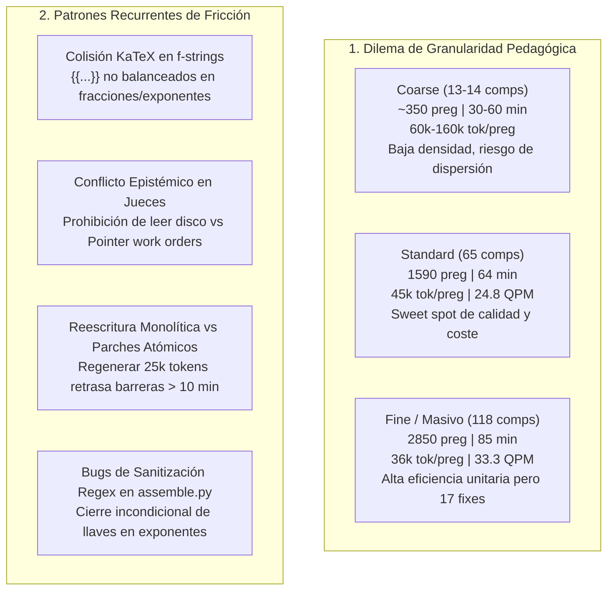

# Síntesis Forense y Comparativa Longitudinal: Auditoría Agéntica de 5 Corridas C2C
## Pipeline Content-to-Course (Google Antigravity SDK Telemetry Engine v3.2)

**Fecha de Consolidación:** `2026-10-20`  
**Modalidad:** Auditoría Agéntica Forense Profunda (Paso A: Determinista + Paso B: Subagentes Forenses Dedicados)  
**Corridas Auditadas:**
1. [`afb5aa18`](conversation://afb5aa18-d2f3-4bd2-b452-4b73c313316e) — **Creación de Curso Praktica Parcial** (`practica_parcial_saul_standard_coarse_v2`)
2. [`f9b9d459`](conversation://f9b9d459-d84a-4e3d-bf32-48e74d8b5c5a) — **Crear Curso Práctica Parcial** (`practica_parcial_saul_standard`)
3. [`a53e6af1`](conversation://a53e6af1-07b8-4246-8afd-4b4ac647d536) — **Creación De Curso Practica Parcial** (`practica_parcial_saul_standard_coarse`)
4. [`acdc402d`](conversation://acdc402d-0803-468b-9c6c-b069a2dc6c09) — **Creación De Curso Practica Parcial Saul** (`practica_parcial_saul`)
5. [`4ceacf92`](conversation://4ceacf92-ef82-4fb0-899d-87aa310873c1) — **Crear Curso Modelo Solow** (`solow_model_v15`)

---

## 1. Matriz Forense Comparativa Longitudinal (Normalizada Apples-to-Apples)

| Métrica / Dimensión | `4ceacf92` (Solow v15) | `a53e6af1` (Saúl Coarse v1) | `f9b9d459` (Saúl Standard) | `afb5aa18` (Saúl Coarse v2) | `acdc402d` (Saúl Fine / Masivo) |
| :--- | :---: | :---: | :---: | :---: | :---: |
| **Corpus de Entrada** | 36 págs (1.49 MB, 1 PDF) | 103 págs (10.39 MB, 7 PDFs) | 103 págs (10.39 MB, 7 PDFs) | 103 págs (10.39 MB, 7 PDFs) | 103 págs (10.39 MB, 7 PDFs) |
| **Competencias Extraídas (CTA)** | 15 comp | 13 comp | **65 comp** | 14 comp | **118 comp** |
| **Banco de Reactivos Validados** | 360 preguntas | 320 preguntas | **1,590 preguntas** | 370 preguntas | **2,850 preguntas** |
| **Subagentes Desplegados** | 12 agentes | 11 agentes | 30 agentes | 17 agentes | **67 agentes** |
| **Tiempo de Pared (Wall-Clock)** | **27.10 min** (1,626s) | **32.83 min** (1,970s) | 64.22 min (3,853s) | 60.03 min (3,602s) | 85.65 min (5,139s) |
| **Speedup Paralelo (Cómputo/Pared)** | 3.32x | 3.33x | 3.92x | 3.03x | **5.17x** |
| **Tokens Facturables (con Caché)** | 22,064,985 | 21,128,769 | 71,443,646 | 59,269,221 | **102,715,610** |
| **Tokens Activos (In + Out neto)** | 2,350,556 | 2,926,179 | 6,491,590 | 5,129,203 | 11,725,289 |
| **Tasa de Acierto de Caché API** | 89.3% | 86.1% | 90.9% | 91.3% | 88.6% |
| **Tokens Totales por Pregunta** | 61,291.6 tok/preg | 66,027.4 tok/preg | **44,933.1 tok/preg** | 160,187.1 tok/preg | **36,040.6 tok/preg** |
| **Segundos por Pregunta** | 4.52 s/preg | 6.16 s/preg | 2.42 s/preg | 9.74 s/preg | **1.80 s/preg** |
| **Rendimiento de Producción (QPM)** | 13.28 preg/min | 9.74 preg/min | **24.76 preg/min** | 6.16 preg/min | **33.27 preg/min** |
| **Intervenciones Manuales Supervisor** | 🛠️ 1 (8s, benigna) | **🛠️ 0 (Autonomía 100%)** | 🛠️ 3 (Reset + Regex fix) | 🛠️ 5 (Prompt + Shard 06) | 🛠️ 17 (Crisis múltiples) |
| **Total de Errores Catalogados** | 24 errores | **15 errores** | 61 errores | 43 errores | 94 errores |
| **Blind Judges Psicométricos** | ✅ **100% (30/30, 1st pass)** | ✅ **100% (26/26, 1st pass)** | ✅ **98.5% (128/130, 1st)** | ✅ **100% (28/28, 1st pass)** | ❌ **0% pass 1 $\to$ 100% pass 2** |
| **Aislamiento Zero-Collision** | ✅ 100% Verificado | ✅ 100% Verificado | ✅ 100% Verificado | ✅ 100% Verificado | ✅ 100% Verificado |

---

## 2. Hallazgos Forenses Clave por Corrida

### 2.1. Corrida `4ceacf92` (`solow_model_v15`): Récord Histórico de Eficiencia
- **Logro de Ingeniería:** Reducción drástica del tiempo de generación en el linaje Solow de 340 min a solo **27.1 min**.
- **Autonomía Psicométrica:** Blind Judges alcanzaron **100% de acuerdo mutuo (30/30 reactivos)** al primer intento, sin reintentos ni arbitraje humano.
- **Intervención Única Auditada:** Creación de `dump_prompts.py` (Paso 31, 8 segundos) provocada por fricción de quoting de PowerShell en terminal Windows al invocar un one-liner de volcado de prompts.
- **Straggler:** Shard 06 Author (578s) demorado por colisión de índices de despacho (`author_06.json` vs `shard_03`) y disparo de circuit breaker por dobles llaves KaTeX en fórmulas de acumulación de capital.

### 2.2. Corrida `a53e6af1` (`practica_parcial_saul_standard_coarse`): El Ideal de Autonomía Zero-Intervention
- **Logro de Ingeniería:** **Cero intervenciones manuales del supervisor (`writes=0`, `edits=0`)** a lo largo de los 32.8 minutos.
- **Mecanismo de Éxito:** El validador CLI de sandbox (`compile_shard.py`) proveyó diagnósticos precisos que permitieron a los 7 subagentes autores autorreparar autónomamente fallos de llaves (`R-20`) y aserciones de parámetros (`TPL-DRY`).
- **Straggler:** Shard Author shard_02 (785s) tardó debido a una reescritura monolítica de 4 minutos tras un fallo en `Hab-02`. En contraste, Shard Author shard_03 usó 5 ediciones atómicas con `replace_file_content` y terminó en 579s pese a tener 42 turnos.

### 2.3. Corrida `f9b9d459` (`practica_parcial_saul_standard`): El Sweet Spot de Producción
- **Densidad de Producción:** 65 competencias y **1,590 reactivos en 64.2 min**, alcanzando un costo unitario óptimo de **44,933 tokens/pregunta** y un ritmo de **24.76 preguntas/minuto**.
- **Straggler Crítico:** Shard Author 05 (1,426s / 23.8 min) en `Hab-12` (separación de variables en EDPs) sufrió 7 fallos sucesivos de compilación por fracciones anidadas en exponentes, disparando el circuit breaker.
- **Intervenciones Auditadas:**
  1. Reset del contador de intentos de Shard 05 (`.check_attempts/compile_shard_05.json`).
  2. Reset del disyuntor persistente `circuit_breaker_Hab-12.json`.
  3. **Parche en el Engine C2C (`engine/assemble.py`):** Detección de un bug en `sanitize_katex_syntax`, donde expresiones regulares insertaban cierres de llaves `}` incondicionales ante delimitadores `\left(` y `\right)` dentro de exponentes. El orquestador añadió la guarda condicional `if text.count("{") > text.count("}"):`.
- **Blind Judges:** 98.46% de acuerdo (128/130). Los 2 desacuerdos fueron bloqueos justificados debido a que `judge_batch.json` omitió incluir la matriz base en el campo `stem`.

### 2.4. Corrida `afb5aa18` (`practica_parcial_saul_standard_coarse_v2`): La Paradoja de Fricción
- **La Paradoja:** Procesando el mismo corpus que Coarse v1 (`a53e6af1`), tardó **60.0 min (vs 32.8 min)** y consumió **59.27M tokens (vs 21.13M)** para generar 370 preguntas (**160,187 tokens/pregunta**, un sobrecosto de 2.8x).
- **Causas Raíz:**
  1. *Straggler en Stage 1B (part_04):* Desorientación de esquema y búsqueda exploratoria en directorios de otras corridas (perdiendo 4 min), seguida de una emisión masiva de 13,661 tokens en un solo turno (777s total).
  2. *Micro-bucle en Shard 03:* 47 turnos y 10 lecturas a validadores por intentar usar `pmatrix` como función de Python.
  3. *Abandono de Shard 06:* El autor colapsó tras `TypeError: unsupported format string passed to tuple.__format__`, obligando al orquestador a intervenir 4 veces para reescribir y sincronizar variables.
  4. *Fricción en Despacho de Jueces:* 17 excepciones `FileNotFoundError` consecutivas en el orquestador por buscar `manifest.json` en vez de los archivos directos.

### 2.5. Corrida `acdc402d` (`practica_parcial_saul`): La Prueba de Estrés Masiva (118 Competencias)
- **Escala:** 67 subagentes, 118 competencias, **2,850 reactivos**, **102.7 millones de tokens**, 85.7 minutos (Speedup: **5.17x**).
- **Crisis de Blind Judges (Fallo en Pasada 1):**
  - Conflicto normativo directo: El system prompt del agente juez prohibía taxativamente leer archivos del disco (*"strictly NOT read files from disk"*), pero la orden del orquestador envió un pointer file (`judge_XX.json`) sin incluir los reactivos inline.
  - 19 de los 20 jueces abortaron inmediatamente en 5 segundos respetando la directiva de seguridad.
  - El orquestador resolvió la crisis creando `gen_authorized_judges.py`, inyectando una autorización explícita de lectura y despachando en 4 lotes de 5 jueces, logrando 100% de acuerdo en la pasada 2.
- **Crisis Shard 17 y KaTeX H-28:** Bucle infinito en generación paramétrica por restricción acoplada en `k` para forzar $py < 0$; bug de separadores en matrices (`\\\\{m21}`); incompatibilidad en `\text{tr}(A)^2` dentro de `\sqrt`.
- **17 Intervenciones Manuales:** Todas clasificadas y auditadas con sus thinking traces correspondientes.

---

## 3. Análisis Transversal de Ingeniería y Patrones Sistémicos

### 3.1. Eficiencia de Granularidad: El "Sweet Spot" de 65 Competencias
- **Modo Coarse (13–14 comps):** Parece intuitivamente más rápido, pero sufre de desproporción de contexto: los autores deben resumir demasiado material, produciendo stragglers cognitivos y ratios de tokens inflados (hasta 160k tok/preg en `afb5aa18`).
- **Modo Fine (118 comps):** Alcanza la mejor economía unitaria pura (**36,040 tokens/pregunta**, **1.8 s/pregunta**), pero somete a la orquestación a una tensión extrema (17 intervenciones de rescate, límites de contexto y riesgo de bloqueo por un solo shard).
- **Modo Standard (65 comps):** Constituye el **equilibrio óptimo de ingeniería**: 1,590 reactivos a 24.76 preg/min y 44.9k tok/preg, con solo 3 intervenciones de bajo impacto.

### 3.2. Edición Atómica vs Reescritura Monolítica
La comparación entre `shard_02` (reescritura monolítica completa de 4 min $\to$ 785s totales) y `shard_03` (5 ediciones puntuales con `replace_file_content` $\to$ 579s totales a pesar de 42 turnos) demuestra empíricamente que **las reparaciones quirúrgicas locales minimizan el tiempo de pared y el consumo de tokens** frente a la regeneración completa de archivos de autoría.

---

## 4. Plan de Acción y Mejoras Recomendadas para C2C v3.3

1. **Blindaje de la Regla KaTeX en System Prompts:**
   - Prohibir estrictamente el uso de llaves dobles `{{...}}` para KaTeX dentro de f-strings en Python.
   - Requerir cadenas crudas `r"..."` con variables sustituidas mediante diccionarios precalculados.
2. **Armonización Epistémica en Blind Judges:**
   - Modificar la plantilla `c2c_judge/agent.md` para incluir la cláusula de acceso: *"You are strictly authorized and required to read only your assigned pointer file `work/dispatch/items/judge_XX.json`"*.
3. **Parche Permanente en `engine/assemble.py`:**
   - Incorporar la verificación de paridad de llaves `if text.count("{") > text.count("}"):` antes de invocar las expresiones regulares `script_outer_fix` y `frac_den_fix`.
4. **Validación de Límite de Intentos en Tiempo de Ejecución:**
   - Aumentar el umbral de intentos de compilación en shards complejos de 6 a 10, o implementar un mecanismo de reseteo automático de `.check_attempts` cuando el hash del código fuente cambia sustancialmente.
5. **Autosuficiencia de Reactivos en Lotes de Control:**
   - Asegurar que `judge_batch.json` copie todo el contexto declarativo (ecuaciones diferenciales, matrices, parámetros) al campo `stem` del ítem ciego.
6. **Pre-Volcado Headless de Prompts:**
   - Modificar `00_prepare.py` para escribir directamente los prompts individuales de subagentes en disco, erradicando los scripts de una línea en PowerShell que provocan fallos de sintaxis en terminal Windows.

---
*Consolidación final de auditoría forense C2C v3.2.*
