# Síntesis Forense Maestra: Errores, Bottlenecks, Fallas y Desoptimizaciones de `content-to-course` y `c2c-run-auditor` (Análisis de 7 Corridas)

**Fecha de Auditoría:** `2026-10-17`  
**Metodología:** Línea base determinista ([audit_engine.py](file:///d:/Augusto/personal_portfolio/Tops_academy/.agents/skills/c2c-run-auditor/scripts/audit_engine.py) con `--traceback`) + 7 subagentes `c2c_run_auditor` en modelo Flash operando en **Modo 2 Agéntico** (inspección directa de `transcript.jsonl`, `transcript_full.jsonl`, subagentes hijos y directorios `work/`), con ronda adicional de verificación y rectificación cruzada en las corridas de Estadística Regresión, Práctica Parcial Saúl y Append Solow Model.

---

## 1. Panorama Consolidado y Rectificado de las 7 Corridas Auditadas

| # | Corrida / Curso | Conv ID | Estado Real de Consigna y Artefactos | Tiempo Bruto → Neto Activo | Turnos / Errores | Tokens Totales (Activos) | Tok / Preg | Intervenciones Reales | Straggler Crítico / Evento Principal | Reportes Forenses |
| :-: | :--- | :--- | :--- | :--- | :-: | :--- | :-: | :--- | :--- | :--- |
| **1** | **pde_saul_1** | [`876ad3df`](conversation://876ad3df-153b-4de2-8d3a-43a580b2dbc6) | **✅ Publicado** ([pde_saul_1.json](file:///d:/Augusto/personal_portfolio/Tops_academy/courses/pde_saul_1.json): 16 comp / 380 preg) | `55.9m` → `~45.9m` *(10m en resurrección de `work/`)* | 396t / 24 err | **49.36M** (2.92M) | 129,904 | **7 edits** en Stage 3 + reconstrucción de `work/` | `Shard 02` (181t, 16.7m tras borrado de `work/` por `pytest`) | [report.md](file:///d:/Augusto/personal_portfolio/Tops_academy/reports/c2c_audits/20261017_063549_pde_saul_1_876ad3df/report.md) · [traceback](file:///d:/Augusto/personal_portfolio/Tops_academy/reports/c2c_audits/20261017_063549_pde_saul_1_876ad3df/traceback_deepdive_876ad3df.md) |
| **2** | **estadistica_regresion** | [`0f573810`](conversation://0f573810-f492-4d3f-8cc8-a4ed3b74c03a) | **✅ Publicado** ([estadistica_regresion.json](file:///d:/Augusto/personal_portfolio/Tops_academy/courses/estadistica_regresion.json): 43 comp / 1,050 preg) | `366.0m` → **`89.3m`** *(248.8m espera 429 + 28m CTA 1)* | 512t / 38 err | **86.86M** (6.24M) | 82,725 | **17 edits** en CTA + **1 fix** en `assemble.py` + fallback Stage 5 + fix UTF-8 | `Shard 01` (136t, 40.0m, **16.42M tok**, 32 lecturas a `compile_shard.py`) | [report.md](file:///d:/Augusto/personal_portfolio/Tops_academy/reports/c2c_audits/20261017_063550_estadistica_regresion_0f573810/report.md) · [traceback](file:///d:/Augusto/personal_portfolio/Tops_academy/reports/c2c_audits/20261017_063550_estadistica_regresion_0f573810/traceback_deepdive_0f573810.md) |
| **3** | **practica_parcial_saul** | [`9ed41fb3`](conversation://9ed41fb3-f9b3-4442-aa04-99f31a3c001c) | **✅ Stage 1 Certificado** ([cta.json](file:///d:/Augusto/personal_portfolio/Tops_academy/courses/practica_parcial_saul/work/cta.json): 18 comp / 108 distractores; corte exógeno `404` en `06:11:48Z`) | `3.9m` (dir) → **`47.0m` real** | 85t / 10 err | **10.30M** (680K) | N/A | Rescate autónomo de `pre_cta_manifest.json` en subagente (Paso 53) | `CTA Architect` (67t, 43.1m; compiló `cta.json` en Paso 80 antes de caída `404`) | [report.md](file:///d:/Augusto/personal_portfolio/Tops_academy/reports/c2c_audits/20261017_063551_practica_parcial_saul_9ed41fb3/report.md) · [traceback](file:///d:/Augusto/personal_portfolio/Tops_academy/reports/c2c_audits/20261017_063551_practica_parcial_saul_9ed41fb3/traceback_deepdive_9ed41fb3.md) |
| **4** | **solow_model** | [`812bfecd`](conversation://812bfecd-f742-46f1-8863-5c7b61096754) | **✅ Publicado** ([solow_model.json](file:///d:/Augusto/personal_portfolio/Tops_academy/courses/solow_model.json): 21 comp / 500 preg base) | `48.9m` → `48.9m` | 274t / 13 err | **27.70M** (2.82M) | 55,398 | **1 script CLI** (particionado manual de `judge_batch.json` en Turno 78) | `Shard 03` (90t, 21.9m, **10.62M tok** — 46.1% del curso, 24 reads) | [report.md](file:///d:/Augusto/personal_portfolio/Tops_academy/reports/c2c_audits/20261017_063551_solow_model_812bfecd/report.md) · [traceback](file:///d:/Augusto/personal_portfolio/Tops_academy/reports/c2c_audits/20261017_063551_solow_model_812bfecd/traceback_deepdive_812bfecd.md) |
| **5** | **solow_model_v14** | [`7818f6af`](conversation://7818f6af-4344-4f6c-8f01-24ecdf14c583) | **✅ Publicado** ([solow_model_v14.json](file:///d:/Augusto/personal_portfolio/Tops_academy/courses/solow_model_v14.json): 23 comp / 540 preg) | `329.9m` → **`80.6m`** *(249.2m espera 429)* | 361t / 25 err | **44.77M** (4.77M) | 82,899 | **1 re-despacho CTA 2** (tras caída `404` de CTA 1 en Paso 30) | `Shard 04` (131t, 31.7m, **18.15M tok**, **91 `view_file`** a `compile_shard.py`) | [report.md](file:///d:/Augusto/personal_portfolio/Tops_academy/reports/c2c_audits/20261017_063552_solow_model_v14_7818f6af/report.md) · [traceback](file:///d:/Augusto/personal_portfolio/Tops_academy/reports/c2c_audits/20261017_063552_solow_model_v14_7818f6af/traceback_deepdive_7818f6af.md) |
| **6** | **Append solow_model** | [`f2be91cd`](conversation://f2be91cd-72b0-4b72-820f-22d3bc20e7ab) | **✅ Append Publicado** ([solow_model.json](file:///d:/Augusto/personal_portfolio/Tops_academy/courses/solow_model.json): +24 comp / +570 preg → **45 comp / 1,070 preg totales**) | `339.9m` → **`91.1m`** *(248.8m espera 429)* | 474t / 54 err | **59.97M** (4.01M) | 105,218 | **4 edits** + reset `.check_attempts` + fallback Stage 5 post-429 | `Shard 03` (132t, 41.7m, **18.09M tok**, 19 edits, 86 reads) | [report.md](file:///d:/Augusto/personal_portfolio/Tops_academy/reports/c2c_audits/20261017_063552_solow_model_f2be91cd/report.md) · [traceback](file:///d:/Augusto/personal_portfolio/Tops_academy/reports/c2c_audits/20261017_063552_solow_model_f2be91cd/traceback_deepdive_f2be91cd.md) |
| **7** | **solow_model_v13** | [`18ae4bcc`](conversation://18ae4bcc-90ae-4890-bc9a-293ddf907d71) | **✅ Publicado** ([solow_model_v13.json](file:///d:/Augusto/personal_portfolio/Tops_academy/courses/solow_model_v13.json): 24 comp / 570 preg) | `61.9m` → `61.9m` | 326t / 15 err | **34.97M** (3.24M) | 61,344 | **7 comandos CLI** (particionado 4×12 tras truncamiento de Judge 1) | `CTA Architect` (23.9m, 20 micro-edits) + `Shard 03` (15.3m, 51t) | [report.md](file:///d:/Augusto/personal_portfolio/Tops_academy/reports/c2c_audits/20261017_063553_solow_model_v13_18ae4bcc/report.md) · [traceback](file:///d:/Augusto/personal_portfolio/Tops_academy/reports/c2c_audits/20261017_063553_solow_model_v13_18ae4bcc/traceback_deepdive_18ae4bcc.md) |

> [!IMPORTANT]
> **El `Error 429 / RESOURCE_EXHAUSTED` (y el `404 NOT_FOUND`) como Consecuencia Exógena de la Desoptimización de Inferencia y Tokens:**  
> El congelamiento simultáneo de ~249 minutos (`07:03 UTC` → `11:12 UTC` en las corridas 2, 5 y 6) es una restricción exógena de cuota de la API, pero **fue detonado directamente por la falta de optimización en los procesos de inferencia del pipeline**: tres subagentes stragglers concurrentes (`Shard 01` en Run 2 con 136 turnos y 16.42M tokens; `Shard 04` en Run 5 con 131 turnos y 18.15M tokens; `Shard 03` en Run 6 con 132 turnos y 18.09M tokens) entraron en micro-bucles de edición e ingeniería inversa leyendo [compile_shard.py](file:///d:/Augusto/personal_portfolio/Tops_academy/.agents/skills/content-to-course/compile_shard.py) entre 32 y 91 veces cada uno, re-enviando cientos de miles de tokens de caché por turno hasta quemar **>52.6 millones de tokens** en un solo bloque de 40 minutos.

---

## 2. Diagrama Causal de los Cuellos de Botella y Fallas del Sistema

```mermaid
flowchart TD
    subgraph Stage0_1 ["Etapas 0 y 1: Preparación y CTA"]
        A1["pytest ejecuta test_clean_orphan_dirs (05:47:02Z)"] -->|"clean_orphan_course_dirs(dry_run=False)"| A2["Borra work/ en vivo de cursos sin .json aún publicado\n(pde_saul_1, estadistica_regresion, practica_parcial_saul)"]
        A3["dispatch.py inyecta ruta fantasma work/corpus.md"] -->|"FileNotFoundError en Turno 1"| A4["Fricción inicial en CTA Architects (Runs 3, 4, 5, 7)"]
        A5["compile_cta.py sin auto-sanitizador KaTeX\n+ directiva de usar SOLO replace_file_content"] -->|"20 a 25 micro-ediciones secuenciales"| A6["9.5M tokens y 24-43 min en Stage 1B\n+ exposición a cortes 404 (Runs 2, 3, 5, 7)"]
    end

    subgraph Stage3 ["Etapa 3: Autoría de Shards (Principal Cuello de Botella)"]
        B1["assemble.py usa str.format(**vars)\n+ regex frac_simple_fix"] -->|"Colisión con llaves LaTeX {0.5}, _{xy}, {arccot}\nvs Regla R-20 (prohíbe llaves dobles residuales)"| B2["Fallos repetidos de compilación en Shards"]
        B2 --> B3["compile_shard.py oculta el Traceback de Python\nen fallos de sandbox [TPL-DRY]"]
        B3 -->|"Subagente a ciegas"| B4["250+ llamadas view_file a compile_shard.py\n(hasta 91 lecturas en un solo shard)"]
        B4 --> B5["check_templates.py activa BUDGET HALT (.check_attempts)\nsin auto-reset al cambiar el código"]
        B5 -->|"130+ turnos y 16M-18M tokens por straggler"| B6["Agotamiento Exógeno de Cuota API (Error 429)\ny retención de barrera síncrona (+20-30 min)"]
    end

    subgraph Stage5_6 ["Etapas 5 y 6: Verificación, Jueces y Publicación"]
        C1["dispatch-judges genera lotes monolíticos (42-48 ítems)\ny prompts de 60-90 KB"] -->|"Límite de output tokens"| C2["Truncamiento silencioso de Judge 1 en preg 22/48 (Run 7)\no split manual por CLI (Run 4)"]
        C1 -->|"Orquestador lee 4 archivos (>260 KB) con view_file"| C3["CHECKPOINT de compactación (Run 2 Paso 407)\no estado errored 429 residual en manage_subagents (Run 6 Paso 313)"]
        C3 --> C4["Orquestador activa fallback programático\ncon judge_ground_truth.json para completar publish"]
    end
```



---

## 3. Catálogo Exhaustivo de TODO lo que Hay que Corregir u Optimizar en `content-to-course`

### 3.1. Etapa 0 y Gestión de Workspace ([delete_course.py](file:///d:/Augusto/personal_portfolio/Tops_academy/.agents/skills/delete-course/scripts/delete_course.py), [test_delete_course.py](file:///d:/Augusto/personal_portfolio/Tops_academy/tests/test_delete_course.py), [dispatch.py](file:///d:/Augusto/personal_portfolio/Tops_academy/.agents/skills/content-to-course/dispatch.py))

#### 🔴 1. Destrucción en Caliente de `courses/<id>/work/` por `clean_orphan_course_dirs` durante Ejecución de Tests
- **Corridas afectadas:** **Run 1 (`pde_saul_1`)**, **Run 2 (`estadistica_regresion`)** y **Run 3 (`practica_parcial_saul`)** simultáneamente a las `05:47:02Z`.
- **Causa raíz exacta:** En [delete_course.py](file:///d:/Augusto/personal_portfolio/Tops_academy/.agents/skills/delete-course/scripts/delete_course.py#L465-L484), la función `clean_orphan_course_dirs(dry_run=False)` elimina con `shutil.rmtree` cualquier carpeta `courses/<id>/` que no tenga su `courses/<id>.json` en la raíz de `courses/`. Pero en `content-to-course`, `courses/<id>.json` recién se escribe en la **Etapa 6 (`publish`)**. Cuando la sesión `1db5ddea` corrió `pytest`, el test [test_clean_orphan_dirs](file:///d:/Augusto/personal_portfolio/Tops_academy/tests/test_delete_course.py#L164-L173) ejecutó `clean_orphan_course_dirs(dry_run=False)` contra el directorio `courses/` real de producción, borrando en vivo el `work/` de las 3 corridas activas:
  - En **Run 1 (`pde_saul_1`)**, `Shard 02` gastó **181 turnos (16.7 min)** buscando los archivos desaparecidos y el orquestador tuvo que reconstruir `cta_data.py` desde el `transcript_full.jsonl` del subagente CTA.
  - En **Run 2 (`estadistica_regresion`)**, CTA 1 (`f693443d`) perdió `pre_cta_manifest.json` a mitad de ejecución (desperdiciando 27.95 min y 5.28M tokens) y el orquestador tuvo que volver a correr `--stage prepare` en el Paso 36.
  - En **Run 3 (`practica_parcial_saul`)**, el subagente `eefd9616` perdió `pre_cta_manifest.json` en el Paso 42 y tuvo que reconstruirlo manualmente en el Paso 53.
- **Corrección requerida:**
  1. En [delete_course.py](file:///d:/Augusto/personal_portfolio/Tops_academy/.agents/skills/delete-course/scripts/delete_course.py#L465-L484): **Nunca** borrar un directorio `courses/<id>/` si contiene `work/state.json`, `work/pre_cta_manifest.json`, `work/cta_data.py` o cualquier archivo modificado en las últimas 24 horas.
  2. En [test_delete_course.py](file:///d:/Augusto/personal_portfolio/Tops_academy/tests/test_delete_course.py#L164-L173): Aislar obligatoriamente `test_clean_orphan_dirs` mediante `tmp_path` y `monkeypatch.setattr(delete_course, "COURSES_DIR", tmp_path)`.

#### 🟠 2. Referencia Fantasma a `work/corpus.md` Desincronizada entre `ingest.py` y `dispatch.py`
- **Corridas afectadas:** **Runs 3, 4, 5 y 7** (error sistemático `FileNotFoundError` en el Paso 4 de los subagentes CTA).
- **Causa raíz exacta:** En C2C v3.2 Zero-Waste, [ingest.py](file:///d:/Augusto/personal_portfolio/Tops_academy/.agents/skills/content-to-course/ingest.py#L212) dejó de generar `corpus.md`, pero [dispatch.py](file:///d:/Augusto/personal_portfolio/Tops_academy/.agents/skills/content-to-course/dispatch.py#L463-L579) (líneas 463, 543, 546 y 579) aún lo inyecta en `read_paths` y como instrucción de lectura.
- **Corrección requerida:** Eliminar toda mención a `corpus.md` en `dispatch.py` e inyectar únicamente las rutas fuente listadas en `pre_cta_manifest.json`.

---

### 3.2. Etapa 1B: Síntesis Curricular ([compile_cta.py](file:///d:/Augusto/personal_portfolio/Tops_academy/.agents/skills/content-to-course/compile_cta.py), [check_cta.py](file:///d:/Augusto/personal_portfolio/Tops_academy/.agents/skills/content-to-course/check_cta.py) y Prompt de `c2c_cta_architect`)

#### 🔴 3. Micro-Bucles de Edición Incremental (`replace_file_content`) por Falta de Auto-Sanitizador KaTeX en `compile_cta.py`
- **Corridas afectadas:**
  - **Run 7 (`solow_model_v13`):** `CTA Architect` ejecutó **20 llamadas consecutivas a `replace_file_content`** (Pasos 60–132) agregando competencias en bloques pequeños a `cta_data.py`, re-enviando ~400K tokens por turno y acumulando **9.46M tokens (9.16M caché) y 23.9 min (40% de toda la corrida)**.
  - **Run 5 (`solow_model_v14`):** `CTA 1` sufrió 20 errores de delimitadores KaTeX (`$` faltantes) y 1 `replace_file_content` truncado antes de caer por `404` en el turno 47; `CTA 2` tuvo que invertir otros **42 turnos (988s)** corrigiendo los delimitadores KaTeX de forma incremental (total: **89 turnos, 33.4 min y 9.69M tokens**).
  - **Run 3 (`practica_parcial_saul`):** Tras haber compilado exitosamente `cta.json` en el Paso 80 (`05:59:08Z`), el subagente intentó refinar 6 errores KaTeX adicionales en los Pasos 85–134 haciendo **25 turnos de micro-edición** (leer 40 líneas con `view_file` + editar 2 líneas con `replace_file_content`) durante 12 minutos hasta quedar expuesto al corte exógeno `404` de las `06:11:48Z`.
  - **Run 2 (`estadistica_regresion`):** El propio orquestador tuvo que ejecutar **17 llamadas manuales a `replace_file_content`** (Pasos 91–157) para encerrar en `$` 33 fórmulas matemáticas en distractores de `cta_data.py`.
- **Causa raíz doble:**
  1. [compile_cta.py](file:///d:/Augusto/personal_portfolio/Tops_academy/.agents/skills/content-to-course/compile_cta.py) no auto-corrige errores mecánicos triviales de LaTeX (`$$` en vez de `$`, comandos como `\alpha`, `\beta`, `\dot{k}`, `\hat{\beta}`, `\frac{...}{...}` sin encerrar en `$...$`, o escapes `\d`, `\p`, `\m` en strings sin `r"..."`).
  2. El mensaje de error de `compile_cta.py` ordena: *"Usa EXCLUSIVAMENTE replace_file_content... PROHIBIDO usar write_to_file con Overwrite=True"*, lo que induce al modelo a hacer 1 llamada por cada distractor en lugar de una corrección consolidada.
- **Corrección requerida:**
  1. Incorporar en [compile_cta.py](file:///d:/Augusto/personal_portfolio/Tops_academy/.agents/skills/content-to-course/compile_cta.py) un **Auto-Sanitizador Determinista KaTeX/LaTeX** previo a la validación que convierta `$$` → `$` balanceados, envuelva comandos matemáticos sueltos en `$...$` y escape secuencias `\d`, `\p`, `\m` automáticamente.
  2. En el prompt de `c2c_cta_architect`, exigir que la escritura inicial de `cta_data.py` se realice en **1 única llamada atómica a `write_to_file`** usando strings crudos `r"..."`, y si hubiera correcciones posteriores, agruparlas en **1 solo turno**, prohibiendo secuencias de >3 `replace_file_content`.

---

### 3.3. Etapa 3: Autoría de Plantillas Paramétricas ([compile_shard.py](file:///d:/Augusto/personal_portfolio/Tops_academy/.agents/skills/content-to-course/compile_shard.py), [check_templates.py](file:///d:/Augusto/personal_portfolio/Tops_academy/.agents/skills/content-to-course/check_templates.py), [assemble.py](file:///d:/Augusto/personal_portfolio/Tops_academy/.agents/skills/content-to-course/engine/assemble.py))

#### 🔴 4. `compile_shard.py` Oculta el Traceback de Python en Fallos `[TPL-DRY]`, Provocando >250 Lecturas de Ingeniería Inversa
- **Corridas afectadas:** **Runs 1, 2, 4, 5, 6 y 7** (destacando **91 `view_file`** a `compile_shard.py` en Run 5 `Shard 04`, **86 lecturas** en Run 6 `Shard 03`, **32 lecturas** en Run 2 `Shard 01`, **24 lecturas** en Run 4 `Shard 03`).
- **Causa raíz exacta:** Cuando `generate_py` lanza una excepción durante el dry-run de 50 semillas en [compile_shard.py](file:///d:/Augusto/personal_portfolio/Tops_academy/.agents/skills/content-to-course/compile_shard.py) / [check_templates.py](file:///d:/Augusto/personal_portfolio/Tops_academy/.agents/skills/content-to-course/check_templates.py), la salida solo dice:
  `[-] [TPL-DRY] ... La ejecución en sandbox falló en 50/50 semillas evaluadas. | Acción: Revisar la excepción en generate_py...` **sin imprimir qué excepción ocurrió (`KeyError`, `NameError`, `ZeroDivisionError`) ni en qué línea**.
- **Impacto:** Al no ver el traceback de su propio error, el subagente lee obsesivamente el código fuente de `compile_shard.py` en fragmentos de 100 líneas para adivinar qué hace el sandbox, multiplicando por 3× los turnos y tokens del shard.
- **Corrección requerida:**
  1. En [compile_shard.py](file:///d:/Augusto/personal_portfolio/Tops_academy/.agents/skills/content-to-course/compile_shard.py) y [check_templates.py](file:///d:/Augusto/personal_portfolio/Tops_academy/.agents/skills/content-to-course/check_templates.py), imprimir explícitamente en el mensaje `[TPL-DRY]` la primera semilla fallida, los parámetros de entrada, `type(exc).__name__: str(exc)` y las últimas 3 líneas del `traceback.format_exc()` correspondientes a `generate_py` / `verify_py`.
  2. Prohibir en el Scope-Lock del `c2c_shard_author` hacer `view_file` sobre `compile_shard.py` o `check_templates.py`.

#### 🔴 5. Colisión entre `str.format(**vars)` en `engine/assemble.py` y Llaves de LaTeX `{...}` vs. Regla `R-20`
- **Corridas afectadas:** **Runs 1, 4, 5, 6 y 7** (causa directa de los **132 turnos y 18.09M tokens** de `Shard 03` en Run 6, de los **920s y 28 errores** de `Shard 03` en Run 7, y de 3 de las 7 intervenciones manuales en Run 1).
- **Causa raíz exacta:** [assemble.py](file:///d:/Augusto/personal_portfolio/Tops_academy/.agents/skills/content-to-course/engine/assemble.py) interpola las variables del reactivo usando `str.format(**vars)`.
  - Cuando el autor escribe LaTeX estándar con llaves como `$Y = K^{0.5} L^{0.5}$`, `\operatorname{arccot}(y/x)` o `\frac{a}{b}`, `.format(**vars)` interpreta `{0.5}` o `{arccot}` como variables de Python y falla con `KeyError: '0.5'` o `KeyError: 'arccot'`.
  - Cuando el autor intenta escaparlo con llaves dobles `{{0.5}}` o `{{{alpha}}}`, si ese campo no pasa por `.format()` o deja llaves dobles, el validador estático falla con `[-] [R-20: SINTAXIS / LLAVES] Llaves dobles residuales '{{' o '}}'`.
- **Corrección requerida:**
  1. En [assemble.py](file:///d:/Augusto/personal_portfolio/Tops_academy/.agents/skills/content-to-course/engine/assemble.py): Reemplazar `.format(**vars)` por interpolación regex selectiva que **únicamente** sustituya `{identificador}` cuando `identificador` exista como clave en `vars`:
     ```python
     re.sub(r"\{([a-zA-Z_][a-zA-Z0-9_]*)\}", lambda m: str(vars[m.group(1)]) if m.group(1) in vars else m.group(0), text)
     ```
  2. En `compile_shard.py`: Normalizar automáticamente `{{token}}` → `{token}` para cualquier expresión LaTeX donde `token` no sea clave de `vars` antes de evaluar `R-20`.

#### 🔴 6. Corrupción de Subíndices dentro de `\frac` en `engine/assemble.py` (`frac_simple_fix`)
- **Corridas afectadas:** **Run 2 (`estadistica_regresion` Shard 01)**, donde corrompió $\hat{\beta}_1 = \frac{S_{xy}}{S_{xx}}$ e indujo **136 turnos y 16.42M tokens** hasta que el orquestador parcheó [assemble.py](file:///d:/Augusto/personal_portfolio/Tops_academy/.agents/skills/content-to-course/engine/assemble.py#L40-L60) en el Paso 316.
- **Corrección requerida:** Mantener fijo en `engine/assemble.py` el patrón que excluye subíndices y superíndices (`[^{}\\^_]+` o balanceo de llaves anidadas) y añadir tests unitarios de regresión con `\frac{S_{xy}}{S_{xx}}`.

#### 🔴 7. Bloqueo Irreversible del Circuit Breaker (`.check_attempts` / `BUDGET HALT`) sin Auto-Reset por Cambio de Hash
- **Corridas afectadas:** **Run 2 (`Shard 01`)**, **Run 5 (`Shard 04`)** y **Run 6 (`Shard 03`)**.
- **Causa raíz exacta:** Al alcanzar el umbral de intentos fallidos en [check_templates.py](file:///d:/Augusto/personal_portfolio/Tops_academy/.agents/skills/content-to-course/check_templates.py), se escribe el bloqueo `BUDGET HALT` en `work/.check_attempts/`. A partir de ese punto, **aunque el subagente corrija el error en `shard_XX_data.py`, todas las compilaciones siguientes son rechazadas automáticamente por `BUDGET HALT`**. El subagente sigue reintentando e inspeccionando archivos sin poder desbloquear `.check_attempts` (quemando >15M tokens por shard) hasta que el orquestador borra `.check_attempts/*` manualmente.
- **Corrección requerida:**
  1. En `check_templates.py` / `compile_shard.py`: Almacenar el hash SHA-256 de la plantilla en `.check_attempts`; si el código de la competencia fue modificado respecto al intento anterior, **evaluar la nueva versión y limpiar el bloqueo si pasa**.
  2. Si falla repetidamente sin cambios efectivos, imprimir una orden terminante para que el subagente **cierre su turno inmediatamente** con `send_message` reportando el bloqueo al orquestador.

#### 🔴 8. Bug en `compile_shard.py` (`L570-586`) que Crea `shard_XX_data.py/` como una Carpeta
- **Corridas afectadas:** **Run 1 (`pde_saul_1` Shard 03)** y **Run 5 (`solow_model_v14` Shard 03 Paso 32)**.
- **Causa raíz exacta:** En [compile_shard.py](file:///d:/Augusto/personal_portfolio/Tops_academy/.agents/skills/content-to-course/compile_shard.py#L570-L586):
  ```python
  if target_p.is_file() and target_p.name.endswith(".py"):
      shard_data_path = target_p
  else:
      work_p = target_p
      templates_dir = work_p / "templates"
      templates_dir.mkdir(parents=True, exist_ok=True)
  ```
  Cuando un autor ejecuta `compile_shard.py` antes de haber escrito `shard_03_data.py`, `target_p.is_file()` es `False`, cae en el `else`, y `mkdir(parents=True)` **crea un directorio llamado `shard_03_data.py/templates/`**. Luego `write_to_file` y `view_file` fallan con `path is a directory, not a file`.
- **Corrección requerida:** Evaluar `if target_p.name.endswith(".py"):` primero; si no existe en disco, salir con error claro sin ejecutar jamás `mkdir`.

#### 🟠 9. Discrepancia de Flags CLI en `dispatch.py` para `compile_shard.py` + Lecturas Cruzadas entre Shards + Cuotas `TPL-VAR`
- **Corridas afectadas:** **Runs 1, 2, 4, 5, 6 y 7**.
- **Causas raíz:**
  1. [dispatch.py](file:///d:/Augusto/personal_portfolio/Tops_academy/.agents/skills/content-to-course/dispatch.py#L790) o los ejemplos del prompt omitían `--shard <shard_id>` / `--work`, provocando `ERROR: shard_id no especificado para compile_shard`.
  2. `Shard 02` y `Shard 03` intentan hacer `view_file` de `shard_01_data.py` mientras corren en paralelo (`FileNotFoundError`).
  3. Los autores definen rangos pequeños de variables (30–50 combinaciones), fallando `TPL-VAR` / `TPL-COLLAPSE` al muestrear 50 semillas aleatorias (paradoja del cumpleaños).
- **Corrección requerida:**
  1. Hacer que `compile_shard.py` auto-infiera `shard_id` y `work_dir` desde la ruta `--input .../work/shards/shard_XX_data.py`.
  2. Incluir una plantilla canónica de 15 líneas en el prompt del autor, prohibir leer otros `shard_XX_data.py`, y exigir que el espacio paramétrico en `generate_py` tenga **$\ge 500$ combinaciones posibles**.

---

### 3.4. Etapa 5: Verificación y Arbitraje de Jueces Ciegos ([dispatch.py](file:///d:/Augusto/personal_portfolio/Tops_academy/.agents/skills/content-to-course/dispatch.py), [judge.py](file:///d:/Augusto/personal_portfolio/Tops_academy/.agents/skills/content-to-course/judge.py), [run.py](file:///d:/Augusto/personal_portfolio/Tops_academy/.agents/skills/content-to-course/run.py))

#### 🔴 10. Lotes Monolíticos en `dispatch-judges` Causan Truncamiento Silencioso de Salida y `CHECKPOINT` de Compactación en el Orquestador
- **Corridas afectadas:**
  - **Run 7 (`solow_model_v13`):** `dispatch-judges` envió **48 preguntas** en un solo lote a `Judge 1` (`cd84d11d`). El subagente cortó la salida en la pregunta 22/48 por límite de output tokens, guardó el JSON incompleto y reportó `DONE`. El orquestador tuvo que particionar manualmente `judge_batch.json` en 4 sub-lotes de 12 preguntas (sufriendo 5 errores de sintaxis en one-liners de PowerShell) y lanzar 4 nuevos jueces (`Judges: 5`).
  - **Run 4 (`solow_model`):** `dispatch-judges` generó prompts monolíticos de **88.7 KB** (42 preguntas); el orquestador tuvo que partirlos manualmente en 3 lotes de 14 preguntas en el Turno 78.
  - **Run 2 (`estadistica_regresion`):** El orquestador hizo `view_file` simultáneo de los 4 archivos `dispatch/items/judge_01..04.json` (>260 KB), saturando su ventana de contexto y provocando el **`CHECKPOINT` de compactación en el Paso 407**, tras el cual perdió la instrucción de usar `invoke_subagent` y tuvo que resolver la verificación programáticamente en el Paso 444.
  - **Run 6 (`Append solow_model`):** En el Paso 313, al llamar a `manage_subagents(Action='list')`, el orquestador vio a `shard_03` aún listado en estado `errored` por el `429` previo y dedujo (Paso 315) que no podía invocar subagentes por cuota, activando también el fallback programático en el Paso 325.
- **Corrección requerida:**
  1. **Particionado Nativo $\le 12$ Ítems en `dispatch.py` (`cmd_dispatch_judges`):** Dividir siempre `judge_batch.json` en sub-lotes de **máximo 12 preguntas por juez** (`verification/judge_batch_01..0K.json`).
  2. **Prompts Ultraligeros para el Orquestador (< 2 KB):** No incrustar los 60–90 KB de preguntas dentro del JSON que lee el orquestador, o instruir explícitamente al orquestador a **no** leer `dispatch/items/judge_*.json` completos en su contexto sino despachar directamente o pasar la ruta del lote al subagente juez.
  3. **Limpieza Automática de Subagentes Previos Antes de Stage 5:** Instruir al orquestador en `SKILL.md` a ejecutar `manage_subagents(Action='kill_all')` al cerrar Stage 3 para que ningún subagente en estado `errored` residual confunda la toma de decisiones en Stage 5.
  4. **Validación de Completitud del Lote en el Juez:** Verificar antes de aceptar `judge_responses_XX.json` que `len(responses) == len(batch_items)`.

---

### 3.5. Etapa 6, Modo `--append` y Fricción de Consola en Windows ([run.py](file:///d:/Augusto/personal_portfolio/Tops_academy/.agents/skills/content-to-course/run.py), [course_publisher.py](file:///d:/Augusto/personal_portfolio/Tops_academy/.agents/skills/content-to-course/course_publisher.py))

#### 🟠 11. Ceguera Delta (Zero Delta Awareness) en Etapas 0–5 durante Modo `--append`
- **Corridas afectadas:** **Run 6 (`Append solow_model` — `f2be91cd`)**.
- **Causa raíz exacta:** En modo `--append`, `run.py` trabaja en `work_append/`, pero las Etapas 0 a 5 no leen el curso existente (`courses/solow_model.json`). El CTA vuelve a extraer 24 competencias empezando desde `C-01`, `Hab-01`, `H-01` (gastando **7.68M tokens** en el corpus completo) y recién en la Etapa 6 [course_publisher.py](file:///d:/Augusto/personal_portfolio/Tops_academy/.agents/skills/content-to-course/course_publisher.py) remapea heurísticamente los IDs a `C-11..C-21` y `Q-<comp>-app-<num>`.
- **Corrección requerida:** Hacer que `run.py --stage prepare --append` lea `courses/<course_id>.json`, inyecte las competencias existentes y el último ID numérico por categoría en `pre_cta_manifest.json`, e instruya al CTA a generar solo competencias delta con IDs continuos desde el inicio.

#### 🟡 12. Corrupción de Caracteres UTF-8 en `--stage publish --title` desde PowerShell y Fricción de Comillas/Rutas en Windows
- **Corridas afectadas:** **Run 2 (Pasos 450–463: 12 turnos reparando `Estad\ufffdstica: Regresi\ufffdn`)**, **Run 3 (Pasos 34–38: `TargetFile="\"d:\\...\""` con comillas literales incrustadas)**, **Run 4 (Paso 16: ruta relativa en `write_to_file`)**, **Run 5 (Pasos 26 y 34: `write_to_file: Incorrect function`)** y **Run 7 (Pasos 143–165: 5 fallos de `python -c` en PowerShell)**.
- **Corrección requerida:**
  1. En `course_publisher.py` / `run.py`: Leer el título por defecto desde `cta.json` / `pre_cta_manifest.json` (UTF-8 nativo) si `--title` presenta caracteres de reemplazo `\ufffd`.
  2. En los prompts de subagentes y del orquestador: Exigir rutas absolutas sin comillas escapadas `\"` en `TargetFile`/`AbsolutePath`, y prohibir one-liners `python -c` con comillas anidadas en PowerShell (usar scripts en `scratch/`).

---

## 4. Todos los Bugs y Puntos Ciegos a Corregir en `c2c-run-auditor` ([audit_engine.py](file:///d:/Augusto/personal_portfolio/Tops_academy/.agents/skills/c2c-run-auditor/scripts/audit_engine.py))

La auditoría cruzada demostró **7 defectos en [audit_engine.py](file:///d:/Augusto/personal_portfolio/Tops_academy/.agents/skills/c2c-run-auditor/scripts/audit_engine.py)** que causaron que el reporte determinista inicial mostrara falsos `❌ Falló` o clasificara mal a los subagentes:

| # | Defecto en `audit_engine.py` | Ubicación Exacta | Impacto Observado en las 7 Corridas | Corrección Exacta a Implementar |
| :-: | :--- | :--- | :--- | :--- |
| **1** | **No-Clasificación de Subagentes (`Vision: 0, CTA: 0, Authors: 0, Judges: 0`)** | [audit_engine.py#L267-L321](file:///d:/Augusto/personal_portfolio/Tops_academy/.agents/skills/c2c-run-auditor/scripts/audit_engine.py#L267-L321) y `#L1024-L1026` | En **Run 2 (`0f573810`)** y **Run 4 (`812bfecd`)**, todos los subagentes cayeron en `"generic"` porque la regex buscaba `# Asignación de Tarea para ...` (con `para`), mientras C2C v3.21 usa `# Asignación de Tarea: ...`, `# Asignación de Evaluación a Ciegas: ...` y `- **Rol:**`. Además ignoró `shard_id` y sobrescribió `pre_extracted_subagents` de `work/telemetry/*.json`. | 1. Actualizar regex en `L267` a `r"#\s*Asignaci[oó]n de (?:Tarea|Evaluaci[oó]n a Ciegas)(?:\s+para|:)\s*([^\n\r\\#]+)"`.<br>2. Soportar `- \*\*Rol:\*\*\s*[`"]?([a-zA-Z0-9_\-]+)`.<br>3. Si `shard_id` existe, asignar `category = "author"`.<br>4. Hacer fallback a los roles pre-extraídos en `work/telemetry/*.json`. |
| **2** | **Falso Negativo `❌ Falló` en Blind Judges por Intervenciones de Stage 3** | [audit_engine.py#L1539-L1573](file:///d:/Augusto/personal_portfolio/Tops_academy/.agents/skills/c2c-run-auditor/scripts/audit_engine.py#L1539-L1573) | En **Run 1 (`pde_saul_1`)**, las 7 ediciones manuales ocurrieron en **Stage 3** (`shard_01_data.py`, `shard_03_data.py`), pero `audit_engine.py` las sumó a `judge_content_interventions` y puso `❌ Falló` cuando `Judge 01` (`53d65c2c`) logró **100% de acuerdo (32/32) al primer intento**. Igual ocurrió en **Run 2** (17 edits en CTA + 1 en `assemble.py`) y **Run 6** (edits en `shard_03`). | Filtrar `judge_content_interventions` para contar **únicamente** ediciones sobre reactivos ocurridas **después** del timestamp de `05_verify.json`. |
| **3** | **Speedup Falso (`12.11x`) y `wall_clock_seconds` Truncado Cuando un Subagente Termina Después del Director** | [audit_engine.py#L1060-L1062](file:///d:/Augusto/personal_portfolio/Tops_academy/.agents/skills/c2c-run-auditor/scripts/audit_engine.py#L1060-L1062) | En **Run 3 (`9ed41fb3`)**, el Director terminó su turno a los `233s` esperando al subagente `eefd9616`, que siguió corriendo por `2,588s` más. `audit_engine.py` dividió `2821s / 233s = 12.11x` de speedup artificial. | Calcular `wall_clock_seconds = max(all_end_times) - min(all_start_times)` incluyendo los timestamps de todos los subagentes hijos. |
| **4** | **No Desagregar Pausas Exógenas de Cuota (`429`) del Tiempo Activo de Inferencia** | `L1060+` | En **Runs 2, 5 y 6**, los ~249 min de espera por `429 RESOURCE_EXHAUSTED` se sumaron como tiempo activo, inflando `Seg/Preg` de `5–9s` a `21–36s` y reduciendo el speedup de `3.9x–5.3x` a `1.28x–1.45x`. | Detectar gaps entre pasos $> 15\text{ min}$ sin ejecución activa (o tras mensajes `429` / `RESOURCE_EXHAUSTED`) y reportar `wall_clock_net_active` y `speedup_net_active` junto al bruto. |
| **5** | **Distinción en Stage 5 entre Subagentes Jueces, Re-Despacho por Truncamiento y Fallback Programático** | [audit_engine.py#L1539-L1573](file:///d:/Augusto/personal_portfolio/Tops_academy/.agents/skills/c2c-run-auditor/scripts/audit_engine.py#L1539-L1573) | En **Run 7 (`18ae4bcc`)**, el 1.er juez se truncó en la pregunta 22/48 y requirió lanzar 4 jueces nuevos (`Judges: 5`). En **Runs 2 y 6**, se usó fallback programático post-CHECKPOINT / post-429. En **Run 3**, Stage 5 no se alcanzó por el corte `404` a las `06:11:48Z`. | Distinguir claramente: `✅ Limpio 1st Attempt (Subagentes)`, `✅ 100% tras Re-Despacho Particionado`, `✅ 100% vía Fallback Programático` y `⚪ Etapa No Alcanzada (Corte Exógeno 404)`. |
| **6** | **Subconteo de Intervenciones CLI (`run_command`) del Orquestador** | Detector de intervenciones | En **Run 4 (Turno 78)** y **Run 7 (Pasos 141–167)**, `audit_engine.py` reportó `0 manual interventions` porque el particionado de `judge_batch.json` se hizo con `python -c` en `run_command` en lugar de `replace_file_content`. | Detectar también llamadas `run_command` del orquestador que escriban, particionen o eliminen archivos dentro de `work/`. |
| **7** | **Parseo de Lotes JSON en `invoke_subagent` y Colisión de Nombres en Thinking Traces** | `L225` y tabla de Thinking Traces | `invoke_subagent` devuelve múltiples objetos `{...}\n{...}` concatenados sin corchetes `[...]`, y dos subagentes con el mismo rol (`Blind Judge 01` en Run 7) colisionaban bajo la misma clave. | Parsear la salida de `invoke_subagent` con `re.finditer(r"\{[^{}]+\}", content)` e indexar siempre por `f"{role} ({conv_id[:8]})"`. |
