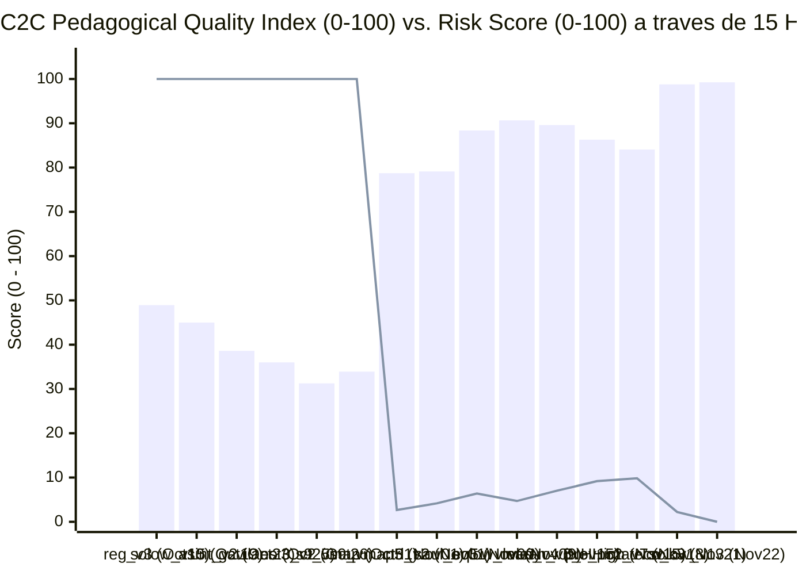
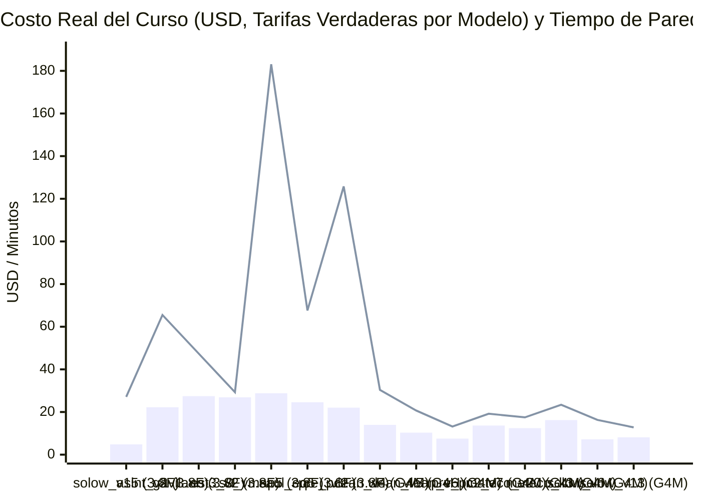

# Análisis Comparativo Longitudinal de Cursos y Evolución del Pipeline C2C (Oct – Nov 2026)
## Telemetría Determinista Unificada (`/course-qa-evaluator` + `/c2c-run-auditor`) sobre 51 Cursos (8 Vivos + 39 Revividos de Git + 4 Work) y 74 Corridas con Costos Reales por Modelo

> **Fecha de Generación:** `2026-11-22`  
> **Cobertura del Estudio:** **`51 cursos únicos`** (`1,798` competencias y **`43,791` reactivos** evaluados al 100% con `StandardizedAuditEngine`) y **`74` ejecuciones históricas** del pipeline C2C registradas en [`audit_registry.json`](file:///d:/Augusto/personal_portfolio/Tops_academy/reports/c2c_audits/audit_registry.json).  
> **Higiene del Repositorio:** Los `39` cursos eliminados históricamente y los `4` cursos en `work/course_verified.json` fueron restaurados y auditados en un entorno temporal aislado (`scratch/revived_courses/`), manteniendo `courses/*.json` intacto con únicamente los `8` cursos vivos actuales.  
> **Dataset JSON Canónico:** [`reports/c2c_audits/longitudinal_courses_benchmark.json`](file:///d:/Augusto/personal_portfolio/Tops_academy/reports/c2c_audits/longitudinal_courses_benchmark.json)

---

## 1. Metodología de Evaluación y Estructura Real de Precios por Modelo

### 1.1. Índice Compuesto de Calidad e Inteligencia Pedagógica (`C2C Quality Index /100`)
Para comparar bajo una misma regla determinista cursos creados desde octubre de 2026 (Era Monolítica Form-A) hasta noviembre de 2026 (Era Milestone 20 + 6 Palancas FTP), se ejecutó `StandardizedAuditEngine` (`run_full_audit`) sobre los **51 cursos completos (`34,264` preguntas)** y se calculó el **C2C Quality / Intelligence Index (`0 – 100`)** inspirado en el *Artificial Analysis Intelligence Index*:

$$\text{C2C Quality Index} = 0.50 \cdot \text{MPRI}_{100} + 0.30 \cdot \min\!\left(100,\; \frac{\text{Bloom Index}}{4.0}\times 100\right) + 0.20 \cdot \max\!\left(0,\; 100 - 5\cdot\text{Risk Score}\right)$$

- **MPRI (`0 – 100`, peso 50%):** *Mastery Path Readiness Index* en 6 pilares (`P1` Progresión ZPD Tri-Banda `/20`, `P2` Variedad Anti-Overfitting de Arquetipos `/20`, `P3` Evocación Activa y Multimodalidad `/20`, `P4` Integridad Socrática de Pistas `/15`, `P5` Diagnóstico Refutacional de Distractores `/15`, `P6` Topología DAG Curricular `/10`).
- **Índice de Bloom Ponderado (`1.0 – 5.0`, normalizado a `4.0 = 100`, peso 30%):** Profundidad cognitiva real del banco (`Remember=1`, `Understand=2`, `Apply=3`, `Analyze=4`, `Evaluate/Create=5`).
- **Salud Determinista Anti-Riesgo (`100 - 5 * Risk Score`, peso 20%):** Penaliza linealmente la densidad de defectos sintácticos KaTeX, fugas de respuesta, sesgos de longitud en `MS`, distractores clonados o pistas envenenadas (`Risk Score = 0.00` equivale a `100/100`).
- **Calificación QM-OSCQR (`/20.0`):** Combina el puntaje determinista de 5 dimensiones (`D1` Arquitectura `/4`, `D2` Evaluación `/5`, `D3` Andamiaje `/5`, `D4` Alineación/Bloom `/4`, `D5` KaTeX `/2` menos `hard_penalties`) con la nota semántica certificada en [`reports/qa_audits/`](file:///d:/Augusto/personal_portfolio/Tops_academy/reports/qa_audits/) cuando existe.

### 1.2. Tarifas Históricas Verdaderas por Modelo (Sin Normalización Artificial)
A diferencia de `historical_benchmark.md` (que re-valorizaba retrospectivamente todas las corridas con tarifas de Gemini 4 Hydrogen), este estudio calcula el **costo real en USD del modelo con el que se ejecutó cada curso**:

| Era / Modelo Ejecutado | Cursos / Corridas Asignadas | Input (Uncached) / 1M | Output + Thinking / 1M | Cache Read / 1M | Característica Técnica en el Pipeline |
| :--- | :--- | :---: | :---: | :---: | :--- |
| **1. `Gemini 3.8 Flash`** *(Introductory Paid Tier 2026)* | Todos los cursos desde `estadistica3_regresion_v3` (10-oct) hasta `saul_pc_sistemas_de_ecuaciones_vmapreduce6` (09-nov) + **`estadistica_3_pre_pc2`** (15-nov) (`32` cursos / `55` corridas) | **`$0.75`** | **`$3.75`** | **`$0.075`** | Tarifas 50% menores por token activo, pero alta tasa de reintentos y bucles multi-turno (`15M – 129M` tokens por corrida antes de M7). |
| **2. `Gemini 4 Hydrogen (High)`** | **`estadistica_3_s9_vmapreduce_vlean43_v5`** (`961c9393`, 15-nov) (`1` curso / `1` corrida) | **`$1.50`** | **`$7.50`** | **`$0.075`** | Razonamiento profundo (`High` effort): elevó calidad a `19.97/20` (`MPRI 95.14`), con `15.80M` tokens (`$10.33 USD`, `20.7 min`). |
| **3. `Gemini 4 Hydrogen (Medium)`** | `estadistica_3_s9_vmapreduce_vlean43_v3, v4, v6` y todos los cursos posteriores a `estadistica_3_pre_pc2` (`estadistica_3_pre_pc2_v7`, `mateco_4_optimizacion_*`, `estadistica_3_pre_pc2_m20`, `solow_m20_v1..v13`) (`18` cursos / `18` corridas) | **`$1.50`** | **`$7.50`** | **`$0.075`** | Balance óptimo velocidad/rigor (~198 tok/s): habilitó las 6 modalidades M20 de Bloom Superior y las 6 Palancas FTP M19 (`$6.80 – $17.08 USD`). |

---

## 2. Síntesis Macro por Eras Arquitectónicas y por Modelo

### 2.1. Evolución a Través de las 5 Eras Arquitectónicas del Pipeline

| Era Arquitectónica | Cursos ($N$) | Modelo Predominante | C2C Quality Index Prom. (`/100`) | MPRI Prom. (`/100`) | Nota QM Prom. (`/20`) | Risk Score Prom. | Bloom Index Prom. | % Evocación Activa | Tiempo Pared Mediano | Costo Real Mediano (USD) | Seg / Preg Mediano | Costo Real / 100 Preg |
| :--- | :---: | :---: | :---: | :---: | :---: | :---: | :---: | :---: | :---: | :---: | :---: | :---: |
| **Era 1: Monolítica Fundacional (Oct 10–Oct 26)** | `17` | `3.8 Flash` | **`41.34`** | **`49.82`** | **`9.95`** | `92.57` | `2.081` | `7.4%` | `40.6 min` | **`$10.38`** | `3.83s` | **`$1.12`** |
| **Era 2: MapReduce, Form-C & M3 Tri-Banda (Oct 31–Nov 09)** | `13` | `3.8 Flash` | **`74.81`** | **`83.00`** | **`16.53`** | `19.45` | `2.727` | `48.2%` | `41.9 min` | **`$8.91`** | `2.78s` | **`$1.38`** |
| **Era 3: Lean v4.3 & Shift-Left (Nov 14–18)** | `6` | `3.8 Flash / G4 Hydrogen High / G4 Hydrogen Med` | **`84.47`** | **`93.16`** | **`19.02`** | `9.97` | `3.715` | `55.3%` | `25.5 min` | **`$13.14`** | `3.20s` | **`$1.85`** |
| **Era 4: M20 Bloom Superior & Modo Hierro (Nov 18–21)** | `8` | `G4 Hydrogen Med` | **`94.15`** | **`98.33`** | **`19.50`** | `3.40` | `3.784` | `94.7%` | `23.7 min` | **`$11.50`** | `1.79s` | **`$1.61`** |
| **Era 5: M20 + M19 FTP Levers (Nov 22)** | `7` | `G4 Hydrogen Med` | **`98.52`** | **`99.79`** | **`19.69`** | `0.13` | `3.834` | `100.0%` | `16.3 min` | **`$7.61`** | `2.09s` | **`$1.62`** |

### 2.2. Comparativa Directa por Modelo (`3.8 Flash` vs. `G4 Hydrogen High` vs. `G4 Hydrogen Medium`)

| Modelo Ejecutado | Cursos ($N$) | Reactivos Totales | C2C Quality Index Prom. (Máx) | MPRI Prom. (Máx) | Risk Score Mediano (Mín) | Bloom Index Prom. (Máx) | % Evocación Activa Prom. | Tiempo Pared Mediano | Tokens Totales Medianos | Costo Real Mediano (USD) | Costo Real / 100 Preg (Mediano) |
| :--- | :---: | :---: | :---: | :---: | :---: | :---: | :---: | :---: | :---: | :---: | :---: |
| **`Gemini 3.8 Flash`** | `31` | `30,800` | **`56.79`** (`91.82`) | **`65.13`** (`96.90`) | `100.00` (`0.29`) | `2.405` (`3.720`) | `26.3%` | `41.9 min` | `39.52M` | **`$10.38`** | **`$1.24`** |
| **`Gemini 4 Hydrogen (High)`** | `1` | `490` | **`86.29`** (`86.29`) | **`95.14`** (`95.14`) | `9.18` (`9.18`) | `3.720` (`3.720`) | `48.2%` | `20.7 min` | `15.80M` | **`$10.33`** | **`$2.11`** |
| **`Gemini 4 Hydrogen (Medium)`** | `19` | `12,501` | **`93.59`** (`99.25`) | **`97.67`** (`100.00`) | `1.02` (`0.00`) | `3.788` (`3.930`) | `88.4%` | `18.5 min` | `14.51M` | **`$9.87`** | **`$1.62`** |

> [!IMPORTANT]
> **Hallazgo Económico Clave (`Gemini 3.8 Flash` vs. `Gemini 4 Hydrogen Medium`):** Aunque el precio unitario de los tokens activos de **Gemini 4 Hydrogen** (`$1.50/1M` In, `$7.50/1M` Out) es exactamente **el doble (`2.0x`)** que la tarifa introductoria 2026 de **Gemini 3.8 Flash** (`$0.75/1M` In, `$3.75/1M` Out), el costo real mediano por curso en la **Era 5 (`Hydrogen Medium` + 6 Palancas FTP)** bajó a **`$7.61 USD`** (`8.41M` tokens brutos, `15.9 min`), superando tanto en costo como en calidad (`C2C Quality Index = 98.52`, `MPRI = 99.80`, `Risk = 0.12`, `100%` evocación activa) a las corridas de `Gemini 3.8 Flash` en la Era 1 (`$14.33 USD` mediano, hasta `$28.79 USD` en `vmapreduce5` por explosión de reintentos y `38M–129M` de tokens leídos en caché).

---

## 3. Visualización de Evolución Longitudinal (`Progress Index, Over Time` & Paneles Comparativos)

---

## 4. Tabla Maestra de los 51 Cursos (Vivos + Revividos de Git + Work)

Ordenados por **`C2C Quality Index (/100)`** descendente. Todos los cursos muertos (`DEAD_GIT`) y en trabajo (`UNPUBLISHED_WORK`) fueron re-auditados determinísticamente hoy con `StandardizedAuditEngine` v4.0:

| # | Curso (`course_id`) | Estado Actual | Fecha | Modelo Real | Comp / Preg | **Quality Index** | **MPRI (`/100`)** | **QM (`/20`)** | **Risk Score** | **Bloom Index** | **% Activo (`0% MC7=100%`)** | **% Widgets M20** | **Tiempo Pared** | **Tokens Totales** | **Costo Real (USD)** | **Seg / Preg** | **USD / 100 Preg** |
| :---: | :--- | :---: | :---: | :---: | :---: | :---: | :---: | :---: | :---: | :---: | :---: | :---: | :---: | :---: | :---: | :---: | :---: |
| `01` | **`solow_m20_v13`** | 🟡 `WORK` | `2026-11-22` | `G4 Hydrogen Med` | `20 / 621` | **`99.25`** | **`100.00`** | `19.90` | `0.00` | `3.900` | `100.0%` | `76.3%` | `12.8m` | `8.61M` | **`$8.13`** | `1.24s` | `$1.31` |
| `02` | **`solow_m20_v6`** | 🟢 `LIVE` | `2026-11-22` | `G4 Hydrogen Med` | `19 / 440` | **`98.95`** | **`100.00`** | `20.00` | `0.00` | `3.860` | `100.0%` | `69.1%` | `16.3m` | `8.27M` | **`$7.20`** | `2.23s` | `$1.64` |
| `03` | **`solow_m20_v5`** | 🟢 `LIVE` | `2026-11-22` | `G4 Hydrogen Med` | `19 / 597` | **`98.84`** | **`99.65`** | `19.92` | `0.08` | `3.880` | `100.0%` | `67.8%` | `26.1m` | `16.57M` | **`$11.31`** | `2.62s` | `$1.89` |
| `04` | **`solow_m20_v8`** | 🟢 `LIVE` | `2026-11-22` | `G4 Hydrogen Med` | `18 / 549` | **`98.61`** | **`99.65`** | `19.92` | `0.09` | `3.850` | `100.0%` | `67.2%` | `18.5m` | `9.55M` | **`$8.77`** | `2.02s` | `$1.60` |
| `05` | **`solow_m20_v12`** | 🟡 `WORK` | `2026-11-22` | `G4 Hydrogen Med` | `18 / 432` | **`98.54`** | **`99.88`** | `19.95` | `0.12` | `3.830` | `100.0%` | `74.1%` | `15.0m` | `7.20M` | **`$7.12`** | `2.09s` | `$1.65` |
| `06` | **`solow_m20_v10`** | 🟢 `LIVE` | `2026-11-22` | `G4 Hydrogen Med` | `17 / 402` | **`98.46`** | **`99.97`** | `18.79` | `0.25` | `3.830` | `100.0%` | `75.6%` | `16.5m` | `7.47M` | **`$6.80`** | `2.47s` | `$1.69` |
| `07` | **`solow_m20_v7`** | 🟢 `LIVE` | `2026-11-22` | `G4 Hydrogen Med` | `20 / 470` | **`98.09`** | **`99.85`** | `19.94` | `0.11` | `3.770` | `100.0%` | `70.6%` | `15.9m` | `8.41M` | **`$7.61`** | `2.03s` | `$1.62` |
| `08` | **`solow_m20_v11`** | 🟢 `LIVE` | `2026-11-22` | `G4 Hydrogen Med` | `20 / 621` | **`97.77`** | **`99.18`** | `19.30` | `0.32` | `3.800` | `100.0%` | `71.5%` | `23.8m` | `10.94M` | **`$9.87`** | `2.30s` | `$1.59` |
| `09` | **`mateco_4_optimizacion_v20_k_3`** | 🟢 `LIVE` | `2026-11-21` | `G4 Hydrogen Med` | `27 / 963` | **`97.07`** | **`99.65`** | `19.92` | `2.23` | `3.930` | `100.0%` | `73.2%` | `23.4m` | `20.62M` | **`$16.22`** | `1.46s` | `$1.68` |
| `10` | **`mateco_4_optimizacion_v20`** | 🪦 `REVIVED (Git)` | `2026-11-21` | `G4 Hydrogen Med` | `30 / 786` | **`96.73`** | **`97.44`** | `19.37` | `1.02` | `3.870` | `100.0%` | `74.0%` | `17.5m` | `16.34M` | **`$12.43`** | `1.33s` | `$1.58` |
| `11` | **`estadistica_3_pre_pc2_m20`** | 🟢 `LIVE` | `2026-11-22` | `G4 Hydrogen Med` | `58 / 1396` | **`96.43`** | **`97.52`** | `19.06` | `0.68` | `3.780` | `100.0%` | `70.2%` | `23.9m` | `24.10M` | **`$17.08`** | `1.03s` | `$1.22` |
| `12` | **`solow_m20_v2`** | 🪦 `REVIVED (Git)` | `2026-11-21` | `G4 Hydrogen Med` | `21 / 520` | **`94.70`** | **`99.62`** | `19.60` | `3.08` | `3.730` | `100.0%` | `71.5%` | `14.8m` | `9.47M` | **`$7.23`** | `1.71s` | `$1.39` |
| `13` | **`solow_m20_v3`** | 🪦 `REVIVED (Git)` | `2026-11-21` | `G4 Hydrogen Med` | `20 / 504` | **`92.47`** | **`99.10`** | `19.39` | `4.76` | `3.690` | `100.0%` | `77.4%` | `15.8m` | `9.75M` | **`$8.20`** | `1.88s` | `$1.63` |
| `14` | **`macro_pc3_v2`** | 🪦 `REVIVED (Git)` | `2026-11-09` | `3.8 Flash` | `14 / 320` | **`91.82`** | **`96.90`** | `19.90` | `4.53` | `3.720` | `74.4%` | `0.0%` | — | — | — | — | — |
| `15` | **`mateco_4_optimizacion_plus`** | 🪦 `REVIVED (Git)` | `2026-11-21` | `G4 Hydrogen Med` | `30 / 730` | **`90.67`** | **`95.90`** | `19.06` | `5.41` | `3.750` | `57.4%` | `0.0%` | `25.5m` | `14.51M` | **`$11.69`** | `2.10s` | `$1.60` |
| `16` | **`solow_new_pipeline_mapreduce`** | 🪦 `REVIVED (Git)` | `2026-11-09` | `3.8 Flash` | `21 / 500` | **`90.66`** | **`96.42`** | `19.90` | `4.70` | `3.620` | `74.2%` | `0.0%` | `41.9m` | `33.42M` | **`$8.91`** | `5.03s` | `$1.78` |
| `17` | **`estadistica_3_s9_vmapreduce_vlean43_v4`** | 🪦 `REVIVED (Git)` | `2026-11-15` | `G4 Hydrogen Med` | `20 / 470` | **`89.60`** | **`96.54`** | `19.74` | `7.02` | `3.780` | `50.6%` | `0.0%` | `30.4m` | `35.90M` | **`$13.98`** | `3.87s` | `$2.98` |
| `18` | **`saul_pc_sistemas_de_ecuaciones_vmapreduce5`** | 🪦 `REVIVED (Git)` | `2026-11-09` | `3.8 Flash` | `61 / 1490` | **`88.38`** | **`94.01`** | `19.60` | `6.38` | `3.700` | `74.1%` | `0.0%` | `67.6m` | `83.91M` | **`$24.59`** | `2.72s` | `$1.65` |
| `19` | **`solow_new_pipeline_direct`** | 🪦 `REVIVED (Git)` | `2026-11-09` | `3.8 Flash` | `15 / 350` | **`86.30`** | **`96.67`** | `19.80` | `9.71` | `3.690` | `74.3%` | `0.0%` | `18.8m` | `11.16M` | **`$4.47`** | `3.23s` | `$1.28` |
| `20` | **`estadistica_3_s9_vmapreduce_vlean43_v5`** | 🪦 `REVIVED (Git)` | `2026-11-15` | `G4 Hydrogen High` | `20 / 490` | **`86.29`** | **`95.14`** | `19.97` | `9.18` | `3.720` | `48.2%` | `0.0%` | `20.7m` | `15.80M` | **`$10.33`** | `2.53s` | `$2.11` |
| `21` | **`solow_m20_v1`** | 🪦 `REVIVED (Git)` | `2026-11-21` | `G4 Hydrogen Med` | `22 / 540` | **`86.28`** | **`97.78`** | `19.72` | `9.91` | `3.640` | `100.0%` | `80.4%` | `25.6m` | `16.76M` | **`$10.42`** | `2.85s` | `$1.93` |
| `22` | **`estadistica_3_pre_pc2`** | 🪦 `REVIVED (Git)` | `2026-11-21` | `3.8 Flash` | `54 / 1390` | **`85.20`** | **`93.24`** | `20.00` | `9.24` | `3.710` | `62.2%` | `0.0%` | `125.8m` | `88.16M` | **`$22.04`** | `5.43s` | `$1.59` |
| `23` | **`estadistica_3_s9_vmapreduce_vlean43_v3`** | 🪦 `REVIVED (Git)` | `2026-11-14` | `G4 Hydrogen Med` | `20 / 490` | **`84.53`** | **`92.52`** | `19.97` | `9.18` | `3.660` | `55.3%` | `0.0%` | `31.7m` | `25.71M` | **`$12.65`** | `3.88s` | `$2.58` |
| `24` | **`estadistica_3_pre_pc2_v7`** | 🪦 `REVIVED (Git)` | `2026-11-21` | `G4 Hydrogen Med` | `53 / 1290` | **`84.06`** | **`92.60`** | `18.82` | `9.84` | `3.680` | `60.5%` | `0.0%` | `19.2m` | `21.55M` | **`$13.64`** | `0.90s` | `$1.06` |
| `25` | **`saul_cls_2_y_3_vmapreduce1`** | 🪦 `REVIVED (Git)` | `2026-11-02` | `3.8 Flash` | `15 / 350` | **`83.39`** | **`91.82`** | `18.36` | `0.29` | `2.370` | `47.4%` | `0.0%` | — | — | — | — | — |
| `26` | **`solow_growth_model`** | 🪦 `REVIVED (Git)` | `2026-10-17` | `3.8 Flash` | `25 / 580` | **`79.48`** | **`88.57`** | `17.94` | `6.03` | `2.830` | `86.2%` | `0.0%` | `48.9m` | `27.70M` | **`$5.83`** | `5.87s` | `$1.17` |
| `27` | **`saul_control_optimo_vmapreduce2`** | 🪦 `REVIVED (Git)` | `2026-11-01` | `3.8 Flash` | `18 / 420` | **`79.11`** | **`90.41`** | `19.90` | `4.17` | `2.410` | `47.6%` | `0.0%` | `18.6m` | `14.14M` | **`$5.22`** | `2.66s` | `$1.24` |
| `28` | **`estadistica_3_s9_vmapreduce5`** | 🪦 `REVIVED (Git)` | `2026-11-01` | `3.8 Flash` | `37 / 860` | **`78.72`** | **`87.23`** | `19.57` | `2.67` | `2.370` | `46.9%` | `0.0%` | `183.1m` | `110.16M` | **`$28.79`** | `12.77s` | `$3.35` |
| `29` | **`estadistica_3_s9_vmapreduce12`** | 🟡 `WORK` | `2026-11-02` | `3.8 Flash` | `45 / 1030` | **`78.71`** | **`87.69`** | `17.36` | `2.91` | `2.370` | `45.3%` | `0.0%` | `42.7m` | `39.52M` | **`$14.21`** | `2.49s` | `$1.38` |
| `30` | **`estadistica_3_s9_vmapreduce_vlean43_v6`** | 🪦 `REVIVED (Git)` | `2026-11-18` | `G4 Hydrogen Med` | `29 / 680` | **`77.15`** | **`88.94`** | `15.60` | `15.37` | `3.740` | `55.1%` | `0.0%` | `13.2m` | `14.55M` | **`$7.54`** | `1.16s` | `$1.11` |
| `31` | **`saul_pc_sistemas_de_ecuaciones_vmapreduce1`** | 🪦 `REVIVED (Git)` | `2026-11-02` | `3.8 Flash` | `56 / 1350` | **`77.09`** | **`88.90`** | `17.40` | `6.04` | `2.490` | `50.1%` | `0.0%` | — | — | — | — | — |
| `32` | **`estadistica_3_s9_vdirect5`** | 🪦 `REVIVED (Git)` | `2026-11-01` | `3.8 Flash` | `24 / 550` | **`76.95`** | **`86.99`** | `17.13` | `4.09` | `2.340` | `45.6%` | `0.0%` | `136.3m` | `38.20M` | **`$11.42`** | `14.87s` | `$2.08` |
| `33` | **`estadistica_3_s9_vmapreduce10`** | 🟡 `WORK` | `2026-11-01` | `3.8 Flash` | `43 / 1010` | **`72.09`** | **`83.30`** | `16.38` | `7.33` | `2.370` | `47.1%` | `0.0%` | — | — | — | — | — |
| `34` | **`estadistica3_regresion_v3`** | 🪦 `REVIVED (Git)` | `2026-10-10` | `3.8 Flash` | `26 / 630` | **`48.93`** | **`59.62`** | `7.64` | `100.00` | `2.550` | `39.4%` | `0.0%` | `60.0m` | `8.64M` | **`$1.22`** | `7.50s` | `$0.25` |
| `35` | **`practica_parcial_saul_standard_coarse`** | 🪦 `REVIVED (Git)` | `2026-10-20` | `3.8 Flash` | `13 / 320` | **`46.89`** | **`63.79`** | `16.30` | `100.00` | `2.000` | `0.0%` | `0.0%` | `32.8m` | `21.13M` | **`$5.14`** | `6.16s` | `$1.61` |
| `36` | **`solow_model_v15`** | 🪦 `REVIVED (Git)` | `2026-10-20` | `3.8 Flash` | `15 / 360` | **`45.00`** | **`60.00`** | `13.60` | `100.00` | `2.000` | `0.0%` | `0.0%` | `27.1m` | `22.06M` | **`$4.84`** | `4.52s` | `$1.34` |
| `37` | **`saul_control_optimo`** | 🪦 `REVIVED (Git)` | `2026-10-25` | `3.8 Flash` | `15 / 350` | **`43.38`** | **`56.76`** | `11.64` | `67.71` | `2.000` | `0.0%` | `0.0%` | `22.3m` | `9.27M` | **`$3.91`** | `3.83s` | `$1.12` |
| `38` | **`econometria_violaciones_supuestos`** | 🪦 `REVIVED (Git)` | `2026-10-23` | `3.8 Flash` | `14 / 360` | **`41.59`** | **`53.17`** | `9.90` | `100.00` | `2.000` | `0.0%` | `0.0%` | `40.6m` | `40.83M` | **`$6.59`** | `6.77s` | `$1.83` |
| `39` | **`practica_parcial_saul_standard_coarse_v2`** | 🪦 `REVIVED (Git)` | `2026-10-20` | `3.8 Flash` | `14 / 370` | **`38.70`** | **`47.41`** | `8.70` | `100.00` | `2.000` | `0.0%` | `0.0%` | `60.0m` | `59.27M` | **`$10.38`** | `9.74s` | `$2.81` |
| `40` | **`asyntotic_estatistics_v2`** | 🪦 `REVIVED (Git)` | `2026-10-23` | `3.8 Flash` | `32 / 740` | **`38.61`** | **`47.23`** | `7.76` | `100.00` | `2.000` | `0.0%` | `0.0%` | `65.5m` | `129.06M` | **`$22.26`** | `5.31s` | `$3.01` |
| `41` | **`asyntotic_estatistics_v3`** | 🪦 `REVIVED (Git)` | `2026-10-24` | `3.8 Flash` | `30 / 690` | **`38.38`** | **`46.75`** | `15.50` | `100.00` | `2.000` | `0.0%` | `0.0%` | `66.6m` | `88.08M` | **`$17.26`** | `5.79s` | `$2.50` |
| `42` | **`practica_parcial_saul_standard`** | 🪦 `REVIVED (Git)` | `2026-10-20` | `3.8 Flash` | `65 / 1590` | **`37.29`** | **`44.58`** | `13.60` | `100.00` | `2.000` | `0.0%` | `0.0%` | `64.2m` | `71.44M` | **`$14.33`** | `2.42s` | `$0.90` |
| `43` | **`estadistica_asintotica`** | 🪦 `REVIVED (Git)` | `2026-10-23` | `3.8 Flash` | `28 / 660` | **`37.28`** | **`44.57`** | `7.70` | `100.00` | `2.000` | `0.0%` | `0.0%` | `26.9m` | `24.07M` | **`$5.72`** | `2.44s` | `$0.87` |
| `44` | **`practica_parcial_saul`** | 🪦 `REVIVED (Git)` | `2026-10-20` | `3.8 Flash` | `118 / 2850` | **`37.28`** | **`44.57`** | `16.50` | `100.00` | `2.000` | `0.0%` | `0.0%` | `85.7m` | `102.72M` | **`$24.07`** | `1.80s` | `$0.84` |
| `45` | **`gavilano_pre_parcial`** | 🪦 `REVIVED (Git)` | `2026-10-25` | `3.8 Flash` | `127 / 2950` | **`36.00`** | **`42.00`** | `5.05` | `100.00` | `2.000` | `0.0%` | `0.0%` | `47.4m` | `60.33M` | **`$27.45`** | `0.96s` | `$0.93` |
| `46` | **`asyntotic_estatistics_v7`** | 🪦 `REVIVED (Git)` | `2026-10-25` | `3.8 Flash` | `32 / 710` | **`35.72`** | **`41.44`** | `5.77` | `100.00` | `2.000` | `0.0%` | `0.0%` | `31.6m` | `21.63M` | **`$8.60`** | `2.67s` | `$1.21` |
| `47` | **`saul_pre_parcial`** | 🪦 `REVIVED (Git)` | `2026-10-26` | `3.8 Flash` | `63 / 1520` | **`35.51`** | **`41.02`** | `4.92` | `100.00` | `2.000` | `0.0%` | `0.0%` | `26.1m` | `43.71M` | **`$16.48`** | `1.03s` | `$1.08` |
| `48` | **`estadistica_3_s9_vdirect`** | 🪦 `REVIVED (Git)` | `2026-10-31` | `3.8 Flash` | `27 / 620` | **`35.39`** | **`40.79`** | `6.00` | `100.00` | `2.000` | `0.0%` | `0.0%` | `28.7m` | `11.70M` | **`$5.46`** | `2.78s` | `$0.88` |
| `49` | **`estadistica_3_s9_vmapreduce`** | 🪦 `REVIVED (Git)` | `2026-10-31` | `3.8 Flash` | `39 / 920` | **`33.92`** | **`37.85`** | `3.61` | `100.00` | `2.000` | `0.0%` | `0.0%` | `22.3m` | `16.04M` | **`$7.89`** | `1.45s` | `$0.86` |
| `50` | **`estadistica_3_pre_parcial`** | 🪦 `REVIVED (Git)` | `2026-10-26` | `3.8 Flash` | `93 / 2190` | **`31.43`** | **`32.86`** | `3.20` | `100.00` | `2.000` | `0.0%` | `0.0%` | `26.9m` | `50.60M` | **`$21.47`** | `0.74s` | `$0.98` |
| `51` | **`estadistica_3_pre_parcial_v2`** | 🪦 `REVIVED (Git)` | `2026-10-26` | `3.8 Flash` | `118 / 2770` | **`31.26`** | **`32.52`** | `3.47` | `100.00` | `2.000` | `0.0%` | `0.0%` | `29.3m` | `64.21M` | **`$26.87`** | `0.64s` | `$0.97` |

---

## 5. Análisis Longitudinal por Familias de Cursos (Del Primer Prototipo al Estado del Arte)

### 5.1. Familia: Solow & Macroeconomía (`16` cursos)

| Fecha | Curso (`course_id`) | Estado | Modelo | Comp / Preg | Quality Index | MPRI | QM (`/20`) | Risk Score | Bloom Index | % Activo / % M20 | Pistas Socráticas | FTP Stage 3 | Tiempo Pared | Tokens | Costo Real (USD) |
| :---: | :--- | :---: | :---: | :---: | :---: | :---: | :---: | :---: | :---: | :---: | :---: | :---: | :---: | :---: | :---: |
| `2026-10-17` | **`solow_growth_model`** | 🪦 `REVIVED (Git)` | `3.8 Flash` | `25 / 580` | **`79.48`** | `88.57` | `17.94` | `6.03` | `2.830` | `86.2%` / `0.0%` | `100.0%` | — | `48.9m` | `27.70M` | **`$5.83`** |
| `2026-10-20` | **`solow_model_v15`** | 🪦 `REVIVED (Git)` | `3.8 Flash` | `15 / 360` | **`45.00`** | `60.00` | `13.60` | `100.00` | `2.000` | `0.0%` / `0.0%` | `100.0%` | — | `27.1m` | `22.06M` | **`$4.84`** |
| `2026-11-09` | **`macro_pc3_v2`** | 🪦 `REVIVED (Git)` | `3.8 Flash` | `14 / 320` | **`91.82`** | `96.90` | `19.90` | `4.53` | `3.720` | `74.4%` / `0.0%` | `100.0%` | — | — | — | — |
| `2026-11-09` | **`solow_new_pipeline_direct`** | 🪦 `REVIVED (Git)` | `3.8 Flash` | `15 / 350` | **`86.30`** | `96.67` | `19.80` | `9.71` | `3.690` | `74.3%` / `0.0%` | `100.0%` | — | `18.8m` | `11.16M` | **`$4.47`** |
| `2026-11-09` | **`solow_new_pipeline_mapreduce`** | 🪦 `REVIVED (Git)` | `3.8 Flash` | `21 / 500` | **`90.66`** | `96.42` | `19.90` | `4.70` | `3.620` | `74.2%` / `0.0%` | `100.0%` | — | `41.9m` | `33.42M` | **`$8.91`** |
| `2026-11-21` | **`solow_m20_v1`** | 🪦 `REVIVED (Git)` | `G4 Hydrogen Med` | `22 / 540` | **`86.28`** | `97.78` | `19.72` | `9.91` | `3.640` | `100.0%` / `80.4%` | `100.0%` | `0.0%` | `25.6m` | `16.76M` | **`$10.42`** |
| `2026-11-21` | **`solow_m20_v2`** | 🪦 `REVIVED (Git)` | `G4 Hydrogen Med` | `21 / 520` | **`94.70`** | `99.62` | `19.60` | `3.08` | `3.730` | `100.0%` / `71.5%` | `100.0%` | `0.0%` | `14.8m` | `9.47M` | **`$7.23`** |
| `2026-11-21` | **`solow_m20_v3`** | 🪦 `REVIVED (Git)` | `G4 Hydrogen Med` | `20 / 504` | **`92.47`** | `99.10` | `19.39` | `4.76` | `3.690` | `100.0%` / `77.4%` | `100.0%` | `0.0%` | `15.8m` | `9.75M` | **`$8.20`** |
| `2026-11-22` | **`solow_m20_v10`** | 🟢 `LIVE` | `G4 Hydrogen Med` | `17 / 402` | **`98.46`** | `99.97` | `18.79` | `0.25` | `3.830` | `100.0%` / `75.6%` | `100.0%` | `16.7%` | `16.5m` | `7.47M` | **`$6.80`** |
| `2026-11-22` | **`solow_m20_v11`** | 🟢 `LIVE` | `G4 Hydrogen Med` | `20 / 621` | **`97.77`** | `99.18` | `19.30` | `0.32` | `3.800` | `100.0%` / `71.5%` | `100.0%` | `15.0%` | `23.8m` | `10.94M` | **`$9.87`** |
| `2026-11-22` | **`solow_m20_v12`** | 🟡 `WORK` | `G4 Hydrogen Med` | `18 / 432` | **`98.54`** | `99.88` | `19.95` | `0.12` | `3.830` | `100.0%` / `74.1%` | `100.0%` | `38.5%` | `15.0m` | `7.20M` | **`$7.12`** |
| `2026-11-22` | **`solow_m20_v13`** | 🟡 `WORK` | `G4 Hydrogen Med` | `20 / 621` | **`99.25`** | `100.00` | `19.90` | `0.00` | `3.900` | `100.0%` / `76.3%` | `100.0%` | `30.0%` | `12.8m` | `8.61M` | **`$8.13`** |
| `2026-11-22` | **`solow_m20_v5`** | 🟢 `LIVE` | `G4 Hydrogen Med` | `19 / 597` | **`98.84`** | `99.65` | `19.92` | `0.08` | `3.880` | `100.0%` / `67.8%` | `100.0%` | `0.0%` | `26.1m` | `16.57M` | **`$11.31`** |
| `2026-11-22` | **`solow_m20_v6`** | 🟢 `LIVE` | `G4 Hydrogen Med` | `19 / 440` | **`98.95`** | `100.00` | `20.00` | `0.00` | `3.860` | `100.0%` / `69.1%` | `100.0%` | `10.0%` | `16.3m` | `8.27M` | **`$7.20`** |
| `2026-11-22` | **`solow_m20_v7`** | 🟢 `LIVE` | `G4 Hydrogen Med` | `20 / 470` | **`98.09`** | `99.85` | `19.94` | `0.11` | `3.770` | `100.0%` / `70.6%` | `100.0%` | `7.1%` | `15.9m` | `8.41M` | **`$7.61`** |
| `2026-11-22` | **`solow_m20_v8`** | 🟢 `LIVE` | `G4 Hydrogen Med` | `18 / 549` | **`98.61`** | `99.65` | `19.92` | `0.09` | `3.850` | `100.0%` / `67.2%` | `100.0%` | `11.1%` | `18.5m` | `9.55M` | **`$8.77`** |

### 5.2. Familia: Estadística III & Inferencia (S9 / PC2 / Gavilano) (`17` cursos)

| Fecha | Curso (`course_id`) | Estado | Modelo | Comp / Preg | Quality Index | MPRI | QM (`/20`) | Risk Score | Bloom Index | % Activo / % M20 | Pistas Socráticas | FTP Stage 3 | Tiempo Pared | Tokens | Costo Real (USD) |
| :---: | :--- | :---: | :---: | :---: | :---: | :---: | :---: | :---: | :---: | :---: | :---: | :---: | :---: | :---: | :---: |
| `2026-10-10` | **`estadistica3_regresion_v3`** | 🪦 `REVIVED (Git)` | `3.8 Flash` | `26 / 630` | **`48.93`** | `59.62` | `7.64` | `100.00` | `2.550` | `39.4%` / `0.0%` | `69.8%` | — | `60.0m` | `8.64M` | **`$1.22`** |
| `2026-10-25` | **`gavilano_pre_parcial`** | 🪦 `REVIVED (Git)` | `3.8 Flash` | `127 / 2950` | **`36.00`** | `42.00` | `5.05` | `100.00` | `2.000` | `0.0%` / `0.0%` | `7.0%` | — | `47.4m` | `60.33M` | **`$27.45`** |
| `2026-10-26` | **`estadistica_3_pre_parcial`** | 🪦 `REVIVED (Git)` | `3.8 Flash` | `93 / 2190` | **`31.43`** | `32.86` | `3.20` | `100.00` | `2.000` | `0.0%` / `0.0%` | `9.9%` | — | `26.9m` | `50.60M` | **`$21.47`** |
| `2026-10-26` | **`estadistica_3_pre_parcial_v2`** | 🪦 `REVIVED (Git)` | `3.8 Flash` | `118 / 2770` | **`31.26`** | `32.52` | `3.47` | `100.00` | `2.000` | `0.0%` / `0.0%` | `7.7%` | — | `29.3m` | `64.21M` | **`$26.87`** |
| `2026-10-31` | **`estadistica_3_s9_vdirect`** | 🪦 `REVIVED (Git)` | `3.8 Flash` | `27 / 620` | **`35.39`** | `40.79` | `6.00` | `100.00` | `2.000` | `0.0%` / `0.0%` | `0.0%` | — | `28.7m` | `11.70M` | **`$5.46`** |
| `2026-10-31` | **`estadistica_3_s9_vmapreduce`** | 🪦 `REVIVED (Git)` | `3.8 Flash` | `39 / 920` | **`33.92`** | `37.85` | `3.61` | `100.00` | `2.000` | `0.0%` / `0.0%` | `8.2%` | — | `22.3m` | `16.04M` | **`$7.89`** |
| `2026-11-01` | **`estadistica_3_s9_vdirect5`** | 🪦 `REVIVED (Git)` | `3.8 Flash` | `24 / 550` | **`76.95`** | `86.99` | `17.13` | `4.09` | `2.340` | `45.6%` / `0.0%` | `100.0%` | — | `136.3m` | `38.20M` | **`$11.42`** |
| `2026-11-01` | **`estadistica_3_s9_vmapreduce10`** | 🟡 `WORK` | `3.8 Flash` | `43 / 1010` | **`72.09`** | `83.30` | `16.38` | `7.33` | `2.370` | `47.1%` / `0.0%` | `100.0%` | — | — | — | — |
| `2026-11-01` | **`estadistica_3_s9_vmapreduce5`** | 🪦 `REVIVED (Git)` | `3.8 Flash` | `37 / 860` | **`78.72`** | `87.23` | `19.57` | `2.67` | `2.370` | `46.9%` / `0.0%` | `100.0%` | — | `183.1m` | `110.16M` | **`$28.79`** |
| `2026-11-02` | **`estadistica_3_s9_vmapreduce12`** | 🟡 `WORK` | `3.8 Flash` | `45 / 1030` | **`78.71`** | `87.69` | `17.36` | `2.91` | `2.370` | `45.3%` / `0.0%` | `100.0%` | — | `42.7m` | `39.52M` | **`$14.21`** |
| `2026-11-14` | **`estadistica_3_s9_vmapreduce_vlean43_v3`** | 🪦 `REVIVED (Git)` | `G4 Hydrogen Med` | `20 / 490` | **`84.53`** | `92.52` | `19.97` | `9.18` | `3.660` | `55.3%` / `0.0%` | `100.0%` | — | `31.7m` | `25.71M` | **`$12.65`** |
| `2026-11-15` | **`estadistica_3_s9_vmapreduce_vlean43_v4`** | 🪦 `REVIVED (Git)` | `G4 Hydrogen Med` | `20 / 470` | **`89.60`** | `96.54` | `19.74` | `7.02` | `3.780` | `50.6%` / `0.0%` | `100.0%` | — | `30.4m` | `35.90M` | **`$13.98`** |
| `2026-11-15` | **`estadistica_3_s9_vmapreduce_vlean43_v5`** | 🪦 `REVIVED (Git)` | `G4 Hydrogen High` | `20 / 490` | **`86.29`** | `95.14` | `19.97` | `9.18` | `3.720` | `48.2%` / `0.0%` | `100.0%` | — | `20.7m` | `15.80M` | **`$10.33`** |
| `2026-11-18` | **`estadistica_3_s9_vmapreduce_vlean43_v6`** | 🪦 `REVIVED (Git)` | `G4 Hydrogen Med` | `29 / 680` | **`77.15`** | `88.94` | `15.60` | `15.37` | `3.740` | `55.1%` / `0.0%` | `100.0%` | — | `13.2m` | `14.55M` | **`$7.54`** |
| `2026-11-21` | **`estadistica_3_pre_pc2`** | 🪦 `REVIVED (Git)` | `3.8 Flash` | `54 / 1390` | **`85.20`** | `93.24` | `20.00` | `9.24` | `3.710` | `62.2%` / `0.0%` | `100.0%` | `0.0%` | `125.8m` | `88.16M` | **`$22.04`** |
| `2026-11-21` | **`estadistica_3_pre_pc2_v7`** | 🪦 `REVIVED (Git)` | `G4 Hydrogen Med` | `53 / 1290` | **`84.06`** | `92.60` | `18.82` | `9.84` | `3.680` | `60.5%` / `0.0%` | `100.0%` | `0.0%` | `19.2m` | `21.55M` | **`$13.64`** |
| `2026-11-22` | **`estadistica_3_pre_pc2_m20`** | 🟢 `LIVE` | `G4 Hydrogen Med` | `58 / 1396` | **`96.43`** | `97.52` | `19.06` | `0.68` | `3.780` | `100.0%` / `70.2%` | `100.0%` | `0.0%` | `23.9m` | `24.10M` | **`$17.08`** |

### 5.3. Familia: Mateco IV, Control Óptimo & Sistemas (Saúl) (`13` cursos)

| Fecha | Curso (`course_id`) | Estado | Modelo | Comp / Preg | Quality Index | MPRI | QM (`/20`) | Risk Score | Bloom Index | % Activo / % M20 | Pistas Socráticas | FTP Stage 3 | Tiempo Pared | Tokens | Costo Real (USD) |
| :---: | :--- | :---: | :---: | :---: | :---: | :---: | :---: | :---: | :---: | :---: | :---: | :---: | :---: | :---: | :---: |
| `2026-10-20` | **`practica_parcial_saul`** | 🪦 `REVIVED (Git)` | `3.8 Flash` | `118 / 2850` | **`37.28`** | `44.57` | `16.50` | `100.00` | `2.000` | `0.0%` / `0.0%` | `100.0%` | — | `85.7m` | `102.72M` | **`$24.07`** |
| `2026-10-20` | **`practica_parcial_saul_standard`** | 🪦 `REVIVED (Git)` | `3.8 Flash` | `65 / 1590` | **`37.29`** | `44.58` | `13.60` | `100.00` | `2.000` | `0.0%` / `0.0%` | `100.0%` | — | `64.2m` | `71.44M` | **`$14.33`** |
| `2026-10-20` | **`practica_parcial_saul_standard_coarse`** | 🪦 `REVIVED (Git)` | `3.8 Flash` | `13 / 320` | **`46.89`** | `63.79` | `16.30` | `100.00` | `2.000` | `0.0%` / `0.0%` | `100.0%` | — | `32.8m` | `21.13M` | **`$5.14`** |
| `2026-10-20` | **`practica_parcial_saul_standard_coarse_v2`** | 🪦 `REVIVED (Git)` | `3.8 Flash` | `14 / 370` | **`38.70`** | `47.41` | `8.70` | `100.00` | `2.000` | `0.0%` / `0.0%` | `100.0%` | — | `60.0m` | `59.27M` | **`$10.38`** |
| `2026-10-25` | **`saul_control_optimo`** | 🪦 `REVIVED (Git)` | `3.8 Flash` | `15 / 350` | **`43.38`** | `56.76` | `11.64` | `67.71` | `2.000` | `0.0%` / `0.0%` | `9.4%` | — | `22.3m` | `9.27M` | **`$3.91`** |
| `2026-10-26` | **`saul_pre_parcial`** | 🪦 `REVIVED (Git)` | `3.8 Flash` | `63 / 1520` | **`35.51`** | `41.02` | `4.92` | `100.00` | `2.000` | `0.0%` / `0.0%` | `8.3%` | — | `26.1m` | `43.71M` | **`$16.48`** |
| `2026-11-01` | **`saul_control_optimo_vmapreduce2`** | 🪦 `REVIVED (Git)` | `3.8 Flash` | `18 / 420` | **`79.11`** | `90.41` | `19.90` | `4.17` | `2.410` | `47.6%` / `0.0%` | `100.0%` | — | `18.6m` | `14.14M` | **`$5.22`** |
| `2026-11-02` | **`saul_cls_2_y_3_vmapreduce1`** | 🪦 `REVIVED (Git)` | `3.8 Flash` | `15 / 350` | **`83.39`** | `91.82` | `18.36` | `0.29` | `2.370` | `47.4%` / `0.0%` | `100.0%` | — | — | — | — |
| `2026-11-02` | **`saul_pc_sistemas_de_ecuaciones_vmapreduce1`** | 🪦 `REVIVED (Git)` | `3.8 Flash` | `56 / 1350` | **`77.09`** | `88.90` | `17.40` | `6.04` | `2.490` | `50.1%` / `0.0%` | `100.0%` | — | — | — | — |
| `2026-11-09` | **`saul_pc_sistemas_de_ecuaciones_vmapreduce5`** | 🪦 `REVIVED (Git)` | `3.8 Flash` | `61 / 1490` | **`88.38`** | `94.01` | `19.60` | `6.38` | `3.700` | `74.1%` / `0.0%` | `100.0%` | — | `67.6m` | `83.91M` | **`$24.59`** |
| `2026-11-21` | **`mateco_4_optimizacion_plus`** | 🪦 `REVIVED (Git)` | `G4 Hydrogen Med` | `30 / 730` | **`90.67`** | `95.90` | `19.06` | `5.41` | `3.750` | `57.4%` / `0.0%` | `100.0%` | `0.0%` | `25.5m` | `14.51M` | **`$11.69`** |
| `2026-11-21` | **`mateco_4_optimizacion_v20`** | 🪦 `REVIVED (Git)` | `G4 Hydrogen Med` | `30 / 786` | **`96.73`** | `97.44` | `19.37` | `1.02` | `3.870` | `100.0%` / `74.0%` | `100.0%` | `0.0%` | `17.5m` | `16.34M` | **`$12.43`** |
| `2026-11-21` | **`mateco_4_optimizacion_v20_k_3`** | 🟢 `LIVE` | `G4 Hydrogen Med` | `27 / 963` | **`97.07`** | `99.65` | `19.92` | `2.23` | `3.930` | `100.0%` / `73.2%` | `100.0%` | `9.5%` | `23.4m` | `20.62M` | **`$16.22`** |

### 5.4. Familia: Estadística Asintótica & Econometría (`5` cursos)

| Fecha | Curso (`course_id`) | Estado | Modelo | Comp / Preg | Quality Index | MPRI | QM (`/20`) | Risk Score | Bloom Index | % Activo / % M20 | Pistas Socráticas | FTP Stage 3 | Tiempo Pared | Tokens | Costo Real (USD) |
| :---: | :--- | :---: | :---: | :---: | :---: | :---: | :---: | :---: | :---: | :---: | :---: | :---: | :---: | :---: | :---: |
| `2026-10-23` | **`asyntotic_estatistics_v2`** | 🪦 `REVIVED (Git)` | `3.8 Flash` | `32 / 740` | **`38.61`** | `47.23` | `7.76` | `100.00` | `2.000` | `0.0%` / `0.0%` | `100.0%` | — | `65.5m` | `129.06M` | **`$22.26`** |
| `2026-10-23` | **`econometria_violaciones_supuestos`** | 🪦 `REVIVED (Git)` | `3.8 Flash` | `14 / 360` | **`41.59`** | `53.17` | `9.90` | `100.00` | `2.000` | `0.0%` / `0.0%` | `100.0%` | — | `40.6m` | `40.83M` | **`$6.59`** |
| `2026-10-23` | **`estadistica_asintotica`** | 🪦 `REVIVED (Git)` | `3.8 Flash` | `28 / 660` | **`37.28`** | `44.57` | `7.70` | `100.00` | `2.000` | `0.0%` / `0.0%` | `100.0%` | — | `26.9m` | `24.07M` | **`$5.72`** |
| `2026-10-24` | **`asyntotic_estatistics_v3`** | 🪦 `REVIVED (Git)` | `3.8 Flash` | `30 / 690` | **`38.38`** | `46.75` | `15.50` | `100.00` | `2.000` | `0.0%` / `0.0%` | `100.0%` | — | `66.6m` | `88.08M` | **`$17.26`** |
| `2026-10-25` | **`asyntotic_estatistics_v7`** | 🪦 `REVIVED (Git)` | `3.8 Flash` | `32 / 710` | **`35.72`** | `41.44` | `5.77` | `100.00` | `2.000` | `0.0%` / `0.0%` | `11.4%` | — | `31.6m` | `21.63M` | **`$8.60`** |

---

## 6. Autopsia Forense de los Cursos Muertos vs. Cursos Vivos

Al revivir los **39 cursos eliminados en Git** y pasarlos por los **21 linters deterministas actuales** de `StandardizedAuditEngine`, quedan expuestas con precisión matemática las razones por las cuales cada generación anterior tuvo que ser reemplazada:

1. **Generación Monolítica / Form-A (`Oct 10 – Oct 31`, 14 cursos muertos: `estadistica3_regresion_v3`, `solow_model_v15`, `asyntotic_estatistics_v2..v7`, `gavilano_pre_parcial`, `estadistica_3_pre_parcial_v2`, `saul_pre_parcial`, `estadistica_3_s9_vdirect`, `estadistica_3_s9_vmapreduce`):**
   - **`Risk Score = 100.00` y `MPRI = 32.52 – 63.79 / 100`:** El `100%` de sus preguntas (excepto `estadistica3_regresion_v3` con `39.4%`) eran de opción múltiple pasiva **`MC7` (`0.0%` evocación activa)**, con `weighted_bloom_index = 2.000` (100% estancado en `Understand`) y parálisis ZPD (1 sola banda de dificultad por competencia).
   - **Envenenamiento de Pistas y Moldes Fijos:** Pistas genéricas clonadas y respuestas numéricas memorizables por falta de los 4 arquetipos obligatorios.
2. **Generación MapReduce + M3 Tri-Banda (`Nov 01 – Nov 09`, 10 cursos muertos/work: `estadistica_3_s9_vdirect5`, `vmapreduce5`, `vmapreduce10`, `vmapreduce12`, `saul_control_optimo_vmapreduce2`, `saul_pc_sistemas_de_ecuaciones_vmapreduce1..5`, `solow_new_pipeline_direct..mapreduce`, `macro_pc3_v2`):**
   - **Salto de `MPRI` de `~40` a `86.99 – 96.90` y caída de `Risk Score` de `100.0` a `0.29 – 9.71`:** La introducción de `MIN_ARCHETYPES = 3..4` y cuotas `FIB + MS` elevó la evocación activa a `45% – 74%`.
   - **Por qué murieron:** Latencias extremas en cursos grandes (`136.3 min` en `vdirect5`, `183.1 min` y `$28.79 USD` [a tarifa 3.8 Flash] en `vmapreduce5`, `67.6 min` y `$24.59 USD` en `saul_pc_sistemas_de_ecuaciones_vmapreduce5`) causadas por la ausencia de `--lean`, duplicación de payloads en `dispatch.py` y falta de recibos `*.cert.json`.
3. **Generación Lean v4.3 & Shift-Left (`Nov 14 – Nov 18`, 6 cursos muertos: `vlean43_v3..v6`, `estadistica_3_pre_pc2`, `estadistica_3_pre_pc2_v7`):**
   - **Transición de `Gemini 3.8 Flash` a `Gemini 4 Hydrogen (High / Medium)`:** En `estadistica_3_pre_pc2` (`e0291cf4`, último curso grande con `3.8 Flash`), 57 competencias tardaron `125.8 min` (`88.16M` tokens, `$22.04 USD` a tarifa 3.8 Flash). Tres días después, con el pipeline M7 + **`Gemini 4 Hydrogen (Medium)`**, el mismo curso (`estadistica_3_pre_pc2_v7`, `192cd54a`) bajó a **`19.2 min` (`21.55M` tokens, `$13.64 USD` — reducción de `6.5x` en tiempo y `-38%` en costo real a pesar de pagar el doble por token)**.
   - **Experimento `Gemini 4 Hydrogen (High)` en `estadistica_3_s9_vmapreduce_vlean43_v5` (`961c9393`):** Logró `19.97/20.0` (`MPRI 95.14`, `Bloom 3.720`) en `20.7 min` y `$10.33 USD` (`15.80M` tokens), demostrando alta precisión pero aún con `51.8%` de dependencia en `MC7`.
4. **Generación Milestone 20 + Milestone 19 FTP (`Nov 19 – Nov 22`, 8 cursos vivos + 2 en `work/`):**
   - **Erradicación del `MC7` (`100%` Evocación Activa y `66% – 78%` en las 6 Modalidades de Bloom Superior):** Todos los cursos vivos (`estadistica_3_pre_pc2_m20`, `mateco_4_optimizacion_v20_k_3`, `solow_m20_v5..v11`) y los dos últimos bancos experimentales (`solow_m20_v12` y `solow_m20_v13`) operan con **`0.0% MC7` (`100.0%` activo)**, `Bloom Index` entre **`3.770` y `3.930`** (`Tier ÉLITE`), `MPRI` entre **`97.52` y `100.00 / 100`** y `Risk Score` entre **`0.00` y `2.23`**.
   - **Impacto de las 6 Palancas FTP en `solow_m20_v12` ($k=2$) y `solow_m20_v13` ($k=3$):** La tasa de aprobación en 1ra compilación de Stage 3 subió de `0% – 9.5%` a **`38.5%` (`v12`) y `30.0%` (`v13`)**, logrando en `solow_m20_v13` producir **`621` reactivos ($k=3$) en `12.85 min` (`1.24 s/preg`), `8.61M` tokens y `$8.13 USD`** con **`MPRI = 100.00/100` y `Risk Score = 0.00`**.

---

## 7. Registro Histórico Completo de las 74 Corridas C2C Re-Valorizadas con Costos Verdaderos por Modelo

| # | Fecha (UTC) | Curso (`course_id`) | Conv ID | Modelo Ejecutado | Tarifas (`In / Out / Cache` por 1M) | Comp / Preg | Tiempo Pared | Speedup | Tokens Activos | Tokens Caché | Tokens Totales | **Costo Real (USD)** | **Tok / Preg** | **Seg / Preg** | **USD / 100 Preg** | FTP Stage 3 |
| :---: | :---: | :--- | :---: | :---: | :---: | :---: | :---: | :---: | :---: | :---: | :---: | :---: | :---: | :---: | :---: | :---: |
| `01` | `2026-11-22 23:54` | **`solow_m20_v12`** | `326e2eee` | `G4 Hydrogen Med` | `$1.50 / $7.50 / $0.075` | `18 / 432` | `15.0m` (`902s`) | `4.29x` | `2.30M` | `4.90M` | `7.20M` | **`$7.12`** | `16,665.2` | `2.09s` | **`$1.65`** | **`38.5%`** |
| `02` | `2026-11-22 23:54` | **`solow_m20_v13`** | `35e55837` | `G4 Hydrogen Med` | `$1.50 / $7.50 / $0.075` | `20 / 621` | `12.8m` (`771s`) | `5.46x` | `2.56M` | `6.05M` | `8.61M` | **`$8.13`** | `13,859.8` | `1.24s` | **`$1.31`** | **`30.0%`** |
| `03` | `2026-11-22 21:00` | **`solow_m20_v11`** | `dc8545ff` | `G4 Hydrogen Med` | `$1.50 / $7.50 / $0.075` | `20 / 621` | `23.8m` (`1427s`) | `3.99x` | `3.20M` | `7.75M` | `10.94M` | **`$9.87`** | `17,621.2` | `2.30s` | **`$1.59`** | **`15.0%`** |
| `04` | `2026-11-22 20:59` | **`solow_m20_v10`** | `764bd0f6` | `G4 Hydrogen Med` | `$1.50 / $7.50 / $0.075` | `17 / 402` | `16.5m` (`992s`) | `3.87x` | `2.15M` | `5.32M` | `7.47M` | **`$6.80`** | `18,584.4` | `2.47s` | **`$1.69`** | **`16.7%`** |
| `05` | `2026-11-22 19:59` | **`solow_m20_v7`** | `80b15034` | `G4 Hydrogen Med` | `$1.50 / $7.50 / $0.075` | `20 / 470` | `15.9m` (`955s`) | `4.41x` | `2.32M` | `6.09M` | `8.41M` | **`$7.61`** | `17,897.8` | `2.03s` | **`$1.62`** | **`7.1%`** |
| `06` | `2026-11-22 19:59` | **`solow_m20_v8`** | `15fa3433` | `G4 Hydrogen Med` | `$1.50 / $7.50 / $0.075` | `18 / 549` | `18.5m` (`1108s`) | `4.42x` | `2.69M` | `6.86M` | `9.55M` | **`$8.77`** | `17,397.5` | `2.02s` | **`$1.60`** | **`11.1%`** |
| `07` | `2026-11-22 18:44` | **`solow_m20_v6`** | `bc7bba12` | `G4 Hydrogen Med` | `$1.50 / $7.50 / $0.075` | `19 / 440` | `16.3m` (`980s`) | `4.13x` | `2.10M` | `6.17M` | `8.27M` | **`$7.20`** | `18,793.4` | `2.23s` | **`$1.64`** | **`10.0%`** |
| `08` | `2026-11-22 00:45` | **`solow_m20_v5`** | `58060ef0` | `G4 Hydrogen Med` | `$1.50 / $7.50 / $0.075` | `19 / 597` | `26.1m` (`1565s`) | `3.88x` | `3.37M` | `13.19M` | `16.57M` | **`$11.31`** | `27,747.1` | `2.62s` | **`$1.89`** | **`0.0%`** |
| `09` | `2026-11-22 00:17` | **`estadistica_3_pre_pc2_m20`** | `76d10933` | `G4 Hydrogen Med` | `$1.50 / $7.50 / $0.075` | `58 / 1396` | `23.9m` (`1436s`) | `6.27x` | `4.88M` | `19.22M` | `24.10M` | **`$17.08`** | `17,265.5` | `1.03s` | **`$1.22`** | **`0.0%`** |
| `10` | `2026-11-21 21:47` | **`mateco_4_optimizacion_v20_k_3`** | `d65b2d48` | `G4 Hydrogen Med` | `$1.50 / $7.50 / $0.075` | `27 / 963` | `23.4m` (`1407s`) | `5.32x` | `5.22M` | `15.40M` | `20.62M` | **`$16.22`** | `21,413.3` | `1.46s` | **`$1.68`** | **`9.5%`** |
| `11` | `2026-11-21 21:19` | **`mateco_4_optimizacion_v20`** | `30d67613` | `G4 Hydrogen Med` | `$1.50 / $7.50 / $0.075` | `30 / 786` | `17.5m` (`1048s`) | `5.83x` | `3.58M` | `12.76M` | `16.34M` | **`$12.43`** | `20,784.2` | `1.33s` | **`$1.58`** | **`0.0%`** |
| `12` | `2026-11-21 21:19` | **`mateco_4_optimizacion_plus`** | `619cb6cf` | `G4 Hydrogen Med` | `$1.50 / $7.50 / $0.075` | `30 / 730` | `25.5m` (`1530s`) | `4.43x` | `3.47M` | `11.04M` | `14.51M` | **`$11.69`** | `19,871.2` | `2.10s` | **`$1.60`** | **`0.0%`** |
| `13` | `2026-11-21 20:08` | **`solow_m20_v3`** | `995c8cfb` | `G4 Hydrogen Med` | `$1.50 / $7.50 / $0.075` | `20 / 504` | `15.8m` (`948s`) | `4.43x` | `2.43M` | `7.32M` | `9.75M` | **`$8.20`** | `19,349.6` | `1.88s` | **`$1.63`** | **`0.0%`** |
| `14` | `2026-11-21 20:08` | **`solow_m20_v2`** | `ca734bad` | `G4 Hydrogen Med` | `$1.50 / $7.50 / $0.075` | `21 / 520` | `14.8m` (`890s`) | `4.57x` | `2.07M` | `7.39M` | `9.47M` | **`$7.23`** | `18,205.0` | `1.71s` | **`$1.39`** | **`0.0%`** |
| `15` | `2026-11-21 20:08` | **`solow_m20_v1`** | `90285b08` | `G4 Hydrogen Med` | `$1.50 / $7.50 / $0.075` | `22 / 540` | `25.6m` (`1537s`) | `3.50x` | `3.38M` | `13.38M` | `16.76M` | **`$10.42`** | `31,031.3` | `2.85s` | **`$1.93`** | **`0.0%`** |
| `16` | `2026-11-21 20:08` | **`estadistica_3_pre_pc2_v7`** | `192cd54a` | `G4 Hydrogen Med` | `$1.50 / $7.50 / $0.075` | `53 / 1290` | `19.2m` (`1155s`) | `6.70x` | `3.95M` | `17.60M` | `21.55M` | **`$13.64`** | `16,708.2` | `0.90s` | **`$1.06`** | **`0.0%`** |
| `17` | `2026-11-21 20:08` | **`estadistica_3_pre_pc2`** | `e0291cf4` | `3.8 Flash` | `$0.75 / $3.75 / $0.075` | `57 / 1390` | `125.8m` (`7545s`) | `9.21x` | `12.97M` | `75.19M` | `88.16M` | **`$22.04`** | `63,428.0` | `5.43s` | **`$1.59`** | **`0.0%`** |
| `18` | `2026-11-18 23:28` | **`estadistica_3_s9_vmapreduce_vlean43_v6`** | `2234dd65` | `G4 Hydrogen Med` | `$1.50 / $7.50 / $0.075` | `29 / 680` | `13.2m` (`789s`) | `4.50x` | `2.23M` | `12.31M` | `14.55M` | **`$7.54`** | `21,391.1` | `1.16s` | **`$1.11`** | — |
| `19` | `2026-11-15 02:30` | **`estadistica_3_s9_vmapreduce_vlean43_v5`** | `961c9393` | `G4 Hydrogen High` | `$1.50 / $7.50 / $0.075` | `20 / 490` | `20.7m` (`1242s`) | `4.28x` | `2.78M` | `13.02M` | `15.80M` | **`$10.33`** | `32,245.9` | `2.53s` | **`$2.11`** | — |
| `20` | `2026-11-15 00:10` | **`estadistica_3_s9_vmapreduce_vlean43_v4`** | `421fdcfd` | `G4 Hydrogen Med` | `$1.50 / $7.50 / $0.075` | `20 / 470` | `30.4m` (`1821s`) | `3.92x` | `3.47M` | `32.42M` | `35.90M` | **`$13.98`** | `76,375.5` | `3.87s` | **`$2.98`** | — |
| `21` | `2026-11-14 23:26` | **`estadistica_3_s9_vmapreduce_vlean43_v3`** | `1b294b29` | `G4 Hydrogen Med` | `$1.50 / $7.50 / $0.075` | `20 / 490` | `31.7m` (`1901s`) | `3.65x` | `3.21M` | `22.50M` | `25.71M` | **`$12.65`** | `52,468.3` | `3.88s` | **`$2.58`** | — |
| `22` | `2026-11-09 07:10` | **`saul_pc_sistemas_de_ecuaciones_vmapreduce6`** | `12fe6d7c` | `3.8 Flash` | `$0.75 / $3.75 / $0.075` | `60 / 1410` | `38.1m` (`2289s`) | `12.55x` | `9.07M` | `35.37M` | `44.44M` | **`$17.83`** | `31,518.4` | `1.62s` | **`$1.26`** | — |
| `23` | `2026-11-09 04:12` | **`solow_new_pipeline_direct`** | `539b37fa` | `3.8 Flash` | `$0.75 / $3.75 / $0.075` | `15 / 350` | `18.8m` (`1130s`) | `4.50x` | `2.35M` | `8.80M` | `11.16M` | **`$4.47`** | `31,872.9` | `3.23s` | **`$1.28`** | — |
| `24` | `2026-11-09 04:12` | **`solow_new_pipeline_mapreduce`** | `3981c7eb` | `3.8 Flash` | `$0.75 / $3.75 / $0.075` | `21 / 500` | `41.9m` (`2513s`) | `3.88x` | `4.11M` | `29.31M` | `33.42M` | **`$8.91`** | `66,837.3` | `5.03s` | **`$1.78`** | — |
| `25` | `2026-11-09 04:12` | **`saul_pc_sistemas_de_ecuaciones_vmapreduce5`** | `66915882` | `3.8 Flash` | `$0.75 / $3.75 / $0.075` | `61 / 1490` | `67.6m` (`4058s`) | `6.20x` | `12.56M` | `71.35M` | `83.91M` | **`$24.59`** | `56,312.9` | `2.72s` | **`$1.65`** | — |
| `26` | `2026-11-09 00:37` | **`estadistica_3_s9_vmapreduce23`** | `32731599` | `3.8 Flash` | `$0.75 / $3.75 / $0.075` | `45 / 1070` | `18.4m` (`1104s`) | `9.98x` | `5.18M` | `9.24M` | `14.42M` | **`$9.43`** | `13,472.0` | `1.03s` | **`$0.88`** | — |
| `27` | `2026-11-08 23:32` | **`estadistica_3_s9_vmapreduce23`** | `85744fc3` | `3.8 Flash` | `$0.75 / $3.75 / $0.075` | `45 / 1070` | `50.4m` (`3025s`) | `5.21x` | `6.80M` | `43.28M` | `50.07M` | **`$14.31`** | `46,797.5` | `2.83s` | **`$1.34`** | — |
| `28` | `2026-11-08 21:51` | **`estadistica_3_s9_vmapreduce22`** | `25225ed7` | `3.8 Flash` | `$0.75 / $3.75 / $0.075` | `48 / 1110` | `49.8m` (`2988s`) | `4.90x` | `6.39M` | `41.84M` | `48.23M` | **`$13.50`** | `43,454.4` | `2.69s` | **`$1.22`** | — |
| `29` | `2026-11-08 19:17` | **`estadistica_3_s9_vmapreduce21`** | `119c07de` | `3.8 Flash` | `$0.75 / $3.75 / $0.075` | `47 / 1080` | `24.6m` (`1475s`) | `10.73x` | `6.88M` | `25.08M` | `31.96M` | **`$13.60`** | `29,588.2` | `1.37s` | **`$1.26`** | — |
| `30` | `2026-11-08 16:26` | **`estadistica_3_s9_vmapreduce16`** | `238df59a` | `3.8 Flash` | `$0.75 / $3.75 / $0.075` | `50 / 1160` | `117.4m` (`7044s`) | `3.24x` | `9.99M` | `63.59M` | `73.58M` | **`$19.78`** | `63,433.0` | `6.07s` | **`$1.71`** | — |
| `31` | `2026-11-08 08:33` | **`estadistica_3_s9_vmapreduce17`** | `d637aaa6` | `3.8 Flash` | `$0.75 / $3.75 / $0.075` | `44 / 0` | `26.6m` (`1599s`) | `11.47x` | `7.49M` | `41.44M` | `48.93M` | **`$15.76`** | `0.0` | `0.00s` | **`$0.00`** | — |
| `32` | `2026-11-02 04:34` | **`estadistica_3_s9_vmapreduce13`** | `b82c4415` | `3.8 Flash` | `$0.75 / $3.75 / $0.075` | `51 / 1170` | `35.5m` (`2133s`) | `7.40x` | `6.68M` | `28.89M` | `35.57M` | **`$13.08`** | `30,403.2` | `1.82s` | **`$1.12`** | — |
| `33` | `2026-11-02 02:44` | **`estadistica_3_s9_vmapreduce12`** | `aa8cbf32` | `3.8 Flash` | `$0.75 / $3.75 / $0.075` | `45 / 1030` | `42.7m` (`2561s`) | `6.29x` | `7.68M` | `31.84M` | `39.52M` | **`$14.21`** | `38,368.9` | `2.49s` | **`$1.38`** | — |
| `34` | `2026-11-02 00:24` | **`estadistica_3_s9_vmapreduce12`** | `b10b1205` | `3.8 Flash` | `$0.75 / $3.75 / $0.075` | `37 / 870` | `326.0m` (`19559s`) | `1.59x` | `6.18M` | `25.49M` | `31.67M` | **`$11.46`** | `36,398.2` | `22.48s` | **`$1.32`** | — |
| `35` | `2026-11-01 17:45` | **`saul_control_optimo_vmapreduce2`** | `dbb28c0b` | `3.8 Flash` | `$0.75 / $3.75 / $0.075` | `18 / 420` | `18.6m` (`1117s`) | `5.72x` | `2.87M` | `11.27M` | `14.14M` | **`$5.22`** | `33,674.3` | `2.66s` | **`$1.24`** | — |
| `36` | `2026-11-01 06:07` | **`estadistica_3_s9_vdirect5`** | `597bb79e` | `3.8 Flash` | `$0.75 / $3.75 / $0.075` | `24 / 550` | `136.3m` (`8177s`) | `2.19x` | `6.53M` | `31.67M` | `38.20M` | **`$11.42`** | `69,451.9` | `14.87s` | **`$2.08`** | — |
| `37` | `2026-11-01 06:07` | **`estadistica_3_s9_vmapreduce5`** | `b8cc4e2b` | `3.8 Flash` | `$0.75 / $3.75 / $0.075` | `37 / 860` | `183.1m` (`10985s`) | `3.11x` | `15.34M` | `94.82M` | `110.16M` | **`$28.79`** | `128,090.7` | `12.77s` | **`$3.35`** | — |
| `38` | `2026-11-01 06:07` | **`estadistica_3_s9_vmapreduce6`** | `76818b59` | `3.8 Flash` | `$0.75 / $3.75 / $0.075` | `45 / 0` | `43.2m` (`2595s`) | `7.54x` | `8.76M` | `78.55M` | `87.31M` | **`$19.33`** | `0.0` | `0.00s` | **`$0.00`** | — |
| `39` | `2026-10-31 18:02` | **`estadistica_3_s9_vmapreduce`** | `068a3181` | `3.8 Flash` | `$0.75 / $3.75 / $0.075` | `39 / 920` | `22.3m` (`1338s`) | `7.28x` | `4.50M` | `11.53M` | `16.04M` | **`$7.89`** | `17,431.2` | `1.45s` | **`$0.86`** | — |
| `40` | `2026-10-31 18:02` | **`estadistica_3_s9_vdirect`** | `592de77b` | `3.8 Flash` | `$0.75 / $3.75 / $0.075` | `27 / 620` | `28.7m` (`1723s`) | `4.58x` | `2.97M` | `8.73M` | `11.70M` | **`$5.46`** | `18,876.7` | `2.78s` | **`$0.88`** | — |
| `41` | `2026-10-26 06:59` | **`estadistica_3_pre_parcial_v2`** | `857d5b79` | `3.8 Flash` | `$0.75 / $3.75 / $0.075` | `118 / 2770` | `29.3m` (`1759s`) | `17.70x` | `15.50M` | `48.70M` | `64.21M` | **`$26.87`** | `23,178.9` | `0.64s` | **`$0.97`** | — |
| `42` | `2026-10-26 05:26` | **`estadistica_3_pre_parcial`** | `821334d0` | `3.8 Flash` | `$0.75 / $3.75 / $0.075` | `93 / 2190` | `26.9m` (`1615s`) | `16.37x` | `12.06M` | `38.54M` | `50.60M` | **`$21.47`** | `23,104.1` | `0.74s` | **`$0.98`** | — |
| `43` | `2026-10-26 04:21` | **`saul_pre_parcial`** | `201fa8ef` | `3.8 Flash` | `$0.75 / $3.75 / $0.075` | `63 / 1520` | `26.1m` (`1569s`) | `12.77x` | `9.14M` | `34.57M` | `43.71M` | **`$16.48`** | `28,756.4` | `1.03s` | **`$1.08`** | — |
| `44` | `2026-10-25 15:26` | **`saul_control_optimo`** | `06bccddf` | `3.8 Flash` | `$0.75 / $3.75 / $0.075` | `15 / 350` | `22.3m` (`1340s`) | `3.90x` | `2.21M` | `7.06M` | `9.27M` | **`$3.91`** | `26,478.2` | `3.83s` | **`$1.12`** | — |
| `45` | `2026-10-25 06:50` | **`asyntotic_estatistics_v7`** | `f4672681` | `3.8 Flash` | `$0.75 / $3.75 / $0.075` | `32 / 710` | `31.6m` (`1896s`) | `5.53x` | `4.98M` | `16.65M` | `21.63M` | **`$8.60`** | `30,458.6` | `2.67s` | **`$1.21`** | — |
| `46` | `2026-10-25 06:50` | **`gavilano_pre_parcial`** | `aad42579` | `3.8 Flash` | `$0.75 / $3.75 / $0.075` | `127 / 2950` | `47.4m` (`2844s`) | `11.41x` | `15.49M` | `44.84M` | `60.33M` | **`$27.45`** | `20,449.4` | `0.96s` | **`$0.93`** | — |
| `47` | `2026-10-25 03:51` | **`asyntotic_estatistics_v6`** | `bb374ed7` | `3.8 Flash` | `$0.75 / $3.75 / $0.075` | `25 / 0` | `41.2m` (`2475s`) | `3.55x` | `4.40M` | `15.10M` | `19.51M` | **`$7.03`** | `0.0` | `0.00s` | **`$0.00`** | — |
| `48` | `2026-10-25 00:52` | **`asyntotic_estatistics_v5`** | `89cf485b` | `3.8 Flash` | `$0.75 / $3.75 / $0.075` | `30 / 0` | `52.3m` (`3139s`) | `3.91x` | `5.85M` | `38.63M` | `44.47M` | **`$10.98`** | `0.0` | `0.00s` | **`$0.00`** | — |
| `49` | `2026-10-24 21:37` | **`asyntotic_estatistics_v4`** | `0b8b5084` | `3.8 Flash` | `$0.75 / $3.75 / $0.075` | `29 / 0` | `37.7m` (`2264s`) | `5.04x` | `5.28M` | `52.05M` | `57.33M` | **`$11.47`** | `0.0` | `0.00s` | **`$0.00`** | — |
| `50` | `2026-10-24 19:55` | **`asyntotic_estatistics_v3`** | `bb98a610` | `3.8 Flash` | `$0.75 / $3.75 / $0.075` | `30 / 690` | `66.6m` (`3997s`) | `4.75x` | `7.56M` | `80.52M` | `88.08M` | **`$17.26`** | `127,653.6` | `5.79s` | **`$2.50`** | — |
| `51` | `2026-10-23 21:38` | **`asyntotic_estatistics_v2`** | `ab30cf91` | `3.8 Flash` | `$0.75 / $3.75 / $0.075` | `32 / 740` | `65.5m` (`3930s`) | `5.03x` | `8.90M` | `120.16M` | `129.06M` | **`$22.26`** | `174,407.8` | `5.31s` | **`$3.01`** | — |
| `52` | `2026-10-23 13:58` | **`estadistica_asintotica`** | `d52ee475` | `3.8 Flash` | `$0.75 / $3.75 / $0.075` | `28 / 660` | `26.9m` (`1613s`) | `4.09x` | `2.68M` | `21.39M` | `24.07M` | **`$5.72`** | `36,462.7` | `2.44s` | **`$0.87`** | — |
| `53` | `2026-10-23 13:58` | **`econometria_violaciones_supuestos`** | `b9316152` | `3.8 Flash` | `$0.75 / $3.75 / $0.075` | `14 / 360` | `40.6m` (`2437s`) | `2.87x` | `2.78M` | `38.05M` | `40.83M` | **`$6.59`** | `113,412.3` | `6.77s` | **`$1.83`** | — |
| `54` | `2026-10-20 03:37` | **`solow_model_v15`** | `4ceacf92` | `3.8 Flash` | `$0.75 / $3.75 / $0.075` | `15 / 360` | `27.1m` (`1626s`) | `3.32x` | `2.35M` | `19.71M` | `22.06M` | **`$4.84`** | `61,291.6` | `4.52s` | **`$1.34`** | — |
| `55` | `2026-10-20 03:37` | **`practica_parcial_saul`** | `acdc402d` | `3.8 Flash` | `$0.75 / $3.75 / $0.075` | `118 / 2850` | `85.7m` (`5139s`) | `5.17x` | `11.73M` | `90.99M` | `102.72M` | **`$24.07`** | `36,040.6` | `1.80s` | **`$0.84`** | — |
| `56` | `2026-10-20 03:37` | **`practica_parcial_saul_standard_coarse`** | `a53e6af1` | `3.8 Flash` | `$0.75 / $3.75 / $0.075` | `13 / 320` | `32.8m` (`1970s`) | `3.33x` | `2.93M` | `18.20M` | `21.13M` | **`$5.14`** | `66,027.4` | `6.16s` | **`$1.61`** | — |
| `57` | `2026-10-20 03:37` | **`practica_parcial_saul_standard`** | `f9b9d459` | `3.8 Flash` | `$0.75 / $3.75 / $0.075` | `65 / 1590` | `64.2m` (`3853s`) | `3.92x` | `6.49M` | `64.95M` | `71.44M` | **`$14.33`** | `44,933.1` | `2.42s` | **`$0.90`** | — |
| `58` | `2026-10-20 03:37` | **`practica_parcial_saul_standard_coarse_v2`** | `afb5aa18` | `3.8 Flash` | `$0.75 / $3.75 / $0.075` | `14 / 370` | `60.0m` (`3602s`) | `3.03x` | `5.13M` | `54.14M` | `59.27M` | **`$10.38`** | `160,187.1` | `9.74s` | **`$2.81`** | — |
| `59` | `2026-10-17 11:35` | **`solow_model_v13`** | `18ae4bcc` | `3.8 Flash` | `$0.75 / $3.75 / $0.075` | `24 / 570` | `61.9m` (`3714s`) | `2.24x` | `3.24M` | `31.72M` | `34.97M` | **`$6.87`** | `61,344.2` | `6.52s` | **`$1.21`** | — |
| `60` | `2026-10-17 11:35` | **`solow_model`** | `f2be91cd` | `3.8 Flash` | `$0.75 / $3.75 / $0.075` | `24 / 570` | `339.9m` (`20393s`) | `1.28x` | `4.01M` | `55.96M` | `59.97M` | **`$9.54`** | `105,218.3` | `35.78s` | **`$1.67`** | — |
| `61` | `2026-10-17 11:35` | **`solow_model_v14`** | `7818f6af` | `3.8 Flash` | `$0.75 / $3.75 / $0.075` | `23 / 540` | `329.9m` (`19792s`) | `1.30x` | `4.77M` | `40.00M` | `44.77M` | **`$8.89`** | `82,898.5` | `36.65s` | **`$1.65`** | — |
| `62` | `2026-10-17 11:35` | **`solow_model`** | `812bfecd` | `3.8 Flash` | `$0.75 / $3.75 / $0.075` | `21 / 500` | `48.9m` (`2936s`) | `2.46x` | `2.82M` | `24.88M` | `27.70M` | **`$5.83`** | `55,398.2` | `5.87s` | **`$1.17`** | — |
| `63` | `2026-10-17 11:35` | **`practica_parcial_saul`** | `9ed41fb3` | `3.8 Flash` | `$0.75 / $3.75 / $0.075` | `18 / 0` | `3.9m` (`233s`) | `12.11x` | `0.68M` | `9.62M` | `10.30M` | **`$1.66`** | `0.0` | `0.00s` | **`$0.00`** | — |
| `64` | `2026-10-17 11:35` | **`estadistica_regresion`** | `0f573810` | `3.8 Flash` | `$0.75 / $3.75 / $0.075` | `43 / 1050` | `366.0m` (`21961s`) | `1.45x` | `6.24M` | `80.62M` | `86.86M` | **`$14.72`** | `82,725.1` | `20.92s` | **`$1.40`** | — |
| `65` | `2026-10-17 11:35` | **`pde_saul_1`** | `876ad3df` | `3.8 Flash` | `$0.75 / $3.75 / $0.075` | `16 / 380` | `55.9m` (`3352s`) | `1.93x` | `2.92M` | `46.45M` | `49.36M` | **`$7.12`** | `129,904.1` | `8.82s` | **`$1.87`** | — |
| `66` | `2026-10-17 03:49` | **`solow_model`** | `2d6847f0` | `3.8 Flash` | `$0.75 / $3.75 / $0.075` | `33 / 0` | `43.5m` (`2609s`) | `3.45x` | `2.89M` | `27.37M` | `30.27M` | **`$6.90`** | `0.0` | `0.00s` | **`$0.00`** | — |
| `67` | `2026-10-17 03:49` | **`solow_model`** | `f1d88c9d` | `3.8 Flash` | `$0.75 / $3.75 / $0.075` | `33 / 790` | `76.0m` (`4558s`) | `2.88x` | `3.62M` | `47.45M` | `51.07M` | **`$9.35`** | `64,640.5` | `5.77s` | **`$1.18`** | — |
| `68` | `2026-10-17 03:49` | **`solow_model`** | `e065ef4b` | `3.8 Flash` | `$0.75 / $3.75 / $0.075` | `33 / 0` | `28.9m` (`1731s`) | `3.37x` | `2.48M` | `16.13M` | `18.61M` | **`$4.34`** | `0.0` | `0.00s` | **`$0.00`** | — |
| `69` | `2026-10-17 03:49` | **`solow_model`** | `b1a6a9dc` | `3.8 Flash` | `$0.75 / $3.75 / $0.075` | `33 / 790` | `143.2m` (`8595s`) | `1.74x` | `3.12M` | `45.54M` | `48.67M` | **`$8.09`** | `61,604.3` | `10.88s` | **`$1.02`** | — |
| `70` | `2026-10-17 03:49` | **`solow_model`** | `236c54b4` | `3.8 Flash` | `$0.75 / $3.75 / $0.075` | `33 / 0` | `0.8m` (`48s`) | `1.00x` | `0.06M` | `0.21M` | `0.27M` | **`$0.07`** | `0.0` | `0.00s` | **`$0.00`** | — |
| `71` | `2026-10-17 03:49` | **`solow_model`** | `b258c6b2` | `3.8 Flash` | `$0.75 / $3.75 / $0.075` | `33 / 0` | `1.4m` (`86s`) | `3.52x` | `0.23M` | `0.43M` | `0.65M` | **`$0.27`** | `0.0` | `0.00s` | **`$0.00`** | — |
| `72` | `2026-10-17 03:49` | **`solow_model`** | `3a4ba3e1` | `3.8 Flash` | `$0.75 / $3.75 / $0.075` | `33 / 0` | `0.5m` (`27s`) | `1.00x` | `0.07M` | `0.07M` | `0.13M` | **`$0.06`** | `0.0` | `0.00s` | **`$0.00`** | — |
| `73` | `2026-10-17 01:33` | **`solow_model`** | `ab9cdbf6` | `3.8 Flash` | `$0.75 / $3.75 / $0.075` | `33 / 790` | `80.4m` (`4824s`) | `2.57x` | `5.03M` | `102.27M` | `107.30M` | **`$14.17`** | `135,823.5` | `6.11s` | **`$1.79`** | — |
| `74` | `2026-10-10 12:00` | **`estadistica3_regresion_v3`** | `baseline` | `3.8 Flash` | `$0.75 / $3.75 / $0.075` | `16 / 480` | `60.0m` (`3600s`) | `2.00x` | `0.70M` | `8.00M` | `8.64M` | **`$1.22`** | `18,010.4` | `7.50s` | **`$0.25`** | — |

---
*Reporte longitudinal generado determinísticamente integrando `StandardizedAuditEngine` (`course-qa-evaluator`) y `audit_engine.py` (`c2c-run-auditor`) con precios reales históricos por modelo.*