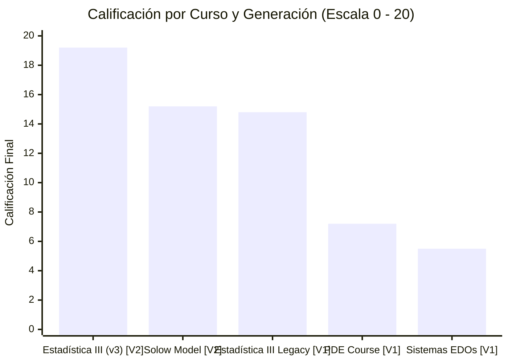
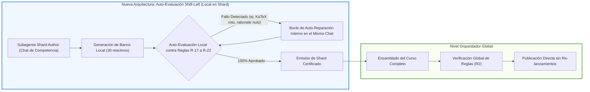
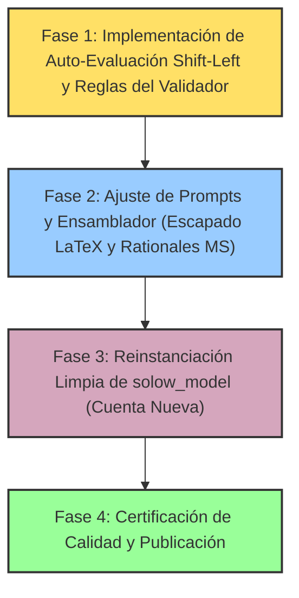

# Meta-Evaluación y Optimización del Pipeline de Creación de Cursos (`content-to-course`)
**Auditoría Holística, Arquitectura Shift-Left y Plan de Reingeniería Instruccional**

---

## 1. Resumen Ejecutivo y Contexto de Generaciones

El presente informe consolida la auditoría de calidad pedagógica, psicométrica y ergonómica realizada por los agentes `course_qa_auditor` sobre los cursos de la plataforma. Para una correcta interpretación de los hallazgos, es fundamental distinguir dos generaciones tecnológicas distintas:

1. **Generación Inicial V1 (Proceso Arcaico - Cursos Descartados)**:
   - **`pde_course` (7.2 / 20.0 - Crítico)** y **`sistemas_edos` (5.5 / 20.0 - Crítico)** fueron concebidos durante las primeras iteraciones del sistema, cuando aún no existían pruebas de calidad, validaciones tempranas ni controles psicométricos. Los defectos masivos observados en ellos (clonación mecánica de enunciados, inyecciones cruzadas y fugas de respuesta) corresponden exclusivamente a ese proceso inicial extinto y ambos cursos han sido eliminados de la plataforma.
2. **Generación Moderna V2 (Nuevo Proceso con Control de Calidad)**:
   - **`estadistica3_regresion_v3` (19.2 / 20.0 - Excelente)** y **`solow_model` (15.2 / 20.0 - Aceptable)** fueron creados bajo el nuevo pipeline instruccional con mejores estándares de granularidad y andamiaje.
   - Si bien ambos cursos de la V2 superaron de plano las deficiencias de la primera generación, la auditoría reveló áreas puntuales de mejora técnica y metodológica en `solow_model` que motivan su reinstanciación íntegra desde cero (*"borrado y cuenta nueva"*).

### Matriz Comparativa de Calidad

| Generación | Curso | Arquitectura (4.0) | Evaluación (5.0) | Andamiaje (5.0) | Alineación (4.0) | Ergonomía (2.0) | Penalizaciones | Nota Final (/20) | Estado en Plataforma |
| :--- | :--- | :---: | :---: | :---: | :---: | :---: | :---: | :---: | :--- |
| **V2 (Nuevo Proceso)** | **`estadistica3_regresion_v3`** | **3.8** | **4.8** | **5.0** | **4.0** | **1.6** | $0.0$ | **19.2** | **Activo (Estándar)** |
| **V2 (Nuevo Proceso)** | **`solow_model`** | 3.5 | 3.2 | 3.8 | 3.9 | 0.8 | $0.0$ | **15.2** | **A Reinstanciar desde Cero** |
| *V1 (Legacy)* | *`estadistica3_regresion_legacy`* | 2.8 | 3.8 | 3.8 | 3.4 | 1.0 | $0.0$ | *14.8* | *Retirado (Superado por V3)* |
| *V1 (Proceso Inicial)* | *`pde_course`* | 2.5 | 2.0 | 1.5 | 2.0 | 1.2 | $-2.0$ | *7.2* | *Eliminado* |
| *V1 (Proceso Inicial)* | *`sistemas_edos`* | 2.8 | 1.8 | 2.3 | 1.5 | 1.1 | $-4.0$ | *5.5* | *Eliminado* |

---

## 2. Puntos de Atención Identificados en el Proceso Actual

Habiendo descartado los vicios del proceso arcaico V1, el análisis se concentra estrictamente en las discrepancias técnicas y psicométricas que impidieron que `solow_model` alcanzara el nivel de excelencia de `estadistica3_regresion_v3`:

### 2.1. Gestión de Sintaxis LaTeX y Escapado en f-strings
* **Hallazgo**: En `solow_model`, se identificaron 777 instancias con dobles llaves residuales (e.g., `\frac{{\dot{k}}}{k}`, `e^{{gt}}`), producto de f-strings en generadores de Python donde las llaves literales de LaTeX fueron duplicadas sin ser procesadas. Asimismo, se detectaron delimitadores `$` abiertos sin cierre en preguntas de cálculo (`Q-Hab03-301..305`).
* **Causa Raíz**: Ausencia de un validador de sintaxis KaTeX que verifique la ausencia de llaves dobles innecesarias y el balance exacto de delimitadores antes de emitir los archivos JSON.

### 2.2. Pérdida de Notación Simbólica en Serialización de Derivadas
* **Hallazgo**: En competencias de dinámica de acumulación (`H-01`, `H-06`, `Hab-02` de `solow_model`), las opciones de respuesta afirman que *"los rendimientos decrecientes implican que $\phi(k) < 0$"*, cuando la condición axiomática es $\phi''(k) < 0$ (segunda derivada estricta).
* **Causa Raíz**: Pérdida de los apóstrofes o comillas simples (`''`) durante la interpolación o serialización JSON de plantillas, alterando el sentido matemático de la proposición.

### 2.3. Cobertura de Rationales Diagnósticos en Selección Múltiple
* **Hallazgo**: En las 132 preguntas de formato `multiple_select` de `solow_model`, los distractores presentan el atributo `error_rationale` en `null`.
* **Causa Raíz**: Aunque el nuevo proceso exige rationales pedagógicos en opciones de 7 alternativas (donde `estadistica3_regresion_v3` logró 100% de cumplimiento), el esquema de `multiple_select` en el ensamblador no forzaba de manera obligatoria la asignación de rationales formativos a las opciones inválidas.

---

## 3. Análisis Comparativo: `estadistica3_regresion_v3` frente a `solow_model`

Ambos cursos surgieron del proceso contemporáneo, pero `estadistica3_regresion_v3` superó a `solow_model` por 4.0 puntos gracias a diferencias metodológicas clave:

| Dimensión | `estadistica3_regresion_v3` (19.2 / 20.0) | `solow_model` (15.2 / 20.0) |
| :--- | :--- | :--- |
| **Granularidad Cognitiva** | Descomposición en **16 micro-competencias atómicas** con objetivos precisos y balance riguroso entre Hechos, Conceptos y Habilidades. | 18 competencias sólidas, pero carece de delimitación modular jerárquica explícita (módulos o unidades formales). |
| **Calidad de Distractores** | **100% de rationales específicos**: cada distractor explica con precisión el error conceptual o matemático cometido. | Buenas opciones de 7 alternativas, pero omisión sistemática de rationales en reactivos de selección múltiple. |
| **Ergonomía Técnica** | Prácticamente impecable: 99% de expresiones KaTeX limpias, con solo 5 deslices menores de delimitadores. | Afectado por 777 llaves dobles de f-strings y pérdida de notación prima en derivadas de segundo orden. |
| **Andamiaje Socrático** | 3 pistas escalonadas reales por reactivo: Conceptual $\to$ Procedimental $\to$ Operativa. | 3 pistas presentes, pero con fórmulas en texto plano sin delimitar en KaTeX en ciertas variantes. |

---

## 4. Reingeniería del Pipeline: Reglas Explícitas y Arquitectura Shift-Left

Para garantizar que los nuevos cursos nazcan blindados y mantener la excelencia alcanzada, se introducen dos pilares fundamentales:

### 4.1. Auto-Evaluación y Validación Local en Agentes Shard-Author (Shift-Left)

> [!IMPORTANT]
> **Principio de Auto-Contención en Shards:**
> Anteriormente, el orquestador global evaluaba el curso completo al final. Si detectaba un error en una sola competencia, requería relanzar subagentes/chats de forma tardía, costosa y fragmentada.
> **Nueva directiva**: Cada subagente autor de shard (`prompt_shard_author.md`) debe ejecutar obligatoriamente una pasada de **auto-evaluación interna** sobre su propio banco de preguntas antes de entregar el archivo. Si detecta cualquier error de KaTeX, rationale nulo o inconsistencia, debe repararlo autónomamente en su propio contexto.

#### Protocolo de Auto-Evaluación en el Shard:
1. **Inspección Sintáctica Local**: El agente valida que todas las fórmulas tengan delimitadores KaTeX balanceados (`$`), sin llaves dobles espurias (`{{`) y con símbolos de derivada intactos (`\phi''(k)`).
2. **Inspección de Rationales**: Verifica que el 100% de las opciones incorrectas (tanto en 7 alternativas como en selección múltiple) posean un `error_rationale` diagnóstico real.
3. **Inspección de Andamiaje**: Comprueba que cada ejercicio contenga exactamente 3 pistas escalonadas que guíen al estudiante sin entregar la solución prematuramente.
4. **Auto-Reparación Inmediata**: En caso de encontrar inconsistencias, el propio subagente reescribe el reactivo antes de concluir su turno, entregando al orquestador un shard pre-certificado.

---

### 4.2. Reglas Explícitas de Calidad del Validador (`src/validator/rules.py`)

A fin de mantener de forma explícita los estándares que distinguieron a `estadistica3_regresion_v3`, se formalizan las siguientes reglas programáticas:

#### Regla R-17: Rationale Formativo Obligatorio sin Comodines (`ERR_PLACEHOLDER_RATIONALE`)
* Ningún `error_rationale` puede ser `null`, vacío ni contener frases comodín o genéricas. Debe explicar el error cognitivo o algebraico concreto.

#### Regla R-18: Confinamiento de Metainformación Psicométrica (`ERR_META_GIVEAWAY`)
* El texto visible de las opciones (`content`) debe contener exclusivamente la respuesta matemática. Explicaciones del tipo *"sumando erróneamente..."* están estrictamente prohibidas en el contenido visible y deben residir únicamente en `error_rationale`.

#### Regla R-19: Integridad de Enunciados Numéricos (`ERR_ANSWER_LEAK`)
* En reactivos `fill_in_the_blank`, se prohíbe que el valor exacto de `correct_answer` aparezca filtrado en el enunciado como una asignación directa.

#### Regla R-20: Verificador de Sintaxis y Delimitadores KaTeX (`ERR_LATEX_SYNTAX`)
* Validación estricta de modo matemático:
  1. Número par y balanceado de delimitadores `$` y `$$`.
  2. Prohibición de triples delimitadores (`$$$`).
  3. Prohibición de llaves dobles residuales `{{` o `}}` derivadas de f-strings.
  4. Preservación estricta de apóstrofes de derivadas (`''`).
  5. Prohibición de variables de plantilla no sustituidas (`{var}`).

#### Regla R-22: Rationale Obligatorio en Selección Múltiple (`ERR_MS_MISSING_RATIONALE`)
* En reactivos `multiple_select`, el 100% de las opciones con `is_correct: false` debe incluir obligatoriamente su `error_rationale` diagnóstico.

---

### 4.3. Ajustes en Prompts y Ensamblador (`content-to-course`)

1. **Prompt del Autor de Shards (`prompt_shard_author.md`)**:
   - Integrar la sección de auto-evaluación obligatoria previa a la finalización del shard.
   - Prohibición explícita de llaves dobles en código LaTeX y mandato de verificar la notación de derivadas.
2. **Ensamblador del Motor (`engine/assemble.py`)**:
   - **Escapado Estricto de Llaves**: Ajustar la interpolación de f-strings para impedir que llaves literales se dupliquen como `{{...}}`.
   - **Propagación Forzada de Rationales**: Asignar automáticamente rationales diagnósticos a las opciones falsas de `multiple_select` desde las definiciones del CTA si la plantilla no las provee.

---

## 5. Plan de Acción Prioritario y Hoja de Ruta Actualizada

### Prioridad 1: Implementación de la Validación Shift-Left y Reglas del Validador
- Formalizar en `src/validator/rules.py` y `psychometric_checker.py` las reglas preventivas `R-17`, `R-18`, `R-19`, `R-20` y `R-22`.
- Integrar en el prompt de shards (`prompt_shard_author.md`) el protocolo de auto-evaluación interna para que los autores detecten y corrijan errores en su propia competencia antes de emitir el shard.

### Prioridad 2: Actualización del Motor de Ensamblaje (`content-to-course`)
- Ajustar `engine/assemble.py` para erradicar llaves dobles `{{...}}` por f-strings de Python y preservar intactos los símbolos de derivadas (`''`).
- Habilitar la herencia automática de rationales diagnósticos para todas las opciones falsas de selección múltiple.

### Prioridad 3: Reinstanciación Limpia de `solow_model` (Cuenta Nueva)
- Ejecutar el pipeline actualizado desde las fuentes documentales primarias:
  - Generar las 18 competencias con auto-evaluación local en cada shard.
  - Asegurar la correcta representación KaTeX de segundas derivadas ($\phi''(k) < 0$) y fórmulas limpias sin llaves dobles.
  - Garantizar rationales diagnósticos al 100% en todas las opciones de reactivos interactivos.
- Sustituir el archivo actual en `courses/solow_model.json` una vez certificado con calificación $\ge 19.0$.

### Prioridad 4: Mantenimiento Menor de `estadistica3_regresion_v3`
- Corregir los 5 deslices menores de delimitadores detectados (`$k_i.$`, `$$$`, `$N \times $N$`) para elevar su puntuación a **19.6 / 20.0**.

---
*Informe generado y actualizado conforme a las directrices de arquitectura instruccional y control de calidad.*
