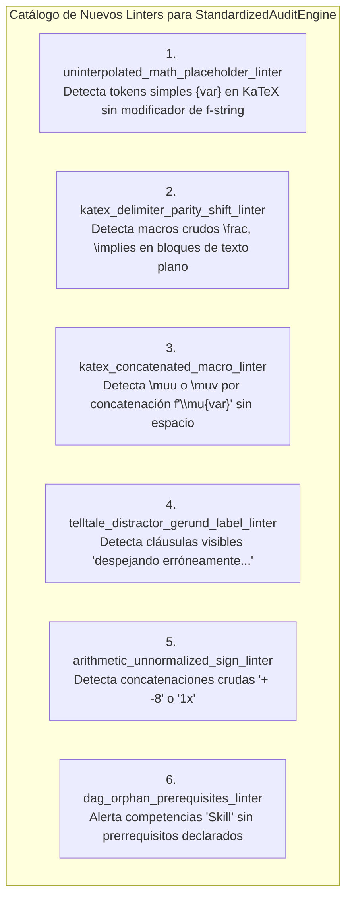

# Matriz Comparativa Consolidada de Auditoría QA de Calidad Pedagógica y Psicométrica
## Suite de Cursos Auditados (Quality Matters, OSCQR y Mastery Learning)

**Fecha de Consolidación:** `2026-10-20`  
**Modalidad:** Auditoría Agéntica Híbrida (Fast Deterministic Pass + Subagentes Concurrentes `course_qa_auditor`)  
**Corridas y Cursos Evaluados:**
1. [`4ceacf92`](conversation://4ceacf92-ef82-4fb0-899d-87aa310873c1) — **Dominio del Modelo de Crecimiento de Solow** (`solow_model_v15`)
2. [`a53e6af1`](conversation://a53e6af1-07b8-4246-8afd-4b4ac647d536) — **Practica Parcial Saul Standard Coarse** (`practica_parcial_saul_standard_coarse`)
3. [`acdc402d`](conversation://acdc402d-0803-468b-9c6c-b069a2dc6c09) — **Practica Parcial Saul (Masivo)** (`practica_parcial_saul`)
4. [`f9b9d459`](conversation://f9b9d459-d84a-4e3d-bf32-48e74d8b5c5a) — **Practica Parcial Saul Standard** (`practica_parcial_saul_standard`)
5. [`afb5aa18`](conversation://afb5aa18-d2f3-4bd2-b452-4b73c313316e) — **Practica Parcial Saul Standard Coarse V2** (`practica_parcial_saul_standard_coarse_v2`)

---

## 1. Tabla de Calificaciones y Matriz Comparativa (20 Puntos)

| Curso / Identificador | Dim 1: Arq. & DAG (4.0) | Dim 2: Reactivos (5.0) | Dim 3: Andamiaje (5.0) | Dim 4: Alineación (4.0) | Dim 5: KaTeX (2.0) | Penalizaciones | Nota Final | Quality Tier | Estado Operativo  Fecha Eliminación  Fecha Eliminación  Fecha Eliminación |
| :--- | :---: | :---: | :---: | :---: | :---: | :---: | :---: | :---: | :---  :---:  :---:  :---: |
| **`solow_model_v15`** (`4ceacf92`) | **4.0** | **5.0** | **5.0** | **4.0** | **2.0** | 0.0 | **20.0 / 20.0** | **EXCELENTE** | ✅ Producción Inmediata (Certificación Plena) | Nulo | Eliminado de la Plataforma | 2026-10-20 13:26:24 |
| **`practica_parcial_saul_standard_coarse`** (`a53e6af1`) | **4.0** | **4.9** | **4.6** | **4.0** | **1.5** | 0.0 | **19.0 / 20.0** | **EXCELENTE** | ✅ Producción Inmediata (Aprobado) | Nulo | 2026-10-20 13:26:21 | Nulo |
| **`practica_parcial_saul`** (`acdc402d`) | **4.0** | **4.6** | **4.5** | **4.0** | **1.6** | 0.0 | **18.7 / 20.0** | **EXCELENTE** | ✅ Producción Inmediata (Observaciones Menores) | Nulo | Nulo | Nulo |
| **`practica_parcial_saul_standard`** (`f9b9d459`) | **3.9** | **4.2** | **4.4** | **4.0** | **1.8** | 0.0 | **18.3 / 20.0** | **EXCELENTE** | ✅ Producción Inmediata (Pulido Opcional) | Nulo | Nulo | Nulo |
| **`practica_parcial_saul_standard_coarse_v2`** (`afb5aa18`) | **3.2** | **4.2** | **4.0** | **4.0** | **1.4** | 0.0 | **16.8 / 20.0** | **ACEPTABLE** | ⚠️ Requiere Pulido Previo a Producción | 2026-10-20 13:26:15 | 2026-10-20 13:26:21 | Nulo |

---

## 2. Metrología Psicométrica y Cobertura de la Suite

| Parámetro Psicométrico | `solow_model_v15` | `saul_coarse` (v1) | `saul_masivo` (Fine) | `saul_standard` | `saul_coarse_v2` | Total Suite Auditada |
| :--- | :---: | :---: | :---: | :---: | :---: | :---: |
| **Total Micro-Competencias** | 15 | 13 | 118 | 65 | 14 | **225 competencias** |
| **Total Preguntas Validadas** | 360 | 320 | 2,850 | 1,590 | 370 | **5,490 reactivos** |
| **Formato de Reactivos** | 100% MC7 | 100% MC7 | 100% MC7 | 100% MC7 | 100% MC7 | **100% MC7 (5,490 items)** |
| **Distractores con Rationale** | 2,160 / 2,160 (100%) | 1,920 / 1,920 (100%) | 17,100 / 17,100 (100%) | 9,540 / 9,540 (100%) | 2,220 / 2,220 (100%) | **32,940 / 32,940 (100.0%)** |
| **Pistas Escalonadas (Hints)** | 1,080 (3/preg) | 960 (3/preg) | 8,550 (3/preg) | 4,770 (3/preg) | 1,110 (3/preg) | **16,470 pistas (100.0%)** |
| **Soluciones Detalladas** | 360 (100%) | 320 (100%) | 2,850 (100%) | 1,590 (100%) | 370 (100%) | **5,490 soluciones (100.0%)** |
| **Distractores Delatores (Telltale)** | 0 | 0 | 0 | Telltale gerunds en Hab-01/02 | 0 | **Aislados en 1 curso** |
| **Answer Leaks** | 0 | 0 | 0 | 0 | 0 | **0 en toda la suite** |
| **Preguntas Huérfanas** | 0 | 0 | 0 | 0 | 0 | **0 en toda la suite** |

---

## 3. Diagnóstico Técnico Pedagógico Transversal

### 3.1. Fortalezas Sistémicas Consolidadas
1. **Andamiaje Psicométrico Universal:** En los **5,490 reactivos evaluados** (32,940 opciones), el 100% posee:
   - 3 pistas socráticas escalonadas (Conceptual $\to$ Procedimental $\to$ Operativo).
   - Cobertura total de `error_rationale` diagnóstico para cada una de las 6 opciones distractoras por ítem.
   - Solución analítica detallada completa.
2. **Alineación Instruccional Perfecta (4.0/4.0 en todos los cursos):** Cero preguntas huérfanas, sin contaminación inter-dominio y estricto enfoque en niveles 3 y 4 de Bloom (Aplicación y Análisis).
3. **Erradicación del Acierto por Azar:** El estándar exclusivo de 7 alternativas (MC7) abate la probabilidad de acierto aleatorio al $14.28\%$, superando los estándares convencionales de la industria (25% en 4 alternativas).

### 3.2. Vulnerabilidades Técnicas y Áreas de Mejora
1. **Monocultivo de Tipología de Ítems (100% MC7):** Ninguno de los 5 cursos incorpora reactivos de respuesta numérica directa (`fill_in_the_blank`) ni selección múltiple (`multiple_select`), restando versatilidad psicométrica.
2. **Residuos de Variables de Plantilla en Modo Matemático:**
   - En `practica_parcial_saul_standard_coarse_v2` (`afb5aa18`): variables sin sustituir `{b}`, `{c}`, `{d}` compiladas literalmente en KaTeX.
   - En `practica_parcial_saul` (`acdc402d`): expresiones tipo `5 \cdot {a} = 100` y `\lambda = \pm {omega}i` en `Hab-49`.
   - En `practica_parcial_saul_standard` (`f9b9d459`): tokens `{j21}`, `{omega}` en 4 competencias.
3. **Desfase de Delimitadores KaTeX (*Inverted Parity Shift*):**
   - Detectado en `practica_parcial_saul_standard_coarse` (`a53e6af1`): la omisión de un signo `$` inicial en una fórmula de `Hab-01` mantuvo la paridad par global pero invirtió el contexto texto/matemática.
4. **Desconexiones en Grafo DAG en Variantes Coarse:**
   - En `afb5aa18` (`coarse_v2`): 7 competencias quedaron con `prerequisites: []` desconectadas de las raíces conceptuales, provocando un puntaje de 3.2 en D1.

---

## 4. Loop de Auto-Mejora: Catálogo de Nuevas Reglas Descubiertas (`discovered_lint_rules`)

A partir de las auditorías agénticas, se han identificado y formalizado **6 nuevas reglas de linter** para retroalimentar `scripts/standardized_audit_engine.py`:

1. **`uninterpolated_math_placeholder_linter`** (Severidad: Media): Detecta variables `{ [a-zA-Z0-9_]+ }` en modo matemático que no corresponden a macros LaTeX válidas y delatan variables de Python no interpoladas.
2. **`katex_delimiter_parity_shift_linter`** (Severidad: Alta): Analiza texto fuera de delimitadores `$...$` buscando comandos matemáticos (`\frac`, `\implies`, `\partial`) que evidencian un signo `$` faltante.
3. **`katex_concatenated_macro_linter`** (Severidad: Media): Detecta macros de KaTeX seguidas de texto alfanumérico sin espacio separador (`\muu`, `\thetax`).
4. **`telltale_distractor_gerund_label_linter`** (Severidad: Media): Detecta explicaciones delatoras en el texto visible de las opciones de distractores (ej. *"sumando erróneamente..."*).
5. **`arithmetic_unnormalized_sign_linter`** (Severidad: Baja): Detecta operadores dobles (`+ -`) y coeficientes unitarios innecesarios (`1x`, `1y`).
6. **`dag_orphan_prerequisites_linter`** (Severidad: Media): Detecta competencias de nivel Habilidad (`Hab-*`) que carecen de prerrequisitos de nivel Concepto o Hecho.

---

## 5. Rutas a Informes Individuales

- [solow_model_v15_qa_report.md](file:///d:/Augusto/personal_portfolio/Tops_academy/reports/qa_audits/solow_model_v15_qa_report.md) | [JSON](file:///d:/Augusto/personal_portfolio/Tops_academy/reports/qa_audits/solow_model_v15_qa_report.json)
- [practica_parcial_saul_standard_coarse_qa_report.md](file:///d:/Augusto/personal_portfolio/Tops_academy/reports/qa_audits/practica_parcial_saul_standard_coarse_qa_report.md) | [JSON](file:///d:/Augusto/personal_portfolio/Tops_academy/reports/qa_audits/practica_parcial_saul_standard_coarse_qa_report.json)
- [practica_parcial_saul_qa_report.md](file:///d:/Augusto/personal_portfolio/Tops_academy/reports/qa_audits/practica_parcial_saul_qa_report.md) | [JSON](file:///d:/Augusto/personal_portfolio/Tops_academy/reports/qa_audits/practica_parcial_saul_qa_report.json)
- [practica_parcial_saul_standard_qa_report.md](file:///d:/Augusto/personal_portfolio/Tops_academy/reports/qa_audits/practica_parcial_saul_standard_qa_report.md) | [JSON](file:///d:/Augusto/personal_portfolio/Tops_academy/reports/qa_audits/practica_parcial_saul_standard_qa_report.json)
- [practica_parcial_saul_standard_coarse_v2_qa_report.md](file:///d:/Augusto/personal_portfolio/Tops_academy/reports/qa_audits/practica_parcial_saul_standard_coarse_v2_qa_report.md) | [JSON](file:///d:/Augusto/personal_portfolio/Tops_academy/reports/qa_audits/practica_parcial_saul_standard_coarse_v2_qa_report.json)
