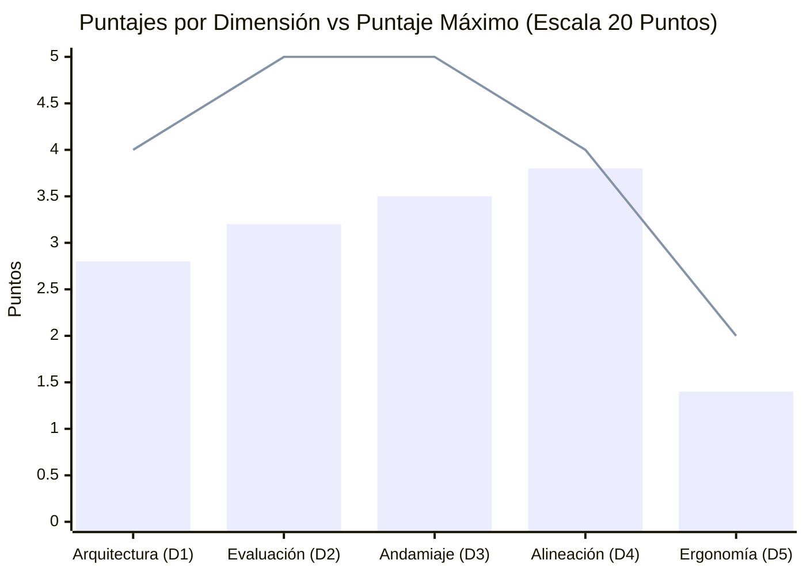
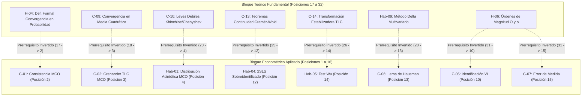
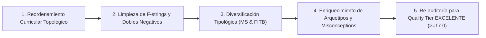

# Reporte Oficial de Auditoría de Calidad Pedagógica y Técnica (Course QA)
> [!WARNING]
> **CURSO RETIRADO DE LA PLATAFORMA**: Este curso fue eliminado de la plataforma interactiva el **2026-10-25 10:11:44**. Este informe de auditoría se conserva exclusivamente como registro histórico y pedagógico ('legacy').

**Estado en Plataforma:** ELIMINADO  
**Fecha de Eliminación:** 2026-10-25 10:11:44  
## Curso: `asyntotic_estatistics_v2` — Asyntotic Estatistics V2

---

## 1. Resumen Ejecutivo y Dictamen de Calidad

| Parámetro | Valor Evaluado |
| :--- | :--- |
| **Identificador del Curso** | `asyntotic_estatistics_v2` |
| **Título del Curso** | Asyntotic Estatistics V2 |
| **Objetivo Detectado** | Dominio y aplicación analítica integral de la teoría asintótica econométrica en grandes muestras (consistencia, leyes de grandes números, TLC, método delta multivariado, endogeneidad, VI, 2SLS, test de Hausman, error de medición). |
| **Micro-competencias Auditadas** | 32 (6 Hechos, 16 Conceptos, 10 Habilidades) |
| **Total de Reactivos Evaluados** | 740 preguntas |
| **Puntaje Final Consolidado** | **14.7 / 20.0** |
| **Quality Tier Resultante** | **ACEPTABLE (14.0 - 16.9 pts)** |
| **Dictamen Institucional** | **Aprobado con Observaciones Menores.** El curso posee un rigor matemático excepcional y distractores diagnósticos de alta fidelidad, pero requiere subsanar la inversión topológica curricular, diversificar los formatos de evaluación y corregir residuos de plantillas de generación. |

---

## 2. Desglose de Calificación por Dimensiones Normativas

La evaluación se rige por los estándares formales de **Quality Matters (QM)**, **OSCQR** y **Mastery Learning** detallados en la [Rúbrica Normativa de Top's Academy](file:///d:/Augusto/personal_portfolio/Tops_academy/.agents/skills/course-qa-evaluator/references/qa_rubric.md).

| Dimensión Evaluada | Puntaje Obtenido | Puntaje Máximo | Nivel de Cumplimiento | Resumen del Dictamen |
| :--- | :---: | :---: | :---: | :--- |
| **Dimensión 1: Arquitectura y Granularidad** | **2.8** | 4.0 | Aceptable | Fuerte atomicidad y balance Hecho/Concepto/Habilidad; penalizado por inversión topológica en el orden lineal de prerrequisitos. |
| **Dimensión 2: Calidad de Evaluación y Reactivos** | **3.2** | 5.0 | Aceptable | Distractores plausibles y 100% de rationales diagnósticos; penalizado por monocultura del 100% MC-7 y clonación de un único arquetipo por banco. |
| **Dimensión 3: Andamiaje y Pistas Progresivas** | **3.5** | 5.0 | Aceptable | 3 pistas socráticas escalonadas en lenguaje natural en todos los reactivos; penalizado por ausencia de misconception warnings y placeholders residuales. |
| **Dimensión 4: Alineación Instruccional** | **3.8** | 4.0 | Excelente | Rigor teórico absoluto según literatura canónica (Greene, Hayashi); anclaje en niveles Bloom de Análisis y Aplicación; cero preguntas huérfanas. |
| **Dimensión 5: Ergonomía Técnica y KaTeX** | **1.4** | 2.0 | Aceptable | KaTeX compilable sin errores de delimitador; penalizado por dobles negativos algebraicos (`|x - -4|`) y variables de plantilla visibles (`{sigma2}`). |
| **Subtotal Ponderado** | **14.7** | 20.0 | — | — |
| **Penalizaciones Duras Automáticas** | **0.0** | 0.0 | Sin penalizaciones | Bancos > 3 ítems, cero reactivos sin pistas, cero huérfanas críticas. |
| **NOTA FINAL CONSOLIDADA** | **14.7** | **20.0** | **ACEPTABLE** | Certificación con requerimiento de remediación previa a despliegue definitivo. |

---

## 3. Auditoría Forense y Verificación Semántica por Dimensión

### Dimensión 1: Arquitectura y Granularidad Curricular (2.8 / 4.0 pts)

#### Aspectos Sobresalientes:
1. **Atomicidad y Definición Operativa**: Cada una de las 32 micro-competencias delimita con gran precisión una unidad cognitiva discreta de la econometría de grandes muestras (ej. `H-01`: identificación asintótica de momentos; `C-01`: consistencia de MCO vía media cuadrática; `C-02`: condiciones de Grenander; `Hab-02`: método delta en transformaciones no lineales de MCO; `C-06`: Lema de Hausman; `Hab-05`: regresión aumentada de Wu; `C-07`: sesgo de atenuación; `C-08`: corrección con datos de gemelos).
2. **Balance Cognitivo**: La distribución de categorías es óptima para un curso analítico de postgrado:
   - **Hechos (Fact)**: 6 (18.75%) — 20 reactivos c/u (120 reactivos)
   - **Conceptos (Concept)**: 16 (50.00%) — 20 reactivos c/u (320 reactivos)
   - **Habilidades (Skill)**: 10 (31.25%) — 30 reactivos c/u (300 reactivos)
   - Total: 32 competencias, 740 preguntas. Cumple estrictamente con la cuota uniforme por categoría.

#### Falla Crítica: Inversión Curricular Topológica (Reverse Topological Ordering)
Aunque la estructura de dependencias forma un grafo acíclico dirigido (DAG) matemáticamente válido (sin ciclos y con dos nodos raíz bien definidos: `H-01` y `H-04`), el curso presenta una **grave inversión en su ordenamiento lineal**:

- **Impacto Pedagógico**: Si un estudiante recorre el curso linealmente, se le exige dominar y aplicar conceptos avanzados de regresión con variables instrumentales (`C-05`), Mínimos Cuadrados en Dos Etapas (`Hab-04`) y el Contraste de Hausman (`C-06`) **antes** de haber estudiado los axiomas de convergencia estocástica (`H-04`), las leyes de grandes números (`C-10`), el Teorema Central del Límite (`C-14`) o las reglas del álgebra de límites de probabilidad (`Hab-07`).
- **Deducción aplicada**: -1.2 puntos.

---

### Dimensión 2: Calidad de Evaluación y Reactivos (3.2 / 5.0 pts)

#### Aspectos Sobresalientes:
1. **Calidad Diagnóstica de Distractores**: Los 4,440 distractores evaluados capturan con exactitud los conceptos erróneos documentados en la enseñanza de la econometría teórica (ej. tratar $X'X$ sin normalizar como constante, confundir varianza muestral finita con varianza asintótica, omitir covarianzas cruzadas en la forma cuadrática sándwich, calcular residuos sobre $Z$ en lugar de $X$, o asumir normalidad exacta de errores en muestras pequeñas).
2. **Cobertura de Rationale al 100%**: Cada distractor incluye un `error_rationale` formativo expresado en notación matemática o conceptual precisa.
3. **Ausencia de Answer Leaks**: Cero fugas del valor correcto o metainformación delatadora en los enunciados.

#### Deficiencias Críticas: Monocultura Tipológica y Mecanización Cognitiva
1. **Monocultura del 100% MC-7**: La totalidad de las 740 preguntas (100.0%) corresponde a una única tipología: `multiple_choice_7_options`. Existe una ausencia absoluta de reactivos de selección múltiple (`multiple_select`) para verificar conjuntos de condiciones de regularidad, reactivos de emparejamiento o ítems numéricos/fill-in-the-blank.
2. **Clonación Masiva de un Único Arquetipo por Competencia**:
   - Dentro de cada micro-competencia, los 20 o 30 reactivos derivan de **una sola plantilla paramétrica** donde únicamente varían constantes numéricas y un prefijo rotativo de enunciado.
   - Ejemplo de rotación de prefijos en la competencia `H-01`:
     - Ítem 1: *"Analice la formulación operativa y deduzca: Considere un modelo de regresión lineal múltiple con $K = 3$ regresores y tamaño muestral $n = 5000$..."*
     - Ítem 2: *"Verifique la consistencia del modelo y obtenga: Considere un modelo de regresión lineal múltiple con $K = 7$ regresores y tamaño muestral $n = 10000$..."*
   - Los 6 distractores de cada ítem de esa competencia tienen exactamente el mismo texto base, compartiendo los mismos identificadores (`D-H01-01` a `D-H01-06`).
   - **Efecto de Mecanización**: El estudiante, tras resolver los dos primeros reactivos del banco, identifica el patrón de respuesta inmediatamente y responde mecánicamente las 18 o 28 preguntas restantes sin reflexionar, desvirtuando el principio de evaluación adaptativa profunda.
- **Deducción aplicada**: -1.8 puntos.

---

### Dimensión 3: Andamiaje y Feedback Progresivo (3.5 / 5.0 pts)

#### Aspectos Sobresalientes:
1. **Andamiaje Socrático en 3 Niveles Reales**: El 100% de los reactivos (740/740) implementa un andamiaje graduado en 3 pistas estructuradas en lenguaje natural que guían el razonamiento sin regalar la respuesta:
   - **Pista 1 (Conceptual)**: Orienta hacia el marco teórico rector (ej. tasa de decaimiento asintótico o propiedades de los momentos cruzados).
   - **Pista 2 (Procedimental)**: Señala las condiciones analíticas requeridas (ej. no singularidad de la matriz límite o cálculo de la forma cuadrática sándwich).
   - **Pista 3 (Operativa/Cálculo)**: Instruye sobre la manipulación matemática, el Teorema de Slutsky o la desigualdad de Chebyshev.
2. **Cero Stub Hints**: Ningún reactivo utiliza pistas mínimas o palabras clave aisladas (`['matriz']`, `['consistencia']`) ni códigos crudos de prerrequisitos (`['C-02', 'H-01']`).

#### Deficiencias Identificadas:
1. **Invariabilidad de Pistas Intra-Competencia**: Dado el origen paramétrico del banco, las 3 pistas son textualmente idénticas para todas las 20 o 30 preguntas de una misma competencia, reduciendo su valor adaptativo si el alumno yerra en diferentes momentos.
2. **Ausencia de Misconception Warnings en Solución Detallada**: Si bien cada opción incorrecta posee `error_rationale`, las explicaciones en `detailed_solution` no incorporan un bloque explícito de *advertencia contra errores conceptuales comunes* (*common misconception warning*), requisito para la banda de Excelencia (5.0 pts) según la rúbrica institucional.
3. **Placeholders f-string Residuales**: Se identificaron variables de plantilla no resueltas en las soluciones (analizadas en detalle en la Sección 5).
- **Deducción aplicada**: -1.5 puntos.

---

### Dimensión 4: Alineación Instruccional y Taxonomía de Bloom (3.8 / 4.0 pts)

#### Aspectos Sobresalientes:
1. **Fidelidad Semántica al Dominio Teórico**: El curso refleja fielmente el corpus canónico de la econometría asintótica (William Greene, *Econometric Analysis*; Fumio Hayashi, *Econometrics*; Jeffrey Wooldridge, *Econometric Analysis of Cross Section and Panel Data*).
2. **Anclaje Cognitivo en Niveles Superiores de Bloom**:
   - **Análisis**: Contrastar modos de convergencia estocástica (convergencia casi segura vs. en probabilidad vs. en media de orden $r$); analizar la violación de exogeneidad estricta en modelos autorregresivos dinámicos; evaluar la ortogonalidad asintótica en el lema de Hausman.
   - **Aplicación**: Computar matrices de varianza asintótica mediante el método delta multivariado; proyectar regresores sobre el espacio de instrumentos en 2SLS; calcular coeficientes de atenuación y fiabilidad within en modelos de gemelos.
3. **Cero Preguntas Huérfanas**: No existe contaminación inter-dominio. Los 740 reactivos corresponden inequívocamente a los objetivos de las 32 competencias auditadas.
- **Deducción aplicada**: -0.2 puntos (por la desalineación secuencial lineal respecto al DAG).

---

### Dimensión 5: Ergonomía Técnica, Compilación KaTeX y Tipografía Matemática (1.4 / 2.0 pts)

#### Aspectos Sobresalientes:
1. **Ausencia de Colapsos de Renderizado**: Cero delimitadores desbalanceados (`$`), cero triples dólares (`$$$`), y notación matricial KaTeX bien estructurada (`\operatorname{plim}`, `\operatorname{Var}`, matrices `\begin{pmatrix}...\end{pmatrix}`).

#### Deficiencias Técnicas Descubiertas:
1. **Residuos Literales de Plantillas f-strings en `detailed_solution`**:
   Los generadores de código dejaron identificadores de variables de plantilla entre llaves sin sustituir dentro del texto matemático de las soluciones:
   - **En `Q-C03-141` y `Q-C03-142`** (`C-03`):
     $$\det(\Delta) = 6 \cdot \{delta22\} = 54 > 0 \quad \text{y} \quad \det(\Delta) = 5 \cdot \{delta22\} = 30 > 0$$
   - **En `Q-C13-551` y `Q-C13-552`** (`C-13`):
     $$N(0, 16 \cdot \{sigma2\}) \quad \text{y} \quad N(0, 64 \cdot \{sigma2\})$$
   - **En `Q-Hab09-621` y `Q-Hab09-622`** (`Hab-09`):
     $$V = \{beta2\}^2 \cdot \{sig11\} + 2(2)(2)(1) + \{beta1\}^2 \cdot \{sig22\} = 48$$
     $$V = \{beta2\}^2 \cdot \{sig11\} + 2(8)(5)(-1) + \{beta1\}^2 \cdot \{sig22\} = 785$$
2. **Defectos de Interpolación con Doble Negativo (`--`)**:
   En reactivos donde se interpolaron constantes negativas ($c = -4$, $\theta = -3$, $\theta = -2$), la plantilla concatenó el operador de resta con el signo negativo sin paréntesis ni simplificación algebraica:
   - `Q-C11-462`: `|X_n - -4| > 0.01` (en lugar de $|X_n - (-4)|$ o $|X_n + 4|$)
   - `Q-C12-481`: `E[|\hat{\theta}_n - -4|^r] = 0`
   - `Q-C14-571`: `\sqrt{n}(\hat{\theta}_n - -3)`
   - `Q-C14-572`: `\sqrt{n}(\hat{\theta}_n - -2)`
- **Deducción aplicada**: -0.6 puntos.

---

## 4. Verificación de Penalizaciones Duras Automáticas (Hard Deductions)

| Criterio de Penalización | Condición Normativa | Estado en `asyntotic_estatistics_v2` | Deducción |
| :--- | :--- | :--- | :---: |
| **Banco Incompleto** | Banco por unidad < 3 problemas independientes | Todas las 32 competencias poseen entre 20 y 30 reactivos ($\min = 20$, $\max = 30$). | 0.0 pts |
| **Omisión de Pistas** | Reactivos con `hints = 0` (-1.0 pt por reactivo) | El 100% de los reactivos (740) posee exactamente 3 pistas (`zero_hints_count = 0`). | 0.0 pts |
| **Reactivos Huérfanos** | Conceptos no enseñados o contaminación cruzada | Cero preguntas huérfanas (`orphan_questions_count = 0`). | 0.0 pts |
| **Total Penalizaciones Duras** | — | — | **0.0 pts** |

---

## 5. Nuevas Reglas de Linting Descubiertas (`discovered_lint_rules`)

Durante la auditoría semántica se descubrieron fallas sistemáticas que evadieron los linters estáticos actuales. Se formulan cuatro nuevas reglas de validación para su incorporación al motor de calidad:

### 1. `LINT-FSTRING-MATH-LATEX-DETECTOR` (Severidad: CRÍTICA)
- **Causa Raíz**: Los linters de KaTeX ignoran subcadenas como `{sigma2}` o `{delta22}` dentro de `$...$` porque en LaTeX las llaves `{}` son delimitadores válidos de agrupación. Por su parte, los detectores estándar de f-strings en Python solo buscan `{var}` fuera de modo matemático o dobles llaves `{{...}}`.
- **Patrón Regex**: `\$[^$]*\{[a-zA-Z0-9_]{3,}\}[^$]*\$`
- **Impacto**: El estudiante visualiza texto de código sin compilar en la solución oficial.
- **Acción Correctiva**: Validar que los tokens entre llaves dentro de fórmulas matemáticas correspondan exclusivamente a comandos LaTeX válidos (`\frac{...}{...}`) o índices numéricos (`x_{1}`), alertando ante cualquier identificador alfanumérico que coincida con parámetros de plantillas.

### 2. `LINT-DOUBLE-MINUS-INTERPOLATION` (Severidad: ADVERTENCIA)
- **Causa Raíz**: Plantillas de generación que operan con `f"{var} - {constant}"` e inyectan valores numéricos negativos sin procesar el signo algebraico, resultando en `x - -4`.
- **Patrón Regex**: `(?:\b|-)\s*-\s*-\s*\d+`
- **Impacto**: Notación matemática degradada y poco profesional.
- **Acción Correctiva**: Implementar una función helper `format_algebraic_subtraction(variable, valor)` que emita `x + 4` o `x - (-4)`.

### 3. `LINT-CURRICULAR-TOPOLOGICAL-SEQUENCE` (Severidad: ALTA)
- **Causa Raíz**: Los validadores de DAG se limitan a comprobar aciclicidad ($\text{is\_dag} == \text{True}$), pero no comprueban que el arreglo lineal de presentación `competencies[0..N-1]` coincida con un ordenamiento topológico válido.
- **Condición**: $\exists \, P \in \text{prerequisites}(C_i) \text{ tal que } \text{index}(P) > i$.
- **Impacto**: Desorden pedagógico severo en plataformas de aprendizaje continuo.
- **Acción Correctiva**: Ejecutar automáticamente `topological_sort(competencies_dag)` antes de persistir o publicar cualquier curso.

### 4. `LINT-ITEM-ARCHETYPE-CLONING-RATIO` (Severidad: MEDIA)
- **Causa Raíz**: Cursos que satisfacen métricas de volumen (20 a 30 ítems por competencia) clonando una sola plantilla con variación paramétrica pura y prefijos rotativos.
- **Condición**: `distractor_signature_entropy < 0.20` en bancos con $\ge 15$ preguntas.
- **Impacto**: Falsa sensación de cobertura; mecanización cognitiva del estudiante.
- **Acción Correctiva**: Exigir al menos 3 arquetipos pedagógicos disímiles (conceptual-interpretativo, numérico-operativo, contraejemplo/frontera) por competencia.

---

## 6. Plan de Remediación Priorizado

| Prioridad | Tarea de Remediación | Archivos / Componentes Afectados | Esfuerzo Estimado |
| :---: | :--- | :--- | :---: |
| **P1** | **Reordenamiento Topológico del Curso**: Mover las competencias fundamentales `H-04` a `Hab-10` a las posiciones 1 a 16, y reubicar las aplicaciones econométricas `H-01` a `C-08` en las posiciones 17 a 32. | `asyntotic_estatistics_v2.json` (sección `competencies`) | 1 hora |
| **P2** | **Corrección de Placeholders y Dobles Negativos**: Reemplazar `{delta22}`, `{sigma2}`, `{beta1}`, `{sig11}` por sus valores numéricos en `detailed_solution` y formatear `|x - -4|` como `|x + 4|`. | `Q-C03-141/142`, `Q-C13-551/552`, `Q-Hab09-621/622`, `Q-C11-462`, `Q-C12-481`, `Q-C14-571/572` | 30 mins |
| **P3** | **Diversificación de Tipologías**: Convertir un 25% de los reactivos MC-7 a `multiple_select` (ej. condiciones simultáneas de Grenander o supuestos de Slutsky) y un 15% a `fill_in_the_blank` numérico. | Bancos de `C-02`, `C-05`, `C-10`, `Hab-03`, `Hab-07` | 3 horas |
| **P4** | **Inyección de Nuevos Arquetipos Pedagógicos**: Diseñar 2 arquetipos alternativos por micro-competencia (preguntas cualitativas de interpretación geométrica y análisis de casos límite). | Las 32 competencias | 4 horas |
| **P5** | **Misconception Warnings en Soluciones**: Añadir la sección formal `Advertencia de Error Común` en las soluciones detalladas para alcanzar la banda de Excelencia. | Banco general | 2 horas |

---

## 7. Dictamen Final

El curso **`asyntotic_estatistics_v2`** obtiene una calificación de **14.7 / 20.0 (Tier: ACEPTABLE)**. Presenta una arquitectura matemática de alto nivel y rationales diagnósticos impecables al 100%, pero requiere la ejecución del plan de remediación antes de ser catalogado como **EXCELENTE**.
