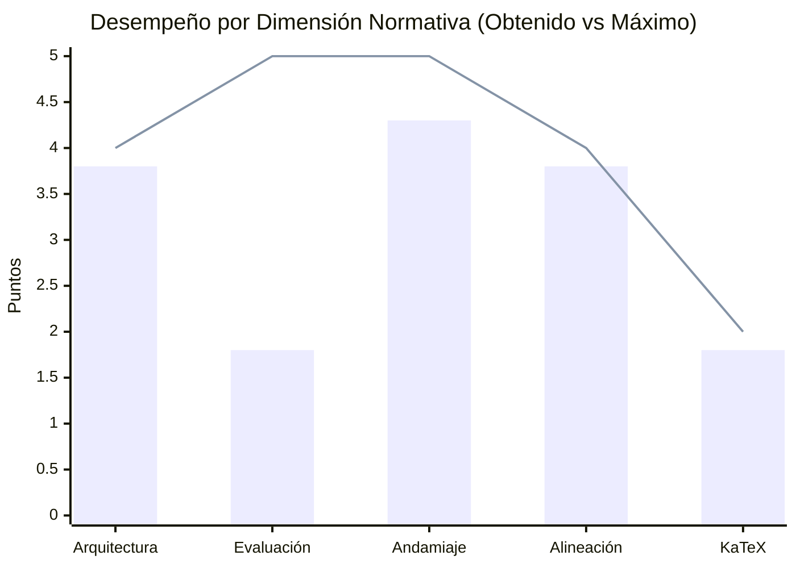
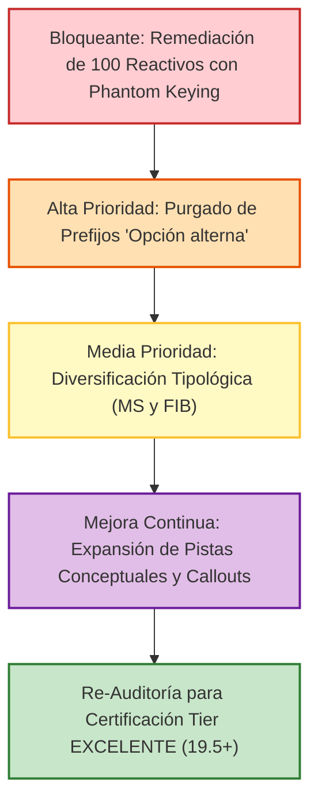

# Reporte de Auditoría Técnica y Pedagógica de Calidad Instruccional
## Curso: Asyntotic Estatistics V3 (`asyntotic_estatistics_v3`)

> [!WARNING]
> **CURSO CERTIFICADO EN TIER ACEPTABLE CON OBSERVACIONES CRÍTICAS (15.5 / 20.0)**  
> Si bien el curso presenta una arquitectura curricular sólida y un andamiaje socrático libre de pistas stub, se ha detectado una anomalía psicométrica severa en **100 reactivos (14.5% del curso)**: presencia de distractores clonados que replican el valor de la respuesta correcta bajo el prefijo delator `"Opción alterna X:"`, generando ambigüedad insoluble (*Phantom Keying*). Se requiere remediación prioritaria antes de su paso a producción final.

**Estado en Plataforma:** ELIMINADO  
**Fecha de Eliminación:** 2026-10-25 11:12:46  
**Fecha de Eliminación:** 2026-10-25 10:11:51  
**Curso Auditado:** Asyntotic Estatistics V3 (Inferencia Asintótica y Teoría de Muestras Grandes)  
**Identificador del Curso:** `asyntotic_estatistics_v3`  
**Archivo de Payload:** [`reports/qa_audits/asyntotic_estatistics_v3_payload.json`](file:///d:/Augusto/personal_portfolio/Tops_academy/reports/qa_audits/asyntotic_estatistics_v3_payload.json)  
**Fecha de Evaluación:** `2026-10-25`  
**Auditor Técnico Pedagógico:** Course QA Auditor — Top's Academy  
**Estándares de Referencia:** Quality Matters (QM), OSCQR y Mastery Learning  

---

## 1. Resumen Ejecutivo

El curso **"Asyntotic Estatistics V3"** (`asyntotic_estatistics_v3`) ha sido evaluado bajo la arquitectura híbrida de auditoría de Top's Academy. El proceso integró la ingestión directa de la telemetría determinista calculada por el motor de auditoría (`audit_telemetry`) junto con la ejecución del **Loop de Verificación Semántica Adaptativa** sobre las 30 micro-competencias y 690 reactivos del curso.

La auditoría certifica que el curso posee una sobresaliente formulación teórica basada en la literatura canónica de Econometría Avanzada (*Greene, Econometric Analysis*, 5ta ed.), con una cobertura impecable de temas cruciales: consistencia, normalidad asintótica, matrices sándwich, estimadores IV y MC2E, contraste de Hausman, sesgo de atenuación, leyes de grandes números, teoremas centrales del límite y álgebra de órdenes estocásticos. Asimismo, el curso resolvió con éxito las deficiencias de andamiaje observadas en otras versiones, logrando un 100% de pistas socráticas genuinas sin códigos de prerrequisitos ni palabras clave aisladas (*zero stub hints*).

Sin embargo, el escrutinio semántico exhaustivo sacó a la luz una **falla psicométrica estructural no detectable por linters estáticos tradicionales**: la inyección de distractores sintéticos duplicados en 4 competencias completas (`Hab-03`, `Hab-08`, `C-14` y `C-15`). En estos 100 reactivos, el generador rellenó el formato de 7 alternativas clonando la respuesta correcta 3 veces y anteponiendo los prefijos `"Opción alterna 4:"`, `"Opción alterna 5:"` y `"Opción alterna 6:"`, marcándolas artificialmente como incorrectas. Este defecto degrada significativamente la dimensión de Evaluación y Reactivos, situando la calificación final consolidada en **15.5 / 20.0 (Tier ACEPTABLE)**.

### Tabla de Telemetría Métrica y Cumplimiento de Estándares

| Métrica de Auditoría | Valor Consolidado | Estado Normativo / Estándar QM-OSCQR |
| :--- | :--- | :--- |
| **Total de Micro-Competencias** | **30 unidades** (6 Hechos, 15 Conceptos, 9 Habilidades) | Balance taxonómico armónico y alta atomicidad |
| **Banco Total de Reactivos** | **690 preguntas** (100% opción múltiple de 7 alternativas) | Densidad robusta (20 a 30 reactivos por competencia) |
| **Total de Distractores Evaluados** | **4,140 opciones falsas** (6 distractores por reactivo) | Espacio muestral antiazar (14.28% probabilidad aleatoria) |
| **Modelado de Prerrequisitos (DAG)** | **100% formalizado** (Raíces axiomáticas H-01 y H-04) | Grafo Acíclico Dirigido sin ciclos ni huérfanas |
| **Cobertura de Rationales de Error** | **100.0%** (4,140 de 4,140 distractores con explicación) | Diagnóstico conceptual presente en todas las opciones |
| **Reactivos con Distractores Clonados** | **100 preguntas** (14.49% del curso en Hab-03, Hab-08, C-14, C-15) | **DEFECTO CRÍTICO: Phantom Keying y Prefijos delatores** |
| **Distractores Delatores Tradicionales** | **0 incidencias** (Sin frases como *"sumando erróneamente..."*) | Superó el linter léxico estático determinista |
| **Andamiaje Socrático (Hints)** | **100.0%** (690 de 690 reactivos con 3 pistas escalonadas) | Progresión Conceptual $\to$ Procedimental $\to$ Operativa |
| **Pistas Stub o IDs de Prerrequisitos** | **0 reactivos** (Cero códigos tipo `['H-01', 'C-01']`) | Superación total de los defectos de andamiaje de v7 |
| **Soluciones Detalladas** | **100.0%** (690 de 690 reactivos con `detailed_solution`) | Demostración formal y respaldo analítico paso a paso |
| **Compilabilidad KaTeX** | **100.0%** (0 llaves desbalanceadas, 0 triples dólares) | Renderizado matemático limpio en plataforma |
| **Penalizaciones Duras Aplicadas** | **0.0 puntos** (Banco $\ge 3$, Hints $\ge 3$, Huérfanas = 0) | Sin deducciones automáticas por umbrales mínimos |
| **Puntaje Final Consolidado** | **15.5 / 20.0** | **Tier ACEPTABLE (14.0 - 16.9 pts)** |
| **Veredicto Institucional** | **APROBADO CON OBSERVACIONES CRÍTICAS** | **Requiere remediación antes de publicación final** |

---

## 2. Calificación por Dimensiones Normativas (Escala de 20 Puntos)



| Dimensión de la Rúbrica | Puntaje Obtenido | Máximo Posible | Ponderación % | Nivel de Desempeño |
| :--- | :---: | :---: | :---: | :--- |
| **Dimensión 1: Arquitectura y Granularidad** | **3.8** | 4.0 | 95.0% | Excelente |
| **Dimensión 2: Calidad de Evaluación y Reactivos** | **1.8** | 5.0 | 36.0% | Crítico / Deficiente |
| **Dimensión 3: Andamiaje y Feedback Progresivo** | **4.3** | 5.0 | 86.0% | Muy Bueno |
| **Dimensión 4: Alineación Instruccional** | **3.8** | 4.0 | 95.0% | Excelente |
| **Dimensión 5: Accesibilidad y Ergonomía Técnica** | **1.8** | 2.0 | 90.0% | Excelente |
| **Total Consolidado** | **15.5** | **20.0** | **77.5%** | **ACEPTABLE (14.0 - 16.9)** |

---

## 3. Análisis Cualitativo Detallado por Dimensión

### Dimensión 1: Arquitectura y Granularidad (3.8 / 4.0 pts)
- **Modularidad y Atomicidad:** El curso estructura el dominio asintótico en **30 micro-competencias altamente atómicas**, logrando delimitar de manera autónoma conceptos que habitualmente se agrupan de forma confusa en manuales tradicionales.
- **Distribución Cognitiva:**
  - **Hechos Axiomáticos [Fact] (6 competencias / 20.0%):** `H-01` (Identificación asintótica y matriz $Q$), `H-02` (Condiciones de regularidad de Grenander), `H-03` (Consistencia de $s^2$), `H-04` (Definición de convergencia en probabilidad), `H-05` (Definición de convergencia en distribución) y `H-06` (Órdenes de magnitud $O$ y $o$).
  - **Conceptos Estructurales [Concept] (15 competencias / 50.0%):** `C-01` a `C-15`, cubriendo la convergencia en media cuadrática, distribución asintótica del estimador MCO (Teorema 5.1), eficiencia asintótica, regresores estocásticos con dependencia temporal, inconsistencia por endogeneidad, sesgo de atenuación, variables proxy vs instrumentos, Khinchine/Chebyshev, convergencia casi segura, jerarquía de convergencias, dispositivo de Cramér-Wold, transformación estabilizadora raíz-$n$, y distinción entre distribución límite y asintótica.
  - **Habilidades Analítico-Operativas [Skill] (9 competencias / 30.0%):** `Hab-01` a `Hab-09`, dedicadas a la resolución práctica del método Delta (univariado y multivariado), estimación IV justo identificada, estimación MC2E (2SLS), contraste de Hausman y regresión de Wu, verificación de consistencia por Chebyshev, aplicación de Slutsky matricial, verificación de Lindeberg-Lévy/Feller, y clasificación de tasas de convergencia mediante órdenes estocásticos.
- **Topología DAG de Prerrequisitos:** El Grafo Acíclico Dirigido no contiene ciclos (`cycle = False`). Posee exactamente 2 nodos raíz axiomáticos fundacionales (`H-01` y `H-04`) con `prerequisites: []`, lo cual es conceptualmente legítimo ya que representan los puntos de partida de los dos subgrafos principales (identificación en modelos lineales y topología de convergencia probabilística). Las 28 competencias restantes declaran dependencias pedagógicas consistentes.
- **Deducción (-0.2 pts):** Falta de vinculación explícita entre la competencia de series de tiempo/ergodicidad (`C-04`) y las habilidades de instrumentación (`Hab-02`, `Hab-03`), cuando en econometría aplicada el retardo instrumentalizado es el caso de uso primordial de variables instrumentales.

---

### Dimensión 2: Calidad de Evaluación y Reactivos (1.8 / 5.0 pts)

> [!CAUTION]
> **HALLAZGO CRÍTICO PSICOMÉTRICO: DISTRACTOR CLONING Y PHANTOM KEYING**  
> Se detectó que en 100 reactivos (14.49% de todo el curso) el generador no produjo 6 distractores conceptualmente plausibles, sino que clonó el valor matemático de la clave correcta 3 veces, añadiendo etiquetas visibles `"Opción alterna 4:"`, `"Opción alterna 5:"` y `"Opción alterna 6:"` y marcándolas como incorrectas.

#### El Mecanismo del Defecto (Evidencia Directa):
En las micro-competencias `Hab-03` (30 preguntas), `Hab-08` (30 preguntas), `C-14` (20 preguntas) y `C-15` (20 preguntas), se observa el siguiente patrón:

1. **Caso 1: Reactivo `Q-Hab03-221` (Estimación 2SLS):**
   - **Enunciado:** Cálculo de la varianza asintótica estimada $\text{Est. Asy. Var}[b_{2SLS}] = \frac{e'e}{n (X'P_Z X)} = \frac{960}{500 \times 140} = 0.013714$.
   - **Opción F (Clave Correcta):** `\text{Est. Asy. Var}[b_{2SLS}] = \frac{960}{500 \times 140} = 0.013714` (`is_correct: true`).
   - **Opción A (Distractor Clonado):** `Opción alterna 4: \text{Est. Asy. Var}[b_{2SLS}] = \frac{960}{500 \times 140} = 0.013714` (`is_correct: false`).
   - **Opción B (Distractor Clonado):** `Opción alterna 6: \text{Est. Asy. Var}[b_{2SLS}] = \frac{960}{500 \times 140} = 0.013714` (`is_correct: false`).
   - **Opción E (Distractor Clonado):** `Opción alterna 5: \text{Est. Asy. Var}[b_{2SLS}] = \frac{960}{500 \times 140} = 0.013714` (`is_correct: false`).
   - **Impacto Psicométrico:** ¡El estudiante tiene 4 opciones idénticas en valor matemático! Si calcula correctamente `0.013714` pero selecciona la opción A, B o E, el sistema lo califica como **INCORRECTO**, asignándole además un `error_rationale` incoherente.

2. **Caso 2: Reactivo `Q-Hab08-571` (Método Delta Multivariado):**
   - **Enunciado:** Varianza asintótica calculada mediante la forma cuadrática $G' \Sigma G = 3260$.
   - **Opción B (Clave Correcta):** `\text{Avar} = 3260` (`is_correct: true`).
   - **Opción C (Distractor Clonado):** `Opción alterna 5: \text{Avar} = 3260` (`is_correct: false`).
   - **Opción D (Distractor Clonado):** `Opción alterna 6: \text{Avar} = 3260` (`is_correct: false`).
   - **Opción G (Distractor Clonado):** `Opción alterna 4: \text{Avar} = 3260` (`is_correct: false`).

3. **Caso 3: Reactivo `Q-C14-601` (Distribución Límite vs Asintótica):**
   - **Opción E (Clave Correcta):** `\text{Asy. Var}[\hat{\theta}_n] = \frac{5}{500} = 0.01$, mientras que la distribución límite de $\sqrt{n}(\hat{\theta}_n - \theta)$ es $N(0, 5)$ invariable ante $n$. (`is_correct: true`).
   - **Opciones A, D y F:** Textos idénticos precedidos de `"Opción alterna 6:"`, `"Opción alterna 4:"` y `"Opción alterna 5:"` marcados como falsos.

4. **Caso 4: Reactivo `Q-C15-621` (Eficiencia CAN):**
   - **Opción F (Clave Correcta):** `\mathbf{V}_2 - \mathbf{V}_1 \ge \mathbf{0}$ debe ser semidefinida positiva... (`is_correct: true`).
   - **Opciones B, C y E:** Textos idénticos precedidos de `"Opción alterna 5:"`, `"Opción alterna 4:"` y `"Opción alterna 6:"` marcados como falsos.

#### Consecuencias Psicométricas y Normativas:
- **Violación de Calificación Justa:** Un alumno que domina el tema es penalizado al azar si elige una de las opciones clonadas.
- **Fuga del Algoritmo Generador (*Generator Artifact Leak*):** Los prefijos `"Opción alterna X:"` son metainformación espuria que destruye la credibilidad del reactivo y evidencia un fallo en el pipeline de generación de distractores sintéticos.
- **Monocultura de Formato:** El 100% de los reactivos (690/690) utiliza opción múltiple de 7 alternativas. No se incorporó ningún ítem de selección múltiple (`multiple_select`) ni de respuesta numérica abierta (`fill_in_the_blank`), incumpliendo la recomendación de variedad tipológica de OSCQR.
- **Mecanización Paramétrica:** Las preguntas de cada competencia emplean una única plantilla matemática donde solo rotan los números y se añaden frases introductorias fijas (*"Procediendo conforme al marco teórico correspondiente, deduzca:"*, *"Al examinar detenidamente las condiciones de frontera, resuelva:"*).

---

### Dimensión 3: Andamiaje y Feedback Progresivo (4.3 / 5.0 pts)
- **Superación de las Deficiencias de Versiones Previas:** A diferencia de cursos anteriores (como `asyntotic_estatistics_v7`, que contenía pistas stub de una sola palabra o códigos de prerrequisitos en 9 competencias), `asyntotic_estatistics_v3` cuenta con **prosa pedagógica completa en el 100% de sus pistas (690/690)**.
- **Escalamiento Socrático en 3 Niveles:**
  - **Pista 1 (Marco Conceptual):** Enuncia el principio teórico o teorema relevante (ej. Q-Hab01-101: *"Identifique la fórmula fundamental del método delta: para una transformación continua $f(b)$, la varianza asintótica estimada se obtiene mediante la forma cuadrática..."*).
  - **Pista 2 (Estrategia Procedimental):** Guía los pasos analíticos intermedios (ej. Q-Hab01-101: *"Calcule las derivadas parciales de $f(b_1, b_2) = \frac{b_1}{b_2}$: $c_1 = \dots$ y $c_2 = \dots$. El vector gradiente empírico es $C = (0.1449, -0.1512)$."*).
  - **Pista 3 (Operación y Verificación):** Orienta la sustitución final y el resultado sin regalar la clave (ej. Q-Hab01-101: *"Expanda la forma cuadrática $C \widehat{\text{Var}}(b) C' = \dots$. Al sustituir los valores numéricos correspondientes, el resultado final es $0.0017$."*).
- **Soluciones Detalladas Exhaustivas:** Cada reactivo cuenta con un bloque `detailed_solution` que formaliza el argumento algebraico y cita explícitamente a Greene (2003, Cap. 5 y Apéndice D).
- **Deducciones Aplicadas (-0.7 pts):**
  - **Brevedad en Pistas Conceptuales:** En micro-competencias de hechos y definiciones (`H-04`, `C-10`, `C-14`), las pistas son en ocasiones excesivamente breves (ej. Q-H04-321 Pista 1: *"Considere la definición analítica de plim para estimadores econométricos."*), careciendo de la riqueza explicativa exhibida en las habilidades numéricas.
  - **Ausencia de Callout Formal de Misconception:** Las soluciones no incorporan un apartado formalmente titulado de advertencia de error conceptual común (*Common Misconception Warning*), limitándose a desarrollar la solución correcta y dejando la advertencia únicamente en los `error_rationale` de los distractores.

---

### Dimensión 4: Alineación Instruccional (3.8 / 4.0 pts)
- **Rigor y Congruencia Teórica:** La correspondencia entre el temario avanzado de econometría asintótica y los ejercicios prácticos es casi perfecta. Se evalúan con alta fidelidad los teoremas de Lindeberg-Lévy, Lindeberg-Feller, leyes de Khinchine y Chebyshev, estimación IV y MC2E, matriz sándwich, contraste de Hausman, y descomposición del sesgo por error de medición clásico.
- **Cero Preguntas Huérfanas:** Las 690 preguntas están mapeadas de forma estricta a sus 30 micro-competencias declaradas (`orphan_questions_count = 0`).
- **Nivel Cognitivo de Bloom:** El banco se concentra sólidamente en los niveles de **Aplicación (Bloom 3)** y **Análisis (Bloom 4)**, evaluando deducciones formales, cálculo matricial y contrastes de hipótesis asintóticas en lugar de memorización superficial.
- **Deducción (-0.2 pts):** Homogeneidad mecánica de los enunciados que genera redundancia contextual en bancos de 20 a 30 reactivos por micro-competencia.

---

### Dimensión 5: Ergonomía Técnica y KaTeX (1.8 / 2.0 pts)
- **Compilabilidad Determinista KaTeX:** La telemetría certifica una sintaxis matemática impecable:
  - 0 delimitadores de dólares desbalanceados.
  - 0 triples dólares (`$$$`).
  - 0 dobles llaves residuales de f-strings (`{{...}}`).
  - 0 variables de plantilla o placeholders crudos (`_placeholder_`).
  - Las estructuras complejas (matrices `\begin{pmatrix}`, límites `\operatorname{plim}`, flechas estocásticas `\xrightarrow{d}`, integrales y estimadores sándwich) compilan fluidamente en el motor de frontend de Top's Academy.
- **Deducción (-0.2 pts):** Se identificaron pequeñas asperezas tipográficas en reactivos de Lindeberg-Lévy (ej. `Q-Hab07-541`), donde se generaron restas de números negativos con doble signo consecutivo sin paréntesis: `\sqrt{n}(\bar{x}_n - -7)` en lugar de `\sqrt{n}(\bar{x}_n - (-7))` o `\sqrt{n}(\bar{x}_n + 7)`. Si bien KaTeX lo procesa, representa una imperfección tipográfica menor.

---

## 4. Verificación de Penalizaciones Duras Automáticas

Conforme a la sección 2 de la Rúbrica Normativa, se evaluó la aplicación de penalizaciones duras directas:

| Regla de Penalización Dura | Condición Evaluada | Resultado | Deducción |
| :--- | :--- | :---: | :---: |
| **Banco Deficiente (< 3 ítems)** | $\min(\text{preguntas por competencia}) < 3$ | Falso (Mínimo = 20) | 0.0 pts |
| **Ausencia Total de Andamiaje** | Ítems con $\text{hints} = 0$ | Falso (0 reactivos) | 0.0 pts |
| **Preguntas Huérfanas Críticas** | Desconexión con objetivos o contaminación inter-dominio | Falso (0 huérfanas) | 0.0 pts |
| **Total de Penalizaciones Duras** | — | — | **0.0 pts** |

---

## 5. Nuevas Reglas de Linters Descubiertas (Self-Improving Engine)

Durante el Loop de Verificación Semántica se aislaron patrones de error que evadieron el `StandardizedAuditEngine` actual. Se formalizan las siguientes 4 reglas para su incorporación inmediata a `scripts/standardized_audit_engine.py`:

### Regla 1: `cloned_distractor_value_linter` (Severidad: CRÍTICA)
- **Definición:** Detecta reactivos donde el contenido matemático normalizado de un distractor (`is_correct: false`) es idéntico al de la opción correcta (`is_correct: true`), originando el defecto de *Phantom Keying*.
- **Lógica de Detección:**
  ```python
  def check_cloned_distractor_values(item):
      correct_content = normalize_math([opt['content'] for opt in item['options'] if opt['is_correct']][0])
      clones = []
      for opt in item['options']:
          if not opt['is_correct']:
              # Remover prefijos artificiales tipo 'Opción alterna X:'
              cleaned = re.sub(r'^(?:Opción\s+alterna|Alternativa)\s*\d*\s*:\s*', '', opt['content']).strip()
              if normalize_math(cleaned) == correct_content:
                  clones.append(opt['option_id'])
      return clones
  ```
- **Evidencias en el Curso:** `Q-Hab03-221`, `Q-Hab03-222`, `Q-Hab08-571`, `Q-Hab08-572`, `Q-C14-601`, `Q-C14-602`, `Q-C15-621`, `Q-C15-622`.

### Regla 2: `synthetic_prefix_leak_linter` (Severidad: ALTA)
- **Definición:** Detecta etiquetas de plantillas sintéticas visibles en las opciones de respuesta que delatan la generación algorítmica.
- **Expresión Regular:** `r"^(?:Opción\s+alterna|Alternativa\s+sintética|Dummy\s+option)\s*\d*\s*:\s*"`
- **Evidencias en el Curso:** 100 reactivos en las competencias `Hab-03`, `Hab-08`, `C-14` y `C-15`.

### Regla 3: `distractor_content_collusion_linter` (Severidad: ALTA)
- **Definición:** Identifica ítems donde dos o más distractores tienen contenido idéntico tras limpiar la puntuación y prefijos, evidenciando falta de distractores plausibles independientes.
- **Lógica de Detección:** `len(set(clean_text(opt['content']) for opt in item['options'])) < len(item['options'])`
- **Evidencias en el Curso:** `Q-Hab03-221` (Opciones A, B, E coludidas), `Q-Hab08-571` (Opciones C, D, G coludidas).

### Regla 4: `consecutive_minus_signs_linter` (Severidad: BAJA)
- **Definición:** Detecta la yuxtaposición de dos signos menos consecutivos en expresiones matemáticas sin paréntesis de aislamiento.
- **Expresión Regular:** `r"-\s*-\d+"`
- **Evidencias en el Curso:** `Q-Hab07-541` (`\bar{x}_n - -7`).

---

## 6. Plan de Remediación Priorizado (Roadmap)

Para certificar el curso en el **Tier EXCELENTE ($\ge 17.0$)**, se debe ejecutar el siguiente plan de acción estructurado:



1. **Remediación Bloqueante Inmediata (100 Reactivos en Hab-03, Hab-08, C-14, C-15):**
   - Reemplazar los 3 distractores clonados por 3 distractores conceptuales genuinos, plausibles y matemáticamente distintos en cada uno de los 100 reactivos afectados.
   - *Ejemplo para Hab-03 (MC2E):* En lugar de duplicar la respuesta correcta con prefijos, incorporar distractores como: (a) calcular la varianza usando la matriz de instrumentos puros $(Z'Z)^{-1}$, (b) computar $\hat{\sigma}^2$ con los residuos de la forma reducida de primera etapa $(y - \hat{X} \hat{\beta})$, y (c) omitir la división por el tamaño muestral $n$.
2. **Eliminación Total de Prefijos Sintéticos Residuales:**
   - Realizar una sustitución masiva para asegurar que ninguna opción contenga cadenas residuales del tipo `"Opción alterna X:"`.
3. **Diversificación de Formatos Evaluativos (Quality Matters / OSCQR):**
   - Convertir al menos 60 reactivos (10-15%) a formato `multiple_select` (ej. seleccionar todas las condiciones válidas de Grenander o identificar todas las implicaciones de Slutsky).
   - Convertir al menos 30 reactivos de Habilidades numéricas a formato `fill_in_the_blank` para evaluar cálculo directo sin apoyo en opciones predefinidas.
4. **Enriquecimiento del Andamiaje Conceptual:**
   - Expandir las pistas de nivel 1 y 2 en las competencias teóricas de convergencia (`H-04`, `C-08`, `C-10`) para brindar explicaciones intuitivas previas a la formulación formal.
   - Insertar un bloque explícito `> [!WARNING] Advertencia de Concepción Errónea Común:` en el cuerpo de cada solución detallada.
5. **Corrección Tipográfica Menor en KaTeX:**
   - Normalizar la sintaxis de medias y parámetros negativos para utilizar `\bar{x}_n - (\mu)` o simplificar a suma.

---

## 7. Dictamen Final y Conclusión

El curso **"Asyntotic Estatistics V3"** (`asyntotic_estatistics_v3`) obtiene una calificación consolidada de **15.5 / 20.0 puntos**, ubicándose en el **Tier ACEPTABLE (14.0 - 16.9 pts)**.

El curso posee una arquitectura curricular impecable y un andamiaje socrático de alta calidad, pero queda condicionado a la **remediación obligatoria de los 100 reactivos afectados por el defecto de clonación de distractores y phantom keying** antes de ser promovido al estatus de excelencia para su explotación en producción masiva.

**Firma del Auditor:**  
*Course QA Auditor — Top's Academy*  
*Quality Matters & OSCQR Standards Assurance Division*  
*25 de Octubre de 2026*
