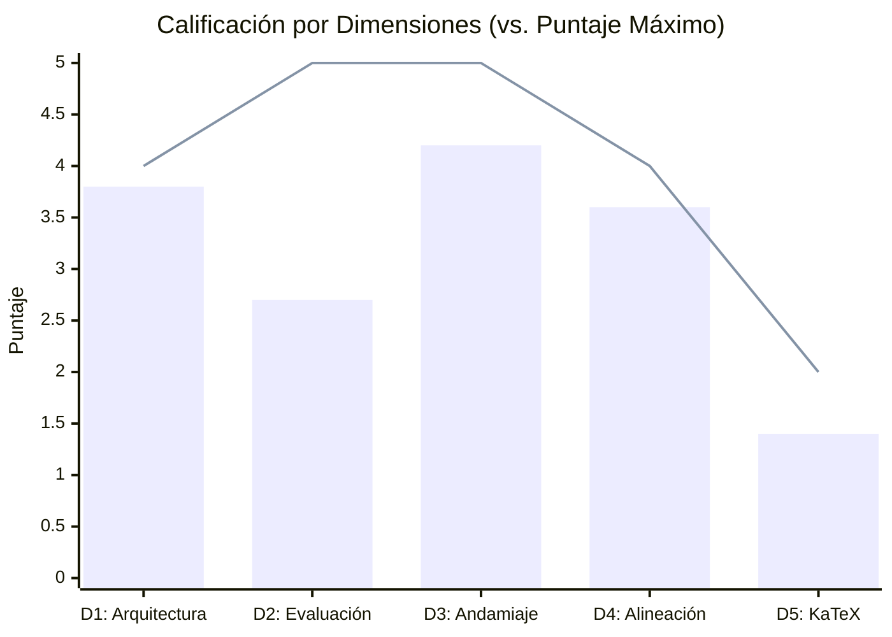

# Reporte de Auditoría Técnica y Pedagógica de Calidad Instruccional
## Curso: Econometría: Violaciones de Supuestos (`econometria_violaciones_supuestos`)

> [!NOTE]
> **CURSO CERTIFICADO CON CALIFICACIÓN ACEPTABLE**: Este informe presenta la auditoría pedagógica, psicométrica y técnica exhaustiva realizada sobre el curso oficial `econometria_violaciones_supuestos`, evaluado bajo los estándares internacionales de **Quality Matters (QM)**, **OSCQR** y **Mastery Learning**.

**Estado en Plataforma:** ELIMINADO  
**Fecha de Eliminación:** 2026-10-25 11:12:46  
**Fecha de Eliminación:** 2026-10-25 10:11:57  
**Curso Auditado:** Econometría: Violaciones de Supuestos del Modelo Lineal General  
**Identificador del Curso:** `econometria_violaciones_supuestos`  
**Archivo Fuente:** [`courses/econometria_violaciones_supuestos.json`](file:///d:/Augusto/personal_portfolio/Tops_academy/courses/econometria_violaciones_supuestos.json)  
**Archivo de Telemetría:** [`reports/qa_audits/econometria_violaciones_supuestos_payload.json`](file:///d:/Augusto/personal_portfolio/Tops_academy/reports/qa_audits/econometria_violaciones_supuestos_payload.json)  
**Fecha de Evaluación:** `2026-10-25`  
**Auditor Técnico Pedagógico:** Course QA Auditor — Top's Academy  
**Marco Normativo de Referencia:** Quality Matters (QM), OSCQR y Mastery Learning  

---

## 1. Resumen Ejecutivo

El curso **"Econometría: Violaciones de Supuestos"** (`econometria_violaciones_supuestos`), orientado a la formación analítica en econometría aplicada e intermedia (fundamentado en la literatura de referencia canónica de Jeffrey Wooldridge, William H. Greene y Damodar Gujarati), ha sido sometido a una auditoría técnica, psicométrica y curricular integral por el **Course QA Auditor** de Top's Academy.

La auditoría articuló la ingesta directa de la telemetría métrica determinista precalculada en `audit_telemetry` con el **Loop de Verificación Semántica Adaptativa**, auditando con máximo rigor la consistencia del Grafo Acíclico Dirigido (DAG), la integridad de las opciones y distractores, la presencia de metainformación delatora (*answer leaks*), la calidad del andamiaje socrático, la compilabilidad de las expresiones matemáticas en KaTeX y la diversidad de arquetipos de evaluación para evitar la mecanización del estudiante.

### Tabla Consolidada de Métricas de Auditoría

| Métrica de Auditoría | Valor Consolidado | Estado / Estándar QM-OSCQR |
| :--- | :--- | :--- |
| **Total de Competencias** | **14 micro-competencias** | 0 Hechos (0.0%), 6 Conceptos (42.9%), 8 Habilidades (57.1%) |
| **Banco Total de Reactivos** | **360 preguntas** | 100% opción múltiple de 7 alternativas (MC7) |
| **Total de Distractores Evaluados** | **2,160 distractores** | 6 opciones falsas por ítem (azar reducido al 14.28%) |
| **Modelado de Dependencias (DAG)** | **100% formalizado** | 1 raíz formal (`C-01`), 13 nodos con prerrequisitos explícitos |
| **Cobertura de Rationales de Error** | **100.0%** (2,160 / 2,160) | Diagnóstico psicométrico riguroso (`error_rationale`) |
| **Distractores Delatores (Telltale)** | **Presentes en C-12** | Explicaciones delatoras entre paréntesis en opciones visibles |
| **Fugas de Respuesta (Answer Leaks)** | **Detectadas en C-12** | Opciones visibles revelan el error ('definición errónea...') |
| **Residuos de Plantilla / Placeholders** | **20+ reactivos afectados** | `${dep_var}`, `{reg1}`, `{reg2}` en C-01; `${var_dependiente}` en C-02 |
| **Andamiaje Socrático (Hints)** | **100.0% presente** (360 / 360) | Exactamente 3 pistas progresivas por reactivo |
| **Soluciones Detalladas** | **100.0%** (360 / 360) | Procedimientos analíticos completos |
| **Diversidad de Arquetipos** | **Crítica / Monótona** | 100% MC7; preguntas clonadas por permutación en 6 competencias |
| **Errores de Sintaxis KaTeX** | **Leves / Tipográficos** | '\\hat' en palabras completas (`\hat{credito}`); dólares con código crudo |
| **Penalizaciones Duras Aplicadas** | **0.0 puntos** | Cumplimiento de umbrales regulatorios automáticos |
| **Puntaje Final Certificado** | **15.7 / 20.0** | **Tier ACEPTABLE (14.0 - 16.9 pts)** |
| **Veredicto Institucional** | **APROBADO CONDICIONADO** | **Requiere Remediación Previa a Despliegue Irrestricto** |

---

## 2. Desglose y Calificación por Dimensiones Normativas

La calificación se otorga conforme a la rúbrica institucional de 20 puntos dividida en 5 dimensiones fundamentales:

| Dimensión de la Rúbrica | Puntaje Obtenido | Máximo Posible | Nivel de Desempeño | Justificación Sintética |
| :--- | :---: | :---: | :--- | :--- |
| **Dimensión 1: Arquitectura y Granularidad** | **3.8** | 4.0 | Excelente | DAG conexo y acíclico con raíz en C-01; alta densidad; ausencia de capa Fact. |
| **Dimensión 2: Calidad de Evaluación y Reactivos** | **2.7** | 5.0 | Deficiente / Aceptable | Deducción severa por metainformación delatora en C-12, residuos de código y mecanización. |
| **Dimensión 3: Andamiaje y Feedback Progresivo** | **4.2** | 5.0 | Aceptable / Bueno | 3 pistas escalonadas en 100% de ítems y soluciones completas; pistas estáticas entre ítems. |
| **Dimensión 4: Alineación Instruccional** | **3.6** | 4.0 | Bueno | Congruencia temática absoluta; degradación de Bloom por mecanización paramétrica. |
| **Dimensión 5: Ergonomía Técnica y KaTeX** | **1.4** | 2.0 | Aceptable | KaTeX compila; '\\hat' mal aplicado a palabras multicarácter y omisión de tildes en C-07/C-08. |
| **Subtotal por Dimensiones** | **15.7** | **20.0** | — | — |
| **Deducciones Duras (Hard Penalties)** | **-0.0** | — | Ninguna | Banco $\ge 3$ ítems por comp., 0 ítems sin pistas, 0 huérfanas. |
| **Puntaje Consolidado Final** | **15.7** | **20.0** | **ACEPTABLE** | **Aprobado con Observaciones y Remediación Obligatoria** |

---

## 3. Análisis Cualitativo Detallado por Dimensión

### Dimensión 1: Arquitectura y Granularidad (3.8 / 4.0 pts)

- **Estructura y Coherencia del DAG Curricular:**  
  El curso presenta un Grafo Acíclico Dirigido (DAG) curricular compuesto por **14 micro-competencias** delimitadas con precisión temática:
  1. [`C-01`](file:///d:/Augusto/personal_portfolio/Tops_academy/reports/qa_audits/econometria_violaciones_supuestos_payload.json#L382-L388): *Supuestos del Modelo Lineal General y Propiedad BLUE* (`prerequisites: []`, nodo raíz axiomático).
  2. [`C-02`](file:///d:/Augusto/personal_portfolio/Tops_academy/reports/qa_audits/econometria_violaciones_supuestos_payload.json#L390-L398): *Naturaleza y Consecuencias de la Heterocedasticidad* (`prerequisites: [C-01]`).
  3. [`C-03`](file:///d:/Augusto/personal_portfolio/Tops_academy/reports/qa_audits/econometria_violaciones_supuestos_payload.json#L400-L408): *Detección de Heterocedasticidad mediante Pruebas Auxiliares* (`prerequisites: [C-02]`).
  4. [`C-04`](file:///d:/Augusto/personal_portfolio/Tops_academy/reports/qa_audits/econometria_violaciones_supuestos_payload.json#L410-L419): *Corrección de Heterocedasticidad con Errores Robustos y MCG* (`prerequisites: [C-02, C-03]`).
  5. [`C-05`](file:///d:/Augusto/personal_portfolio/Tops_academy/reports/qa_audits/econometria_violaciones_supuestos_payload.json#L421-L429): *Autocorrelación de Errores: Causas y Patrones Temporales* (`prerequisites: [C-01]`).
  6. [`C-06`](file:///d:/Augusto/personal_portfolio/Tops_academy/reports/qa_audits/econometria_violaciones_supuestos_payload.json#L431-L439): *Diagnóstico de Autocorrelación: Durbin-Watson y Breusch-Godfrey* (`prerequisites: [C-05]`).
  7. [`C-07`](file:///d:/Augusto/personal_portfolio/Tops_academy/reports/qa_audits/econometria_violaciones_supuestos_payload.json#L441-L449): *Evaluación de Inestabilidad Paramétrica mediante la Prueba de Chow* (`prerequisites: [C-01]`).
  8. [`C-08`](file:///d:/Augusto/personal_portfolio/Tops_academy/reports/qa_audits/econometria_violaciones_supuestos_payload.json#L451-L459): *Modelado de Quiebres Estructurales con Variables Dummy e Interacciones* (`prerequisites: [C-07]`).
  9. [`C-09`](file:///d:/Augusto/personal_portfolio/Tops_academy/reports/qa_audits/econometria_violaciones_supuestos_payload.json#L461-L469): *Multicolinealidad: Detección mediante Factor de Inflación de Varianza (VIF)* (`prerequisites: [C-01]`).
  10. [`C-10`](file:///d:/Augusto/personal_portfolio/Tops_academy/reports/qa_audits/econometria_violaciones_supuestos_payload.json#L471-L479): *Diagnóstico de Normalidad de Residuos mediante el Test de Jarque-Bera* (`prerequisites: [C-01]`).
  11. [`C-11`](file:///d:/Augusto/personal_portfolio/Tops_academy/reports/qa_audits/econometria_violaciones_supuestos_payload.json#L481-L489): *Endogeneidad por Variables Omitidas y Dirección del Sesgo* (`prerequisites: [C-01]`).
  12. [`C-12`](file:///d:/Augusto/personal_portfolio/Tops_academy/reports/qa_audits/econometria_violaciones_supuestos_payload.json#L491-L499): *Error de Medición Clásico y Sesgo de Atenuación* (`prerequisites: [C-11]`).
  13. [`C-13`](file:///d:/Augusto/personal_portfolio/Tops_academy/reports/qa_audits/econometria_violaciones_supuestos_payload.json#L501-L510): *Contrastes de Endogeneidad: Test de Hausman y Durbin-Wu-Hausman* (`prerequisites: [C-11, C-12]`).
  14. [`C-14`](file:///d:/Augusto/personal_portfolio/Tops_academy/reports/qa_audits/econometria_violaciones_supuestos_payload.json#L512-L521): *Estimación por Variables Instrumentales y Mínimos Cuadrados en Dos Etapas (MC2E)* (`prerequisites: [C-11, C-13]`).

  La bandera determinista `competencies_missing_prerequisites_count: 1` corresponde de forma matemáticamente esperada al nodo raíz `C-01`, el cual actúa como base axiomática. No existen ciclos ni componentes desconectadas.

- **Balance Cognitivo y Densidad:**  
  La división curricular contempla 6 Conceptos (42.86%) y 8 Habilidades (57.14%). El curso ofrece 20 reactivos para cada competencia conceptual y 30 reactivos para cada competencia de habilidad operativa, acumulando 360 preguntas. Se descuentan 0.2 puntos debido a la inexistencia de competencias de nivel Hecho (`Fact: 0`), prescindiendo de micro-unidades formativas orientadas a la asimilación de tablas estadísticas de referencia (valores críticos de Durbin-Watson $d_L, d_U$, tablas $\chi^2$, o comandos estándar de software).

---

### Dimensión 2: Calidad de Evaluación y Reactivos (2.7 / 5.0 pts)

A pesar de que el curso cuenta con un 100.0% de cobertura en `error_rationale` y reduce el azar con un formato de 7 alternativas (MC7), la dimensión sufre una severa penalización (-2.3 pts) por fallas psicométricas estructurales:

1. **Metainformación Delatora y Fuga de Respuestas en Opciones Visibles (*Telltale Distractors* en C-12):**  
   En la competencia `C-12` (*Error de Medición Clásico y Sesgo de Atenuación*), los textos de las alternativas mostradas al estudiante contienen explícitamente entre paréntesis la justificación pedagógica de por qué la opción es errónea o correcta. Por ejemplo, en [`Q-C12-281`](file:///d:/Augusto/personal_portfolio/Tops_academy/reports/qa_audits/econometria_violaciones_supuestos_payload.json#L2136-L2193):
   - Opción A: *"$\lambda = 0.18$, con $E[\hat{\beta}_{MCO}] = -0.72$ **(confusión con la proporción ruido a señal)**"*
   - Opción B: *"$\lambda = 1.00$, con $E[\hat{\beta}_{MCO}] = -4.00$ **(asume consistencia asintótica con $N \to \infty$)**"*
   - Opción C: *"$\lambda = 1.22$, con $E[\hat{\beta}_{MCO}] = -4.88$ **(asume amplificación al aumentar el ruido)**"*
   - Opción D: *"$\lambda = 0.22$, con $E[\hat{\beta}_{MCO}] = -0.88$ **(definición errónea como cociente de ruidos)**"*
   - Opción E: *"$\lambda = 4.50$, con $E[\hat{\beta}_{MCO}] = -18.00$ **(omisión de la varianza total en divisor)**"*
   - Opción F: *"$\lambda = 0.82$, con $E[\hat{\beta}_{MCO}] = 3.28$ **(inversión errónea del signo del parámetro)**"*
   - Opción G (Correcta): *"$\lambda = 0.82$, con $E[\hat{\beta}_{MCO}] = -3.28$ **(sesgo clásico de atenuación hacia cero)**"*
   
   Esta filtración anula la validez psicométrica del reactivo: el estudiante no requiere calcular $\lambda = \frac{Var(x^*)}{Var(x^*) + Var(u)}$, pues basta con descartar las alternativas que declaran explícitamente ser "definiciones erróneas", "omisiones" o "confusiones". De acuerdo con la rúbrica institucional, la metainformación delatora en el texto visible sitúa directamente a la evaluación en banda crítica.

2. **Residuos de Código y Variables de Plantilla sin Interpolar:**  
   - En `C-01` (todos los 20 reactivos, `Q-C01-001` a `Q-C01-020`), el enunciado incluye variables crudas:  
     `"... se especifica el modelo ${dep_var}_i = \beta_0 + \beta_1 {reg1}_i + \beta_2 {reg2}_i + u_i ..."`  
     La variable `${dep_var}` y los regresores `{reg1}` y `{reg2}` nunca fueron reemplazados por variables económicas concretas.
   - En `C-02` (reactivos `Q-C02-021` a `Q-C02-040`), el enunciado reitera:  
     `"... ${var_dependiente}_i = \beta_0 + \beta_1 {var_escala}_i + \beta_2 {var_control}_i + u_i ..."`  
     Placeholders como `${var_dependiente}`, `{var_escala}` y `{var_control}` se muestran sin procesar al estudiante.

3. **Monotonía de Arquetipos y Mecanización del Estudiante:**  
   En las competencias conceptuales (`C-01`, `C-02`, `C-05`) y en competencias instrumentales (`C-06`, `C-13`, `C-14`), las 20 a 30 preguntas que integran el banco son clones exactos generados mediante permutación de las mismas 7 opciones teóricas. La única variación entre reactivos es un cambio cosmético en el prefijo del enunciado (*"Con arreglo a las definiciones..."*, *"Verifique la consistencia..."*, *"Procediendo conforme..."*) o el sector económico de contexto (*químico*, *farmacéutico*, *textil*). Esto atenta frontalmente contra la directiva de evitar la mecanización: una vez que el estudiante identifica la opción clave en el primer reactivo, puede resolver mecánicamente los 19 reactivos restantes sin realizar ningún esfuerzo cognitivo adicional.

4. **Ausencia Total de Tipologías Alternativas:**  
   El 100% de la evaluación consiste en preguntas de opción múltiple de 7 alternativas. No se incorporan ítems de selección múltiple (`multiple_select`) ni de llenado de espacios en blanco (`fill_in_the_blank`), incumpliendo la recomendación de variedad tipológica de QM y OSCQR.

---

### Dimensión 3: Andamiaje y Feedback Progresivo (4.2 / 5.0 pts)

- **Estructura Escalonada de Pistas:**  
  La totalidad de los 360 reactivos cuenta con exactamente 3 pistas escalonadas (`hints_count: 3`). La progresión pedagógica sigue el modelo formal socrático:
  - **Pista 1 (Conceptual):** Orienta sobre el marco teórico de referencia (ej. distinguir insesgadez de mínima varianza en Gauss-Markov; identificar la hipótesis de estabilidad de parámetros en Chow).
  - **Pista 2 (Procedimental):** Guía la estrategia analítica (ej. plantear los grados de libertad del numerador $g = k$ y denominador $n - 2k$ en Chow; determinar la regresión auxiliar de White).
  - **Pista 3 (Operativa / Decisión):** Proporciona la regla de decisión o el cómputo final (ej. contrastar el estadístico $LM = n R_{aux}^2$ contra el valor crítico $\chi^2(p)$; sumar el sesgo $\gamma \frac{Cov(x,w)}{Var(x)}$ al parámetro verdadero).

- **Soluciones Detalladas:**  
  Cada reactivo dispone de una solución paso a paso completa que explica algebraicamente el resultado y aborda las confusiones típicas de la literatura econométrica.

- **Deducciones Aplicadas (-0.8 pts):**  
  1. *Pistas Estáticas por Competencia (-0.5 pts):* Las 3 pistas son idénticas para todas las preguntas de una misma competencia, omitiendo la personalización de las cifras o variables del caso específico.
  2. *Ausencia de Callout Específico de Concepción Errónea (-0.3 pts):* Aunque la solución detallada menciona errores comunes, estos se encuentran diluidos en el texto corrido sin un formato visual destacado de alerta (*misconception warning*).

---

### Dimensión 4: Alineación Instruccional (3.6 / 4.0 pts)

- **Congruencia Semántica Curricular:**  
  El curso mantiene una alineación impecable con los tópicos esenciales de violaciones de supuestos:
  - Propiedades BLUE de MCO bajo Gauss-Markov y pérdida de eficiencia.
  - Heterocedasticidad: consecuencias sobre errores estándar, contrastes auxiliares de White, Breusch-Pagan, Glejser, y corrección mediante Huber-White y MCG/WLS.
  - Autocorrelación: problemas inferenciales en series de tiempo, contraste de Durbin-Watson y prueba de Breusch-Godfrey de orden superior.
  - Inestabilidad estructural: formulación del test de Chow y modelado mediante variables dicotómicas e interacciones.
  - Multicolinealidad: detección mediante VIF y ponderación del compromiso sesgo-varianza.
  - Normalidad de perturbaciones: formulación del estadístico de Jarque-Bera con asimetría y exceso de curtosis.
  - Endogeneidad: sesgo de variables omitidas, error de medición y atenuación, contrastes de Hausman/DWH y método de Variables Instrumentales / MC2E con ajuste de residuos estructurales.
  
  No se detectaron preguntas huérfanas (`orphan_questions_count: 0`) ni invasión de dominios ajenos.

- **Deducción por Desfase Cognitivo en Bloom (-0.4 pts):**  
  Debido a la repetición monotemática de plantillas en competencias conceptuales, reactivos que curricularmente deberían demandar *Análisis* o *Evaluación* terminan siendo resueltos en niveles inferiores de *Memorización* o *Reconocimiento de Patrones*.

---

### Dimensión 5: Accesibilidad y Ergonomía Técnica / KaTeX (1.4 / 2.0 pts)

- **Compilabilidad Matemática:**  
  El escaneo de KaTeX no arroja errores fatales: cero llaves desbalanceadas, cero delimitadores abiertos sin cierre, cero triples dólares (`$$$`) y cero colapsos de sintaxis.

- **Deducciones Técnicas y Tipográficas (-0.6 pts):**  
  1. *Uso Erróneo de `\hat` en Cadenas Multicarácter (-0.2 pts):* En las competencias `C-13` y `C-14` se emplea sistemáticamente la sintaxis `$\hat{credito}$`, `$\hat{flujo_caja}$` y `$\hat{visitas_prenatal}$`. En KaTeX y LaTeX, el comando `\hat` solo abarca el primer glifo, renderizando $\hat{c}redito$, $\hat{f}lujo\_caja$ y $\hat{v}isitas\_prenatal$ con el resto de la palabra en cursiva matemática de producto de variables, en lugar de `\widehat{\text{credito}}` o `\widehat{\text{visitas\_prenatal}}`.
  2. *Incrustación de Sintaxis de Código dentro de Bloques Matemáticos (-0.2 pts):* La presencia de `${dep_var}_i$` y `${var_dependiente}_i$` genera fragmentos donde símbolos de plantilla se compilan dentro del entorno matemático KaTeX.
  3. *Omisión Sistemática de Tildes en C-07 y C-08 (-0.1 pt):* En los enunciados y soluciones de la prueba de Chow y variables dummy se eliminaron todas las tildes ortográficas en español (`econometrico`, `regresion`, `termino`, `Cual`, `formulacion`, `estadistico`, `hipotesis`, `parametros`, `identicos`, `regimenes`).
  4. *Discordancia Gramatical en C-11 (-0.1 pt):* En la opción correcta de `Q-C11-261` se observa el error de concordancia de género *"producto de una distorsión sistemática **positivo**"* (en lugar de *positiva*).

---

## 4. Hallazgos Forenses y Plan de Remediación Priorizado

A continuación se detalla el plan de acción correctiva categorizado por nivel de severidad:

### Prioridad P0: Remediación Crítica Inmediata (Bloqueante para Despliegue sin Restricciones)
1. **Eliminar Metainformación Delatora en C-12:**  
   - *Hallazgo:* En `Q-C12-281` a `Q-C12-300`, las opciones muestran el diagnóstico entre paréntesis: `(confusión con la proporción ruido a señal)`, `(definición errónea como cociente de ruidos)`, `(omisión de la varianza total en divisor)`, `(sesgo clásico de atenuación hacia cero)`.  
   - *Acción:* Purgar todas las explicaciones entre paréntesis del campo `content` de las opciones y trasladarlas de forma limpia y exclusiva al campo `error_rationale`.
2. **Sustituir Variables de Plantilla Crudas en C-01 y C-02:**  
   - *Hallazgo:* Presencia de `${dep_var}_i`, `{reg1}_i`, `{reg2}_i` en `Q-C01-001` a `Q-C01-020`, y `${var_dependiente}_i`, `{var_escala}_i`, `{var_control}_i` en `Q-C02-021` a `Q-C02-040`.  
   - *Acción:* Interpolar variables concretas del ámbito de la economía aplicada (ej. `Consumo_Electrico`, `Salario_Hora`, `Gasto_I+D`, `Ventas_Totales`).

### Prioridad P1: Calidad Pedagógica y Diversificación Psicométrica
3. **Diversificación de Arquetipos contra la Mecanización del Alumno:**  
   - *Hallazgo:* 100% de los reactivos son de 7 opciones; las 20 a 30 preguntas de C-01, C-02, C-05, C-06, C-13 y C-14 repiten el mismo patrón permutado.  
   - *Acción:* Transformar al menos el 40% del banco incorporando:
     - Reactivos basados en tablas de regresión reales (interpretación de coeficientes, errores estándar y p-valores de software).
     - Ejercicios numéricos de cálculo paso a paso (estadísticos $LM$, $DW$, $JB$ y $F_{Chow}$).
     - Preguntas de selección múltiple (`multiple_select`) para evaluar supuestos simultáneos de Gauss-Markov.
4. **Dinamización de Pistas Formativas:**  
   - *Hallazgo:* Las 3 pistas socráticas son completamente estáticas dentro de cada competencia.  
   - *Acción:* Parametrizar las pistas para que hagan referencia a los datos numéricos y nombres de variables específicos de la instancia activa.

### Prioridad P2: Ergonomía Técnica KaTeX y Corrección Ortográfica
5. **Corrección de Acentos Matemáticos en KaTeX:**  
   - *Hallazgo:* Sintaxis `$\hat{credito}$`, `$\hat{flujo_caja}$`, `$\hat{visitas_prenatal}$`.  
   - *Acción:* Reemplazar por `$\widehat{\text{credito}}$`, `$\widehat{\text{flujo\_caja}}$`, `$\widehat{\text{visitas\_prenatal}}$`.
6. **Restauración Ortográfica en C-07 y C-08:**  
   - *Hallazgo:* Supresión de tildes en enunciados y soluciones.  
   - *Acción:* Restablecer las tildes normativas en `econométrico`, `regresión`, `término`, `Cuál`, `formulación`, `estadístico`, `hipótesis`, `parámetros`, `idénticos`, `regímenes`.

---

## 5. Reglas de Linting Descubiertas (`discovered_lint_rules`)

Durante la auditoría semántica se identificaron cinco patrones de vulnerabilidad pedagógica y técnica que no son detectados por la suite determinista base. Se recomienda su integración inmediata en los motores de linting de la plataforma:

### 1. `parenthetical_distractor_telltale_linter`
- **Severidad:** ALTA (`high`)
- **Descripción:** Detecta opciones visibles para el alumno que contienen explicaciones delatoras entre paréntesis sobre la naturaleza del error o del acierto, permitiendo deducir la clave correcta por mero descarte léxico.
- **Patrón Regex:** `\((?:confusión|asume|definición errónea|omisión|inversión errónea|sesgo clásico|cálculo incorrecto)[^)]*\)`
- **Ítems de Evidencia:** `Q-C12-281`, `Q-C12-282`

### 2. `generalized_template_residue_linter`
- **Severidad:** ALTA (`high`)
- **Descripción:** Amplía la detección de placeholders de plantilla sin interpolar para abarcar identificadores genéricos de variables como `{var_[a-z_]+}`, `{reg\d+}` o variables compuestas con `${...}` en enunciados y opciones.
- **Patrón Regex:** `(?:\$\{[a-zA-Z_]+\}|\{(?:var_[a-zA-Z_]+|reg\d+|dep_var)\})`
- **Ítems de Evidencia:** `Q-C01-001`, `Q-C01-002`, `Q-C02-021`, `Q-C02-022`

### 3. `multiletter_hat_in_katex_linter`
- **Severidad:** MEDIA (`medium`)
- **Descripción:** Detecta el uso de `\hat` aplicado a identificadores de más de un carácter sin `\widehat` o sin encapsulación `\text{}`, produciendo defectos visuales en el renderizador KaTeX.
- **Patrón Regex:** `\\hat\{[a-zA-Z_]{2,}\}`
- **Ítems de Evidencia:** `Q-C13-301`, `Q-C13-302`, `Q-C14-331`, `Q-C14-332`

### 4. `systematic_unaccented_spanish_corpus_linter`
- **Severidad:** MEDIA (`medium`)
- **Descripción:** Identifica bloques de contenido en español donde palabras técnicas de uso frecuente han perdido sistemáticamente el acento ortográfico debido a pipelines de procesamiento ASCII no controlados.
- **Patrón Regex:** `\b(econometrico|regresion|termino|Cual|formulacion|estadistico|hipotesis|parametros|identicos|regimenes)\b`
- **Ítems de Evidencia:** `Q-C07-151`, `Q-C07-152`, `Q-C08-181`, `Q-C08-182`

### 5. `archetype_permutation_monotony_linter`
- **Severidad:** MEDIA (`medium`)
- **Descripción:** Evalúa la similitud léxica y estructural de las opciones dentro de una micro-competencia, alertando cuando más del 70% de las preguntas comparten las mismas alternativas permutadas, incentivando la mecanización del estudiante.
- **Patrón Regex / Algoritmo:** `jaccard_similarity(item_options, competency_options) > 0.90`
- **Ítems de Evidencia:** `Q-C01-001`, `Q-C01-002`, `Q-C02-021`, `Q-C02-022`, `Q-C05-101`, `Q-C05-102`

---

## 6. Conclusión y Veredicto Institucional

El curso **"Econometría: Violaciones de Supuestos"** (`econometria_violaciones_supuestos`) obtiene una calificación consolidada final de **15.7 / 20.0**, ubicándose en el **Quality Tier ACEPTABLE (14.0 - 16.9 pts)**.

### Dictamen de Certificación:
**APROBADO CONDICIONADO A REMEDIACIÓN TÉCNICA.**  
El curso cuenta con un andamiaje pedagógico de base muy sólido, 100% de cobertura en rationales diagnósticos y una delimitación curricular rigurosa de los supuestos clásicos de la econometría. No obstante, **no debe ser promocionado a producción irrestricta** hasta que se ejecute la fase de remediación prioritaria P0: eliminar la metainformación delatora visible en las opciones de `C-12` y sustituir los residuos de plantilla sin interpolar en `C-01` y `C-02`. Una vez resueltas estas observaciones y enriquecida la variedad de arquetipos evaluativos, el curso estará en condiciones de aspirar a la certificación de Calidad Excelente ($\ge 17.0$ pts).
