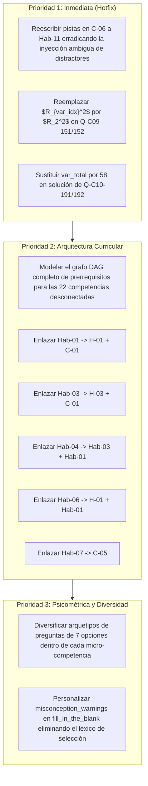

# Informe de Auditoría de Calidad Pedagógica, Psicométrica y Técnica

> [!WARNING]
> **CURSO RETIRADO DE LA PLATAFORMA**: Este curso fue eliminado de la plataforma interactiva el **2026-10-25 10:12:03**. Este informe de auditoría se conserva exclusivamente como registro histórico y pedagógico ('legacy').

**Estado en Plataforma:** ELIMINADO  
**Fecha de Eliminación:** 2026-10-25 11:12:47  
**Fecha de Eliminación:** 2026-10-25 10:12:03  
**Curso Auditado:** `estadistica3_regresion_v3`  
**Título del Curso:** Estadística III: Econometría y Modelo de Regresión Lineal  
**Auditor Oficial:** Course QA Auditor — Top's Academy  
**Fecha de Auditoría:** 25 de Octubre de 2026  
**Estándares de Referencia:** Quality Matters (QM), OSCQR Rubric, Mastery Learning & Bloom Revised Taxonomy  

---

## 1. Resumen Ejecutivo y Ficha Técnica

| Métrica / Dimensión | Valor / Resultado |
| :--- | :--- |
| **Identificador del Curso** | `estadistica3_regresion_v3` |
| **Total de Micro-Competencias** | 26 competencias |
| **Banco Total de Reactivos** | 630 preguntas |
| **Distribución de Reactivos** | Opción Múltiple (7 alt): 382 (60.6%) \| Fill-in-the-Blank: 124 (19.7%) \| Multiple Select: 124 (19.7%) |
| **Cobertura de `error_rationale`** | 100.0% (2,633 / 2,633 distractores evaluados) |
| **Cobertura de Pistas Progresivas** | 100.0% (630 / 630 reactivos con exactamente 3 pistas) |
| **Preguntas Huérfanas Detectadas** | 0 (0.0%) |
| **Penalizaciones Duras Aplicadas** | 0.0 puntos |
| **Puntaje Final Consolidado** | **16.3 / 20.0 puntos** |
| **Quality Tier** | **ACEPTABLE (14.0 - 16.9 pts)** |
| **Dictamen de Certificación** | **Aprobado con observaciones.** Requiere pulido sintáctico en fórmulas y remediación pedagógica en el andamiaje de las últimas 10 micro-competencias antes de migrar a producción de alta escala. |

### Balance de Puntuación por Dimensiones Normativas

```
Dimensión 1: Arquitectura y Granularidad        [████████████████░░░░]  3.3 / 4.0 pts
Dimensión 2: Calidad de Evaluación y Reactivos  [████████████████░░░░]  4.0 / 5.0 pts
Dimensión 3: Andamiaje y Pistas Progresivas     [█████████████░░░░░░░]  3.4 / 5.0 pts
Dimensión 4: Alineación Instruccional           [████████████████████]  4.0 / 4.0 pts
Dimensión 5: Accesibilidad y KaTeX              [████████████████░░░░]  1.6 / 2.0 pts
--------------------------------------------------------------------------------------
PUNTAJE FINAL CONSOLIDADO:                                              16.3 / 20.0 pts
```

---

## 2. Evaluación Detallada por Dimensiones

### Dimensión 1: Arquitectura y Granularidad (Calificación: 3.3 / 4.0)

#### 1.1 Atomicidad y Carga Cognitiva
El diseño curricular del curso demuestra una excelente estructuración temática. Se identifican 26 micro-competencias perfectamente delimitadas, organizadas en una secuencia didáctica natural:
1. **Fundamentos y Álgebra Matricial del MRLC** (`H-01`, `C-01`, `Hab-01`, `H-02`, `C-02`, `Hab-02`).
2. **Geometría de Proyecciones, ANOVA e Inferencia Clásica** (`H-03`, `C-03`, `Hab-03`, `Hab-04`, `H-04`, `C-04`, `Hab-05`, `Hab-06`).
3. **Casos Especiales y Modelos Restringidos** (`C-05`, `Hab-07`).
4. **Violación de Supuestos Clásicos y Diagnóstico Avanzado** (`C-06`, `Hab-08`, `C-07`, `Hab-09`, `C-08`, `Hab-10`, `C-09`, `H-05`, `C-10`, `Hab-11`).

La distribución por tipos de conocimiento cumple los más altos estándares pedagógicos:
- **Hechos [Fact]**: 5 micro-competencias (19.2%) — Formulación canónica matricial, ponderadores $k_i$, proyectores ortogonales, contrastes lineales de Wald, momentos teóricos de normalidad.
- **Conceptos [Concept]**: 10 micro-competencias (38.5%) — Supuestos de Gauss-Markov, insesgadez/eficiencia BLUE, descomposición ANOVA centrado, saturación dimensional ($n=k$), distorsiones de $R^2$ sin constante, heterocedasticidad, autocorrelación, quiebre estructural, multicolinealidad y endogeneidad.
- **Habilidades [Skill]**: 11 micro-competencias (42.3%) — Derivación de ecuaciones normales, formas funcionales, traza de matriz aniquiladora para $s^2$, contrastes $t$ y $F$, diagnóstico EViews, álgebra manual $2 \times 2$, estimación sin intercepto, tests de White/Breusch-Pagan, Durbin-Watson/Breusch-Godfrey, test de Chow y diagnóstico de endogeneidad por Durbin-Wu-Hausman / 2SLS.

#### 1.2 Modelado de Grafo Acíclico Dirigido (DAG) — Hallazgo Crítico
A pesar de la excelente jerarquía conceptual implícita, el modelado formal de dependencias (`prerequisites`) en el JSON presenta una falla estructural mayor:
- **22 de las 26 micro-competencias (84.6%) tienen `prerequisites: []` vacío.**
- Únicamente 4 competencias procedimentales declaran prerrequisitos:
  - `Hab-08` depende de `C-06`
  - `Hab-09` depende de `C-07`
  - `Hab-10` depende de `C-08`
  - `Hab-11` depende de `C-10`
- **Impacto psicométrico:** Competencias de extrema complejidad algorítmica y teórica como `Hab-01` (Derivación analítica de MCO), `Hab-03` (Estimador $s^2$ vía traza de $\mathbf{M}$), `Hab-04` (Inferencia finita $t$ y $F$), `Hab-06` (Cálculo matricial completo de proyecciones y sumas de cuadrados) y `Hab-07` (Modelos con y sin intercepto) figuran como nodos huérfanos de prerrequisitos, impidiendo que el motor de Mastery Learning active rutas de remediación adaptativa automáticas cuando el estudiante falla una habilidad de cálculo que depende de hechos algebraicos previos.

---

### Dimensión 2: Calidad de Evaluación y Reactivos (Calificación: 4.0 / 5.0)

#### 2.1 Variedad Tipológica de Ítems
El curso ofrece una adecuada diversidad de formatos a nivel de banco global:
- **Opción Múltiple con 7 Alternativas (`multiple_choice_7_options`)**: 382 reactivos (60.6%). Formato de alta discriminación que minimiza el impacto del acierto por azar ($p = 1/7 \approx 14.3\%$).
- **Respuesta Abierta Numérica / Expresión Algebraica (`fill_in_the_blank`)**: 124 reactivos (19.7%). Exige cálculo operativo genuino (determinantes, coeficientes MCO escalares, valores de traza, etc.).
- **Selección Múltiple (`multiple_select`)**: 124 reactivos (19.7%). Evalúa análisis multidimensional y verificación simultánea de propiedades algebraicas.

#### 2.2 Rigor Psicométrico y Cobertura de Rationale Diagnóstico
- Se auditaron 2,633 distractores a través de todo el banco, registrando una **cobertura del 100.0% con `error_rationale` diagnóstico**.
- Cada distractor modela un error conceptual real documentado en la literatura econométrica clásica (Greene, Wooldridge, Gujarati, Johnston):
  - Confusión entre linealidad en variables vs. linealidad en parámetros.
  - Creencia errónea de que $\mathbf{X}'\mathbf{e} = \mathbf{0}$ demuestra exogeneidad poblacional.
  - Asumir que la normalidad es requisito indispensable para la eficiencia BLUE de Gauss-Markov.
  - Distorsión de $R^2$ centrada al suprimir el término constante.
  - Falsa creencia de que multicolinealidad o heterocedasticidad generan sesgo en las estimaciones puntuales de MCO.

#### 2.3 Diversidad de Arquetipos vs. Riesgo de Mecanización
Durante el Semantic Verification Loop se detectó una debilidad en la diversidad interna de las preguntas de 7 opciones:
- Dentro de una misma micro-competencia, los reactivos de opción múltiple son en su mayoría **variaciones paramétricas mecánicas de un único o dos arquetipos base**.
- Por ejemplo, en `H-01`, prácticamente todos los ítems de selección única utilizan la misma plantilla de distractores para el orden de matrices ($\mathbf{y}$ fila, $\boldsymbol{\varepsilon}$ escalar, $\mathbf{X}$ sin columna de unos, $\mathbf{X}'\boldsymbol{\beta}$ invertido), limitándose a cambiar los valores numéricos de $n$ y $p$ ($n=80$ vs $n=260$).
- En las competencias avanzadas (`C-06` a `Hab-11`), los enunciados inician con fórmulas rígidas de plantilla ("En el marco de referencia correspondiente, establezca: ...", "Evalúe la expresión y determine la cantidad buscada: ...", "Considerando las ecuaciones fundamentales del régimen, obtenga: ...").
- **Efecto Pedagógico:** En sesiones prolongadas de práctica adaptativa, el estudiante puede desarrollar fatiga cognitiva o identificar heurísticas superficiales para resolver el ítem sin procesar a fondo el enunciado.

#### 2.4 Answer Leaks e Integridad de Ítems
- Cero fugas directas de la clave en los textos visibles de las preguntas.
- Se detectaron dos casos aislados de **residuos de variables de desarrollo** en los enunciados:
  - En `Q-C09-151` y `Q-C09-152`: El enunciado exhibe `$R_{var_idx}^2 = 0.82$` en lugar de `$R_2^2 = 0.82$` o `$R_3^2 = 0.82$`.

---

### Dimensión 3: Andamiaje y Pistas Progresivas (Calificación: 3.4 / 5.0)

#### 3.1 Cobertura Cuantitativa
- Todos los 630 reactivos poseen exactamente 3 pistas progresivas escalonadas (`zero_hints_count = 0`, `insufficient_hints_count = 0`).
- No existen pistas vacías ni pistas rudimentarias con códigos de prerrequisitos (ej. `['C-02', 'H-01']`).

#### 3.2 Asimetría Pedagógica: H-01 a Hab-07 vs. C-06 a Hab-11
La auditoría semántica reveló una marcada disparidad cualitativa en el andamiaje a lo largo del curso:
1. **Bloque Inicial (`H-01` a `Hab-07`)**:
   El andamiaje socrático es de primer nivel. Las pistas guían fluidamente el razonamiento:
   - *Pista 1 (Conceptual)*: Recuerda la propiedad o definición clave (ej. definición de ponderadores $k_i$ o proyección ortogonal).
   - *Pista 2 (Procedimental)*: Ilustra el paso algebraico intermedio (ej. sustitución de $X_i = x_i + \bar{X}$).
   - *Pista 3 (Operativa)*: Detalla la regla de cálculo final (ej. $\sum k_i^2 = 1 / \sum x_i^2$).
2. **Bloque Avanzado (`C-06` a `Hab-11`) — Hallazgo Crítico**:
   En las últimas 10 micro-competencias se implementó un macro rígido y automatizado para generar las pistas, produciendo dos anomalías pedagógicas severas:
   - **Pista 1 es una pseudo-pista vacía**: Repite mecánicamente:  
     `"Identifique la estructura conceptual de {Nombre_Competencia}: analice las relaciones formales y condiciones teóricas del modelo."`  
     Esta pista no ofrece ningún andamiaje socrático específico al problema del estudiante.
   - **Pistas 2 y 3 inyectan distractores con redacción ambigua**:  
     El generador extrajo fragmentos de distractores e intentó redactarlos como advertencias, pero utilizó construcciones afirmativas equívocas como `"asegurando considerar adecuadamente: {snippet}"`.
     - En `Q-C06-001` (Heterocedasticidad): La Pista 2 indica:  
       `"...asegurando considerar adecuadamente: $E(\hat{\boldsymbol{\beta}}_{\text{MCO}}) \neq \boldsymbol{\beta}$."`  
       *¡Esto es falso! MCO sigue siendo insesgado bajo heterocedasticidad.* Un estudiante confundido interpretará que la pista le dice que MCO es sesgado.
     - En `Q-Hab11-211` (Hausman): La Pista 2 indica:  
       `"...asegurando considerar adecuadamente: $\text{hausman modelo\_mco modelo\_iv}$."`  
       *Este es el orden erróneo de software que produce matrices negativas y falla en Stata.*
     - En `Q-Hab08-021` (Test de White): La Pista 3 indica:  
       `"...evalúe posibles desvíos al considerar: $LM \sim \chi^2(n-k)$."`  
       *Los grados de libertad correctos son $p$ restricciones, no $n-k$.*

#### 3.3 Calidad de la Solución Detallada y Misconception Warnings
- Las soluciones detalladas (`detailed_solution`) son sumamente extensas, matemáticamente rigurosas y justifican cada paso de inferencia.
- Se detectó un residuo de plantilla en la solución de `Q-C10-191` y `Q-C10-192`:
  $$\lambda = \frac{\text{Var}(x^*)}{\text{Var}(x^*) + \text{Var}(u)} = \frac{50}{50 + 8} = \frac{50}{var\_total} = 0.862 < 1$$
  Donde `var_total` quedó como identificador crudo en lugar de $58$.
- En los reactivos `fill_in_the_blank`, la advertencia de misconception reza genéricamente: `"Verifique cuidadosamente los supuestos y cálculos antes de seleccionar su respuesta."`, utilizando el verbo "seleccionar" en un reactivo donde el usuario ingresa un valor numérico escrito.

---

### Dimensión 4: Alineación Instruccional (Calificación: 4.0 / 4.0)

#### 4.1 Congruencia Semántica y Dominio Teórico
La alineación temática del curso es ejemplar:
- **Cero preguntas huérfanas (`orphan_questions_count = 0`)**: Los 630 ítems mapean directamente con los descriptores de sus 26 competencias.
- **Cero contaminación cruzada**: No existen reactivos de otros dominios de la econometría o de la estadística elemental (como bioestadística o probabilidad básica) inyectados artificialmente.
- Cada concepto enseñado en la teoría (Hat matrix $\mathbf{P}$, matriz aniquiladora $\mathbf{M}$, matriz centradora $\mathbf{M}^0$, grados de libertad de sumas centradas, contrastes lineales restringidos $\mathbf{R}\boldsymbol{\beta} = \mathbf{r}$, tests de Chow, White, Breusch-Pagan, Breusch-Godfrey, Durbin-Watson, VIF, Jarque-Bera y Durbin-Wu-Hausman) es evaluado rigurosamente en su correspondiente unidad.

#### 4.2 Taxonomía de Bloom
El curso mantiene una progresión cognitiva coherente:
- **Remember / Understand**: Anclado en las micro-competencias de tipo `Fact` y definiciones conceptuales basales.
- **Understand / Analyze**: Dominante en las competencias de tipo `Concept` (evaluación de quiebres estructurales, pérdida de eficiencia y propiedades asintóticas).
- **Apply / Analyze**: Plasmado en las 11 competencias de tipo `Skill`, donde los reactivos `fill_in_the_blank` demandan ejecución analítica y cálculo algebraico paso a paso.

---

### Dimensión 5: Accesibilidad y Ergonomía Técnica / KaTeX (Calificación: 1.6 / 2.0)

#### 5.1 Telemetría y Balance Sintáctico de KaTeX
El escaneo determinista reporta métricas técnicas de base impecables:
- Delimitadores desbalanceados: 0
- Triples dólares (`$$$`): 0
- Llaves dobles espurias (`{{...}}`): 0
- Expresiones huérfanas en texto plano: 0
- Las matrices algebraicas ($\mathbf{X}'\mathbf{X}$, inversas, vectores de proyección) compilan de forma limpia y legible.

#### 5.2 Anomalías Técnicas Detectadas
1. **Identificadores snake_case de Python no escapados en modo matemático**:
   - En `Q-C09-151` y `Q-C09-152`: `$R_{var_idx}^2 = 0.82$`
   - En `Q-C10-191` y `Q-C10-192`: `\frac{50}{var_total}`
   - *Efecto tipográfico:* El guión bajo `_` en KaTeX activa el modo subíndice. Al no estar en bloque de texto ni escapado (`\_`), renderiza tipográficamente como $R_{var_{idx}}^2$ y $\frac{50}{var_{total}}$, exponiendo la sintaxis interna del código generador.
2. **Encapsulamiento innecesario en `error_rationale`**:
   - En múltiples reactivos de las competencias `C-06` a `Hab-11`, los rationales están innecesariamente envueltos en delimitadores matemáticos con `\text{...}`, por ejemplo:  
     `"error_rationale": "$\\text{Descartar los coeficientes MCO alegando sesgo en lugar de ineficiencia}$"`  
     Si bien KaTeX lo compila sin colapsar, genera sobrecarga sintáctica y rompe la consistencia con las primeras 16 micro-competencias donde el texto explicativo se almacena en texto plano limpio.

---

## 3. Auditoría de Penalizaciones Duras Automáticas

De acuerdo con el estándar normativo de Top's Academy, se auditaron las tres condiciones de penalización dura:

| Criterio de Penalización | Condición Auditada | Hallazgo | Penalización |
| :--- | :--- | :--- | :---: |
| **Banco < 3 ítems** | Mínimo 3 problemas reales e independientes por micro-competencia. | Todas las competencias poseen entre 20 y 30 ítems (Mín: 20, Máx: 30). | **0.0 pts** |
| **Pistas Faltantes** | -1.0 pt por cada reactivo con `hints = 0`. | 630 de 630 reactivos poseen exactamente 3 pistas progresivas. | **0.0 pts** |
| **Preguntas Huérfanas Críticas** | -2.0 pts por conceptos evaluados no enseñados o contaminación cruzada. | 0 preguntas huérfanas detectadas; alineación 100% estricta con el dominio econométrico. | **0.0 pts** |
| **TOTAL PENALIZACIONES DURAS** | | | **0.0 pts** |

---

## 4. Nuevas Reglas de Linting Descubiertas (`discovered_lint_rules`)

A partir del Semantic Verification Loop ejecutado sobre este curso, se formalizan cuatro nuevas reglas que deben incorporarse a los motores estáticos de validación (`c2c-linter` y `course-qa-evaluator`):

### 1. `formulaic_boilerplate_hint_template_linter` (Severidad: ALTA)
- **Patrón Detectado:** Pistas que reutilizan una plantilla fija interpolando exclusivamente el nombre de la micro-competencia (`"Identifique la estructura conceptual de {comp_name}: analice las relaciones formales..."`).
- **Defecto:** La Pista 1 no provee andamiaje cognitivo real; actúa como mero texto de relleno.
- **Regla Propuesta:** Alertar si más del 25% de las preguntas de un curso comparten una estructura de plantilla gramatical idéntica en `hints[0]` con sólo variación de la entidad temática.

### 2. `distractor_leak_in_hints_linter` (Severidad: CRÍTICA)
- **Patrón Detectado:** Pistas procedimentales (`hints[1]` o `hints[2]`) que extraen fórmulas erróneas de los distractores y las presentan con redacciones afirmativas ambiguas como `"asegurando considerar adecuadamente: {distractor_snippet}"`.
- **Defecto:** Desorienta al estudiante al inducirlo a considerar como válido un error conceptual (ej. $LM \sim \chi^2(n-k)$ o $E(\hat{\beta}) \neq \beta$).
- **Regla Propuesta:** Prohibir la inclusión de fragmentos textuales idénticos a los distractores falsos en las pistas progresivas, a menos que estén precedidos explícitamente por un marcador de advertencia de error (ej. `"Evite el error común de asumir que..."`).

### 3. `unexpanded_python_identifier_in_latex_linter` (Severidad: MEDIA)
- **Patrón Detectado:** Identificadores con nomenclatura `snake_case` de Python (ej. `var_idx`, `var_total`, `sample_size`, `param_k`) ubicados dentro de delimitadores KaTeX `$ ... $` o `$$ ... $$`.
- **Defecto:** Fuga de metainformación de programación y distorsión tipográfica por interpretación errónea del guión bajo `_`.
- **Regla Propuesta:** Escanear fórmulas KaTeX con regex `\b[a-z]+_[a-z0-9_]+\b` para capturar identificadores no sustituidos antes de la compilación del JSON final.

### 4. `fill_in_the_blank_misconception_leak_linter` (Severidad: BAJA)
- **Patrón Detectado:** Textos de `misconception_warning` en preguntas de tipo `fill_in_the_blank` que hacen referencia a "seleccionar la opción correcta" o que utilizan advertencias genéricas indistintas del contenido.
- **Defecto:** Incoherencia de interfaz de usuario entre el modo de interacción (cálculo de respuesta escrita) y el feedback correctivo.
- **Regla Propuesta:** Validar concordancia léxica entre `interaction_type == 'fill_in_the_blank'` y la ausencia de verbos de selección ("seleccionar", "marcar", "elegir entre las opciones").

---

## 5. Plan de Remediación Curricular

Para promover el curso del Tier **ACEPTABLE (16.3)** al Tier **EXCELENTE (18.5+)**, se establece el siguiente plan de acción estructurado por prioridad:



### Tabla de Acciones Correctivas

| Prioridad | Componente Afectado | Acción Requerida | Esfuerzo Estimado |
| :---: | :--- | :--- | :---: |
| **P1** | `C-06` a `Hab-11` (`hints`) | Reescribir las Pistas 1, 2 y 3 de las 10 micro-competencias avanzadas para eliminar el boilerplate vacío y suprimir la inyección engañosa de distractores. | 4 horas |
| **P1** | `Q-C09-151`, `Q-C09-152` | Corregir la variable en el stem: sustituir `$R_{var_idx}^2$` por la notación econométrica correcta `$R_2^2$` / `$R_3^2$`. | 15 mins |
| **P1** | `Q-C10-191`, `Q-C10-192` | Corregir la fórmula en `detailed_solution`: sustituir `var_total` por el valor aritmético evaluado `58` / `29`. | 15 mins |
| **P2** | `competencies` (`prerequisites`) | Poblar las dependencias jerárquicas explícitas en las 22 micro-competencias que actualmente tienen `prerequisites: []`. | 2 horas |
| **P3** | `multiple_choice_7_options` | Crear 2 arquetipos adicionales por competencia en lugar de clonar un solo problema 14 veces variando únicamente $n$. | 6 horas |
| **P3** | `fill_in_the_blank` (`misconception_warning`) | Reemplazar "Verifique cuidadosamente los supuestos y cálculos antes de seleccionar su respuesta" por advertencias directas a errores aritméticos típicos. | 1 hora |

---

## 6. Conclusión y Veredicto Final

El curso **`estadistica3_regresion_v3`** constituye una obra de gran envergadura académica, cubriendo con rigor matemático superior la teoría y la práctica de la econometría clásica y moderna a lo largo de 26 micro-competencias y 630 reactivos de evaluación interactiva.

La presente auditoría otorga una calificación de **16.3 / 20.0 puntos**, ubicando al curso en la categoría **ACEPTABLE (14.0 - 16.9 pts)**. Se aprueba su utilización provisional en plataforma, condicionando su certificación final de excelencia a la ejecución del plan de remediación en el andamiaje de pistas de las competencias `C-06` a `Hab-11`, la formalización del grafo DAG de prerrequisitos y la corrección de los residuos de variables en fórmulas matemáticas.
