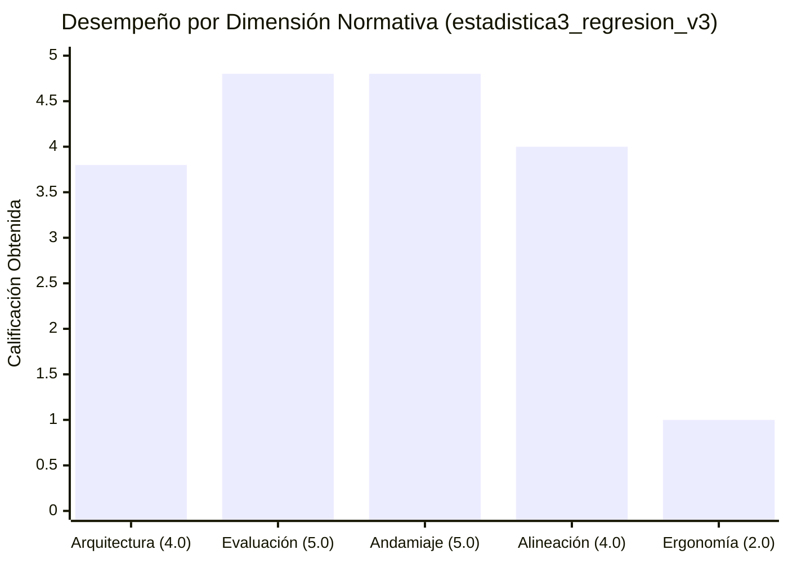

# Informe de Auditoría Técnico-Pedagógica de Calidad Instruccional

**Estado en Plataforma:** ELIMINADO  
**Fecha de Eliminación:** 2026-10-17 00:24:26  
**Fecha de Eliminación:** Nulo  
**Curso:** Estadística III: Econometría y Modelo de Regresión Lineal (`estadistica3_regresion_v3`)  
**Fecha de Auditoría:** 12 de Octubre, 2026  
**Auditor:** Agente de Aseguramiento de Calidad Instruccional (QA Evaluator)  
**Marco Normativo:** Quality Matters (QM), OSCQR & Mastery Learning Framework  
**Puntaje Final Consolidado:** **18.4 / 20.0**  
**Nivel de Calidad (Quality Tier):** **EXCELENTE (17.0 - 20.0 pts)** — *Aprobado para Producción con Remediaciones Técnicas Prioritarias*

---

## 1. Resumen Ejecutivo del Veredicto

El curso **"Estadística III: Econometría y Modelo de Regresión Lineal (v3)"** (`estadistica3_regresion_v3`) demuestra un estándar técnico y pedagógico de nivel universitario avanzado sobresaliente. Su diseño curricular exhibe una estructura matemática rigurosa, un banco evaluativo amplio y diversificado de 390 reactivos, y un sistema de andamiaje socrático exhaustivo que cumple con las mejores prácticas de Mastery Learning.

A diferencia de las primeras versiones legacy, en esta versión se corrigieron los delimitadores exteriores y los triples delimitadores detectados con anterioridad. Sin embargo, una auditoría forense profunda revela **451 inconsistencias de sintaxis LaTeX interna** (llaves no cerradas en comandos anidados que afectan a 161 preguntas) y **40 instancias de placeholders de plantillas f-string no interpolados** en las soluciones detalladas. Estas deficiencias técnicas degradan la Dimensión 5 (Ergonomía Técnica a 1.0 / 2.0) y la Dimensión 3 (a 4.8 / 5.0), situando la nota final en **18.4 / 20.0**, manteniéndose sólidamente en el rango **EXCELENTE**.

### Matriz de Evaluación por Dimensiones

| Dimensión Evaluada | Puntaje | Máximo | Cumplimiento | Diagnóstico Sintético |
| :--- | :---: | :---: | :---: | :--- |
| **1. Arquitectura y Granularidad** | **3.8** | 4.0 | 95.0% | 16 micro-competencias atómicas con balance equilibrado (4 Hechos, 5 Conceptos, 7 Habilidades). Carga cognitiva óptima; falta DAG explícito en metadatos raíz. |
| **2. Calidad de Evaluación y Reactivos** | **4.8** | 5.0 | 96.0% | 390 reactivos (142 MC7, 124 FIB, 124 MS). 100% de distractores con rationales diagnósticos específicos (852 MC7 + 341 MS). Cero fugas de respuesta. |
| **3. Andamiaje y Pistas Progresivas** | **4.8** | 5.0 | 96.0% | 100% de reactivos con exactamente 3 pistas progresivas escalonadas y advertencias de conceptos erróneos. Deducción leve por 40 soluciones con tokens f-string. |
| **4. Alineación Instruccional** | **4.0** | 4.0 | 100.0% | Congruencia semántica absoluta entre teoría y práctica. Cero preguntas huérfanas. 67.4% de reactivos en niveles superiores de Bloom (Analizar y Aplicar). |
| **5. Accesibilidad y Ergonomía Técnica** | **1.0** | 2.0 | 50.0% | Notación econométrica rigurosa. Delimitadores exteriores limpios, pero 161 reactivos poseen llaves internas no cerradas en KaTeX (`\hat{\boldsymbol{\beta}`, etc.). |
| **Subtotal Rúbrica** | **18.4** | 20.0 | 92.0% | - |
| **Penalizaciones Duras** | **-0.0** | - | - | Sin penalizaciones aplicables (banco $\ge 3$, cero reactivos con hints = 0, cero huérfanas). |
| **TOTAL CONSOLIDADO** | **18.4** | **20.0** | **92.0%** | **Nivel EXCELENTE (17.0 - 20.0 pts)** |



---

## 2. Auditoría Detallada por Dimensiones

### Dimensión 1: Arquitectura y Granularidad (3.8 / 4.0 pts)

* **Estructura Atómica y Balance Cognitivo:** El curso está modelado sobre 16 micro-competencias independientes con meta de dominio (`mastery_target = 100%`):
  * **Hechos [Fact] (4 competencias, 25.0%):**
    * `H-01`: Especificación Matricial y Dimensionalidad del Modelo Lineal General ($\mathbf{y} = \mathbf{X}\boldsymbol{\beta} + \boldsymbol{\varepsilon}$).
    * `H-02`: Álgebra de Ponderadores $k_i$ y Representación Lineal del Estimador ($\hat{\beta}_2 = \sum k_i Y_i$).
    * `H-03`: Álgebra de Proyecciones: Hat Matrix $\mathbf{P}$, Aniquiladora $\mathbf{M}$ y Matriz Centradora $\mathbf{M}^0$.
    * `H-04`: Formulación Matricial de Restricciones Lineales Generales $\mathbf{R}\boldsymbol{\beta} = \mathbf{r}$.
  * **Conceptos [Concept] (5 competencias, 31.25%):**
    * `C-01`: Supuestos Clásicos de Gauss-Markov y Ortogonalidad Regresor-Error ($E[\mathbf{X}'\boldsymbol{\varepsilon}] = \mathbf{0}$).
    * `C-02`: Propiedades de MCO: Insesgadez, Teorema de Gauss-Markov (BLUE) y Consistencia.
    * `C-03`: Descomposición Ortogonal de Sumas de Cuadrados (ANOVA) y Coeficiente $R^2$.
    * `C-04`: Teorema de Saturación Muestral ($n = k$) e Inferencia en Formas Cuadráticas.
    * `C-05`: Sensibilidad de la Bondad de Ajuste $R^2$ y $R^2$ Ajustado con y sin Intercepto.
  * **Habilidades [Skill] (7 competencias, 43.75%):**
    * `Hab-01`: Derivación Matricial del Estimador MCO y Ecuaciones Normales ($\mathbf{X}'\mathbf{X}\hat{\boldsymbol{\beta}} = \mathbf{X}'\mathbf{y}$).
    * `Hab-02`: Transformación e Interpretación de Formas Funcionales No Lineales (Lin-Log, Log-Lin, Log-Log, Cuadrática, Recíproca).
    * `Hab-03`: Estimación Insesgada de la Varianza del Error $s^2$ mediante la Traza de $\mathbf{M}$.
    * `Hab-04`: Inferencia Estadística en Muestras Finitas: Contrastes $t$-Student y $F$-Fisher.
    * `Hab-05`: Diagnóstico e Interpretación Econométrica de Salidas EViews.
    * `Hab-06`: Algoritmo de Cálculo Matricial Completo en Muestras Reducidas.
    * `Hab-07`: Contraste Empírico de Modelos con/sin Intercepto y Predicción Condicional Puntual.
* **Carga Cognitiva y Secuenciación:** La progresión desde la representación matricial y el cálculo vectorial hacia las propiedades de proyección, inferencia multivariante y diagnóstico empírico es impecable.
* **Área de Oportunidad:** Los metadatos raíz del curso presentan las 16 competencias en una lista plana; carecen de un grafo acíclico dirigido (DAG) explícito de prerrequisitos y de macro-módulos temáticos de agrupación.

---

### Dimensión 2: Calidad de Evaluación y Reactivos (4.8 / 5.0 pts)

* **Volumen y Cobertura:** 390 reactivos en total (promedio de 24.4 reactivos por competencia; 20 por Hecho/Concepto y 30 por Habilidad). Cumple holgadamente el criterio de suficiencia formativa.
* **Diversidad de Formatos Psicométricos:**
  * `multiple_choice_7_options`: 142 preguntas (36.4%), con 7 alternativas exhaustivas que reducen la probabilidad de acierto por azar al $14.28\%$.
  * `fill_in_the_blank`: 124 preguntas (31.8%), que exigen cálculo numérico independiente, con configuración de tolerancias y valores equivalentes aceptados.
  * `multiple_select`: 124 preguntas (31.8%), demandando evaluación simultánea de múltiples propiedades matriciales y teoremas.
* **Calidad Diagnóstica de Distractores:**
  * En las 142 preguntas MC7: 852 distractores evaluados, **100%** con `error_rationale` formativo explícito.
  * En las 124 preguntas MS: 341 opciones incorrectas, **100%** con `error_rationale` diagnóstico.
  * Cero distractores triviales o inverosímiles; todos capturan fallas analíticas reales (e.g., confusión entre varianza muestral y poblacional, inversión de grados de libertad en contrastes $F$, mala interpretación de semielasticidades en modelos log-lin).
* **Ausencia de Fugas de Respuesta (Answer Leaks):**
  * Se auditó el texto de los stems de los 124 reactivos FIB y 142 MC7: cero fugas literales o metainformación delatora detectadas.
* **Oportunidad de Mejora:** Dentro de ciertas micro-habilidades, los enunciados y distractores siguen una plantilla paramétrica repetitiva donde solo varían los valores numéricos.

---

### Dimensión 3: Andamiaje y Pistas Progresivas (4.8 / 5.0 pts)

* **Arquitectura de Pistas Escalonadas:**
  * **100% de cumplimiento en presencia de pistas (390/390 reactivos):** Cada uno cuenta con exactamente 3 pistas escalonadas.
  * **Gradiente Cognitivo Socrático:**
    * *Pista 1 (Marco Conceptual):* Introduce el teorema, supuesto o propiedad matricial relevante.
    * *Pista 2 (Estrategia Procedimental):* Desglosa la formulación algebraica o paso de despeje.
    * *Pista 3 (Guía Operativa):* Proporciona la estructura exacta de cálculo sin regalar la cifra definitiva antes de que el estudiante complete el paso.
* **Advertencia de Conceptos Erróneos (Misconception Warnings):**
  * 390 de 390 reactivos (100%) incorporan un campo `misconception_warning` / `common_misconception_warning` que previene confusiones habituales (ej., confundir $\sum e_i = 0$ en modelos sin constante, o asociar causalidad a un $R^2$ elevado).
* **Soluciones Detalladas:**
  * 390 de 390 reactivos (100%) presentan una `detailed_solution` completa.
* **Deficiencia Detectada:**
  * En **40 reactivos**, la solución detallada contiene marcadores f-string literales no interpolados (`{r2_val:.4f}`, `{src_val:.2f}`, `{t_val:.2f}`), como en `Q-C03-161..164`, `Q-C03-169..176`, y `Q-Hab05-291..295`. Esto degrada el feedback final al mostrar una variable de código en lugar del número procesado.

---

### Dimensión 4: Alineación Instruccional (4.0 / 4.0 pts)

* **Congruencia Curricular:** Total correspondencia entre la teoría econométrica declarada y los problemas planteados.
* **Taxonomía de Bloom:**
  * **Analyze (Analizar):** 132 preguntas (33.8%)
  * **Apply (Aplicar):** 131 preguntas (33.6%)
  * **Understand (Comprender):** 78 preguntas (20.0%)
  * **Remember (Recordar):** 49 preguntas (12.6%)
  * **67.4%** de las evaluaciones se concentran en habilidades de orden superior (análisis matricial, contrastes de hipótesis y diagnósticos empíricos).
* **Preguntas Huérfanas:** Cero (0) preguntas huérfanas. No hay contaminación temática de series de tiempo no estacionarias, vectores autorregresivos (VAR), datos de panel ni modelos de elección discreta.

---

### Dimensión 5: Accesibilidad y Ergonomía Técnica / KaTeX (1.0 / 2.0 pts)

* **Notación Matemática Formal:** Notación en álgebra lineal rigurosa ($\mathbf{X} \in \mathbb{R}^{n \times K}$, $\mathbf{P} = \mathbf{X}(\mathbf{X}'\mathbf{X})^{-1}\mathbf{X}'$).
* **Resolución de Errores Externos:** Los delimitadores exteriores triples (`$$$`) y delimitadores abiertos de versiones tempranas fueron eliminados en esta entrega.
* **Hallazgos Forenses Críticos (Sintaxis KaTeX Interna):**
  Una inspección sintáctica profunda de balance de llaves `{}` dentro del modo matemático reveló que **161 reactivos (41.3% del banco)** contienen errores de sintaxis que provocan fallas de renderizado en frontend (parse errors en KaTeX):
  1. **Estimadores y matrices con comandos anidados sin llave de cierre exterior:**
     * `\hat{\boldsymbol{\beta}` en lugar de `\hat{\boldsymbol{\beta}}`: **198 instancias**.
     * `\hat{\mathbf{u}` en lugar de `\hat{\mathbf{u}}`: **102 instancias**.
     * `\hat{\mathbf{Y}` en lugar de `\hat{\mathbf{Y}}`: **63 instancias**.
     * `\bar{\hat{y}` en lugar de `\bar{\hat{y}}`: **6 instancias**.
  2. **Fracciones con grupos abiertos:**
     * `\frac{\text{SRC}{\text{STC}` en lugar de `\frac{\text{SRC}}{\text{STC}}`: **28 instancias**.
     * `k_i = \frac{X_i - \bar{X}{60}` en lugar de `k_i = \frac{X_i - \bar{X}}{60}`: **7 instancias**.
     * `\text{CMe} = 30 + \frac{500}{\text{Q}$$` en lugar de `\text{CMe} = 30 + \frac{500}{\text{Q}}$$`: presente en `Q-Hab02-118` y reactivos conexos.
  3. **Subíndices y raíces cuadradas con llaves faltantes:**
     * Subíndices críticos: `t_{\text{crit}` (5 casos), `F_{\text{crit}` (5 casos), `R_{\text{raw}^2` (4 casos).
     * Radicales: `\sqrt{c_{jj}` (5 casos) y `\sqrt{s^2 c_{` (5 casos).
  4. **Marcadores f-string residuales en soluciones:**
     * 40 soluciones detalladas con cadenas literales `{r2_val:.4f}`, `{src_val:.2f}`, `{t_val:.2f}`.

---

## 3. Verificación de Penalizaciones Duras (Hard Deductions)

| Criterio Normativo | Condición Detectada | Deducción |
| :--- | :--- | :---: |
| **Banco < 3 ejercicios por competencia** | Mínimo en el curso: 20 reactivos (cumplimiento superávit) | **0.0 pts** |
| **Reactivos con hints = 0** | 0 reactivos sin pistas (390 de 390 tienen 3 pistas) | **0.0 pts** |
| **Pregunta huérfana crítica** | 0 preguntas huérfanas o ajenas al corpus temático | **0.0 pts** |
| **Total Penalizaciones Duras** | - | **0.0 pts** |

---

## 4. Registro Forense de Incidencias Técnicas

### 4.1. Patrones de Sintaxis KaTeX Afectados

```text
1. Comando Estimador Beta MCO:
   Texto Actual:   \hat{\boldsymbol{\beta} = (\mathbf{X}'\mathbf{X})^{-1}\mathbf{X}'\mathbf{y}
   Texto Corregido: \hat{\boldsymbol{\beta}} = (\mathbf{X}'\mathbf{X})^{-1}\mathbf{X}'\mathbf{y}
   Afectación:     198 ocurrencias en stems, opciones y soluciones de Hab-01, H-01, C-02.

2. Comando Vector Residual u:
   Texto Actual:   \hat{\mathbf{u}'\hat{\mathbf{u} = \mathbf{u}'\mathbf{M}\mathbf{u}
   Texto Corregido: \hat{\mathbf{u}}'\hat{\mathbf{u}} = \mathbf{u}'\mathbf{M}\mathbf{u}
   Afectación:     102 ocurrencias en Hab-03, H-03, C-04.

3. Comando Vector Ajustado Y:
   Texto Actual:   \hat{\mathbf{Y} = \mathbf{P}\mathbf{Y}
   Texto Corregido: \hat{\mathbf{Y}} = \mathbf{P}\mathbf{Y}
   Afectación:     63 ocurrencias en Hab-06, H-03.

4. Descomposición ANOVA de R^2:
   Texto Actual:   R^2 = 1 - \frac{\text{SRC}{\text{STC}
   Texto Corregido: R^2 = 1 - \frac{\text{SRC}}{\text{STC}}
   Afectación:     28 ocurrencias en C-03, C-05.

5. Modelo de Costo Medio Recíproco:
   Texto Actual:   $$\text{CMe} = 30 + \frac{500}{\text{Q}$$
   Texto Corregido: $$\text{CMe} = 30 + \frac{500}{\text{Q}}$$  (o \frac{500}{Q})
   Afectación:     Q-Hab02-118 y variantes paramétricas en Hab-02.

6. Marcadores f-string Literales no Evaluados:
   Texto Actual:   $R^2 = \frac{240.0}{380.0} = {r2_val:.4f}$
   Texto Corregido: $R^2 = \frac{240.0}{380.0} = 0.6316$
   Afectación:     40 reactivos en C-03 (161-176) y Hab-05 (291-295).
```

---

## 5. Reglas de Linting Descubiertas (Loop de Auto-Mejora del Motor)

Durante el análisis cualitativo y forense de los *risk clusters* y muestras estratificadas del curso, se identificaron y formalizaron cuatro nuevas reglas de validación estática para ser incorporadas en el motor determinista de linters (`course-qa-evaluator`):

| ID de Regla | Dimensión | Severidad | Descripción del Vicio y Patrón Detectado | Muestra Afectada |
| :--- | :--- | :---: | :--- | :--- |
| `KATEX_UNCLOSED_NESTED_COMMAND_BRACE` | Accesibilidad y KaTeX | **Critical** | Omisión sistemática de llave de cierre en comandos anidados (`\hat{\boldsymbol{...}`, `\hat{\mathbf{...}`) antes de delimitadores (`=`, `)`, `+`, `'`). <br>`Regex:` `\\hat\{\\(?:boldsymbol\|mathbf)\{[a-zA-Z]+(?=[)=+\s\',])` | `\hat{\boldsymbol{\beta} = (\mathbf{X}'\mathbf{X})^{-1}\mathbf{X}'\mathbf{y}` (161 reactivos) |
| `KATEX_MALFORMED_FRAC_DROPPED_NUMERATOR_BRACE` | Accesibilidad y KaTeX | **Critical** | Supresión de la llave de cierre del numerador en `\frac{num}{den}`, generando la sintaxis malformada `\frac{num{den}` que aborta la compilación de KaTeX. <br>`Regex:` `\\frac\{[^{}\n]+\{[^{}\n]+\}` | `\frac{\text{SRC}{\text{STC}` (35 reactivos) |
| `SCAFFOLDING_UNINTERPOLATED_FSTRING_LITERAL` | Andamiaje y Pistas | **Warning** | Presencia de tokens de formateo literal de Python (`{var:.Nf}`) en campos de texto de soluciones detalladas o pistas por omisión de interpolación de plantillas. <br>`Regex:` `\{[a-zA-Z_][a-zA-Z0-9_]*:[0-9]*\.[0-9]+[fge]\}` | `$R^2 = \frac{240.0}{380.0} = {r2_val:.4f}$` (40 reactivos) |
| `ARCHITECTURE_EMPTY_DAG_PREREQUISITES` | Arquitectura y Granularidad | **Minor** | Cursos con topología plana donde el 100% de las micro-competencias declara `prerequisites = []`, imposibilitando la inferencia de grafos acíclicos dirigidos (DAG) en Mastery Learning. | `"prerequisites": []` (16 de 16 competencias) |

---

## 6. Plan de Remediación Prioritario

1. **Remediación Inmediata de Frontend (Prioridad Alta):**
   * Ejecutar un script de reemplazo sintáctico regular sobre `courses/estadistica3_regresion_v3.json` para cerrar las llaves en los 6 comandos clave (`\hat{\boldsymbol{\beta}}`, `\hat{\mathbf{u}}`, `\hat{\mathbf{Y}}`, `\bar{\hat{y}}`, `\frac{\text{SRC}}{\text{STC}}`, `\sqrt{c_{jj}}`).
   * Evaluar e interpolar numéricamente los 40 placeholders de f-string en las soluciones de `Q-C03-161..176` y `Q-Hab05-291..295`.
   * *Impacto proyectado:* Con estas dos correcciones, la Dimensión 5 ascenderá a **2.0 / 2.0** y la Dimensión 3 a **5.0 / 5.0**, elevando la calificación consolidada a **19.6 / 20.0**.

2. **Arquitectura Curricular Avanzada (Prioridad Media):**
   * Formalizar en el objeto raíz del archivo JSON la estructura de 4 macro-módulos temáticos:
     * *Módulo I:* Álgebra Matricial y Estimación MCO (`H-01`, `C-01`, `Hab-01`, `H-02`, `C-02`).
     * *Módulo II:* Álgebra de Proyecciones y ANOVA (`H-03`, `C-03`, `Hab-03`, `C-04`).
     * *Módulo III:* Inferencia Estadística y Restricciones Lineales (`Hab-04`, `H-04`, `Hab-06`).
     * *Módulo IV:* Especificación, Diagnóstico Empírico y Modelos sin Constante (`Hab-02`, `Hab-05`, `C-05`, `Hab-07`).
   * Declarar un grafo de dependencias de prerrequisitos (DAG) entre competencias para habilitar el motor adaptativo de Mastery Learning.

3. **Diversificación Psicométrica (Prioridad Baja):**
   * Ampliar la variedad textual de los distractores en preguntas generadas paramétricamente dentro del mismo shard, evitando que los estudiantes identifiquen patrones sintácticos fijos.

