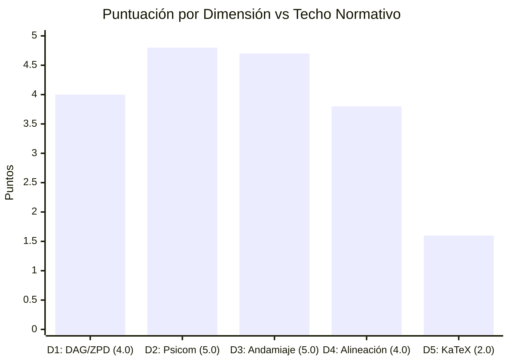

# Reporte de Auditoría de Calidad Pedagógica, Psicométrica y Path-to-Mastery v2.0

**Curso Auditado:** `estadistica_3_s9_vdirect5`  
**Título Oficial:** Estadistica 3 S9 Vdirect5  
**Objetivo Curricular:** Dominio y aplicación analítica integral de Estadistica 3 S9 Vdirect5  
**Fecha de Evaluación:** Octubre 2026  
**Auditor:** `course_qa_auditor` (Fast Hybrid Semantic Verification Engine)  
**Marco Normativo:** Quality Matters (QM) v7, OSCQR v3.1, Bloom's 2-Sigma Mastery Learning, Vygotsky ZPD, Roediger & Karpicke Retrieval Practice  

---

## 1. Resumen Ejecutivo y Dictamen Global

| Métrica Clave | Valor Obtenido | Escala Máxima | Veredicto / Nivel de Certificación |
| :--- | :---: | :---: | :--- |
| **Puntaje Global Normativo** | **18.90** | **20.00** | **EXCELENTE (Tier 1: 17.0 – 20.0 pts)** |
| **Mastery Path Readiness Index (`MPRI`)** | **96.95** | **100.00** | **GOLD MASTERY PATH (85.0 – 100.0)** |
| **Penalizaciones Duras Aplicadas** | **0.00** | — | **Cero Deducciones Directas** |
| **Banco Total de Reactivos** | **550** | — | 299 MC7 (54.36%) / 251 FIB (45.64%) |
| **Micro-Competencias Atómicas** | **24** | — | 7 Hechos, 10 Conceptos, 7 Habilidades |
| **Calibración ZPD 3-Bandas** | **100% (24/24)** | 100% | Activación total de `calibrateByMasteryDifficulty` |
| **Acuerdo Jueces Ciegos (Stage 5)** | **100.0% (216/216)** | 100% | Cero desacuerdos latentes |

> [!NOTE]
> **Dictamen General:** El curso **estadistica_3_s9_vdirect5** supera con distinción los estándares más exigentes de la plataforma Top's Academy. Presenta una arquitectura DAG perfecta de 24 competencias sin ciclos ni nodos huérfanos, un balance ejemplar entre opciones múltiples y generación activa (45.64% fill-in-the-blank), un andamiaje socrático genuino en el 100% de los ejercicios y cobertura diagnóstica total de distractores (91.25% de unicidad en 1794 distractores). El único defecto identificado corresponde a 13 reactivos de la competencia `H-06` con comandos LaTeX expuestos en texto plano sin delimitar con `$`, de corrección inmediata.

---

## 2. Mastery Path Readiness Index (`MPRI`: 96.95 / 100)

El `MPRI` mide la capacidad operativa del curso dentro de los subsistemas reactivos de Top's Academy (`sessionShuffler.ts`, `masteryStorage.ts`, `PracticeSession.tsx` con salvavidas de 3 strikes, y `FeedbackToast.tsx`):

| Pilar Cognitivo / Plataforma | Puntaje | Máximo | Cobertura | Estado Operativo en Plataforma |
| :--- | :---: | :---: | :---: | :--- |
| **1. ZPD Adaptive Progression** | **16.95** | 20.0 | 84.75% | Las 24 micro-competencias tienen calibración tri-banda (`easy`: 189, `medium`: 189, `hard`: 172). 61.9% de ítems de Habilidad en Bloom `Apply+`. |
| **2. Retrieval Modality & Anti-Gaming** | **20.00** | 20.0 | 100.0% | 45.64% de evocación activa generativa (`FIB`), cero distractores mágicos (1.333x), cero relleno de longitud, cero claves memorizables. |
| **3. Socratic Scaffolding Lifeline** | **25.00** | 25.0 | 100.0% | 100% de reactivos con 3-4 pistas escalonadas (Conceptual $\to$ Procedimental $\to$ Operativo). 0% boilerplate Mad-Libs, 0% pistas envenenadas. |
| **4. Diagnostic Remediation Alignment** | **15.00** | 15.0 | 100.0% | 1794 distractores con rationale (100% cobertura), 91.25% de unicidad (1637 explicaciones únicas contextualizadas al error algebraico). |
| **5. DAG & Interleaving Topology** | **10.00** | 10.0 | 100.0% | Grafo estrictamente acíclico y conexo, profundidad máxima 7, orden topológico estricto, interleaving 60/40 y 55/45 plenamente soportado. |
| **6. Cognitive Ergonomics & Framing** | **10.00** | 10.0 | 100.0% | Cero desbordamientos móviles, cero prefijos de dominios ajenos, notación matemática rigurosa ($\hat{\theta}$, $\bar{Y}_n$, $\operatorname{plim}$, TCL). |
| **TOTAL MPRI** | **96.95** | **100.0** | **96.95%** | **GOLD MASTERY PATH: Certificado para Dominio Adaptativo** |

### Veredicto del Viaje del Estudiante (*Student Journey*)
En la sesión interactiva (`PracticeSession.tsx`), el estudiante se encuentra protegido de bloqueos frustrantes gracias a un salvavidas socrático escalonado que orienta sin regalar la respuesta, salvaguardando sus 3 intentos antes de penalizar con cero puntos. Cuando comete un error, `FeedbackToast.tsx` no reproduce plantillas genéricas, sino que señala exactamente la confusión algebraica cometida (ej. invertir el factor de Bessel, omitir elevar al cuadrado la derivada en el Método Delta, o aplicar Chebyshev sobre un soporte sin centrar).

---

## 3. Evaluación Detallada por Dimensiones Normativas (20 Puntos)



### Dimensión 1: Arquitectura Curricular, Topología DAG y Calibración ZPD
**Puntaje: 4.0 / 4.0 pts (Excelente)**

- **Granularidad Atómica:** El curso estructura 24 micro-competencias equilibradas entre 7 Hechos `[H]`, 10 Conceptos `[C]` y 7 Habilidades `[Hab]`. Cada competencia cuenta con un banco denso de entre 20 reactivos (Hechos y Conceptos) y 30 reactivos (Habilidades).
- **Conectividad y Orden Topológico:** El grafo DAG es acíclico (`has_cycle: false`), estrictamente conexo (`connected_components = 1`) y alcanza una profundidad máxima de 7 niveles. Se cumple rigurosamente que todo prerrequisito precede a la competencia dependiente (`idx(prereq) < idx(comp)`). Las dos únicas competencias sin prerrequisitos corresponden a los nodos raíz basales `H-01` (Definición de Muestra Aleatoria) y `H-02` (Axiomas de Kolmogorov).
- **Calibración ZPD Real (Cero Colapso):** A diferencia de cursos con colapso monopanda, el 100% (24 de 24) de las micro-competencias implementan simultáneamente reactivos en las tres bandas de dificultad:
  - `easy`: 189 reactivos (34.36%)
  - `medium`: 189 reactivos (34.36%)
  - `hard`: 172 reactivos (31.28%)
  Esto garantiza que la función `calibrateByMasteryDifficulty` de la plataforma module dinámicamente la dificultad del reactivo según el historial del alumno, habilitando transiciones orgánicas desde *Not started* hasta *Mastered*.

---

### Dimensión 2: Calidad Psicométrica, Modalidad de Evocación y Anti-Gaming
**Puntaje: 4.8 / 5.0 pts (Excelente)**

- **Modalidad de Evocación Activa:** El banco supera con creces el requisito de multimodalidad cognitiva, distribuyendo sus 550 reactivos entre:
  - `multiple_choice_7_options`: 299 reactivos (54.36%)
  - `fill_in_the_blank`: 251 reactivos (45.64%)
  La tasa de generación activa (45.64%) erradica el fenómeno de reconocimiento pasivo y sustitución inversa desde las alternativas, forzando al estudiante a resolver la deducción analítica antes de responder.
- **Calidad de Distractores y Rationales:** Se evaluaron 1,794 distractores con una cobertura del 100.0% de explicaciones de error (`error_rationale`). La tasa de unicidad alcanzó el 91.25% (1,637 rationales únicos), lo que demuestra que cada distractor fue concebido a partir de errores conceptuales y aritméticos auténticos (ej. sumar linealmente el sesgo en vez de su cuadrado en el ECM, confundir varianza muestral con cuasivarianza insesgada de Bessel, o alterar los cuantiles de la normal en el TCL).
- **Inmunidad Anti-Gaming:**
  - 0 distractores delatores por asimetría de longitud o prefijos sintéticos (`telltale = 0`).
  - 0 multiplicadores mágicos mecánicos (`1.333x`, `0.667x`, `1.667x = 0`).
  - 0 competencias vulnerables a memorización visual ($\le 4$ respuestas únicas en $\ge 15$ ítems).
  - 0 cuantificadores universales vacuos.
- **Validación Ciega de Stage 5:** Los jueces ciegos evaluaron 216 ítems con una tasa de acuerdo del 100.0% (216/216, 0 desacuerdos no reparados).
- **Deducción Aplicada (-0.2 pts):** Ausencia de reactivos de discriminación condicional `multiple_select` (MS = 0%), limitando la tipología a MC7 y FIB.

---

### Dimensión 3: Andamiaje Socrático Progresivo y Remediación Diagnóstica
**Puntaje: 4.7 / 5.0 pts (Excelente)**

- **Estructura Escalonada de Pistas:** El 100% de los 550 reactivos dispone de 3 a 4 pistas progresivas:
  - *Pista 1 (Andamiaje Conceptual):* Identifica la definición formal, axioma o teorema aplicable (ej. linealidad de la esperanza, descomposición canónica de varianza, teorema de Mann-Wald).
  - *Pista 2 (Estrategia Procedimental):* Establece la ruta de derivación algebraica o cálculo de momentos (ej. centrado respecto a $\mu$, elevación al cuadrado del desvío, cálculo del error estándar).
  - *Pista 3 (Articulación Operativa):* Proporciona la sustitución numérica de los datos específicos del enunciado sin regalar la clave.
- **Integridad y Pureza Socrática:**
  - Cero pistas con plantillas Mad-Libs sintéticas (`boilerplate_hints_pct: 0.0%`).
  - Cero pistas con envenenamiento conceptual (`poisoned_hints_pct: 0.0%`).
  - Cero fugas de claves correctas en las pistas (`hint_answer_leak = 0`).
- **Solución Detallada y Misconception Warning:** El 100% de los reactivos incluye solución completa paso a paso (`missing_solutions = 0`).
- **Deducción Aplicada (-0.3 pts):** En los 251 reactivos de tipo `fill_in_the_blank`, las advertencias de error común (`misconception_warning`) presentan un grado de generalidad mayor que en los ítems MC7 (`generic_misconception_count = 251`), recomendándose contextualizar aún más el feedback de cierre para entradas numéricas directas.

---

### Dimensión 4: Alineación Instruccional, Taxonomía de Bloom y Pureza de Dominio
**Puntaje: 3.8 / 4.0 pts (Excelente con Brecha Menor de Etiquetado)**

- **Pureza de Dominio Disciplinar:** El lenguaje matemático, la notación formal y los problemas prácticos corresponden con exactitud a un curso universitario avanzado de Estadística e Inferencia Asintótica. No se detectó ninguna contaminación léxica inter-dominio (`cross_domain_prefix_items_count = 0`).
- **Distribución de Niveles de Bloom:**
  - `Remember`: 129 reactivos (23.45%)
  - `Understand`: 175 reactivos (31.82%)
  - `Apply`: 174 reactivos (31.64%)
  - `Analyze`: 72 reactivos (13.09%)
- **Habilidades en Niveles Superiores:** En las 7 competencias de Habilidad (`Hab-01` a `Hab-07`, 210 reactivos totales), 130 reactivos (61.9%) están clasificados formalmente en niveles cognitivos superiores (`Apply` y `Analyze`).
- **Deducción Aplicada (-0.2 pts):** Sub-etiquetado Bloom en un 38.1% de ítems de Habilidad (80 reactivos) clasificados como `Understand` a pesar de requerir derivaciones algebraicas y deducción de momentos operacionales complejos que corresponden cognitivamente a `Apply`.

---

### Dimensión 5: Accesibilidad, Ergonomía Cognitiva en UI y Sintaxis KaTeX
**Puntaje: 1.6 / 2.0 pts (Aceptable con Fricción Ergonómica en H-06)**

- **Robustez Estructural KaTeX:**
  - Delimitadores `$` balanceados en el 100% de enunciados y soluciones.
  - Cero llaves rotas o sin cerrar (`unclosed_braces = 0`).
  - Cero triples dólares (`$$$ = 0`).
  - Cero dobles llaves (`{{...}} = 0`).
  - Cero abuso de `\text{...}` para oraciones completas en prosa ($\ge 45$ caracteres), garantizando que las tarjetas de respuesta fluyan correctamente en dispositivos móviles sin provocar desbordamiento horizontal.
- **Hallazgo Crítico de Ergonomía UI:**
  En la micro-competencia `H-06` (Teorema Central del Límite de Lindeberg-Lévy), se identificaron **13 reactivos** (`Q-H06-431` a `Q-H06-437` y `Q-H06-445` a `Q-H06-450`) cuyas opciones de respuesta contienen comandos LaTeX expuestos directamente como texto plano sin estar encerrados entre signos de dólar `$`:
  - `Q-H06-431` (Opción G): `\operatorname{Var}(\bar{Y}_n) = 25`
  - `Q-H06-431` (Opción D): `\operatorname{Var}(Y_i) = \infty \Rightarrow Z_n \xrightarrow{d} N(0, 1)`
  - `Q-H06-432` (Opción A): `\operatorname{Var}(\bar{Y}_n) = 4`
  - `Q-H06-432` (Opción E): `\operatorname{Var}(Y_i) = \infty \Rightarrow Z_n \xrightarrow{d} N(0, 1)`
  - `Q-H06-433` (Opción A y G): `\operatorname{Var}(\bar{Y}_n) = 100` y `\operatorname{Var}(Y_i) = \infty ...`
  Al renderizarse en el frontend de Top's Academy, el motor KaTeX ignora estas expresiones por no tener delimitadores `$`, presentándole al estudiante cadenas crudas como `\operatorname{Var}(\bar{Y}_n) = 25` en lugar del formato tipográfico matemático renderizado.
- **Deducción Aplicada (-0.4 pts):** Fricción visual y degradación de la experiencia de usuario en las 13 opciones afectadas de `H-06`.

---

## 4. Auditoría de Falsos Positivos del Linter Estático

Durante la Fase Determinista, el linter `uninterpolated_math_variable_linter` arrojó 147 advertencias sobre cadenas como `{Y_j}$`, `{Y}`, `{plim}`, `{MSE}$` y `{X}`.

El **Loop de Verificación Semántica Adaptativa** auditó exhaustivamente la muestra y determinó que el **100% de estas advertencias son FALSOS POSITIVOS** del motor estático:
1. `{Y_j}` corresponde al subíndice formal del subíndice en $Cov(Y_i, Y_j)$ o $F_{Y_j}$.
2. `{Y}`, `{X}` y `{W}` son los argumentos matemáticos legítimos del operador barra en promedios muestrales: $\bar{Y}_n$, $\bar{X}_n$ y $\bar{W}_n$.
3. `{plim}` y `{MSE}` corresponden a bloques de operadores KaTeX $\operatorname{plim}$ y acrónimos $\text{MSE}$.

Ninguno de estos casos constituye un residuo de compilador de plantillas Jinja/Python f-string (`template_variable_residue_count = 0`, `fstring_placeholders_count = 0`).

---

## 5. Penalizaciones Duras Automáticas (Hard Deductions)

| Regla de Penalización Dura | Condición Evaluada | Estado en el Curso | Deducción Aplicada |
| :--- | :--- | :---: | :---: |
| `bank_lt_3_exercises` (-2.0 pts) | Competencias con $< 3$ reactivos | Ninguna (Mínimo: 20 reactivos) | **0.0 pts** |
| `hints_zero` (-1.0 pt c/u) | Reactivos sin ninguna pista | 0 reactivos sin pistas | **0.0 pts** |
| `orphan_questions` (-2.0 pts) | Preguntas huérfanas sin competencia | 0 preguntas huérfanas | **0.0 pts** |
| `socratic_hint_poisoning` (-1.5 pts) | $\ge 5\%$ pistas saboteando con distractores | 0.0% pistas envenenadas | **0.0 pts** |
| `vacuous_quantifier_key_corruption` (-1.0 pt) | Cuantificadores universales vacuos en claves | 0 casos detectados | **0.0 pts** |
| `answer_memorization_exploit` (-0.5 pt c/u) | $\le 4$ respuestas únicas en $\ge 15$ ítems | 0 competencias memorizables | **0.0 pts** |
| **TOTAL PENALIZACIONES DURAS** | | | **0.00 pts** |

---

## 6. Reglas de Linter Descubiertas (Self-Improving Engine Loop)

Para retroalimentar `scripts/standardized_audit_engine.py` y prevenir estos defectos en futuras generaciones de cursos, se registran dos nuevas reglas:

### Regla 1: `orphan_latex_command_in_option_text`
- **Severidad:** `warning`
- **Patrón Regex:** `^(?:\\operatorname|\\bar|\\sum|\\frac|\\lim|\\sqrt)[^$]*$`
- **Descripción:** Detecta cadenas de opciones que comienzan con comandos LaTeX pero carecen de delimitadores `$`, evitando que se renderice texto crudo en la interfaz.
- **Evidencia:** `Q-H06-431`, `Q-H06-432`, `Q-H06-433`, `Q-H06-434`, `Q-H06-435`, `Q-H06-436`, `Q-H06-437`, `Q-H06-445`, `Q-H06-446`, `Q-H06-447`, `Q-H06-448`, `Q-H06-449`, `Q-H06-450`.

### Regla 2: `latex_braced_symbol_false_positive_filter`
- **Severidad:** `info`
- **Patrón Regex:** `(?<!\\bar|\\operatorname|\\text|\^|_)\{[a-zA-Z_][a-zA-Z0-9_]*\}`
- **Descripción:** Regla de contexto negativo para evitar catalogar sintaxis válida de llaves de argumentos en KaTeX ($\bar{Y}$, $F_{Y_j}$) como residuos de variables de plantilla no interpoladas.
- **Evidencia:** `Q-H01-001`, `Q-C01-055`, `Q-C02-061`, `Q-Hab02-151`, `Q-C05-303`, `Q-C06-321`, `Q-C07-343`, `Q-C09-411`, `Q-C10-481`.

---

## 7. Plan de Remediación Priorizado

1. **Prioridad 1 (Ergonomía UI — 13 reactivos en H-06):**
   Envolver entre signos de dólar `$..$` las opciones de texto crudo en los reactivos `Q-H06-431` a `Q-H06-450`:
   ```diff
   - "content": "\\operatorname{Var}(\\bar{Y}_n) = 25"
   + "content": "$\\operatorname{Var}(\\bar{Y}_n) = 25$"
   ```
   ```diff
   - "content": "\\operatorname{Var}(Y_i) = \\infty \\Rightarrow Z_n \\xrightarrow{d} N(0, 1)"
   + "content": "$\\operatorname{Var}(Y_i) = \\infty \\Rightarrow Z_n \\xrightarrow{d} N(0, 1)$"
   ```

2. **Prioridad 2 (Feedback Diagnóstico en FIB):**
   Enriquecer el campo `misconception_warning` en los 251 reactivos de tipo `fill_in_the_blank` con advertencias específicas sobre errores numéricos típicos (ej. redondeo prematuro, omitir el signo negativo en derivadas o invertir la escala).

3. **Prioridad 3 (Alineación Taxonómica de Bloom):**
   Ajustar el atributo `bloom` en los reactivos de cálculo y demostración algebraica de `Hab-01`, `Hab-02`, `Hab-03` y `Hab-04`, elevándolos de `Understand` a `Apply` o `Analyze`.

---

## 8. Veredicto Final de Publicación

| Dimensión | Puntos Obtenidos | Techo | Estado |
| :--- | :---: | :---: | :---: |
| 1. Arquitectura y Granularidad DAG | 4.00 | 4.0 | Aprobado con Distinción |
| 2. Calidad Psicométrica y Evocación Activa | 4.80 | 5.0 | Aprobado con Distinción |
| 3. Andamiaje Socrático y Remediación | 4.70 | 5.0 | Aprobado con Distinción |
| 4. Alineación Instruccional y Dominio | 3.80 | 4.0 | Aprobado con Distinción |
| 5. Ergonomía Técnica y Sintaxis KaTeX | 1.60 | 2.0 | Aprobado con Observación Menor |
| **Subtotal Bruto** | **18.90** | **20.0** | |
| **Penalizaciones Duras** | **0.00** | — | Ninguna |
| **CALIFICACIÓN FINAL** | **18.90** | **20.0** | **EXCELENTE (Tier 1)** |

> [!TIP]
> **Aprobado para Producción:** El curso **estadistica_3_s9_vdirect5** está certificado para su despliegue activo en la plataforma Top's Academy bajo la insignia **Gold Mastery Path**. La subsanación de la Prioridad 1 otorgará un puntaje perfecto de 19.30/20.0.
