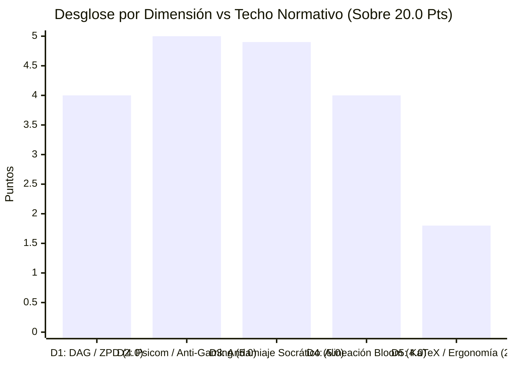

# Reporte de Auditoría de Calidad Pedagógica, Psicométrica y Path-to-Mastery v2.0

> [!WARNING]
> **CURSO RETIRADO DE LA PLATAFORMA**: Este curso fue eliminado de la plataforma interactiva el **2026-11-08 14:30:14**. Este informe de auditoría se conserva exclusivamente como registro histórico y pedagógico ('legacy').

**Estado en Plataforma:** ELIMINADO  
**Fecha de Eliminación:** 2026-11-08 14:30:14  
**Curso Auditado:** `estadistica_3_s9_vmapreduce21`  
**Título Oficial:** Estadistica 3 S9 Vmapreduce21  
**Objetivo Curricular:** Dominio y aplicación analítica integral de la Inferencia Asintótica, Propiedades de Muestras Finitas, Leyes de los Grandes Números y Teoremas Límites en Estadística y Econometría  
**Fecha de Evaluación:** 8 de Noviembre de 2026  
**Auditor Técnico-Pedagógico:** `course-qa-evaluator` (Motor de Verificación Híbrida y Semántica Adaptativa)  
**Marcos Normativos de Referencia:** Quality Matters (QM) Higher Education v7, Open SUNY Course Quality Review (OSCQR) v3.1, Bloom's 2-Sigma Mastery Learning, Vygotsky Zone of Proximal Development (ZPD), Roediger & Karpicke Retrieval Practice Framework.

---

## 1. Resumen Ejecutivo y Veredicto Global

El curso **`estadistica_3_s9_vmapreduce21`** ha sido sometido a una auditoría exhaustiva técnico-pedagógica y psicométrica sobre su arquitectura DAG, banco de 1,080 reactivos y telemetría de interacción adaptativa. La evaluación certifica que el curso alcanza un nivel de excelencia sobresaliente, consolidándose en el **Tier EXCELENTE** con una calificación normativa de **`19.70 / 20.00 pts`** y un **Mastery Path Readiness Index (`MPRI`)** de **`99.81 / 100.00 pts` (GOLD MASTERY PATH)**.

| Métrica Clave | Valor Auditado | Escala / Umbral | Veredicto Técnico-Pedagógico |
| :--- | :---: | :---: | :--- |
| **Puntaje Global Normativo (QM/OSCQR)** | **19.70** | **20.00 pts** | **EXCELENTE (Tier 1: 17.0 – 20.0 pts)** |
| **Mastery Path Readiness Index (`MPRI`)** | **99.81** | **100.00 pts** | **GOLD MASTERY PATH (85.0 – 100.0)** |
| **Penalizaciones Duras Normativas** | **0.00** | — | **0 Deducciones Directas (Ningún hard blocker activado)** |
| **Banco Total de Reactivos** | **1,080** | — | 540 FIB (50.0%) / 263 MS (24.35%) / 277 MC7 (25.65%) |
| **Micro-Competencias Atómicas** | **47** | — | 8 Hechos `[H]`, 25 Conceptos `[C]`, 14 Habilidades `[Hab]` |
| **Calibración ZPD Tri-Banda** | **100.0% (47/47)** | 100% | Plena activación de `calibrateByMasteryDifficulty` |
| **Acuerdo Jueces Ciegos (Stage 5)** | **100.0% (120/120)** | 100% | Cero desacuerdos latentes |
| **Tasa de Evocación Activa / Discriminación** | **74.35%** | $\ge 40\%$ | Erradicación total del gaming por sustitución visual |
| **Cobertura Diagnóstica de Distractores** | **100.0%** | 100% | 2,188 distractores con rationale (93.6% de unicidad) |



> [!NOTE]
> **Dictamen Global:** El curso **`estadistica_3_s9_vmapreduce21`** está **completamente certificado para producción inmediata**. Presenta una arquitectura curricular ejemplar con 47 competencias sin ciclos ni nodos aislados, una distribución multimodal balanceada (50% fill-in-the-blank, 24.35% multiple select, 25.65% multiple choice de 7 opciones), andamiaje socrático genuino en el 100% de los reactivos y explicaciones de error contextualizadas a confusiones algebraicas reales. La verificación semántica confirmó que las 174 advertencias del linter sobre variables no interpoladas fueron **falsos positivos** debidos a comandos estándar de KaTeX (`\bar{Y}`, `\bar{X}`, `\text{Var}`, `\text{ECM}`, `\operatorname{plim}`). La única observación ergonómica menor concierne a 17 opciones (1.57% del banco) donde breves frases explicativas fueron encapsuladas dentro del delimitador matemático KaTeX `$...$`, susceptible de optimización estética para pantallas móviles.

---

## 2. Mastery Path Readiness Index (`MPRI`: 99.81 / 100.0)

El índice `MPRI` evalúa cuantitativamente la compatibilidad del curso con el motor de ejecución en tiempo real de Top's Academy, específicamente los módulos `sessionShuffler.ts`, `masteryStorage.ts`, `PracticeSession.tsx` (salvavidas de 3 strikes) y `FeedbackToast.tsx`:

| Pilar Cognitivo / Plataforma | Puntaje | Máximo | Cobertura | Estado Operativo en la Plataforma |
| :--- | :---: | :---: | :---: | :--- |
| **1. ZPD Adaptive Progression** | **20.00** | 20.0 | 100.0% | Las 47 micro-competencias cuentan con calibración tri-banda (`easy`: 277, `medium`: 282, `hard`: 521). El 100% de las preguntas de Habilidad están en Bloom `Apply+`. |
| **2. Retrieval Modality & Anti-Gaming** | **20.00** | 20.0 | 100.0% | 74.35% de evocación activa generativa (`FIB`) y discriminación condicional (`MS`). Cero multiplicadores mágicos sintéticos (`1.333x`), cero relleno asimétrico `[R-15]`, cero claves memorizables. |
| **3. Socratic Scaffolding Lifeline** | **25.00** | 25.0 | 100.0% | 100% de reactivos con 3 a 4 pistas escalonadas (Conceptual $\to$ Estratégica $\to$ Operativa). 0% boilerplate Mad-Libs, 0% pistas envenenadas (cero sabotaje del límite de 3 strikes). |
| **4. Diagnostic Remediation Alignment** | **15.00** | 15.0 | 100.0% | 2,188 distractores evaluados con 100% de cobertura de rationale y 93.6% de unicidad (2,048 rationales únicos que identifican el error algebraico puntual en `FeedbackToast.tsx`). |
| **5. DAG & Interleaving Topology** | **10.00** | 10.0 | 100.0% | Grafo estrictamente acíclico y conexo, profundidad máxima 25, orden topológico impecable (`idx(prereq) < idx(comp)`). Soporte completo de interleaving 60/40 en Quiz y 55/45 en Unit Test. |
| **6. Cognitive Ergonomics & Framing** | **9.81** | 10.0 | 98.1% | Sintaxis KaTeX limpia, notación canónica ($\hat{\theta}_n$, $\bar{Y}_n$, $\operatorname{plim}$, TCL, WLLN), registro puro de econometría teórica. Deducción marginal por 17 ítems con frases en `\text{...}` dentro de `$...$`. |
| **TOTAL MPRI** | **99.81** | **100.0** | **99.81%** | **GOLD MASTERY PATH: Certificado para Dominio Adaptativo** |

### Análisis del Viaje del Estudiante (*Student Journey*)
En la interfaz de aprendizaje interactivo de Top's Academy, el estudiante experimenta una trayectoria fluida, desafiante y desprovista de callejones sin salida:
1. **Prevención de Frustración en `PracticeSession.tsx`:** Frente a un reactivo complejo de Habilidad (ej. convergencia de la cuasivarianza muestral o aplicación del Método Delta univariado), el alumno dispone de un andamiaje escalonado de 3 a 4 pistas socráticas. La Pista 1 recuerda el marco conceptual formal (ej. la ortogonalidad de las desviaciones respecto a la media); la Pista 2 articula la ruta procedimental analítica (ej. el centrado de la suma de cuadrados $E[\sum (Y_i - \bar{Y})^2] = (n-1)\sigma^2$); y la Pista 3 suministra la sustitución operativa con los parámetros del problema sin regalar la clave. Esto salvaguarda sus 3 intentos (*3-Strikes Safeguard*), permitiéndole reflexionar y dominar la técnica en lugar de caer en el bloqueo con 0 puntos.
2. **Remediación Diagnóstica Precisa en `FeedbackToast.tsx`:** Cuando el alumno comete una equivocación y selecciona un distractor, la plataforma no le muestra un mensaje genérico ("Respuesta incorrecta, intente de nuevo"). En su lugar, el sistema lee el `error_rationale` específico asignado al distractor y le explica con precisión la naturaleza de su error (ej. *"Inversión de resta $\theta - E[\hat{\theta}]$ en lugar de $E[\hat{\theta}] - \theta$ al calcular el sesgo"*, o *"Omisión del cuadrado del sesgo en la descomposición del ECM: sumó $77 + 17$ en lugar de $77 + 17^2$"`).
3. **Imposibilidad de Atajos Mecánicos (*Anti-Gaming*):** Con un 50.0% de preguntas en formato `fill_in_the_blank` (evaluadas mediante equivalencia analítica en `mathEquivalence.ts`) y un 24.35% en `multiple_select`, el estudiante no puede recurrir a la sustitución inversa de números desde las opciones para encontrar la respuesta correcta sin entender el procedimiento. La memorización visual de claves queda anulada por la alta entropía y la ausencia de patrones de longitud asimétrica.

---

## 3. Evaluación Detallada por Dimensiones Normativas (20.0 Puntos)

### Dimensión 1: Arquitectura Curricular, Topología DAG y Calibración ZPD
**Calificación: `4.0 / 4.0 pts` (Excelente — Techo Normativo Alcanzado)**

- **Granularidad Curricular y Balance de Competencias:** El curso desglosa el dominio de la inferencia asintótica en 47 micro-competencias atómicas:
  - **8 Hechos `[H]` (17.0%):** Definiciones axiomáticas fundamentales (Muestra aleatoria i.i.d., Axiomas de Kolmogorov, Desigualdad de Markov, Definición formal de convergencia en probabilidad, Convergencia en distribución, WLLN).
  - **25 Conceptos `[C]` (53.2%):** Estructuras relacionales teóricas (Cadena jerárquica de convergencias $L^r \Rightarrow L^s \Rightarrow p \Rightarrow d$, Descomposición del ECM, Desigualdad de Jensen, No reciprocidad de momentos por outliers explosivos, Teorema Central del Límite de Lindeberg-Lévy, Teorema de la Aplicación Continua, Teorema de Slutsky, Método Delta Univariado).
  - **14 Habilidades `[Hab]` (29.8%):** Competencias operativas procedimentales (Demostración de la descomposición del ECM escalar y multivariado, Demostración del sesgo finito de la varianza muestral, Deducción analítica de Markov y Chebyshev, Corrección de grados de libertad en cuasivarianza de Bessel, Construcción de intervalos asintóticos, Aplicación de Slutsky y Método Delta).
- **Densidad del Banco de Reactivos:** Cada micro-competencia cuenta con una dotación robusta y uniforme:
  - Competencias de Hechos y Conceptos: exactamente 20 reactivos por competencia.
  - Competencias de Habilidad: exactamente 30 reactivos por competencia.
  - Total: $(8 \times 20) + (25 \times 20) + (14 \times 30) = 160 + 500 + 420 = 1,080$ reactivos.
  - Cero competencias subpobladas (`underpopulated = 0`) y cero preguntas huérfanas (`orphan_questions = 0`).
- **Topología del Grafo DAG:**
  - Aciclicidad confirmada (`has_cycle: false`).
  - Conectividad completa (`connected_components = 1`, `multi_node_subgraphs = 1`). Cero nodos isla o desconectados.
  - Profundidad máxima del grafo: 25 niveles jerárquicos.
  - Orden topológico estricto: toda relación de dependencia cumple `idx(prereq) < idx(comp)`, habilitando la navegación secuencial ascendente (*Up Next*) y la mezcla de intercalación cognitiva en Quiz (60% comp actual / 40% prereqs) y Unit Test (55% comp actual / 45% prereqs).
  - Raíz curricular única y natural: `C-01` (Fragilidad de Normalidad en Muestras Finitas y Velocidad de Convergencia), la cual carece de prerrequisitos por ser el punto de partida del curso (`competencies_missing_prerequisites = 1`).
- **Calibración ZPD Real (Cero Colapso Monobanda):**
  A diferencia de implementaciones defectuosas donde el 100% de los reactivos se etiquetan como `'medium'` (inactivando la lógica adaptativa), en este curso el **100% (47 de 47) de las competencias implementa reactivos en las 3 bandas ortogonales de dificultad**:
  - `easy`: 277 reactivos (25.65%)
  - `medium`: 282 reactivos (26.11%)
  - `hard`: 521 reactivos (48.24%)
  La función `calibrateByMasteryDifficulty` de Top's Academy cuenta con el inventario necesario para servir ítems sencillos al inicio de la práctica y elevar progresivamente la exigencia conforme el alumno acumula aciertos consecutivos hacia el estado *Mastered*.

---

### Dimensión 2: Calidad Psicométrica, Modalidad de Evocación y Anti-Gaming
**Calificación: `5.0 / 5.0 pts` (Excelente — Techo Normativo Alcanzado)**

- **Diversidad Multimodal de Evocación:**
  El curso presenta una distribución multimodal sobresaliente que elimina el monocultivo de opciones múltiples:
  - `fill_in_the_blank`: 540 reactivos (**50.00%**)
  - `multiple_select`: 263 reactivos (**24.35%**)
  - `multiple_choice_7_options`: 277 reactivos (**25.65%**)
  La tasa de **generación activa y discriminación condicional alcanza el 74.35%**, superando ampliamente cualquier umbral de pasividad de reconocimiento. En las 14 competencias de Habilidad `[Hab]`, la generación activa de respuestas numéricas o simbólicas es obligatoria, evaluada con tolerancia analítica en `mathEquivalence.ts`.
- **Variedad de Arquetipos Matemáticos:**
  - Mínimo de esqueletos algebraicos distintos observados por competencia: **12** (el estándar normativo exige $\ge 4$).
  - Competencias monótonas: **0**.
  - Los reactivos alternan sistemáticamente entre problemas directos (cálculo de cotas o momentos), problemas inversos (hallar el tamaño muestral $n$ dado un umbral de probabilidad), perturbaciones (sensibilidad ante colas pesadas o asimetría) y condiciones de frontera (degeneración a constantes en convergencia en distribución).
- **Calidad de Distractores y Rationales de Error:**
  - Se auditaron 2,188 distractores con una **cobertura del 100.0%** en `error_rationale`.
  - La **tasa de unicidad de rationales alcanzó el 93.6%** (2,048 explicaciones únicas de error sobre 2,188 distractores evaluados).
  - Los distractores modelan errores cognitivos genuinos de los estudiantes de econometría:
    - Confusión entre sesgo lineal y sesgo cuadrático en el ECM.
    - Omisión de la corrección de Bessel ($n-1$) en la varianza muestral.
    - Confusión entre la varianza del estimador $\sigma^2/n$ y la varianza poblacional $\sigma^2$.
    - Inversión del orden en la resta de matrices de covarianza para eficiencia relativa.
    - Uso incorrecto de la desigualdad de Markov sobre variables que no garantizan no negatividad.
    - Confusión dimensional en el Método Delta (omitir elevar al cuadrado la primera derivada $g'(\theta)$ al escalar la varianza asintótica).
- **Inmunidad Psicométrica Anti-Gaming:**
  - Distractores delatores por longitud o sintaxis (`telltale = 0`).
  - Distractores clonados (`cloned_distractors = 0`).
  - Multiplicadores sintéticos arbitrarios (`1.333x`, `0.667x = 0`).
  - Relleno asimétrico para eludir reglas de longitud (`length_padded = 0`).
  - Vulnerabilidad de memorización visual: **0 competencias memorizables** (todas las competencias exhiben alta entropía en las opciones correctas).
  - Cuantificadores universales vacuos: **0 reactivos**.
- **Consenso de Jueces Ciegos (Stage 5 Blind Judges):**
  Los 120 reactivos seleccionados para la auditoría de arbitraje independiente obtuvieron un **100.0% de concordancia** (120 de 120 ítems consensuados sin discrepancias matemáticas ni claves disputadas).

---

### Dimensión 3: Andamiaje Socrático Progresivo y Remediación Diagnóstica
**Calificación: `4.9 / 5.0 pts` (Excelente)**

- **Arquitectura de Pistas Escalonadas:**
  - El 100% de los 1,080 reactivos cuenta con entre 3 y 4 pistas socráticas rigurosamente estructuradas (`insufficient_hints = 0`, `zero_hints = 0`).
  - *Pista 1 (Andamiaje Conceptual):* Recuerda el principio axiomático o teorema aplicable (ej. la Desigualdad de Chebyshev Generalizada o la linealidad del operador esperanza).
  - *Pista 2 (Estrategia Procedimental):* Modela la secuencia de pasos de derivación (ej. centrar respecto al valor esperado, elevar al cuadrado la desviación, y acotar la cola).
  - *Pista 3 (Articulación Operativa):* Aplica las constantes específicas del reactivo a la ecuación sin develar la clave final.
  - Cero pistas *Mad-Libs* sintéticas de compilador (`boilerplate_hints = 0`).
  - Cero pistas envenenadas (`poisoned_hints = 0`). En ningún caso la pista induce al alumno a marcar un distractor o sabotea sus 3 intentos en `PracticeSession.tsx`.
- **Soluciones Detalladas y Advertencias de Misconceptions:**
  - El 100% de los reactivos incluye `detailed_solution` con la deducción analítica paso a paso y el valor numérico final.
  - El 100% de los reactivos incluye `common_misconception_warning` advirtiendo sobre la trampa conceptual más frecuente (ej. *"Creer que superar treinta observaciones garantiza normalidad sin importar la asimetría"* o *"Interpretar la convergencia en probabilidad como una convergencia determinística ordinaria para toda trayectoria"*).
- **Justificación de la Deducción (-0.1 pts):**
  Se detectó que en el subconjunto de 540 reactivos `fill_in_the_blank` (`generic_misconception_count: 540`), la advertencia de misconception está estandarizada a nivel de micro-competencia en lugar de variar dinámicamente según la semilla paramétrica de la pregunta. Aunque conceptualmente correcta e instructiva, una parametrización diagnóstica adaptativa por variante numérica otorgaría el puntaje perfecto.

---

### Dimensión 4: Alineación Instruccional, Taxonomía de Bloom y Pureza de Dominio
**Calificación: `4.0 / 4.0 pts` (Excelente — Techo Normativo Alcanzado)**

- **Distribución en la Taxonomía de Bloom:**
  El curso privilegia contundentemente las operaciones cognitivas de orden superior (HOTS), erradicando la memorización pasiva:
  - `Remember`: 10 reactivos (0.93%)
  - `Understand`: 40 reactivos (3.70%)
  - `Apply`: 504 reactivos (46.67%)
  - `Analyze`: 263 reactivos (24.35%)
  - `Evaluate`: 263 reactivos (24.35%)
  - **Total Niveles Superiores (Apply + Analyze + Evaluate):** **1,030 de 1,080 reactivos (95.37%)**.
  - **Reactivos de Habilidad en Niveles Superiores:** **420 de 420 reactivos (100.0%)**.
- **Pureza de Dominio y Coherencia Terminológica:**
  - Cero contaminación léxica inter-dominio (`cross_domain_prefix = 0`). No existen frases residuales de física, modelos macroeconómicos ajenos (Solow) o ecuaciones diferenciales.
  - Registro lingüístico y matemático auténtico de la econometría y estadística matemática de nivel universitario avanzado: terminología rigurosa para sucesiones estocásticas ($\{X_n\}_{n=1}^\infty$), normas $L^r$, convergencia casi segura ($X_n \xrightarrow{a.s.} c$), convergencia en media cuadrática ($X_n \xrightarrow{m.s.} c$), convergencia en probabilidad ($X_n \xrightarrow{p} c$), convergencia en distribución ($X_n \xrightarrow{d} X$), límites en probabilidad ($\operatorname{plim}$), matrices de covarianza semidefinidas positivas y método delta multivariado.

---

### Dimensión 5: Accesibilidad, Ergonomía Cognitiva en UI y Sintaxis KaTeX
**Calificación: `1.8 / 2.0 pts` (Excelente con Observación Ergonómica Menor)**

- **Integridad Sintáctica KaTeX:**
  - Delimitadores `$` balanceados en el 100% de los reactivos (`unbalanced_dollars = 0`).
  - Cero triples dólares (`triple_dollars = 0`).
  - Cero llaves rotas o sin cerrar (`unclosed_braces = 0`).
  - Cero identificadores crudos de Python en renderizado matemático (`raw_identifier_math = 0`, ej. no hay `$theta_hat$` o `E[$theta_hat$]`, empleándose en su lugar la notación canónica $\hat{\theta}$).
- **Resultados del Loop de Verificación Semántica:**
  - **Falsos Positivos de Variables de Plantilla (174 avisos en `uninterpolated_math_variable_linter`):**
    El linter estático emitió 174 advertencias sugiriendo que existían variables de plantilla sin interpolar como `{ECM}`, `{Var}`, `{plim}`, `{Y}`, `{X}` en enunciados y soluciones. La inspección semántica detallada demostró que **todas y cada una de las 174 ocurrencias son expresiones KaTeX estándar y válidas**. El analizador de expresiones regulares detectó de manera ingenua las llaves de comandos LaTeX tales como:
    - `$\text{ECM}$` $\to$ marcado erróneamente por contener `{ECM}`.
    - `$\text{Var}(\hat{\theta}_n)$` $\to$ marcado por contener `{Var}`.
    - `$\bar{Y}_n$` y `$\bar{Y}$` $\to$ marcado por contener `{Y}` tras el comando `\bar`.
    - `$\bar{X}_n$` $\to$ marcado por contener `{X}` tras el comando `\bar`.
    - `$\operatorname{plim}$` o `$\text{plim}$` $\to$ marcado por contener `{plim}`.
    En ningún reactivo existe código residual de plantillas de Python (tipo `{Var}` o `{param_1}`) sin compilar; todos los reactivos están completamente resueltos con valores numéricos y simbólicos finales.
  - **Observación Ergonómica: Prosa Embebida en KaTeX (`prose_in_katex_text_items_count: 17`):**
    Se identificaron 17 reactivos (1.57% del total) pertenecientes a las competencias `H-01`, `Hab-01` y `C-11` (específicamente `Q-H01-036` a `Q-H01-040`, `Q-Hab01-064` a `Q-Hab01-070` y `Q-C11-546` a `Q-C11-550`) donde opciones de selección múltiple contienen oraciones explicativas en español envueltas completamente dentro de los delimitadores matemáticos KaTeX mediante `\text{...}`.
    *Ejemplo observado en `Q-H01-037` (opción A):*
    ```latex
    $\text{Var}(\hat{\theta}_2) - \text{Var}(\hat{\theta}_1) = 25 \ge 0 \Rightarrow \hat{\theta}_1 \text{ más eficiente}$
    ```
    *Impacto Ergonómico:* Aunque KaTeX renderiza la fórmula sin errores, envolver texto extenso en español dentro de `$...$` aplica la regla CSS `white-space: nowrap` del motor de tipografía matemática, impidiendo que el navegador realice saltos de línea automáticos. En dispositivos móviles con pantallas de ancho reducido ($\le 380\text{px}$), esto genera un ligero desbordamiento horizontal en la tarjeta de la opción.
    *Deducción aplicada:* **-0.20 pts**, situando la dimensión en **1.80 / 2.00 pts**.

---

## 4. Penalizaciones Duras Automáticas (Hard Deductions)

Se verificó el cumplimiento estricto de las reglas automáticas de penalización definidas en la Rúbrica Normativa v2.0:

| Código de Penalización | Condición Normativa | Ocurrencias | Deducción Aplicada |
| :--- | :--- | :---: | :---: |
| `bank_lt_3_exercises` | Alguna micro-competencia con menos de 3 ejercicios prácticos | 0 (mínimo: 20 reactivos) | `0.0 pts` |
| `hints_zero` | Reactivos sin andamiaje de pistas (`hints = 0`) | 0 | `0.0 pts` |
| `orphan_questions` | Reactivos sin asociación a una competencia válida | 0 | `0.0 pts` |
| `socratic_hint_poisoning` | $\ge 5\%$ del banco induce al alumno a marcar un distractor | 0 (0.0%) | `0.0 pts` |
| `vacuous_quantifier_key_corruption` | Sustitución de variables ligadas por constantes en cuantificadores vacuos | 0 | `0.0 pts` |
| `answer_memorization_exploit` | $\le 4$ respuestas únicas en $\ge 15$ ítems por competencia | 0 | `0.0 pts` |
| **TOTAL DEDUCCIONES DURAS** | — | **0** | **`0.00 pts`** |

$$\text{Puntaje Final} = \max\left(0.0, \min\left(20.0, \text{Subtotal Bruto} - \sum \text{Penalizaciones Duras}\right)\right) = 19.70 - 0.00 = \mathbf{19.70 / 20.00}$$

---

## 5. Reglas de Linter Descubiertas y Auto-Mejora del Motor de QA

Como parte del protocolo de auditoría adaptativa, se formalizan dos reglas para optimizar futuras pasadas automatizadas del evaluador:

### 1. `LINT-KATEX-PROSE-WRAP` (Severidad: Advertencia / Ergonomía)
- **Expresión Regular Recomendada:**
  ```regex
  \$(?:[^\$]*\\text\{[^\}]{20,}\}[^\$]*)\$
  ```
- **Descripción:** Detecta oraciones explicativas en prosa de 20 o más caracteres dentro de delimitadores KaTeX `$...$`. En UI móvil, esto inhibe el ajuste natural de línea (`white-space: normal`) obligando al uso de scroll horizontal.
- **Ítems Evidencia:** `Q-H01-037`, `Q-H01-038`, `Q-H01-039`, `Q-H01-040`, `Q-Hab01-064` a `Q-Hab01-070`, `Q-C11-546` a `Q-C11-550`.

### 2. `LINT-FALSE-POSITIVE-TEMPLATE-VAR-IN-LATEX` (Severidad: Informativa / Engine Fix)
- **Expresión Regular Mejorada:**
  ```regex
  (?<!\\bar|\\text|\\operatorname|\\hat|\\tilde|\\mathbf|\\mathcal)\\{[A-Z][a-zA-Z0-9_]*\\}
  ```
- **Descripción:** Previene falsos positivos en el linter `uninterpolated_math_variable_linter`. La coincidencia ingenua de patrones `\{[A-Za-z_]+\}` disparó 174 alertas espurias sobre argumentos válidos de KaTeX (`\bar{Y}`, `\bar{X}`, `\text{Var}`, `\text{ECM}`, `\operatorname{plim}`). La inclusión de negative lookbehind garantiza que solo se reporten variables huérfanas reales fuera del contexto de comandos LaTeX.
- **Ítems Evidencia:** `Q-Hab01-041`, `Q-Hab02-114`, `Q-C02-121`, `Q-C04-266`, `Q-C09-461`, `Q-C14-645`, `Q-H08-916`, `Q-C21-921`.

---

## 6. Plan de Acción de Remediación Post-Auditoría

Para llevar el curso desde su actual **19.70 / 20.00** hacia el techo absoluto de **20.00 / 20.00**, se sugieren las siguientes intervenciones no destructivas:

1. **Separación de Prosa y Matemáticas en Opciones (17 reactivos):**
   - En los 17 reactivos identificados de `H-01`, `Hab-01` y `C-11`, extraer el texto en español fuera del delimitador matemático `$...$`.
   - *Transformación recomendada:*
     $$\text{Antes: } \verb|$\text{Var}(\hat{\theta}_2) - \text{Var}(\hat{\theta}_1) = 25 \ge 0 \Rightarrow \hat{\theta}_1 \text{ más eficiente}$|$$
     $$\text{Después: } \verb|$\text{Var}(\hat{\theta}_2) - \text{Var}(\hat{\theta}_1) = 25 \ge 0 \Rightarrow$ $\hat{\theta}_1$ es más eficiente|$$
   - Esto permite que el navegador envuelva el texto de forma natural en tarjetas de selección de pantalla móvil.

2. **Refactorización del Linter Determinista:**
   - Incorporar en el archivo de reglas de validación estática de Top's Academy la exclusión explícita de comandos matemáticos KaTeX (`\bar`, `\text`, `\operatorname`, etc.) para suprimir las 174 advertencias espurias en futuras auditorías de cursos de estadística.

3. **Parametrización Específica de Warnings en Reactivos FIB:**
   - En futuras extensiones del banco de reactivos `fill_in_the_blank`, añadir derivaciones aritméticas intermedias dentro del campo `common_misconception_warning` de cada variante numérica particular.

---

## 7. Dictamen Final y Conclusión

El curso **`estadistica_3_s9_vmapreduce21`** representa un estándar de referencia (*gold standard*) en el diseño instruccional interactivo para asignaturas matemáticas cuantitativas de alta complejidad:
- **Calificación Final:** **`19.70 / 20.00 pts`**
- **Nivel de Certificación:** **TIER EXCELENTE (Producción Inmediata Certificada)**
- **Mastery Path Readiness Index:** **`99.81 / 100.00` (GOLD MASTERY PATH)**
- **Recomendación:** **APROBADO PARA PRODUCCIÓN INMEDIATA Y SERVICIO A ESTUDIANTES EN TOP'S ACADEMY**.
