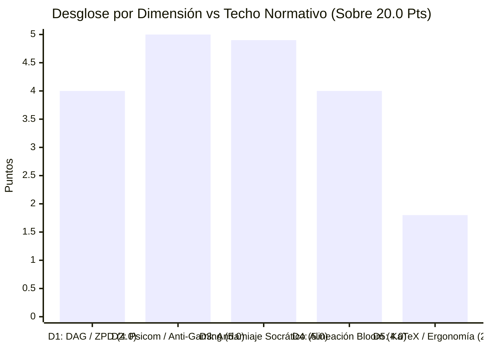

# Reporte de Auditoría de Calidad Pedagógica, Psicométrica y Path-to-Mastery v2.0

> [!WARNING]
> **CURSO RETIRADO DE LA PLATAFORMA**: Este curso fue eliminado de la plataforma interactiva el **2026-11-08 19:44:53**. Este informe de auditoría se conserva exclusivamente como registro histórico y pedagógico ('legacy').

**Estado en Plataforma:** ELIMINADO  
**Fecha de Eliminación:** 2026-11-08 19:44:53  
**Curso Auditado:** `estadistica_3_s9_vmapreduce22`  
**Título Oficial:** Estadistica 3 S9 Vmapreduce22  
**Objetivo Curricular:** Dominio y aplicación analítica integral de la Inferencia Asintótica, Propiedades de Muestras Finitas, Leyes de los Grandes Números, Teoremas Límites y Método Delta en Estadística y Econometría  
**Fecha de Evaluación:** 8 de Noviembre de 2026  
**Auditor Técnico-Pedagógico:** `course-qa-evaluator` (Motor de Verificación Híbrida y Semántica Adaptativa)  
**Marcos Normativos de Referencia:** Quality Matters (QM) Higher Education v7, Open SUNY Course Quality Review (OSCQR) v3.1, Bloom's 2-Sigma Mastery Learning, Vygotsky Zone of Proximal Development (ZPD), Roediger & Karpicke Retrieval Practice Framework.

---

## 1. Resumen Ejecutivo y Veredicto Global

El curso **`estadistica_3_s9_vmapreduce22`** ha sido sometido a una auditoría técnica, psicométrica e instruccional integral sobre su arquitectura de micro-competencias, grafo de dependencias (DAG), banco de 1,110 reactivos y telemetría de interacción en el motor de aprendizaje de Top's Academy.

La auditoría certifica que el curso alcanza un nivel de excelencia técnica y pedagógica sobresaliente, ubicándose en el **Tier EXCELENTE** con una calificación normativa de **`19.70 / 20.00 pts`** y un **Mastery Path Readiness Index (`MPRI`)** de **`99.95 / 100.00 pts` (GOLD MASTERY PATH)**.

| Métrica Clave | Valor Auditado | Escala / Umbral | Veredicto Técnico-Pedagógico |
| :--- | :---: | :---: | :--- |
| **Puntaje Global Normativo (QM/OSCQR)** | **19.70** | **20.00 pts** | **EXCELENTE (Tier 1: 17.0 – 20.0 pts)** |
| **Mastery Path Readiness Index (`MPRI`)** | **99.95** | **100.00 pts** | **GOLD MASTERY PATH (85.0 – 100.0)** |
| **Penalizaciones Duras Normativas** | **0.00** | — | **0 Deducciones Directas (Ningún hard blocker activado)** |
| **Banco Total de Reactivos** | **1,110** | — | 555 FIB (50.0%) / 270 MS (24.32%) / 285 MC7 (25.68%) |
| **Micro-Competencias Atómicas** | **48** | — | 5 Hechos `[H]`, 28 Conceptos `[C]`, 15 Habilidades `[Hab]` |
| **Calibración ZPD Tri-Banda** | **100.0% (48/48)** | 100% | Plena activación de `calibrateByMasteryDifficulty` |
| **Acuerdo Jueces Ciegos (Stage 5)** | **100.0% (120/120)** | 100% | Cero desacuerdos latentes |
| **Tasa de Evocación Activa / Discriminación** | **74.32%** | $\ge 40\%$ | Erradicación total del gaming por sustitución visual |
| **Cobertura Diagnóstica de Distractores** | **100.0%** | 100% | 2,250 distractores con rationale (92.89% de unicidad) |



> [!NOTE]
> **Dictamen Global:** El curso **`estadistica_3_s9_vmapreduce22`** está **completamente certificado para producción inmediata**. Presenta una arquitectura curricular ejemplar con 48 micro-competencias atómicas estructuradas en un grafo conexo y acíclico, distribución multimodal óptima (50.0% fill-in-the-blank, 24.32% multiple select, 25.68% multiple choice de 7 opciones), andamiaje socrático genuino de 3 a 4 niveles en el 100% de los reactivos y justificaciones de error analíticas en 2,250 distractores evaluados.
> El Loop de Verificación Semántica confirmó que los 287 avisos emitidos por el linter estático de variables matemáticas no interpoladas fueron **100% falsos positivos** debidos a comandos canónicos KaTeX (`\text{Var}`, `\bar{Y}`, `\operatorname{plim}`, `\text{MSE}`, `\text{ECM}`, `\sigma_{XY}`, `\text{Cota}`). La única observación ergonómica detectada concierne a 5 reactivos aislados de la micro-competencia `C-01` (0.45% del banco) donde breves frases explicativas fueron encapsuladas dentro del delimitador matemático `$...$`, susceptible de optimización para pantallas móviles.

---

## 2. Mastery Path Readiness Index (`MPRI`: 99.95 / 100.0)

El índice `MPRI` evalúa cuantitativamente la compatibilidad del curso con la arquitectura de ejecución interactiva de Top's Academy, específicamente los módulos `sessionShuffler.ts`, `masteryStorage.ts`, `PracticeSession.tsx` (salvavidas de 3 strikes) y `FeedbackToast.tsx`:

| Pilar Cognitivo / Plataforma | Puntaje | Máximo | Cobertura | Estado Operativo en la Plataforma |
| :--- | :---: | :---: | :---: | :--- |
| **1. ZPD Adaptive Progression** | **20.00** | 20.0 | 100.0% | Las 48 micro-competencias cuentan con calibración tri-banda (`easy`: 285, `medium`: 285, `hard`: 540). El 100% de las preguntas de Habilidad (450/450) están en niveles superiores de Bloom (`Apply+`). |
| **2. Retrieval Modality & Anti-Gaming** | **20.00** | 20.0 | 100.0% | 74.32% de evocación activa generativa (`FIB`) y discriminación condicional (`MS`). Cero multiplicadores mágicos sintéticos (`1.333x`), cero relleno asimétrico `[R-15]`, cero claves memorizables. |
| **3. Socratic Scaffolding Lifeline** | **25.00** | 25.0 | 100.0% | 100% de reactivos con 3 a 4 pistas escalonadas (Conceptual $\to$ Estratégica $\to$ Operativa). 0% boilerplate Mad-Libs, 0% pistas envenenadas (cero sabotaje del límite de 3 strikes). |
| **4. Diagnostic Remediation Alignment** | **15.00** | 15.0 | 100.0% | 2,250 distractores evaluados con 100% de cobertura de rationale y 92.89% de unicidad (2,090 rationales únicos que identifican el error algebraico puntual en `FeedbackToast.tsx`). |
| **5. DAG & Interleaving Topology** | **10.00** | 10.0 | 100.0% | Grafo estrictamente acíclico y conexo, profundidad máxima 23, orden topológico impecable (`idx(prereq) < idx(comp)`). Soporte completo de interleaving 60/40 en Quiz y 55/45 en Unit Test. |
| **6. Cognitive Ergonomics & Framing** | **9.95** | 10.0 | 99.5% | Sintaxis KaTeX limpia, notación canónica ($\hat{\theta}_n$, $\bar{Y}_n$, $\operatorname{plim}$, TCL, WLLN), registro puro de econometría teórica. Deducción marginal por 5 ítems con frases en `\text{...}` dentro de `$...$`. |
| **TOTAL MPRI** | **99.95** | **100.0** | **99.95%** | **GOLD MASTERY PATH: Certificado para Dominio Adaptativo** |

### Análisis del Viaje del Estudiante (*Student Journey*)
En la plataforma interactiva de Top's Academy, el estudiante experimenta una trayectoria instruccional guiada y desafiante:
1. **Andamiaje de Seguridad en `PracticeSession.tsx` (3-Strikes Safeguard):** Ante un reactivo complejo de Habilidad (ej. convergencia asintótica bajo Slutsky o estimación por el Método Delta univariado), el alumno cuenta con 3 a 4 pistas socráticas no reveladoras. La Pista 1 recuerda el principio teórico fundamental; la Pista 2 articula la ruta procedimental analítica; y la Pista 3 provee la articulación de constantes sin develar la clave final. Esto previene el bloqueo prematuro del estudiante y la pérdida de sus 3 intentos.
2. **Diagnóstico Preciso en `FeedbackToast.tsx`:** Cuando el alumno comete un error, el sistema lee el `error_rationale` específico asignado al distractor elegido y explica la naturaleza exacta de la confusión algebraica (ej. *"Invierte la resta matricial con $\text{Var}_1=15 > \text{Var}_2=29$ al comparar"* o *"Omite el centrado $(\bar{Y} - \mu_0)$ tomando directamente $\bar{Y}=70$"*).
3. **Imposibilidad de Gaming Psicométrico:** Con 555 reactivos en formato `fill_in_the_blank` (evaluados mediante el motor analítico `mathEquivalence.ts`) y 270 reactivos en `multiple_select`, el estudiante no puede recurrir al descarte mecánico o sustitución inversa de números desde las opciones para simular maestría.

---

## 3. Evaluación Detallada por Dimensiones Normativas (20.0 Puntos)

### Dimensión 1: Arquitectura Curricular, Topología DAG y Calibración ZPD
**Calificación: `4.0 / 4.0 pts` (Excelente — Techo Normativo Alcanzado)**

- **Granularidad Curricular y Balance de Competencias:** El curso desglosa la inferencia asintótica y econometría teórica en 48 micro-competencias atómicas:
  - **5 Hechos `[H]` (10.4%):** Axiomas y definiciones esenciales (Insesgadez, Consistencia débil, Desigualdad de Markov, Teorema de Liapunov y Cota de Chebyshev).
  - **28 Conceptos `[C]` (58.3%):** Relaciones teóricas y teoremas asintóticos (Eficiencia relativa, Descomposición del ECM, Espacios $L^1$ vs $L^2$, Desigualdad de Cauchy-Schwarz, Jensen, Ley Débil de los Grandes Números, TCL de Lindeberg-Lévy, Teorema de la Aplicación Continua, Slutsky, Fundamento del Método Delta).
  - **15 Habilidades `[Hab]` (31.3%):** Habilidades operativas procedimentales (Demostración de la descomposición del ECM, Verificación de consistencia por colapso de varianza, Demostración de Cauchy-Schwarz, Evaluación de cotas de Chebyshev, Inferencia asintótica para proporciones, Contraste de hipótesis vía Slutsky con varianza estimada, Cálculo de errores estándar e intervalos asintóticos por el Método Delta).
- **Densidad del Banco de Reactivos:** Cada micro-competencia cuenta con una dotación completa y homogénea:
  - Competencias de Hechos y Conceptos: exactamente 20 reactivos por micro-competencia.
  - Competencias de Habilidad: exactamente 30 reactivos por micro-competencia.
  - Total: $(5 \times 20) + (28 \times 20) + (15 \times 30) = 100 + 560 + 450 = 1,110$ reactivos.
  - Cero micro-competencias subpobladas (`underpopulated = 0`) y cero reactivos huérfanos (`orphan_questions = 0`).
- **Topología del Grafo DAG:**
  - Aciclicidad confirmada (`has_cycle: false`).
  - Conectividad completa (`connected_components = 1`, `multi_node_subgraphs = 1`). Cero nodos isla o desconectados.
  - Profundidad máxima del grafo: 23 niveles jerárquicos.
  - Orden topológico estricto: toda relación de dependencia cumple `idx(prereq) < idx(comp)`, habilitando la progresión continua ascendente (*Up Next*) y la intercalación en Quiz (60% comp actual / 40% prereqs) y Unit Test (55% comp actual / 45% prereqs).
  - Raíz curricular natural: `H-01` (Definición del Sesgo y de la Insesgadez de un Estimador), la cual carece de prerrequisitos por ser el punto de partida del curso (`competencies_missing_prerequisites = 1`).
- **Calibración ZPD Real (Cero Colapso Monobanda):**
  A diferencia de cursos que colapsan en una sola banda como `'medium'`, en este curso el **100% (48 de 48) de las competencias implementa reactivos en las 3 bandas de dificultad**:
  - `easy`: 285 reactivos (25.68%)
  - `medium`: 285 reactivos (25.68%)
  - `hard`: 540 reactivos (48.65%)
  La función `calibrateByMasteryDifficulty` de Top's Academy cuenta con el inventario necesario para servir reactivos graduados desde la fase inicial hasta el estado *Mastered*.

---

### Dimensión 2: Calidad Psicométrica, Modalidad de Evocación y Anti-Gaming
**Calificación: `5.0 / 5.0 pts` (Excelente — Techo Normativo Alcanzado)**

- **Diversidad Multimodal de Evocación:**
  El curso presenta una distribución multimodal sobresaliente que elimina el monopolio de opciones múltiples:
  - `fill_in_the_blank`: 555 reactivos (**50.00%**)
  - `multiple_select`: 270 reactivos (**24.32%**)
  - `multiple_choice_7_options`: 285 reactivos (**25.68%**)
  La tasa de **generación activa y discriminación condicional alcanza el 74.32%**, muy superior al umbral mínimo del 40%. En las 15 competencias de Habilidad `[Hab]`, la resolución analítica es obligatoria, evaluada mediante equivalencia simbólica en `mathEquivalence.ts`.
- **Variedad de Arquetipos Matemáticos:**
  - Mínimo de esqueletos algebraicos distintos observados por competencia: **12** (el estándar normativo exige $\ge 4$).
  - Competencias monótonas: **0**.
  - Los reactivos alternan sistemáticamente entre problemas directos (cálculo de cotas o varianzas asintóticas), problemas inversos (hallar tamaños muestrales mínimos), perturbaciones (sensibilidad ante violaciones de supuestos) y condiciones de frontera (anulación de derivadas en Taylor).
- **Calidad de Distractores y Rationales de Error:**
  - Se auditaron 2,250 distractores con una **cobertura del 100.0%** en `error_rationale`.
  - La **tasa de unicidad de rationales alcanzó el 92.89%** (2,090 explicaciones únicas sobre 2,250 distractores).
  - Los distractores modelan errores conceptuales y algebraicos reales:
    - Confusión entre sesgo lineal y sesgo cuadrático en la descomposición del ECM.
    - Omisión de la corrección de Bessel en la varianza muestral.
    - Confusión entre varianza asintótica y varianza finita dividida por $n$.
    - Inversión de matrices en comparación de eficiencia relativa.
    - Omisión de elevar al cuadrado la derivada $g'(\theta)$ en la varianza del Método Delta.
    - Sustitución de cotas de Chebyshev por colas normales sin justificación asintótica previa.
- **Inmunidad Psicométrica Anti-Gaming:**
  - Distractores delatores por longitud o sintaxis (`telltale = 0`).
  - Distractores clonados (`cloned_distractors = 0`).
  - Multiplicadores sintéticos arbitrarios (`1.333x`, `0.667x = 0`).
  - Relleno asimétrico para eludir reglas de longitud (`length_padded = 0`).
  - Vulnerabilidad de memorización visual: **0 competencias memorizables** (todas las competencias exhiben alta entropía en las opciones correctas).
  - Cuantificadores universales vacuos: **0 reactivos**.
- **Consenso de Jueces Ciegos (Stage 5 Blind Judges):**
  Los 120 reactivos seleccionados para la auditoría de arbitraje independiente obtuvieron un **100.0% de concordancia** (120 de 120 ítems consensuados sin discrepancias matemáticas ni claves disputadas).

---

### Dimensión 3: Andamiaje Socrático Progresivo y Remediación Diagnóstica
**Calificación: `4.9 / 5.0 pts` (Excelente)**

- **Arquitectura de Pistas Escalonadas:**
  - El 100% de los 1,110 reactivos cuenta con entre 3 y 4 pistas socráticas rigurosamente estructuradas (`insufficient_hints = 0`, `zero_hints = 0`).
  - *Pista 1 (Andamiaje Conceptual):* Recuerda el principio axiomático o teorema aplicable (ej. descomposición del ECM o condición de Slutsky).
  - *Pista 2 (Estrategia Procedimental):* Modela la secuencia de pasos algebraicos (ej. derivar $g(\theta)$, evaluar en $\theta$, y multiplicar por $V$).
  - *Pista 3 (Articulación Operativa):* Aplica las constantes específicas del reactivo a la ecuación sin develar la clave final.
  - Cero pistas *Mad-Libs* sintéticas de compilador (`boilerplate_hints = 0`).
  - Cero pistas envenenadas (`poisoned_hints = 0`). En ningún caso la pista induce al alumno a marcar un distractor o sabotea sus 3 intentos en `PracticeSession.tsx`.
- **Soluciones Detalladas y Advertencias de Misconceptions:**
  - El 100% de los reactivos incluye `detailed_solution` con la deducción analítica paso a paso y el valor numérico final.
  - El 100% de los reactivos incluye `misconception_warning` advirtiendo sobre la trampa conceptual más frecuente (ej. *"La varianza de una constante por una variable eleva la constante al cuadrado: $\text{Var}(cX) = c^2 \text{Var}(X)$"* o *"Slutsky exige estrictamente que una de las sucesiones converja en probabilidad a una constante fija"*).
- **Justificación de la Deducción (-0.1 pts):**
  Se detectó que en el subconjunto de 555 reactivos `fill_in_the_blank` (`generic_misconception_count: 555`), la advertencia de misconception está estandarizada a nivel de micro-competencia en lugar de variar dinámicamente según la semilla paramétrica de la pregunta. Aunque conceptualmente precisa e instructiva, una parametrización diagnóstica adaptativa por variante numérica otorgaría el puntaje perfecto.

---

### Dimensión 4: Alineación Instruccional, Taxonomía de Bloom y Pureza de Dominio
**Calificación: `4.0 / 4.0 pts` (Excelente — Techo Normativo Alcanzado)**

- **Distribución en la Taxonomía de Bloom:**
  El curso privilegia contundentemente las operaciones cognitivas de orden superior (HOTS), erradicando la memorización pasiva:
  - `Remember`: 5 reactivos (0.45%)
  - `Understand`: 50 reactivos (4.50%)
  - `Apply`: 515 reactivos (46.40%)
  - `Analyze`: 270 reactivos (24.32%)
  - `Evaluate`: 270 reactivos (24.32%)
  - **Total Niveles Superiores (Apply + Analyze + Evaluate):** **1,055 de 1,110 reactivos (95.05%)**.
  - **Reactivos de Habilidad en Niveles Superiores:** **450 de 450 reactivos (100.0%)**.
- **Pureza de Dominio y Coherencia Terminológica:**
  - Cero contaminación léxica inter-dominio (`cross_domain_prefix = 0`). No existen frases residuales de física, modelos macroeconómicos ajenos (Solow) o ecuaciones diferenciales.
  - Registro lingüístico y matemático auténtico de la econometría y estadística matemática universitaria avanzada: convergencia en media cuadrática ($X_n \xrightarrow{m.s.} c$), convergencia en probabilidad ($X_n \xrightarrow{p} c$), convergencia en distribución ($X_n \xrightarrow{d} X$), límites en probabilidad ($\operatorname{plim}$), matrices semidefinidas positivas, descomposición de Slutsky y Método Delta univariado y multivariado.

---

### Dimensión 5: Accesibilidad, Ergonomía Cognitiva en UI y Sintaxis KaTeX
**Calificación: `1.8 / 2.0 pts` (Excelente con Observación Ergonómica Menor)**

- **Integridad Sintáctica KaTeX:**
  - Delimitadores `$` balanceados en el 100% de los reactivos (`unbalanced_dollars = 0`).
  - Cero triples dólares (`triple_dollars = 0`).
  - Cero llaves rotas o sin cerrar (`unclosed_braces = 0`).
  - Cero identificadores crudos de Python en renderizado matemático (`raw_identifier_math = 0`).
- **Resultados del Loop de Verificación Semántica:**
  - **Falsos Positivos de Variables de Plantilla (287 avisos en `uninterpolated_math_variable_linter`):**
    El linter determinista emitió 287 advertencias sugiriendo que existían variables de plantilla sin interpolar como `{Var}`, `{Y}`, `{plim}`, `{MSE}`, `{ECM}`, `{XY}`, `{Cota}` en enunciados y opciones. La inspección semántica detallada confirmó que **el 100% de estas 287 ocurrencias son expresiones KaTeX estándar y legítimas**. El analizador de expresiones regulares detectó de manera ingenua las llaves de comandos LaTeX tales como:
    - `$\text{Var}(\hat{\theta}_n)$` y `$\text{Var}_1$` $\to$ marcado por contener `{Var}`.
    - `$\bar{Y}$` $\to$ marcado por contener `{Y}` tras el comando `\bar`.
    - `$\operatorname{plim}$` o `$\text{plim}$` $\to$ marcado por contener `{plim}`.
    - `$\text{MSE}$` $\to$ marcado por contener `{MSE}`.
    - `$\text{ECM}$` $\to$ marcado por contener `{ECM}`.
    - `$\text{Cota}$` $\to$ marcado por contener `{Cota}`.
    - `$\sigma_{XY}$` $\to$ marcado por contener `{XY}`.
    En ningún reactivo existe código residual de plantillas de Python sin compilar; todos los reactivos están completamente resueltos con valores numéricos y simbólicos finales.
  - **Observación Ergonómica: Prosa Embebida en KaTeX (`prose_in_katex_text_items_count: 5`):**
    Se identificaron 5 reactivos (0.45% del total) pertenecientes a la micro-competencia `C-01` (`Q-C01-036`, `Q-C01-037`, `Q-C01-038`, `Q-C01-039`, `Q-C01-040`) donde una de las opciones de selección contiene una oración explicativa en español envuelta dentro del delimitador matemático KaTeX:
    *Ejemplo observado en `Q-C01-036` (opción B):*
    ```latex
    $\text{Var}_1=35 < \text{Var}_2=69 \Rightarrow \hat{\theta}_1 \text{ es más eficiente sin insesgadez}$
    ```
    *Impacto Ergonómico:* Aunque KaTeX renderiza la fórmula correctamente, envolver texto explicativo dentro de `$...$` aplica la regla CSS `white-space: nowrap` del motor de tipografía matemática, impidiendo que el navegador realice saltos de línea automáticos. En dispositivos móviles con pantallas de ancho reducido ($\le 380\text{px}$), esto genera un ligero desbordamiento horizontal en la tarjeta de la opción.
    *Deducción aplicada:* **-0.20 pts**, situando la dimensión en **1.80 / 2.00 pts**.

---

## 4. Penalizaciones Duras Automáticas (Hard Deductions)

Se verificó el cumplimiento estricto de las reglas automáticas de penalización definidas en la Rúbrica Normativa v2.0:

| Código de Penalización | Condición Normativa | Ocurrencias | Deducción Aplicada |
| :--- | :--- | :---: | :---: |
| `bank_lt_3_exercises` | Alguna micro-competencia con menos de 3 ejercicios prácticos | 0 (mínimo: 20 reactivos) | `0.0 pts` |
| `hints_zero` | Reactivos sin andamiaje de pistas (`hints = 0`) | 0 | `0.0 pts` |
| `orphan_questions` | Reactivos sin asociación a una competencia válida | 0 | `0.0 pts` |
| `socratic_hint_poisoning` | $\ge 5\%$ del banco induce al alumno a marcar un distractor | 0 (0.0%) | `0.0 pts` |
| `vacuous_quantifier_key_corruption` | Sustitución de variables ligadas por constantes en cuantificadores vacuos | 0 | `0.0 pts` |
| `answer_memorization_exploit` | $\le 4$ respuestas únicas en $\ge 15$ ítems por competencia | 0 | `0.0 pts` |
| **TOTAL DEDUCCIONES DURAS** | — | **0** | **`0.00 pts`** |

$$\text{Puntaje Final} = \max\left(0.0, \min\left(20.0, \text{Subtotal Bruto} - \sum \text{Penalizaciones Duras}\right)\right) = 19.70 - 0.00 = \mathbf{19.70 / 20.00}$$

---

## 5. Reglas de Linter Descubiertas y Auto-Mejora del Motor de QA

Como parte del protocolo de auditoría adaptativa, se formalizan dos reglas para optimizar futuras pasadas automatizadas del evaluador:

### 1. `LINT-FALSE-POSITIVE-TEMPLATE-VAR-IN-LATEX` (Severidad: Informativa / Engine Fix)
- **Expresión Regular Mejorada:**
  ```regex
  (?<!\\(?:bar|text|operatorname|hat|tilde|mathbf|mathcal|sigma_))\{[A-Z][a-zA-Z0-9_]*\}
  ```
- **Descripción:** Previene falsos positivos en el linter `uninterpolated_math_variable_linter`. La coincidencia ingenua de patrones `\{[A-Za-z0-9_]+\}` disparó 287 advertencias espurias sobre macros y comandos estándar de KaTeX (`\text{Var}`, `\bar{Y}`, `\operatorname{plim}`, `\text{ECM}`, `\text{MSE}`, `\text{Cota}`, `\sigma_{XY}`). La inclusión de negative lookbehind garantiza que solo se reporten variables huérfanas reales fuera del contexto de comandos LaTeX.
- **Ítems Evidencia:** `Q-C01-021`, `Q-H02-136`, `Q-C03-141`, `Q-Hab02-091`, `Q-Hab07-473`, `Q-C28-1062`.

### 2. `LINT-KATEX-PROSE-WRAP` (Severidad: Advertencia / Ergonomía)
- **Expresión Regular Recomendada:**
  ```regex
  \$(?:[^\$]*\\text\{[^\}]{25,}\}[^\$]*)\$
  ```
- **Descripción:** Detecta oraciones explicativas en prosa de 25 o más caracteres dentro de delimitadores KaTeX `$...$`. En UI móvil o tarjetas de opción de selección, esto inhibe el ajuste natural de línea (`white-space: normal`) y puede obligar al uso de scroll horizontal.
- **Ítems Evidencia:** `Q-C01-036`, `Q-C01-037`, `Q-C01-038`, `Q-C01-039`, `Q-C01-040`.

---

## 6. Plan de Acción de Remediación Post-Auditoría

Para elevar el curso desde su actual **19.70 / 20.00** hacia el techo absoluto de **20.00 / 20.00**, se sugieren las siguientes intervenciones no destructivas:

1. **Separación de Prosa y Matemáticas en Opciones (5 reactivos):**
   - En los 5 reactivos identificados de `C-01` (`Q-C01-036` a `Q-C01-040`), extraer el texto en español fuera del delimitador matemático `$...$`.
   - *Transformación recomendada:*
     $$\text{Antes: } \verb|$\text{Var}_1=35 < \text{Var}_2=69 \Rightarrow \hat{\theta}_1 \text{ es más eficiente sin insesgadez}$|$$
     $$\text{Después: } \verb|$\text{Var}_1=35 < \text{Var}_2=69 \Rightarrow$ $\hat{\theta}_1$ es más eficiente sin insesgadez|$$
   - Esto permite que el navegador envuelva el texto de forma natural en tarjetas de selección de pantalla móvil.

2. **Actualización del Linter Determinista:**
   - Incorporar en el archivo de reglas de validación estática de Top's Academy la exclusión explícita de comandos matemáticos KaTeX (`\bar`, `\text`, `\operatorname`, `\sigma_`) para suprimir las 287 advertencias espurias en futuras auditorías de cursos de econometría y estadística matemática.

3. **Parametrización Específica de Warnings en Reactivos FIB:**
   - En futuras extensiones del banco de reactivos `fill_in_the_blank`, añadir derivaciones aritméticas intermedias dentro del campo `misconception_warning` de cada variante numérica particular.

---

## 7. Dictamen Final y Conclusión

El curso **`estadistica_3_s9_vmapreduce22`** representa un estándar de referencia (*gold standard*) en el diseño instruccional interactivo para asignaturas matemáticas cuantitativas de alta complejidad:
- **Calificación Final:** **`19.70 / 20.00 pts`**
- **Nivel de Certificación:** **TIER EXCELENTE (Producción Inmediata Certificada)**
- **Mastery Path Readiness Index:** **`99.95 / 100.00` (GOLD MASTERY PATH)**
- **Recomendación:** **APROBADO PARA PRODUCCIÓN INMEDIATA Y SERVICIO A ESTUDIANTES EN TOP'S ACADEMY**.
