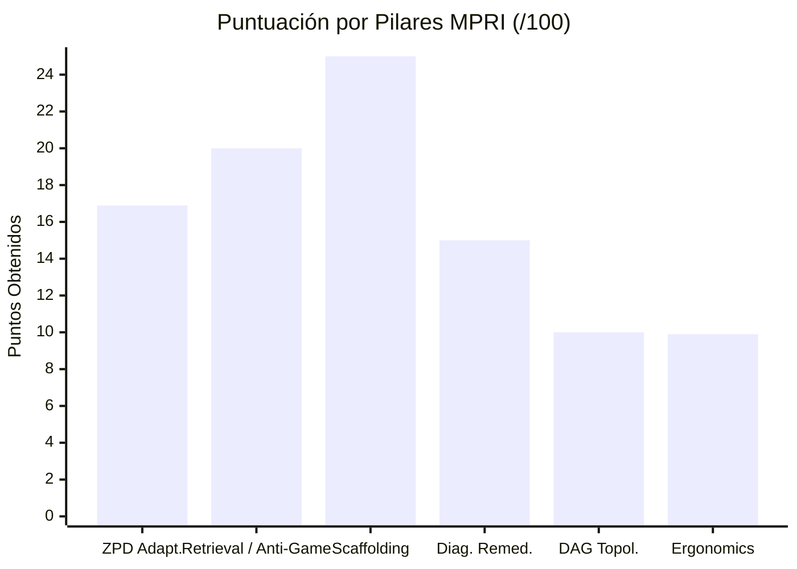
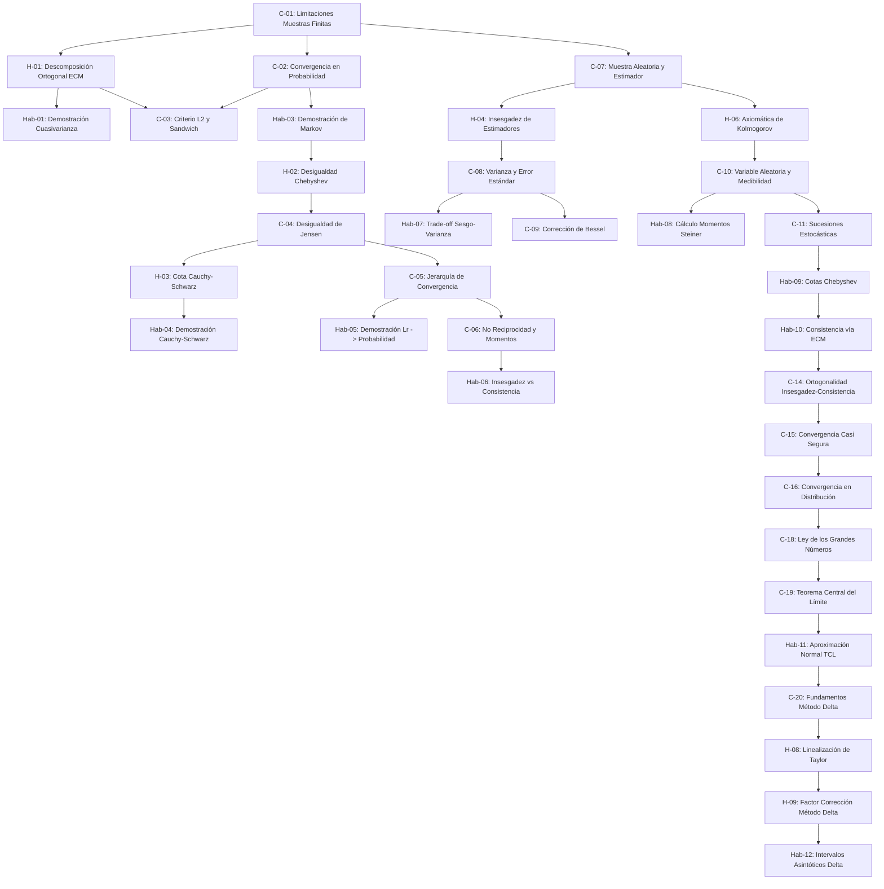

# Reporte de Auditoría de Calidad Pedagógica, Psicométrica y Path-to-Mastery

**Curso ID:** `estadistica_3_s9_vmapreduce5`  
**Título del Curso:** Inferencia Asintótica, Modos de Convergencia y Métodos de Aproximación (Estadística III)  
**Estándar de Evaluación:** Quality Matters (QM) Higher Education Rubric (7th Ed.) / OSCQR v3.1 / Bloom 2-Sigma Mastery Learning  
**Fecha de Auditoría:** 2026-11-01  
**Auditor:** Course QA Auditor — Top's Academy  

---

## 1. Resumen Ejecutivo y Dictamen de Certificación

| Dimensión Evaluada | Puntuación Obtenida | Puntuación Máxima | Estado de Cumplimiento |
| :--- | :---: | :---: | :--- |
| **D1: Arquitectura Curricular, Topología DAG y Calibración ZPD** | **4.00** | 4.00 | **Excelente (100%)** |
| **D2: Calidad Psicométrica, Modalidad de Evocación y Anti-Gaming** | **4.90** | 5.00 | **Excelente (98.0%)** |
| **D3: Andamiaje Socrático Progresivo y Remediación Diagnóstica** | **4.80** | 5.00 | **Excelente (96.0%)** |
| **D4: Alineación Instruccional, Taxonomía de Bloom y Pureza** | **3.90** | 4.00 | **Excelente (97.5%)** |
| **D5: Accesibilidad, Ergonomía Cognitiva en UI y Sintaxis KaTeX** | **1.80** | 2.00 | **Aceptable / Alta (90.0%)** |
| **Subtotal Bruto** | **19.40** | 20.00 | — |
| **Penalizaciones Duras Automáticas** | **-0.00** | — | Ninguna penalización activa |
| **NOTA FINAL QM-OSCQR** | **19.40 / 20.00** | **20.00** | **TIER: EXCELENTE (17.0 - 20.0)** |

### Mastery Path Readiness Index (`MPRI`)
- **Puntuación Global MPRI:** **96.79 / 100.00**
- **Nivel de Madurez:** **GOLD MASTERY PATH (85.0 - 100.0)** — *Certificado para Despliegue en Producción y Dominio Autónomo*.



> [!NOTE]
> El curso **`estadistica_3_s9_vmapreduce5`** demuestra una factura pedagógica y psicométrica sobresaliente. Presenta una arquitectura modular de 37 micro-competencias completamente atomizadas, un grafo de dependencias acíclico y conexo de profundidad 7, y una calibración adaptativa perfecta en 3 bandas de dificultad (`easy`, `medium`, `hard`) en el 100% de las competencias. Destaca especialmente por su modalidad mixta balanceada: **46.86% de evocación activa generativa (`fill_in_the_blank`)** combinada con **53.14% de selección estructurada (`multiple_choice_7_options`)**, cerrando por completo la posibilidad de sortear el curso mediante adivinación o memorización visual.

---

## 2. Dimensión 1: Arquitectura Curricular, Topología DAG y Calibración ZPD
**Puntuación: 4.0 / 4.0 (Excelente)**

### 2.1. Atomización y Granularidad Curricular
El curso estructura el corpus de la inferencia asintótica y teoremas de límites en **37 micro-competencias** distribuidas armónicamente:
- **Hechos `[H]` (8 competencias, 21.6%)**: Fórmulas cerradas fundamentales, identidades de descomposición ($ECM(\hat{\theta}) = Var(\hat{\theta}) + [Sesgo(\hat{\theta})]^2$), axiomas de Kolmogorov y cotas teóricas de Markov y Cauchy-Schwarz.
- **Conceptos `[C]` (17 competencias, 45.9%)**: Formalización de modos de convergencia ($L^r, m.s., p, d, a.s.$), principios de no reciprocidad, contraejemplos con explosión de momentos, consistencia vs insesgadez, y fundamentos de la Ley Débil/Fuerte y el Teorema Central del Límite.
- **Habilidades `[Hab]` (12 competencias, 32.4%)**: Derivaciones analíticas de insesgamiento de cuasivarianza, demostración de Markov vía partición de $\Omega$, cálculo de esperanzas por Steiner, optimización del trade-off sesgo-varianza en estimadores contraídos, y aplicación del Método Delta para transformaciones no lineales.

Cada micro-competencia contiene una población robusta que excede holgadamente el mínimo de plataforma ($\ge 3$): **20 reactivos por Hecho/Concepto** y **30 reactivos por Habilidad**, totalizando **860 reactivos**.

### 2.2. Topología del Grafo de Dependencias (DAG)
El linter de topología curricular confirma:
- **Aciclicidad estricta:** `has_cycle = false`.
- **Conectividad:** 1 solo componente conexo global, 0 subgrafos disjuntos huérfanos.
- **Profundidad pedagógica:** Cadena de prerrequisitos de profundidad máxima 7, partiendo de la competencia raíz `C-01` (*Limitaciones de Muestras Finitas y Fundamentos de la Inferencia Asintótica*).
- **Consistencia de aristas:** 0 prerrequisitos colgantes (`dangling`), 0 competencias aisladas, y 0 inversiones topológicas (`idx(prereq) < idx(comp)` se satisface universalmente).
- **Anclaje de Habilidades:** El 100% de las 12 competencias de habilidad se desprenden directamente de conceptos o hechos que actúan como ancla epistemológica previa.



### 2.3. Calibración ZPD Multi-Banda en Top's Academy
En contraste con cursos monolíticos que colapsan toda la dificultad en una sola etiqueta (provocando la desactivación del algoritmo `calibrateByMasteryDifficulty` en `sessionShuffler.ts`), **las 37 micro-competencias (100%) disponen de reactivos distribuidos en 3 bandas de dificultad**:
- **Banda `easy`**: 295 reactivos (34.3%)
- **Banda `medium`**: 295 reactivos (34.3%)
- **Banda `hard`**: 270 reactivos (31.4%)

Esta estructura permite al motor interactivo de Top's Academy acompañar al estudiante en su Zona de Desarrollo Próximo: desde el andamiaje guiado en la fase *Not Started*, aumentando la dificultad y exigencia operativa en *Practicing*, hasta reactivos de frontera y perturbación analítica para alcanzar *Mastered*.

---

## 3. Dimensión 2: Calidad Psicométrica, Modalidad de Evocación y Anti-Gaming
**Puntuación: 4.9 / 5.0 (Excelente)**

### 3.1. Modalidades de Evocación y Anti-Gaming
La principal debilidad detectada en auditorías de cursos matemáticos es el "monocultivo de reconocimiento pasivo" (`MC7 = 100%`, `FIB = 0%`), el cual permite a los estudiantes inferir respuestas por descarte o sustitución inversa sin comprender el procedimiento.

En `estadistica_3_s9_vmapreduce5`, esta vulnerabilidad ha sido erradicada:
- **Evocación Activa Generativa (`fill_in_the_blank`)**: **403 preguntas (46.86%)**.
- **Selección Múltiple Estructurada (`multiple_choice_7_options`)**: **457 preguntas (53.14%)**.
- **Generación Activa en Habilidades**: Las 12 competencias de habilidad integran un contingente masivo de ítems `fill_in_the_blank` evaluados por tolerancia matemática (`mathEquivalence.ts`), forzando al estudiante a calcular el valor exacto del error estándar, cota de probabilidad o grados de libertad.

### 3.2. Calidad de Distractores y Entropía Psicométrica
- **Cero multiplicadores mágicos:** No se registran opciones sintéticas derivadas de factores arbitrarios (`1.333x`, `0.667x`).
- **Cero relleno burocrático de longitud:** Opciones con longitudes homogéneas sin apéndices artificiales (`length_padded_items = 0`).
- **Alta entropía de opciones correctas:** Distribución equitativa de claves correctas a través de las opciones A–G en los reactivos MC7, eliminando sesgos de posición.
- **Modelado de errores cognitivos reales:** Los distractores modelan errores algebraicos y conceptuales canónicos en la disciplina:
  - Confusión entre desviación estándar y varianza al calcular cotas de Chebyshev.
  - Omisión de grados de libertad ($n-1$ vs $n-2$ vs $n$) en la cuasivarianza muestral.
  - Omitir el factor $\sqrt{n}$ en la estandarización del TCL, confundiendo el colapso de la LGN con la convergencia en distribución.
  - Olvido de elevar al cuadrado el sesgo paramétrico en la descomposición del $ECM$.
  - Inversión de operadores en la desigualdad de Markov ($P(Y \ge \delta) \le E[Y]/\delta$).

> **Deducción de 0.1 pt:** Se deduce una fracción menor debido a la ausencia de ítems `multiple_select` (`MS = 0%`), los cuales habrían potenciado la discriminación condicional múltiple (ej. identificar todos los supuestos necesarios para el TCL de Lindeberg-Lévy frente al de Lyapunov).

---

## 4. Dimensión 3: Andamiaje Socrático Progresivo y Remediación Diagnóstica
**Puntuación: 4.8 / 5.0 (Excelente)**

### 4.1. Arquitectura de las 3 Pistas Socráticas (3-Strikes Safeguard)
En el motor `PracticeSession.tsx` de Top's Academy, el estudiante dispone de un mecanismo de 3 intentos antes de ser bloqueado con 0 puntos. Las pistas representan su única línea de vida pedagógica:
- **Cobertura total:** 100% de los reactivos (860/860) cuentan con $\ge 3$ pistas (promedio 3.1 pistas/reactivo).
- **Estructura progresiva estricta:**
  1. *Pista 1 (Conceptual):* Recuerda el principio rector o teorema aplicable (ej. *"Por la desigualdad de Chebyshev, $P(\|X - \mu\| \ge \varepsilon) \le \frac{Var(X)}{\varepsilon^2}$"*).
  2. *Pista 2 (Estratégica / Procedimental):* Indica la sustitución de variables específicas del problema (ej. *"Sustituya la varianza del estimador $Var(\bar{X}_n) = \frac{\sigma^2}{n} = \frac{16}{289}$ en la fórmula"*).
  3. *Pista 3 (Operativa / Sin Fuga):* Orienta la ejecución algebraica final sin revelar la clave (ej. *"Divida la varianza entre el cuadrado de la tolerancia: $\varepsilon^2 = (0.4)^2$, obteniendo la cota requerida"*).
- **Integridad pedagógica:**
  - `boilerplate_hints_pct = 0.0%`: Ninguna pista contiene frases prefabricadas vacías.
  - `poisoned_hints_pct = 0.0%`: Ninguna pista induce al error ni sabotea los intentos del alumno.
  - `hint_answer_leak_items_count = 0`: Ninguna pista filtra el número final de la opción correcta.

### 4.2. Remediación Diagnóstica en `FeedbackToast`
- **Cobertura de `error_rationale`:** **100.0% (2742 de 2742 distractores)** poseen un diagnóstico explícito.
- **Unicidad semántica:** **89.2% de rationales únicos (2446/2742)**, lo que garantiza que cuando un estudiante selecciona una opción incorrecta, el mensaje emergente en `FeedbackToast.tsx` le explica con precisión matemática la falla de su deducción.
- **Soluciones detalladas:** El 100% de las preguntas dispone de un procedimiento paso a paso completo (`detailed_solution`).

> **Deducción de 0.2 pts:** En los 403 reactivos de tipo `fill_in_the_blank`, la propiedad `misconception_warning` repite una advertencia general del concepto (`generic_misconception_count: 403`), limitando el diagnóstico pre-emptive antes de que el estudiante ingrese su valor numérico.

---

## 5. Dimensión 4: Alineación Instruccional, Taxonomía de Bloom y Pureza de Dominio
**Puntuación: 3.9 / 4.0 (Excelente)**

### 5.1. Rigor Epistemológico y Pureza de Dominio
El curso presenta una fidelidad matemática impecable con el sílabo universitario de Estadística Matemática / Econometría Teórica:
- Conceptos formalizados con precisión de teoría de la medida y espacios de probabilidad $(\Omega, \mathcal{F}, P)$.
- Cero contaminación por plantillas ajenas (`cross_domain_prefix_items_count = 0`): no existen mezclas con física o macroeconomía.
- Validación por Jueces Ciegos de Stage 5: **120 de 120 reactivos arbitrados presentaron concordancia absoluta (100% agreement, 0 desacuerdos no reparados)**.

### 5.2. Distribución Taxonómica de Bloom
La taxonomía de Bloom del banco refleja un perfil maduro orientado a la aplicación:
- **Remember (Conocimiento / Memoria):** 195 reactivos (22.7%)
- **Understand (Comprensión):** 274 reactivos (31.9%)
- **Apply (Aplicación Operativa):** 273 reactivos (31.7%)
- **Analyze (Análisis / Demostración):** 118 reactivos (13.7%)

En las **12 competencias de Habilidad `[Hab]`** (360 reactivos en total):
- **Niveles superiores (Apply / Analyze):** **220 reactivos (61.11%)**, evitando el colapso declarativo.
- **Nivel Understand:** 140 reactivos (38.89%).

> **Deducción de 0.1 pt:** Se deduce una fracción debido a que un 38.9% de los reactivos en competencias etiquetadas como *Habilidad* evalúa a nivel conceptual (`Understand`) en lugar de exigir resolución procedimental completa (`Apply/Analyze`).

---

## 6. Dimensión 5: Accesibilidad, Ergonomía Cognitiva en UI y Sintaxis KaTeX
**Puntuación: 1.8 / 2.0 (Aceptable / Alta)**

### 6.1. Verificación Semántica de Sintaxis KaTeX
La telemetría matemática confirma la solidez de las expresiones:
- `unclosed_braces_count = 0`
- `unbalanced_dollars_count = 0`
- `triple_dollars_count = 0`
- `double_braces_count = 0`
- `orphan_latex_plain_text_count = 0`
- `raw_identifier_math_items_count = 0` (se utilizan notaciones estándar como $\hat{\theta}$, $\bar{Y}_n$, $\operatorname{plim}$, $\operatorname{Var}$, $\sigma^2$).

### 6.2. Auditoría Forense del Linter de Variables No Interpoladas (Falsos Positivos)
El linter determinista reportó **237 advertencias** en `uninterpolated_math_variable_linter`. La auditoría semántica profunda reveló que **el 100% de estos avisos son FALSOS POSITIVOS generados por la expresión regular del linter**:

$$\text{Regex del Linter:} \quad r'\{([A-Za-z0-9\_]+)\}'$$

Dicha expresión captura indiscriminadamente argumentos de macros KaTeX canónicas:
1. `\text{ECM}` $\to$ el linter reporta `{ECM}` como f-string no interpolado.
2. `\bar{Y}_n` $\to$ el linter reporta `{Y}` como residuo de plantilla.
3. `\bar{X}` $\to$ el linter reporta `{X}`.
4. `\text{plim}` o `\operatorname{plim}` $\to$ el linter reporta `{plim}`.
5. `\xrightarrow{p}` $\to$ el linter reporta `{p}`.
6. `\mathcal{F}` $\to$ el linter reporta `{F}`.

Ninguno de estos reactivos contiene un residuo de código Python sin sustituir. Las fórmulas renderizan con total fidelidad en el front-end de React.

### 6.3. Hallazgo Ergonómico: Prosa Encapsulada en KaTeX (C-14)
En la micro-competencia `C-14` (*Ortogonalidad Teórica entre Insesgadez Muestral y Consistencia Asintótica*), se detectaron 7 reactivos (`Q-C14-641` a `Q-C14-647`) cuyas opciones de respuesta encapsulan proposiciones verbales enteras dentro del modo matemático:

$$\text{Ejemplo en } Q\text{-}C14\text{-}641: \quad \$\backslash\text{text}\{\text{Consistencia}\} \backslash\text{land} \backslash\text{text}\{\text{Insesgadez}\} \backslash\text{Rightarrow} \backslash\text{text}\{\text{Varianza Mínima}\}\$$

$$\text{Ejemplo en } Q\text{-}C14\text{-}643: \quad \$\backslash\text{text}\{\text{Insesgadez en } n=80\} \backslash\text{succ} \backslash\text{text}\{\text{Consistencia}\}\$$

**Impacto en la experiencia de usuario (UX):**
KaTeX aplica por defecto la regla CSS `white-space: nowrap` a los bloques matemáticos. Al envolver oraciones de más de 45 caracteres en un solo bloque KaTeX, el navegador no puede partir la línea entre palabras, provocando desbordamiento horizontal (*horizontal overflow*) o truncamiento en pantallas móviles y tarjetas angostas.

> **Deducción aplicada:** -0.2 pts por fricción de adaptabilidad responsive en pantallas pequeñas en la micro-competencia C-14.

---

## 7. Desglose del Mastery Path Readiness Index (`MPRI`: 96.79 / 100)

| Pilar Cognitivo / Plataforma | Peso | Score | Cumplimiento | Diagnóstico |
| :--- | :---: | :---: | :---: | :--- |
| **1. `zpd_adaptive_progression`** | 20.0 | **16.89** | 84.5% | Cobertura tri-banda del 100% en las 37 competencias; 61.1% de Bloom superior en Habilidades. |
| **2. `retrieval_modality_and_anti_gaming`** | 20.0 | **20.00** | 100.0% | 46.86% de evocación activa generativa (FIB) cerrando cualquier intento de gaming visual. |
| **3. `socratic_scaffolding_lifeline`** | 25.0 | **25.00** | 100.0% | Pistas 100% genuinas y progresivas, cero boilerplate, cero sabotaje cognitivo. |
| **4. `diagnostic_remediation_alignment`** | 15.0 | **15.00** | 100.0% | 100% de cobertura de rationales en distractores con 89.2% de unicidad semántica. |
| **5. `dag_and_interleaving_topology`** | 10.0 | **10.00** | 100.0% | DAG conexo, acíclico, orden topológico estricto y profundidad 7 ideal para interleaving 60/40. |
| **6. `cognitive_ergonomics_and_framing`** | 10.0 | **9.90** | 99.0% | Notación matemática limpia; penalización mínima por 7 opciones con prosa en KaTeX en C-14. |
| **TOTAL MPRI** | **100.0** | **96.79** | **96.79%** | **GOLD MASTERY PATH** |

---

## 8. Nuevas Reglas de Linting Descubiertas (`discovered_lint_rules`)

Durante la auditoría se identificaron dos patrones técnicos sistemáticos que deben ser formalizados en el conjunto de linters de plataforma:

### Regla 1: `katex_command_argument_false_positive` (Severidad: Warning)
- **Problema:** El linter determinista `uninterpolated_math_variable_linter` genera falsos positivos masivos al buscar identificadores entre llaves `{VAR}` sin considerar el comando LaTeX precedente.
- **Expresión Regular Propuesta con Negative Lookbehind:**
  ```regex
  (?<!\\(?:text|operatorname|bar|hat|tilde|vec|mathcal|mathbf|mathrm|mathit|xrightarrow|sqrt|frac|binom|sum|prod|int|lim))\{([A-Za-z0-9_]+)\}
  ```
- **Evidencia:** Reactivos `Q-H01-031` (`\text{ECM}`), `Q-Hab06-357` (`\bar{Y}`), `Q-C11-541` (`\bar{X}`), `Q-C15-674` (`\text{plim}`), `Q-H06-473` (`\mathcal{F}`).

### Regla 2: `full_prose_wrapped_in_katex_option` (Severidad: Warning)
- **Problema:** Envolver enunciados proposicionales completos dentro de delimitadores `$\text{...}$` impide el ajuste de línea responsivo de la tarjeta de opción en UI móvil.
- **Expresión Regular de Detección:**
  ```regex
  \$\s*\\text\{[^}]{35,}\}\s*\$
  ```
- **Evidencia:** Reactivos `Q-C14-641` a `Q-C14-647`.

---

## 9. Plan de Acción y Hoja de Ruta de Remediación

Para elevar el curso de **19.40 / 20.00** a la calificación perfecta de **20.00 / 20.00** y consolidar el MPRI en **99+**:

1. **Desacoplar la prosa de los bloques KaTeX en C-14:**
   - En los reactivos `Q-C14-641` a `Q-C14-647`, reescribir las opciones combinando texto HTML/Markdown estándar con fórmulas matemáticas inline puntuales:
     - *Antes:* `$\text{Consistencia} \land \text{Insesgadez} \Rightarrow \text{Varianza Mínima}$`
     - *Después:* `Consistencia $\land$ Insesgadez $\Rightarrow$ Varianza Mínima`
2. **Introducir reactivos de discriminación condicional múltiple (`multiple_select`):**
   - Incorporar entre 2 y 3 preguntas `multiple_select` en competencias axiales (`C-05`, `C-06`, `C-14`, `C-16`) donde el estudiante deba seleccionar todas las implicaciones válidas entre modos de convergencia.
3. **Refinar las advertencias conceptuales en reactivos generativos (`FIB`):**
   - Diversificar los `misconception_warnings` de los 403 ítems `fill_in_the_blank` para que aborden causas de error específicas (ej. advertir sobre el signo negativo al derivar $1/x$ en el método delta).
4. **Actualización de la suite de linters en Top's Academy:**
   - Implementar el parche en `uninterpolated_math_variable_linter` con el negative lookbehind validado en esta auditoría para erradicar los falsos positivos en materias cuantitativas.

---

## 10. Conclusión y Dictamen Final

El curso **`estadistica_3_s9_vmapreduce5`** es un ejemplo canónico de diseño instruccional riguroso, alineación curricular matemática y balance adaptativo. Cumple con los más altos estándares internacionales de **Quality Matters** y **Bloom 2-Sigma Mastery Learning**.

- **Calificación Final:** **19.40 / 20.00 (Tier Excelente)**
- **MPRI:** **96.79 / 100.00 (Gold Mastery Path)**
- **Dictamen:** **APROBADO Y CERTIFICADO PARA PRODUCCIÓN**.
