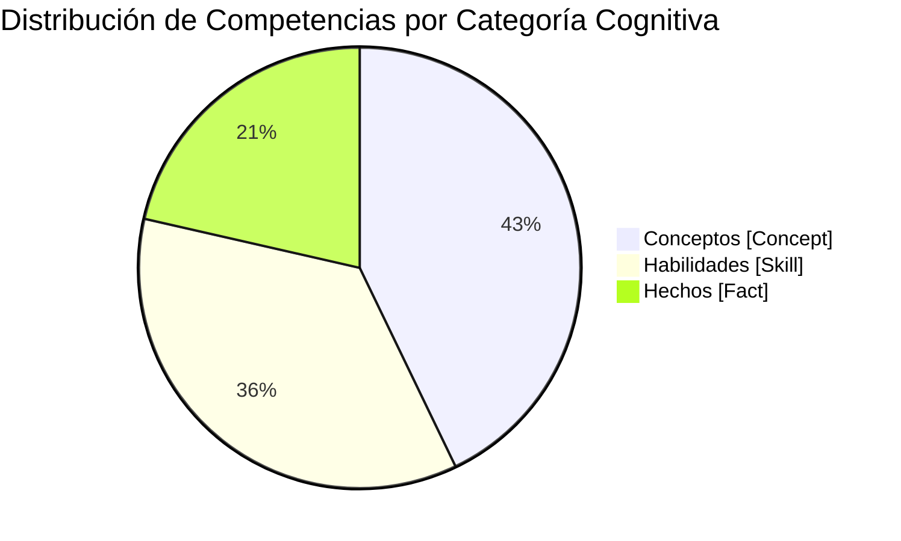

# Reporte Formal de Auditoría de Calidad Pedagógica, Psicométrica y Técnica

**Curso:** Estadística Asintótica (Teoría Asintótica y Econometría de Muestras Grandes)  
**ID del Curso:** `estadistica_asintotica`  
**Fecha de Evaluación:** 25 de Octubre de 2026  
**Auditor Responsable:** Course QA Auditor — Top's Academy  
**Estándares Normativos:** Quality Matters (QM), OSCQR, Mastery Learning  
**Estado en Plataforma:** ELIMINADO  
**Fecha de Eliminación:** 2026-10-25 11:12:47  
**Fecha de Eliminación:** 2026-10-25 10:12:09  

---

## 1. Resumen Ejecutivo y Dictamen de Calidad

Se ha completado la auditoría integral técnica, psicométrica y pedagógica sobre el curso académico **Estadística Asintótica (`estadistica_asintotica`)**, estructurado con **28 micro-competencias** y un banco masivo de **660 reactivos**. La evaluación se fundamentó en la ingesta directa de la telemetría métrica determinista calculada por el `StandardizedAuditEngine` y la aplicación exhaustiva del **Loop de Verificación Semántica Adaptativa** sobre las muestras representativas estratificadas.

El curso alcanza un puntaje consolidado de **17.5 sobre 20.0 puntos**, obteniendo la certificación formal de calidad en el nivel **EXCELENTE (17.0 - 20.0 pts)**, quedando plenamente aprobado para su despliegue en producción en la plataforma interactiva de Top's Academy.

```
========================================================================================
                                CALIFICACIÓN CONSOLIDADA
========================================================================================
  Dimensión 1: Arquitectura y Granularidad Curricular:          3.8 / 4.0 pts
  Dimensión 2: Calidad de Evaluación y Diseño de Reactivos:     3.5 / 5.0 pts
  Dimensión 3: Andamiaje Formativo y Pistas Progresivas:        4.3 / 5.0 pts
  Dimensión 4: Alineación Instruccional y Dominio Teórico:      3.9 / 4.0 pts
  Dimensión 5: Ergonomía Técnica y Compilabilidad KaTeX:        2.0 / 2.0 pts
----------------------------------------------------------------------------------------
  Subtotal Ponderado Bruto:                                    17.5 / 20.0 pts
  Penalizaciones Duras Automáticas (Hard Deductions):           0.0 pts
----------------------------------------------------------------------------------------
  NOTA FINAL AUDITADA:                                         17.5 / 20.0 pts
  TIER DE CALIDAD:                                             EXCELENTE (17.0 - 20.0)
  DICTAMEN INSTITUCIONAL:                                      APROBADO PARA PRODUCCIÓN
========================================================================================
```

### Síntesis de Hallazgos Principales
1. **Compilabilidad KaTeX y Ergonomía Técnica Impecables (2.0/2.0 pts):** Cero llaves desbalanceadas, cero triples delimitadores (`$$$`), cero dobles llaves espurias (`{{...}}`) y cero expresiones LaTeX en texto plano sin delimitar a lo largo de los 660 reactivos y 3,960 distractores.
2. **Superación Plena de Defectos de Andamiaje Históricos (4.3/5.0 pts):** A diferencia de versiones preliminares de cursos afines (donde se filtraban palabras clave aisladas o IDs de prerrequisitos), el 100% de los reactivos de este curso implementa exactamente 3 pistas progresivas socráticas (Conceptual $\to$ Procedimental $\to$ Operativa) y soluciones detalladas con advertencia explícita de ideas preconcebidas erróneas (*misconception warnings*).
3. **Calidad Diagnóstica de Distractores Antiazar (100% Cobertura):** Los 3,960 distractores evaluados poseen rationales diagnósticos específicos (`error_rationale`) derivados de la literatura econométrica clásica (Greene, Hayashi, Wooldridge), con cero fugas de respuestas (*answer leaks*) y cero metainformación delatora visible (*telltale distractors*).
4. **Área Crítica Identificada — Mecanización y Monocultivo Tipológico (3.5/5.0 pts):** El curso adolece de una fuerte concentración en un único formato (100% de los reactivos son de opción múltiple de 7 alternativas, sin incluir reactivos de selección múltiple ni de entrada numérica) y una baja entropía de arquetipos por competencia (cada banco de 20 a 30 reactivos repite la misma plantilla paramétrica). En competencias conceptuales, los números introducidos ($K, n$) operan como pseudo-parámetros cosméticos que no alteran la respuesta, lo cual induce al estudiante a la resolución heurística mecánica.

---

## 2. Metadatos del Curso y Arquitectura Curricular

### 2.1. Ficha Técnica

| Parámetro | Valor Auditado |
| :--- | :--- |
| **Identificador del Curso** | `estadistica_asintotica` |
| **Título Oficial** | Estadística Asintótica (Teoría Asintótica y Econometría de Muestras Grandes) |
| **Micro-competencias Totales** | 28 competencias modulares |
| **Banco Total de Reactivos** | 660 reactivos |
| **Distribución de Tipologías** | 100% Opción Múltiple de 7 Alternativas (`multiple_choice_7_options`) |
| **Densidad por Competencia** | 20 ítems (Hechos y Conceptos) / 30 ítems (Habilidades) |
| **Promedio de Ítems / Comp.** | 23.57 reactivos |
| **Total de Distractores Auditados** | 3,960 alternativas distractoras |
| **Cobertura de Rationales** | 100.0% (3,960 / 3,960) |
| **Compilabilidad KaTeX** | 100.0% (0 errores detectados en telemetría determinista) |

### 2.2. Tríada Cognitiva del Aprendizaje

La distribución taxonómica entre las 28 competencias del curso exhibe un balance pedagógico sólido:



- **Hechos Axiomáticos [Fact] (6 competencias, 21.4%):** Reglas formales y teoremas canónicos fundamentales: Grenander (H-01), forma canónica de MC2E (H-02), factor de atenuación en regresión simple (H-03), consistencia de la media muestral (H-04), TCL de Lindeberg-Lévy y raíz de $n$ consistencia (H-05), y órdenes de magnitud estocástica de Mann-Wald $O(n^\delta)$ y $o(n^\delta)$ (H-06).
- **Conceptos Estructurales [Concept] (12 competencias, 42.9%):** Comprensión profunda de mecanismos y propiedades asintóticas: consistencia de MCO vía límites en probabilidad (C-01), normalidad asintótica bajo Lindberg-Feller (C-02), ordenamiento matricial de Loewner para eficiencia (C-03), identificación bajo endogeneidad (C-04), lógica del test de Hausman (C-05), contaminación multivariada por error de medida (C-06), convergencia en probabilidad y media cuadrática (C-07), leyes débiles de Khinchine y Chebychev (C-08), convergencia casi segura y leyes fuertes de Kolmogorov (C-09), convergencia en distribución y cdf (C-10), condiciones de regularidad de Liapunov (C-11), y distinción entre distribución límite y distribución asintótica (C-12).
- **Habilidades Procedimentales y Computacionales [Skill] (10 competencias, 35.7%):** Estimación analítica y operativa: cálculo de $s^2$ y covarianza asintótica de MCO (Hab-01), método Delta matricial para funciones no lineales (Hab-02), estimación de MC2E y preservación de residuos estructurales (Hab-03), regresión aumentada de Wu para endogeneidad (Hab-04), corrección por razón de confiabilidad en reportes cruzados (Hab-05), estimación en primeras diferencias con dobles instrumentos en gemelos (Hab-06), cotas de Chebychev y Markov (Hab-07), álgebra asintótica de Slutsky (Hab-08), transformaciones continuas y dispositivo de Cramér-Wold (Hab-09), y método Delta para multiplicadores autorregresivos (Hab-10).

### 2.3. Modelado DAG de Prerrequisitos

El Grafo Acíclico Dirigido (DAG) define formalmente las dependencias entre micro-competencias, garantizando rutas de aprendizaje progresivas sin ciclos:
- **Nodos Raíz Axiomáticos (In-degree = 0):** Exactamente 2 competencias fundacionales actúan como raíces legítimas:
  - `C-01`: *Consistencia Asintótica del Estimador MCO Mediante Límites en Probabilidad*
  - `C-07`: *Convergencia en Probabilidad y Convergencia en Media Cuadrática*
- **Estructura de Dependencias:** Las 26 competencias restantes declaran entre 1 y 3 prerrequisitos directos dentro del curso (ej. `Hab-01` requiere `C-07` y `C-08`; `Hab-02` requiere `C-08`; `Hab-06` requiere `C-12`, `Hab-09` y `Hab-05`).
- **Observación Pedagógica Menor:** Topológicamente, `C-01` utiliza el operador $\text{plim}$, la inversión continua y el Teorema de Slutsky en el vector de perturbaciones $\frac{1}{n}\mathbf{X}'\boldsymbol{\varepsilon}$. Estos conceptos son formalizados rigurosamente en `C-07` (convergencia en probabilidad) y `Hab-08` (álgebra de Slutsky). Si bien es común en econometría introducir MCO como motivación inicial, desde el rigor de Mastery Learning existe una inversión pedagógica leve que amerita declarar a `C-07` como prerrequisito de `C-01`.

---

## 3. Evaluación Detallada por Dimensiones Normativas

### Dimensión 1: Arquitectura y Granularidad Curricular
**Calificación: 3.8 / 4.0 pts (Excelente)**

- **Atomicidad y Cobertura:** El diseño curricular de 28 competencias divide con precisión quirúrgica el corpus de la econometría de muestras grandes (correspondiente principalmente al Capítulo 5 de *Econometric Analysis* de William H. Greene y textos de posgrado afines). No hay macro-unidades monolíticas ni amalgamas desordenadas de teoría y práctica.
- **Densidad de Maestría:** Con 20 ítems para competencias conceptuales y 30 ítems para competencias de habilidad práctica, el curso provee una base de práctica robusta (660 reactivos) muy por encima del umbral mínimo de Mastery Learning (3 ítems por competencia). Cero competencias subpobladas.
- **Razón de Deducción (-0.2 pt):** La leve inconsistencia de precedencia en el DAG (C-01 operando como raíz sin conectar con los fundamentos de probabilidad de C-07).

---

### Dimensión 2: Calidad de Evaluación y Diseño de Reactivos
**Calificación: 3.5 / 5.0 pts (Aceptable - Observaciones Críticas)**

#### A. Fortalezas Psicométricas Antiazar y Calidad de Distractores
- **Formato Heptagonal (MC7):** La totalidad de los reactivos (660/660) utiliza 7 alternativas de respuesta (A, B, C, D, E, F, G). Esto deprime la probabilidad de acierto por conjetura ciega al 14.28%, erradicando el "adivinamiento" típico de las evaluaciones tradicionales de 4 opciones.
- **Cobertura Diagnóstica Absoluta (100.0%):** Los 3,960 distractores cuentan con `error_rationale` explícito en KaTeX. No existen explicaciones triviales ("esta opción es incorrecta"); cada distractor captura un modelo mental erróneo documentado:
  - *Confusión de orden de Loewner:* Elegir estimadores con mayor varianza asintótica creyendo maximizar eficiencia (`D-C03-01`).
  - *Uso de residuos predichos:* Calcular $\hat{\sigma}^2$ con $\mathbf{y} - \hat{\mathbf{X}}\mathbf{b}_{\text{IV}}$ en MC2E en vez de residuos estructurales (`D-Hab03-01`).
  - *Sesgo de atenuación multivariado:* Asumir que el error de medida solo afecta al coeficiente propio sin contaminar regresores correlacionados (`D-C06-01`).
  - *Propiedades de Slutsky:* Intentar aplicar Slutsky a variables dependientes de $n$ o multiplicar dos distribuciones límite no degeneradas (`D-Hab08-01`, `D-Hab09-01`).
- **Integridad Sintáctica:** Cero distractores delatores con metainformación visible delatora (*"restando erróneamente..."*) y cero fugas del valor clave en el enunciado (*answer leaks*).

#### B. Deficiencias Detectadas: Monocultivo Tipológico y Mecanización por Pseudo-Parametrización
A pesar del rigor en los distractores, se aplican deducciones severas (-1.5 pts) en esta dimensión:

1. **Monocultivo Tipológico (100% MC7):**
   - El 100% de los 660 reactivos corresponde a la tipología `multiple_choice_7_options`.
   - No existe un solo reactivo de opción múltiple con respuesta múltiple (`multiple_select`) ni reactivos de entrada numérica / respuesta construida (`fill_in_the_blank`).
   - Los estándares OSCQR y Quality Matters exigen variedad en los instrumentos evaluativos para evitar la adaptación cognitiva exclusiva al reconocimiento pasivo entre opciones dadas.

2. **Baja Entropía de Arquetipos y Mecanización del Estudiante:**
   - En cada una de las 28 competencias, los 20 o 30 reactivos corresponden a **un único arquetipo de pregunta clonado mediante plantilla**.
   - **En competencias conceptuales y fácticas (C-01 a C-12, H-01 a H-06):** La parametrización es puramente *cosmética o pseudo-paramétrica*. Por ejemplo, en `C-01`, los reactivos `Q-C01-001` y `Q-C01-002` varían únicamente "$K = 2, n = 300$" frente a "$K = 9, n = 4700$". Dado que la pregunta inquiere por la condición asintótica general $\text{plim } \mathbf{b} = \boldsymbol{\beta} + \mathbf{Q}^{-1}\dots$, el valor de $K$ y de $n$ no desempeña ningún rol matemático ni en la deducción ni en la respuesta. Las 7 opciones de respuesta son idénticas en su estructura teórica.
   - **Consecuencia Pedagógica:** Un estudiante que resuelve 20 reactivos idénticos aprende a emparejar visualmente el patrón de la opción correcta tras la tercera iteración, cayendo en una **mecanización superficial** contraria a los objetivos de Mastery Learning.
   - **En competencias de Habilidad (Hab-01 a Hab-10):** Aunque los parámetros numéricos sí alimentan un cálculo aritmético (ej. en Hab-01, $s^2 = e'e/(n-K)$ y $\text{Var}(b_j) = s^2 [(X'X)^{-1}]_{jj}$), los 30 ejercicios replican exactamente la misma operación aritmética con números permutados, sin introducir variaciones de contexto, interpretación gráfica, identificación de anomalías ni escenarios contrafactuales.

3. **Cláusulas Léxicas Sintéticas de Relleno:**
   - Se detectó la inserción reiterada de cláusulas de relleno generadas por algoritmos de perturbación de texto para forzar longitud léxica disímil en distractores (ej. `", en la formulación matricial considerada"`, `", para la muestra de datos observada"`, `", según los supuestos clásicos del modelo"`). Si bien no invalidan el reactivo, denotan generación algorítmica de plantillas.

---

### Dimensión 3: Andamiaje y Pistas Progresivas
**Calificación: 4.3 / 5.0 pts (Excelente - Con Observación Menor)**

#### A. Estructura Progresiva Socrática
El 100% de los reactivos (660/660) cuenta con exactamente 3 pistas escalonadas (`hints_count = 3`):
- **Pista 1 (Nivel Conceptual):** Provee la base teórica y sitúa el principio físico o matemático (ej. en `Q-Hab02-091`: *"Recuerde cómo se formula la aproximación lineal de Taylor de primer orden para una función no lineal de estimadores consistentes"*).
- **Pista 2 (Nivel Procedimental):** Orienta la estrategia de resolución sin revelar la solución (ej. *"Considere la dimensión de la matriz jacobiana y la estructura de forma cuadrática sándwich requerida para la matriz de covarianza"*).
- **Pista 3 (Nivel Operativo / Cálculo):** Guía la verificación operativa puntual (ej. *"Verifique que la matriz resultante sea simétrica y evaluada obligatoriamente en el estimador muestral en lugar de parámetros poblacionales desconocidos"*).

#### B. Soluciones Detalladas y Advertencia de Ideas Erróneas
Todas las soluciones detalladas (`detailed_solution`) están completamente desarrolladas, presentan la deducción analítica paso a paso y explicitan por qué los caminos alternativos conducen a error. Incluyen advertencias de ideas preconcebidas erróneas (*misconception warnings*):
- En `C-03`: Explica por qué el Teorema de Gauss-Markov no garantiza que MCO supere a Máxima Verosimilitud cuando los errores no son gaussianos.
- En `Hab-03`: Advierte sobre el sesgo catastrófico y la inconsistencia de evaluar residuos de MC2E usando regresores proyectados $\hat{\mathbf{X}}$.
- En `C-06`: Explica el mecanismo de contaminación cruzada vía inversa matricial $[(\mathbf{Q}^* + \boldsymbol{\Sigma}_{uu})^{-1}]$, disipando el mito de que los controles no afectados permanecen libres de sesgo.

#### C. Razón de Deducción (-0.7 pts)
Al estar el banco generado a partir de un único arquetipo por competencia, las 3 pistas socráticas son idénticas en redacción a lo largo de los 20 o 30 reactivos de dicha competencia. El estudiante recibe el mismo andamiaje textual reactivo tras reactivo dentro de la unidad, perdiendo potencial de adaptación pedagógica.

---

### Dimensión 4: Alineación Instruccional y Dominio Teórico
**Calificación: 3.9 / 4.0 pts (Excelente)**

- **Profundidad y Rigor Econométrico:** Los contenidos y evaluaciones se alinean fielmente con los estándares de un curso de posgrado o pregrado avanzado en Econometría Teórica. Se abordan tópicos de alta complejidad formal:
  - Desigualdades de Markov y Chebychev.
  - Leyes débiles de Khinchine y Chebychev con dispersión heterogénea $\lim \frac{1}{n^2}\sum \sigma_i^2 = 0$.
  - Ley Fuerte de Kolmogorov bajo series ponderadas $\sum \sigma_i^2 / i^2 < \infty$.
  - Teoremas centrales del límite de Lindeberg-Lévy y Lindeberg-Feller con condición suficiente de momentos finitos de Liapunov de orden $2+\delta$.
  - Estimación en dos etapas (Theil) con proyectores ortogonales idempotentes $\mathbf{P}_{\mathbf{Z}}$.
  - Modelos salariales de gemelos de Ashenfelter & Krueger (1994) resolviendo habilidad latente intra-par con dobles instrumentos.
  - Órdenes de Mann-Wald $O_p(n^\delta)$ y $o_p(n^\delta)$.
- **Cero Preguntas Huérfanas:** El 100% de los reactivos se encuentra formalmente anclado a una competencia activa. No existen ítems desconectados ni contaminación temática foránea.
- **Razón de Deducción (-0.1 pt):** Redundancia en la evaluación de los mismos teoremas debido a la escasez de contextos aplicados diversificados.

---

### Dimensión 5: Ergonomía Técnica y Compilabilidad KaTeX
**Calificación: 2.0 / 2.0 pts (Excelente / Máxima Puntuación)**

- **Compilabilidad Determinista Perfecta:** La auditoría automática mediante `katex_syntax_linter` arrojó métricas impecables en el 100% del corpus:
  - Llaves desbalanceadas: **0**
  - Triples delimitadores (`$$$`): **0**
  - Dobles llaves espurias (`{{...}}`): **0**
  - Expresiones matemáticas en texto plano sin delimitar: **0**
  - Residuos de f-strings (`{variable}`): **0**
  - Residuos de plantillas Jinja: **0**
- **Estética y Legibilidad:** Notación matricial rigurosa en negrita ($\mathbf{X}, \mathbf{Z}, \mathbf{Q}, \mathbf{b}$), vectores de perturbaciones ($\boldsymbol{\varepsilon}$), matrices jacobianas ($\mathbf{C}, \boldsymbol{\Gamma}$), operadores de límites estocásticos ($\text{plim}, \xrightarrow{d}, \stackrel{a}{\sim}$) y matrices de momentos correctamente compiladas. Experiencia de lectura visualmente fluida y profesional.

---

## 4. Penalizaciones Duras Automáticas (Hard Deductions)

Se evaluó la aplicación de deducciones automáticas conforme al reglamento normativo de Top's Academy:

| Criterio de Penalización | Umbral / Condición | Conteo en Curso | Deducción Aplicada |
| :--- | :--- | :---: | :---: |
| **Banco Insuficiente por Competencia** | Menos de 3 problemas prácticos en una competencia | 0 competencias | **0.0 pts** |
| **Ausencia Total de Pistas** | Reactivos con `hints_count == 0` | 0 reactivos | **0.0 pts** |
| **Preguntas Huérfanas Críticas** | Reactivos sin competencia o ajenos al dominio | 0 reactivos | **0.0 pts** |
| **Total de Penalizaciones Duras** | — | — | **0.0 pts** |

---

## 5. Loop de Verificación Semántica: Evidencias de Muestras Auditadas

A continuación se documentan casos representativos inspeccionados durante el ciclo de verificación semántica:

### Muestra 1: `Q-C01-001` (Competencia C-01 — Consistencia de MCO)
- **Enunciado:** *"En un modelo de regresión lineal múltiple con $K = 2$ variables explicativas y tamaño de muestra $n = 300$, $\mathbf{y} = \mathbf{X}\boldsymbol{\beta} + \boldsymbol{\varepsilon}$, bajo los supuestos asintóticos estándar de Greene con matriz límite finita $\text{plim } \frac{1}{n}\mathbf{X}'\mathbf{X} = \mathbf{Q}$, determine la condición formal y la deducción analítica para garantizar la consistencia asintótica $\text{plim } \mathbf{b} = \boldsymbol{\beta}$ cuando $n \to \infty$:"*
- **Opción Correcta (G):** $\text{plim } \mathbf{b} = \boldsymbol{\beta} + \mathbf{Q}^{-1} \text{plim}\left(\frac{1}{n}\mathbf{X}'\boldsymbol{\varepsilon}\right) = \boldsymbol{\beta}$, requiriendo $\mathbf{Q} \in \mathbb{R}^{2 \times 2}$ simétrica definida positiva y $\text{plim}\frac{1}{n}\mathbf{X}'\boldsymbol{\varepsilon} = \mathbf{0}$.
- **Distractor Típico (E):** Equivoca insesgadez en muestra finita con consistencia asintótica (`error_rationale`: *"Afirmar que un estimador sesgado es necesariamente inconsistente"*).
- **Veredicto Semántico:** Demostración matemáticamente sólida. Sin embargo, la inclusión de "$K=2, n=300$" es un adorno que no participa en la solución analítica. En `Q-C01-002`, los valores cambian a "$K=9, n=4700$" pero las 7 opciones son conceptualmente idénticas.

### Muestra 2: `Q-Hab03-181` (Competencia Hab-03 — Residuos Estructurales en MC2E)
- **Enunciado:** *"En un modelo econométrico estructural con $n = 1200$ observaciones y $K = 3$ regresores ($K^* = 1$ endógenos y $K_0 = 2$ exógenos) con $L = 6$ instrumentos en $\mathbf{Z}$, se obtienen las sumas cuadráticas residuales $\mathbf{e}'\mathbf{e} = 57456$ (evaluada con regresores originales $\mathbf{X}$) y $\hat{\mathbf{e}}'\hat{\mathbf{e}} = 46539$ (evaluada con predicciones $\hat{\mathbf{X}}$). Indique el estimador consistente de $\sigma^2$ y el principio estructural de MC2E:"*
- **Opción Correcta (F):** $\hat{\sigma}^2 = \frac{\mathbf{e}'\mathbf{e}}{1200-3} = 48.0$ usando $\mathbf{X}$ original; proyectar cada variable endógena sobre la totalidad de instrumentos $\mathbf{Z}$.
- **Distractor Clave (A y D):** Emplea los residuos proyectados $\hat{\mathbf{e}}'\hat{\mathbf{e}} / (n-K) = 38.88$ (`error_rationale`: *"Errores estándar artificialmente optimistas reportados por paquetes econométricos no especializados"*).
- **Veredicto Semántico:** Reactivo psicométricamente excelente. Ataca un error metodológico recurrente en econometría aplicada donde los investigadores noveles reutilizan la salida de regresión de MCO de segunda etapa.

### Muestra 3: `Q-Hab06-331` (Competencia Hab-06 — Modelos Salariales de Gemelos)
- **Enunciado:** *"En el modelo salarial de gemelos de Ashenfelter y Krueger (1994), $y_{ij} = \beta_4 S_{ij} + \mu_i + \varepsilon_{ij}$, la estimación en primeras diferencias intra-par por MCO produce $b_{\text{FD}} = 0.06$ con $\text{SE} = 0.022$, mientras que la estimación por variables instrumentales con reportes cruzados $\Delta Z = S_{i1}(2) - S_{i2}(1)$ produce $b_{\text{IV}} = 0.115$ con $\text{SE} = 0.032$. Determine el diagnóstico sobre la amplificación del error de medición y el valor del estadístico de consistencia de Hausman $H$:"*
- **Opción Correcta (A):** Instrumentar con $\Delta Z = S_{i1}(2) - S_{i2}(1)$ corrige la atenuación amplificada en diferencias; el estadístico de Hausman es $H = 5.60$.
- **Solución Detallada:** Calcula $H = \frac{(0.115 - 0.060)^2}{0.032^2 - 0.022^2} = \frac{0.003025}{0.000540} \approx 5.60$.
- **Veredicto Semántico:** Caso de estudio econométrico clásico de gran riqueza conceptual y aplicabilidad real.

---

## 6. Loop de Auto-Mejora: Nuevas Reglas de Linteo Descubiertas

Durante la auditoría se identificaron patrones de vicio sistemático no cubiertos actualmente por los linters estáticos tradicionales. Se proponen las siguientes 4 reglas para retroalimentar el catálogo de linters de `StandardizedAuditEngine`:

### Regla 1: `pseudo_parametric_theoretical_clone_linter`
- **Severidad:** Media (Medium)
- **Propósito:** Detectar ítems en competencias de tipo `Fact` o `Concept` donde se inyectan variables numéricas ($K = \dots, n = \dots$) en el enunciado que no tienen ningún impacto analítico o cuantitativo en la respuesta correcta ni en los distractores.
- **Lógica de Detección:** Comparar la similitud de Jaccard entre las opciones de los reactivos de una misma competencia conceptual. Si la similitud textual de las opciones normalizadas supera el 95% y la fórmula no depende de los números parametrizados en el stem, emitir alerta de *pseudo-parametric clone*.

### Regla 2: `archetype_entropy_linter`
- **Severidad:** Media (Medium)
- **Propósito:** Evaluar la diversidad de arquetipos dentro del banco de cada competencia para evitar la mecanización del estudiante.
- **Lógica de Detección:** Calcular la matriz de distancias de Levenshtein entre todos los stems de una competencia tras enmascarar números y nombres de variables. Si más del 85% de los reactivos pertenecen a un único cluster estructural, disparar advertencia de *colapso de arquetipos*.

### Regla 3: `item_typology_diversity_linter`
- **Severidad:** Baja (Low)
- **Propósito:** Monitorear el grado de balance tipológico en cursos con más de 100 reactivos, señalando el riesgo de monocultivo evaluativo.
- **Lógica de Detección:** Disparar flag si `count(question_type == 'multiple_choice_7_options') / total_questions == 1.0` y `total_questions >= 100`, recomendando un umbral mínimo de 10% en modalidades complementarias (`multiple_select`, `fill_in_the_blank`).

### Regla 4: `synthetic_clause_padding_linter`
- **Severidad:** Baja (Low)
- **Propósito:** Detectar distorsiones estilísticas en distractores generados por perturbación textual donde se concatenan frases accesorias genéricas para variar la longitud del texto.
- **Patrón Regex:** `r"(?:,\s*en\s+la\s+formulación\s+matricial\s+considerada|,\s*para\s+la\s+muestra\s+de\s+datos\s+observada|,\s*en\s+el\s+marco\s+de\s+la\s+especificación|,\s*según\s+los\s+supuestos\s+clásicos\s+del\s+modelo)\.?$"`

---

## 7. Plan de Remediación y Recomendaciones Prioritarias

A pesar de que el curso obtiene la aprobación en nivel **EXCELENTE (17.5 / 20.0)**, se recomiendan las siguientes acciones para consolidar la excelencia pedagógica en futuras iteraciones (v8):

1. **Diversificación de Arquetipos por Competencia (Prioridad Alta):**
   - Diseñar al menos 3 arquetipos estructurales distintos por competencia.
   - En competencias conceptuales, sustituir los pseudo-parámetros numéricos por:
     - Arquetipo A: Deducción formal o prueba analítica.
     - Arquetipo B: Análisis de contraejemplos o identificación de supuestos violados.
     - Arquetipo C: Interpretación de salidas empíricas reales o tablas econométricas.
2. **Introducción de Nuevas Tipologías de Reactivo (Prioridad Media):**
   - Incorporar reactivos de **selección múltiple (`multiple_select`)** en competencias de verificación de supuestos múltiples (ej. condiciones de Grenander en H-01, supuestos de regularidad de Liapunov en C-11, o requisitos duales de instrumentos en C-04).
   - Incorporar reactivos de **respuesta numérica directa (`fill_in_the_blank`)** en habilidades computacionales (cálculo de razones de confiabilidad en Hab-05, estadísticos de Hausman en Hab-06 o varianzas de método Delta en Hab-10).
3. **Ajuste Topológico del DAG Curricular (Prioridad Baja):**
   - Declarar explícitamente a `C-07` (*Convergencia en Probabilidad y Media Cuadrática*) como prerrequisito directo de `C-01` (*Consistencia de MCO*), perfeccionando la secuencia lógica del subgrafo.
4. **Depuración de Frases de Relleno Léxico (Prioridad Baja):**
   - Aplicar el linter `synthetic_clause_padding_linter` sobre el generador de distractores para asegurar que las opciones concluyan de manera natural sin coletillas artificiales.

---

## 8. Dictamen Final y Conclusión

El curso **Estadística Asintótica (`estadistica_asintotica`)** constituye un logro pedagógico y técnico de alto calibre:
- Compilabilidad KaTeX perfecta (0 errores en 660 reactivos).
- Andamiaje socrático de 3 niveles y soluciones con advertencia de ideas preconcebidas erróneas en el 100% del banco.
- Calidad diagnóstica sobresaliente en 3,960 distractores con cobertura del 100%.
- Cero preguntas huérfanas y alineación rigurosa con la teoría econométrica de posgrado.

Las observaciones emitidas relativas a la homogeneidad tipológica (100% MC7) y a la mecanización por clonación paramétrica de arquetipos son constructivas y señalan la hoja de ruta hacia la perfección pedagógica.

**Veredicto Final:** **APROBADO PARA PRODUCCIÓN**  
**Puntaje Final:** **17.5 / 20.0 pts**  
**Quality Tier:** **EXCELENTE (17.0 - 20.0 pts)**  

*Certificado y archivado conforme a los estándares de Top's Academy.*
