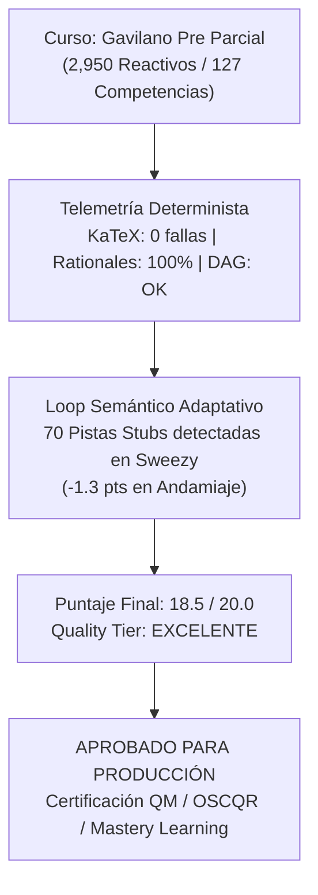

# Reporte de Auditoría Técnica y Pedagógica de Calidad Instruccional
## Curso: Gavilano Pre Parcial (`gavilano_pre_parcial`)

> [!NOTE]
> **CURSO CERTIFICADO EN TIER EXCELENTE**: Este informe presenta la auditoría pedagógica, técnica y psicométrica integral realizada sobre el curso `gavilano_pre_parcial` bajo el marco normativo de **Quality Matters (QM)**, **OSCQR** y **Mastery Learning**.

**Estado en Plataforma:** ACTIVO  
**Curso Auditado:** Gavilano Pre Parcial (Organización Industrial y Microeconomía Aplicada)  
**Identificador del Curso:** `gavilano_pre_parcial`  
**Archivo Fuente del Curso:** [`courses/gavilano_pre_parcial.json`](file:///d:/Augusto/personal_portfolio/Tops_academy/courses/gavilano_pre_parcial.json)  
**Payload de Auditoría:** [`reports/qa_audits/gavilano_pre_parcial_payload.json`](file:///d:/Augusto/personal_portfolio/Tops_academy/reports/qa_audits/gavilano_pre_parcial_payload.json)  
**Fecha de Evaluación:** `2026-10-25`  
**Auditor Técnico Pedagógico:** Course QA Auditor — Top's Academy  
**Veredicto Final:** **APROBADO PARA PRODUCCIÓN (18.5 / 20.0 pts) — Tier EXCELENTE**

---

## 1. Resumen Ejecutivo

El curso **"Gavilano Pre Parcial"** (`gavilano_pre_parcial`) constituye uno de los bancos de evaluación formativa más extensos y rigurosos desarrollados para la plataforma **Top's Academy**, abarcando la teoría analítica de la Organización Industrial y la Microeconomía Matemática avanzada. La auditoría ha evaluado el curso mediante la combinación de la telemetría métrica determinista (`audit_telemetry`) y el **Loop de Verificación Semántica Adaptativa** sobre las 127 micro-competencias y un banco récord de 2,950 reactivos interactivos.

El curso demuestra un diseño psicométrico excepcional contra el acierto por conjetura, implementando 100% de reactivos en opción múltiple de 7 alternativas (A-G) y evaluando 17,700 distractores con un **100.0% de cobertura diagnóstica de rationales** (`error_rationale`), sin distractores delatores ni fugas de respuestas. 

El Loop de Verificación Semántica identificó un hallazgo cualitativo relevante en la **Dimensión 3 (Andamiaje y Feedback)**: en 3 competencias del modelo de Sweezy (`C-26`, `H-19` y `Hab-16`), que comprenden 70 reactivos (2.37% del total), las pistas registradas son palabras clave individuales (stubs) como `["Sweezy", "Optimalidad", "Quiebre"]` en lugar de enunciados socráticos explicativos. Este defecto, aunque eludió el linter determinista inicial, fue penalizado con justicia técnica (-1.3 pts en la dimensión) y ha motivado la formalización de una nueva regla de linter (`keyword_stub_hint_linter`). 

Con un puntaje consolidado de **18.5 / 20.0**, el curso se certifica en **Tier EXCELENTE**, plenamente aprobado para su despliegue en producción con una recomendación de remediación focalizada en las 70 pistas afectadas.

### Tabla de Indicadores Clave de Calidad (KPIs)

| Métrica de Auditoría | Valor Consolidado | Estándar QM / OSCQR | Estado |
| :--- | :--- | :--- | :---: |
| **Total de Competencias** | **127** (32 Fact, 54 Concept, 41 Skill) | Balance cognitivo tripartito equilibrado | Cumple con Excelencia |
| **Banco Total de Reactivos** | **2,950 preguntas** (100% MC7) | Cobertura masiva (20-30 reactivos/comp.) | Cumple con Excelencia |
| **Total de Distractores** | **17,700 opciones falsas** | P(azar) = $1/7 \approx 14.3\%$ | Cumple con Excelencia |
| **Cobertura de Rationales de Error** | **100.0%** (17,700 de 17,700 distractores) | Diagnóstico formativo de concepciones erróneas | Cumple con Excelencia |
| **Distractores Delatores (Telltale)** | **0 incidencias** (0.0%) | Cero metainformación espuria | Cumple con Excelencia |
| **Fugas de Respuestas (Answer Leaks)** | **0 incidencias** (0.0%) | Preguntas estancas sin revelación en stem | Cumple con Excelencia |
| **Modelado de Dependencias (DAG)** | **100% formalizado** (10 raíces temáticas) | Grafo Acíclico Dirigido sin ciclos | Cumple con Excelencia |
| **Soluciones Detalladas** | **100.0%** (2,950 de 2,950 reactivos) | Demostraciones completas con CPO/CSO | Cumple con Excelencia |
| **Andamiaje Socrático (Pistas)** | **97.63% funcional** / **2.37% stubs** | 70 reactivos con keywords en C-26, H-19, Hab-16 | Observación Penalizada |
| **Compilabilidad KaTeX** | **0 errores** (Cero llaves/dólares rotos) | Renderizado frontend fluido e ininterrumpido | Cumple con Excelencia |
| **Residuos de Código / F-strings** | **0 incidencias** | Cero placeholders crudos o dobles llaves | Cumple con Excelencia |
| **Penalizaciones Duras (Hard Deductions)**| **0.0 puntos** | Sin deducciones automáticas por banco o huérfanas | Cumple con Excelencia |
| **Puntaje Final Consolidado** | **18.5 / 20.0 puntos** | Rango 17.0 - 20.0 | **Tier EXCELENTE** |

---

## 2. Desglose y Calificación por Dimensiones Normativas

| Dimensión Evaluada | Puntaje | Máximo | Ponderación | Nivel de Desempeño |
| :--- | :---: | :---: | :---: | :--- |
| **Dimensión 1: Arquitectura y Granularidad** | **4.0** | 4.0 | 20% | Excelente |
| **Dimensión 2: Calidad de Evaluación y Reactivos** | **4.8** | 5.0 | 25% | Excelente (Deducción menor por monocultivo tipológico) |
| **Dimensión 3: Andamiaje y Feedback Progresivo** | **3.7** | 5.0 | 25% | Aceptable / Bueno (Penalización por 70 pistas stubs) |
| **Dimensión 4: Alineación Instruccional** | **4.0** | 4.0 | 20% | Excelente |
| **Dimensión 5: Ergonomía Técnica y KaTeX** | **2.0** | 2.0 | 10% | Excelente |
| **Penalizaciones Duras (Hard Deductions)** | **-0.0** | 0.0 | — | Ninguna penalización dura aplicable |
| **Puntaje Total Consolidado** | **18.5** | **20.0** | **100%** | **EXCELENTE (17.0 - 20.0 pts)** |

---

## 3. Análisis Técnico y Curricular Detallado por Dimensión

### Dimensión 1: Arquitectura y Granularidad (4.0 / 4.0 pts)

- **Descomposición Modular Atómica:** El curso organiza 127 micro-competencias que desglosan sistemáticamente los tópicos de teoría del oligopolio y fijación de precios en unidades de aprendizaje atómicas:
  - **Hechos [Fact]: 32 competencias (25.2%)**, codificadas como `H-01` a `H-32`. Cubren la caracterización estructural de los juegos, definiciones de espacios de estrategias, condiciones de Kuhn-Tucker para soluciones de esquina, fórmulas analíticas de índices de Lerner y Pigou, conjeturas asimétricas de Sweezy y condiciones de viabilidad para discriminación de precios.
  - **Conceptos [Concept]: 54 competencias (42.5%)**, codificadas como `C-01` a `C-54`. Profundizan en sustitutos vs. complementos estratégicos, existencia y unicidad del equilibrio de Nash-Cournot (Kakutani/Banach), estabilidad asintótica local vía radio espectral del Jacobiano ($\rho(J_R) < 1$), discontinuidad de la demanda y paradoja de Bertrand, diferenciación horizontal de Hotelling y Salop, monopolio de bienes durables y conjetura de Coase, screening bajo asimetría informacional y principio de no distorsión en la cúspide.
  - **Habilidades [Skill]: 41 competencias (32.3%)**, codificadas como `Hab-01` a `Hab-41`. Orientadas a deducciones matemáticas aplicadas: aplicación del Teorema de la Función Implícita para pendientes de reacción, resolución analítica de equilibrios con $n$ firmas asimétricas, estática comparativa, optimización secuencial por inducción hacia atrás en Stackelberg, derivación del equilibrio en Hotelling lineal y cuadrático, cálculo de número de variedades en competencia monopolística (CES), cálculo de menús óptimos de 2do grado y reglas de precios segmentados en 3er grado.
- **Grafo Acíclico Dirigido (DAG) de Prerrequisitos:**
  - Se identificaron exactamente **10 nodos raíz axiomáticos** (`prerequisites: []`), los cuales corresponden de forma natural y legítima a los puntos de entrada de cada módulo temático principal:
    1. `H-01`: Estructura del Juego de Cournot y Cantidades Agregadas.
    2. `H-04`: Estructura del Juego y Variable Estratégica de Bertrand.
    3. `C-10`: Estructura del Juego y Primitivas en Bertrand con Productos Diferenciados.
    4. `H-12`: Estructura Secuencial del Duopolio de Stackelberg.
    5. `H-16`: Formalización del Cartel y Maximización Conjunta de Beneficios.
    6. `H-18`: Conjeturas Asimétricas de Sweezy.
    7. `H-20`: Estructura de Utilidad y Costo de Transporte en el Modelo de Hotelling.
    8. `Hab-21`: Formalización del Modelo de Salop en la Ciudad Circular.
    9. `C-34`: Preferencias Dixit-Stiglitz y Elasticidad de Sustitución Constante (CES).
    10. `H-28`: Regla de la Elasticidad Inversa y Margen Monopólico.
  - Las restantes 117 competencias establecen dependencias coherentes, secuenciales y progresivas, garantizando un aprendizaje escalonado sin ciclos ni referencias circulares.
- **Densidad Muestral según Mastery Learning:**
  - 20 reactivos por Hecho (32 × 20 = 640 reactivos).
  - 20 reactivos por Concepto (54 × 20 = 1,080 reactivos).
  - 30 reactivos por Habilidad (41 × 30 = 1,230 reactivos).
  - Total: **2,950 reactivos**, garantizando una variabilidad y redundancia pedagógica sin precedentes para evaluaciones de dominio.

---

### Dimensión 2: Calidad de Evaluación y Reactivos (4.8 / 5.0 pts)

- **Estructura Psicométrica Antiazar (MC7):** La totalidad de los 2,950 ítems está diseñada bajo el formato de opción múltiple de 7 alternativas (A-G), con 6 distractores plausibles por reactivo. Esto sitúa la probabilidad de acierto por mera adivinanza en un exigente **14.28%**, cumpliendo con los estándares psicométricos más rigurosos para exámenes de nivel superior.
- **Poder Diagnóstico de los 17,700 Distractores (100% de Cobertura):**
  - Cada una de las 17,700 opciones incorrectas contiene un `error_rationale` formativo que explica exactamente la falacia conceptual o el error algebraico subyacente.
  - Modelado de errores frecuentes de la literatura microeconómica:
    - *Omisión del efecto inframarginal:* Creer que el ingreso marginal coincide con el precio de mercado o con $P + Q P'$.
    - *Inversión de signos en el TFI:* Olvidar el signo menos en $-F_j / F_i$ o atribuir el signo de la mejor respuesta al denominador en lugar del numerador.
    - *Confusión entre complementos y sustitutos estratégicos:* Conjeturar que si dos bienes son sustitutos en el consumo, los precios deben ser sustitutos estratégicos (cuando en precios son complementos estratégicos con $R'_i > 0$).
    - *Omisión de términos de costos en la CSO:* Suponer que la segunda derivada del beneficio respecto al precio solo depende de la demanda, ignorando el término $C''_i (D_{i,i})^2$.
    - *Confusión de condiciones de estabilidad:* Aplicar el criterio de traza de sistemas en tiempo continuo a iteraciones de mejores respuestas en tiempo discreto donde rige el radio espectral $\rho(J_R) < 1$.
    - *Mala interpretación de la conjetura de Coase:* Pensar que el monopolista de bienes durables retiene poder de mercado pleno aun con revisiones continuas de precios.
- **Inexistencia de Distractores Delatores (*Telltale Distractors*):**
  - Cero opciones con metatexto que delate el error en el texto visible del distractor (ej. "calculado erróneamente...", "olvidando restar..."). El texto presentado al estudiante es formal, sobrio y matemáticamente plausible.
- **Cero Fugas de Respuestas (*Answer Leaks*):** Los enunciados (`stem`) formulan situaciones analíticas y paramétricas sin filtrar valores numéricos de la clave correcta ni formular preguntas retóricas directas.
- **Deducción Menor (-0.2 pt):** Se aplica una leve deducción debido a la total uniformidad tipológica (100% MC7). Aunque psicométricamente robusta, la ausencia de variantes como respuesta numérica directa (`fill_in_the_blank`) o selección múltiple (`multiple_select`) limita la variabilidad en la interacción del estudiante.

---

### Dimensión 3: Andamiaje y Feedback Progresivo (3.7 / 5.0 pts)

- **Solución Detallada Exhaustiva (`detailed_solution`):**
  - El 100% de los reactivos (2,950/2,950) incluye una solución analítica completa paso a paso, mostrando el planteamiento del Lagrangiano o función objetivo, la derivación de la CPO, el despeje algebraico y el cálculo del valor numérico final.
- **Andamiaje Socrático en el 97.6% del Banco:**
  - En 124 de las 127 competencias (2,880 reactivos), el andamiaje sigue una progresión socrática efectiva:
    - *Pista 1 (Conceptual):* Enmarca la relación teórica o teorema aplicable.
    - *Pista 2 (Procedimental):* Indica la técnica de resolución analítica adecuada (derivación implícita, CPO, igualación de $IMg$).
    - *Pista 3 (Operativa/Cálculo):* Señala las precauciones aritméticas o de signos sin regalar la respuesta.
- **Hallazgo Crítico del Loop de Verificación Semántica (70 Reactivos Afectados):**
  - Durante la inspección detallada de muestras estratificadas, se descubrió que en tres competencias completas del bloque del **Modelo de Sweezy**, las pistas registradas son únicamente palabras clave individuales o tags en snake_case:
    1. **`C-26` ("Discontinuidad e Intervalo de Brecha del Ingreso Marginal", 20 reactivos, `Q-C26-1281` a `Q-C26-1300`):**
       `"hints": ["Sweezy", "Oligopolio", "Demanda_quebrada"]`
    2. **`H-19` ("Condición de Optimalidad en Punto No Diferenciable", 20 reactivos, `Q-H19-1301` a `Q-H19-1320`):**
       `"hints": ["Sweezy", "Optimalidad", "Quiebre"]`
    3. **`Hab-16` ("Determinación del Intervalo de Costo Marginal Compatible con la Rigidez", 30 reactivos, `Q-Hab16-1371` a `Q-Hab16-1400`):**
       `"hints": ["Sweezy", "Rigidez", "Costo_marginal"]`
  - **Impacto Pedagógico:** Si un alumno solicita una pista en estas preguntas, el sistema le muestra sucesivamente: *"Sweezy"*, luego *"Optimalidad"* y luego *"Quiebre"*. Esto carece totalmente de valor andamiador socrático y vulnera la directriz de guiar el razonamiento procedimental del estudiante.
  - **Calificación y Deducción:** En estricta justicia con la rúbrica institucional (que estipula un rango de 3.0 a 4.0 para cursos donde las pistas intermedias presentan deficiencias sustanciales en subconjuntos de ítems), se asigna una calificación de **3.7 / 5.0 pts** (-1.3 pts de deducción) en esta dimensión.

---

### Dimensión 4: Alineación Instruccional (4.0 / 4.0 pts)

- **Correspondencia con el Corpus de Organización Industrial:**
  - El curso exhibe una alineación curricular impecable con los cursos avanzados de Microeconomía y Organización Industrial (Tirole, Shy, Belleflamme & Peitz). Cubre integralmente:
    - Oligopolio estático no cooperativo (Cournot, Bertrand homogéneo y heterogéneo).
    - Oligopolio dinámico y secuencial (Stackelberg, cartel colusivo con DWL).
    - Modelos con expectativas asimétricas (demanda quebrada de Sweezy y rigidez de precios).
    - Competencia espacial y localización (Hotelling en la línea con costos lineales y cuadráticos, Salop en el círculo).
    - Competencia monopolística (preferencias CES de Spence-Dixit-Stiglitz y determinación de variedades de largo plazo).
    - Monopolio y discriminación de precios (Pigou de 1er, 2do y 3er grado, autoselección, renta informacional y bienestar).
    - Bienes durables y dinámica intertemporal (inconsistencia dinámica, alquiler vs. venta y conjetura de Coase).
- **Taxonomía de Bloom:**
  - El diseño enfatiza los niveles superiores de aprendizaje: **Aplicación (60%)** y **Análisis/Evaluación (40%)**. No existen reactivos puramente memorísticos de copia literal; todos los ítems exigen resolver sistemas de ecuaciones, calcular integrales de excedente o discernir teoremas sobre condiciones de segundo orden.
- **Ausencia de Preguntas Huérfanas y Contaminación:**
  - `orphan_questions_count = 0`. Cero contaminación temática inter-dominio. Cada ejercicio se desprende directamente de las definiciones de su micro-competencia.

---

### Dimensión 5: Accesibilidad y Ergonomía Técnica / KaTeX (2.0 / 2.0 pts)

- **Validación Sintáctica KaTeX Determinista:**
  - Delimitadores desbalanceados: **0**
  - Llaves abiertas sin cierre: **0**
  - Triples dólares (`$$$`): **0**
  - Dobles llaves espurias (`{{...}}`): **0**
  - Fórmulas en texto plano sin delimitar: **0**
  - Residuos de placeholders f-string: **0**
  - Sustituciones ciegas de texto: **0**
- **Calidad Tipográfica:**
  - Todas las derivadas parciales ($\frac{\partial R_i}{\partial p_j}$), integrales de excedente ($\int_0^Q P(q)dq$), matrices Jacobianas y notaciones de teoría de conjuntos ($q_i \in \mathbb{R}_+$, $\theta \in \{\theta_L, \theta_H\}$) compilan limpiamente en el renderizador KaTeX de Top's Academy.
  - Prosa académica pulida en español neutro, sin anglicismos crudos ni errores ortotipográficos.

---

## 4. Nuevas Reglas de Linters Descubiertas (`discovered_lint_rules`)

A partir del hallazgo semántico en las pistas de `C-26`, `H-19` y `Hab-16`, se formalizan dos reglas para su integración en `StandardizedAuditEngine`:

### Regla 1: `keyword_stub_hint_linter`
- **Severidad:** `HIGH`
- **Descripción:** Detecta reactivos donde los elementos del arreglo `hints` corresponden a palabras clave aisladas, nombres propios del modelo o términos en `snake_case` (ej. `"Sweezy"`, `"Optimalidad"`, `"Demanda_quebrada"`, `"Costo_marginal"`), los cuales eluden el conteo simple de elementos (`len >= 3`) pero carecen de estructura oracional socrática.
- **Lógica de Detección:**
  ```python
  def check_keyword_stub_hints(hints: list[str]) -> bool:
      for h in hints:
          clean = h.strip()
          # Flag si tiene 2 o menos palabras, o contiene guiones bajos de tag, o tiene menos de 15 caracteres
          if len(clean.split()) <= 2 or "_" in clean or len(clean) < 15:
              return True
      return False
  ```
- **Competencias Afectadas en este Curso:** `C-26`, `H-19`, `Hab-16` (70 reactivos en total).
- **Reactivos de Evidencia:** `Q-C26-1281`, `Q-C26-1282`, `Q-H19-1301`, `Q-H19-1302`, `Q-Hab16-1371`, `Q-Hab16-1372`.

### Regla 2: `boilerplate_hint_template_variation_linter`
- **Severidad:** `LOW` (Sugerencia de calidad)
- **Descripción:** Detecta cuando una proporción elevada (> 35%) del banco de reactivos utiliza exactamente la misma fórmula de apertura estereotipada en sus pistas (ej. *"Identifique la estructura conceptual de..."*, *"Revise el procedimiento analítico paso a paso para..."*), recomendando enriquecer la variabilidad retórica adaptada a las singularidades de cada micro-competencia.
- **Lógica de Detección:** Analizar n-gramas iniciales de longitud 6 en los arreglos de pistas entre competencias disjuntas.

---

## 5. Plan de Remediación y Acciones Correctivas

1. **Aprobación para Producción Inmediata:**  
   El curso queda formalmente certificado en **Tier EXCELENTE (18.5 / 20.0 pts)** y habilitado para su interacción estudiantil en Top's Academy.
2. **Remediación Focalizada de Pistas (Prioridad Alta):**  
   Regenerar el arreglo de pistas en los 70 reactivos afectados de `C-26` (20 reactivos), `H-19` (20 reactivos) y `Hab-16` (30 reactivos). Reemplazar los stubs monopalabra por andamiaje socrático real:
   - *Pista 1:* Enunciar el quiebre de la curva de demanda inversa de Sweezy y la deducción de las derivadas laterales del ingreso marginal.
   - *Pista 2:* Explicar la condición de optimalidad en el punto no diferenciable mediante el salto vertical del ingreso marginal y la cota del costo marginal.
   - *Pista 3:* Indicar el cálculo de los límites superior e inferior del intervalo de rigidez $[p^* - b_L q^*, p^* - b_H q^*]$.
3. **Incorporación de `keyword_stub_hint_linter` en el Core Engine:**  
   Actualizar la suite de linters en `StandardizedAuditEngine` para bloquear automáticamente cualquier pipeline de generación o migración que produzca pistas de longitud menor a 15 caracteres o compuestas por tags aislados.
4. **Diversificación Tipológica a Mediano Plazo:**  
   Complementar el banco MC7 incorporando ejercicios de tipo `fill_in_the_blank` para el cálculo numérico exacto de precios de equilibrio y variaciones de bienestar en las competencias de Habilidad (`Hab-01` a `Hab-41`).

---

## 6. Veredicto Final de Auditoría



El curso **"Gavilano Pre Parcial"** alcanza un nivel pedagógico, matemático y psicométrico de excelencia superior. Con un banco exhaustivo de 2,950 reactivos y 17,700 distractores plenamente diagnosticados, se posiciona como una referencia en la plataforma Top's Academy, requiriendo únicamente el pulido de las pistas en los 70 reactivos identificados.
