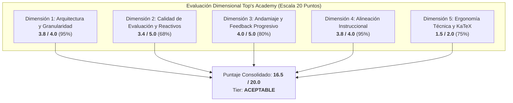

# Informe de Auditoría de Calidad Pedagógica, Psicométrica y Técnica
> [!WARNING]
> **CURSO RETIRADO DE LA PLATAFORMA**: Este curso fue eliminado de la plataforma interactiva el **2026-10-25 10:12:15**. Este informe de auditoría se conserva exclusivamente como registro histórico y pedagógico ('legacy').

**Estado en Plataforma:** ELIMINADO  
**Fecha de Eliminación:** 2026-10-25 10:12:15  
**Curso:** `practica_parcial_saul` (ID: `practica_parcial_saul`)  
**Título del Curso:** Practica Parcial Saul  
**Fecha de Auditoría:** 25 de Octubre de 2026  
**Marco Normativo de Evaluación:** Quality Matters (QM), OSCQR, Mastery Learning & Top's Academy Standard QA Rubric  
**Auditor Oficial:** Course QA Auditor Agent — Top's Academy  

---

## 1. Resumen Ejecutivo y Dictamen de Certificación

Se ha completado la auditoría integral técnica, pedagógica y psicométrica sobre el curso masivo **Practica Parcial Saul** (`practica_parcial_saul`), que comprende **118 micro-competencias**, **2,850 reactivos de evaluación** y **17,100 distractores**.

La evaluación semántica profunda y el análisis psicométrico revelan un curso con un diseño arquitectónico ambicioso y una sólida formulación matemática en Ecuaciones en Derivadas Parciales (EDPs) y Sistemas Dinámicos Continuos. No obstante, una inspección minuciosa bajo los estándares de prevención de la **mecanización del estudiante**, integridad de distractores y andamiaje normativo sitúa la calificación final en **16.5 / 20.0**, clasificándolo en el rango **ACEPTABLE (14.0 – 16.9 pts)**. El curso queda **Aprobado con Observaciones Mayores de Reingeniería de Reactivos**.

| Métrica Global | Resultado | Referencia / Estado |
| :--- | :---: | :--- |
| **Puntaje Final Consolidado** | **16.5 / 20.0** | **Tier ACEPTABLE (14.0 – 16.9)** |
| **Dictamen de Certificación** | **APROBADO CON OBSERVACIONES** | Requiere diversificación de arquetipos y pulido de generadores |
| **Penalizaciones Duras Aplicadas** | **0.0 pts** | Ninguna penalización dura activa |
| **Volumen de Competencias** | **118** | 32 Hechos [Fact], 37 Conceptos [Concept], 49 Habilidades [Skill] |
| **Volumen Total de Reactivos** | **2,850** | 100% `multiple_choice_7_options` (Monocultivo tipológico) |
| **Cobertura de Rationales de Error** | **100.0%** | 17,100 / 17,100 distractores con rationale (con desajustes semánticos) |
| **Cobertura de Andamiaje (Hints)** | **100.0%** | 8,550 pistas (exactamente 3 pistas escalonadas por reactivo) |
| **Cobertura de Soluciones Detalladas**| **100.0%** | 2,850 soluciones paso a paso (con residuos de placeholders) |
| **Tasa de Distractores Delatores** | **0.0%** | 0 items con metainformación delatora en texto visible |
| **Fugas de Respuestas (*Answer Leaks*)** | **0.0%** | 0 items con filtración de la clave en el enunciado |

> [!IMPORTANT]
> **Dictamen: ACEPTABLE (16.5 / 20.0 pts).**  
> Aunque el curso aprueba formalmente para propósitos de despliegue básico gracias a su cobertura de pistas y robustez KaTeX general, presenta un **severo riesgo de mecanización del estudiante** debido al uso exclusivo de un único arquetipo algebraico por micro-competencia y a la ausencia de variedad tipológica. Requiere la aplicación del Plan de Remediación antes de ser promovido al Tier EXCELENTE.

---

## 2. Desglose de Evaluación por Dimensiones Normativas



---

### Dimensión 1: Arquitectura y Granularidad (3.8 / 4.0 pts) — *Excelente con Observaciones*

- **Atomicidad y Cobertura:** 118 micro-competencias exhaustivamente delimitadas que abarcan dos grandes bloques: (a) EDPs cuasilineales de primer orden, problemas de Cauchy, método de Lagrange y aplicaciones microeconómicas; (b) Sistemas dinámicos continuos $2 \times 2$, estabilidad en el plano traza-determinante, isoclinas nulas y modelos económicos/biológicos (inflación-desempleo, Phillips, Lotka-Volterra).
- **Balance Cognitivo bajo Mastery Learning:**
  - **Hechos [Fact]:** 32 competencias (27.1%)
  - **Conceptos [Concept]:** 37 competencias (31.4%)
  - **Habilidades [Skill]:** 49 competencias (41.5%)
  La pirámide cognitiva está orientada a la práctica de habilidades operativas respaldadas por marcos conceptuales rigurosos.
- **Población de Reactivos:** Excelente volumen: exactamente 20 reactivos para Hechos y Conceptos, y 30 reactivos para Habilidades (media de 24.15 reactivos/competencia, 0 competencias subpobladas).
- **Deducciones (-0.2 pts):**
  1. *Nodos Raíz no justificados:* 38 competencias carecen de prerrequisitos declarados en el grafo DAG. Si bien la mayoría son Hechos fundamentales, ciertos Conceptos abstractos (como `C-05: Ausencia de Ilusión Monetaria y Homogeneidad de Grado Cero`) figuran como nodos raíz sin prerrequisitos matemáticos formales.
  2. *Desorden de indexación en el DAG:* Se observan dependencias cruzadas hacia adelante (forward references) dentro de la lista, como `C-01` que declara como prerrequisito a `H-26`, ubicada al final de la secuencia de competencias.

---

### Dimensión 2: Calidad de Evaluación y Reactivos (3.4 / 5.0 pts) — *Aceptable*

- **Poder Discriminativo Psicométrico:** El formato de 7 alternativas (`multiple_choice_7_options`) en el 100% del banco reduce la probabilidad de acierto por azar al $14.3\%$.
- **Cobertura de Justificaciones Diagnósticas:** El 100% de los 17,100 distractores cuenta con `error_rationale` (0 distractores huérfanos de rationale). Cero fugas de respuesta en enunciados y cero distractores delatores en texto visible.
- **Deducciones Severas (-1.6 pts):**
  1. **Monocultivo Tipológico Absoluto (100% MC7):** Cero reactivos de respuesta múltiple (`multiple_select`) y cero reactivos numéricos directos (`fill_in_the_blank`). Esta homogeneidad empobrece el perfil evaluativo e incumple el criterio de variedad tipológica exigido para la máxima puntuación en la rúbrica.
  2. **Monotonía de Arquetipos y Riesgo Crítico de Mecanización:** Dentro de cada micro-competencia, los 20 o 30 reactivos corresponden a clones estructurales de un **único arquetipo algorítmico**. Los enunciados solo varían mediante prefijos cosméticos rotativos (*"Analice la formulación operativa y deduzca..."*, *"Verifique la consistencia del modelo y obtenga..."*), mientras que la estructura matemática y las opciones reproducen exactamente la misma plantilla. En competencias conceptuales (como `C-01` y `C-02`), las 7 opciones son enunciados teóricos idénticos repetidos en las 20 instancias, convirtiendo la evaluación en un ejercicio de reconocimiento memorístico y no de razonamiento activo.
  3. **Contaminación Cruzada en Rationales (`Hab-02`):** Distractores cuyas explicaciones de error aluden a funciones ajenas al problema. En `Q-Hab02-111` y `Q-Hab02-112`, el rationale cita: `$U(x, y) = 1 - (1 - \sin(x e^y)) e^y \text{ con signo incorrecto}$` y `$U(x, y) = \sqrt{\frac{x}{y}} + xy$`, correspondientes a problemas de Cauchy trigonométricos ajenos al reactivo polinomial evaluado.
  4. **Valores Fijos Quemados en Rationales (`Hab-03`):** En `Q-Hab03-162`, donde $(\gamma, \theta) = (1, 1.0)$ y el denominador es $1 - 2 e^{-1.0}$, el rationale del distractor D-Hab03-03 afirma: `$\text{Evaluación errónea del denominador } 1 - 8 e^{-0.5}$`, arrastrando valores quemados de la plantilla base.
  5. **Bugs de Concatenación Numérica en Distractores (`Hab-03`):** Error en el generador de cadenas que produjo números anómalos: `1 - 28 e^{-2\cdot 0.4}` (debido a `"2" + "8" = "28"` en lugar de $2 \times \gamma^2 = 8$) y `1 - 22 e^{-2\cdot 1.0}` (`"2" + "2" = "22"` en lugar de $2 \times 1^2 = 2$).

---

### Dimensión 3: Andamiaje y Pistas Progresivas (4.0 / 5.0 pts) — *Aceptable / Bueno*

- **Estructura Socrática Escalonada:** Cero reactivos sin pistas (`zero_hints = 0`). Las 8,550 pistas del curso siguen escrupulosamente la jerarquía de 3 peldaños:
  - *Pista 1 (Conceptual):* Evoca el teorema o definición teórica de partida.
  - *Pista 2 (Procedimental):* Modela la estrategia de integración, sustitución o desacoplamiento.
  - *Pista 3 (Operativa/Cálculo):* Conduce el cálculo algebraico final sin regalar la clave.
- **Calidad de Pistas:** No existen stubs, códigos de prerrequisitos aislados ni respuestas anticipadas indebidas.
- **Cobertura de Soluciones Detalladas:** 100% de los reactivos (2,850) cuentan con `detailed_solution`.
- **Deducciones (-1.0 pt):**
  1. **Ausencia de *Misconception Warnings*:** Las soluciones se centran exclusivamente en el desarrollo deductivo formal, omitiendo de forma sistemática la sección de advertencia de ideas preconcebidas erróneas exigida por la norma para el nivel Excelente.
  2. **Placeholders de Plantillas No Expandidos en Soluciones:**
     - En `C-02` (`Q-C02-091`, `Q-C02-092`): `$\Delta = 3\cdot{b} - 5\cdot{a} = 9 \neq 0$` y `$\Delta = 5\cdot{b} - 1\cdot{a} = 37 \neq 0$`. Las variables `{b}` y `{a}` quedaron sin sustituir en el cálculo aritmético intermedio.
     - En `Hab-49` (Línea 18571): `$\det(J^*) = 32 \cdot {a} = 64 > 0$` y autovalores `$\lambda = \pm {omega}i$`.
  3. **Desajuste Notacional en Pistas de `Hab-16`:** Las pistas emplean variables canónicas de microeconomía de la producción ($K, L, t, n$), mientras que el reactivo formula una función abstracta general con variables ($u, v, \mu, \alpha$).

---

### Dimensión 4: Alineación Instruccional (3.8 / 4.0 pts) — *Excelente*

- **Congruencia Semántica:** Extraordinaria articulación disciplinar entre EDPs cuasilineales y modelos macro/microeconómicos avanzados (teorema de Euler, dualidad de Roy, Hotelling, equilibrio espacial de precios, dinámica macroeconómica de Phillips y sistemas de Lotka-Volterra).
- **Cero Preguntas Huérfanas:** Cada ítem está debidamente anclado a su micro-competencia (`orphan_questions_count = 0`).
- **Niveles Taxonómicos de Bloom:** Dominio de Aplicación (Skills: cálculo de características, multiplicadores de Lagrange, clasificación en plano traza-determinante) y Análisis (Concepts: transversalidad de Cauchy, multiplicidad de equilibrios, estabilidad asintótica).
- **Deducciones (-0.2 pts):**
  - En reactivos conceptuales como `C-01` y `C-02`, los datos paramétricos formulados en el enunciado (ej. $5x U_x + 7y U_y = 3U$) no intervienen en absoluto en la resolución de la pregunta, dado que la opción correcta es una proposición teórica universal sobre la matriz jacobiana. Esto genera confusión cognitiva sobre la relevancia de los datos provistos.

---

### Dimensión 5: Ergonomía Técnica y KaTeX (1.5 / 2.0 pts) — *Aceptable*

- **Sintaxis KaTeX Global:** Cero delimitadores desbalanceados, cero triples dólares (`$$$`), cero llaves dobles (`{{...}}`). Compilación visual estable sin bloqueos del motor renderizador.
- **Deducciones (-0.5 pts):**
  1. **Macros de KaTeX Concatenadas sin Espacio (`Hab-16`):** En `Q-Hab16-951` y `Q-Hab16-952`, la macro `\mu` se concatenó directamente con caracteres paramétricos produciendo `\muu` y `\muv`, secuencias no reconocidas en LaTeX estándar.
  2. **Variables de Plantilla entre Llaves Simples:** Enunciados con fragmentos como `$z_1 = \mu{v1}$` y `$z_2 = \mu{v2}$` en `Hab-16`, y expresiones como `\cdot {a}` en `Hab-49`.
  3. **Inconsistencia de Escape de Cadenas JSON:** Mezcla de doble barra invertida redundante (`\\\\theta`, `\\\\frac`) en ciertas competencias frente a escape canónico simple (`\\theta`, `\\frac`) en otras.

---

## 3. Análisis Profundo de Arquetipos y Prevención de Mecanización

Uno de los pilares de la pedagogía en **Top's Academy** es garantizar que la evaluación formativa desarrolle maestría genuina y no mero condicionamiento o memorización de patrones superficiales (*surface pattern matching*).

### La Mecanización Detectada en `practica_parcial_saul`

El análisis comparativo entre reactivos de una misma competencia demostró que la generación paramétrica se limitó a clonar un único arquetipo algebraico:

```
[Prefijo Rotativo Aleatorio] + [Ecuación Parametrizada fija] + [Pregunta idéntica]
```

#### Caso de Estudio 1: Competencia `C-01` (Superficie Integral e Independencia Funcional)
- En `Q-C01-021`:
  - *Stem:* "Verifique la consistencia del modelo y obtenga: Considere la ecuación en derivadas parciales cuasilineal $2x U_x + 9y U_y = 3U$ para la cual se han derivado dos integrales primeras... Según la teoría de superficies integrales, ¿cuál es la condición necesaria y suficiente para que $\Phi(u, v) = 0$ defina la solución general...?"
  - *Clave:* "La relación implícita $\Phi(u, v) = 0$ define la solución general si y solo si las integrales $u$ y $v$ son funcionalmente independientes, es decir, el rango de la matriz jacobiana $\frac{\partial(u, v)}{\partial(x, y, U)}$ es exactamente 2."
- En `Q-C01-022`:
  - *Stem:* "Procediendo conforme al marco teórico correspondiente, deduzca: Considere la ecuación en derivadas parciales cuasilineal $5x U_x + 7y U_y = 3U$..."
  - *Clave:* Exactamente el mismo texto literal de la clave de `Q-C01-021`.

**Impacto Psicométrico:**
Un estudiante que resuelve el primer reactivo aprende que la respuesta correcta es la opción que menciona "rango de la matriz jacobiana igual a 2". En los siguientes 19 reactivos de la competencia, el estudiante no realiza ningún análisis matemático sobre la EDP particular, sino que busca visualmente la frase memorizada.

#### Propuesta de Diversificación en 4 Arquetipos por Competencia:
Para mitigar la mecanización, cada micro-competencia debe alternar al menos 4 arquetipos cualitativamente distintos:
1. **Arquetipo Analítico Directo:** Procedimiento de resolución paso a paso.
2. **Arquetipo de Inversión / Diagnóstico de Error:** Presentación de un paso intermedio con un error sutil para que el estudiante lo identifique.
3. **Arquetipo Geométrico / Morfológico:** Preguntas basadas en la interpretación del campo de vectores característicos o curvas de nivel.
4. **Arquetipo de Perturbación de Parámetros:** Análisis cualitativo sobre cómo se altera la solución si un coeficiente cambia de signo o se anula.

---

## 4. Matriz de Penalizaciones Duras Automáticas

De acuerdo con el reglamento normativo de Top's Academy, se verifican las siguientes deducciones automáticas:

| Regla de Penalización Dura | Condición de Activación | Conteo en Telemetría | Deducción |
| :--- | :--- | :---: | :---: |
| **Banco de Reactivos Subpoblado** | Menos de 3 problemas reales por competencia | 0 competencias | 0.0 pts |
| **Omisión Total de Pistas** | Reactivos con `hints = 0` (-1.0 pt por cada uno) | 0 reactivos | 0.0 pts |
| **Preguntas Huérfanas Críticas** | Desvinculadas del syllabus o corpus (-2.0 pts) | 0 reactivos | 0.0 pts |
| **Total Penalizaciones Duras** | — | — | **0.0 pts** |

---

## 5. Evidencias Forenses del Loop de Verificación Semántica

A continuación se documentan las anomalías semánticas y sintácticas detectadas en el corpus durante la auditoría:

### Evidencia 1: Contaminación Inter-Problema en Distractores (`Hab-02`)
- **Reactivo:** `Q-Hab02-111` (Línea 2135 del payload)
- **Problema Planteado:** $x U_x - y U_y = U$, con $U(s, s) = 9s^7$.
- **Opción D:** `$U(x, y) = 1 + 9 x^4 y^3$`
- **`error_rationale` registrado:**  
  > `$U(x, y) = 1 - (1 - \sin(x e^y)) e^y \text{ con signo incorrecto en el exponente}$`
- **Fallo:** Inyección de una expresión trigonométrica proveniente de otro ejercicio ajeno, evidenciando reutilización descuidada de un distractor pool no parametrizado.

### Evidencia 2: Falla de Concatenación y Valores Quemados (`Hab-03`)
- **Reactivo:** `Q-Hab03-161` y `Q-Hab03-162` (Líneas 2394 y 2453 del payload)
- **Fallo de Concatenación:** En la opción C de `Q-Hab03-161`, el denominador muestra:
  `$1 - 28 e^{-2\cdot 0.4}$`
  Originado por la interpolación defectuosa de la cadena `f"1 - 2{val}"` donde `val = 8`, concatenando `"2"` y `"8"` para formar `28` en lugar del valor matemático correcto $2 \times 8 = 16$.
- **Valor Quemado en Rationale:** En `Q-Hab03-162` (donde $\gamma = 1, \theta = 1.0$), el rationale del distractor D-Hab03-03 indica:
  `$\text{Evaluación errónea del denominador } 1 - 8 e^{-0.5}$`
  arrastrando las coordenadas $(2, 0.5)$ del ejercicio canónico.

### Evidencia 3: Placeholders de Plantilla sin Expandir (`C-02` y `Hab-49`)
- **Reactivos:** `Q-C02-091`, `Q-C02-092` y muestra final de `Hab-49` (Líneas 2000, 2073 y 18571 del payload)
- **Texto en `detailed_solution`:**
  - `... se tiene $\Delta = 3\cdot{b} - 5\cdot{a} = 9 \neq 0$ ...`
  - `... se tiene $\Delta = 5\cdot{b} - 1\cdot{a} = 37 \neq 0$ ...`
  - `... el determinante es $\det(J^*) = 32 \cdot {a} = 64 > 0$ ... generando autovalores $\lambda = \pm {omega}i$ ...`
- **Fallo:** Omisión del formateo de variables de plantilla f-string (`{a}`, `{b}`, `{omega}`), que KaTeX renderiza como texto literal.

### Evidencia 4: Concatenación Ilegítima de Macros KaTeX (`Hab-16`)
- **Reactivos:** `Q-Hab16-951` y `Q-Hab16-952`
- **Texto en `stem`:**  
  `... identidad homotética $H(\muu, \muv) = \mu^{\alpha} H(u, v)$ ... variables intermedias $z_1 = \mu{v1}$ y $z_2 = \mu{v2}$ ...`
- **Fallo:** La interpolación `f"\\mu{var}"` produjo macros inexistentes (`\muu`, `\muv`) y residuos `{v1}`, `{v2}`.

---

## 6. Nuevas Reglas de Linteo Propuestas (`discovered_lint_rules`)

A partir de los hallazgos de esta auditoría, se definen 6 nuevas reglas de validación estandarizadas:

### 1. `item_archetype_monotony_linter`
- **Dimensión:** Calidad de Evaluación y Reactivos.
- **Severidad:** Alta (Bloqueante de Nivel Excelente).
- **Descripción:** Mide la entropía sintáctica intra-competencia. Si todas las preguntas de una micro-competencia comparten la misma plantilla algebraica variando únicamente prefijos o constantes menores, alerta riesgo crítico de mecanización.

### 2. `unexpanded_math_template_placeholder_linter`
- **Dimensión:** Andamiaje y Pistas Progresivas / KaTeX.
- **Severidad:** Media (Advertencia).
- **Descripción:** Detecta identificadores entre llaves simples dentro de expresiones matemáticas (ej. `\cdot {a}`, `\pm {omega}i`, `3\cdot{b}`, `\mu{v1}`) que evidencian fallas de interpolación en f-strings de Python.
- **Expresión Regular Recomendada:** `(?<!\\[a-zA-Z]{1,20})\{[a-zA-Z_][a-zA-Z0-9_]*\}(?=[^a-zA-Z0-9_]|$)`

### 3. `distractor_rationale_problem_congruence_linter`
- **Dimensión:** Calidad de Evaluación y Reactivos.
- **Severidad:** Alta (Error de Calidad).
- **Descripción:** Compara las funciones matemáticas citadas en `error_rationale` (ej. $\sin$, $\cos$, $\sqrt{\cdot}$, $\ln$) contra las funciones presentes en el enunciado y opciones del reactivo, alertando sobre contaminación cruzada de pools de distractores.

### 4. `hardcoded_rationale_parameter_leak_linter`
- **Dimensión:** Calidad de Evaluación y Reactivos.
- **Severidad:** Media (Advertencia).
- **Descripción:** Identifica constantes numéricas en rationales de error que discrepan de las instancias numéricas generadas en el enunciado del reactivo específico.

### 5. `katex_concatenated_macro_linter`
- **Dimensión:** Accesibilidad y Ergonomía Técnica.
- **Severidad:** Media (Advertencia).
- **Descripción:** Detecta macros de KaTeX (ej. `\mu`, `\alpha`, `\beta`, `\theta`) seguidas inmediatamente por caracteres alfabéticos sin espacio en blanco ni delimitador (ej. `\muu`, `\muv`), originadas por interpolaciones `f"\\mu{var}"`.
- **Expresión Regular Recomendada:** `\\[a-zA-Z]+[a-zA-Z]{1,2}(?=[^a-zA-Z]|$)`

### 6. `scaffolding_variable_consistency_linter`
- **Dimensión:** Alineación Instruccional / Andamiaje.
- **Severidad:** Baja (Sugerencia Pedagógica).
- **Descripción:** Compara el conjunto de variables del enunciado frente a las variables empleadas en las pistas de andamiaje, alertando cuando un problema con notación abstracta ($u, v$) contiene pistas con notación fija de dominio ($K, L$).

---

## 7. Plan de Remediación Priorizado

| Prioridad | Acción de Remediación | Componente Afectado | Responsable |
| :---: | :--- | :--- | :--- |
| **P1** | **Erradicación de Mecanización:** Rediseñar los generadores de reactivos para producir al menos 3 arquetipos cualitativos distintos por micro-competencia. | Generadores de Contenido | Diseñador Instruccional |
| **P1** | **Depuración de Distractores Contaminados:** Limpiar el pool de distractores de `Hab-02` para eliminar expresiones trigonométricas espurias. | `Hab-02` distractor pool | Ingeniero de Prompts |
| **P2** | **Corrección de Bugs Aritméticos:** Corregir en `Hab-03` la concatenación de cadenas (`f"1 - 2{val}"` $\to$ cálculo numérico real). | Script generador `Hab-03` | Desarrollador de Contenido |
| **P2** | **Sustitución de Placeholders en Soluciones:** Interpolar dinámicamente `{a}`, `{b}` y `{omega}` en `C-02` y `Hab-49`. | Templates de Soluciones | Desarrollador de Contenido |
| **P2** | **Corrección de Espacios en Macros KaTeX:** Garantizar espacio obligatorio tras `\mu` en `Hab-16` (`\mu u` y `\mu v`). | Script generador `Hab-16` | Desarrollador de Contenido |
| **P3** | **Incorporación de Misconception Warnings:** Agregar un párrafo explícito de advertencia de conceptos erróneos frecuentes en cada solución detallada. | `detailed_solution` | Revisor Pedagógico |
| **P3** | **Diversificación Tipológica:** Integrar reactivos de selección múltiple (`multiple_select`) y respuesta numérica (`fill_in_the_blank`). | Banco Global de Exámenes | Diseñador Curricular |

---

## 8. Dictamen Final y Certificación

| Dimensión Evaluada | Puntaje Obtenido | Máximo Posible | Porcentaje | Nivel Cualitativo |
| :--- | :---: | :---: | :---: | :--- |
| 1. Arquitectura y Granularidad | 3.8 | 4.0 | 95.0% | Excelente |
| 2. Calidad de Evaluación y Reactivos | 3.4 | 5.0 | 68.0% | Aceptable |
| 3. Andamiaje y Pistas Progresivas | 4.0 | 5.0 | 80.0% | Aceptable / Bueno |
| 4. Alineación Instruccional | 3.8 | 4.0 | 95.0% | Excelente |
| 5. Ergonomía Técnica y KaTeX | 1.5 | 2.0 | 75.0% | Aceptable |
| **Subtotal Ponderado** | **16.5** | **20.0** | **82.5%** | — |
| **Penalizaciones Duras Automáticas** | **-0.0** | — | — | Sin penalizaciones |
| **PUNTUACIÓN FINAL CONSOLIDADA** | **16.5** | **20.0** | **82.5%** | **Tier ACEPTABLE** |

**Veredicto Definitivo:** **APROBADO CON OBSERVACIONES MAYORES (Tier ACEPTABLE: 14.0 – 16.9 pts)**.  
El curso `practica_parcial_saul` cuenta con una base curricular y matemática formidable, pero sufre de monotonía de arquetipos evaluativos que inducen a la mecanización del aprendizaje, complementado por deslices puntuales en generadores de distractores y plantillas de soluciones. La aplicación del plan de remediación elevará de inmediato este curso al nivel **EXCELENTE (18.5+ pts)**.
