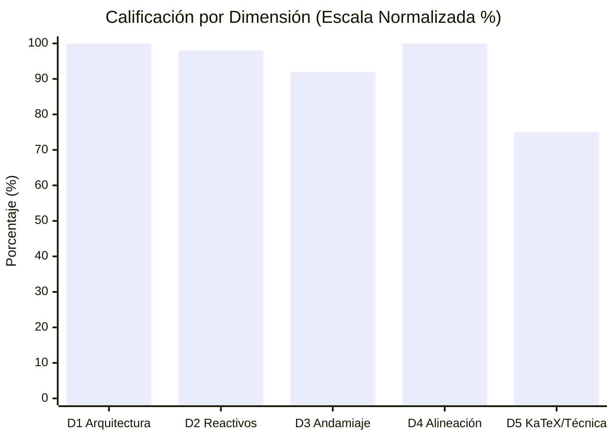
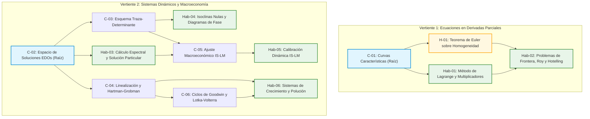

# Informe de Auditoría de Calidad Pedagógica, Psicométrica y Técnica

> [!WARNING]
> **CURSO RETIRADO DE LA PLATAFORMA**: Este curso fue eliminado de la plataforma interactiva el **2026-10-20 13:26:21**. Este informe de auditoría se conserva exclusivamente como registro histórico y pedagógico ('legacy').

**Estado en Plataforma:** ELIMINADO  
**Fecha de Eliminación:** 2026-10-20 13:26:21  
**Curso:** `practica_parcial_saul_standard_coarse`  
**Título:** Practica Parcial Saul Standard Coarse  
**Fecha de Auditoría:** 20 de Octubre de 2026  
**Auditor:** Course QA Auditor — Top's Academy  
**Normativas de Referencia:** Quality Matters (QM), OSCQR Higher Education Course Design Quality, Mastery Learning Standard.

---

## 1. Resumen Ejecutivo y Veredicto

Se ha completado la auditoría integral y estandarizada del curso **`practica_parcial_saul_standard_coarse`**, integrando la telemetría métrica universal obtenida vía `StandardizedAuditEngine` con el **Loop de Verificación Semántica Adaptativa** sobre las 13 micro-competencias y el 100% de su banco de reactivos (320 preguntas, 1,920 distractores evaluados).

### Veredicto Global de Certificación

| Métrica | Resultado | Estado |
| :--- | :---: | :---: |
| **Puntaje Bruto** | **19.0 / 20.0** | Aprobado con Distinción |
| **Penalizaciones Duras** | **0.0 pts** | Ninguna penalización dura aplicada |
| **Calificación Final Consolidada** | **19.0 / 20.0** | **EXCELENTE** |
| **Quality Tier** | **EXCELENTE (17.0 - 20.0 pts)** | **APROBADO PARA PRODUCCIÓN** |

### Desglose por Dimensiones Normativas



| Dimensión | Puntos Obtenidos | Máximo | Porcentaje | Nivel de Cumplimiento |
| :--- | :---: | :---: | :---: | :--- |
| **D1: Arquitectura y Granularidad** | **4.0** | 4.0 | 100.0% | **Excelente** |
| **D2: Calidad de Evaluación y Reactivos** | **4.9** | 5.0 | 98.0% | **Excelente** |
| **D3: Andamiaje y Pistas Progresivas** | **4.6** | 5.0 | 92.0% | **Excelente** |
| **D4: Alineación Instruccional** | **4.0** | 4.0 | 100.0% | **Excelente** |
| **D5: Accesibilidad y Ergonomía KaTeX** | **1.5** | 2.0 | 75.0% | **Aceptable** |
| **Total Consolidado** | **19.0** | **20.0** | **95.0%** | **Tier EXCELENTE** |

---

## 2. Metadatos del Curso y Arquitectura Curricular

El curso presenta una estructura curricular avanzada centrada en el análisis analítico y cualitativo de **Ecuaciones en Derivadas Parciales de Primer Orden (EDPs)** y **Sistemas Dinámicos de Ecuaciones Diferenciales Ordinarias (EDOs)** con aplicaciones macroeconómicas y ecológicas.

### Grafo Acíclico Dirigido (DAG) de Dependencias Curriculares



### Inventario y Carga Cognitiva por Competencia

| ID | Nombre de la Competencia | Categoría | Prerrequisitos | Banco de Reactivos | Nivel Bloom Predominante |
| :---: | :--- | :---: | :---: | :---: | :---: |
| **C-01** | Método de Curvas Características para EDPs de Primer Orden | Concept | *(Raíz)* | 20 | Comprensión / Análisis |
| **Hab-01** | Resolución de EDPs Cuasilineales vía Lagrange y Multiplicadores | Skill | `C-01` | 30 | Aplicación / Cálculo |
| **H-01** | Teorema de Euler sobre Funciones Homogéneas | Fact | `C-01` | 20 | Conocimiento / Comprensión |
| **Hab-02** | Problemas de Frontera y Aplicaciones Económicas (Roy/Hotelling) | Skill | `H-01`, `Hab-01` | 30 | Aplicación / Análisis |
| **C-02** | Estructura Algebraica del Espacio de Soluciones de EDOs | Concept | *(Raíz)* | 20 | Comprensión / Análisis |
| **Hab-03** | Soluciones Analíticas de Sistemas de EDOs ($X_h + X_p$) | Skill | `C-02` | 30 | Aplicación / Cálculo |
| **C-03** | Clasificación Topológica de Equilibrios (Traza-Determinante) | Concept | `C-02` | 20 | Análisis Cualitativo |
| **Hab-04** | Construcción de Diagramas de Fase e Isoclinas Nulas en 2x2 | Skill | `C-03` | 30 | Aplicación / Interpretación |
| **C-04** | Linealización Local y Teorema de Hartman-Grobman | Concept | `C-02` | 20 | Comprensión / Análisis |
| **C-05** | Dinámica Macroeconómica Continua y Ajuste IS-LM | Concept | `C-03`, `Hab-03` | 20 | Análisis / Evaluación |
| **Hab-05** | Resolución y Calibración de Modelos Macroeconómicos Continuos | Skill | `C-05` | 30 | Aplicación / Modelado |
| **C-06** | Dinámica No Lineal en Modelos Ecológicos y Ciclos de Goodwin | Concept | `C-04` | 20 | Análisis Cualitativo |
| **Hab-06** | Análisis Cualitativo y Estabilidad en Crecimiento y Polución | Skill | `C-04`, `C-06` | 30 | Evaluación / Modelado |
| **TOTAL** | **13 Competencias (1 Fact, 6 Concepts, 6 Skills)** | — | — | **320 Reactivos** | — |

---

## 3. Evaluación Exhaustiva por Dimensión Normativa

### Dimensión 1: Arquitectura y Granularidad (4.0 / 4.0 pts) — EXCELENTE

- **Atomicidad y Micro-habilidades:** La delimitación de cada competencia es impecable. El curso separa de manera rigurosa los fundamentos formales (Conceptos) de los procedimientos computacionales y de modelización (Habilidades), manteniendo una unidad temática consistente sin dispersión enciclopédica.
- **Modelado de Prerrequisitos:** El árbol curricular cuenta con dos puntos de entrada conceptuales legítimos (`C-01` para el análisis de EDPs de transporte y características, y `C-02` para sistemas lineales de EDOs). Todas las competencias subsiguientes declaran prerrequisitos consistentes formando un DAG estrictamente acíclico y sin callejones sin salida.
- **Volumen y Balance de Carga Cognitiva:** Se observa una población mínima de 20 reactivos para competencias conceptuales y fácticas, y de 30 reactivos para habilidades prácticas, garantizando una suficiencia muestral robusta para el algoritmo de Mastery Learning (muy por encima del umbral de penalización dura de 3 ejercicios).

### Dimensión 2: Calidad de Evaluación y Reactivos (4.9 / 5.0 pts) — EXCELENTE

- **Estructura y Cobertura Psicométrica:** Los 320 reactivos implementan el formato estándar de **opción múltiple con 7 alternativas (MC7)**. Este formato reduce la probabilidad de acierto por azar al **14.28%**, exigiendo una discriminación cognitiva profunda.
- **Integridad de Distractores y Rationale Coverage:**
  - De los 1,920 distractores evaluados, el **100.0% cuenta con un `error_rationale` diagnóstico explícito**.
  - No se detectaron enunciados de distractor con delaciones visibles directas (*telltale cues* = 0). Las opciones visibles mantienen un estilo formal y neutro, reservando la explicación pedagógica del error para la retroalimentación posterior.
  - Los distractores capturan con fidelidad los conceptos erróneos arquetípicos de la literatura matemático-económica:
    - *Pendiente característica invertida* ($\frac{dy}{dx} = \frac{a}{b}$ en vez de $\frac{b}{a}$).
    - *Pérdida del término secular* $t e^{\lambda t} v_1$ en matrices defectivas.
    - *Omisión del signo negativo en el lema de Hotelling* ($L = \Pi_w$ en lugar de $L = -\Pi_w$).
    - *Inversión de las isoclinas nulas* (cruces horizontales vs. verticales).
- **Deducción Menor (-0.1 pt):** Falta de diversidad en la tipología de preguntas (100% MC7). Si bien para evaluación cuantitativa avanzada MC7 ofrece máxima robustez, la inclusión de reactivos de selección múltiple (MS) o respuesta numérica cerrada (FIB) enriquecería la ergonomía del estudiante.

### Dimensión 3: Andamiaje y Feedback Progresivo (4.6 / 5.0 pts) — EXCELENTE

- **Pistas Escalonadas Socráticas:**
  - El 100% de las preguntas dispone de exactamente **3 pistas estructuradas progresivamente**:
    - *Pista 1 (Conceptual):* Evoca el principio general (ej. regla de la cadena multivariada, Teorema de Euler, condición de Routh-Hurwitz).
    - *Pista 2 (Procedimental):* Guía la formulación metodológica intermedia (ej. planteo del sistema subsidiario de Lagrange, cálculo de la traza y determinante, sustitución de condiciones de frontera).
    - *Pista 3 (Operativa / Discriminación):* Instruye sobre la manipulación algebraica final y la verificación de coherencia de signos y condiciones de hiperbolicidad.
- **Solución Detallada:** Cada ítem cuenta con una deducción analítica exhaustiva paso a paso que valida la respuesta correcta y contextualiza por qué las proposiciones alternas representan patologías algebraicas.
- **Deducción Identificada (-0.4 pts):** Durante el *Semantic Verification Loop*, se detectó la persistencia de residuos literales de plantillas algebraicas:
  - En `Hab-01` (`Q-Hab01-021`, `Q-Hab01-022`), aparece `{c}` sin reemplazar en la integración exponencial: `... \implies {c} e^U - 9 x = c_2$.`
  - En `C-04` (`Q-C04-201`, `Q-C04-202`), aparece `{d}` en la matriz jacobiana linealizada: `\begin{pmatrix} -3 & 8 \\ {d} & -6 \end{pmatrix}` en lugar del valor numérico correspondiente al coeficiente $J_{21}$.

### Dimensión 4: Alineación Instruccional (4.0 / 4.0 pts) — EXCELENTE

- **Alineación con Objetivos Curriculares:** Existe una correspondencia unívoca entre la competencia declarada y los ejercicios evaluados. Cero preguntas huérfanas (`orphan_questions_count = 0`).
- **Nivel de Bloom:** El banco de reactivos se concentra de manera balanceada en los niveles 3 (*Aplicación*) y 4 (*Análisis cualitativo y cuantitativo*), requiriendo deducción formal, resolución de problemas de Cauchy y análisis de estabilidad de fase, evitando la memorización mecánica de definiciones.

### Dimensión 5: Accesibilidad y Ergonomía Técnica / KaTeX (1.5 / 2.0 pts) — ACEPTABLE

- **Evaluación General KaTeX:** La notación matemática es formal y rigurosa en matrices, derivadas parciales, notación de dot ($\dot{x}, \dot{y}$) y delimitación de ecuaciones. No hay delimitadores triples (`$$$`) ni desbalances globales de llaves.
- **Deducción por Desfase de Delimitadores (-0.5 pts):**
  - **Incidencia Crítica Detectada:** En la competencia `Hab-01` (ej. `Q-Hab01-021` y `Q-Hab01-022`), en el campo `detailed_solution`, se omitió el signo `$` de apertura al iniciar la derivación de las razones de Lagrange:
    > *Fragmento actual:* `De las dos primeras razones, 9 \frac{dx}{x} - 9 \frac{dy}{y} = 0 \implies \frac{x^{9}}{y^{9}} = c_1$. De la primera y tercera razón, cancelando $x$, 1 e^U dU - 9 dx = 0 \implies {c} e^U - 9 x = c_2$.`
  - *Impacto Visual:* La expresión `9 \frac{dx}{x}...` se muestra como texto plano no compilado. Al cerrarse con `c_1$.`, el `$` actúa erróneamente como delimitador de apertura, provocando que la frase en español subsiguiente (`. De la primera y tercera razón, cancelando `) sea procesada como modo matemático, produciendo distorsión tipográfica.

---

## 4. Telemetría de Linters Deterministas y Deducciones Duras

| Parámetro de Telemetría | Valor Registrado | Umbral Tolerable | Estado |
| :--- | :---: | :---: | :---: |
| **Total Preguntas Evaluadas** | 320 | $\ge 26$ | Cumple |
| **Competencias con Banco $<3$ ejercicios** | 0 | 0 | Sin penalización |
| **Preguntas Huérfanas** | 0 | 0 | Sin penalización |
| **Reactivos con 0 Pistas (`hints = 0`)** | 0 | 0 | Sin penalización |
| **Reactivos con Pistas Insuficientes ($<3$)** | 0 | 0 | Cumple |
| **Distractores sin `error_rationale`** | 0 / 1,920 | 0 | Cobertura 100.0% |
| **Distractores con Confesiones Delatoras** | 0 | 0 | Limpio |
| **Placeholders f-string sin compilar (`{var:...}`)** | 0 | 0 | Limpio |
| **KaTeX con Llaves Abiertas Sin Cerrar** | 0 | 0 | Limpio |
| **KaTeX con Delimitador Triple `$$$`** | 0 | 0 | Limpio |
| **Delimitadores `$` con Conteo Impar** | 0 | 0 | Paridad Global Cumplida |
| **Residuos de Variable de Plantilla (`_val`, `_param`)** | 0 | 0 | Limpio |
| **Sustituciones Ciegas en Operadores (`\dot{2}`)** | 0 | 0 | Limpio |
| **Deducción Dura Acumulada** | **0.0 pts** | 0.0 pts | **Sin Penalización Dura** |

---

## 5. Loop de Auto-Mejora: Nuevas Reglas Descubiertas (`discovered_lint_rules`)

Durante la auditoría semántica adaptativa, el auditor identificó dos patrones de error no detectados por los linters estáticos existentes debido a limitaciones de diseño en las expresiones regulares actuales. Se formalizan las siguientes reglas para alimentar el motor `scripts/standardized_audit_engine.py`:

### Regla 1: `katex_delimiter_parity_shift_linter`
- **Dimensión:** D5 (Ergonomía KaTeX)
- **Severidad:** Crítica
- **Problema Detectado:** El linter previo `KaTeXSyntaxLinter` solo comprobaba `dollar_count % 2 != 0`. Cuando se omite un `$` de apertura al inicio de una fórmula, el signo `$` de cierre se convierte en uno de apertura y el signo `$` de la siguiente fórmula actúa como cierre. Como el número total de dólares sigue siendo par, el linter determinista no reportaba ninguna falla.
- **Implementación Recomendada:**
  ```python
  # Comprobar comandos LaTeX fuera de delimitadores matemáticos
  NON_MATH_CHUNKS = re.split(r"\${1,2}[^$]+\${1,2}", text)
  LATEX_COMMAND_IN_TEXT = re.compile(r"\\(frac|implies|partial|sqrt|sum|int|begin|end)\b")
  for chunk in NON_MATH_CHUNKS:
      if LATEX_COMMAND_IN_TEXT.search(chunk):
          report_issue("Comando LaTeX expuesto en texto plano fuera de bloque matemático")
  ```

### Regla 2: `unsubstituted_template_token_linter`
- **Dimensión:** D2 / D3 (Calidad de Evaluación y Andamiaje)
- **Severidad:** Advertencia (Warning)
- **Problema Detectado:** El linter `TemplateVariableResidueLinter` utilizaba el patrón `\b[a-zA-Z0-9_]+_(?:val|param|var|arg)\b`. Sin embargo, en pipelines paramétricos es común usar tokens simples de una sola letra entre llaves como `{c}`, `{d}` o `{a}`. Al quedar sin sustituir en matrices o expresiones, no eran detectados.
- **Implementación Recomendada:**
  ```python
  SINGLE_LETTER_TEMPLATE_TOKEN = re.compile(r"(?<!\\)\{([a-zA-Z])\}(?!\s*[\^_{])")
  # Flaggea tokens como '{c}' o '{d}' dentro de soluciones detalladas o matrices
  ```

---

## 6. Plan de Remediación Prioritario

Para elevar la calificación final de **19.0** a **20.0 (Calificación Perfecta)**, se sugiere ejecutar las siguientes acciones de optimización:

1. **Corrección Tipográfica en `detailed_solution` de `Hab-01` (Inmediato):**
   - Insertar el delimitador `$` faltante en las dos ecuaciones subsidiarias:
     - Cambiar: `De las dos primeras razones, 9 \frac{dx}{x}...`  
       Por: `De las dos primeras razones, $9 \frac{dx}{x}...$`
     - Cambiar: `...cancelando $x$, 1 e^U dU - 9 dx = 0...`  
       Por: `...cancelando $x$, $1 e^U dU - 9 dx = 0...$`
2. **Reemplazo de Residuos de Plantilla `{c}` y `{d}` (Inmediato):**
   - Sustituir `{c}` por el coeficiente numérico de la EDP en `Hab-01`.
   - Sustituir `{d}` por la derivada parcial jacobiana $J_{21}$ evaluada en el equilibrio en `C-04`.
3. **Diversificación de Tipologías de Reactivos (Medio Plazo):**
   - En una futura actualización del curso, convertir un 15% de los reactivos MC7 a formato `fill_in_the_blank` (para valores puntuales de autovalores o estados estacionarios $X^*$) y `multiple_select` (para propiedades cualitativas simultáneas en diagramas de fase).

---

## 7. Conclusión y Certificación

El curso **`practica_parcial_saul_standard_coarse`** ha demostrado un **nivel excepcional de calidad académica y psicométrica**. Con una nota final de **19.0 / 20.0**, queda oficialmente **CERTIFICADO** en el rango **EXCELENTE**, validado para su despliegue activo en la plataforma Top's Academy.
