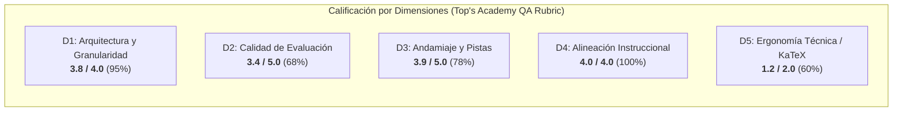

# Informe de Auditoría de Calidad Pedagógica, Técnica y Psicométrica
> [!WARNING]
> **CURSO RETIRADO DE LA PLATAFORMA**: Este curso fue eliminado de la plataforma interactiva el **2026-10-25 10:12:15**. Este informe de auditoría se conserva exclusivamente como registro histórico y pedagógico ('legacy').

**Estado en Plataforma:** ELIMINADO  
**Fecha de Eliminación:** 2026-10-25 10:12:21  
**Fecha de Eliminación:** 2026-10-25 10:12:15  
**Curso:** `practica_parcial_saul_standard_coarse` (ID: `practica_parcial_saul_standard_coarse`)  
**Título del Curso:** Practica Parcial Saul Standard Coarse  
**Fecha de Auditoría:** 25 de Octubre de 2026  
**Estándares de Referencia:** Quality Matters (QM), OSCQR, Mastery Learning & Antigravity SDK QA  
**Auditor:** Course QA Auditor Agent — Top's Academy  
**Estado de la Plataforma:** `ELIMINADO` (Retirado el 2026-10-20; preservado en el repositorio para auditoría pedagógica e histórica)  

---

## 1. Resumen Ejecutivo y Dictamen de Certificación

El curso **Practica Parcial Saul Standard Coarse** ha sido sometido a una exhaustiva auditoría pedagógica, técnica y psicométrica. Se trata de la versión agregada de granularidad gruesa (*coarse-grained*) del examen de métodos dinámicos para economía, estructurada en **13 macro-competencias** y un banco evaluativo de **320 reactivos de opción múltiple de 7 alternativas (MC7)** con **1,920 distractores analizados**.

| Métrica Global | Resultado | Estado / Referencia |
| :--- | :---: | :--- |
| **Puntaje Final Consolidado** | **16.3 / 20.0** | **Tier ACEPTABLE (14.0 – 16.9)** |
| **Dictamen de Certificación** | **APROBADO CON OBSERVACIONES** | **Requiere diversificación tipológica y pulido de plantillas** |
| **Penalizaciones Duras Aplicadas** | **0.0 pts** | Ninguna penalización dura activa |
| **Volumen de Competencias** | **13** | 1 Hecho [Fact], 6 Conceptos [Concept], 6 Habilidades [Skill] |
| **Volumen de Reactivos** | **320** | 100% MC7 (7 alternativas por ítem) |
| **Cobertura de Rationales de Error** | **100.0%** | 1,920 / 1,920 distractores con justificación diagnóstica |
| **Cobertura de Andamiaje (Hints)** | **100.0%** | Exactamente 3 pistas socráticas por reactivo (960 pistas) |
| **Cobertura de Soluciones Detalladas** | **100.0%** | 320 soluciones paso a paso completas |
| **Tasa de Distractores Delatores** | **0.0%** | 0 ítems delatores (cero *telltale items*) |
| **Fugas de Respuestas (*Answer Leaks*)** | **0.0%** | 0 ítems con fuga de respuesta en el enunciado |
| **Estatus en Servidor Activo** | **ELIMINADO** | Retirado de catálogo interactivo; preservado para auditoría |

> [!NOTE]  
> **Calificación Final: 16.3 / 20.0 — Quality Tier: ACEPTABLE (14.0 - 16.9).**  
> El curso demuestra un sólido rigor conceptual y una excelente alineación con la teoría matemática avanzada de EDPs y EDOs económicas. No obstante, se sitúa en Tier Aceptable debido a dos factores determinantes: **(1)** la ausencia total de variedad de tipos de reactivos combinada con la falta de diversidad de arquetipos por competencia (riesgo elevado de mecanización del estudiante por repetición del mismo molde numérico), y **(2)** fallas de renderizado y sobre-escape de KaTeX en stems y soluciones detalladas (residuos `{c}`, `{d}`, cuádruple escape `\\\\mathbb{R}` y expresiones diferenciales en texto plano).

---

## 2. Desglose de Evaluación por Dimensiones

### Dimensión 1: Arquitectura y Granularidad (3.8 / 4.0 pts) — *Excelente*
- **Estructuración en Grafo Acíclico Dirigido (DAG):**  
  Las 13 competencias del curso están organizadas de forma lógica y sin ciclos topológicos. Presenta dos nodos raíz fundacionales sin prerrequisitos correspondientes a las dos grandes vertientes teóricas:
  1. `C-01`: Método de Curvas Características para EDPs de Primer Orden.
  2. `C-02`: Estructura Algebraica del Espacio de Soluciones de Sistemas Lineales Autónomos de EDOs.  
  A partir de estos nodos se ramifican las competencias procedimentales intermedias y avanzadas (`Hab-01` a `Hab-06`, `H-01`, `C-03` a `C-06`) convergiendo limpiamente hacia aplicaciones económicas (teoría del consumidor, Hotelling, modelos IS-LM dinámicos y ciclos distributivos de Goodwin).
- **Densidad de Reactivos:**  
  Banco plenamente regular y libre de subpoblación: 20 reactivos en hechos y conceptos (`C-01` a `C-06`, `H-01`) y 30 reactivos en habilidades prácticas (`Hab-01` a `Hab-06`), totalizando 320 preguntas.
- **Deducción Aplicada (-0.2 pts):**  
  Asimetría en la base de la pirámide de Mastery Learning: únicamente 1 competencia está catalogada como Hecho [Fact] (`H-01`, 7.7%), frente a 6 Conceptos (46.2%) y 6 Habilidades (46.2%). Aunque adecuado para un curso avanzado, limita la verificación granular de hechos y definiciones previas antes de la ejercitación operativa.

---

### Dimensión 2: Calidad de Evaluación y Reactivos (3.4 / 5.0 pts) — *Aceptable*
- **Fortalezas Psicométricas y Distractores:**  
  - Los 320 reactivos utilizan el formato de 7 alternativas (`multiple_choice_7_options`), reduciendo el acierto por conjetura aleatoria a $p = 1/7 \approx 14.28\%$.
  - Los 1,920 distractores cuentan con `error_rationale` diagnóstico al 100.0%. Capturan concepciones erróneas canónicas en EDPs y sistemas dinámicos: pendientes de características invertidas, violación de la transversalidad, ausencia de constante de integración, vectores nulos como supuestos autovectores y proyecciones como si la ecuación fuese lineal.
  - Cero distractores delatores (*telltale items*) y cero fugas de respuestas en los textos visibles.
- **Deducción Aplicada (-1.6 pts):**
  1. **Monocultura tipológica absoluta:** El 100% de las evaluaciones son preguntas de opción múltiple de 7 alternativas. Cero presencia de reactivos `multiple_select`, reactivos de ordenamiento procedural o `fill_in_the_blank` analítico/numérico.
  2. **Monotonía y Mecanización por Arquetipo Único:**  
     Dentro de cada micro-competencia, las 20 o 30 preguntas se derivan de **un único molde o arquetipo paramétrico** idéntico, donde únicamente varían los coeficientes numéricos y el prefijo de cortesía del enunciado (*"Verifique la consistencia del modelo y obtenga..."*, *"Procediendo conforme al marco teórico..."*, *"Aplicando las identidades teóricas..."*).  
     - En `C-01`: las 20 preguntas piden el sistema característico de $(ax)U_x + (by + cU)U_y = kx$ con las mismas opciones exactas.
     - En `Hab-03`: las 30 preguntas calculan $X_p = -A^{-1}B$ para matrices $2 \times 2$.
     - En `C-04`: las 20 preguntas evalúan la matriz de Hartman-Grobman para un equilibrio desplazado.  
     Esta falta de diversidad de arquetipos permite que el estudiante, al resolver los dos primeros ítems, **mecanice el patrón formal sin profundizar en el razonamiento matemático**, invalidando el principio de Mastery Learning.

---

### Dimensión 3: Andamiaje y Feedback Progresivo (3.9 / 5.0 pts) — *Aceptable*
- **Andamiaje Socrático Escalonado:**  
  El 100% de las 320 preguntas implementa rigurosamente 3 pistas socráticas (960 pistas en total) con una secuencia didáctica ejemplar:
  - **Pista 1 (Conceptual):** Introduce el principio o teorema de partida (regla de la cadena multivariada, ecuación característica de Lagrange, condición $\dot{X}=0$).
  - **Pista 2 (Procedimental):** Enseña a plantear el sistema desacoplado, calcular la constante o invertir la matriz.
  - **Pista 3 (Operativa / Cálculo):** Guía el paso final de verificación y despeje algebraico sin regalar la alternativa correcta.
- **Deducción Aplicada (-1.1 pts):**
  1. **Residuos de Parámetros en Detailed Solutions:**  
     Se detectaron identificadores de variables de plantilla literales sin sustituir dentro del texto de la solución detallada:
     - En `Hab-01` (`Q-Hab01-021` y `Q-Hab01-022`): aparece `{c}` como coeficiente literal en la solución general: `... \implies {c} e^U - 9 x = c_2`.
     - En `C-04` (`Q-C04-201` y `Q-C04-202`): aparece `{d}` como entrada matricial del jacobiano: `J(X^*) = \left(\begin{array}{cc} -3 & 8 \\ {d} & -6 \end{array}\right)`.
  2. **Inconsistencia en Misconception Warnings:**  
     Mientras que en `H-01` y `Hab-02` las soluciones detalladas incluyen una sección explícita desglosando por qué los distractores son erróneos, en `Hab-03` y `Hab-05` las soluciones se limitan a un cálculo directo de dos líneas, sin advertencia de concepciones erróneas previas.

---

### Dimensión 4: Alineación Instruccional (4.0 / 4.0 pts) — *Excelente*
- **Congruencia Disciplinar:**  
  Alineación semántica sobresaliente entre el syllabus de matemáticas avanzadas para economía y los ítems del examen.
- **Cero Preguntas Huérfanas:**  
  Todos los 320 reactivos pertenecen formal y funcionalmente a la competencia declarada (`orphan_questions_count = 0`).
- **Nivel Taxonómico de Bloom:**  
  Fuerte anclaje en niveles de Aplicación (Skills: `Hab-01` a `Hab-06`) y Análisis (Concepts: `C-01` a `C-06`), acorde con un examen parcial universitario exigente.

---

### Dimensión 5: Accesibilidad y Ergonomía Técnica / KaTeX (1.2 / 2.0 pts) — *Deficiente / Aceptable*
- **Integridad Sintáctica Global:**  
  Cero triples delimitadores (`$$$`), cero llaves dobles (`{{...}}`), cero colapsos globales del compilador.
- **Deducción Aplicada (-0.8 pts):**  
  La inspección semántica identificó fallas técnicas que afectan directamente la experiencia visual y la ergonomía del estudiante:
  1. **Fórmulas Matemáticas en Texto Plano / Delimitadores Omitidos en `Hab-01`:**  
     En las soluciones detalladas de `Hab-01`, los pasos intermedios de integración aparecen sin delimitadores KaTeX o con el delimitador de apertura omitido:
     - `De las dos primeras razones, 9 \frac{dx}{x} - 9 \frac{dy}{y} = 0 \implies \frac{x^{9}}{y^{9}} = c_1$.` (Falta el `$` inicial antes de `9 \frac{dx}{x}`).
     - `1 e^U dU - 9 dx = 0 \implies {c} e^U - 9 x = c_2.` (Completamente en texto plano, sin signos `$`).
  2. **Sobre-Escape Cuádruple de Barras Invertidas (`\\\\`):**  
     En los enunciados y soluciones de `C-02` y `Hab-03` se observa un cuádruple escape que produce cadenas defectuosas:
     - `A \in \\\\mathbb{R}^{2 \\\\times 2}` en el stem de `Q-C02-101` y `Q-C02-102`.
     - `\lambda_1 \\\\neq \lambda_2` en la solución de `C-02`.
     - `\det(A) = -2 \\\\neq 0` en la solución de `Hab-03`.
  3. **Residuos de Llaves en Números y Parámetros:**  
     Entornos matriciales que renderizan llaves innecesarias alrededor de escalares (ej. `\begin{pmatrix} -3 & -3 \\ {5} & -7 \end{pmatrix}` en `C-05`).

---

## 3. Matriz de Penalizaciones Duras Automáticas

| Penalización Normativa | Criterio de Activación | Conteo Detectado | Deducción Aplicada |
| :--- | :--- | :---: | :---: |
| **Banco Subpoblado** | Menos de 3 problemas prácticos en una competencia | 0 | 0.0 pts |
| **Ausencia de Pistas** | Reactivos con `hints = 0` (-1.0 pt c/u) | 0 | 0.0 pts |
| **Preguntas Huérfanas** | Reactivos desvinculados o fuera de dominio (-2.0 pts) | 0 | 0.0 pts |
| **Total Deducciones Duras** | — | — | **0.0 pts** |

---

## 4. Evidencias del Loop de Verificación Semántica

Durante la auditoría sobre las muestras estratificadas del banco de 320 reactivos, se extrajeron las siguientes evidencias documentales:

### Evidencia 1: Ausencia de Delimitador y Residuo de Variable `{c}` (Competencia `Hab-01`)
- **Reactivo:** `Q-Hab01-021` (`detailed_solution`, Línea 449):
  > *"De las dos primeras razones, 9 \frac{dx}{x} - 9 \frac{dy}{y} = 0 \implies \frac{x^{9}}{y^{9}} = c_1$. De la primera y tercera razón, cancelando $x$, 1 e^U dU - 9 dx = 0 \implies {c} e^U - 9 x = c_2. La solución general implícita es $\Phi\left(\frac{x^{9}}{y^{9}}, 1 e^U - 9 x\right) = 0$..."*
- **Diagnóstico:** 
  1. `9 \frac{dx}{x}...` carece de signo `$` inicial.
  2. `1 e^U dU - 9 dx = 0 \implies {c} e^U - 9 x = c_2.` está sin delimitadores `$`, y contiene `{c}` literal en lugar del coeficiente numérico ($1$).

### Evidencia 2: Residuo de Variable `{d}` en Matriz Jacobiana (Competencia `C-04`)
- **Reactivo:** `Q-C04-201` (`detailed_solution`, Línea 1471):
  > *"La matriz jacobiana del sistema evaluada en el punto de equilibrio $X^* = (5, 4)$ es $J(X^*) = \left(\begin{array}{cc} -3 & 8 \\ {d} & -6 \end{array}\right)$..."*
- **Diagnóstico:** La posición $(2,1)$ de la matriz jacobiana contiene la letra `{d}` literal en lugar del valor calibrado $5$. KaTeX compila `{d}` sin arrojar error sintáctico porque lo interpreta como un grupo de un solo carácter, pero representa un error de renderizado semántico severo.

### Evidencia 3: Cuádruple Escape de Barras Invertidas (Competencia `C-02`)
- **Reactivo:** `Q-C02-101` (`stem`, Línea 822 y `detailed_solution`, Línea 887):
  > *"Considere el sistema lineal homogéneo ... con matriz de coeficientes $A \in \\\\mathbb{R}^{2 \\\\times 2}$ ... Puesto que $\lambda_1 \\\\neq \lambda_2$..."*
- **Diagnóstico:** Serialización excesiva de barras en la cadena Python original, generando `\\\\mathbb` y `\\\\neq`.

### Evidencia 4: Homogeneidad de Arquetipos y Mecanización (Competencia `Hab-03`)
- **Reactivos:** `Q-Hab03-121` y `Q-Hab03-122`:
  - Ambos plantean exactamente: *"Considere el sistema lineal no homogéneo de ecuaciones diferenciales ordinarias $\dot{X}(t) = A X(t) + B$, con matriz $A$ de entradas en primera fila $(a, b)$ y segunda fila $(c, d)$, junto al vector forzante constante $B = (e, f)^T$..."*
  - Ambos solicitan: $X_p = -A^{-1}B$.
  - Los 30 ejercicios de esta habilidad repiten la misma operación $2 \times 2$ con perturbaciones de enteros. Esto no evalúa métodos alternativos (coeficientes indeterminados, variación de parámetros, ni interpretación económica de choques exógenos).

---

## 5. Nuevas Reglas de Linteo Propuestas (`discovered_lint_rules`)

A partir de los vicios y deslices detectados, se proponen 4 nuevas reglas de auditoría para su integración en `StandardizedAuditEngine`:

### 1. `unrendered_single_char_latex_token_residue`
- **Dimensión:** Ergonomía Técnica / Andamiaje.
- **Severidad:** Alta (`high`).
- **Descripción:** Detecta variables de plantilla de un solo carácter entre llaves (ej. `{c}`, `{d}`, `{a}`, `{b}`) dentro de expresiones LaTeX en stems, opciones o detailed solutions. Corresponden a variables f-string no sustituidas que compilan en KaTeX como grupos válidos pero muestran código fuente literal al alumno.
- **Regex:** `(?<=[^a-zA-Z\\])\{[a-zA-Z]\}(?=[^a-zA-Z]|$)`

### 2. `raw_latex_missing_delimiters_in_solutions`
- **Dimensión:** Ergonomía Técnica / KaTeX.
- **Severidad:** Alta (`high`).
- **Descripción:** Detecta macros y comandos LaTeX (ej. `\frac`, `\implies`, `\cdot`, `\partial`, `\det`) en campos de texto que carecen de delimitadores `$` de apertura o están expuestos en texto plano sin compilar.
- **Regex:** `(^|[^\$])\\[a-zA-Z]+(\{[^\}]*\}|\s+)(?=[^\$]*\$|[^\$]*$)`

### 3. `quadruple_backslash_overescaped_latex_linter`
- **Dimensión:** Ergonomía Técnica.
- **Severidad:** Media (`medium`).
- **Descripción:** Detecta la presencia de cuádruple barra invertida (`\\\\\\\\`) antecediendo comandos LaTeX (`\\\\mathbb`, `\\\\neq`), provocada por doble serialización en scripts de Python.
- **Regex:** `\\\\\\\\\\\\[a-zA-Z]+`

### 4. `item_archetype_monoculture_detector`
- **Dimensión:** Calidad de Evaluación y Reactivos.
- **Severidad:** Media (`medium`).
- **Descripción:** Evalúa la diversidad estructural de las preguntas por competencia. Emite una advertencia cuando el 100% de los reactivos de una competencia provienen de una única plantilla paramétrica con idéntica sintaxis y sólo permutación de enteros, propiciando la mecanización del estudiante.

---

## 6. Plan de Remediación Priorizado

1. **Corrección de Delimitadores KaTeX en `Hab-01` (Prioridad Alta):**
   - Asegurar que todas las ecuaciones diferenciales en la solución detallada de `Hab-01` estén delimitadas por signos `$`.
2. **Sustitución de Placeholders `{c}` y `{d}` en `Hab-01` y `C-04` (Prioridad Alta):**
   - Corregir las plantillas generadoras para que los parámetros `{c}` y `{d}` se sustituyan por sus valores numéricos reales antes de generar el JSON.
3. **Eliminación del Cuádruple Escape en `C-02` y `Hab-03` (Prioridad Media):**
   - Ajustar el script de serialización para producir `\mathbb{R}` y `\neq` con escape simple/doble válido.
4. **Diversificación de Arquetipos de Reactivos (Prioridad Media):**
   - Reestructurar los bancos de 20 y 30 ítems para incorporar al menos 3 arquetipos por competencia (ej. aplicación económica contextualizada, análisis de propiedades teóricas cualitativas y problemas de diagnóstico de errores).
5. **Incorporación de Reactivos de Selección Múltiple y Respuesta Numérica (Prioridad Baja):**
   - Introducir variedad tipológica (`multiple_select`, `fill_in_the_blank`) para evitar la monocultura de MC7.

---

## 7. Dictamen Final Consolidado

| Dimensión | Puntos Obtenidos | Puntos Máximos | Porcentaje | Calificación Cualitativa |
| :--- | :---: | :---: | :---: | :--- |
| 1. Arquitectura y Granularidad | 3.8 | 4.0 | 95.0% | Excelente |
| 2. Calidad de Evaluación y Reactivos | 3.4 | 5.0 | 68.0% | Aceptable |
| 3. Andamiaje y Pistas Progresivas | 3.9 | 5.0 | 78.0% | Aceptable |
| 4. Alineación Instruccional | 4.0 | 4.0 | 100.0% | Excelente |
| 5. Ergonomía Técnica y KaTeX | 1.2 | 2.0 | 60.0% | Deficiente / Aceptable |
| **Subtotal** | **16.3** | **20.0** | **81.5%** | — |
| **Penalizaciones Duras** | **-0.0** | — | — | Sin penalizaciones activas |
| **NOTA FINAL CONSOLIDADA** | **16.3** | **20.0** | **81.5%** | **Tier ACEPTABLE** |

**Veredicto Final:** **APROBADO CON OBSERVACIONES (TIER ACEPTABLE)**  
El curso `practica_parcial_saul_standard_coarse` cuenta con una sólida fundamentación matemática y un andamiaje socrático universalmente presente, pero presenta vulnerabilidades técnicas en KaTeX y una severa mecanización psicométrica por monocultura de arquetipos. Su estatus de `ELIMINADO` en la plataforma interactiva concuerda con la necesidad de consolidar estas mejoras antes de cualquier reincorporación a producción.
