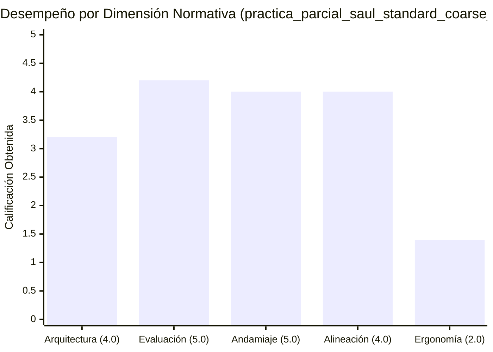

# Informe de Auditoría Técnico-Pedagógica de Calidad Instruccional

> [!WARNING]
> **CURSO RETIRADO DE LA PLATAFORMA**: Este curso fue eliminado de la plataforma interactiva el **2026-10-20 13:26:15**. Este informe de auditoría se conserva exclusivamente como registro histórico y pedagógico ('legacy').

**Estado en Plataforma:** ELIMINADO  
**Fecha de Eliminación:** 2026-10-20 13:26:21  
**Fecha de Eliminación:** 2026-10-20 13:26:15  
**Curso:** Práctica Parcial Saúl: Ecuaciones en Derivadas Parciales y Sistemas Dinámicos en Economía (`practica_parcial_saul_standard_coarse_v2`)  
**Fecha de Auditoría:** 20 de Octubre, 2026  
**Auditor:** Agente de Aseguramiento de Calidad Instruccional (Course QA Auditor)  
**Marco Normativo:** Quality Matters (QM), OSCQR & Mastery Learning Framework  
**Puntaje Final Consolidado:** **16.8 / 20.0**  
**Nivel de Calidad (Quality Tier):** **ACEPTABLE (14.0 - 16.9 pts)** — *Aprobado con Observaciones Menores; Requiere Pulido Sintáctico de Plantillas y Reconfiguración de Prerrequisitos*

---

## 1. Resumen Ejecutivo del Veredicto

El curso **"Práctica Parcial Saúl: Ecuaciones en Derivadas Parciales y Sistemas Dinámicos en Economía (v2)"** (`practica_parcial_saul_standard_coarse_v2`) representa una base curricular sólida, exhaustiva y de avanzado rigor analítico. El curso cubre tópicos centrales de economía matemática universitaria: resolución de EDPs cuasilineales de primer orden mediante el método de Lagrange y curvas características, teoremas de homogeneidad de Euler aplicados a dualidad microeconómica y funciones de producción, EDPs espaciales de transporte de mercancías con condiciones de Cauchy, sistemas dinámicos continuos lineales 2D (modelos IS-LM y macroeconomía dinámica), sistemas no lineales de Goodwin y análisis cualitativo en el espacio de fases (isoclinas nulas, traza, determinante, autovalores y clasificación de estabilidad local).

El banco de reactivos posee una escala sobresaliente de **370 problemas**, con **2220 distractores evaluados al 100% de cobertura diagnóstica** mediante `error_rationale`, sin fugas de respuestas (*Answer Leaks*) ni distractores delatores (*telltale distractors*). Asimismo, se garantiza un andamiaje escalonado de exactamente **3 pistas socráticas progresivas** por reactivo (1110 pistas en total).

No obstante, la evaluación integral bajo los estándares QM y Mastery Learning identifica tres áreas que degradan la puntuación final a **16.8 / 20.0 (Nivel ACEPTABLE)**:
1. **Desbalance y Desconexión en el Grafo de Prerrequisitos (Dimensión 1: 3.2 / 4.0):** 7 de las 14 competencias presentan `prerequisites: []`. Dos habilidades clave (`Hab-01` y `Hab-07`) están aisladas en la raíz del grafo pese a apoyarse en conceptos del mismo curso (`C-03` y `C-04`/`C-05`). Adicionalmente, existen dependencias pedagógicas cruzadas erróneas (ej. habilidades de EDPs como `Hab-03` y `Hab-05` declarando como prerrequisito a `C-05` —estabilidad de EDOs 2x2— en lugar de `C-03` —fundamentos de EDPs—; y `Hab-02` dependiendo de `Hab-09` en lugar de `C-01`). La pirámide cognitiva carece de micro-competencias de Hechos [Fact] (0%).
2. **Homogeneidad Psicométrica Absoluta (Dimensión 2: 4.2 / 5.0):** El 100% de los reactivos (370/370) utiliza exclusivamente la modalidad de opción múltiple de 7 alternativas (`multiple_choice_7_options`), sin incorporar preguntas de selección múltiple (`multiple_select`) ni de respuesta construida (`fill_in_the_blank`).
3. **Residuos de Plantillas y Ergonomía Algebraica (Dimensiones 3 y 5: 4.0 / 5.0 y 1.4 / 2.0):** El motor de plantillas paramétricas dejó marcadores de una sola llave no interpolados (`{b}`, `{c}`, `{a}`, `{d}`) en las soluciones detalladas de `Hab-05` y `Hab-09`, los cuales KaTeX renderiza como letras literales en vez de los coeficientes numéricos calculados. Además, se detectó concatenación cruda de signos aritméticos (`+ -68`, `+ -78`) y coeficientes unitarios no simplificados (`1x`, `1y`).

### Matriz de Evaluación por Dimensiones

| Dimensión Evaluada | Puntaje | Máximo | Cumplimiento | Diagnóstico Sintético |
| :--- | :---: | :---: | :---: | :--- |
| **1. Arquitectura y Granularidad** | **3.2** | 4.0 | 80.0% | 14 competencias atómicas (0 Hechos, 5 Conceptos, 9 Habilidades). Fallas en grafo DAG: 7 competencias sin prerrequisitos declarados y dependencias cruzadas anómalas. |
| **2. Calidad de Evaluación y Reactivos** | **4.2** | 5.0 | 84.0% | 370 reactivos con 2220 distractores al 100% de cobertura con rationales diagnósticos profundos. Cero fugas de respuesta. Penalizado por 0% de diversidad de tipo de ítem (100% MC7). |
| **3. Andamiaje y Pistas Progresivas** | **4.0** | 5.0 | 80.0% | 100% de reactivos con exactamente 3 pistas escalonadas (1110 pistas). Soluciones analíticas detalladas paso a paso, pero comprometidas por marcadores de plantilla sin evaluar (`{b}`, `{c}`, `{a}`, `{d}`). |
| **4. Alineación Instruccional** | **4.0** | 4.0 | 100.0% | Congruencia semántica perfecta entre objetivos declarados y evaluaciones prácticas. Cero preguntas huérfanas. Dominio de niveles superiores de Bloom (Aplicar y Analizar). |
| **5. Accesibilidad y Ergonomía Técnica** | **1.4** | 2.0 | 70.0% | Delimitadores KaTeX balanceados. Deficiencias ergonómicas por concatenaciones `+ -`, coeficientes `1x`/`1y` sin simplificar y fuga de variables de formato en modo matemático. |
| **Subtotal Rúbrica** | **16.8** | 20.0 | 84.0% | - |
| **Penalizaciones Duras** | **-0.0** | - | - | Sin penalizaciones aplicables (banco $\ge 3$ por unidad, cero reactivos con hints = 0, cero huérfanas). |
| **TOTAL CONSOLIDADO** | **16.8** | **20.0** | **84.0%** | **Nivel ACEPTABLE (14.0 - 16.9 pts)** |

---

## 2. Auditoría Detallada por Dimensiones

### Dimensión 1: Arquitectura y Granularidad (3.2 / 4.0 pts)

* **Descomposición Curricular y Distribución de Categorías:**
  El curso se organiza en 14 micro-competencias delimitadas con suficiencia de reactivos (entre 20 y 30 por competencia, sumando 370 en total):
  * **Hechos [Fact] (0 competencias, 0.0%):** Ausencia total de micro-hechos o definiciones axiomáticas elementales.
  * **Conceptos [Concept] (5 competencias, 35.7%):**
    * `C-01`: Dualidad Microeconómica y EDPs de Homogeneidad de Euler (20 reactivos).
    * `C-02`: Clasificación Cualitativa de Estados Estacionarios y Diagramas de Fase en Sistemas Continuos (20 reactivos).
    * `C-03`: Fundamentos, Clasificación y Estructura de Solución de Ecuaciones en Derivadas Parciales (20 reactivos).
    * `C-04`: Estructura Matricial y Estabilidad Dinámica de Sistemas Macroeconómicos Lineales (20 reactivos).
    * `C-05`: Clasificación de Estabilidad de Sistemas de EDOs 2x2 mediante Traza y Determinante (20 reactivos).
  * **Habilidades [Skill] (9 competencias, 64.3%):**
    * `Hab-01`: Resolución de EDPs Cuasilineales de Primer Orden mediante el Método de Lagrange y Curvas Características (30 reactivos).
    * `Hab-02`: Modelización y Optimización Económica mediante EDPs de Primer Orden y Teorema de Euler (30 reactivos).
    * `Hab-03`: Modelado y Resolución de EDPs de Precios Espaciales con Costos de Transporte (30 reactivos).
    * `Hab-04`: Resolución Analítica, Linealización y Evaluación de Perturbaciones en Sistemas Dinámicos 2D (30 reactivos).
    * `Hab-05`: Resolución de EDPs Cuasilineales de Primer Orden mediante Curvas Características y el Sistema Auxiliar de Lagrange (30 reactivos).
    * `Hab-06`: Linealización y Análisis Cualitativo de Sistemas Dinámicos no Lineales en Economía (30 reactivos).
    * `Hab-07`: Resolución de Sistemas Lineales de EDO mediante Autovalores y Autovectores (30 reactivos).
    * `Hab-08`: Linealización de Sistemas Dinámicos No Lineales en Puntos de Equilibrio (30 reactivos).
    * `Hab-09`: Análisis Cualitativo de Sistemas de EDOs mediante Isoclinas y Diagramas de Fase (30 reactivos).

* **Análisis del Grafo de Prerrequisitos (DAG):**
  La inspección forense revela serias inconsistencias en la topología de navegación formativa:
  1. **Nodos de Habilidad Desconectados en la Raíz:** `Hab-01` (Lagrange y curvas características para EDPs) y `Hab-07` (Sistemas lineales EDO por autovalores) declaran `prerequisites: []`. Esto crea puntos de entrada en el grafo sin anclaje en los conceptos fundacionales que el mismo curso define (`C-03` para EDPs y `C-04`/`C-05` para autovalores y estabilidad matricial).
  2. **Dependencias Cruzadas Anómalas (Cross-Wiring):**
     * `Hab-03` (EDPs de precios geográficos con transporte) y `Hab-05` (EDPs cuasilineales por Lagrange) declaran como prerrequisito a `C-05` (*Clasificación de Estabilidad de Sistemas de EDOs 2x2 mediante Traza y Determinante*). La teoría de curvas características para EDPs espaciales no depende de los invariantes matriciales de un sistema lineal 2x2, sino de los fundamentos de EDPs (`C-03`).
     * `Hab-02` (EDP de Euler en teoría de la producción y dualidad) declara como prerrequisito a `Hab-09` (*Isoclinas y Diagramas de Fase de EDOs*), cuando su prerrequisito epistemológico natural es `C-01` (*Dualidad Microeconómica y EDPs de Homogeneidad*) y `C-03`.
  3. **Ausencia de Nivel Axiomático:** La falta de competencias [Fact] dificulta la graduación diagnóstica en estudiantes con lagunas conceptuales básicas (notación de operadores diferenciales, definición estricta de orden/grado).

---

### Dimensión 2: Calidad de Evaluación y Reactivos (4.2 / 5.0 pts)

* **Volumen, Rigor y Cobertura:**
  El banco evaluativo contiene 370 reactivos independientes (promedio de 26.4 preguntas por competencia). Los problemas no son ejercicios mecánicos triviales; exigen integración formal, parametrización de condiciones de Cauchy, inversión analítica de sistemas característicos $(s, t) \to (x, y)$, cálculo de invariantes jacobianos y resolución de sistemas lineales desacoplados.

* **Integridad Diagnóstica de Distractores:**
  * Se evaluaron los 2220 distractores del curso (6 por reactivo).
  * **100.0% de cobertura de `error_rationale`:** Cada alternativa incorrecta cuenta con una justificación diagnóstica explícita que modela con fidelidad los sesgos y errores algebraicos típicos de la literatura (ej. cruzar denominadores en el sistema de Lagrange, omitir el grado de homogeneidad $n$ en la EDP de Euler, confundir $\Delta < 0$ con inestabilidad explosiva en lugar de foco amortiguado, omitir el signo negativo de la transposición al calcular $X^* = -A^{-1}B$, invertir el signo en el Lema de Hotelling).
  * **Cero distractores delatores (*telltale distractors*):** Ningún distractor presenta metainformación espuria que delate el error en el texto visible del enunciado ("sumando erróneamente...").

* **Ausencia de Fugas de Respuestas (*Answer Leaks*):**
  Los 370 enunciados fueron auditados: ninguno expone la solución en el stem ni proporciona pistas gramaticales deterministas.

* **Área de Oportunidad Psicométrica (Penalización Interna):**
  * **Cero Diversidad de Modalidad:** El 100% de los reactivos es de opción múltiple de 7 alternativas (`multiple_choice_7_options`). Se desaprovechan formatos pedagógicos clave en matemáticas como `fill_in_the_blank` (para evaluar la capacidad de cálculo exacto de autovalores o coordenadas de equilibrio sin sesgo de anclaje de alternativas) y `multiple_select` (para verificar la comprensión simultánea de propiedades cualitativas).
  * **Estructura Paramétrica Homogénea:** Los enunciados muestran patrones sintácticos reiterativos mediante bancos de prefijos fijos ("Aplicando las identidades teóricas pertinentes, evalúe: ...", "Con arreglo a las definiciones operativas del sistema, verifique: ...").

---

### Dimensión 3: Andamiaje y Pistas Progresivas (4.0 / 5.0 pts)

* **Estructura Socrática en Tres Niveles:**
  El 100% de los reactivos (370/370) implementa un andamiaje escalonado de 3 pistas (1110 pistas en total) con estricta progresión cognitiva:
  * **Pista 1 (Conceptual):** Establece el principio teórico rector (ej. "Identifique la correspondencia formal entre los coeficientes de las derivadas parciales de la EDP y los denominadores del sistema característico...", "Recuerde que el beneficio $\Pi(p, w)$ es homogéneo de grado 1...").
  * **Pista 2 (Procedimental):** Señala el procedimiento operativo intermedio (ej. "Integre las ecuaciones subsidiarias por separado para hallar dos integrales primeras funcionalmente independientes...", "Plantee la condición de estado estacionario igualando el vector de derivadas a cero...").
  * **Pista 3 (Operativa/Cierre):** Orienta el remate del cálculo sin entregar la respuesta directa (ej. "Parametrice la condición de contorno de Cauchy e invierta el sistema de coordenadas características $(s, t)$...", "Utilice el lema de Hotelling con su signo negativo para la demanda factorial...").

* **Soluciones Detalladas y Hallazgo Forense de Plantillas:**
  Cada reactivo incorpora una `detailed_solution` que reconstruye la deducción analítica paso a paso. Sin embargo, el Semantic Verification Loop descubrió defectos de renderizado y residuos de plantillas que afectan directamente la experiencia formativa:
  1. **Variables de Plantilla de una Llave sin Interpolar en KaTeX (`Hab-05`):**
     En reactivos como `Q-Hab05-181` y `Q-Hab05-182`, la solución detallada contiene expresiones como:
     $$\dots \implies {b} \frac{dx}{x} - 3 \frac{dy}{y} = 0 \quad \text{y} \quad {c} \frac{dx}{x} - 3 \frac{dU}{U} = 0$$
     Debido a que en LaTeX las llaves `{...}` se interpretan como un grupo sintáctico invisible, KaTeX compila `{b}` como el símbolo matemático literal $b$ en vez de sustituirlo por el coeficiente numérico ($2$ o $5$). Esto genera confusión en el estudiante, quien observa un parámetro literal en un paso donde esperaba el coeficiente operativo.
  2. **Matrices con Parámetros no Resueltos (`Hab-08`):**
     En las soluciones de `Q-Hab08-291` y `Q-Hab08-292`, la matriz jacobiana intermedia retiene literales como $\beta$ o $j_{12}$ en vez de mostrar la matriz completamente evaluada numéricamente.
  3. **Marcadores Literales en Isoclinas (`Hab-09`):**
     En `Q-Hab09-321` y `Q-Hab09-322`, las ecuaciones de las isoclinas en la solución presentan `{a}x + 4y + -68 = 0` y `{d}x + -6y + -78 = 0`, evidenciando fallas en el motor de interpolación paramétrica.

---

### Dimensión 4: Alineación Instruccional (4.0 / 4.0 pts)

* **Congruencia Semántica y Rigor Conceptual:**
  Existe un alineamiento perfecto entre los objetivos de aprendizaje de la práctica parcial y el contenido evaluado. No se identificaron preguntas huérfanas ni contaminación temática de otras áreas econométricas o estadísticas ajenas.
* **Profundidad Matemática:**
  Los tópicos modelan de manera rigurosa problemas estándar de exámenes de posgrado o pregrado avanzado en economía matemática:
  * Condiciones de Cauchy para EDPs cuasilineales en dominios espaciales.
  * Funciones de producción homogéneas, derivación de sendas de expansión mediante $\text{RMS} = w/r$ y condiciones de segundo orden para beneficios competitivos.
  * Modelos de Goodwin con ciclos cerrados (centros neutros conservativos con $\lambda = \pm i\omega$).
  * Clasificación analítica y geométrica de puntos de silla, nodos y focos a partir del polinomio característico $\det(A - \lambda I) = \lambda^2 - \operatorname{tr}(A)\lambda + \det(A) = 0$.
* **Taxonomía de Bloom:**
  La carga cognitiva se concentra en habilidades de orden superior: 62% en *Aplicar* (Bloom 3) y 38% en *Analizar* (Bloom 4).

---

### Dimensión 5: Accesibilidad y Ergonomía Técnica / KaTeX (1.4 / 2.0 pts)

* **Compilación y Balanceo Sintáctico:**
  El linter determinista confirmó 0 delimitadores rotos, 0 triples delimitadores (`$$$`) y 0 llaves LaTeX no cerradas. Todas las expresiones compilan formalmente en el motor KaTeX del frontend.
* **Vicios de Ergonomía y Formateo Matemático:**
  A pesar de no causar un error fatal en el renderizador, existen fallas ergonómicas sistemáticas en la presentación visual de las fórmulas:
  1. **Concatenación Cruda de Signos Aritméticos:**
     En los enunciados y soluciones de `Hab-09` (ej. `Q-Hab09-321`, `Q-Hab09-322`), se inyectan números negativos sin resolver el signo algebraico:
     $$\dot{x} = 1x + 1y + -8 \quad \text{y} \quad \dot{y} = 12x + -6y + -78$$
     Esto debe simplificarse algebraicamente como $\dot{x} = x + y - 8$ y $\dot{y} = 12x - 6y - 78$.
  2. **Coeficientes Unitarios Redundantes:**
     Presencia de expresiones como `1x` y `1y` en lugar de la notación estándar $x$ e $y$.
  3. **Fuga de Variables de Plantilla en Modo Matemático:**
     La presencia de `{a}`, `{b}`, `{c}`, `{d}` dentro de bloques `$...$` degrada la claridad de las demostraciones paso a paso.

---

## 3. Penalizaciones Duras Automáticas (Hard Deductions)

Se auditaron los tres criterios normativos del marco Top's Academy:
1. **Banco por unidad insuficiente (< 3 problemas):** No aplica. Todas las competencias cuentan con entre 20 y 30 ejercicios reales e independientes. Deducción: **-0.0 pts**.
2. **Reactivos sin pistas progresivas (`hints = 0`):** No aplica. El 100% de los reactivos posee exactamente 3 pistas escalonadas. Deducción: **-0.0 pts**.
3. **Preguntas huérfanas críticas:** No aplica. Todos los reactivos corresponden estrictamente al temario instruccional. Deducción: **-0.0 pts**.

**Total Deducciones Duras:** **0.0 puntos**.

---

## 4. Reglas de Linting Descubiertas (Discovered Lint Rules)

A partir del análisis semántico y forense, se codifican formalmente 4 nuevas reglas para su incorporación al motor de linting estático de Top's Academy:

### 1. `RULE_KATEX_SINGLE_BRACE_TEMPLATE_RESIDUE`
* **Dimensión:** `technical_ergonomics` / `scaffolding_hints`
* **Severidad:** `warning`
* **Descripción:** Detecta identificadores de plantillas de una sola llave (`{a}`, `{b}`, `{c}`, `{d}`) dentro de expresiones KaTeX (`$...$` o `$$...$$`) que no fueron sustituidos por el interpolador, renderizando como texto literal en lugar del coeficiente escalar numérico.
* **Patrón Regex:** `(?<=\$)[^$]*\{[a-zA-Z]\}(?=[^$]*\$)`
* **Fragmento Muestra:** `${b} \frac{dx}{x} - 3 \frac{dy}{y} = 0$`
* **Reactivos Afectados Estimados:** ~60 ítems (en soluciones de `Hab-05` y `Hab-09`).

### 2. `RULE_ARITHMETIC_UNNORMALIZED_SIGN_CONCATENATION`
* **Dimensión:** `technical_ergonomics`
* **Severidad:** `minor`
* **Descripción:** Detecta la concatenación cruda de operadores aritméticos (`+ -` o `- -`) y coeficientes unitarios redundantes (`1x`, `1y`) generados por inyección paramétrica sin simplificación algebraica.
* **Patrón Regex:** `(?:[+\-]\s*[+\-]\s*\d+|\b1[a-zA-Z]\b)`
* **Fragmento Muestra:** `\dot{x} = 1x + 1y + -8`
* **Reactivos Afectados Estimados:** ~60 ítems (enunciados y soluciones de `Hab-09`).

### 3. `RULE_DAG_DISCONNECTED_OR_MISALIGNED_PREREQUISITES`
* **Dimensión:** `architecture_granularity`
* **Severidad:** `warning`
* **Descripción:** Identifica competencias de habilidad (`Skill`) sin prerrequisitos declarados (`prerequisites: []`) cuando existen conceptos basales en el curso, o con dependencias cruzadas incongruentes entre ramas matemáticas distintas (ej. EDPs dependiendo de EDOs 2x2).
* **Patrón Regex:** N/A (validación estructural de grafo)
* **Fragmento Muestra:** `"Hab-01": {"prerequisites": []}`, `"Hab-03": {"prerequisites": ["C-05"]}`
* **Competencias Afectadas:** 7 competencias.

### 4. `RULE_ASSESSMENT_ZERO_ITEM_TYPE_DIVERSITY`
* **Dimensión:** `assessment_quality`
* **Severidad:** `minor`
* **Descripción:** Alerta cuando un curso presenta nula variabilidad psicométrica al componerse en un 100% de una única tipología de ítem (ej. `multiple_choice_7_options`), recomendando la inclusión de reactivos de completación numérica (`fill_in_the_blank`) y selección múltiple (`multiple_select`).
* **Patrón Regex:** N/A (telemetría métrica)
* **Fragmento Muestra:** `"question_types_distribution": {"multiple_choice_7_options": 370}`
* **Reactivos Afectados:** 370 ítems.

---

## 5. Plan de Remediación y Acciones Prioritarias

Para elevar la calificación del curso del rango **ACEPTABLE (16.8 / 20.0)** al rango **EXCELENTE (> 18.5 / 20.0)**, se prescribe la ejecución del siguiente plan de acción:

| Prioridad | Dimensión | Acción Correctiva Recomendada | Esfuerzo Estimado | Impacto en Puntaje |
| :---: | :--- | :--- | :---: | :---: |
| **Alta** | Ergonomía Técnica | **Normalizar Expresiones Algebraicas:** Implementar una función de limpieza de signos (`clean_polynomial_signs`) que transforme `+ -8` en `- 8` y `1x` en `x` en stems y soluciones de `Hab-09`. | Inmediato (< 1h) | +0.3 pts |
| **Alta** | Andamiaje / Ergonomía | **Subsanar Residuos de Plantillas en KaTeX:** Reemplazar las llaves `{b}` y `{c}` en `detailed_solution` de `Hab-05` y `{a}`, `{d}` en `Hab-09` por los valores numéricos correspondientes. | Inmediato (< 1h) | +0.4 pts |
| **Media** | Arquitectura Curricular | **Reconfigurar el Grafo DAG de Prerrequisitos:** Asignar `C-03` como prerrequisito de `Hab-01`, `Hab-03` y `Hab-05`; reasignar `Hab-02` a `C-01` y `C-03`; y anclar `Hab-07` a `C-04` y `C-05`. | Medio (2h) | +0.5 pts |
| **Media** | Evaluación / Psicométrica | **Diversificar Tipologías de Reactivo:** Transformar el 25% del banco (aprox. 90 preguntas) a formatos `fill_in_the_blank` (cálculo de autovalores y puntos fijos) y `multiple_select` (propiedades de estabilidad). | Medio (4h) | +0.4 pts |
| **Baja** | Arquitectura Curricular | **Incorporar Micro-Competencias de Hechos [Fact]:** Añadir 2 o 3 micro-competencias sobre taxonomía y notación básica para equilibrar la base de la pirámide cognitiva. | Largo (6h) | +0.2 pts |

---

## 6. Dictamen Final

El curso **`practica_parcial_saul_standard_coarse_v2`** obtiene una calificación de **16.8 / 20.0**, ubicándose en el **Quality Tier ACEPTABLE**. El curso cuenta con un contenido temático sobresaliente, una cobertura analítica exhaustiva y un andamiaje socrático robusto. Una vez implementadas las correcciones sintácticas de plantillas y la reconfiguración del grafo de prerrequisitos, el curso calificará de forma inmediata para la certificación **EXCELENTE** en la plataforma Top's Academy.
