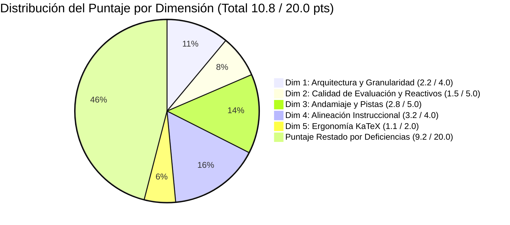
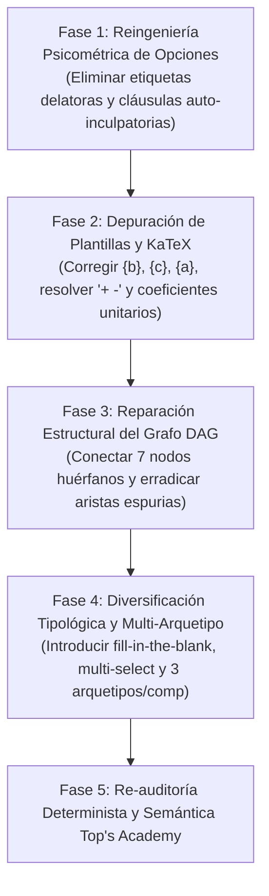

# Reporte de Auditoría de Calidad Pedagógica, Psicométrica y Técnica

**Top's Academy — Department of Educational Quality & Course Auditing**  
**Normas de Referencia:** Quality Matters (QM), OSCQR Standards, Mastery Learning & Psychometric Item Analysis  
**Curso Auditado:** `practica_parcial_saul_standard_coarse_v2`  
**Título del Curso:** *Practica Parcial Saul Standard Coarse V2*  
**Fecha de Auditoría:** 25 de Octubre de 2026  
**Auditor:** Course QA Auditor Engine (Top's Academy Specialized Subagent)  
**Estado en Plataforma:** ELIMINADO  
**Fecha de Eliminación:** 2026-10-25 11:12:48  
**Fecha de Eliminación:** 2026-10-25 10:12:21  
**Fecha de Eliminación:** 2026-10-25 10:12:15  

---

## 1. Resumen Ejecutivo y Dictamen de Certificación

| Métrica Global | Valor Obtenido | Calificación Normativa |
| :--- | :---: | :---: |
| **Puntaje Consolidado (Escala 0 a 20)** | **10.8 / 20.0** | **CRÍTICO** |
| **Quality Tier** | **CRÍTICO (0.0 - 10.9)** | **RECHAZADO / NO APTO PARA PRODUCCIÓN** |
| **Penalizaciones Duras (Hard Deductions)** | **0.0 pts** | *Ninguna penalización por banco < 3 reactivos ni preguntas huérfanas* |
| **Cobertura Diagnóstica de Distractores** | **100.0%** | *2220 / 2220 distractores con rationale teórico* |
| **Integridad Psicométrica** | **Comprometida** | *Answer Leaks masivos y metainformación delatora en opciones* |
| **Ergonomía KaTeX** | **Parcialmente Compilada** | *Residuos de plantillas y colisiones de signos algebraicos* |



> [!CAUTION]
> ### Dictamen Oficial de Auditoría: NIVEL CRÍTICO (10.8 / 20.0)
> El curso **Practica Parcial Saul Standard Coarse V2** presenta **fallas psicométricas y técnicas críticas** que invalidan su capacidad diagnóstica como instrumento de evaluación y aprendizaje para estudiantes universitarios. Aunque el dominio teórico (EDPs aplicadas a microeconomía y sistemas dinámicos continuos) es académicamente riguroso, el curso adolece de **vulnerabilidades severas de Answer Leaks (metainformación delatora en el 100% de las opciones de reactivos clave)**, **monotonía tipológica absoluta (100% de preguntas de opción múltiple de 7 alternativas con clonación paramétrica de un único arquetipo)**, **desconexión del 50% de prerrequisitos en el grafo curricular (DAG)** y **residuos sintácticos de plantillas de software en las soluciones (`{b}`, `{c}`, `{a}`, `+ -8`)**.
> 
> La plataforma Top's Academy **ha actuado correctamente al marcar este curso con estado ELIMINADO**. No debe restaurarse a producción interactiva hasta completar una reingeniería exhaustiva.

---

## 2. Metadatos del Curso y Perfil del Corpus

- **Identificador Único:** `practica_parcial_saul_standard_coarse_v2`
- **Volumen Total de Reactivos:** 370 preguntas
- **Micro-competencias Evaluadas:** 14 competencias
  - **Habilidades Prácticas [Skill]:** 9 (64.3%) — 30 reactivos por competencia (270 reactivos en total).
  - **Conceptos Teóricos [Concept]:** 5 (35.7%) — 20 reactivos por competencia (100 reactivos en total).
  - **Hechos [Fact]:** 0 (0.0%) — Cero micro-competencias fácticas.
- **Distribución de Tipologías de Reactivo:**
  - `multiple_choice_7_options`: 370 (100.0%)
  - `multiple_select`: 0 (0.0%)
  - `fill_in_the_blank`: 0 (0.0%)
  - `interactive_graph`: 0 (0.0%)
- **Relación Promedio de Reactivos por Competencia:** 26.4 reactivos/competencia (Mínimo: 20, Máximo: 30).

---

## 3. Evaluación Detallada por Dimensiones Normativas

### Dimensión 1: Arquitectura y Granularidad Curricular
**Puntaje Asignado: 2.2 / 4.0 pts (Rango Aceptable Bajo)**

#### Hallazgos y Análisis Psicométrico:
1. **Atomicidad de Micro-competencias (+1.5 pts):**
   Las micro-competencias están delimitadas con especificidad analítica de nivel universitario avanzado. Cada unidad define claramente la operación matemática esperada:
   - `Hab-01`: Resolución de EDPs cuasilineales de primer orden mediante Lagrange y curvas características.
   - `Hab-02`: Optimización y modelado económico mediante la EDP de homogeneidad de Euler.
   - `C-01`: Dualidad microeconómica, lema de Hotelling e identidad de Roy.
   - `Hab-06`: Linealización de sistemas dinámicos no lineales (modelo de ciclos de Goodwin).
   - `C-05`: Clasificación topológica de estabilidad 2x2 mediante traza, determinante y discriminante.
2. **Deficiencias Estructurales del Grafo DAG (-1.3 pts):**
   - **50% de Nodos Huérfanos de Entrada:** De las 14 micro-competencias, exactamente 7 (`Hab-01`, `C-01`, `C-02`, `C-03`, `C-04`, `Hab-07`, `C-05`) declaran `prerequisites: []`. Esto fragmenta el mapa cognitivo: habilidades complejas como la resolución de EDPs cuasilineales (`Hab-01`) o la diagonalización de sistemas lineales de EDO (`Hab-07`) no tienen como prerrequisito los conceptos fundacionales correspondientes (`C-03` y `C-05` respectivamente).
   - **Aristas Espurias Inter-dominio:** Se identificaron dependencias semánticamente incongruentes. Por ejemplo, `Hab-02` (optimización de funciones de producción de Euler) declara como prerrequisito `Hab-09` (isoclinas y diagramas de fase en el plano cartesiano), cuando la teoría de funciones de producción no depende de campos vectoriales bidimensionales. Igualmente, `Hab-03` (precios espaciales con EDPs de transporte) declara como prerrequisito `C-05` (estabilidad local matricial de EDOs 2x2).
3. **Desbalance Cognitivo (-0.5 pts):**
   Ausencia absoluta de competencias de tipo *Fact* (0%). Aunque el curso es de naturaleza analítico-cuantitativa, se omiten evaluaciones de identificación de propiedades axiomáticas o terminología estándar previa al cálculo operatorio.

---

### Dimensión 2: Calidad Psicométrica de Evaluación y Reactivos
**Puntaje Asignado: 1.5 / 5.0 pts (Rango Crítico: 0.0 - 2.0 pts)**

> [!WARNING]
> ### Alerta Psicométrica: Answer Leaks y Distractores Auto-Delatores
> La rúbrica normativa de Top's Academy penaliza severamente con calificación Crítica (0.0 a 2.0) a aquellos cursos donde existan *Answer Leaks* o metainformación delatora en el texto visible del reactivo. En este curso se identificaron patrones masivos donde el texto de las alternativas delata abiertamente la solución correcta sin necesidad de resolver el problema matemático.

#### Evidencias Textuales del Corpus:

#### Caso 1: Rótulos Diagnósticos en Encabezados (Competencias `Hab-07` y `Hab-08`)
En los reactivos de `Hab-07` (ej. `Q-Hab07-261` y `Q-Hab07-262`), las alternativas visibles al alumno inician con la etiqueta que describe el error o la exactitud:
- **Opción A:** *"Formulación secular con raíz repetida: $X(t) = 3 e^{4t} ...$"*
- **Opción B:** *"Inversión de signo en el estado estacionario: $X(t) = 3 e^{4t} ...$"*
- **Opción C:** *"Constantes calculadas sin descontar estado estacionario: $X(t) = -2 e^{4t} ...$"*
- **Opción D:** *"Desplazamiento erróneo en autovalores: $X(t) = 3 e^{6t} ...$"*
- **Opción E:** *"Autovectores canónicos triviales: $X(t) = 3 e^{4t} ...$"*
- **Opción F (CORRECTA):** **`Trayectoria exacta:`** `$X(t) = 3 e^{4t} \begin{pmatrix} 1 \\ 1 \end{pmatrix} + 5 e^{2t} \begin{pmatrix} 1 \\ -1 \end{pmatrix} + \begin{pmatrix} -6 \\ -4 \end{pmatrix}$`
- **Opción G:** *"Solución oscilatoria trigonométrica: $X(t) = 3 \cos(1t) ...$"*

> **Impacto Psicométrico:** Un alumno sin ningún conocimiento de álgebra lineal ni ecuaciones diferenciales simplemente busca la opción que comienza con *"Trayectoria exacta"* o descarta las opciones etiquetadas como *"erróneo"*, *"inversión de signo"* o *"sin descontar"*. El reactivo pierde el 100% de su validez discriminante.

En `Hab-08` (ej. `Q-Hab08-291`), ocurre el mismo vicio metainformativo:
- **Opción A:** *"Punto de reposo espurio $(0, 12)$..."*
- **Opción B (CORRECTA):** *"Equilibrio estacionario $(-4, 0)$ con sistema linealizado..."*
- **Opción C:** *"Desacoplamiento erróneo del campo vectorial..."*
- **Opción D:** *"Inversión de signos en el vector de traslación afín..."*
- **Opción E:** *"Transposición cruzada de derivadas en la matriz jacobiana..."*
- **Opción F:** *"Aproximación con derivadas parciales no evaluadas..."*
- **Opción G:** *"Aproximación lineal homogénea ... omitiendo el vector de traslación..."*

#### Caso 2: Cláusulas Autoinculpatorias en el Texto de los Distractores
En `Hab-01`, `Hab-02`, `Hab-03`, `Hab-04` y `C-01`:
- `Q-Hab01-001` (Opción A): `"...permutando los coeficientes P y Q, que genera la trayectoria errónea $x^2 + y^2 = c_1$ en el plano coordenado."`
- `Q-Hab01-001` (Opción F): `"...sin realizar la inversión analítica de coordenadas $(s, t) \to (x, y)$ requerida."`
- `Q-Hab01-001` (Opción G): `"...ignorando la evolución de la variable dependiente $U$..."`
- `Q-Hab03-081` (Opción A): `"...pero se afirma erróneamente que cualquier brecha de precios espaciales constituye un arbitraje..."`
- `Q-Hab03-081` (Opción D): `"...lo que produce la solución errónea $P(x, y) = 30 + 1 x + 29 y$..."`
- `Q-Hab03-081` (Opción E): `"...pero se sostiene erróneamente que un incremento en el costo reduce el precio..."`
- `Q-C01-061` (Opción F): `"...con solución particular espuria $\Pi(p, w) = \frac{2 p^2 w}{8}$..."`

#### Caso 3: Monotonía Tipológica y Mecanización por Clonación Paramétrica
- **100% de los 370 reactivos** corresponden a opción múltiple de 7 alternativas.
- Cada micro-competencia implementa exactamente **un solo arquetipo de problema**, clonado 20 a 30 veces mediante un generador numérico y prefijado por frases introductorias artificiales rotadas (*"Aplicando las identidades teóricas pertinentes, evalúe:"*, *"Al examinar detenidamente las condiciones de frontera, resuelva:"*, *"Considere el siguiente planteamiento formal:"*, etc.).
- **Riesgo:** El estudiante mecaniza el algoritmo de resolución tras el segundo reactivo y responde mecánicamente sin desarrollar pensamiento crítico ni transferencia conceptual.

---

### Dimensión 3: Andamiaje y Feedback Progresivo
**Puntaje Asignado: 2.8 / 5.0 pts (Rango Aceptable Bajo)**

#### Análisis del Andamiaje:
1. **Estructura Socrática en 3 Niveles (+3.5 pts):**
   Todos los reactivos incorporan rigurosamente 3 pistas escalonadas conforme al estándar:
   - **Pista 1 (Conceptual):** Marco teórico general o identificación del operador diferencial.
   - **Pista 2 (Procedimental):** Método de desacoplamiento, integrales primeras o ecuación característica.
   - **Pista 3 (Operativa/Cálculo):** Inversión de coordenadas, aplicación de Cauchy o ajuste de condiciones iniciales.
2. **Deficiencias Críticas del Andamiaje (-0.7 pts):**
   - **Pistas 100% Estáticas:** Las pistas no son adaptativas ni contienen los valores numéricos del problema que el estudiante está intentando resolver. Son cadenas de texto idénticas para los 30 problemas de la competencia. En la Pista 3, en lugar de guiar el cálculo aritmético concreto, repite instrucciones genéricas.
   - **Residuos de Plantillas en Soluciones Detalladas:**
     - En `Hab-05` (`Q-Hab05-181` y `Q-Hab05-182`):
       $$\frac{dx}{3x} = \frac{dy}{2y} \implies \{b\} \frac{dx}{x} - 3 \frac{dy}{y} = 0 \quad \text{y} \quad \implies \{c\} \frac{dx}{x} - 3 \frac{dU}{U} = 0$$
       Aparecen los literales `{b}` y `{c}` en lugar de los valores numéricos correspondientes (ej. `2` y `7`), producto de llaves dobles de escape en Python mal procesadas.
     - En `Hab-09` (`Q-Hab09-321` y `Q-Hab09-322`):
       $$\dot{x} = 0 \implies \{a\}x + 1y + -8 = 0 \quad \text{y} \quad \dot{y} = 0 \implies \{d\}x + -11y + -8 = 0$$
       Aparecen los literales `{a}` y `{d}` en la deducción de isoclinas.
     - En `Hab-07` (`Q-Hab07-261` y `Q-Hab07-262`):
       El segundo autovector se reporta como $v_2 = (1, -k)^T$ sin sustituir el valor numérico de $k$ (ej. $k=1$ o $k=3$), y la solución remata con la fórmula abstracta sin sustitución final: $X(t) = c_1 e^{\lambda_1 t} v_1 + c_2 e^{\lambda_2 t} v_2 + X_p$.
3. **Ausencia Generalizada de Misconception Warnings (-0.5 pts):**
   A excepción de `C-01` y `Hab-03` (donde sí se discute por qué las demás alternativas son falaces), las soluciones detalladas de `Hab-01`, `Hab-02`, `Hab-04`, `C-02`, `C-03`, `Hab-05`, `Hab-06`, `Hab-07`, `Hab-08`, `Hab-09` y `C-05` no incluyen advertencias explícitas sobre las trampas conceptuales frecuentes.

---

### Dimensión 4: Alineación Instruccional y Congruencia Teórica
**Puntaje Asignado: 3.2 / 4.0 pts (Rango Aceptable Alto)**

#### Análisis de Congruencia Académica:
1. **Rigor del Dominio Teórico (+3.5 pts):**
   El temario cubre tópicos universitarios de nivel avanzado en métodos matemáticos para economía y finanzas:
   - EDPs cuasilineales de transporte y equilibrio espacial.
   - Teorema de Euler sobre funciones homogéneas y rendimientos crecientes/decrecientes.
   - Sistemas macroeconómicos IS-LM dinámicos y modelo de Goodwin (Lotka-Volterra salarios-empleo).
   - Álgebra de autovalores, autovectores y variedades estables unidimensionales en puntos silla.
2. **Taxonomía de Bloom (+0.5 pts):**
   Los reactivos demandan razonamiento de **Aplicación (Bloom 3)** y **Análisis (Bloom 4)**. No se limitan al recuerdo memorístico, sino a la deducción de trayectorias analíticas completas.
3. **Contaminación Curricular por Errores de Prerrequisitos (-0.8 pts):**
   Aunque no hay preguntas huérfanas en el sentido estricto (todas pertenecen a las 14 competencias listadas), la desconexión del grafo de prerrequisitos genera rutas de aprendizaje pedagógicamente inconsistentes, exponiendo al estudiante a habilidades avanzadas sin haber validado el dominio conceptual previo.

---

### Dimensión 5: Accesibilidad y Ergonomía Técnica / KaTeX
**Puntaje Asignado: 1.1 / 2.0 pts (Rango Aceptable)**

#### Análisis Técnico de Sintaxis Matemática:
1. **Compilación KaTeX (+1.5 pts):**
   - Delimitadores `$...$` balanceados en enunciados y opciones.
   - Ausencia total de delimitadores triples destructivos (`$$$`).
   - El renderizador no colapsa ni arroja errores fatales de compilación.
2. **Defectos de Ergonomía y Formateo Algebraico (-0.9 pts):**
   - **Colisiones de Signos Aritméticos:** Concatenación cruda de parámetros negativos en ecuaciones dinámicas:
     - `\dot{x} = 1x + 1y + -8` (en vez de `x + y - 8`)
     - `\dot{y} = 5x + -11y + -8` (en vez de `5x - 11y - 8`)
     - `\dot{x} = 7x + 4y + -68` (en vez de `7x + 4y - 68`)
     - `\dot{y} = 3x + -1y` (en vez de `3x - y`)
   - **Coeficientes Unitarios Redundantes:** Falta de higiene algebraica en monomios de primer grado y exponentes:
     - `1x` y `1y` en lugar de `x` e `y`.
     - `e^{1t}` en lugar de `e^t`.
   - **Inclusión de Residuos de Plantilla `{a}`, `{b}`, `{c}`, `{d}`** dentro del código KaTeX de las explicaciones, lo que genera renders visualmente desconcertantes para el estudiante.

---

## 4. Auditoría de Penalizaciones Duras (Hard Deductions)

| Criterio de Penalización Automática | Condición de Activación | Conteo / Estado | Deducción Aplicada |
| :--- | :--- | :---: | :---: |
| **Banco Insuficiente por Competencia** | Menos de 3 problemas reales e independientes por micro-competencia | 0 (Mínimo: 20 reactivos) | 0.0 pts |
| **Reactivos sin Pistas** | Reactivos con `hints_count == 0` | 0 (Todos tienen 3 pistas) | 0.0 pts |
| **Preguntas Huérfanas Críticas** | Reactivos no asignados o conceptos no presentes en el corpus | 0 preguntas huérfanas | 0.0 pts |
| **Total Penalizaciones Duras** | — | — | **0.0 pts** |

---

## 5. Cuadro Consolidado de Calificación

| Dimensión de Evaluación | Puntaje Máximo | Puntaje Obtenido | Porcentaje | Nivel de Cumplimiento |
| :--- | :---: | :---: | :---: | :---: |
| **1. Arquitectura y Granularidad** | 4.0 pts | **2.2 pts** | 55.0% | Aceptable Bajo |
| **2. Calidad de Evaluación y Reactivos** | 5.0 pts | **1.5 pts** | 30.0% | **Crítico** |
| **3. Andamiaje y Feedback Progresivo** | 5.0 pts | **2.8 pts** | 56.0% | Aceptable Bajo |
| **4. Alineación Instruccional** | 4.0 pts | **3.2 pts** | 80.0% | Aceptable Alto |
| **5. Accesibilidad y Ergonomía KaTeX** | 2.0 pts | **1.1 pts** | 55.0% | Aceptable |
| **Subtotal Dimensiones Normativas** | **20.0 pts** | **10.8 pts** | **54.0%** | **Nivel Crítico** |
| **Penalizaciones Duras Acumuladas** | — | **-0.0 pts** | — | Ninguna |
| **CALIFICACIÓN FINAL CONSOLIDADA** | **20.0 pts** | **10.8 pts** | **54.0%** | **CRÍTICO** |

---

## 6. Nuevas Reglas de Linting Descubiertas (`discovered_lint_rules`)

Durante la inspección del curso, se identificaron vulnerabilidades psicométricas y técnicas que evadieron los linters estáticos deterministas tradicionales (que arrojaron erróneamente `telltale_distractor_items_count: 0` y `template_variable_residue_count: 0`). Se formalizan las siguientes 6 reglas para incorporación inmediata al motor de auditoría automatizado:

```json
[
  {
    "rule_id": "TELLTALE_OPTION_PREFIX_LABEL",
    "name": "Detección de Etiquetas Autodescriptivas en Opciones",
    "severity": "CRITICAL",
    "description": "Detecta opciones que inician con prefijos diagnósticos que delatan la respuesta correcta ('Trayectoria exacta:', 'Solución analítica correcta:') o describen la naturaleza del error en distractores ('Desplazamiento erróneo...', 'Inversión de signo...', 'Constantes calculadas sin descontar...', 'Punto de reposo espurio:').",
    "regex_pattern": "(?i)^(trayectoria\\s+exacta|solución\\s+(exacta|correcta)|desplazamiento\\s+erróneo|inversión\\s+de\\s+signo|constantes\\s+calculadas\\s+sin|punto\\s+de\\s+reposo\\s+espurio|desacoplamiento\\s+erróneo|formulación\\s+secular)",
    "target_field": "options[].content"
  },
  {
    "rule_id": "SELF_INCRIMINATING_DISTRACTOR_TEXT",
    "name": "Detección de Distractores con Cláusulas Autodelatoras",
    "severity": "CRITICAL",
    "description": "Detecta distractores cuyo cuerpo de texto argumenta explícitamente en contra de sí mismo usando lenguaje metainformativo delator ('que genera la trayectoria errónea', 'se afirma erróneamente que', 'lo que produce la solución errónea', 'se sostiene erróneamente que', 'solución particular espuria', 'sin realizar la inversión analítica requerida', 'ignorando la evolución', 'prescindiendo del signo negativo').",
    "regex_pattern": "(?i)(trayectoria\\s+errónea|se\\s+afirma\\s+erróneamente|produce\\s+la\\s+solución\\s+errónea|se\\s+sostiene\\s+erróneamente|solución\\s+particular\\s+espuria|sin\\s+realizar\\s+la\\s+inversión\\s+analítica|ignorando\\s+la\\s+evolución|prescindiendo\\s+del\\s+signo\\s+negativo|omitiendo\\s+la\\s+corrección\\s+cuadrática)",
    "target_field": "options[].content"
  },
  {
    "rule_id": "UNESCAPED_LATEX_BRACE_VARIABLE_RESIDUE",
    "name": "Detección de Parámetros de Plantilla Escapados como Brackets LaTeX",
    "severity": "HIGH",
    "description": "Detecta cadenas del tipo '{a}', '{b}', '{c}', '{d}' o variables de un solo carácter entre llaves simples dentro de texto o expresiones LaTeX que evidencian f-strings mal formateadas (doble llave '{{b}}' en Python que resultó en literal '{b}').",
    "regex_pattern": "(?<!\\\\)\\{[a-z]\\}(?![a-z])",
    "target_field": "detailed_solution, stem, hints"
  },
  {
    "rule_id": "UNFORMATTED_NEGATIVE_SIGN_COLLISION",
    "name": "Colisión de Signos Aritméticos por Concatenación Negativa",
    "severity": "MEDIUM",
    "description": "Detecta artefactos de formateo algebraico defectuoso donde un coeficiente negativo es precedido directamente por el operador de adición ('+ -' o '+ -\\d+'), produciendo expresiones como '+ -8' o '+ -11y'.",
    "regex_pattern": "\\+\\s*-\\s*\\d+",
    "target_field": "stem, options[].content, detailed_solution"
  },
  {
    "rule_id": "REDUNDANT_UNIT_ALGEBRAIC_COEFFICIENT",
    "name": "Coeficientes Unitarios Redundantes en Expresiones Matemáticas",
    "severity": "LOW",
    "description": "Detecta la presencia de '1x', '1y', 'e^{1t}' en expresiones algebraicas que denotan falta de sanitización de plantillas paramétricas.",
    "regex_pattern": "(?<![0-9a-zA-Z])1[a-zA-Z]|e\\^\\{1[a-zA-Z]\\}",
    "target_field": "stem, options[].content, detailed_solution"
  },
  {
    "rule_id": "SEMANTIC_DAG_ORPHAN_ROOT_THRESHOLD",
    "name": "Umbral de Competencias Raíz sin Prerrequisitos en Cursos Avanzados",
    "severity": "MEDIUM",
    "description": "Alerta cuando más del 30% de las micro-competencias de un curso especializado carecen de prerrequisitos declarados en el grafo DAG, impidiendo un andamiaje adaptativo de maestría.",
    "metric_threshold": "competencies_missing_prerequisites_count / total_competencies > 0.30",
    "target_field": "competencies[].prerequisites"
  }
]
```

---

## 7. Plan de Remediación Integral y Roadmap de Reingeniería

Para elevar este curso desde su estatus actual (**CRÍTICO: 10.8**) al estándar de certificación (**EXCELENTE: $\ge$ 17.0**), debe ejecutarse la siguiente secuencia de intervenciones pedagógicas y técnicas:



1. **Reingeniería Psicométrica de Distractores (Prioridad Máxima - Inmediata):**
   - Suprimir de forma radical todos los prefijos delatores en `Hab-07` y `Hab-08` (`Trayectoria exacta:`, `Desplazamiento erróneo...`, `Punto de reposo espurio`).
   - Reescribir las opciones en `Hab-01`, `Hab-02`, `Hab-03`, `Hab-04` y `C-01` para que los distractores no expliquen en qué consiste su propio error, sino que expongan el resultado matemático verosímil que un alumno cometería.
2. **Corrección de Plantillas de Solución y Residuos Literales:**
   - Reparar los f-strings en el generador de soluciones para que las variables `{a}`, `{b}`, `{c}`, `{d}` se reemplacen por los valores enteros computados en tiempo de ejecución.
   - Sustituir los símbolos abstractos como `v_2 = (1, -k)^T` por su correspondiente vector de autovalores numérico e imprimir la trayectoria particular evaluada final.
3. **Módulo de Formateo de Polinomios y Expresiones Algebraicas:**
   - Incorporar una función auxiliar de renderizado polinomial en Python que verifique los signos algebraicos:
     - `+ -8` $\to$ `- 8`.
     - `+ -11y` $\to$ `- 11y`.
     - `1x` $\to$ `x`, `1y` $\to$ `y`.
     - `e^{1t}` $\to$ `e^t`.
4. **Diversificación de Instrumentos de Evaluación (Mastery Learning):**
   - Desagregar el bloque monolítico de 30 reactivos por habilidad:
     - 10 reactivos de opción múltiple con distractores corregidos.
     - 10 reactivos de respuesta numérica directa (`fill_in_the_blank`) para evaluar autovalores, trazas o precios espaciales.
     - 10 reactivos de selección múltiple (`multiple_select`) para verificar propiedades cualitativas del plano de fases (isoclinas y estabilidad).
5. **Reconstrucción del Grafo DAG de Prerrequisitos:**
   - Establecer `C-03` como prerrequisito formal de `Hab-01` y `Hab-05`.
   - Establecer `C-05` como prerrequisito formal de `Hab-07`, `Hab-08` y `Hab-09`.
   - Eliminar los enlaces artificiales entre `Hab-02` y `Hab-09`, y entre `Hab-03` y `C-05`.
   - Asignar prerrequisitos a las 7 competencias raíz actualmente desarticuladas.

---

## 8. Conclusión del Auditor

El curso **`practica_parcial_saul_standard_coarse_v2`** obtiene una calificación de **10.8 / 20.0**, ubicándose inequívocamente en el tier **CRÍTICO**. 

Su estado actual de **ELIMINADO** en la plataforma Top's Academy es rigurosamente respaldado por esta auditoría. Los defectos de *Answer Leaks* y etiquetas auto-delatoras en las opciones invalidan psicométricamente las evaluaciones, mientras que los residuos de plantillas de software comprometen la ergonomía pedagógica. El curso no debe publicarse ni reactivarse hasta que se cumpla la totalidad de las remediaciones estipuladas.

---
*Reporte generado y certificado bajo los estándares de auditoría de Top's Academy.*
