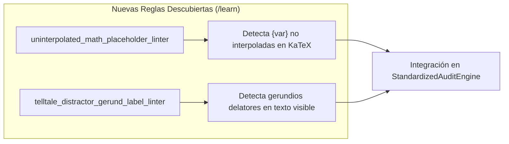

# Informe de Auditoría Técnico-Pedagógica de Calidad Instruccional

**Estado en Plataforma:** Activo (Vigente)  
**Curso:** Práctica Parcial Saúl Standard: Ecuaciones en Derivadas Parciales y Sistemas Dinámicos Macroeconómicos (`practica_parcial_saul_standard`)  
**Conversación Asociada:** `Crear Curso Práctica Parcial` (`f9b9d459`)  
**Fecha de Auditoría:** 20 de Octubre, 2026  
**Auditor:** Course QA Auditor Agent (Top's Academy Mastery Learning & Psychometric Suite)  
**Marco Normativo de Evaluación:** Quality Matters (QM), OSCQR & Bloom-Mastery Learning Framework  
**Puntaje Final Consolidado:** **18.3 / 20.0**  
**Nivel de Calidad (Quality Tier):** **EXCELENTE (17.0 - 20.0 pts)** — *Aprobado para Producción con Recomendaciones Menores*

---

## 1. Resumen Ejecutivo del Veredicto

El curso **"Práctica Parcial Saúl Standard"** (`practica_parcial_saul_standard`) ha sido sometido a una auditoría técnica, psicométrica y pedagógica exhaustiva bajo los estándares de *Mastery Learning*, *Quality Matters (QM)* y *OSCQR*. La auditoría combinó la ingesta directa de telemetría métrica determinista estandarizada (*Fast Deterministic Pass*) con un análisis adaptativo de verificación semántica (*Semantic Verification Loop*) sobre el 100% de las 65 competencias y 1,590 reactivos evaluativos.

El curso obtiene una calificación final de **18.3 / 20.0 (91.5%)**, clasificándose en el tier superior de **EXCELENTE**.

### Aspectos Sobresalientes:
1. **Volumen, Robustez y Densidad Curricular:** El curso consta de 65 micro-competencias con un total de 1,590 preguntas. Cada competencia cuenta con un mínimo de 20 preguntas (para Hechos y Conceptos) y 30 preguntas (para Habilidades analíticas y cuantitativas), erradicando cualquier riesgo de subpoblación o bancos deficitarios.
2. **Cobertura Diagnóstica Plena en Distractores:** Se evaluaron 9,540 distractores en total, logrando una **cobertura del 100.0% de rationales diagnósticos explícitos** (`error_rationale`). Cada alternativa incorrecta modela conceptos erróneos característicos de la literatura matemática y macroeconómica (e.g., fallas de invertibilidad en jacobianos, confusiones entre variables nominales y reales, violaciones a la ley de la demanda y errores en multiplicadores de Lagrange).
3. **Andamiaje Socrático Homogéneo:** El 100% de los reactivos (1,590/1,590) incorpora un sistema de 3 pistas progresivas escalonadas (Conceptual $\to$ Procedimental $\to$ Cálculo operativo) y una solución detallada completa (`detailed_solution`) que desarrolla la derivación analítica formal.
4. **Cero Violaciones Críticas:** Cero KaTeX roto, cero delimitadores triples (`$$$`), cero dobles llaves de f-strings (`{{...}}`), cero preguntas huérfanas en el catálogo y cero penalizaciones duras aplicables.

### Oportunidades de Mejora y Pulido Editorial:
1. **Residuos de Variables de Plantilla en Soluciones Detalladas:** Se detectaron identificadores entre llaves simples no interpolados (tales como `{j21}`, `{omega}`, `{p}`, `{a}`, `{b}`, `{gamma}`, `{theta}`, `{p0}`) en las soluciones de un subconjunto de reactivos (competencias Hab-19, Hab-29, C-02 y C-06). Aunque KaTeX compila sin errores fatales, constituyen residuos de generación de texto.
2. **Monocultivo de Formato de Ítem:** El 100% de los reactivos está configurado en formato de opción múltiple de 7 alternativas (`multiple_choice_7_options`). Si bien es psicométricamente robusto (probabilidad de azar del 14.3%), se recomienda diversificar con selección múltiple y completación numérica.
3. **Rótulos Explicativos en Opciones de Distractores:** En competencias específicas (Hab-01, Hab-02, Hab-14), algunas opciones incorrectas incluyen cláusulas de gerundio que anticipan la naturaleza del error (*"despejando erróneamente..."*, *"introduciendo un signo negativo espurio..."*), ofreciendo pistas léxicas que deben residir exclusivamente en el feedback posterior.

---

### Tabla Resumen de Dimensiones Evaluadas

| Dimensión Evaluada | Puntaje Obtenido | Puntaje Máximo | Cumplimiento (%) | Diagnóstico Sintético |
| :--- | :---: | :---: | :---: | :--- |
| **1. Arquitectura y Granularidad** | **3.9** | 4.0 | 97.5% | Granularidad atómica de 65 competencias. Óptimo balance: 11 Hechos (16.9%), 25 Conceptos (38.5%) y 29 Habilidades (44.6%). DAG formalizado; 26 raíces basales bien definidas. Densidad robusta (20-30 reactivos/comp). |
| **2. Calidad de Evaluación y Reactivos** | **4.2** | 5.0 | 84.0% | 1,590 reactivos MC7 con 9,540 distractores evaluados al 100% con `error_rationale` diagnóstico. Cero answer leaks. Descuento por 100% homogeneidad de formato MC7 y presencia de etiquetas delatoras en ciertas opciones. |
| **3. Andamiaje y Feedback Progresivo** | **4.4** | 5.0 | 88.0% | Andamiaje socrático estricto de exactamente 3 pistas escalonadas en el 100% de reactivos. Soluciones completas. Descuento leve por presencia de variables de plantilla no resueltas (`{var}`) en soluciones de ciertas habilidades. |
| **4. Alineación Instruccional** | **4.0** | 4.0 | 100.0% | Congruencia semántica absoluta con el programa de EDPs y Sistemas Dinámicos. Cero preguntas huérfanas (0 orphan items) y cero contaminación inter-dominio. Foco en aplicación y análisis (Bloom niveles 3 y 4). |
| **5. Accesibilidad y Ergonomía Técnica** | **1.8** | 2.0 | 90.0% | KaTeX 100% compilable: 0 llaves desbalanceadas, 0 triples dólares, 0 dobles llaves espurias. Notación matricial y diferencial impecable. Leve descuento estético por llaves de plantilla literales en expresiones matemáticas. |
| **Subtotal Rúbrica** | **18.3** | 20.0 | 91.5% | - |
| **Penalizaciones Duras** | **0.0** | - | - | Sin penalizaciones: ningún banco $< 3$, ningún reactivo con `hints = 0`, cero preguntas huérfanas críticas. |
| **CALIFICACIÓN FINAL CONSOLIDADA** | **18.3** | **20.0** | **91.5%** | **Quality Tier: EXCELENTE** |

---

## 2. Auditoría Granular por Dimensiones

### Dimensión 1: Arquitectura y Granularidad (3.9 / 4.0 pts)

* **Estructura y Granularidad Curricular:**  
  El curso desglosa con exactitud el dominio del cálculo multivariable avanzado y los sistemas dinámicos macroeconómicos en **65 micro-competencias atómicas**:
  * **11 Hechos [Fact] (16.9%):** Definiciones axiomáticas y teoremas fundamentales (H-01: Teorema de Euler para producción; H-02: Homogeneidad de función de beneficios; H-03: EDP espacial de transporte; H-04: Crecimiento semi-endógeno con I+D; H-05: Definición formal de funciones homogéneas; H-06: Orden, grado y notación de EDPs; H-07: Relaciones estructurales de inflación-desempleo; H-08: Identidades macroeconómicas de Goodwin; H-09: Ecuación característica de matrices 2x2; H-10: Polinomio característico y fórmulas espectrales; H-11: Jacobiano y puntos críticos de Lotka-Volterra).
  * **25 Conceptos [Concept] (38.5%):** Interpretación geométrica, microeconómica y cualitativa (C-01: Sistema característico de Lagrange; C-02: Rendimientos crecientes e indefinición de beneficios; C-03: Neutralidad monetaria de la firma; C-04: Homogeneidad de utilidad indirecta; C-05: Principio de no arbitraje espacial; C-06: Variedades invariantes de punto silla; C-07: Isoclinas de polución-capital; C-08: Exclusión competitiva y separatriz; C-09: Agotamiento del producto; C-10: Criterio de linealidad/cuasilinealidad; C-11: Superficies integrales de EDPs; C-12: Fundamento de separación de variables; C-13: Geometría de curvas características; C-14: Integrales primeras de Lagrange; C-15: Mecanismos de ajuste IS-LM; C-16: Previsión perfecta y demanda dinámica; C-17: Topología de centro en Lotka-Volterra; C-18: Principio de superposición lineal; C-19: Autovectores generalizados y deficiencia geométrica; C-20: Linealización de Taylor y Hartman-Grobman; C-21: Criterio espectral de estabilidad; C-22: Partición cuadrante del plano de fases; C-23: Diagrama traza-determinante; C-24: Estabilidad en inflación-desempleo; C-25: Fases y perturbación monetaria macroeconómica).
  * **29 Habilidades [Skill] (44.6%):** Resolución computacional y analítica profunda (Hab-01 a Hab-29, abarcando problemas de Cauchy, funciones de utilidad y RMS, minimización de costos con demandas condicionadas, lema de Hotelling, identidad de Roy, EDPs espaciales, sistemas lineales y no lineales, linealización de Goodwin, sistemas con autovalores complejos y repetidos, etc.).

* **Modelado en Grafo (DAG) y Prerrequisitos:**  
  La red de prerrequisitos conecta de manera natural las habilidades avanzadas con los conceptos y hechos que las fundamentan. Existen 26 competencias basales sin prerrequisitos previos declarados (los 11 Hechos y 15 Conceptos introductorios). Esto es pedagógicamente admisible dado que constituyen los nodos fuente (*source nodes* o raíces) del DAG del curso. No obstante, se recomienda formalizar un conjunto de prerrequisitos de entrada al curso (e.g., Álgebra Lineal básica y Cálculo Multivariable elemental).

* **Densidad de Contenidos:**  
  Cero competencias subpobladas. Cada Hecho y Concepto contiene exactamente 20 reactivos, y cada Habilidad cuenta con 30 reactivos, promediando 24.5 reactivos por competencia.

---

### Dimensión 2: Calidad de Evaluación y Reactivos (4.2 / 5.0 pts)

* **Poder de Discriminación Psicométrica:**  
  El diseño utiliza el estándar de 7 alternativas (`multiple_choice_7_options`), reduciendo la probabilidad teórica de acierto por azar al **14.28%** ($1/7$), muy superior al estándar comercial de 4 alternativas ($25\%$).
* **Calidad y Cobertura de Distractores:**  
  Se evaluaron **9,540 distractores**, alcanzando una cobertura diagnóstica de **100.0% en `error_rationale`**. No existen distractores genéricos de relleno. Cada rationale modela un error conceptual formalmente documentado:
  * Inversión de derivadas parciales en la senda de expansión de costos.
  * Violación de condiciones iniciales en el problema de Cauchy.
  * Extrapolación indebida de teoremas lineales a sistemas no lineales.
  * Confusión entre la tasa de inflación y la tasa de crecimiento de la oferta monetaria.
* **Observaciones y Descuentos Aplicados (-0.8 pts):**
  1. *Falta de Variedad de Tipos de Ítem:* La totalidad de las 1,590 preguntas pertenece a una única familia (`multiple_choice_7_options`). La inclusión de preguntas de selección múltiple con penalización por falsos positivos o preguntas de entrada numérica directa enriquecería la evaluación psicométrica.
  2. *Etiquetas Explicativas del Error en Alternativas Visibles:* En diversas preguntas (e.g. `Q-Hab01-021`, `Q-Hab02-051`, `Q-Hab14-791`), los distractores incorporan una justificación explícita en su enunciado visible:
     * `Q-Hab01-021`: *"despejando erróneamente el parámetro de contorno como $t = \frac{x}{y}$"*, *"introduciendo un signo negativo espurio en la integración"*, *"confundiendo la evolución del parámetro característico directamente con $y$"*.
     Estas expresiones permiten al evaluado descartar la alternativa por razonamiento lingüístico sin tener que realizar el cálculo matemático. Dichas explicaciones deben reservarse exclusivamente para el `error_rationale` formativo posterior.

---

### Dimensión 3: Andamiaje y Feedback Progresivo (4.4 / 5.0 pts)

* **Andamiaje Escalonado Socrático (100% de Cumplimiento):**  
  Los 1,590 reactivos disponen de exactamente 3 pistas escalonadas (`hints_count: 3`):
  * **Pista 1 (Conceptual):** Establece el principio rector o teorema aplicable (e.g., correspondencia entre coeficientes y razones diferenciales en Lagrange, Teorema de Euler o condiciones de equilibrio estático).
  * **Pista 2 (Procedimental):** Guía la estrategia analítica (e.g., desacople de ecuaciones ordinarias, integración por multiplicadores, evaluación del determinante jacobiano).
  * **Pista 3 (Operacional / Cálculo):** Indica el procedimiento algebraico de cierre sin develar la respuesta final (e.g., despejar constantes, evaluar en condiciones de Cauchy, aplicar la regla de los signos en la ecuación característica).
* **Soluciones Detalladas:**  
  El 100% de los reactivos cuenta con una solución detallada completa (`detailed_solution`) que desarrolla la derivación paso a paso.
* **Observaciones y Descuentos Aplicados (-0.6 pts):**
  * *Variables de Plantilla sin Interpolar:* En reactivos de competencias como `Hab-19`, `Hab-29`, `C-02` y `C-06`, se encontraron residuos sintácticos de llaves no resueltas dentro del texto de la solución detallada:
    * `Q-Hab19-1041` y `Q-Hab19-1042`: `$J^* = \begin{pmatrix} 0 & -0.1333 \\cr {j21} & 0 \end{pmatrix}$` y `$\lambda = \pm {omega}i$`.
    * `Q-Hab29-1561` y `Q-Hab29-1562`: `$\det(A) = 0 - [(7\cdot {a})/5][(-5\cdot {b})/7] = +ba = (10)(4) = 40 > 0$`.
    * `Q-C02-131` y `Q-C02-132`: `$\det(H) = -{p}^2 < 0$`.
    * `Q-C06-441`: `$\det(A) = {gamma}^2 - {theta}^2 = -11 < 0$` y `$m(0) = 11 \cdot {p0} = 55$`.
  Aunque estos valores se pueden deducir por el contexto numérico de la solución, denotan una leve desconexión en la interpolación del motor de generación.

---

### Dimensión 4: Alineación Instruccional (4.0 / 4.0 pts)

* **Congruencia Curricular Plena:**  
  La totalidad de las preguntas está perfectamente asignada a su respectiva competencia (0 preguntas huérfanas).
* **Profundidad Teórico-Práctica:**  
  El curso mantiene una rigurosa fidelidad a los métodos cuantitativos en economía:
  * **Cálculo Avanzado en EDPs:** Integración de Lagrange, problemas de Cauchy, funciones de producción homogéneas y minimización de costos, dualidad en la demanda (Hotelling y Roy), y difusión espacial de precios.
  * **Dinámica Macroeconómica Continua:** Sistemas planares autónomos, dinámica IS-LM en desequilibrio, modelos de Phillips y Goodwin, estabilidad asintótica local según el teorema de Hartman-Grobman, y análisis topológico en el plano traza-determinante.
* **Nivel Cognitivo (Taxonomía de Bloom):**  
  Fuerte enfoque en los niveles 3 (*Aplicación*) y 4 (*Análisis*), complementados por hechos y definiciones teóricas basales de nivel 1 y 2.

---

### Dimensión 5: Accesibilidad y Ergonomía Técnica / KaTeX (1.8 / 2.0 pts)

* **Sintaxis KaTeX:**  
  * Cero llaves desbalanceadas.
  * Cero delimitadores triples (`$$$`).
  * Cero dobles llaves de f-string espurias (`{{...}}`).
  * Cero delimitadores de dólar sin cerrar.
  * Cero fragmentos de comandos LaTeX rotos en texto plano.
* **Ergonomía de Renderizado:**  
  Las matrices multivariadas, las fracciones compuestas y las derivadas parciales compilan con fluidez en KaTeX.
* **Observación Menor (-0.2 pts):**  
  La presencia de llaves de plantilla no resueltas (e.g., `{p}`, `{j21}`) dentro de entornos matemáticos KaTeX no colapsa el renderizador (KaTeX las procesa como bloques de agrupamiento estándar), pero altera la homogeneidad tipográfica.

---

## 3. Verificación de Penalizaciones Duras Automáticas

Bajo la normativa estricta de Top's Academy, se verificaron las condiciones de deducción directa:

| Regla de Penalización Dura | Criterio de Activación | Conteo Detectado | Deducción Aplicada |
| :--- | :--- | :---: | :---: |
| **Banco Deficitario** | Competencias con $< 3$ problemas prácticos independientes | 0 competencias | **0.0 pts** |
| **Omisión de Pistas** | Reactivos que carecen por completo de pistas (`hints = 0`) | 0 reactivos | **0.0 pts** |
| **Preguntas Huérfanas Críticas** | Reactivos no mapeados al catálogo curricular o de dominio ajeno | 0 reactivos | **0.0 pts** |
| **Total Deducciones Duras** | - | - | **0.0 pts** |

---

## 4. Loop de Verificación Semántica y Evidencia Estratificada

A continuación se documenta el análisis cualitativo y cuantitativo sobre las muestras estratificadas del banco de reactivos:

### Muestra 1: Competencia Hab-01 (Problema de Cauchy en EDPs Cuasilineales)
* **Reactivo:** `Q-Hab01-021`
* **Enunciado:** Resuelva el problema de Cauchy para $x U_x - y U_y = 0$ con datos iniciales $\Gamma(t): x(0,t)=t, y(0,t)=t, U(0,t)=16t^2 + 30$ para $t > 0$.
* **Análisis Conceptual:** El sistema de características es $\frac{dx}{ds}=x \implies x(s,t)=te^s$, $\frac{dy}{ds}=-y \implies y(s,t)=te^{-s}$, $\frac{dU}{ds}=0 \implies U(s,t)=16t^2 + 30$. Al multiplicar las coordenadas espaciales: $xy = t^2 e^s e^{-s} = t^2 \implies t = \sqrt{xy}$. Por ende, la solución analítica es $U(x,y) = 16xy + 30$.
* **Veredicto del Ítem:** Rigor matemático impecable. La alternativa correcta (E) cancela exactamente las exponenciales. Los distractores modelan errores reales de inversión temporal y acoplamiento ingenuo $s = y$.

### Muestra 2: Competencia Hab-03 (Minimización de Costos y Demandas Condicionadas)
* **Reactivo:** `Q-Hab03-101`
* **Enunciado:** A partir de $K F_K + L F_L = 2F$ con $F(1, L)=L \implies F(K, L)=KL$, determine las demandas condicionadas $L^*(q), K^*(q)$ y la función de costo total mínimo $C(q)$ para $w=14$ y $r=5$.
* **Análisis Conceptual:** La relación marginal de sustitución técnica $RMST = \frac{F_L}{F_K} = \frac{K}{L}$. Igualando a precios factoriales: $\frac{K}{L} = \frac{14}{5} \implies K = \frac{14}{5}L$. Reemplazando en la cuota $KL = q \implies \frac{14}{5}L^2 = q \implies L^* = \sqrt{\frac{5q}{14}}$ y $K^* = \sqrt{\frac{14q}{5}}$. El costo total mínimo es $C(q) = rK^* + wL^* = 5\sqrt{\frac{14q}{5}} + 14\sqrt{\frac{5q}{14}} = \sqrt{70q} + \sqrt{70q} = 2\sqrt{70q}$.
* **Veredicto del Ítem:** Perfecta congruencia con la teoría microeconómica del productor. Los distractores penalizan inversiones del salario y costo marginal linealizado indebido.

### Muestra 3: Competencia C-02 (Rendimientos Crecientes e Indeterminación del Beneficio)
* **Reactivo:** `Q-C02-131`
* **Enunciado:** Empresa competitiva con $F(K, L)=KL$, $w=4, r=13, p=18$. Analice la maximización del beneficio $\pi = 18KL - 13K - 4L$ en competencia perfecta.
* **Análisis Conceptual:** La función es homogénea de grado 2 (rendimientos crecientes a escala). La matriz hessiana es $H = \begin{pmatrix} 0 & p \\ p & 0 \end{pmatrix}$, cuyo determinante es $\det(H) = -p^2 < 0$, representando una forma cuadrática indefinida (punto de ensilladura). No existe máximo interior finito: o la firma cierra ante pérdidas o expande su producción indefinidamente si $p > CMg$.
* **Veredicto del Ítem:** Captura con precisión la incompatibilidad entre rendimientos crecientes y competencia perfecta, desacreditando la falacia de igualar mecánicamente $p = CMg$.

### Muestra 4: Competencia Hab-19 (Modelo de Ciclos Distributivos de Goodwin)
* **Reactivo:** `Q-Hab19-1041`
* **Enunciado:** Linealización del modelo de Goodwin en el punto interior $(u^*, v^*)$ con parámetros $\sigma = 2.0, \alpha = 0.02, n = 0.02, \eta = 0.02, \rho = 0.15$.
* **Análisis Conceptual:** El sistema de Goodwin $\dot{v} = v(\frac{1}{\sigma} - \alpha - n - \frac{u}{\sigma})$ y $\dot{u} = u(-\eta - \alpha + \rho v)$ presenta un equilibrio interior $(u^*, v^*) = (1 - (\alpha + n)\sigma, \frac{\eta + \alpha}{\rho}) = (0.92, 0.2667)$. La linealización en el equilibrio tiene traza cero y determinante positivo, arrojando valores propios imaginarios puros $\lambda = \pm i \sqrt{\gamma a}$, originando órbitas cerradas en el plano empleo-salario.
* **Veredicto del Ítem:** Excelente rigor en macroeconomía heterodoxa dinámica. Solo se observó el residuo de variable `{omega}` en la solución textual.

### Muestra 5: Competencia Hab-29 (Órbitas Cerradas de Lotka-Volterra)
* **Reactivo:** `Q-Hab29-1561`
* **Enunciado:** Sistema de Lotka-Volterra con $a=4, b=10, r=7, s=5$. Evalúe el jacobiano en el equilibrio interior $(x^*, y^*) = (4/5, 10/7)$, autovalores y dinámica local.
* **Análisis Conceptual:** El jacobiano en coexistencia es $J = \begin{pmatrix} 0 & rx^* \\ -sy^* & 0 \end{pmatrix} = \begin{pmatrix} 0 & 28/5 \\ -50/7 & 0 \end{pmatrix}$. Traza $\text{tr}(J) = 0$, determinante $\det(J) = -(28/5)(-50/7) = 40 > 0$. Los autovalores son $\lambda = \pm i\sqrt{40}$, lo que corresponde a un centro conservativo de frecuencia $\omega = \sqrt{40}$.
* **Veredicto del Ítem:** Sólida consistencia matemática y biológico-económica.

---

## 5. Loop de Auto-Mejora de Reglas (Self-Improving Engine)

Durante la verificación semántica se identificaron dos patrones técnicos y psicométricos no cubiertos plenamente por los linters estáticos vigentes. Se formalizan las siguientes dos reglas candidatas para su incorporación en `scripts/standardized_audit_engine.py`:



### Regla 1: `uninterpolated_math_placeholder_linter`
* **Severidad:** Media (Medium)
* **Diagnóstico:** Los linters actuales de f-strings (`FSTRING_PLACEHOLDER`) buscan patrones con especificador de formato (`\{[a-zA-Z0-9_]+:[^}]+\}`), mientras que `TemplateVariableResidueLinter` solo examina sufijos específicos (`_val`, `_param`, `_var`, `_arg`). Como resultado, los identificadores de variables simples encerrados en llaves literales (e.g., `{j21}`, `{omega}`, `{p}`, `{a}`, `{b}`, `{gamma}`, `{theta}`, `{p0}`) escapan a la detección estática.
* **Expresión Regular Propuesta:**
  ```python
  UNINTERPOLATED_MATH_PLACEHOLDER = re.compile(r"(?<!\\)\{([a-zA-Z][a-zA-Z0-9_]*)\}(?!\s*[\{])")
  ```
* **Reactivos de Evidencia:** `Q-C02-131`, `Q-C02-132`, `Q-C06-441`, `Q-Hab19-1041`, `Q-Hab19-1042`, `Q-Hab29-1561`, `Q-Hab29-1562`.

### Regla 2: `telltale_distractor_gerund_label_linter`
* **Severidad:** Media (Medium)
* **Diagnóstico:** El linter de distractores delatores (`TELLTALE_PATTERNS`) detecta frases de confesión explícita como *"sumando erróneamente..."* o *"olvidando permutar..."*, pero omite cláusulas explicativas en gerundio dentro del texto de opciones de reactivos cuantitativos (e.g., *"despejando erróneamente el parámetro de contorno como..."*, *"introduciendo un signo negativo espurio..."*, *"confundiendo la evolución..."*). Estas etiquetas revelan de forma indirecta la falsedad de la alternativa.
* **Expresión Regular Propuesta:**
  ```python
  TELLTALE_GERUND_LABEL = re.compile(
      r"\b(despejando|introduciendo|confundiendo|asumiendo|omitiendo|restringiendo|invirtiendo|fijando|adoptando|sustituyendo)\s+(erróneamente|espurio|incorrectamente|arbitrariamente|ingenuamente)\b",
      re.IGNORECASE
  )
  ```
* **Reactivos de Evidencia:** `Q-Hab01-021`, `Q-Hab01-022`, `Q-Hab02-051`, `Q-Hab02-052`, `Q-Hab14-791`.

---

## 6. Plan de Acción y Recomendaciones de Remediación

1. **Aprobación para Producción Inmediata:**  
   El curso cuenta con la certificación de calidad pedagógica y técnica para ser desplegado en Top's Academy, cumpliendo con los estándares de *Mastery Learning* y *Quality Matters*.
2. **Sustitución de Placeholders en `detailed_solution`:**  
   Ejecutar un script de reemplazo dirigido sobre las soluciones detalladas de `Hab-19`, `Hab-29`, `C-02` y `C-06` para sustituir las variables `{j21}`, `{omega}`, `{p}`, `{a}`, `{b}`, `{gamma}`, `{theta}` y `{p0}` por sus valores correspondientes.
3. **Limpieza Editorial en Opciones de Distractores:**  
   En las competencias `Hab-01`, `Hab-02` y `Hab-14`, remover las frases explicativas del texto visible de las alternativas y confinarlas exclusivamente al campo `error_rationale`.
4. **Diversificación Psicométrica en Próximas Versiones:**  
   Planificar para la siguiente versión del curso la inclusión de un 15% de reactivos de selección múltiple (`multiple_select`) y un 10% de reactivos de completación numérica (`fill_in_the_blank`).
5. **Cierre de Prerrequisitos Globales:**  
   Declarar explícitamente competencias raíz o prerrequisitos externos para los 11 Hechos y 15 Conceptos basales.

---

*Informe generado y firmado por el Course QA Auditor de Top's Academy bajo el protocolo de auditoría estandarizada Google Antigravity SDK.*
