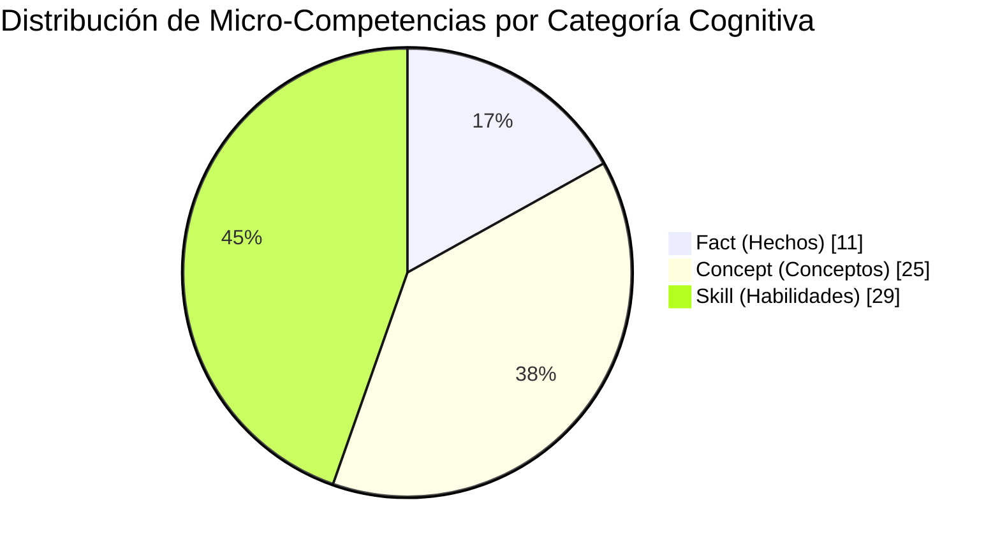
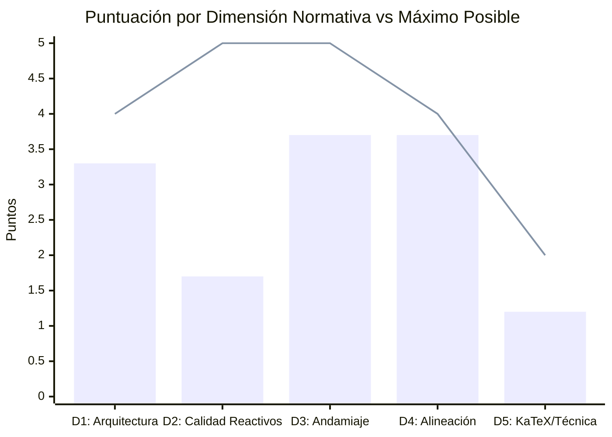

# Reporte Formal de Auditoría de Calidad Pedagógica, Psicométrica y Técnica

> [!WARNING]
> **CURSO RETIRADO DE LA PLATAFORMA**: Este curso fue eliminado de la plataforma interactiva el **2026-10-25 10:12:15**. Este informe de auditoría se conserva exclusivamente como registro histórico y pedagógico ('legacy').

**Estado en Plataforma:** ELIMINADO  
**Fecha de Eliminación:** 2026-10-25 10:12:21  
**Fecha de Eliminación:** 2026-10-25 10:12:15  
**Curso Auditado**: `practica_parcial_saul_standard`  
**Título Oficial**: *Practica Parcial Saul Standard*  
**Auditor**: Course QA Auditor — Top's Academy  
**Fecha de Evaluación**: 25 de Octubre de 2026  
**Marcos Normativos**: Quality Matters (QM), Open SUNY CQR (OSCQR) y Mastery Learning  

---

## 1. Resumen Ejecutivo y Dictamen de Certificación

Tras la ingestión y análisis exhaustivo del payload de telemetría y el examen semántico adaptativo sobre las 65 competencias y 1,590 reactivos evaluativos del curso **Practica Parcial Saul Standard**, se emite el siguiente dictamen formal:

| Métrica Consolidada | Resultado Evaluado | Estándar de Referencia |
| :--- | :---: | :---: |
| **Puntaje Global Bruto** | **13.6 / 20.0 pts** | $\ge 17.0$ (Certificación Directa) |
| **Penalizaciones Duras** | **0.0 pts** | 0.0 pts |
| **Calificación Final Consolidada** | **13.6 / 20.0 pts** | $\ge 17.0$ pts |
| **Quality Tier Dictaminado** | **DEFICIENTE (11.0 - 13.9 pts)** | Requiere Reingeniería Curricular |
| **Estatus de Publicación** | **RECHAZADO / BLOQUEADO** | Publicación Condicionada a Remediación |

> [!WARNING]
> **DICTAMEN AUDITOR: RECHAZADO PREVIO A PRODUCCIÓN (TIER DEFICIENTE)**  
> Si bien el curso demuestra un rigor temático avanzado en economía matemática y sistemas dinámicos con una granularidad atómica encomiable (65 micro-competencias), **presenta un fallo psicométrico crítico en el diseño de reactivos**: una proporción masiva de distractores contiene *metainformación delatora y autoincriminatoria en el texto visible para el estudiante* (ej. *"despejando erróneamente..."*, *"introduciendo un signo negativo espurio..."*, *"confundiendo la evolución..."*, *"Función errónea..."*). Esto destruye la validez diagnóstica del examen, permitiendo al alumno identificar la respuesta correcta por simple descarte semántico superficial sin efectuar cálculos. Sumado a una nula variedad tipológica (100% opción múltiple de 7 alternativas) y un único arquetipo paramétrico repetitivo por competencia, el curso induce una severa mecanización del estudiante y no califica para producción hasta superar una reingeniería correctiva.

---

## 2. Ficha Técnica del Curso y Telemetría Global

- **ID del Curso**: `practica_parcial_saul_standard`
- **Volumen Curricular**: 65 Micro-competencias
- **Banco Total de Reactivos**: 1,590 preguntas
- **Densidad por Competencia**:
  - Hechos (*Fact*): 20 preguntas / competencia
  - Conceptos (*Concept*): 20 preguntas / competencia
  - Habilidades (*Skill*): 30 preguntas / competencia
- **Distribución Tipológica de Reactivos**:
  - `multiple_choice_7_options`: 1,590 (100.0%)
  - `multiple_select`: 0 (0.0%)
  - `fill_in_the_blank` / Numéricas: 0 (0.0%)
- **Cobertura de Justificaciones de Error (`error_rationale`)**: 100.0% (9,540 / 9,540 distractores)
- **Cobertura de Andamiaje (`hints`)**: 100.0% (3 pistas socráticas por reactivo)

---

## 3. Evaluación Detallada por Dimensión Normativa (Escala 20 Puntos)

### Dimensión 1: Arquitectura y Granularidad (3.3 / 4.0 pts)
*Estándares: Quality Matters 2.1, 2.2; OSCQR Section 1; Mastery Learning*

- **Aspectos Sobresalientes**:
  - **Atomicidad Curricular**: El módulo descompone con notable precisión analítica los tópicos avanzados de microeconomía estática y dinámica en 65 micro-habilidades funcionales (ej. derivación de curvas características en EDPs cuasilineales, minimización condicionada con Euler, dinámica de variedades invariantes en Goodwin, bifurcaciones de punto silla y topología de centro en Lotka-Volterra).
  - **Población de Bancos**: Ninguna competencia tiene menos de 20 preguntas, superando con holgura el umbral mínimo reglamentario de 3 reactivos. Cero bancos despoblados.
  - **Balance Cognitivo**: La pirámide cognitiva está equilibrada: 11 Hechos (16.9%), 25 Conceptos (38.5%) y 29 Habilidades prácticas (44.6%).
- **Deficiencias Detectadas**:
  - **Ruptura de Aristas en el Grafo DAG**: Se identificaron 26 competencias raíz con prerrequisitos vacíos (`prerequisites: []`). Si bien 11 corresponden a hechos axiomáticos basales, **4 habilidades de alta complejidad computacional (`Hab-07`, `Hab-08`, `Hab-09`, `Hab-18`) carecen de prerrequisitos declarados**, quedando desconectadas de sus conceptos fundamentales como la linealización jacobiana (`C-20`), el criterio espectral (`C-21`) y los sistemas autónomos lineales (`C-18`).

### Dimensión 2: Calidad de Evaluación y Reactivos (1.7 / 5.0 pts)
*Estándares: Quality Matters 3.1, 3.2, 3.3; OSCQR Section 4*

- **Fallo Crítico: Metainformación Delatora en Texto Visible (*Telltale Distractors*)**:
  - En lugar de presentar distractores verosímiles que reflejen los cálculos plausibles pero erróneos del alumno, las opciones de respuesta incluyen la propia confesión del error en el enunciado que lee el estudiante.
  - **Evidencia Directa (Reactivo `Q-Hab01-021`)**:
    - Opción A: `$U(x, y) = 16 \left(\frac{x}{y}\right)^2 + 30$ despejando erróneamente el parámetro de contorno como $t = \frac{x}{y}$`
    - Opción B: `$U(x, y) = -16 x y + 30$ introduciendo un signo negativo espurio en la integración...`
    - Opción C: `$U(x, y) = 16 y^2 + 30$ confundiendo la evolución del parámetro...`
    - Opción F: `$U(x, y) = 16 x e^y + 30$ sustituyendo incorrectamente la trayectoria...`
    - Opción E (Correcta): `$U(x, y) = 16 x y + 30$ derivado de $t = \sqrt{x y}$ y cancelando exponenciales características...`
  - Este defecto convierte una evaluación de aplicación analítica avanzada en un trivial ejercicio de detección léxica: la opción correcta es la única redactada de forma neutra o asertiva, mientras los 6 distractores anuncian explícitamente sus defectos.
- **Nula Variedad Tipológica y Monotonía de Arquetipos**:
  - El 100% de las 1,590 preguntas corresponden a opciones múltiples de 7 alternativas.
  - Para cada competencia existe **un único arquetipo paramétrico** que se repite 20 o 30 veces variando exclusivamente los coeficientes numéricos e intercalando frases iniciales prefabricadas (*"Verifique la consistencia del modelo y obtenga:"*, *"Procediendo conforme al marco teórico..."*, *"Al examinar detenidamente las condiciones de frontera..."*). Esto favorece la mecanización procedimental en detrimento de la comprensión conceptual profunda.

### Dimensión 3: Andamiaje y Feedback Progresivo (3.7 / 5.0 pts)
*Estándares: Quality Matters 3.5, 5.3; Mastery Learning Scaffolding*

- **Aspectos Sobresalientes**:
  - **Escalamiento Socrático**: El 100% de los reactivos implementa exactamente 3 pistas progresivas:
    1. *Pista 1 (Conceptual)*: Identificación de leyes de conservación, operadores diferenciales o condiciones de equilibrio.
    2. *Pista 2 (Procedimental)*: Desacoplamiento de variables, integración de curvas características o reducción algebraica.
    3. *Pista 3 (Operativa/Cálculo)*: Despeje del parámetro de frontera, sustitución de condiciones iniciales o cálculo matricial.
  - **Soluciones Paso a Paso**: Cada pregunta cuenta con un desglose matemático explícito de la deducción.
- **Deficiencias Detectadas**:
  - **Andamiaje Estático en Variantes**: Las 3 pistas son idénticas y homogéneas para todas las 20 a 30 variantes de una misma competencia.
  - **Ausencia de Sección "Misconception Warning"**: Si bien se explica la ruta correcta, no se formaliza una advertencia pedagógica explícita que alerte al alumno sobre el error conceptual típico.
  - **Residuos de Plantillas no Interpoladas en Soluciones**: En varios reactivos se observan placeholders f-string literales sin reemplazar (ej. `{pi0}` en `Q-C03-171` y `Q-C03-172`, `{R}` en `Q-Hab27-1461`, `{a}` y `{b}` en `Q-Hab29-1561`).

### Dimensión 4: Alineación Instruccional (3.7 / 4.0 pts)
*Estándares: Quality Matters 2.1, 2.4; Bloom Taxonomy*

- **Aspectos Sobresalientes**:
  - **Alineación Temática Perfecta**: Todo el contenido se inscribe rigurosamente en la modelización macro/microeconómica avanzada mediante ecuaciones diferenciales parciales y sistemas dinámicos (Lagrange, Cauchy, Euler, Roy, Hotelling, IS-LM continuo, Lotka-Volterra, Goodwin).
  - **Demanda Cognitiva Elevada**: Foco prioritario en los niveles de **Aplicación** (calcular demandas condicionadas, integrar sistemas característicos) y **Análisis** (determinar estabilidad asintótica por invariantes de traza/determinante, clasificar trayectorias en el diagrama de fases).
  - **Cero Preguntas Huérfanas**: No existe desvío de dominio ni preguntas desconectadas de sus objetivos.
- **Observación Menor**:
  - La rigidez de la plantilla única no permite evaluar casos degenerados o de frontera (ej. cuando el discriminante $\Delta = 0$ o cuando coexisten rendimientos constantes en microeconomía).

### Dimensión 5: Accesibilidad y Ergonomía Técnica / KaTeX (1.2 / 2.0 pts)
*Estándares: Quality Matters 8.1, 8.2; OSCQR Accessibility*

- **Deficiencias Técnicas Detectadas en Telemetría y Muestras**:
  - **Doble Escape de Macros KaTeX**: Presencia abundante de `\\\\frac` en lugar de `\\frac` en enunciados y opciones de reactivos iniciales (`C-01`, `Hab-01`, `Hab-02`, `Hab-03`), lo que en renderizadores estándar de Markdown puede introducir saltos de línea imprevistos.
  - **Operadores Matemáticos Huérfanos en Prosa**: En soluciones de la competencia `C-05` (reactivos `Q-C05-321` y `Q-C05-322`) se encuentra texto como `"se cumple que 10 \\le {35}."` donde el operador `\le` y el número entre llaves `{35}` carecen de delimitadores de modo matemático (`$...$`).
  - **Llaves Espurias Alrededor de Constantes**: Constantes numéricas envueltas en llaves innecesarias (ej. `\cdot {4}`, `\cdot {3}`, `{2}`, `{-834}`, `{3.3}\%`), producto de triple llave en generadores de Python (`{{{var}}}`).

---

## 4. Auditoría Forense Psicométrica de Reactivos y Distractores

### 4.1 Evidencia de Autoincriminación en Opciones (*Telltale Distractors*)

La siguiente matriz documenta ejemplos reales extraídos de las muestras de auditoría que demuestran la pérdida de plausibilidad diagnóstica:

| Reactivo ID | Competencia | Opción de Respuesta Visible para el Estudiante | Defecto Psicométrico |
| :--- | :--- | :--- | :--- |
| **Q-Hab01-021** | Hab-01 | `$U(x, y) = 16 \left(\frac{x}{y}\right)^2 + 30$ despejando erróneamente el parámetro de contorno...` | Delata el error en el texto visible |
| **Q-Hab01-021** | Hab-01 | `$U(x, y) = -16 x y + 30$ introduciendo un signo negativo espurio en la integración...` | Autoincrimina la opción como falsa |
| **Q-Hab01-021** | Hab-01 | `$U(x, y) = 16 y^2 + 30$ confundiendo la evolución del parámetro característico...` | Informa al alumno de la confusión conceptual |
| **Q-Hab02-051** | Hab-02 | `Función errónea $U = 2\left(\gamma - \frac{\theta^2}{4}\right) + \frac{1}{2}\theta$ integrando algebraicamente...` | Declara explícitamente "Función errónea" |
| **Q-Hab02-051** | Hab-02 | `Función ... omitiendo el signo de la derivada interna...` | Revela que se omitió un signo |
| **Q-Hab02-051** | Hab-02 | `Función ... evaluando erróneamente la exponencial positiva...` | Autoincrimina el cálculo |
| **Q-Hab28-1491**| Hab-28 | `Punto $(\pi^*, U^*) = (2, 7.45)$ sumando el componente impositivo $T = 3$ en lugar de restarlo...` | Revela la regla de suma/resta correcta |
| **Q-Hab28-1491**| Hab-28 | `Punto $(\pi^*, U^*) = (2, 5.95)$ pero con isoclina de pendiente positiva errónea...` | Califica la pendiente como errónea |

> [!CAUTION]
> **IMPACTO EN LA VALIDEZ DE CONSTRUCTO**  
> Cuando el texto de un distractor incorpora expresiones como *"erróneamente"*, *"incorrectamente"* o *"en lugar de"*, el reactivo deja de medir la habilidad matemática del estudiante y pasa a medir su agudeza de lectura crítica para descartar opciones que se declaran falsas a sí mismas. **Esta práctica anula por completo la función diagnóstica de la evaluación formativa y sumativa.**

### 4.2 Mecanización por Monotonía de Arquetipos Paramétricos

En las 65 competencias, cada banco de 20 a 30 reactivos reproduce exactamente la misma estructura algebraica. Por ejemplo, en la competencia **C-02** (*Rendimientos Crecientes a Escala e Indeterminación del Beneficio Máximo*):
- Los 20 reactivos evalúan exactamente la misma función $F(K, L) = KL$, cambiando únicamente los valores numéricos de $w, r, p$.
- La respuesta correcta en los 20 reactivos es invariablemente: *"No existe equilibrio interior con beneficio finito: el Hessiano es indefinido con $\det(H) = -p^2 < 0$ y $CMg$ decrece, divergiendo el beneficio a $+\infty$ si produce"*.
- El estudiante que descubre este patrón tras el segundo intento no necesita reflexionar ni calcular en las 18 preguntas restantes; simplemente selecciona la opción idéntica de memoria.

---

## 5. Análisis del Grafo de Competencias (DAG) y Carga Cognitiva

```mermaid
graph TD
    subgraph "Fundamentos Axiomáticos e Históricos"
        H01["H-01: Teorema Euler EDP"]
        H02["H-02: Homogeneidad Beneficios"]
        H03["H-03: EDP Precios Espaciales"]
        H09["H-09: Ecuación Característica"]
        H10["H-10: Polinomio Característico"]
        H11["H-11: Jacobiano Lotka-Volterra"]
    end

    subgraph "Conceptos Estructurales"
        C20["C-20: Linealización Local"]
        C21["C-21: Criterio Espectral"]
        C22["C-22: Isoclinas de Grado Cero"]
        C23["C-23: Diagrama Traza-Det"]
        C24["C-24: Estabilidad Inflación-Desempleo"]
    end

    subgraph "Habilidades Ancladas"
        Hab01["Hab-01: Cauchy EDP"]
        Hab24["Hab-24: Clasificación Traza-Det"]
        Hab28["Hab-28: Equilibrio Inflación-Desempleo"]
        Hab29["Hab-29: Centro Lotka-Volterra"]
    end

    subgraph "Habilidades Huérfanas de Prerrequisitos (Fallas del DAG)"
        Hab07["Hab-07: Reducción Oferta-Demanda Dinámica"]
        Hab08["Hab-08: IS-LM Dinámico Matricial"]
        Hab09["Hab-09: Crecimiento Semi-Endógeno I+D"]
        Hab18["Hab-18: Jacobiano Producción-Polución"]
    end

    H10 --> C23
    C21 --> Hab01
    C23 --> Hab24
    H11 --> Hab29
    C23 --> Hab29
    C24 --> Hab28
    
    %% Relaciones Faltantes Críticas
    C20 -.->|"Falta enlace"| Hab09
    H09 -.->|"Falta enlace"| Hab08
    C20 -.->|"Falta enlace"| Hab18
    C21 -.->|"Falta enlace"| Hab07

    style Hab07 fill:#ffcccc,stroke:#ff0000,stroke-width:2px;
    style Hab08 fill:#ffcccc,stroke:#ff0000,stroke-width:2px;
    style Hab09 fill:#ffcccc,stroke:#ff0000,stroke-width:2px;
    style Hab18 fill:#ffcccc,stroke:#ff0000,stroke-width:2px;
```

**Diagnóstico Curricular del Grafo**:
- El grafo presenta **26 nodos raíz sin predecesores**, fragmentando la progresión pedagógica.
- Las habilidades `Hab-07`, `Hab-08`, `Hab-09` y `Hab-18` realizan linealizaciones en puntos de equilibrio, cálculos matriciales de estados estacionarios y análisis de estabilidad local, pero figuran con prerrequisitos vacíos.
- Se debe enlazar explícitamente `C-20` (Linealización vía Jacobiano) y `C-21` (Criterio espectral) como prerrequisitos indispensables para estas habilidades.

---

## 6. Catálogo de Nuevas Reglas de Linting Descubiertas

Durante la auditoría forense se descubrieron patrones anómalos que eludieron los linters estáticos iniciales. Estas reglas se formalizan a continuación para incorporarse al motor determinista de Tops Academy:

| Código de Regla | Severidad | Dimensión Afectada | Patrón Detectado | Solución Requerida |
| :--- | :---: | :---: | :--- | :--- |
| **`LINT-OPT-TELLTALE-METAINFO`** | **CRITICAL** | Calidad de Evaluación | Adverbios o frases autoincriminatorias en opciones (`erróneamente`, `incorrectamente`, `espurio`, `en lugar de restar`, `confundiendo`). | Trasladar la justificación exclusivamente a `error_rationale`. Opciones redactadas de forma neutra. |
| **`LINT-SOL-UNRENDERED-PLACEHOLDER`** | **MAJOR** | Andamiaje y Pistas | Identificadores de plantilla en texto plano sin interpolar (`{pi0}`, `{R}`, `{a}`, `{b}`). | Asegurar la inclusión de todas las variables en el diccionario de formateo del script generador. |
| **`LINT-SPURIOUS-NUMBER-BRACES`** | **MINOR** | Ergonomía KaTeX | Números aislados encerrados en llaves espurias (`\cdot {4}`, `{35}`, `{15}`). | Corregir el sobre-escape de triples llaves `{{{var}}}` en generadores Python. |
| **`LINT-KATEX-ORPHAN-PLAIN-MATH`** | **MAJOR** | Ergonomía KaTeX | Macros y operadores relacionales (`\le`, `\ge`, `\to`) fuera de delimitadores `$`. | Envolver obligatoriamente toda expresión matemática entre signos `$...$`. |
| **`LINT-ESCAPED-QUAD-BACKSLASH`** | **MINOR** | Ergonomía KaTeX | Cuádruple barra invertida (`\\\\frac`) en la serialización JSON del texto. | Normalizar a doble barra `\\frac` en JSON para decodificación transparente en KaTeX. |
| **`LINT-DAG-UNANCHORED-SKILLS`** | **MAJOR** | Arquitectura | Competencias de tipo `Skill` con lista de `prerequisites: []` vacía. | Asignar al menos un prerrequisito conceptual o factual obligatorio a cada habilidad. |

---

## 7. Plan de Remediación y Reingeniería Curricular Priorizado

Para que el curso alcance la certificación **EXCELENTE ($\ge 17.0$ pts)**, el equipo de desarrollo curricular debe ejecutar las siguientes intervenciones en orden prioritario:

### Fase 1: Saneamiento Psicométrico Inmediato (Prioridad Máxima - BLOCKER)
1. **Neutralización de Distractores**:
   - Reemplazar el texto visible de los distractores que contengan metainformación delatora por formulaciones afirmativas plausibles.
   - *Ejemplo de remediación en `Q-Hab01-021`*:
     - *Incorrecto actual*: `$U(x, y) = 16 \left(\frac{x}{y}\right)^2 + 30$ despejando erróneamente el parámetro de contorno como $t = \frac{x}{y}$`
     - *Corregido propuesto*: `$U(x, y) = 16 \left(\frac{x}{y}\right)^2 + 30$ a partir de la relación de contorno $t = \frac{x}{y}$`
     - El razonamiento del error (*incumple la condición inicial $U(x,x)=x^2$*) permanece preservado en `error_rationale`.

### Fase 2: Diversificación de Arquetipos y Tipología (Prioridad Alta)
2. **Despliegue de Múltiples Arquetipos por Competencia**:
   - Diseñar al menos **3 arquetipos cualitativamente distintos** para cada micro-competencia:
     - *Arquetipo A*: Deducción operativa/algebraica directa con datos específicos.
     - *Arquetipo B*: Identificación de contraejemplos conceptuales o escenarios límite.
     - *Arquetipo C*: Interpretación cualitativa en el diagrama de fases o estática comparativa.
3. **Diversificación Tipológica**:
   - Convertir al menos el 20% del banco a preguntas de **selección múltiple (`multiple_select`)** para evaluar propiedades simultáneas (ej. condiciones de Routh-Hurwitz o propiedades del Teorema de Euler) y el 10% a **respuesta numérica directa (`fill_in_the_blank`)**.

### Fase 3: Integración del Grafo DAG y Pulido KaTeX (Prioridad Media)
4. **Cierre de Aristas en el Grafo DAG**:
   - Vincular `Hab-07` con `C-18` y `C-21`.
   - Vincular `Hab-08` con `C-15` y `H-09`.
   - Vincular `Hab-09` con `H-04` y `C-20`.
   - Vincular `Hab-18` con `C-07` y `C-20`.
5. **Corrección de Sintaxis KaTeX y Plantillas**:
   - Re-ejecutar el script de templating resolviendo las variables huérfanas `{pi0}`, `{R}`, `{a}`, `{b}`.
   - Envolver fórmulas sueltas en `$...$` (ej. `$10 \le 35$`).
   - Normalizar los escapes a `\frac` sin cuádruples barras.

---

## 8. Veredicto Final y Conclusión

| Dimensión Evaluada | Puntuación Obtenida | Puntuación Máxima | Estado Normativo |
| :--- | :---: | :---: | :---: |
| 1. Arquitectura y Granularidad | 3.3 | 4.0 | Aceptable |
| 2. Calidad de Evaluación y Reactivos | 1.7 | 5.0 | **Crítico** |
| 3. Andamiaje y Pistas Progresivas | 3.7 | 5.0 | Aceptable |
| 4. Alineación Instruccional | 3.7 | 4.0 | Aceptable |
| 5. Ergonomía Técnica y KaTeX | 1.2 | 2.0 | Aceptable con Observaciones |
| **Puntaje Consolidado** | **13.6** | **20.0** | **DEFICIENTE (11.0 - 13.9)** |

**Conclusión del Auditor**:  
El curso **`practica_parcial_saul_standard`** no supera los estándares mínimos para su despliegue en Top's Academy y queda clasificado en el rango **DEFICIENTE (13.6 / 20.0 pts)**. La causa principal de este dictamen radica en la degradación psicométrica introducida por los distractores delatores y la extrema mecanización de su banco de reactivos. Se autorizará su re-auditoría una vez que se implementen las acciones correctivas de la Fase 1 y Fase 2 del plan de remediación.
