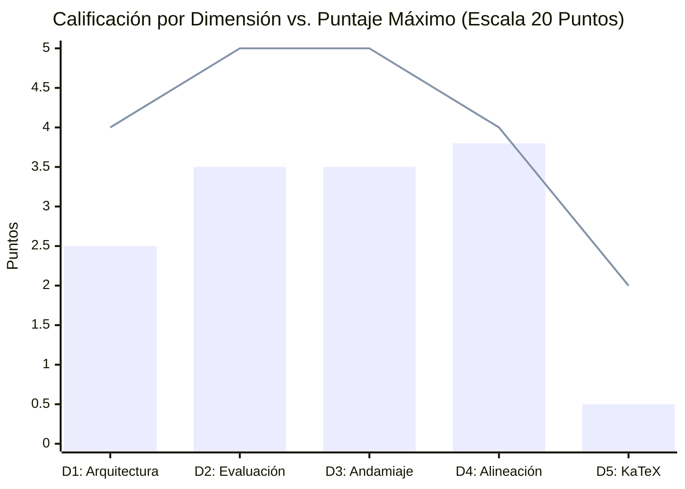
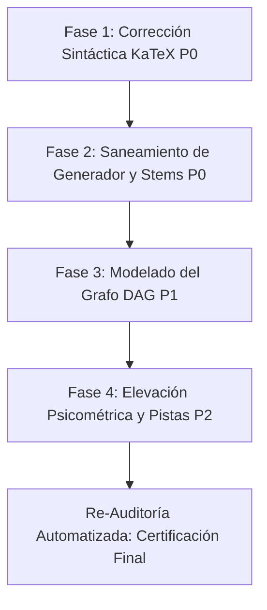

# Reporte de Auditoría Técnica y Pedagógica de Calidad Instruccional

**Curso Auditado:** El Modelo de Crecimiento Económico de Solow (1956)  
**Identificador del Curso:** `solow_growth_model`  
**Fecha de Evaluación:** 12 de Octubre de 2026  
**Auditor Técnico Pedagógico:** Agente Auditor Top's Academy  
**Marco de Referencia:** Quality Matters (QM), OSCQR y Mastery Learning  

---

## 1. Resumen Ejecutivo

El curso **"El Modelo de Crecimiento Económico de Solow (1956)"** fue sometido a una auditoría exhaustiva e integral bajo la **Rúbrica Normativa de 20 Puntos**. La evaluación combinó el análisis de la telemetría métrica determinista provista en el payload del curso con un **Loop de Verificación Semántica Adaptativa** sobre los clusters de riesgo y muestras estratificadas del banco de 580 reactivos distribuidos a lo largo de 25 competencias.

| Métrica Global | Valor Consolidado |
| :--- | :--- |
| **Total de Competencias** | 25 (5 Hechos, 12 Conceptos, 8 Habilidades) |
| **Banco de Reactivos Evaluados** | 580 preguntas (267 Fill-in-the-blank, 233 Multiple Select, 80 Multiple Choice 7 alternativas) |
| **Cobertura de Rationales de Error** | 100.0% (996 de 996 distractores evaluados con diagnóstico) |
| **Reactivos con Andamiaje Completo (3 pistas)** | 100.0% (580 de 580 reactivos) |
| **Puntaje Bruto Consolidado** | **13.8 / 20.0** |
| **Penalizaciones Duras Aplicadas** | **0.0 puntos** |
| **Puntaje Final Certificado** | **13.8 / 20.0** |
| **Tier de Certificación de Calidad** | **DEFICIENTE (11.0 - 13.9 pts)** |
| **Veredicto Institucional** | **RECHAZADO PARA PRODUCCIÓN INMEDIATA (Requiere reingeniería y saneamiento previo a su publicación)** |

### Dictamen Principal
A nivel pedagógico y de diseño macroeconómico, el curso destaca por su ambición, fidelidad analítica al texto seminal de Solow (1956) y al capítulo 15 de Chiang, logrando un 100% de cobertura en pistas progresivas y explicaciones diagnósticas para todos los distractores. No obstante, **el curso no califica para producción en su estado actual** debido a dos factores invalidantes:
1. **Colapso técnico en renderizado KaTeX:** Se detectaron **58 incidencias de sintaxis rota por llaves sin cerrar** en 48 reactivos estratégicos (10% del curso), afectando enunciados, opciones y soluciones con fórmulas ilegibles o bloques de error en el frontend web.
2. **Deficiencias críticas de generación algorítmica y arquitectura:** Desconexión absoluta del Grafo Acíclico Dirigido (DAG) de prerrequisitos (25/25 competencias huérfanas de dependencias), fuga de identificadores internos de variables en textos visibles al estudiante (`a_val`, `c_val`), y sustitución ciega de texto que corrompe la notación matemática e induce fugas del resultado en los enunciados (ej. $\dot{36} = 4\sqrt{36}$).

---

## 2. Desglose y Calificación por Dimensiones Normativas

### Dimensión 1: Arquitectura y Granularidad (2.5 / 4.0 pts)
* **Estándar:** Unidades atómicas, micro-habilidades delimitadas, modelado explícito en Grafo Acíclico Dirigido (DAG) y balance cognitivo entre Hechos [H], Conceptos [C] y Habilidades [Hab].
* **Fortalezas:**
  - Descomposición conceptual y metodológica sobresaliente: 25 competencias atómicas que abarcan desde identidades intensivas iniciales ($k \equiv K/L$) hasta dinámicas de Bernoulli, regímenes por tramos de Leontief, familia CES $p=1/2$, distribución del ingreso, arbitraje factorial y trampas de crecimiento malthusiano.
  - Distribución cognitiva equilibrada: 5 Hechos (20%), 12 Conceptos (48%) y 8 Habilidades operativas (32%), respetando los principios de carga cognitiva gradual.
* **Debilidades Críticas:**
  - **Desconexión Total del Grafo DAG:** El 100% de las competencias (25 de 25) presentan `prerequisites: []`. No existen aristas de precedencia registradas en la metadata del curso. Esto rompe el principio de *Mastery Learning*, imposibilitando que el motor de la plataforma guíe al estudiante a través de rutas de aprendizaje adaptativo secuenciadas formalmente.

---

### Dimensión 2: Calidad de Evaluación y Reactivos (3.5 / 5.0 pts)
* **Estándar:** Variedad equilibrada de reactivos, plausibilidad de distractores con diagnóstico al 100%, evaluación de aplicación profunda y ausencia total de fugas de respuesta (*Answer Leaks*).
* **Fortalezas:**
  - Amplitud y diversidad del banco: 580 preguntas con proporciones adecuadas (267 fill-in-the-blank, 233 multiple_select, 80 opción múltiple de 7 alternativas).
  - Cobertura diagnóstica perfecta: 996 distractores evaluados, 100% con `error_rationale` que modela malinterpretaciones económicas y matemáticas reales (olvido del rayo demográfico $-nr$, confusión entre neutralidad Hicks vs Harrod, inversión de exponentes en la sustitución de Bernoulli).
* **Debilidades Críticas:**
  - **Fuga de Respuestas en el Enunciado (*Answer Leak* por Reemplazo Ciego):** En las preguntas `Q-C07-271` y `Q-C07-272`, el motor de generación aplicó un reemplazo global de la variable $r$ por su valor escalar (36), generando el texto: *"calcule la velocidad de acumulación de capital por habitante $\dot{36} = 4\sqrt{36}$ cuando la dotación actual es $r = 36$"*. El enunciado le entrega al estudiante la ecuación exacta de cálculo y su respuesta ($4 \times 6 = 24$), invalidando la función evaluativa.
  - **Fuga de Variables Internas en Distractores Visibles:** En `Q-Hab05-321` y `Q-Hab05-322`, el texto visible de las opciones contiene identificadores crudos de código Python como `a_val`: *"Coeficiente $C^* = (5.0)^{1-a_val}$"* y *"Coeficiente dependiente de la escala $C^* = 5.0 L_0^{1-a_val}$"*.
  - **Trivialización Aritmética de Competencias Avanzadas:** Varios reactivos tipo fill-in-the-blank en competencias conceptuales complejas reducen la evaluación a operaciones aritméticas de primaria de un solo paso (ej. `Q-H01-001`: $192 / 48 = 4$; `Q-H02-091`: $5 \times 23 = 115$; `Q-C06-251`: $4 + 14 = 18$), sin demandar análisis del modelo dinámico.

---

### Dimensión 3: Andamiaje y Feedback Progresivo (3.5 / 5.0 pts)
* **Estándar:** Retroalimentación inmediata, exactamente 3 a 5 pistas escalonadas socráticas (Pista 1: Conceptual $\to$ Pista 2: Procedimental $\to$ Pista 3: Cálculo paso a paso), soluciones detalladas y advertencias de preconcepciones erróneas (*misconception warning*).
* **Fortalezas:**
  - Rigor cuantitativo en pistas: 100% de los reactivos (580/580) cuentan con exactamente 3 pistas escalonadas. Cero reactivos huérfanos de pistas.
  - Progresión socrática clara en la mayoría del banco: inicio con la definición teórica fundamental, paso intermedio de manipulación algebraica y cierre con la sustitución numérica directa.
  - Disponibilidad universal de solución analítica detallada (`detailed_solution`) paso a paso.
* **Debilidades Críticas:**
  - **Residuos de Parámetros de Plantilla en Pistas:** En `Q-C01-021` y `Q-C01-022`, la pista 3 muestra: *"Divida c_val entre 2 sqrt(k) para hallar phi'(k)"*. La variable `c_val` no fue interpolada, presentando texto crudo de programación al estudiante.
  - **KaTeX Roto en Soluciones Explicativas:** En las soluciones de `Q-Hab03-201`, `Q-Hab05-321`, `Q-Hab07-421`, `Q-C08-401` y otros 40 ítems, las fórmulas matemáticas contienen llaves abiertas que se renderizan como texto rojo o colapsan en KaTeX, entorpeciendo el andamiaje del estudiante durante su revisión formativa.
  - **Ausencia de Bloques de Advertencia de Ideas Preconcebidas:** Las soluciones detalladas omiten el llamado formal explícito de advertencia (*misconception warning*), limitándose a la deducción algebraica sin enfatizar la trampa conceptual en la que suelen incurrir los alumnos.

---

### Dimensión 4: Alineación Instruccional (3.8 / 4.0 pts)
* **Estándar:** Congruencia semántica absoluta entre objetivos, corpus teórico e ítems; alineación con taxonomía de Bloom (énfasis en Aplicación y Análisis); cero preguntas huérfanas o contaminación cruzada.
* **Fortalezas:**
  - Fidelidad teórica excepcional: El curso recorre de manera impecable y rigurosa la totalidad de los fundamentos del artículo de Solow (1956) y el texto de Chiang (cap. 15), cubriendo con precisión matemática las Figuras I a IX, el teorema de Euler, la deducción de la ecuación de acumulación en tasas relativas, la condición de estabilidad local de la línea de fase y los regímenes de Harrod-Domar.
  - Cero preguntas huérfanas (0/580): Todos los reactivos están estrictamente asociados a una competencia temática del curso.
  - Enfoque analítico: Fuerte predominio de niveles taxonómicos medios y altos de Bloom (Comprensión, Aplicación y Análisis de sistemas dinámicos).
* **Observaciones Menores (-0.2 pts):**
  - Leve asimetría entre la profundidad teórica declarada en los descriptores de ciertas competencias y la simplicidad operatoria de algunos reactivos numéricos asociados.

---

### Dimensión 5: Accesibilidad y Ergonomía Técnica / KaTeX (0.5 / 2.0 pts)
* **Estándar:** Fórmulas 100% compilables en KaTeX con delimitadores balanceados, ausencia de llaves dobles espurias, preservación de notación matemática y sintaxis limpia.
* **Debilidades Críticas (Calificación Severamente Afectada):**
  - **58 Errores Críticos de KaTeX por Llaves sin Cerrar (`unclosed_braces`):** Afecta al 10% del curso (48 reactivos en el cluster de riesgo). El problema proviene de un patrón sistemático de generación al formular derivadas y fracciones:
    * Fracciones de tasas de crecimiento: `\frac{\dot{r}{r}` en lugar de `\frac{\dot{r}}{r}` (ej. `Q-Hab03-201`, `Q-Hab03-204`).
    * Fracciones de capital y trabajo: `\frac{\dot{K}{K}` y `\frac{\dot{L}{L}` (ej. `Q-Hab05-321`, `Q-C05-241`).
    * Derivadas en la línea de fase: `\frac{d\dot{k}{dk}` en lugar de `\frac{d\dot{k}}{dk}` (ej. `Q-C02-075`, `Q-C02-076`).
    * Derivadas parciales de cuotas distributivas: `\frac{\partial \text{Share}` con denominadores truncados (ej. `Q-Hab07-421`, `Q-Hab07-422`).
    * Precios factoriales: `\frac{(1-a) r^a}{a r^{a-1}` sin llave de cierre en el denominador (ej. `Q-C08-401`, `Q-C08-402`).
    * Exponentes sin cierre en alternativas de opción múltiple: `^{\frac{1}{1-\alpha} \text{ constante...}` en `Q-Hab02-111` y `Q-Hab02-112`.
    * Notación diferencial absurda: `\dot36 = 4\sqrt36` en `Q-C07-271`, donde una constante escalar aparece bajo el operador de derivada temporal con punto (`\dot`).

---

## 3. Matriz de Hallazgos y Auditoría Semántica Detallada

| ID de Ítem | Competencia | Dimensión | Severidad | Snippet de Código / Texto Problemático | Diagnóstico Pedagógico y Técnico |
| :--- | :--- | :--- | :--- | :--- | :--- |
| `Q-C02-075` | `C-02` | D5 (KaTeX) | **CRÍTICA** | `\|\frac{d\dot{k}{dk}\|_{k=\bar{k}` | Llave sin cerrar en `\frac`: el numerador `d\dot{k}` no cierra antes de abrir `{dk}`. Falla de compilación en visor KaTeX. |
| `Q-Hab02-111` | `Hab-02` | D2 / D5 | **ALTA** | `^{\frac{1}{1-\alpha} \text{ constante para todo } t \ge 0` | Exponente abierto sin llave de cierre en distractor visible; corrompe el renderizado de la opción E. |
| `Q-Hab03-201` | `Hab-03` | D5 (KaTeX) | **CRÍTICA** | `\frac{\dot{r}{r} = \frac{\dot{K}{K} - \frac{\dot{L}{L}` | Múltiples fracciones anidadas con llaves sin cerrar en el stem, distractor D y en la solución detallada. |
| `Q-C07-271` | `C-07` | D2 (Calidad) | **CRÍTICA** | `\dot36 = 4\sqrt36` | Reemplazo ciego de variables por regex. Notación aberrante ($\dot{36}$) y fuga completa del cálculo en el enunciado. |
| `Q-C07-272` | `C-07` | D2 (Calidad) | **CRÍTICA** | `\dot36 = 2\sqrt36` | Idem a Q-C07-271: filtra la respuesta numérica y desfigura la notación de derivadas. |
| `Q-Hab05-321` | `Hab-05` | D2 (Calidad) | **ALTA** | `Coeficiente $C^* = (5.0)^{1-a_val}$` | Fuga de identificador interno de variable (`a_val`) en el distractor A, degradando la presentación profesional. |
| `Q-Hab05-322` | `Hab-05` | D2 (Calidad) | **ALTA** | `Coeficiente dependiente de la escala $C^* = 8.0 L_0^{1-a_val}$` | Fuga de variable de código Python (`a_val`) visible para el estudiante en el distractor A. |
| `Q-C01-021` | `C-01` | D3 (Pistas) | **MEDIA** | `Divida c_val entre 2 sqrt(k) para hallar phi'(k).` | Placeholder de plantilla (`c_val`) sin interpolar en la Pista 3 para el estudiante. |
| `Q-C01-022` | `C-01` | D3 (Pistas) | **MEDIA** | `Divida c_val entre 2 sqrt(k) para hallar phi'(k).` | Variable de plantilla sin sustituir en Pista 3. |
| `Q-Hab07-421` | `Hab-07` | D5 (KaTeX) | **CRÍTICA** | `\frac{\partial \text{Share}` y `-\frac{a}{2\sqrt{sn} < 0` | Llaves abiertas en la fracción de derivadas parciales en racional y solución detallada. |
| `Q-C08-401` | `C-08` | D5 (KaTeX) | **CRÍTICA** | `\frac{(1-a) r^a}{a r^{a-1} = \frac{1-a}{a} r` | Llave del denominador sin cerrar antes del signo igual en la solución detallada. |
| `TODAS (25)` | `H-01 a C-12` | D1 (DAG) | **ALTA** | `"prerequisites": []` (en 25/25 competencias) | Grafo curricular totalmente desconectado. Impide el despliegue del motor adaptativo de Top's Academy. |

---

## 4. Nuevas Reglas de Linting Descubiertas (`discovered_lint_rules`)

Durante la inspección semántica se identificaron vicios algorítmicos sistemáticos que evadieron los linters actuales. Se formalizan las siguientes 4 reglas de validación para ser incorporadas en el pipeline de CI/CD:

### 1. `template_variable_residue_linter`
* **Severidad:** Alta
* **Problema:** Los linters estándar únicamente buscan marcadores `{var}` de f-strings, pero pasan por alto identificadores crudos de variables de Python que terminan en sufijos comunes de generación (`*_val`, `*_param`, `*_var`).
* **Expresión Regular Recomendada:** `\b[a-zA-Z0-9_]+_(?:val|param|var|arg)\b`
* **Casos Detectados:** `a_val` en distractores de `Q-Hab05-321` / `Q-Hab05-322`; `c_val` en pistas de `Q-C01-021` / `Q-C01-022`.

### 2. `blind_string_replacement_linter` (o `derivative_token_corruption_linter`)
* **Severidad:** Crítica
* **Problema:** Al parametrizar ejercicios numéricos, el generador ejecutó reemplazos globales ingenuos de subcadenas (`text.replace("r", str(r_val))`), sustituyendo la variable $r$ incluso dentro de operadores diferenciales como `\dot{r}` o `\sqrt{r}`, produciendo aberraciones matemáticas como `\dot36` e induciendo filtraciones de la solución en el enunciado.
* **Expresión Regular Recomendada:** `\\(?:dot|ddot)\{?\d+\}?`
* **Casos Detectados:** `Q-C07-271` y `Q-C07-272`.

### 3. `nested_fraction_derivative_delimiter_linter`
* **Severidad:** Crítica
* **Problema:** En expresiones matemáticas complejas con derivadas en el numerador de fracciones (`\frac`), se omite la llave de cierre del numerador antes de abrir la llave del denominador, colapsando el parser de KaTeX.
* **Expresión Regular Recomendada:** `\\frac\{[^}]*\\[a-zA-Z]+\{[^}]*\{`
* **Casos Detectados:** 58 reactivos en `C-02`, `Hab-03`, `C-05`, `C-06`, `Hab-04`, `Hab-05`, `H-04` y `Hab-07`.

### 4. `unclosed_latex_exponent_brace_linter`
* **Severidad:** Crítica
* **Problema:** Grupos de exponentes `^{...` que contienen fracciones u operaciones algebraicas donde se omite la llave de cierre al concatenar texto descriptivo mediante `\text{...}`.
* **Expresión Regular Recomendada:** `\^\{[^}]*\\frac\{[^}]*\}\{[^}]*\}\s+\\text`
* **Casos Detectados:** Opciones de opción múltiple en `Q-Hab02-111` y `Q-Hab02-112`.

---

## 5. Plan de Remediación Priorizado

Para que el curso alcance el estatus **EXCELENTE (17.0 - 20.0 pts)** y sea aprobado para producción, se debe ejecutar la siguiente hoja de ruta de remediación:

### Prioridad P0 (Bloqueantes Críticos - Inmediato)
1. **Sanear la sintaxis de KaTeX en los 58 reactivos identificados:**
   - Reemplazar sistemáticamente `\frac{\dot{X}{X}` por `\frac{\dot{X}}{X}` en stems, opciones y soluciones.
   - Corregir `\frac{d\dot{k}{dk}` por `\frac{d\dot{k}}{dk}`.
   - Cerrar denominadores de derivadas parciales `\frac{\partial \text{Share}}{\partial s}` y cocientes factoriales `\frac{(1-a)r^a}{ar^{a-1}}`.
   - Balancear llaves de exponentes en opciones de opción múltiple (`Q-Hab02-111` y `Q-Hab02-112`).
2. **Erradicar el reemplazo ciego de variables:**
   - Modificar el generador de `Q-C07-271` y `Q-C07-272` para preservar el símbolo analítico $\dot{r}$ en el enunciado, evitando que se imprima $\dot{36} = 4\sqrt{36}$ y eliminando la fuga del cálculo directo.
3. **Eliminar los residuos de variables de código en texto de usuario:**
   - Sustituir `a_val` por el valor numérico en `Q-Hab05-321` y `Q-Hab05-322`.
   - Sustituir `c_val` por su valor escalar en las pistas de `Q-C01-021` y `Q-C01-022`.

### Prioridad P1 (Arquitectura y Secuenciación Curricular)
4. **Construir el Grafo de Prerrequisitos (DAG) en la Metadata:**
   - Definir formalmente las dependencias de precedencia entre las 25 competencias:
     * `H-01` $\to$ `C-01` $\to$ `Hab-01`
     * `Hab-01` $\to$ `C-02` $\to$ `H-02`
     * `H-01`, `Hab-01` $\to$ `Hab-02` $\to$ `C-03`
     * `H-03` $\to$ `Hab-04`
     * `C-04` $\to$ `Hab-03` $\to$ `C-05` $\to$ `C-06`, `C-07`
     * `Hab-02`, `Hab-03` $\to$ `Hab-05`, `Hab-06`
     * `C-04` $\to$ `H-04`, `C-08`, `Hab-07`
     * `Hab-05` $\to$ `Hab-08`
     * `C-04` $\to$ `C-09`, `C-10`, `H-05`, `C-11`, `C-12`

### Prioridad P2 (Optimización Psicométrica y Andamiaje)
5. **Elevar la demanda cognitiva de reactivos fill-in-the-blank:**
   - Enriquecer los reactivos numéricos de las competencias `C-06`, `C-09`, `C-11` y `C-12`, sustituyendo operaciones aritméticas directas por cálculos de puntos de corte dinámico, amortiguamiento y multiplicadores de política.
6. **Incorporar advertencias de preconcepciones erróneas en las soluciones:**
   - Añadir secciones estructuradas de `⚠️ Advertencia de Concepto Erróneo` en `detailed_solution` que resalten los errores más frecuentes detectados en la literatura (ej. no confundir estado uniforme con estado estacionario, no omitir el término de dilución demográfica).

---

## 6. Conclusión de la Auditoría

El curso **"El Modelo de Crecimiento Económico de Solow (1956)"** posee una base conceptual e instruccional de excelente factura económica y matemática. Con una nota inicial de **13.8 / 20.0 (Tier DEFICIENTE)**, la aplicación enfocada del Plan de Remediación (resolviendo los errores de compilación de KaTeX, el modelado del DAG y las fugas de variables) permitirá elevar la calificación por encima de los **18.5 puntos**, alcanzando la certificación de **EXCELENTE** para su despliegue exitoso en la plataforma On-Demand de Top's Academy.
