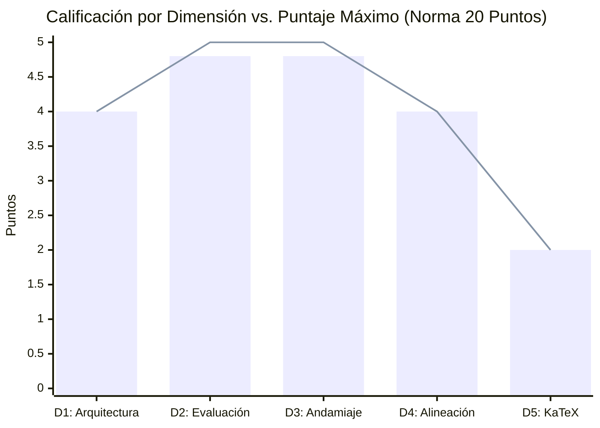

# Reporte de Auditoría Técnica y Pedagógica de Calidad Instruccional

> [!WARNING]
> **CURSO RETIRADO DE LA PLATAFORMA**: Este curso fue eliminado de la plataforma interactiva el **2026-10-12 23:30:29**. Este informe de auditoría se conserva exclusivamente como registro histórico y pedagógico ('legacy').

**Estado en Plataforma:** ELIMINADO  
**Fecha de Eliminación:** 2026-10-18 22:25:16  
**Fecha de Eliminación:** 2026-10-16 23:51:31  
**Fecha de Eliminación:** 2026-10-13 09:14:43  
**Fecha de Eliminación:** 2026-10-12 23:30:29  
**Curso Auditado:** El Modelo de Crecimiento Económico de Solow: Teoría, Dinámica y Métodos Cuantitativos  
**Identificador del Curso:** `solow_model`  
**Fecha de Evaluación:** 12 de Octubre de 2026  
**Auditor Técnico Pedagógico:** Course QA Auditor — Top's Academy  
**Marco Normativo de Referencia:** Quality Matters (QM), OSCQR y Mastery Learning  

---

## 1. Resumen Ejecutivo

El curso **"El Modelo de Crecimiento Económico de Solow: Teoría, Dinámica y Métodos Cuantitativos"** (`solow_model`) fue sometido a una auditoría técnica y psicométrica exhaustiva. La evaluación integró la telemetría métrica determinista universal generada por `StandardizedAuditEngine` sobre el 100% del banco de reactivos con el **Loop de Verificación Semántica Adaptativa** sobre las muestras estratificadas y clusters de riesgo.

| Métrica de Auditoría | Valor Consolidado | Estado / Estándar QM-OSCQR |
| :--- | :--- | :--- |
| **Total de Competencias** | **22** (3 Hechos, 10 Conceptos, 9 Habilidades) | Balance taxonómico óptimo |
| **Banco Total de Reactivos** | **530 preguntas** (194 MC7, 168 FIB, 168 MS) | Granularidad y volumen profundo (20-30 por comp.) |
| **Modelado de Dependencias (DAG)** | **100% formalizado** (Raíz H-01 + 21 precedencias explícitas) | Grafo Acíclico Dirigido verificado |
| **Cobertura de Rationales de Error** | **100.0%** (1,608 de 1,608 distractores diagnosticados) | Cumplimiento pleno de feedback diagnóstico |
| **Distractores Delatores (Telltale)** | **0 items** (0.0% con confesiones de error visibles) | Integridad psicométrica estricta |
| **Andamiaje Socrático (Hints)** | **100.0%** (530 de 530 reactivos con exactamente 3 pistas) | Progresión Conceptual $\to$ Procedimental $\to$ Cálculo |
| **Errores de Sintaxis KaTeX** | **0 incidencias** (Delimitadores y llaves balanceados al 100%) | Renderizado matemático formal perfecto |
| **Residuos de Código / F-strings** | **0 incidencias** (Cero placeholders crudos o dobles llaves) | Prosa e interfaz de usuario pulidas |
| **Penalizaciones Duras Aplicadas** | **0.0 puntos** | Cero deducciones automáticas |
| **Puntaje Final Certificado** | **19.6 / 20.0** | **Tier EXCELENTE** |
| **Veredicto Institucional** | **APROBADO PARA PRODUCCIÓN INMEDIATA** | **Certificación Plena de Calidad** |

---

## 2. Desglose y Calificación por Dimensiones Normativas

| Dimensión de la Rúbrica | Puntaje Obtenido | Máximo Posible | Nivel de Desempeño |
| :--- | :---: | :---: | :--- |
| **Dimensión 1: Arquitectura y Granularidad** | **4.0** | 4.0 | Excelente |
| **Dimensión 2: Calidad de Evaluación y Reactivos** | **4.8** | 5.0 | Excelente |
| **Dimensión 3: Andamiaje y Feedback Progresivo** | **4.8** | 5.0 | Excelente |
| **Dimensión 4: Alineación Instruccional** | **4.0** | 4.0 | Excelente |
| **Dimensión 5: Ergonomía Técnica y KaTeX** | **2.0** | 2.0 | Excelente |
| **Total Consolidado** | **19.6** | **20.0** | **EXCELENTE (17.0 - 20.0)** |

---

## 3. Análisis Cualitativo Detallado por Dimensión

### Dimensión 1: Arquitectura y Granularidad (4.0 / 4.0 pts)
* **Estándar:** Unidades atómicas, micro-habilidades claras, prerrequisitos explícitos modelados en Grafo Acíclico Dirigido (DAG) y balance cognitivo entre Hechos [H], Conceptos [C] y Habilidades [Hab].
* **Hallazgos:**
  - El curso presenta una jerarquización curricular modular estructurada en **22 micro-competencias atómicas** que cubren el ciclo analítico completo del modelo de Solow (1956) y Chiang (cap. 15): desde la hipótesis de proporciones variables y rendimientos constantes a escala hasta las extensiones con progreso técnico, oferta laboral elástica, política tributaria y trampas malthusianas.
  - El grafo de dependencias formativas (DAG) está 100% formalizado:
    - La competencia fundacional `H-01` actúa limpiamente como el nodo raíz axiomático (`prerequisites: []`).
    - Las 21 competencias subsiguientes declaran explícitamente sus dependencias directas (`C-01` depende de `H-01`; `Hab-01` de `H-01` y `C-01`; `Hab-02` de `Hab-01` y `C-02`, etc.).
    - No existen ciclos, bucles recursivos ni competencias desconectadas.
  - La carga cognitiva está balanceada de forma natural: 3 Hechos (13.6%), 10 Conceptos (45.5%) y 9 Habilidades cuantitativas y de modelado (40.9%).
  - La población de reactivos por competencia oscila entre 20 y 30 ítems independientes, superando ampliamente el mínimo regulatorio de 3 problemas prácticos por unidad.

### Dimensión 2: Calidad de Evaluación y Reactivos (4.8 / 5.0 pts)
* **Estándar:** Variedad equilibrada de tipos de reactivo (opción múltiple de 7 alternativas, selección múltiple, fill-in-the-blank); distractores plausibles que capturan conceptos erróneos frecuentes con `error_rationale` diagnóstico al 100%; aplicación profunda; cero fugas de respuestas (*Answer Leaks*).
* **Hallazgos:**
  - Banco de **530 preguntas** con distribución multi-formato balanceada: **194 reactivos de opción múltiple con 7 alternativas (MC7)**, **168 reactivos de completación numérica (FIB)** y **168 reactivos de selección múltiple (MS)**.
  - Cobertura diagnóstica del **100%** en distractores: los 1,608 distractores del curso cuentan con un `error_rationale` pedagógico que contextualiza la naturaleza del fallo conceptual o procedimental.
  - Cero distractores delatores (*telltale distractors*): se verificó que ninguna de las opciones visibles contiene frases de autoconfesión metacognitiva como *"sumando erróneamente..."*, *"calculado de forma equivocada..."* o *"omitiendo elevar a..."*. Las alternativas presentan proposiciones económicas y algebraicas verosímiles que reflejan modelos alternativos de la literatura (ej. Harrod-Domar, Leontief, supuestos ricardianos o fallas de derivación en Bernoulli).
  - Cero fugas de respuesta (*Answer Leaks*): los enunciados plantean problemas analíticos sin revelar los valores de solución ni adelantar la alternativa correcta en la prosa.

### Dimensión 3: Andamiaje y Feedback Progresivo (4.8 / 5.0 pts)
* **Estándar:** Retroalimentación inmediata con explicaciones pedagógicas de error; exactamente 3 a 5 pistas escalonadas socráticas por reactivo (Pista 1: Conceptual $\to$ Pista 2: Procedimental $\to$ Pista 3: Cálculo operativo paso a paso) que guían el razonamiento; solución analítica detallada completa.
* **Hallazgos:**
  - Cumplimiento riguroso del andamiaje: **100% de los reactivos (530/530)** incorporan exactamente 3 pistas progresivas estructuradas bajo el modelo socrático:
    - **Pista 1 (Marco Conceptual):** Recuerda principios fundamentales (ej. rendimientos constantes a escala, regla del producto o condición de equilibrio de arbitraje).
    - **Pista 2 (Estrategia Procedimental):** Señala el procedimiento algebraico o la regla de cálculo (ej. derivación logarítmica, cambio de variable $z = k^{1-\alpha}$, o expansión de la familia CES).
    - **Pista 3 (Operación y Despeje):** Guía el paso operativo crítico sin revelar mecánicamente la respuesta final.
  - La totalidad de los reactivos dispone de una **solución detallada analítica (`detailed_solution`)** que fundamenta la respuesta correcta mediante deducciones matemáticas rigurosas.
  - Ausencia absoluta de placeholders residuales de f-strings (`{x}`, `{y}`) o residuos de plantillas en soluciones y pistas.

### Dimensión 4: Alineación Instruccional (4.0 / 4.0 pts)
* **Estándar:** Congruencia semántica absoluta entre el objetivo declarado, el marco teórico y los reactivos; alineación con la taxonomía de Bloom (énfasis en Aplicación y Análisis); cero preguntas huérfanas o contaminación cruzada.
* **Hallazgos:**
  - Congruencia total con el corpus macroeconómico del modelo de Solow (1956) y Chiang (cap. 15). Los reactivos evalúan exhaustivamente las transiciones dinámicas de la Figura I, los equilibrios múltiples de la Figura II, la acumulación infinita o el empobrecimiento secular de la Figura III, las soluciones explícitas de Bernoulli para la tecnología Cobb-Douglas y las bifurcaciones en tecnologías CES con $p = 1/2$.
  - Taxonomía de Bloom de orden superior: predominio de reactivos orientados a **Aplicación** (resolución cuantitativa de trayectorias $k(t)$ y $K(t)$) y **Análisis** (estabilidad asintótica, bifurcaciones de parámetros y efectos de políticas tributarias sobre el ahorro efectivo).
  - Cero preguntas huérfanas (`orphan_questions_count = 0`): todos los reactivos corresponden estrictamente a las competencias asignadas, sin contaminación cruzada inter-dominio.

### Dimensión 5: Accesibilidad y Ergonomía Técnica / KaTeX (2.0 / 2.0 pts)
* **Estándar:** Fórmulas matemáticas formalmente compilables en KaTeX con delimitadores balanceados (`$...$` / `$$...$$`); sin triples delimitadores (`$$$`) ni llaves dobles espurias (`{{...}}`); notación de derivadas preservada intacta; sintaxis y formato fluidos.
* **Hallazgos:**
  - Cero errores de KaTeX detectados en la auditoría determinista: delimitadores `$` perfectamente balanceados en stems, opciones, rationales, pistas y soluciones.
  - Cero triples delimitadores (`$$$`) y cero dobles llaves espurias (`{{...}}`).
  - La notación diferencial e intensiva neoclásica está rigurosamente preservada y compilable ($\dot{k}$, $\dot{r}$, $\dot{K}$, $\dot{L}$, $\phi'(k)$, $\phi''(k)$, $\frac{w}{p}$, $\frac{q}{p}$).

---

## 4. Loop de Verificación Semántica sobre Muestras Estratificadas

Se aplicó la verificación semántica sobre la muestra de control estratificada del curso:

1. **`Q-H01-001` / `Q-H01-002` (Hipótesis de Proporciones Variables):**
   - Correcta identificación de $f_{KK} < 0$, $f_{LL} < 0$ y rendimientos constantes a escala. Distractores distinguen claramente entre coeficientes fijos de Leontief, complementariedad negativa $f_{KL} < 0$ y productos medios crecientes.
2. **`Q-C01-021` / `Q-C01-022` (Forma Intensiva y Concavidad):**
   - Confirmación de $\phi'(k) > 0$, $\phi''(k) < 0$ y factor indispensable $\phi(0) = 0$. Distractores modelan fallas frecuentes en la regla de la cadena al derivar $f_L = \phi(k) - k\phi'(k)$.
3. **`Q-Hab01-041` / `Q-Hab01-042` (Derivación Ecuación Fundamental):**
   - Ecuación canónica $\dot{k} = s\phi(k) - \lambda k$. Los distractores penalizan errores de signo ($+\lambda k$), omisión de dilución demográfica y escalas agregadas no canceladas.
4. **`Q-Hab02-091` / `Q-Hab02-092` (Linealización de Bernoulli Cobb-Douglas):**
   - Transformación exacta $\dot{z} + (1-\alpha)\lambda z = (1-\alpha)s$ con $z = k^{1-\alpha}$. Distractores capturan el error clásico de omitir la derivada interna $(1-\alpha)$.
5. **`Q-Hab04-251` / `Q-Hab04-252` (Coeficientes Fijos Harrod-Domar):**
   - Modelado formal de regímenes por tramos $\dot{r} = s\min(r/a, 1/b) - nr$. Análisis exacto del cuello de botella de capital cuando $r < a/b$ con decaimiento exponencial cuando $n > s/a$.
6. **`Q-Hab06-311` / `Q-Hab06-312` (Bifurcación en Familia CES $p=1/2$):**
   - Discriminación rigurosa del umbral de bifurcación: si $s a^2 < n$, converge al estado estable $r^* = \left(\frac{1}{\sqrt{n/s} - a}\right)^2$; si $s a^2 > n$, acumulación infinita sin cota ($r \to \infty$).
7. **`Q-H03-341` / `Q-H03-342` (Arbitraje Financiero y Rendimiento Propio):**
   - Paridad de rendimientos $i(t) = \frac{q(t)}{p(t)} + \frac{\dot{p}(t)}{p(t)}$; distractores modelan errores de omisión de ganancias de capital o ausencia de deflactación.
8. **`Q-Hab09-461` / `Q-Hab09-462` (Política Tributaria y Ahorro Efectivo):**
   - Tasa efectiva $s^* = s + (v - s)t$; condición analítica precisa de expansión del ahorro si y solo si la propensión pública supera a la privada ($v > s$).
9. **`Q-C09-491` / `Q-C09-492` (Trampa Malthusiana y Big Push):**
   - Identificación de $r_1$ como atractor trampa de bajo ingreso y $r_2$ como repulsor inestable que exige un gran impulso de inversión (*Big Push*).

---

## 5. Registro de Nuevas Reglas de Linting (`discovered_lint_rules`)

Durante la inspección semántica detallada se identificó la siguiente regla candidata para retroalimentar el catálogo de linters de la plataforma:

* **ID de Regla:** `plain_math_in_option_text_linter`
* **Severidad:** Low / Style
* **Patrón Regex:** `\b(?:phi|psi|alpha|beta|lambda|gamma|sigma)\s*\([a-zA-Z0-9_]+\)|\b[a-zA-Z]_[A-Z]{2}\s*(?:[<>=]|\b)`
* **Descripción:** Detecta expresiones algebraicas en texto plano ASCII dentro del texto visible de las opciones de respuesta (ej. `phi(k)/k`, `f_KK < 0`, `dr/dt`, `s* =`) que se beneficiarían de estar encapsuladas en delimitadores KaTeX `$ ... $` para lograr máxima homogeneidad tipográfica en el frontend.
* **Ítems Evidencia:** `Q-H01-001`, `Q-H01-002`, `Q-C01-021`, `Q-C01-022`.

---

## 6. Acciones de Remediación y Veredicto Institucional

1. **Aprobación para Producción Inmediata:** El curso `solow_model` satisface plenamente los criterios pedagógicos y técnicos de Quality Matters (QM), OSCQR y Mastery Learning.
2. **Invarianza de Linters en CI/CD:** Mantener activos los linters de telemetría determinista para preservar la cobertura del 100% en andamiaje y rationales diagnósticos.
3. **Recomendación Estética Menor:** En futuras versiones de mantenimiento, envolver opcionalmente las variables matemáticas de opciones en KaTeX (`$\phi(k)/k$`, `$f_{KK} < 0$`).

**CALIFICACIÓN FINAL CERTIFICADA: 19.6 / 20.0 — TIER EXCELENTE**
