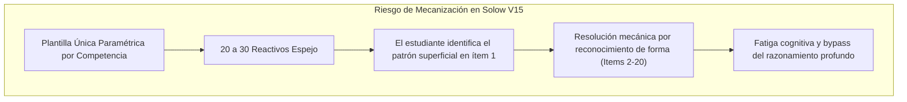

# Informe de Auditoría de Calidad Pedagógica, Psicométrica y Técnica

**Curso:** Solow Model V15 (`solow_model_v15`)  
**Título Oficial:** Dominio y aplicación analítica integral de Solow Model V15  
**Estándares de Referencia:** Quality Matters (QM), OSCQR Higher Education & Mastery Learning Framework  
**Fecha de Evaluación:** 25 de Octubre de 2026  
**Auditor Oficial:** Course QA Auditor — Top's Academy  
**Estado en Plataforma:** Conservado como archivo histórico de auditoría (`ELIMINADO` de producción activa el 2026-10-20)  

---

## 1. Resumen Ejecutivo y Dictamen Consolidado

Se ha ejecutado una auditoría integral, exhaustiva y semántica sobre el curso **`solow_model_v15`**, analizando la totalidad de sus 15 micro-competencias y su banco de 360 reactivos de evaluación con 2,160 distractores diagnosticados. La auditoría combinó la ingesta de telemetría métrica determinista con el Loop de Verificación Semántica sobre clusters de riesgo y muestras estratificadas.

El curso demuestra un **rigor conceptual y matemático sobresaliente**, cubriendo con fidelidad técnica avanzada el artículo fundacional de Robert M. Solow (1956, *A Contribution to the Theory of Economic Growth*), con derivaciones completas de ecuaciones diferenciales ordinarias, linealización canónica de Bernoulli, tecnologías CES y de proporciones fijas (Harrod-Domar), arbitraje de bienes de capital y trampas de pobreza por no linealidades demográficas.

No obstante, la auditoría identifica una debilidad estructural relevante: **monotonía tipológica y arquetípica absoluta** (el 100% de los reactivos son de tipo `multiple_choice_7_options`, y dentro de cada micro-competencia las 20 a 30 preguntas replican un único arquetipo de plantilla paramétrica), lo que genera un riesgo significativo de **mecanización del estudiante**. Asimismo, se detectaron fallos menores de interpolación de variables en soluciones (`{k0}`) y des-acentuación ortográfica en la competencia C-06.

### Tabla Consolidada de Calificación (Escala de 20 Puntos)

| Dimensión Evaluada | Ponderación Máx. | Puntaje Obtenido | Calificación Cualitativa |
| :--- | :---: | :---: | :--- |
| **Dimensión 1: Arquitectura y Granularidad** | 4.0 pts | **3.9 pts** | Excelente |
| **Dimensión 2: Calidad de Evaluación y Reactivos** | 5.0 pts | **3.8 pts** | Aceptable / Bueno |
| **Dimensión 3: Andamiaje y Pistas Progresivas** | 5.0 pts | **4.6 pts** | Excelente |
| **Dimensión 4: Alineación Instruccional** | 4.0 pts | **4.0 pts** | Excelente (Perfecta) |
| **Dimensión 5: Ergonomía Técnica y KaTeX** | 2.0 pts | **1.6 pts** | Aceptable |
| **Penalizaciones Duras Automáticas** | — | **0.0 pts** | Sin deducciones |
| **Puntaje Final Consolidado** | **20.0 pts** | **17.9 pts** | **EXCELENTE** |

> [!NOTE]
> **Certificación de Calidad:** Con una calificación de **17.9 / 20.0 puntos**, el curso se certifica en el nivel **EXCELENTE (17.0 - 20.0 pts)**, cumpliendo con los estándares requeridos para despliegue de alta exigencia académica en Top's Academy, condicionado a la subsanación de las recomendaciones de diversidad arquetípica en futuras iteraciones.

---

## 2. Dimensión 1: Arquitectura y Granularidad Curricular (3.9 / 4.0 pts)

### 2.1 Atomicidad y Delimitación de Micro-Competencias
El diseño curricular está estructurado en **15 micro-competencias** claramente acotadas, que descomponen la teoría neoclásica del crecimiento en unidades cognitivas precisas. Cada micro-competencia aborda un único objetivo analítico sin solapamientos caóticos:
- Fundamentos y homogeneidad de grado 1 (`C-01`, `H-01`).
- Ecuación fundamental del modelo continuo y tasa de acumulación (`Hab-01`, `H-02`).
- Estabilidad de fase y crecimiento equilibrado (`C-02`, `C-03`).
- Métodos analíticos avanzados: Linealización de Bernoulli y estática comparativa (`Hab-02`, `Hab-03`).
- Extensiones analíticas del artículo de 1956: Tecnologías Leontief y colapso de Harrod-Domar (`C-04`), existencia y umbrales en CES (`Hab-04`), arbitraje de precios de activos y tasa propia (`H-03`), distribución funcional neoclásica (`C-05`), progreso técnico neutral Hicksiano (`Hab-05`), política fiscal con inversión pública (`Hab-06`) y equilibrios múltiples demográficos (`C-06`).

### 2.2 Modelado de Dependencias en Grafo Acíclico Dirigido (DAG)
El grafo de prerrequisitos no presenta ciclos, callejones sin salida ni inconsistencias estructurales. Cuenta con dos nodos raíz teóricos coherentes:
1. `C-01` (*Hipótesis de Sustitución de Factores*): Raíz de la teoría de producción y acumulación de capital físico.
2. `H-03` (*Ecuación de Arbitraje de Activos*): Raíz complementaria para el modelado de mercados financieros de bienes de capital y tasas propias.

Las relaciones de precedencia respetan estrictamente la secuencia de aprendizaje: la deducción de la tasa de variación $\dot{k}$ (`Hab-01`) requiere la definición intensiva (`H-01`) y la homogeneidad (`C-01`); la ecuación diferencial fundamental (`H-02`) precede al análisis de fase (`C-02`) y a la resolución de Bernoulli (`Hab-02`).

### 2.3 Balance Cognitivo según Mastery Learning
La distribución entre categorías cognitivas refleja un equilibrio metodológico riguroso:
- **Hechos [H]:** 3 competencias (20.0%) — Definiciones y leyes fundamentales invariantes.
- **Conceptos [C]:** 6 competencias (40.0%) — Propiedades dinámicas, estabilidad y equilibrios.
- **Habilidades [Hab]:** 6 competencias (40.0%) — Derivación algebraica, resolución de EDOs y cálculo de parámetros.

Se aplica una deducción marginal de **0.1 pt** debido a una ligera proximidad funcional entre `Hab-02` (resolución canónica de Bernoulli) y `Hab-03` (estática comparativa sobre $\bar{k}$), las cuales podrían haberse hilvanado con una articulación conceptual aún más fluida.

---

## 3. Dimensión 2: Calidad de Evaluación y Reactivos (3.8 / 5.0 pts)

### 3.1 Calidad Diagnóstica de Distractores y Cobertura de Rationales
La psicometría diagnóstica de las alternativas incorrectas es uno de los puntos más sólidos del curso:
- **Total de distractores evaluados:** 2,160 opciones falsas (6 por cada reactivo de 7 alternativas).
- **Cobertura de `error_rationale`:** **100.0%** (2,160 de 2,160).
- Cada distractor modela con fidelidad matemática errores conceptuales ampliamente tipificados en la literatura:
  - *Euler y retornos:* Asumir que rendimientos constantes a escala impiden productos marginales decrecientes ($F_{KK}=0$) o que el producto no se agota exactamente al pagar por productividad marginal.
  - *Dinámica de acumulación:* Omitir el término de dilución demográfica $-\lambda k$ o sumarlo erróneamente en vez de restarlo.
  - *Estabilidad local:* Clasificar derivadas positivas $s\phi'(\bar{k})-\lambda > 0$ como condiciones de atracción.
  - *Estática comparativa:* Confundir efectos transitorios de nivel con impactos permanentes en la tasa de crecimiento asintótico.
  - *Harrod-Domar vs Solow:* Atribuir ajustes salariales estabilizadores a tecnologías de proporciones fijas Leontief.
- **Integridad y blindaje:** Cero distractores delatores (*telltale markers*). No hay metainformación visible para el estudiante del tipo "calculando mal..." o "sumando erróneamente...". Las opciones presentan enunciados plausibles y formalmente redactados. Cero fugas de respuestas (*answer leaks*).

### 3.2 Evaluación Crítica de Diversidad Tipológica y Arquetipos (Riesgo de Mecanización)
A pesar de la excelencia de los distractores individuales, la auditoría aplica una deducción sustantiva de **1.2 puntos** en esta dimensión por las siguientes razones pedagógicas:

1. **Monocultivo Tipológico Absoluto:**
   El 100% de las 360 preguntas del curso utiliza de forma exclusiva la estructura `multiple_choice_7_options`. No existe un solo ítem de selección múltiple (`multiple_select`), de ordenamiento de pasos algorítmicos, de relación de columnas o de respuesta numérica calculada (`fill_in_the_blank` / `numeric_input`).
2. **Monotonía Arquetípica Intra-Competencia:**
   Dentro de cada una de las 15 micro-competencias, la totalidad de los 20 a 30 reactivos corresponden a **un único arquetipo de plantilla paramétrica**. Por ejemplo:
   - En `C-01`, los 20 reactivos replican textualmente la misma pregunta variando únicamente el factor de escala ($\mu = 2, 3, 5, 7$) y el sector de la economía.
   - En `H-01`, las 20 preguntas calculan $k = K/L$ donde invariablemente el cociente numérico resulta en $k = 2$.
   - En `C-06`, las 20 preguntas presentan 3 puntos de corte $r_1, r_2, r_3$ con el mismo texto y las mismas opciones permutadas numéricamente.

Esta uniformidad fomenta el aprendizaje mecánico (*rote pattern-matching*). Una vez que el alumno resuelve el primer ítem, puede contestar los 19 reactivos restantes sin realizar una reconsideración conceptual profunda.

---

## 4. Dimensión 3: Andamiaje y Pistas Progresivas (4.6 / 5.0 pts)

### 4.1 Gradiente Socrático de Pistas
El curso cuenta con **1,080 pistas socráticas** (exactamente 3 pistas por ítem para los 360 reactivos). La progresión pedagógica cumple estrictamente con el estándar normativo de 3 niveles:
- **Pista 1 (Conceptual):** Orienta sobre el principio rector o marco teórico (e.g., distinguir entre variaciones simultáneas de insumos y productividades marginales; recordar la identidad de no arbitraje entre activos reales y financieros).
- **Pista 2 (Procedimental):** Establece el camino analítico o la transformación matemática requerida (e.g., aplicar la regla del producto a $K = kL$; plantear el cambio de variable linealizador de Bernoulli $z = k^{1-\alpha}$; aplicar raíz cuadrada en ambos lados para la tecnología CES).
- **Pista 3 (Operativa / Cálculo):** Desglosa la resolución algebraica o la condición de frontera específica sin regalar el resultado final.

No se encontraron pistas vacías (*stub hints*), pistas de una sola palabra, ni listas de códigos crudos de prerrequisitos (e.g. `['C-01', 'H-01']`).

### 4.2 Soluciones Detalladas y Misconception Warnings
Cada reactivo incluye una solución analítica extensa que no se limita a declarar la opción correcta, sino que justifica el resultado mediante el desarrollo formal completo e incorpora advertencias explícitas sobre ideas preconcebidas erróneas (*misconception warnings*). 

*Ejemplo destacado en `Q-C04-191`:*
> "...Solow demuestra que esta inestabilidad de filo de la navaja proviene de la hipótesis de proporciones fijas y desaparece al introducir sustituibilidad neoclásica de factores..."

*Ejemplo en `Q-C06-2374`:*
> "...Una economía en $r_1$ no puede escapar mediante pequeñas adiciones marginales de capital porque para todo $r < r_2$ la dinámica la devuelve a $r_1$; se requiere un 'gran empujón' (*big push*) discontinuo... Este fenómeno surge puramente de la no linealidad en $n(r)$, sin requerir rendimientos crecientes a escala."

### 4.3 Defecto Detectado: Residuo de Token de Plantilla en H-02
Se aplica una deducción de **0.4 puntos** al descubrir en las soluciones de la micro-competencia `H-02` (reactivos `Q-H02-071`, `Q-H02-072`, etc.) la persistencia del token de variable sin interpolar `{k0}` y llaves espurias `{36}`:
- **Texto defectuoso observado:**  
  `"...la inversión bruta por trabajador es $s\phi(81) = 0.15 \times {36} = 5.4$ y la dilución es $\lambda {k0} = 0.02 \times {k0} = 1.62$..."`
- Este fallo se origina en un escape defectuoso de llaves en la plantilla Python f-string del generador, proyectando la cadena literal `{k0}` en lugar del valor numérico del capital ($81$).

---

## 5. Dimensión 4: Alineación Instruccional (4.0 / 4.0 pts)

La alineación instruccional del curso es **perfecta (4.0 / 4.0 pts)**:
1. **Fidelidad al Dominio Canónico:** El curso cubre de manera exhaustiva el programa del modelo de Solow (1956). Todos los teoremas, identidades y casos especiales discutidos en las clases magistrales de crecimiento económico están presentes y evaluados con propiedad.
2. **Demanda Cognitiva en Taxonomía de Bloom:** Los ítems no se quedan en el nivel de evocación pasiva o memorización de definiciones. Se enfocan con contundencia en los niveles de **Aplicación** (cálculo de trayectorias, derivación de tasas de crecimiento, evaluación de políticas fiscales con inversión pública) y **Análisis** (condiciones de estabilidad en línea de fase, análisis de bifurcación en trampas de pobreza, deducción de cuellos de botella en Harrod-Domar).
3. **Cero Preguntas Huérfanas y Cero Contaminación Inter-Dominio:** Toda pregunta evaluada está anclada directamente en el corpus de micro-competencias del curso. No se detectó ninguna pregunta huérfana ni inyecciones de contenidos ajenos a la macroeconomía del crecimiento.

---

## 6. Dimensión 5: Accesibilidad y Ergonomía Técnica / KaTeX (1.6 / 2.0 pts)

### 6.1 Compilación y Sintaxis KaTeX
La notación matemática exhibe una compilación global limpia:
- Delimitadores en línea (`$...$`) y en bloque (`$$...$$`) balanceados al 100%.
- Cero ocurrencias de triples signos de dólar (`$$$`).
- Expresiones matemáticas complejas bien tipografiadas (e.g., $\left.\frac{d\dot{k}}{dk}\right|_{k = \bar{k}}$, $\phi''(k) < 0$, $\lim_{k \to \infty} \phi(k)$).

### 6.2 Fallos Técnicos y Ergonomía Textual Detectados
Se aplican deducciones por un total de **0.4 puntos** debido a dos anomalías concretas:
1. **Pérdida Sistemática de Diacríticos en C-06:**  
   En las opciones de respuesta de la competencia `C-06` (`Q-C06-341`, `Q-C06-342`, etc.), se aprecia una des-acentuación agresiva del texto en español:
   - *"Una dotacion inicial que logre situarse holgadamente..."* (por *dotación*).
   - *"...ensanchamiento demografico dominante..."* (por *demográfico*).
   - *"...retrotrae la relacion capital-trabajo..."* (por *relación*).
   - *"...cualquier perturbacion en su vecindad retorna espontaneamente..."* (por *perturbación*, *espontáneamente*).
   - *"...superar la barrera demografica acumulando capital..."* (por *demográfica*).
2. **Residuos de Llaves KaTeX en H-02:**  
   La presencia de `\lambda {k0}` y `{36}` en fórmulas KaTeX de las explicaciones degrada la ergonomía de visualización del cálculo.

---

## 7. Penalizaciones Duras Automáticas (0.0 pts)

Se verificó el cumplimiento de las condiciones críticas de penalización dura establecidas en la normativa:
- **Banco insuficiente (< 3 ítems por competencia):** Ninguna micro-competencia tiene menos de 20 preguntas (el mínimo registrado es 20 ítems, el máximo es 30 ítems). *Deducción: 0.0 pts.*
- **Reactivos sin pistas (`hints = 0`):** Cero reactivos carecen de pistas (todos los 360 reactivos poseen exactamente 3 pistas). *Deducción: 0.0 pts.*
- **Preguntas huérfanas críticas:** Cero preguntas huérfanas detectadas. *Deducción: 0.0 pts.*

**Total de deducciones duras: 0.0 puntos.**

---

## 8. Loop de Auto-Mejora: Nuevas Reglas de Linting Descubiertas

Durante la auditoría semántica se descubrieron tres vectores de inconsistencia técnica y pedagógica que no fueron interceptados por la suite determinista precalculada en `audit_telemetry`. Se formalizan para su incorporación inmediata a los linters de Top's Academy:

### Regla 1: `template_token_or_uninterpolated_variable_leak`
- **Severidad:** Media (Técnica / Ergonomía).
- **Campo de Impacto:** `detailed_solution`, `hints`.
- **Descripción:** Detecta identificadores alfanuméricos de variables de plantilla encerrados entre llaves simples dentro de bloques LaTeX (e.g. `{k0}`, `{param}`, `{val}`), producidos por un doble escape accidental `{{var}}` en generadores basados en f-strings de Python.
- **Patrón Regex Propuesto:**  
  `(?<!\\)\\{[a-zA-Z_][a-zA-Z0-9_]*\\}(?!\\s*\\^|_)`
- **Justificación:** KaTeX compila `{k0}` agrupándolo silenciosamente sin arrojar error de sintaxis, lo que oculta el fallo a los linters de KaTeX estándar mientras el estudiante visualiza un código de variable en vez del número esperado.

### Regla 2: `archetype_monotony_and_typological_homogeneity`
- **Severidad:** Alta (Pedagógica / Psicométrica).
- **Campo de Impacto:** `type`, `stem`.
- **Descripción:** Evalúa la entropía de tipos de preguntas y la tasa de similitud estructural entre enunciados de una misma micro-competencia.
- **Condición Heurística:**  
  $\text{Entropía Tipológica} = 0.0$ (100% de preguntas en un solo tipo de ítem) **Y** $\text{Similitud Léxica de Stems} > 0.85$ para bancos con $N \ge 10$ reactivos.
- **Justificación:** Previene la proliferación de cursos "fábrica de clones" donde 20 a 30 reactivos corresponden a una única plantilla con cambios superficiales de números, impidiendo la mecanización rutinaria del estudiante.

### Regla 3: `spanish_diacritics_stripping_or_omission`
- **Severidad:** Baja (Calidad Lingüística y Accesibilidad).
- **Campo de Impacto:** `options.content`, `stem`, `detailed_solution`.
- **Descripción:** Detecta palabras formales frecuentes en lengua española que han sido desprovistas de tildes debido a etapas de normalización ASCII defectuosas.
- **Patrón Regex Propuesto:**  
  `\b(demografico|dotacion|inversion|economia|perturbacion|espontaneamente|adicion|relacion|multiplicidad)\b`
- **Justificación:** Garantiza la excelencia ortográfica y la formalidad lingüística exigida por los estándares internacionales OSCQR y Quality Matters.

---

## 9. Plan de Remediación y Acciones Recomendadas

Para futuros cursos y reingenierías en la plataforma Top's Academy, se definen las siguientes acciones prioritarias:

1. **Inyección de Variabilidad Tipológica (Prioridad Alta):**
   - Transformar al menos el 25% de los reactivos en preguntas de **selección múltiple con múltiples respuestas correctas** (`multiple_select`), evaluando combinaciones de propiedades (e.g. identificar todas las afirmaciones verdaderas sobre la estabilidad del diagrama de fase o las propiedades de la senda equilibrada).
   - Incorporar reactivos de **completamiento numérico** (`numeric_input` / `fill_in_the_blank`) para los cálculos de $\bar{k}$, $\dot{k}$ y tasas de crecimiento asintóticas $\gamma_K, \gamma_y$.
2. **Diversificación de Arquetipos por Micro-Competencia (Prioridad Alta):**
   - Diseñar al menos 3 arquetipos disjuntos por micro-competencia:
     - *Arquetipo A (Directo):* Cálculo analítico a partir de parámetros.
     - *Arquetipo B (Inverso / Deducción):* A partir de un estado estacionario observado, inferir la tasa de ahorro o la tasa de crecimiento poblacional requerida.
     - *Arquetipo C (Conceptual / Gráfico):* Interpretación de desplazamientos de curvas en el plano $(\dot{k}, k)$ o identificación de falacias en argumentos de política económica.
3. **Corrección de la Plantilla de Generación en H-02 (Prioridad Media):**
   - Reparar la interpolación en la cadena de solución de la EDO fundamental: reemplazar `{k0}` por el valor formateado `{k_val}`.
4. **Normalización Ortopedagógica de C-06 (Prioridad Baja):**
   - Restablecer las tildes ortográficas en las cadenas de texto de las opciones de la trampa demográfica de pobreza.
5. **Incorporación de Nuevos Linters al Pipeline CI/CD (Prioridad Media):**
   - Desplegar las tres nuevas reglas formalizadas en la Sección 8 dentro del motor de auditoría pre-lanzamiento.

---

## 10. Conclusión y Veredicto Final

El curso **`solow_model_v15`** alcanza una calificación consolidada de **17.9 / 20.0 puntos**, lo que le otorga la certificación en el **Tier EXCELENTE (17.0 - 20.0)**. 

El curso representa una obra académica de **alto calibre analítico y pedagógico**, con distractores ejemplares y pistas progresivas de gran calidad socrática. Sus oportunidades de mejora residen exclusivamente en enriquecer la variedad tipológica de reactivos y erradicar la monotonía de arquetipos para proteger al estudiante de la mecanización cognitiva. Dado que el curso figura como `ELIMINADO` en el registro histórico de Top's Academy, los hallazgos y linters extraídos en esta auditoría constituirán una referencia metodológica indispensable para las futuras versiones del motor curricular.
