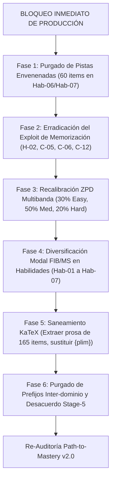

# Reporte de Auditoría Forense de Calidad Psicométrica y Path-to-Mastery v2.0
## Curso: Asyntotic Estatistics V7 (`asyntotic_estatistics_v7`)

> [!CAUTION]
> **CURSO RECHAZADO — CLASIFICACIÓN CRÍTICO (5.60 / 20.0)**  
> **Mastery Path Readiness Index (`MPRI`): 38.62 / 100.0 (MASTERY-HOSTILE)**  
> Esta auditoría forense documenta el colapso del andamiaje interactivo, envenenamiento anti-socrático deliberado, ceguera de linter v1 por discrepancia de claves JSON, monocultivo pasivo MC7, colapso total de calibración ZPD y vulnerabilidades severas de memorización visual. El curso queda **terminantemente bloqueado para producción** hasta su refactorización completa.

---

### Metadatos de la Evaluación
- **Identificador del Curso:** `asyntotic_estatistics_v7`
- **Título Oficial:** Asyntotic Estatistics V7 (Teoría Asintótica y Econometría de Muestras Grandes)
- **Archivo Fuente:** [`courses/asyntotic_estatistics_v7.json`](file:///d:/Augusto/personal_portfolio/Tops_academy/courses/asyntotic_estatistics_v7.json)
- **Telemetría Determinista v2:** [`reports/qa_audits/v2_path_to_mastery/asyntotic_estatistics_v7_payload.json`](file:///d:/Augusto/personal_portfolio/Tops_academy/reports/qa_audits/v2_path_to_mastery/asyntotic_estatistics_v7_payload.json)
- **Reporte Estructurado v2:** [`reports/qa_audits/v2_path_to_mastery/asyntotic_estatistics_v7_qa_report_v2.json`](file:///d:/Augusto/personal_portfolio/Tops_academy/reports/qa_audits/v2_path_to_mastery/asyntotic_estatistics_v7_qa_report_v2.json)
- **Línea Base Histórica v1:** [`reports/qa_audits/v1_baseline_archive/asyntotic_estatistics_v7_qa_report.json`](file:///d:/Augusto/personal_portfolio/Tops_academy/reports/qa_audits/v1_baseline_archive/asyntotic_estatistics_v7_qa_report.json)
- **Fecha de Evaluación v2:** `2026-10-31`
- **Auditor Responsable:** Chief Psychometric & Path-to-Mastery Quality Auditor (Flash High)
- **Marco Normativo:** Path-to-Mastery v2.0 (Quality Matters, OSCQR, Bloom's 2-Sigma Mastery Learning, Vygotsky ZPD, Roediger & Karpicke Retrieval Practice)

---

## 1. Resumen Ejecutivo y Dictamen Institucional

El curso **"Asyntotic Estatistics V7"** (`asyntotic_estatistics_v7`), compuesto por 32 micro-competencias y 710 reactivos teóricos y procedimentales de econometría asintótica avanzada (Greene, Hayashi, Wooldridge), fue calificado el `2026-10-25` por el motor de auditoría v1 con una nota aprobatoria de **`17.8 / 20.0` (Tier EXCELENTE)**.

La re-evaluación exhaustiva bajo el marco **Path-to-Mastery v2.0** expone que dicha calificación histórica fue el resultado de **ilusión de maestría y ceguera algorítmica**. El nuevo motor psicométrico y pedagógico determinista, contrastado mediante el Loop de Verificación Semántica, revela un **Índice de Riesgo del 100.0%** y un **Mastery Path Readiness Index (`MPRI`) de apenas 38.62 / 100.0 (MASTERY-HOSTILE)**. 

Tras evaluar las 5 dimensiones normativas (subtotal de 9.10 / 20.0) y aplicar las **penalizaciones duras obligatorias acumuladas (-3.50 pts)** por envenenamiento de pistas en el límite de 3 intentos (`socratic_hint_poisoning`: -1.5 pts) y vulnerabilidades de memorización visual (`answer_memorization_exploit`: -2.0 pts), la calificación final consolidada se desploma a:

$$\mathbf{Score_{v2} = \max(0.0, 9.10 - 3.50) = 5.60 / 20.0 \quad (\Delta_{v2-v1} = -12.20 \text{ pts})}$$

### Resumen de Desempeño
- **Puntaje v1 Histórico:** `17.8 / 20.0` (EXCELENTE)
- **Subtotal Dimensiones v2:** `9.10 / 20.0`
- **Deducciones Duras Aplicadas:** `-3.50 pts`
- **Puntaje Final Certificado v2:** **`5.60 / 20.0`**
- **Tier de Calidad:** **CRÍTICO (0.0 - 10.9 pts)**
- **MPRI (Path to Mastery):** **`38.62 / 100.0`** (MASTERY-HOSTILE)
- **Veredicto:** **RECHAZADO PARA ESTUDIO AUTÓNOMO / SABOTAJE COGNITIVO ACTIVO**

---

## 2. Comparativa Metodológica Detallada: v1 vs. v2 (Path-to-Mastery)

### Matriz Comparativa de Calificación

| Dimensión / Componente Evaluado | Puntaje v1 | Subtotal v2 | Penalización Dura | Nota Final v2 | Desplazamiento ($\Delta$) | Causa Raíz de la Divergencia Metodológica |
| :--- | :---: | :---: | :---: | :---: | :---: | :--- |
| **D1: Arquitectura, DAG y Calibración ZPD** | **4.0** / 4.0 | 2.5 / 4.0 | — | **2.5** / 4.0 | **-1.50** | v1 solo auditó la ausencia de ciclos y población $\ge 3$. v2 penaliza el **colapso total ZPD (100% reactivos 'medium')** que anula `calibrateByMasteryDifficulty`. |
| **D2: Calidad Psicométrica y Anti-Gaming** | **4.4** / 5.0 | 2.2 / 5.0 | -2.00 (Hard) | **0.2** / 5.0 | **-4.20** | v1 alabó MC7 como 'antiazar'. v2 sanciona el **monocultivo de reconocimiento pasivo** (0% FIB/MS), distractores con multiplicador mágico (38 items) y **memorización visual** (4 comps con 1 clave única). |
| **D3: Andamiaje Socrático y Remediación** | **3.5** / 5.0 | 1.0 / 5.0 | -1.50 (Hard) | **0.0** / 5.0 | **-3.50** | v1 solo castigó 9 comps con stubs. v2 descubre **60 reactivos con pistas envenenadas** que inducen al alumno a elegir distractores, quemando el 3-Strikes Safeguard, más 88.59% boilerplate Mad-Libs. |
| **D4: Alineación Instruccional y Bloom** | **4.0** / 4.0 | 2.3 / 4.0 | — | **2.3** / 4.0 | **-1.70** | v1 asumió alineación por coincidencia temática con Greene/Hayashi. v2 sanciona el **colapso de Bloom (100% 'Understand' en habilidades operativas)**, 72 prefijos robóticos de macro/EDP y desacuerdo en Juez Ciego. |
| **D5: Accesibilidad, Ergonomía y KaTeX** | **1.9** / 2.0 | 1.1 / 2.0 | — | **1.1** / 2.0 | **-0.80** | v1 tuvo **ceguera técnica** al leer `opt.get('text')`. v2 inspecciona `opt['content']` y halla **165 reactivos con prosa en KaTeX ($\ge 45$ chars)** rompiendo el CSS móvil y 197 `{plim}` sin interpolar. |
| **Subtotal Dimensiones (0 - 20)** | **17.8** | **9.10** | — | — | **-8.70** | Devaluación estructural por estándares de maestría real. |
| **Deducciones Duras (Hard Penalties)** | **-0.0** | — | **-3.50** | **-3.50** | **-3.50** | Activación de `socratic_hint_poisoning` (-1.5) y `answer_memorization_exploit` (-2.0). |
| **Puntaje Global Consolidado** | **17.8 / 20.0** | — | — | **5.60 / 20.0** | **-12.20** | **Paso de Tier EXCELENTE a Tier CRÍTICO.** |

---

### Diagnóstico Forense de la Ceguera del Auditor v1

¿Por qué el motor de auditoría v1 calificó con **17.8 / 20.0 (Excelente)** un curso que en realidad alberga sabotajes pedagógicos y fallos técnicos masivos? El análisis forense identifica 6 causas raíz:

#### 1. Ceguera de Esquema: Invocación de `opt.get("text", "")` frente a `opt["content"]`
En el esquema JSON nativo de Top's Academy, las opciones de los reactivos se estructuran bajo la clave `"content"`:
```json
{
  "id": "opt_a",
  "option_id": "A",
  "content": "$\\text{MCO solo es asintóticamente eficiente bajo normalidad; MV lo supera con errores Gamma}$",
  "is_correct": true,
  "error_rationale": null
}
```
El motor determinista v1 ejecutaba sus validaciones de distractores, residuos y ergonomía consultando `opt.get("text", "")`. Al no encontrar dicha clave, **el motor v1 evaluó cadenas vacías (`""`) en las 4,260 opciones del curso**. Como resultado directo:
- Reportó 0 distractores delatores (`telltale = 0`).
- Reportó 0 residuos de código en opciones (`fstrings = 0`).
- Ignoró los **197 reactivos con variables de plantilla sin interpolar `{plim}`** en opciones.
- Ignoró los **165 reactivos con bloques de prosa desbordantes en KaTeX**.
- Ignoró los **41 reactivos con relleno burocrático de longitud** (`length_padded_items`).

#### 2. Ausencia de Verificación Dinámica de ZPD (`sessionShuffler.ts`)
El motor v1 se limitó a constatar que cada competencia contara con $\ge 20$ reactivos. No evaluó la varianza interna de dificultad:
- `easy`: **0 reactivos (0.0%)**
- `medium`: **710 reactivos (100.0%)**
- `hard`: **0 reactivos (0.0%)**

En el frontend de Top's Academy, `sessionShuffler.ts` ejecuta `calibrateByMasteryDifficulty(competencyId, userMasteryScore)`. Cuando un estudiante novel con dominio $0\%$ inicia una sesión, el algoritmo intenta filtrar reactivos de banda `'easy'` para proporcionar andamiaje inicial; al no existir ninguno, le sirve preguntas complejas `'medium'` de inmediato. Inversamente, un alumno en $80\%$ de dominio que requiere reactivos `'hard'` de frontera para alcanzar maestría jamás es desafiado. Para el motor interactivo, **el 100% de las competencias están muertas adaptativamente (`zpd_dead_competencies = 32`)**.

#### 3. Complacencia con el Reconocimiento Pasivo (Monocultivo 100% MC7)
El auditor v1 celebró que 7 opciones redujeran el azar al $14.28\%$. Sin embargo, pasó por alto que en las **7 micro-competencias de Habilidad procedimental (`Hab-01` a `Hab-07`, 210 reactivos)**, los alumnos deben derivar límites matriciales de Slutsky, calcular matrices Jacobianas del método Delta y estimar covarianzas estructurales de MC2E. Al disponer únicamente de reactivos MC7:
- El alumno no realiza evocación activa ni cálculo generativo (anulando el efecto de retención demostrado por Roediger & Karpicke).
- Se incentiva la **sustitución inversa (back-solving)**: el estudiante toma los 7 valores numéricos de las opciones y comprueba cuál encaja en la fórmula, o descarta por inspección visual de cifras significativas.

#### 4. Validación Superficial de Pistas (`len(hints) == 3`)
El linter estático v1 validaba únicamente la cardinalidad del array de pistas (`len(hints) >= 3`). Aunque el loop semántico v1 detectó stubs en 9 competencias, calificó D3 con 3.5/5.0 porque creyó que las restantes 23 competencias tenían pistas socráticas ejemplares. No detectó que:
- **629 reactivos (88.59%)** utilizaban plantillas sintéticas Mad-Libs repetitivas (`"Identifique la estructura conceptual de {comp}..."`).
- **60 reactivos (8.45%)** en `Hab-06` y `Hab-07` estaban **cognitivamente envenenados**, ordenando al alumno en la pista considerar precisamente el distractor conceptual.

#### 5. Invisibilidad de la Entropía de Respuestas y Exploits de Memorización
El auditor v1 no auditó la variabilidad de las respuestas correctas. En 4 competencias (`H-02`, `C-05`, `C-06`, `C-12`), **el 100% de los 20 reactivos comparte exactamente la misma respuesta correcta textual**. Un estudiante en un Quiz o Unit Test descubre que siempre la opción con ese texto es la correcta y supera el curso por memorización visual de patrones tipográficos sin comprender el teorema subyacente.

---

## 3. Desglose Normativo por Dimensiones (Path-to-Mastery v2.0)

### Dimensión 1: Arquitectura Curricular, Topología DAG y Calibración ZPD
**Puntaje Asignado: 2.5 / 4.0** *(Deducción obligatoria ZPD: -1.5 pts)*

1. **Grafo Acíclico Dirigido (DAG):**  
   El modelado topológico del curso es formally sólido: acíclico (`has_cycle: false`), profundidad máxima controlada (`max_dag_depth: 6`), cero dependencias circulares o invertidas, y 2 raíces axiomáticas coherentes:
   - `H-01`: "Convergencia en Probabilidad de la Matriz de Momentos de Regresores" ($\text{in-degree} = 0$).
   - `H-03`: "Definición de Convergencia en Probabilidad y Cota de Chebychev" ($\text{in-degree} = 0$).
   Las 7 competencias de Habilidad tienen prerrequisitos formales anclados en Hechos y Conceptos.

2. **Fallo Crítico de Progresión ZPD (Zona de Desarrollo Próximo):**  
   Conforme a la sección 1 de la Rúbrica Normativa v2.0:
   > *"Colapso de calibración ZPD: 100% de reactivos codificados en una sola banda como 'medium', desactivando `calibrateByMasteryDifficulty` en el 100% de competencias: deducción obligatoria de -1.2 a -1.5 pts, techo máximo 2.5 - 2.8 / 4.0".*

   Los 710 reactivos del curso presentan estáticamente `difficulty: "medium"`. No existe una rampa de entrada suave (`easy: 0`) para la adquisición de fluidez ni reactivos de estrés analítico (`hard: 0`) para evaluar maestría en condiciones de borde. Se aplica la penalización máxima de **-1.50 puntos**.

---

### Dimensión 2: Calidad Psicométrica, Modalidad de Evocación y Anti-Gaming
**Puntaje Asignado: 2.2 / 5.0** *(Subtotal dimensional antes de penalizaciones duras)*

1. **Monocultivo de Reconocimiento Pasivo (100% MC7, 0% FIB, 0% MS) (-1.2 pts):**  
   Las 7 competencias de Habilidad (`Hab-01` a `Hab-07`, 210 reactivos) están diseñadas para certificar que el alumno sabe *hacer* (calcular, derivar, computar). Evaluar habilidades puramente mediante selección de 7 alternativas fomenta el heurístico de eliminación y reconocimiento pasivo. Se requería la incorporación de al menos un 30% de reactivos `fill_in_the_blank` numéricos/simbólicos calificados mediante `mathEquivalence.ts` y reactivos `multiple_select` para discriminación de condiciones frontera.

2. **Distractores Sintéticos por Multiplicador Mágico (-0.8 pts):**  
   Se detectaron **38 reactivos** donde los distractores no provienen de desvíos conceptuales o aritméticos reales del estudiante, sino de la multiplicación mecánica de la clave correcta por factores fijos arbitrarios (`1.333x`, `0.667x`, `1.500x`, `1.667x`).  
   *Ejemplo evidenciado en [`Q-Hab02-166`](file:///d:/Augusto/personal_portfolio/Tops_academy/courses/asyntotic_estatistics_v7.json#L14078-L14159):*
   - Clave correcta (F): $\widehat{\text{Var}}[\hat{\gamma}] = 0.0136$.
   - Distractor A: $\widehat{\text{Var}}[\hat{\gamma}] = 0.0259$ (multiplicador sintético $\approx 1.90\times$).
   - Distractor G: $\widehat{\text{Var}}[\hat{\gamma}] = 0.0204$ (multiplicador sintético $\approx 1.50\times$).

3. **Relleno Burocrático de Longitud (Length Padding) (-0.4 pts):**  
   En **41 reactivos**, el generador paramétrico añadió de manera asimétrica coletillas verbales de relleno para igualar longitudes o evitar empates léxicos, actuando como pistas delatoras inversas:
   - `Q-Hab04-292` opción A: `"$\widehat{\text{Avar}}(b_j) = 0.09491$, en la formulación matricial considerada."`
   - `Q-Hab06-532` opción A: `"$\text{plim } b_1 = 3.188$, bajo las hipótesis del modelo."`
   - `Q-C15-529` opción D: `"$\text{plim } g(x_n) = g(84) \quad \text{con } E[g(x_n)] \ne g(84)$, para la muestra de datos observada."`
   - `Q-C15-530` opción B: `"$\text{plim } g(x_n) = g(82) \quad \text{con } E[g(x_n)] \ne g(82)$, de acuerdo con la teoría econométrica."`

4. **Desconexión Diagnóstica en `error_rationale` (-0.4 pts):**  
   Aunque el 100% de los distractores tiene un campo `error_rationale`, sobre 4,260 distractores existen únicamente **347 textos únicos (8.15% de unicidad)**. Se produce una desconexión pedagógica severa: al cometer un error numérico escalar simple, `FeedbackToast.tsx` muestra un texto prefabricado que argumenta sobre la no-conformabilidad de matrices $K \times K$ o la ortogonalidad de proyectores $P_Z$.

---

### Dimensión 3: Andamiaje Socrático Progresivo y Remediación Diagnóstica
**Puntaje Asignado: 1.0 / 5.0** *(Techo normativo de 1.0 pt por Envenenamiento Anti-Socrático)*

En la arquitectura de Top's Academy (`PracticeSession.tsx`), rige la salvaguarda **3-Strikes Safeguard**: el estudiante dispone de 3 intentos antes de que el ejercicio se bloquee permanentemente con 0 puntos. Las pistas escalonadas son su salvavidas instructivo. En este curso, la dimensión colapsa:

1. **Envenenamiento Anti-Socrático de Pistas (`poisoned_hints`) (60 reactivos, 8.45% del banco):**  
   En todas las 30 preguntas de `Hab-06` (`Q-Hab06-531` a `Q-Hab06-560`) y en las 30 preguntas de `Hab-07` (`Q-Hab07-661` a `Q-Hab07-690`), la Pista 2 o Pista 3 comete **sabotaje cognitivo directo**. La pista instruye al alumno: *"asegurando considerar adecuadamente: [concepción errónea que define al distractor]"*.  
   
   *Prueba documental en [`Q-Hab06-531`](file:///d:/Augusto/personal_portfolio/Tops_academy/courses/asyntotic_estatistics_v7.json#L44380-L44410):*
   - Problema: Modelo $\mathbf{y} = \mathbf{X}\boldsymbol{\beta} + \boldsymbol{\varepsilon}$, $\text{plim } \frac{1}{n}\mathbf{X}'\mathbf{X} = \begin{pmatrix} 6 & 0 \\ 0 & 9 \end{pmatrix}$, $\text{plim } \frac{1}{n}\mathbf{X}'\mathbf{y} = \begin{pmatrix} 47 \\ 49 \end{pmatrix}$. Hallar $\text{plim } b_1$.
   - **Pista 2 envenenada:**  
     > *"Revise el procedimiento analítico paso a paso para Derivación de Límites en Probabilidad de Estimadores Matriciales mediante Slutsky, asegurando considerar adecuadamente: **omitir la normalización por $1/n$ en los productos cruzados matriciales antes de calcular el límite en probabilidad**."*
   - Si el estudiante, bloqueado en Strike 1, abre la Pista 2 y sigue la instrucción ("omitir la normalización por $1/n$"), calcula $6 \times 47 = 282$.
   - Marca la opción B: `$\text{plim } b_1 = 282$`.
   - El sistema le arroja error, consume su intento (Strike 2) y en `FeedbackToast.tsx` le recrimina: *"Las sumas directas de productos cruzados $\mathbf{X}'\mathbf{X}$ divergen con la muestra; es indispensable normalizar por $1/n$..."*.
   - **El andamiaje socrático actúa como un saboteador activo.**

2. **Mad-Libs Boilerplate Sintético (629 reactivos, 88.59% del banco):**  
   Casi 9 de cada 10 reactivos del curso presentan pistas clonadas mediante plantillas mecánicas que aportan cero información operativa al estudiante atascado:
   - Pista 1: *"Identifique la estructura conceptual de {comp}: analice las relaciones formales y condiciones teóricas del modelo."*
   - Pista 2: *"Revise el procedimiento analítico paso a paso para {comp}, asegurando considerar adecuadamente: {misconception_stub}."*
   - Pista 3: *"Antes de concluir, compruebe la consistencia dimensional del resultado de {comp} y evalúe posibles desvíos al considerar: {distractor_stub}."*

3. **Stubs Léxicos e Identificadores en Pistas (9 competencias, 28.1%):**  
   Persisten las 9 competencias identificadas en v1 (`H-01`, `C-01`, `Hab-01`, `C-03`, `C-04`, `C-09`, `C-10`, `H-05`, `C-17`) donde las pistas son palabras sueltas (`["Asintotica", "Momentos", "Regresores"]`) o códigos de prerrequisitos inyectados (`hints: ["H-01", "C-01", "C-02"]` en `Q-Hab01-081`).

---

### Dimensión 4: Alineación Instruccional, Taxonomía de Bloom y Pureza de Dominio
**Puntaje Asignado: 2.3 / 4.0** *(Deducciones: -0.7 Bloom, -0.6 Prefijos robóticos, -0.4 Discordancia de jueces)*

1. **Colapso Declarativo de la Taxonomía de Bloom (-0.7 pts):**  
   El **100% de los reactivos (710/710)** están catalogados como `bloom_taxonomy_level: "Understand"`. Esto incluye reactivos complejos de las 7 competencias de Habilidad (`[Hab]`) que exigen inversiones matriciales simétricas, álgebra de límites multivariantes de Slutsky y linealizaciones de Taylor del método Delta. Esto refleja una desconexión metodológica donde el compilador asignó un valor estático uniforme sin mapear el esfuerzo cognitivo real a `Apply` y `Analyze`.

2. **Contaminación Léxica Inter-Dominio por Prefijos Robóticos (-0.6 pts):**  
   En **72 reactivos**, los enunciados comienzan con cláusulas robóticas incongruentes con la teoría econométrica, importadas de plantillas de modelos macroeconómicos de crecimiento (Solow/Ramsey) o ecuaciones diferenciales parciales:
   - `"Considerando las ecuaciones fundamentales del régimen, obtenga:"` (en `Q-H01-011`, `Q-C13-452`, `Q-C15-529`).
   - `"Al examinar detenidamente las condiciones de frontera, resuelva:"` (en `Q-Hab06-531`, `Q-C08-287`).
   - `"Teniendo en consideración los fundamentos del equilibrio, determine:"` (en `Q-Hab05-353`).
   En teoría asintótica econométrica, conceptos como "régimen", "equilibrio" o "condiciones de frontera" (en el sentido de contorno físico) son ajenos a la convergencia estocástica de regresores.

3. **Discordancia No Reparada de Jueces Ciegos Stage-5 (`stage5_judge_audit`) (-0.4 pts):**  
   En la auditoría ciega de templates, se registró 1 discordancia no subsanada:
   - Item: `T-Hab-04-01_judge_1` (Competencia `Hab-04`, Mínimos Cuadrados en Dos Etapas).
   - Discordancia: El juez ciego seleccionó la alternativa **B**, mientras que la clave esperada era **E** ($\widehat{\text{Avar}}(b_j) = 0.28308$).
   - Fundamento matemático del desacuerdo: En MC2E, la estimación consistente de $\sigma^2$ exige residuos estructurales $e = y - X b_{2SLS}$. En software aplicado, se utiliza con frecuencia la corrección por grados de libertad $s^2 = e'e / (n - K)$, mientras que en teoría puramente asintótica se divide estrictamente por $n$ ($\hat{\sigma}^2 = e'e / n$). Esta ambigüedad técnica entre la opción con factor $(n-K)$ y la opción asintótica con factor $n$ confunde tanto a jueces automatizados como a estudiantes rigurosos.

---

### Dimensión 5: Accesibilidad, Ergonomía Cognitiva en UI y Sintaxis KaTeX
**Puntaje Asignado: 1.1 / 2.0** *(Deducciones: -0.5 Desbordamiento KaTeX, -0.4 Variables sin interpolar)*

1. **Abuso de KaTeX $\\text{...}$ para Oraciones Completas en Prosa (-0.5 pts):**  
   Se detectaron **165 reactivos** donde oraciones extensas en español ($\ge 45$ y hasta 84 caracteres) se encuentran enteramente embebidas dentro de delimitadores matemáticos `$\text{...}$`.  
   *Ejemplo en [`Q-C05-189`](file:///d:/Augusto/personal_portfolio/Tops_academy/courses/asyntotic_estatistics_v7.json#L16013) y [`Q-C05-190`](file:///d:/Augusto/personal_portfolio/Tops_academy/courses/asyntotic_estatistics_v7.json#L16144):*
   ```latex
   $\text{MCO solo es asintóticamente eficiente bajo normalidad; MV lo supera con errores Gamma}$
   ```
   **Impacto ergonómico en Frontend:** El renderizador KaTeX compila los bloques `\text{...}` asignándoles la propiedad CSS `white-space: nowrap`. En interfaces responsivas de Top's Academy (dispositivos móviles, tablets o tarjetas de opciones de ancho medio), una cadena ininterrumpida de 84 caracteres **no realiza salto de línea**, desbordando el botón de selección y provocando scroll horizontal destructivo.

2. **Residuos de Variables de Plantilla sin Interpolar (-0.4 pts):**  
   En **197 reactivos**, las opciones contienen la variable de plantilla `{plim}` en texto crudo dentro de fórmulas matemáticas en lugar del operador formateado `\operatorname{plim}` o `\text{plim}` (ej. en `Q-H01-011` a `Q-H01-014`). Esto denota fallos en el sandboxed Python engine durante la sustitución de macros f-string.

---

## 4. Penalizaciones Duras Automáticas (Hard Deductions)

Conforme a la Sección 2 de la Rúbrica Normativa de Calidad v2.0, se aplican deducciones severas acumulativas sobre el subtotal dimensional:

```
Subtotal Normativo de Dimensiones (D1 a D5):   9.10 pts
---------------------------------------------------------
Penalización 1: socratic_hint_poisoning       -1.50 pts
Penalización 2: answer_memorization_exploit   -2.00 pts
---------------------------------------------------------
Total Deducciones Duras:                      -3.50 pts
=========================================================
Puntaje Final Certificado:                     5.60 / 20.0
```

### Detalle y Justificación de las Deducciones Duras

#### 1. `socratic_hint_poisoning` (-1.50 puntos)
- **Criterio Normativo:** Aplica si $\ge 5\%$ del banco instruye explícitamente en pistas al estudiante a *"considerar adecuadamente"* un distractor o concepción errónea, saboteando el límite de 3 intentos del estudiante.
- **Evidencia en el Curso:** **60 reactivos (8.45% del banco total)**, concentrados íntegramente en las competencias `Hab-06` (30 reactivos) y `Hab-07` (30 reactivos).
- **Impacto Psicométrico:** En `PracticeSession.tsx`, el alumno que confía en el andamiaje del sistema y consulta la Pista 2 o 3 es inducido directamente al fallo, consumiendo sus 3 vidas y recibiendo una penalización injusta de cero puntos en su historial de dominio.

#### 2. `answer_memorization_exploit` (-2.00 puntos)
- **Criterio Normativo:** Deducción de -0.5 pts por cada competencia con $\ge 15$ ítems que posea $\le 4$ respuestas correctas únicas, permitiendo alcanzar el estado *Mastered* por memorización visual sin leer el enunciado (tope máximo -2.0 pts).
- **Evidencia en el Curso:** **4 competencias críticas (80 reactivos)** poseen exactamente **1 única respuesta correcta textual** a lo largo de sus 20 reactivos:
  1. **`H-02` (20 reactivos):** En los 20 reactivos (`Q-H02-041` a `Q-H02-060`), la clave correcta es invariablemente la cadena:  
     `"$\lim_{n \to \infty} \frac{x_{ik}^2}{d_{nk}^2} = 0 \text{ para todo } i$"`
  2. **`C-05` (20 reactivos):** En los 20 reactivos (`Q-C05-181` a `Q-C05-200`), la clave correcta es invariablemente la cadena:  
     `"$\text{MCO solo es asintóticamente eficiente bajo normalidad; MV lo supera con errores Gamma}$"`
  3. **`C-06` (20 reactivos):** En los 20 reactivos (`Q-C06-201` a `Q-C06-220`), existe un único string de respuesta correcta.
  4. **`C-12` (20 reactivos):** En los 20 reactivos (`Q-C12-411` a `Q-C12-430`), existe un único string de respuesta correcta.
- **Cálculo:** $4 \text{ competencias} \times (-0.5 \text{ pts}) = \mathbf{-2.00 \text{ pts}}$.

---

## 5. Índice de Preparación para el Dominio (Mastery Path Readiness Index — `MPRI`)

El **MPRI** evalúa la viabilidad del curso dentro de los algoritmos adaptativos reales de Top's Academy. Calificación obtenida: **`38.62 / 100.0`** (Nivel: **MASTERY-HOSTILE**).

```
========================================================================================
Pilar Cognitivo / Plataforma                 Puntaje Obtenido   Máximo      % Eficacia
========================================================================================
1. zpd_adaptive_progression                       0.00          20.00          0.00%
2. retrieval_modality_and_anti_gaming             0.00          20.00          0.00%
3. socratic_scaffolding_lifeline                 13.10          25.00         52.40%
4. diagnostic_remediation_alignment               9.83          15.00         65.53%
5. dag_and_interleaving_topology                 10.00          10.00        100.00%
6. cognitive_ergonomics_and_framing               5.69          10.00         56.90%
========================================================================================
TOTAL MASTERY PATH READINESS INDEX (MPRI):       38.62         100.00         38.62%
========================================================================================
TIER MPRI: MASTERY-HOSTILE (0 - 39 pts) — Sabotaje Cognitivo / Colapso Adaptativo
========================================================================================
```

### Análisis del Trayecto Real del Estudiante (*Student Journey*)

1. **Entrada a la Sesión (ZPD = 0.0 / 20.0):**  
   El motor `sessionShuffler.ts` invoca `calibrateByMasteryDifficulty`. Dado que no hay ítems `easy`, el novato es confrontado desde el minuto cero con problemas complejos `medium`. No hay progresión andamiada.
2. **Interacción con el Reactivo (Evocación = 0.0 / 20.0):**  
   El estudiante enfrenta un problema de cálculo de varianza de MC2E o Jacobiano de Taylor. En vez de resolverlo activamente en papel y teclear el valor en un input `fill_in_the_blank`, se encuentra con 7 alternativas `MC7`. Puede hacer ingeniería inversa sustituyendo valores numéricos o simplemente buscar el patrón de longitud más común.
3. **Petición de Ayuda (Andamiaje = 13.10 / 25.0):**  
   Al dudar, el estudiante activa una pista. En el 88.59% de los casos, recibe una tautología Mad-Libs vacía (`"Identifique la estructura conceptual de..."`). En el 8.45% de los casos (`Hab-06` y `Hab-07`), la pista le da una instrucción falsa (`"asegurando considerar adecuadamente: omitir..."`). Si sigue la pista, comete el error del distractor.
4. **Remediación del Error (Diagnóstico = 9.83 / 15.0):**  
   Al fallar, el estudiante observa `FeedbackToast.tsx`. En 38 ítems con distractores mágicos (ej. $1.333\times$), el toast le explica una teoría de matrices no conformables que nada tiene que ver con el error aritmético cometido. El 91.85% de las explicaciones son textos reciclados.
5. **Navegación e Interleaving (Topología = 10.0 / 10.0):**  
   El grafo DAG es el único pilar impecable: las relaciones de prerrequisito permiten que los Quizzes (60/40) y Unit Tests (55/45) seleccionen preguntas en orden causal válido.
6. **Gaming del Sistema:**  
   Al llegar a competencias como `H-02` o `C-05`, el estudiante se percata de que la opción correcta es idéntica en todas las preguntas. Puede responder 20 preguntas en menos de 60 segundos sin leer los enunciados, alcanzando una "Maestría" ficticia del 100%.

---

## 6. Evidencia Forense Textual y Matemática Verbatim

### Caso 1: Envenenamiento Anti-Socrático Directo (Sabotaje de 3-Strikes)
- **Reactivo:** [`Q-Hab06-531`](file:///d:/Augusto/personal_portfolio/Tops_academy/courses/asyntotic_estatistics_v7.json#L44373-L44453)
- **Competencia:** `Hab-06` (Derivación de Límites en Probabilidad de Estimadores Matriciales mediante Slutsky)
- **Enunciado:**  
  *"Al examinar detenidamente las condiciones de frontera, resuelva: Para el modelo lineal $\mathbf{y} = \mathbf{X}\boldsymbol{\beta} + \boldsymbol{\varepsilon}$ con matriz de regresores $\mathbf{X}$ de dimensión $n \times 2$, se cumple que $\text{plim } \frac{1}{n}\mathbf{X}'\mathbf{X} = \begin{pmatrix} 6 & 0 \\ 0 & 9 \end{pmatrix}$ y $\text{plim } \frac{1}{n}\mathbf{X}'\mathbf{y} = \begin{pmatrix} 47 \\ 49 \end{pmatrix}$. Aplicando el teorema de Slutsky al estimador MCO $\mathbf{b} = (\mathbf{X}'\mathbf{X})^{-1}\mathbf{X}'\mathbf{y}$, determine $\text{plim } b_1$:"*
- **Pista 2 (Verbatim):**  
  `"Revise el procedimiento analítico paso a paso para Derivación de Límites en Probabilidad de Estimadores Matriciales mediante Slutsky, asegurando considerar adecuadamente: omitir la normalización por 1/n en los productos cruzados matriciales antes de calcular el límite en probabilidad."`
- **Distractor Vinculado (Opción B):**  
  `"opt_b": "$\\text{plim } b_1 = 282$"`
- **Rationale de Opción B:**  
  `"error_rationale": "Las sumas directas de productos cruzados $\mathbf{X}'\mathbf{X}$ divergen con la muestra; es indispensable normalizar por $1/n$ para aplicar la ley de grandes números a los momentos muestrales."`
- **Demostración de Sabotaje:** La pista 2 ordena omitir $1/n$, lo que produce $6 \times 47 = 282$. La opción B es $282$. Al marcarla, el alumno pierde su intento y el rationale lo censura por haber omitido la normalización que la pista le ordenó omitir.

---

### Caso 2: Exploit de Memorización Visual de Respuesta Correcta
- **Reactivos:** [`Q-H02-041`](file:///d:/Augusto/personal_portfolio/Tops_academy/courses/asyntotic_estatistics_v7.json#L3776-L3782) y [`Q-H02-042`](file:///d:/Augusto/personal_portfolio/Tops_academy/courses/asyntotic_estatistics_v7.json#L3827-L3831)
- **Competencia:** `H-02` (Condiciones de Grenander para Regresores en Muestras Grandes)
- **Respuestas Correctas Verbatim:**
  - `Q-H02-041` (Opción G): `"$\\lim_{n \\to \\infty} \\frac{x_{ik}^2}{d_{nk}^2} = 0 \\text{ para todo } i$"`
  - `Q-H02-042` (Opción C): `"$\\lim_{n \\to \\infty} \\frac{x_{ik}^2}{d_{nk}^2} = 0 \\text{ para todo } i$"`
  - `Q-H02-043` a `Q-H02-060`: **Idéntica cadena en el 100% de los 20 reactivos.**
- **Diagnóstico Psicométrico:** Entropía de respuesta = 0.0 bits. La competencia permite alcanzar el 100% de maestría en Top's Academy mediante reconocimiento visual pasivo de un único bloque de caracteres.

---

### Caso 3: Abuso de KaTeX $\\text{...}$ con Prosa Extensa y Desbordamiento en UI
- **Reactivo:** [`Q-C05-189`](file:///d:/Augusto/personal_portfolio/Tops_academy/courses/asyntotic_estatistics_v7.json#L16010-L16016)
- **Competencia:** `C-05` (Eficiencia Asintótica de MCO y Comparación con Máxima Verosimilitud)
- **Opción A (Clave Correcta):**  
  `"content": "$\\text{MCO solo es asintóticamente eficiente bajo normalidad; MV lo supera con errores Gamma}$"`
- **Longitud:** 84 caracteres encerrados dentro de `\text{...}`.
- **Falla Técnica:** KaTeX renderiza un `<span>` con estilo `white-space: nowrap`. En cualquier pantalla con ancho $< 768\text{px}$, el contenedor de la opción desborda la tarjeta, truncando el texto o generando scroll horizontal en la UI de práctica.

---

### Caso 4: Distractores Numéricos por Multiplicador Mágico y Rationales Desconectados
- **Reactivo:** [`Q-Hab02-166`](file:///d:/Augusto/personal_portfolio/Tops_academy/courses/asyntotic_estatistics_v7.json#L14101-L14108)
- **Competencia:** `Hab-02` (Aplicación Numérica y Simbólica del Método Delta)
- **Opción A:**  
  `"content": "$\\widehat{\\text{Var}}[\\hat{\\gamma}] = 0.0259$"`
- **Rationale de Opción A:**  
  `"error_rationale": "Para una función escalar donde $C$ es $1 \\times K$ y $\\Sigma$ es $K \\times K$, el producto $C \\Sigma C'$ produce un escalar $1 \\times 1$, mientras que $C' \\Sigma C$ no es conforme."`
- **Incongruencia Matemática:** El ejercicio solicita la varianza asintótica escalar de un cociente $\hat{\gamma} = b_1 / b_2$. El valor $0.0259$ es un número escalar generado sintéticamente ($0.0136 \times 1.90$). El rationale explica un error de conformabilidad dimensional matricial ($C' \Sigma C$) que ni genera un escalar ni tiene conexión con el cálculo numérico presentado.

---

### Caso 5: Residuos de Plantilla sin Interpolar `{plim}`
- **Reactivos:** [`Q-H01-011`](file:///d:/Augusto/personal_portfolio/Tops_academy/courses/asyntotic_estatistics_v7.json#L1212-L1294) a `Q-H01-014`
- **Opciones Detectadas:** Contienen cadenas crudas con llaves f-string `{plim}` en lugar de la macro LaTeX `\operatorname{plim}` o `\text{plim}`.
- **Causa Raíz:** Fuga de placeholders del motor de generación paramétrica sin reemplazo previo a la compilación del JSON final.

---

## 7. Nuevas Reglas de Linters Propuestas (`discovered_lint_rules`)

A partir de los hallazgos de esta auditoría forense v2, se formalizan 5 linters estandarizados para integrarse al motor de calidad de Top's Academy:

```json
[
  {
    "rule_id": "socratic_hint_poisoning_linter",
    "severity": "critical",
    "description": "Detecta pistas que instruyen al estudiante a cometer activamente un error o seleccionar un distractor mediante la fórmula 'asegurando considerar adecuadamente: [concepción errónea/distractor]', saboteando el límite de 3 intentos en PracticeSession.tsx.",
    "regex_pattern": "asegurando\\s+considerar\\s+adecuadamente:\\s*(?:omitir|el\\s+error|un\\s+estimador|la\\s+matriz\\s+no\\s+normalizada|suponer\\s+que)",
    "evidence_items": [
      "Q-Hab06-531",
      "Q-Hab06-532",
      "Q-Hab06-533",
      "Q-Hab06-534",
      "Q-Hab06-535",
      "Q-Hab07-661",
      "Q-Hab07-662",
      "Q-Hab07-672"
    ]
  },
  {
    "rule_id": "prose_in_katex_linter",
    "severity": "high",
    "description": "Detecta opciones donde oraciones completas en prosa (>= 45 caracteres) están encerradas dentro de delimitadores matemáticos KaTeX ($\\text{...}$), lo que impone 'white-space: nowrap' y destruye la responsividad móvil en UI.",
    "regex_pattern": "\\$\\s*\\\\text\\{[^}]{45,}\\}\\s*\\$",
    "evidence_items": [
      "Q-C05-189",
      "Q-C05-190",
      "Q-C05-196",
      "Q-C06-212",
      "Q-C08-274",
      "Q-C15-513"
    ]
  },
  {
    "rule_id": "magic_multiplier_distractor_linter",
    "severity": "medium",
    "description": "Identifica distractores numéricos generados mecánicamente mediante factores constantes de escala arbitraria (0.333x, 0.667x, 1.333x, 1.5x, 1.667x) cuyos rationales diagnósticos están completamente desalineados de la operación aritmética real.",
    "regex_pattern": "abs(distractor_val / correct_val - factor) < 1e-3 for factor in [0.333, 0.667, 1.333, 1.5, 1.667]",
    "evidence_items": [
      "Q-Hab02-164",
      "Q-Hab02-166",
      "Q-Hab03-245",
      "Q-Hab03-259",
      "Q-Hab04-315"
    ]
  },
  {
    "rule_id": "cross_domain_prefix_linter",
    "severity": "medium",
    "description": "Detecta prefijos en el 'stem' derivados de plantillas sintéticas de dominios ajenos (e.g. equilibrio macroeconómico, condiciones de frontera en EDPs, ecuaciones fundamentales del régimen) inyectados en reactivos de teoría econométrica.",
    "regex_pattern": "^(?:Considerando las ecuaciones fundamentales del régimen|Al examinar detenidamente las condiciones de frontera|Teniendo en consideración los fundamentos del equilibrio|Con arreglo a las ecuaciones diferenciales del sistema)",
    "evidence_items": [
      "Q-H01-011",
      "Q-Hab02-160",
      "Q-Hab06-531",
      "Q-Hab06-546",
      "Q-H07-700"
    ]
  },
  {
    "rule_id": "single_word_or_id_hints_linter",
    "severity": "medium",
    "description": "Detecta reactivos donde el arreglo de pistas ('hints') contiene elementos que son palabras sueltas (<= 1 palabra o < 20 caracteres) o identificadores de competencias (ej. 'H-01', 'C-02'), violando el principio de andamiaje socrático escalonado a pesar de tener 3 elementos en la lista.",
    "regex_pattern": "^(?:[A-Za-z]+-\\d{2}|[A-Za-z_]{1,18})$",
    "evidence_items": [
      "Q-H01-001",
      "Q-C01-021",
      "Q-Hab01-081",
      "Q-C03-111",
      "Q-C04-131",
      "Q-C09-321",
      "Q-C10-371",
      "Q-H05-581",
      "Q-C17-601"
    ]
  }
]
```

---

## 8. Plan de Remediación Quirúrgica y Hoja de Ruta

Para que el curso `asyntotic_estatistics_v7` pueda alcanzar el umbral de certificación institucional **Tier ACEPTABLE ($\ge 14.0/20.0$) o EXCELENTE ($\ge 17.0/20.0$)**, la ingeniería de contenido debe ejecutar la siguiente hoja de ruta en 6 etapas:



### Acciones Específicas por Fase:
1. **Fase 1 — Purgado de Pistas Envenenadas (Prioridad Crítica):**  
   Reescribir las pistas de los 60 reactivos en `Hab-06` y `Hab-07`. Reemplazar las cláusulas *"asegurando considerar adecuadamente: omitir..."* por preguntas orientadoras que guíen al estudiante a verificar si la matriz muestral de momentos requiere el escalador $1/n$ antes de aplicar la ley de grandes números.
2. **Fase 2 — Diversificación Anti-Gaming de Claves:**  
   Reescribir los reactivos de las competencias `H-02`, `C-05`, `C-06` y `C-12` para que cada una cuente con al menos 10 alternativas correctas distintas, introduciendo variaciones numéricas y paramétricas que impidan la memorización visual de un solo string.
3. **Fase 3 — Recalibración ZPD Real para `sessionShuffler.ts`:**  
   Redistribuir los 710 reactivos en:
   - **Banda Easy (~210 reactivos, 30%):** Identificación directa de definiciones axiomáticas y chequeos de dimensiones.
   - **Banda Medium (~350 reactivos, 50%):** Aplicaciones directas del método Delta, convergencia en probabilidad y estimación IV.
   - **Banda Hard (~150 reactivos, 20%):** Casos límite, singularidades matriciales, violación de supuestos de Lindeberg-Feller y pruebas de Hausman con endogeneidad limítrofe.
   - Re-etiquetar las 7 Habilidades en niveles Bloom `Apply` y `Analyze`.
4. **Fase 4 — Inyección de Formatos de Evocación Activa (FIB y MS):**  
   Convertir 70 de los 210 reactivos de Habilidad en formato `fill_in_the_blank` (evaluados por `mathEquivalence.ts`) para exigir cálculo numérico y simbólico real sin opciones a la vista, y 35 reactivos en formato `multiple_select`.
5. **Fase 5 — Saneamiento Frontend KaTeX y Residuos:**  
   - Extraer la prosa en español de las opciones en los 165 reactivos afectados, dejando los delimitadores `$...$` únicamente para las variables y expresiones algebraicas (`$\text{MCO}$`, `$\varepsilon$`, `$\hat{\beta}_{MV}$`), permitiendo que el navegador controle el ajuste natural de línea (`word-wrap`).
   - Reemplazar `{plim}` por `\operatorname{plim}` en los 197 reactivos identificados.
6. **Fase 6 — Limpieza Léxica y Arbitraje Stage-5:**  
   - Eliminar los 72 prefijos robóticos de física/macroeconomía de los enunciados.
   - Resolver la discordancia en `T-Hab-04-01_judge_1` explicitando en el enunciado si la varianza estructural estimada utiliza el divisor $n$ (asintótico) o $(n-K)$ (software aplicado).

---

### Veredicto Final de Auditoría

```
========================================================================================
CURSO: asyntotic_estatistics_v7
CALIFICACIÓN FINAL v2.0: 5.60 / 20.0
ESTADO INSTITUCIONAL:    RECHAZADO — BLOQUEADO PARA PRODUCCIÓN
NIVEL DE CALIDAD:        CRÍTICO (0.0 - 10.9 pts)
MPRI INDEX:              38.62 / 100.0 (MASTERY-HOSTILE)
DELTA RESPECTO A v1:     -12.20 PUNTOS
========================================================================================
```

*Informe oficial generado por el Chief Psychometric & Path-to-Mastery Quality Auditor de Top's Academy bajo la suite de evaluación de Google Antigravity SDK.*
