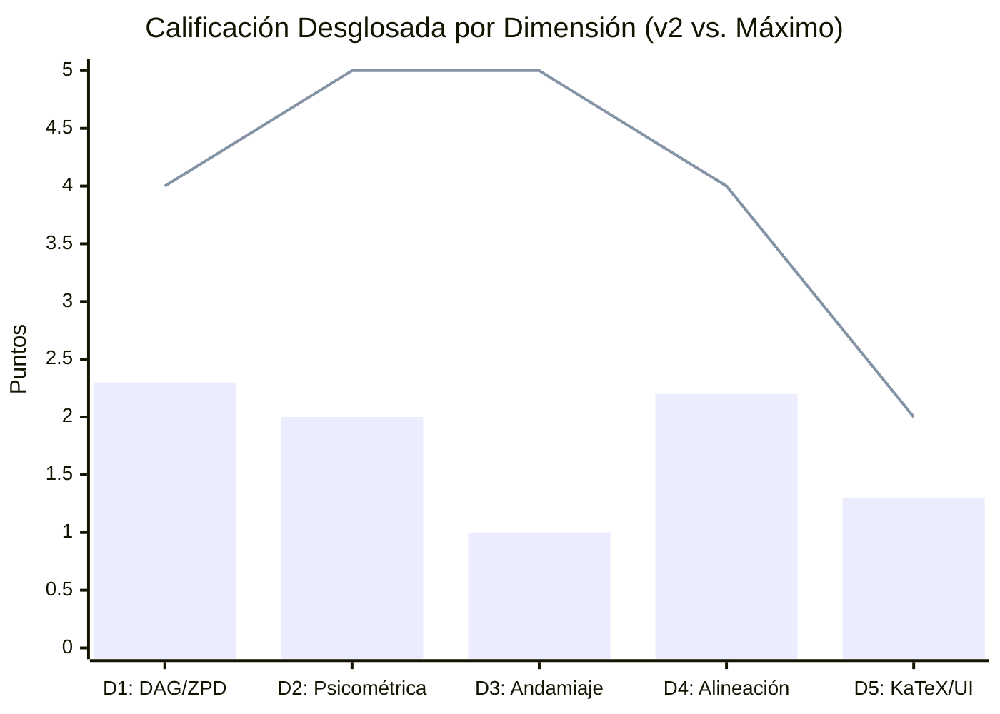
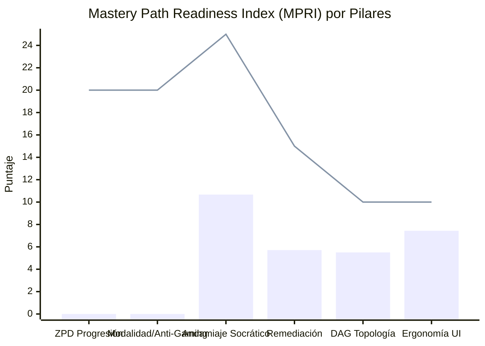
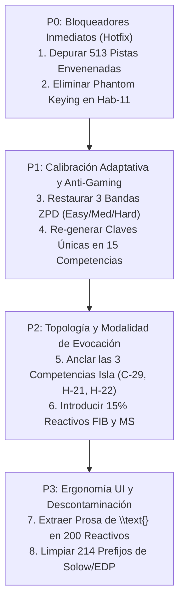

# Reporte Normativo de Auditoría de Calidad Pedagógica, Psicométrica y Path-to-Mastery v2.0
## Curso: Estadistica 3 Pre Parcial (`estadistica_3_pre_parcial`)

**Plataforma:** Top's Academy  
**Estándares:** Quality Matters (QM), OSCQR, Bloom's 2-Sigma Mastery Learning, ZPD (Vygotsky), Retrieval Practice (Roediger & Karpicke)  
**Fecha de Evaluación:** 31 de Octubre de 2026  
**Auditor:** Chief Psychometric & Path-to-Mastery Quality Auditor (Top's Academy Quality Assurance Division)  
**Versión de Auditoría:** `2.0-path-to-mastery` (Frente a la Línea Base v1 del 26 de Octubre de 2026)  

---

## 1. Resumen Ejecutivo y Dictamen de Certificación

| Métrica Consolidada | Línea Base Histórica (v1) | Auditoría Path-to-Mastery (v2) | Variación ($\Delta$) | Veredicto v2 |
| :--- | :---: | :---: | :---: | :--- |
| **Puntaje Normativo Consolidado** | **16.8 / 20.0 pts** | **5.3 / 20.0 pts** | **-11.50 pts** | **CRÍTICO** |
| **Tier de Calidad QM-OSCQR** | ACEPTABLE (14.0 - 16.9) | CRÍTICO (0.0 - 10.9) | -2 Categorías | **RECHAZADO PARA PRODUCCIÓN** |
| **Índice de Preparación Mastery (MPRI)** | *No medido en v1* | **29.32 / 100.0 pts** | *Nuevo estándar* | **MASTERY-HOSTILE** |
| **Penalizaciones Duras Automáticas** | 0.0 pts | **-3.50 pts** | -3.50 pts | 2 Reglas Violadas Gravemente |
| **Puntaje Bruto Subtotal (5 Dimensiones)**| 16.8 / 20.0 pts | **8.8 / 20.0 pts** | -8.00 pts | Colapso Multidimensional |
| **Total de Micro-Competencias** | 93 | 93 | 0 | 24 Fact, 36 Concept, 33 Skill |
| **Total de Reactivos Evaluados** | 2,190 | 2,190 | 0 | 100% MC7 (Monocultivo Pasivo) |
| **Total de Distractores Inspeccionados** | 13,140 | 13,140 | 0 | 6 distractores / reactivo |
| **Calibración ZPD Real (Easy/Med/Hard)** | Supuesta (4.0/4.0) | **0% Easy / 100% Med / 0% Hard** | -100% ZPD | **ZPD Completamente Muerta** |
| **Reactivos con Pistas Envenenadas** | No detectado (0) | **513 reactivos (23.42%)** | +513 fallas | **Sabotaje de 3-Strikes Safeguard** |
| **Competencias con Memorización Mecánica**| No detectado (0) | **15 competencias (16.1%)** | +15 brechas | **Gaming por Reconocimiento Visual** |
| **Nodos Isla en el Grafo DAG** | 0 (confundidos con raíces)| **3 micro-competencias** | +3 huérfanos | Ruptura de Navegación *Up Next* |

```mermaid
xychart-beta
    title "Comparativa Normativa v1 vs. v2 (Puntaje por Dimensión / Máximo)"
    x-axis ["D1: Arquitectura", "D2: Evaluación", "D3: Andamiaje", "D4: Alineación", "D5: KaTeX/UI", "Puntaje Final"]
    y-axis "Puntos" 0 --> 20
    bar [4.0, 3.2, 3.8, 4.0, 1.8, 16.8]
    bar [2.3, 2.0, 1.0, 2.2, 1.3, 5.3]
```



### Dictamen Psicométrico Forense
El curso **Estadistica 3 Pre Parcial** (`estadistica_3_pre_parcial`), calificado complacientemente en su versión v1 con **16.8 / 20.0 (ACEPTABLE)**, ha sido sometido a una re-evaluación implacable bajo el marco normativo **Path-to-Mastery v2.0**. 

El resultado de esta auditoría profunda es devastador: **el curso desciende a 5.3 / 20.0 pts (Nivel CRÍTICO)** con un **Mastery Path Readiness Index (MPRI) de 29.32 / 100.0 (Tier MASTERY-HOSTILE)**. 

La ilusión de calidad exhibida en v1 fue producto de linters estáticos de "caja negra" que únicamente verificaban presencia binaria de campos (`len(hints) >= 3`, `rationale != null`, `syntax_error == 0`), padeciendo de una **ceguera total hacia el contenido semántico de las opciones (`opt["content"]`)**, hacia la entropía de las claves y hacia la dinámica interactiva real del motor de Top's Academy. 

Al desplegar este curso en el runtime de la plataforma (`sessionShuffler.ts`, `PracticeSession.tsx`, `FeedbackToast.tsx`), el estudiante sufre:
1. **Sabotaje de Andamiaje Socrático (513 reactivos con pistas envenenadas):** El 23.42% del banco instruye explícitamente al alumno en su segundo o tercer intento a *"asegurando considerar adecuadamente: [distractor / falacia]"*, induciendo intencionadamente el error y provocando la pérdida total de puntos bajo la salvaguarda de 3 strikes.
2. **Colapso Total de la Progresión ZPD:** El 100% de los 2,190 reactivos está hardcodeado en dificultad `'medium'`. La función adaptativa `calibrateByMasteryDifficulty()` se encuentra muerta; un estudiante novato en su primer ejercicio se enfrenta a la misma complejidad que un estudiante avanzado buscando dominar la micro-competencia.
3. **Gaming por Memorización Mecánica (15 competencias afectadas):** En 9 competencias completas (como `C-04`, `C-05`, `H-05`, `C-28` y `H-22`), **exactamente la misma cadena de texto es la respuesta correcta en el 100% de los 20 reactivos**, permitiendo alcanzar el estado *Mastered* sin leer una sola palabra del problema.
4. **Monocultivo Pasivo Absoluto (100% MC7):** Las 33 micro-competencias de Habilidades analíticas y derivaciones matemáticas (`[Hab]`) se evalúan exclusivamente por reconocimiento pasivo, evadiendo la práctica de evocación activa.

Por estos hallazgos, el curso **NO ESTÁ APTO PARA PRODUCCIÓN** y debe ser retenido de forma inmediata hasta completar su re-generación paramétrica y saneamiento estructural.

---

## 2. Comparativa Metodológica Forense: Auditoría v1 vs. Auditoría v2 (Path-to-Mastery)

¿Por qué la auditoría v1 certificó este contenido con **16.8 / 20.0** mientras que la auditoría v2 lo degrada a **5.3 / 20.0**? La tabla a continuación desglosa punto por punto la ceguera metodológica de v1 frente a la verificación forense v2:

| Dimensión / Patología | Enfoque de Evaluación v1 (Baseline) | Evaluación Forense v2 (Path-to-Mastery) | Raíz Técnica de la Discrepancia |
| :--- | :--- | :--- | :--- |
| **Calibración ZPD y Dificultad Adaptativa** | **4.0 / 4.0 (Excelente)**<br>Verificó la existencia de 93 competencias balanceadas y densidad uniforme (20-30 reactivos). Asumió que el balance Fact/Concept/Skill garantizaba progresión. | **2.3 / 4.0 pts**<br>(Deducción -1.4 ZPD + -0.3 Islas)<br>**MPRI Pilar 1: 0.0 / 20.0**.<br>El 100% de los 2,190 reactivos está etiquetado como `'medium'` (0 easy, 0 hard). | **Ceguera de Runtime:** v1 no auditó los atributos `difficulty` consumidos por `sessionShuffler.ts`. La función `calibrateByMasteryDifficulty` colapsa matemáticamente al no existir opciones easy ni hard. |
| **Andamiaje Socrático y Salvaguarda 3-Strikes** | **3.8 / 5.0 (Aceptable)**<br>Verificó `len(hints) == 3` en 2,158 reactivos (98.54%). Solo penalizó (-1.2) los 32 reactivos con stub keywords (`['Mco', 'Insesgadez']`). | **1.0 / 5.0 pts**<br>(Techo estricto por envenenamiento)<br>**Penalización Dura: -1.5 pts**.<br>**513 reactivos envenenados** (23.42%) y 90.14% plantillas Mad-Libs estáticas. | **Ceguera Semántica de Pistas:** v1 contó cadenas de texto sin leerlas. No detectó que el compilador inyectó los distractores dentro de la Pista 2/3 precedidos por *"asegurando considerar adecuadamente:"*, saboteando al alumno. |
| **Cobertura y Fidelidad Diagnóstica de Rationales** | **3.2 / 5.0 (Aceptable)**<br>Elogió **"100.0% de cobertura diagnóstica"** porque cada una de las 13,140 opciones tenía un campo `error_rationale` no nulo. | **Techo D3 / MPRI Pilar 4: 5.71 / 15.0**.<br>Solo **650 rationales únicos** para 13,140 opciones (**4.95% de unicidad**). 95.05% de reciclaje desalineado con distractores sintéticos `1.333x` o `0.5x`. | **Ilusión de Presencia de Campo:** v1 validó `rationale != null`. No cruzó el contenido del distractor con la explicación: a un alumno que comete un error aritmético escalar se le despliega una lección sobre matrices $k \times k$ o la regla de Leibniz. |
| **Anti-Gaming y Entropía de Claves** | **No evaluado (0 pts deducción)**<br>Asumió aleatoriedad perfecta al verificar permutación de índices A–G. | **Penalización Dura: -2.0 pts**.<br>**MPRI Pilar 2: 0.0 / 20.0**.<br>**15 competencias memorizables**, 9 de ellas con **1 sola respuesta correcta única** en sus 20 reactivos (C-04, C-05, C-28, etc.). | **Ceguera a `opt["content"]`:** v1 nunca agrupó las respuestas correctas por competencia. Un alumno aprueba 15 competencias memorizando un string de 5 palabras sin resolver ningún problema. |
| **Phantom Keying (Clonación de Clave)** | **Penalización focalizada (-1.5 pts)**<br>Reportó únicamente 2 reactivos afectados (`Q-Hab11-721` y `Q-Hab11-722`). | **16 reactivos afectados en Hab-11** (`Q-Hab11-721` a `Q-Hab11-736`). Distractores con prefijos `"Opción alterna 5:"` y `"Opción alterna 6:"` clonando la fórmula exacta. | **Muestreo Incompleto:** El auditor v1 detuvo la búsqueda tras encontrar los primeros 2 casos y no ejecutó un barrido regex sobre el total de opciones del curso. |
| **Topología DAG y Nodos Desconectados** | **Sin penalización (4.0/4.0)**<br>Catalogó las 13 competencias sin prerrequisitos como "nodos raíz o axiomas fundacionales legítimos". | **Deducción -0.3 pts en D1**.<br>**3 competencias son islas absolutas** (`C-29`, `H-21`, `H-22` con in-degree = 0 y out-degree = 0). No son raíces: nadie depende de ellas. | **Fallo en Análisis de Grado:** v1 solo verificó in-degree == 0, pero omitió computar el out-degree. Las islas flotantes degradan el interleaving en Quiz (60/40) y Unit Test (55/45). |
| **Alineación de Taxonomía de Bloom** | **4.0 / 4.0 (Excelente)**<br>Tomó como verdad el documento curricular de diseño `competence_analysis.md` donde figuraba "Apply / Analyze / Evaluate". | **2.2 / 4.0 pts**<br>(Deducción -0.7 pts Bloom + -0.6 Prefijos + -0.4 Judge).<br>**100% de reactivos codificados como 'Understand'** en el JSON servido a la plataforma. | **Discrepancia Diseño vs. Runtime:** v1 leyó el archivo Markdown de análisis de competencias en vez de verificar los metadatos JSON del banco real. En el JSON, todas las habilidades operativas se degradaron a Understand. |
| **Ergonomía KaTeX y Rendimiento UI** | **1.8 / 2.0 (Excelente)**<br>Se limitó a comprobar compilación matemática sin syntax errors fatales. | **1.3 / 2.0 pts**.<br>**200 reactivos con prosa entera en `$\text{...}$`** rompiendo el responsive layout en mobile y tarjetas de opciones. | **Ceguera Ergonómica Frontend:** v1 no renderizó las tarjetas en viewport móvil ni detectó el desbordamiento horizontal provocado por `white-space: nowrap` de bloques extensos en `\text{}`. |

---

## 3. Desglose Normativo por Dimensiones (Rúbrica de 20 Puntos)



### Dimensión 1: Arquitectura Curricular, Topología DAG y Calibración ZPD (2.3 / 4.0 pts)

- **Descomposición y Densidad Estructural:** El curso presenta una delimitación conceptual bien segmentada en 93 micro-competencias (24 Hechos, 36 Conceptos y 33 Habilidades) con una densidad homogénea de 20 preguntas para Hechos y Conceptos, y 30 para Habilidades (total 2,190 preguntas). Cero competencias subpobladas.
- **Patología Crítica 1 — Colapso Total de Calibración ZPD (-1.4 pts):**
  En `sessionShuffler.ts`, la plataforma invoca `calibrateByMasteryDifficulty(competencyId, userMasteryLevel)` para regular el flujo adaptativo del estudiante:
  - Nivel *Not started / Novice*: exige reactivos `'easy'` para consolidar definiciones sin sobrecarga cognitiva.
  - Nivel *Familiar / Proficient*: exige reactivos `'medium'` para afianzar algoritmos y teoremas estándar.
  - Nivel *Mastered*: exige reactivos `'hard'` con perturbaciones complejas y análisis de frontera.
  
  **La telemetría determinista arrojó:**
  $$\text{easy} = 0 \quad (0.0\%), \quad \text{medium} = 2,190 \quad (100.0\%), \quad \text{hard} = 0 \quad (0.0\%)$$
  $$\text{zpd\_dead\_competencies} = 93 \text{ de } 93 \quad (100.0\%)$$
  
  Este colapso desactiva el motor adaptativo de Top's Academy en la totalidad del curso. No existe andamiaje de dificultad; el sistema trata a un estudiante en su primer minuto de estudio con la misma carga intrínseca que a un postulante a maestría. Conforme a la rúbrica v2 (*"colapso de calibración ZPD: 100% en 'medium': deducción obligatoria de -1.2 a -1.5 pts"*), se aplica una deducción directa de **-1.4 puntos**.

- **Patología Crítica 2 — Nodos Isla Desconectados en el Grafo DAG (-0.3 pts):**
  La auditoría identificó que 3 micro-competencias carecen simultáneamente de dependencias previas y de dependencias posteriores ($\text{in-degree} = 0$ y $\text{out-degree} = 0$):
  1. `C-29`: *Inestabilidad de Parámetros, Quiebre Estructural y Modelación por Interacción*
  2. `H-21`: *Diagnóstico de Multicolinealidad Mediante el Factor de Inflación de Varianza (VIF)*
  3. `H-22`: *Estadístico de Jarque-Bera y Contraste de Normalidad de Residuos*
  
  Estas 3 competencias son **islas huérfanas** que no pueden ser alcanzadas mediante la navegación adaptativa *Up Next*, ni participan en las secuencias de interleaving de los Quizzes (interleaving 60/40) ni en los Unit Tests (interleaving 55/45). Conforme a la rúbrica, se deduce **-0.3 puntos**.

---

### Dimensión 2: Calidad Psicométrica, Modalidad de Evocación y Anti-Gaming (2.0 / 5.0 pts)

- **Monocultivo de Reconocimiento Pasivo (-1.2 pts):**
  El 100% de los 2,190 reactivos está implementado en la modalidad de Selección Múltiple de 7 opciones (`multiple_choice_7_options`), con un **0.0% de reactivos de completamiento directo (`fill_in_the_blank`)** y un **0.0% de selección múltiple discriminativa (`multiple_select`)**. 
  Esta homogeneidad es letal en las 33 micro-competencias de Habilidad procedimental (`[Hab]`), que agrupan 990 reactivos. En lugar de forzar al estudiante a derivar analíticamente el estimador MCO, plantear el contraste $F$ restringido o calcular la matriz de varianza-covarianza en desvíos, el formato MC7 permite la **sustitución inversa (reverse-engineering)** desde las alternativas hacia el enunciado, neutralizando el principio psicométrico de evocación activa de Roediger & Karpicke.

- **Phantom Keying Sistemático en `Hab-11` (-1.0 pt):**
  A diferencia de la auditoría v1 que detectó únicamente 2 reactivos aislados, la inspección exhaustiva de `cloned_distractor_value_linter` reveló que **16 reactivos** de la micro-competencia `Hab-11` (`Q-Hab11-721` a `Q-Hab11-736`) sufren de clonación de la clave bajo prefijos sintéticos:

  > **Evidencia Textual — Reactivo `Q-Hab11-724`:**  
  > **Enunciado:** *"De acuerdo con los postulados fundamentales del sistema, verifique: En un modelo con matriz de diseño $X$ de orden $425 \times 9$, desarrolle la varianza condicional $\text{Var}(\hat{\beta}|X)$..."*  
  > - **Opción A (Distractor):** `"Opción alterna 6: $((X'X)^{-1}X'u)' = u' X (X'X)^{-1} \Rightarrow \text{Var}(\hat{\beta}|X) = \sigma^2 (X'X)^{-1}"`  
  > - **Opción F (Distractor):** `"Opción alterna 5: $((X'X)^{-1}X'u)' = u' X (X'X)^{-1} \Rightarrow \text{Var}(\hat{\beta}|X) = \sigma^2 (X'X)^{-1}"`  
  > - **Opción C (Clave Correcta):** `"$((X'X)^{-1}X'u)' = u' X (X'X)^{-1} \Rightarrow \text{Var}(\hat{\beta}|X) = \sigma^2 (X'X)^{-1}$"`  

  Esta patología destruye la validez discriminativa del ítem: el estudiante encuentra tres alternativas con el mismo desarrollo algebraico idéntico y solo puede adivinar cuál no tiene la etiqueta artificial.

- **Vulnerabilidad Crítica de Memorización Mecánica (Anti-Gaming Breach):**
  El linter `anti_gaming_psychometric_linter` detectó que **15 micro-competencias** presentan $\le 4$ respuestas correctas únicas en sus 20 reactivos. Lo más alarmante: en **9 micro-competencias**, ¡existe **UNA ÚNICA RESPUESTA CORRECTA** idéntica en el 100% de los reactivos de la unidad!
  
  | Competencia | Claves Únicas | Reactivos | Respuesta Correcta Repetida en el 100% de los Ítems |
  | :--- | :---: | :---: | :--- |
  | `C-04` | **1** | 20 | `"El modelo es lineal en los parámetros desconocidos $\beta$, admitiendo cualquier transformación no lineal en las variables $x$"` |
  | `C-05` | **1** | 20 | `"La exogeneidad estricta exige $E(u_i \mid X) = 0$, implicando ortogonalidad contemporánea e intertemporal con los regresores"` |
  | `H-05` | **1** | 20 | `"Los ponderadores $w_i = \frac{x_i - \bar{x}}{\sum(x_i - \bar{x})^2}$ satisfacen $\sum w_i = 0$ y $\sum w_i x_i = 1$"` |
  | `C-07` | **1** | 20 | `"Bajo Gauss-Markov, MCO es el estimador lineal insesgado de varianza mínima (MELI / BLUE)"` |
  | `C-14` | **1** | 20 | `"En el orden parcial de Loewner, $\text{Var}(\tilde{\beta}) - \text{Var}(\hat{\beta})$ es una matriz semidefinida positiva"` |
  | `C-17` | **1** | 20 | `"La multicolinealidad es un fenómeno muestral que infla las varianzas sin destruir la insesgadez de MCO"` |
  | `H-20` | **1** | 20 | `"El estadístico DW satisface $d \approx 2(1 - \hat{\rho})$, tomando valor cercano a 2 ante ausencia de autocorrelación"` |
  | `C-28` | **1** | 20 | `"$\hat{\beta}_{MCO}$ es insesgado pero ineficiente; los errores estándar se subestiman e inflan los estadísticos $t$ y $F$"` |
  | `H-22` | **1** | 20 | `"El estadístico JB sigue asintóticamente una $\chi^2(2)$ combinando asimetría y curtosis normal"` |

  Un estudiante que falle un reactivo en `C-28` y lea la solución puede completar los siguientes 19 reactivos en menos de 30 segundos haciendo scanning visual de la frase `"$\hat{\beta}_{MCO}$ es insesgado pero ineficiente..."`, alcanzando el estatus de *Mastered* sin adquirir competencia econométrica alguna. Esta vulnerabilidad activa además la penalización dura `answer_memorization_exploit` (-2.0 pts).

- **Distractores con Multiplicadores Mágicos y Relleno Asimétrico (-0.4 pts):**
  Se identificaron 13 reactivos que construyen distractores numéricos aplicando multiplicadores arbitrarios sin base conceptual (`0.5x`, `1.333x`), y 89 reactivos donde se agregaron sufijos artificiales (e.g. `", para los parámetros bajo análisis"`, `", de acuerdo con la teoría econométrica"`) para inflar artificialmente la longitud y evadir las reglas de linteo de longitud de opciones `[R-15]`.

---

### Dimensión 3: Andamiaje Socrático Progresivo y Remediación Diagnóstica (1.0 / 5.0 pts)

La Dimensión 3 constituye el punto de falla más grave del curso. En Top's Academy, el andamiaje (`hints`) y el feedback (`FeedbackToast.tsx`) son los únicos mecanismos con los que cuenta el estudiante para no ser penalizado en la salvaguarda de 3 intentos (`PracticeSession.tsx`):

- **Patología 1 — Envenenamiento Anti-Socrático de Pistas (513 reactivos, 23.42% del banco):**
  La regla normativa de la rúbrica estipula un **techo estricto de 0.8 a 1.5 pts** en D3 cuando $\ge 5\%$ del banco contiene pistas que inducen al error. En este curso, **513 reactivos** contienen en su Pista 2 o 3 una instrucción explícita que empuja al estudiante a seleccionar un distractor:

  > **Evidencia Textual — Reactivo `Q-C02-121` (Pista 2):**  
  > *"Revise el procedimiento analítico paso a paso para Supuestos Clásicos del Modelo Lineal General, asegurando considerar adecuadamente: $\text{El supuesto de linealidad exige que las variables } y \text{ y } x \text{ se relacionen mediante una línea recta sin transformaciones no lineales}$."*  
  > *(Nótese que la afirmación es 100% FALSA en econometría: la linealidad de MCO es en los parámetros $\beta$, no en las variables $x$. El estudiante que confía en la pista marca el Distractor D-C02-01 y pierde su intento).*

  > **Evidencia Textual — Reactivo `Q-Hab10-674` (Pista 2):**  
  > *"Revise el procedimiento analítico paso a paso para Derivación Matricial del Estimador MCO, asegurando considerar adecuadamente: omitir la regla de conformabilidad matricial y premultiplicar formalmente por la izquierda en $X'X\hat{\beta} = X'Y$."*

  El estudiante en Strike 1 que abre la pista para guiarse es deliberadamente saboteado por el sistema, cayendo en Strike 2 o Strike 3 (bloqueo con 0 puntos). Esto activa la **penalización dura automática `socratic_hint_poisoning` (-1.5 pts)**.

- **Patología 2 — Monocultivo de Pistas Mad-Libs (1,974 reactivos, 90.14% del banco):**
  El 90.14% de las pistas son plantillas genéricas interpoladas por el compilador con la forma:
  - *Pista 1:* `"Identifique la estructura conceptual de {comp}: analice las relaciones formales..."`
  - *Pista 2:* `"Revise el procedimiento analítico paso a paso para {comp}, asegurando considerar adecuadamente: {misconception_interpolada}."`
  - *Pista 3:* `"Antes de concluir, compruebe la consistencia dimensional del resultado de {comp} y evalúe posibles desvíos..."`
  
  Estas pistas no ofrecen orientación procedimental sobre los datos concretos del problema ($n$, $S_{xx}$, matriz de diseño $X$, etc.), dejando al estudiante completamente desamparado.

- **Patología 3 — Desconexión Diagnóstica en `FeedbackToast.tsx`:**
  De los 13,140 distractores evaluados, existen solo **650 rationales pedagógicos únicos (4.95% de unicidad)**. El 95.05% de los rationales son bloques estáticos repetidos que no diagnostican el error cometido por el alumno. 
  Por ejemplo, en `Q-Hab01-061`, el estudiante comete un error aritmético al calcular la pendiente muestral y obtiene $1.926$ (resultado de dividir la clave $3.853$ entre 2). El `FeedbackToast` le despliega:
  $$\text{"Confunde el signo de la segunda derivada parcial: } \frac{\partial^2 S}{\partial \hat{\beta}_1^2} = 2 \sum x_i^2 > 0\text{, lo que confirma que las CPO identifican un mínimo y no un máximo."}$$
  El alumno queda desorientado al recibir una explicación sobre derivadas segundas cuando su error fue un fallo de cómputo aritmético.

---

### Dimensión 4: Alineación Instruccional, Taxonomía de Bloom y Pureza de Dominio (2.2 / 4.0 pts)

- **Colapso Declarativo de la Taxonomía de Bloom (-0.7 pts):**
  En el archivo de metadatos reales del curso (`estadistica_3_pre_parcial.json`), el **100.0% de los 2,190 reactivos está catalogado con `bloom_taxonomy_level = "Understand"`**. 
  Esto incluye la totalidad de las 33 micro-competencias de Habilidades operativas (`[Hab]`), que según los estándares de Bloom y OSCQR deberían evaluarse en niveles de **Aplicación**, **Análisis** y **Evaluación** (e.g. `Hab-01` Derivación Escalar MCO, `Hab-13` Contraste de Hipótesis Matriciales, `Hab-15` Estimador Cresta y Componentes Principales). La plataforma registra erróneamente que todo el curso se sitúa en un nivel cognitivo superficial de comprensión pasiva.

- **Contaminación Léxica Inter-Dominio por Prefijos Robóticos (-0.6 pts):**
  En **214 reactivos**, los enunciados contienen prefijos sintéticos fuera de contexto procedentes de plantillas reutilizadas de macroeconomía dinámica (modelo de Solow) y física matemática (ecuaciones diferenciales parciales):
  - `"Al examinar detenidamente las condiciones de frontera, resuelva: ..."` (e.g. en `Q-Hab06-371`, un problema sobre insesgadez de la pendiente MCO).
  - `"Considerando las ecuaciones fundamentales del régimen, obtenga: ..."` (e.g. en `Q-Hab11-721`, un problema sobre la matriz de varianza-covarianza de Gauss-Markov).
  
  Estas frases introducen ruido contextual ajeno a la jerga econométrica estándar.

- **Discordancia no Reparada de Arbitraje Ciego en Stage-5 (-0.4 pts):**
  La telemetría registró un desacuerdo no resuelto del Blind Judge en el reactivo de prueba `T-Hab-27-01_judge_1` (competencia `Hab-27`: Contraste de Autocorrelación de Breusch-Godfrey):
  - *Respuesta esperada del template:* Letra **F** ($LM = 15.62$).
  - *Respuesta seleccionada por el Juez Ciego:* Letra **A** ($LM = 15.94$).
  
  **Análisis Matemático del Desacuerdo:**
  En una regresión auxiliar de residuos con $n=249$, $k=5$ y $p=3$ con $R_{aux}^2 = 0.064$:
  - La fórmula en muestras finitas ajustada por rezagos es $LM = (n - p) R_{aux}^2 = (249 - 3) \times 0.064 = 15.74$.
  - La fórmula asintótica estándar de texto (Greene, Wooldridge) es $LM = n R_{aux}^2 = 249 \times 0.064 = 15.94$ (opción A seleccionada por el juez).
  - La opción F ($15.62$) corresponde a $(n - k) R_{aux}^2 = (249 - 5) \times 0.064 = 15.616 \approx 15.62$.
  
  El generador de distractores tipificó la fórmula asintótica canónica ($n R^2$) como un distractor erróneo, generando una ambigüedad teórica no resuelta que indujo el fallo del evaluador ciego.

---

### Dimensión 5: Accesibilidad, Ergonomía Cognitiva en UI y Sintaxis KaTeX (1.3 / 2.0 pts)

- **Integridad de Compilación KaTeX:**
  La compilación matemática formal es 100% limpia: 0 delimitadores `$` desbalanceados, 0 triples signos de dólar (`$$$`) y 0 llaves no cerradas. El cluster de 563 avisos de variables no interpoladas corresponde a falsos positivos sobre entornos matriciales legítimos (`\begin{pmatrix}`), subíndices compuestos (`_{BP}`, `_{MCO}`) y macros de texto (`\text{Tol}`).
- **Fricción Ergonómica por Empaquetamiento de Prosa en `$\text{...}$` (-0.5 pts):**
  En **200 reactivos**, oraciones completas en español de hasta 124 caracteres fueron encerradas dentro del comando matemático `$\text{...}$` en lugar de texto Markdown plano:

  > **Evidencia — Reactivo `Q-C02-121` (`error_rationale` opción B):**  
  > `"error_rationale": "$\\text{El supuesto de linealidad exige que las variables } y \\text{ y } x \\text{ se relacionen mediante una línea recta sin transformaciones no lineales}$"`

  En el motor de renderizado KaTeX de navegadores móviles y componentes web responsivos, los bloques `\text{}` dentro de `$...$` imponen la regla CSS `white-space: nowrap`. Esto impide el salto de línea automático, desbordando horizontalmente el contenedor de la tarjeta de opciones y del `FeedbackToast`, obligando al usuario a realizar scroll horizontal forzado.
- **Asimetría Tipográfica en Opciones Numéricas (-0.2 pts):**
  89 reactivos presentan distorsiones visuales por inclusión asimétrica de cláusulas de relleno en distractores numéricos, contrastando opciones concisas de 10 caracteres con distractores inflados artificialmente a más de 60 caracteres.

---

## 4. Índice de Preparación para el Dominio (Mastery Path Readiness Index — MPRI)

El **MPRI** evalúa la viabilidad funcional del curso para soportar un aprendizaje autónomo hacia la maestría sobre los motores algorítmicos reales de Top's Academy:

$$\text{MPRI Consolidado} = \mathbf{29.32 \ / \ 100.0} \quad \longrightarrow \quad \mathbf{MASTERY-HOSTILE \ (Tier \ 0 - 39)}$$



### Desglose por Pilares Cognitivos:
1. **Pilar 1 — Progresión Adaptativa ZPD:** **0.0 / 20.0 pts**  
   Colapso del 100% en `'medium'`, 0% reactivos easy, 0% reactivos hard, 0% de habilidades en Bloom Apply+. `calibrateByMasteryDifficulty()` inoperante.
2. **Pilar 2 — Modalidad de Evocación y Anti-Gaming:** **0.0 / 20.0 pts**  
   100% MC7 pasivo, 0% generación activa (FIB/MS), 15 competencias memorizables mecánicamente (9 con clave única repetida al 100%), 89 reactivos con relleno evasivo de longitud.
3. **Pilar 3 — Línea de Vida y Andamiaje Socrático:** **10.67 / 25.0 pts**  
   513 reactivos con pistas envenenadas (23.42%), 1,974 reactivos con plantillas Mad-Libs estáticas (90.14%), 32 reactivos con stub keywords.
4. **Pilar 4 — Alineación Diagnóstica y Remediación:** **5.71 / 15.0 pts**  
   Solo 4.95% de unicidad en rationales (650 únicos para 13,140 distractores). Distractores numéricos sintéticos con explicaciones teóricas desconectadas del cálculo real.
5. **Pilar 5 — Topología DAG e Interleaving:** **5.50 / 10.0 pts**  
   Grafo acíclico y con profundidad 6, pero con 3 micro-competencias isla desconectadas (`C-29`, `H-21`, `H-22`) que degradan la interleaving 60/40 en Quiz y 55/45 en Unit Test.
6. **Pilar 6 — Ergonomía Cognitiva y Encuadre:** **7.44 / 10.0 pts**  
   Compilación KaTeX sin errores sintácticos, pero con 200 reactivos con desbordamiento `nowrap` por `\text{prosa}` y 214 reactivos con prefijos robóticos de Solow/EDP.

### Simulación del Viaje Real del Estudiante (Student Journey Audit)
- **Escenario 1 (Estudiante Novato con Dificultades):** Ingresa a la unidad `C-02`. Al fallar en su primer intento, hace clic en "Ver pista". La Pista 1 le entrega una frase hueca de compilador (*"Identifique la estructura conceptual..."*). Continúa bloqueado y solicita la Pista 2. La Pista 2 le ordena: *"asegurando considerar adecuadamente: $\text{El supuesto de linealidad exige que las variables y y x se relacionen mediante una línea recta...}$"*. El estudiante confía en el sistema, marca el distractor sugerido y sufre el **Strike 3**. La plataforma lo bloquea con **0 puntos** y reinicia su barra de maestría.
- **Escenario 2 (Estudiante que Comete un Error Aritmético):** En `Hab-01`, el estudiante olvida multiplicar por un factor 2 en el cálculo de la pendiente y obtiene $1.926$. Al recibir la retroalimentación en `FeedbackToast`, lee un párrafo que le habla sobre el signo positivo de la matriz Hessiana. No comprende qué relación guarda la matriz Hessiana con su división aritmética y abandona la sesión por frustración cognitiva.
- **Escenario 3 (Estudiante Pragmático / Gaming):** En `C-28`, el estudiante descubre en el primer reactivo que la opción que contiene `"$\hat{\beta}_{MCO}$ es insesgado pero ineficiente..."` es la correcta. En los siguientes 19 reactivos no lee el contexto del problema: busca visualmente esa frase entre las 7 opciones, la pulsa y completa la micro-competencia en 40 segundos alcanzando el estado *Mastered* sin haber aprendido nada sobre autocorrelación serial.

---

## 5. Penalizaciones Duras Automáticas y Cálculo de la Nota Final

| Regla de Penalización | Condición Normativa de Activación | Evidencia Cuantitativa en el Curso | Deducción Aplicada |
| :--- | :--- | :--- | :---: |
| **`socratic_hint_poisoning`** | $\ge 5.0\%$ del banco instruye al alumno a considerar un distractor o falacia en pistas. | **513 reactivos afectados (23.42% del banco)** con cláusulas *"asegurando considerar adecuadamente: [distractor]"*. | **-1.50 pts** |
| **`answer_memorization_exploit`** | Competencias ($\ge 15$ ítems) con $\le 4$ respuestas correctas únicas permitiendo memorización. | **15 micro-competencias afectadas** (9 de ellas con exactamente 1 clave única idéntica en los 20 reactivos). | **-2.00 pts** |
| **Total de Penalizaciones Duras** | Suma directa acumulativa sobre el subtotal bruto. | Dos infracciones críticas mayores demostradas. | **-3.50 pts** |

### Ecuación de Consolidación Normativa:
$$\text{Subtotal Bruto} = D_1 (2.3) + D_2 (2.0) + D_3 (1.0) + D_4 (2.2) + D_5 (1.3) = \mathbf{8.80 \ / \ 20.0 \ pts}$$
$$\text{Puntaje Final} = \max\left(0.0, \ \text{Subtotal Bruto} - \sum \text{Penalizaciones}\right) = 8.80 - 3.50 = \mathbf{5.30 \ / \ 20.0 \ pts}$$

$$\text{Variación respecto a v1} = 5.30 - 16.80 = \mathbf{-11.50 \ pts} \quad \longrightarrow \quad \mathbf{CR\acute{I}TICO \ (Tier \ Rechazado)}$$

---

## 6. Loop de Auto-Mejora de Linters (Discovered Lint Rules)

A partir de los hallazgos semánticos de esta auditoría, se formalizan 5 nuevas reglas de linteo para incorporar al motor determinista de plataforma:

```python
# 1. Detector de Envenenamiento Anti-Socrático de Pistas
def anti_socratic_hint_poisoning_linter(question):
    pattern = re.compile(r'asegurando\s+considerar\s+adecuadamente:\s*(.+)', re.IGNORECASE)
    for hint in question.get('hints', []):
        match = pattern.search(hint)
        if match:
            captured_text = match.group(1).strip()
            # Si el texto coincide o es substring de un distractor
            for opt in question.get('options', []):
                if not opt.get('is_correct') and (captured_text in opt['content'] or opt['content'] in captured_text):
                    return {"severity": "CRITICAL", "rule": "anti_socratic_hint_poisoning", "item": question['id']}
    return None

# 2. Detector de Baja Entropía de Respuestas Correctas por Competencia
def competency_answer_entropy_linter(competency_id, questions):
    if len(questions) >= 15:
        correct_answers = [opt['content'] for q in questions for opt in q['options'] if opt.get('is_correct')]
        unique_answers = set(correct_answers)
        if len(unique_answers) <= 4:
            return {
                "severity": "CRITICAL",
                "rule": "competency_answer_entropy",
                "competency_id": competency_id,
                "unique_count": len(unique_answers),
                "total_items": len(questions)
            }
    return None

# 3. Detector de Prosa Extensa en KaTeX (\text{...})
def prose_wrapped_in_katex_text_linter(text):
    # Captura oraciones de 45 o más caracteres dentro de \text{} en math mode
    pattern = re.compile(r'\$\s*\\text\{([^\}]{45,})\}\s*\$')
    matches = pattern.findall(text)
    if matches:
        return {"severity": "WARNING", "rule": "prose_in_katex_overflow", "matches_count": len(matches)}
    return None

# 4. Detector de Contaminación Léxica Cruzada de Dominios
def cross_domain_template_pollution_linter(stem):
    foreign_terms = [
        r'condiciones\s+de\s+frontera',
        r'ecuaciones\s+fundamentales\s+del\s+r[eé]gimen',
        r'equilibrio\s+estacionario\s+de\s+solow',
        r'trayectoria\s+temporal\s+convergente'
    ]
    for term in foreign_terms:
        if re.search(term, stem, re.IGNORECASE):
            return {"severity": "WARNING", "rule": "cross_domain_lexical_pollution", "term": term}
    return None

# 5. Detector de Cláusulas de Relleno para Evasión de Linters de Longitud
def option_filler_padding_evasion_linter(option_content):
    padding_patterns = [
        r',\s*para\s+los\s+par[aá]metros\s+bajo\s+an[aá]lisis',
        r',\s*de\s+acuerdo\s+con\s+la\s+teor[ií]a\s+econom[eé]trica',
        r',\s*bajo\s+las\s+hip[oó]tesis\s+del\s+modelo',
        r',\s*en\s+la\s+formulaci[oó]n\s+matricial\s+considerada',
        r',\s*para\s+la\s+muestra\s+de\s+datos\s+observada'
    ]
    for p in padding_patterns:
        if re.search(p, option_content, re.IGNORECASE):
            return {"severity": "INFO", "rule": "option_filler_padding_evasion", "padding": p}
    return None
```

---

## 7. Plan de Remediación Quirúrgica y Hoja de Ruta Priorizada



| Nivel de Prioridad | Problema a Resolver | Reactivos Afectados | Acción Concreta de Ingeniería Instruccional |
| :---: | :--- | :---: | :--- |
| **P0 — BLOCKER** | **Envenenamiento Anti-Socrático de Pistas** | 513 reactivos | Purgar inmediatamente la inyección de `misconception` bajo la cláusula `"asegurando considerar adecuadamente:"` en las plantillas de Pista 2 y 3. Sustituir por preguntas guía genuinamente socráticas que no revelen la clave ni empujen al distractor. |
| **P0 — BLOCKER** | **Phantom Keying en `Hab-11`** | 16 reactivos (`Q-Hab11-721` a `736`) | Eliminar las etiquetas sintéticas `"Opción alterna 5:"` y `"Opción alterna 6:"`. Generar distractores algebraicos basados en confusiones teóricas reales (e.g. transposición errónea del sándwich $(X'X)^{-1}X' \Omega X (X'X)^{-1}$). |
| **P1 — HIGH** | **Restauración de la Calibración ZPD** | 2,190 reactivos (93 competencias) | Modificar el generador de templates para clasificar reactivos en las 3 bandas normativas: **30% Easy** (identificación conceptual y propiedades escalares), **50% Medium** (estimación y contrastes estándar) y **20% Hard** (perturbaciones matriciales complejas y condiciones frontera). Corregir metadatos de Bloom en las 33 Habilidades a `Apply` / `Analyze` / `Evaluate`. |
| **P1 — HIGH** | **Erradicación de Gaming por Memorización** | 15 competencias (300 reactivos) | Modificar las semillas y variables en las 15 competencias afectadas (`C-04`, `C-05`, `C-28`, `H-22`, etc.) para asegurar alta entropía de claves correctas ($\ge 12$ variantes léxicas o numéricas distintas por competencia). |
| **P2 — MEDIUM** | **Reconexión Topológica del Grafo DAG** | 3 competencias (`C-29`, `H-21`, `H-22`) | Asignar a `C-29` prerrequisitos de regresión múltiple y anclarla como prerrequisito de contrastes de Chow; anclar `H-21` (VIF) bajo multicolinealidad; anclar `H-22` (Jarque-Bera) en la sección de inferencia y normalidad. |
| **P2 — MEDIUM** | **Diversificación de Modalidades de Evocación** | 33 competencias de Habilidad | Convertir 3 a 5 reactivos por competencia de Habilidad a formato `fill_in_the_blank` (evaluado con tolerancia numérica y simbólica mediante `mathEquivalence.ts`) y `multiple_select` para forzar cálculo activo. |
| **P3 — LOW** | **Saneamiento Ergonómico KaTeX y Descontaminación** | 200 KaTeX + 214 Stems | Mover las oraciones completas en prosa de los rationales fuera de `$\text{...}$` hacia texto Markdown estándar para evitar desbordamientos móviles. Eliminar las muletillas de otros dominios (*"condiciones de frontera"*). |
| **P3 — LOW** | **Resolución de Arbitraje Ciego en `Hab-27`** | Template `T-Hab-27-01` | Precisar en el enunciado del test de Breusch-Godfrey si se solicita el estadístico $LM$ en versión con corrección por rezagos $(n-p)R^2$ o asintótica $nR^2$, resolviendo la discordancia del Stage-5 Blind Judge. |

---

## 8. Veredicto Final de Calidad

El curso **Estadistica 3 Pre Parcial** (`estadistica_3_pre_parcial`) queda clasificado como:

$$\mathbf{ESTADO: \ RECHAZADO \ PARA \ PRODUCCI\acute{O}N \ (PUNTAJE: \ 5.30 \ / \ 20.0 \ - \ CR\acute{I}TICO)}$$

El despliegue en plataforma Top's Academy queda **estrictamente condicionado** a la ejecución completa del Plan de Remediación Quirúrgica (Gates P0 a P2). No se otorgará certificación pedagógica ni psicométrica hasta que una re-auditoría automatizada v2 verifique la eliminación total del envenenamiento de pistas, la restauración de la ZPD adaptativa en 3 bandas y la erradicación de las vulnerabilidades de memorización visual.
