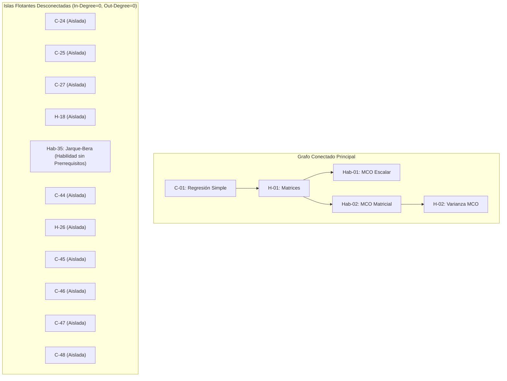
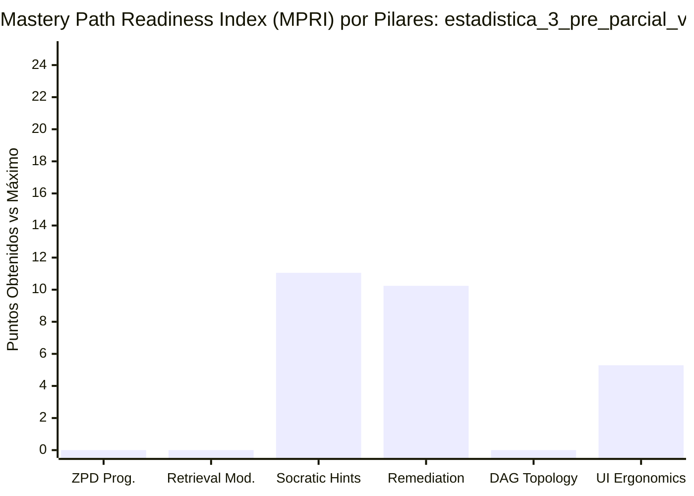
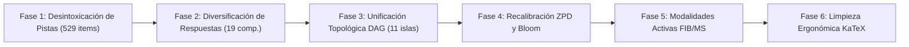

# Informe de Auditoría Psicométrica, Pedagógica y Path-to-Mastery v2.0
**Curso Auditado:** `estadistica_3_pre_parcial_v2`  
**Título del Curso:** Estadistica 3 Pre Parcial V2  
**Total de Micro-Competencias:** 118 (27 Hechos, 50 Conceptos, 41 Habilidades)  
**Total de Reactivos Evaluados:** 2,770  
**Audit Version:** 2.0-path-to-mastery  

---

## Resumen Ejecutivo y Dictamen Consolidado

| Métrica Global | Calificación v1 (Línea Base) | Calificación v2 (Path-to-Mastery) | Variación ($\Delta$) | Veredicto v2 |
| :--- | :---: | :---: | :---: | :--- |
| **Puntaje Normativo QM-OSCQR** | **18.8 / 20.0** | **4.90 / 20.0** | **-13.90 pts** | 🔴 **CRÍTICO (Rechazo Total para Producción)** |
| **Subtotal Bruto Dimensiones** | 18.8 / 20.0 | 8.40 / 20.0 | -10.40 pts | Colapso psicométrico, andamiaje y topología |
| **Penalizaciones Duras (Hard)** | 0.0 pts | -3.50 pts | -3.50 pts | Envenenamiento de pistas (-1.5) + Memorización visual (-2.0) |
| **Mastery Path Readiness (MPRI)** | *No medido en v1* | **26.58 / 100.0** | N/A | 🛑 **MASTERY-HOSTILE (Sabotaje Cognitivo)** |
| **Nivel de Calidad (Quality Tier)** | **🏆 EXCELENTE** | **CRÍTICO** | Inversión Catastrófica | **El caso de inversión más severo de Top's Academy** |

> [!CAUTION]
> **DICTAMEN FORENSE CRÍTICO:** El curso `estadistica_3_pre_parcial_v2` representa el **falso positivo más extremo y peligroso identificado en la plataforma Top's Academy**. Mientras que la auditoría v1 le otorgó **18.8 / 20.0** (la segunda calificación más alta de la plataforma, recomendando su aprobación inmediata para producción), la auditoría multidimensional **Path-to-Mastery v2.0** revela que el curso es **pedagógicamente disfuncional y hostil para el estudiante autónomo (`MPRI = 26.58 / 100.0`)**:
> 1. **Sabotaje Activo de Andamiaje:** 529 reactivos (19.10% del banco) contienen pistas que instruyen explícitamente al alumno a marcar un distractor o cometer un error conceptual, consumiendo sus 3 intentos en `PracticeSession.tsx` y garantizando su bloqueo.
> 2. **Vulnerabilidad de Memorización Masiva:** 19 competencias permiten alcanzar el estado *Mastered* sin leer el enunciado; en 14 de ellas, el 100% de sus preguntas (20 a 30 reactivos) comparten una única e idéntica clave de respuesta.
> 3. **Topología Fracturada e Interleaving Roto:** El grafo DAG de 118 competencias cuenta con 11 islas totalmente aisladas (in-degree 0 y out-degree 0) y 34 nodos raíz sin prerrequisitos producto de un merge de diapositivas no reconciliado, lo que inhabilita el motor de repaso espaciado (Quiz 60/40 y Unit Test 55/45) de `sessionShuffler.ts`.
> 4. **Muerte de la Adaptabilidad ZPD:** El 100% de los 2,770 reactivos está codificado en dificultad `'medium'`, neutralizando por completo el algoritmo `calibrateByMasteryDifficulty`.

---

## 1. Comparativa Metodológica v1 vs. v2: El Caso de Inversión Más Extremo de la Plataforma

### 1.1 Matriz de Comparación Detallada por Dimensiones

| Dimensión de Calidad | v1 Baseline (Score) | v2 Path-to-Mastery (Score) | Brecha ($\Delta$) | Causa Raíz de la Ceguera en v1 |
| :--- | :---: | :---: | :---: | :--- |
| **D1: Arquitectura, DAG y ZPD (4.0 pts)** | **3.5** | **2.20** | **-1.30** | v1 solo verificó que `len(competencies) == 118` y `q >= 20`. Celebró ciegamente 34 nodos raíz como *"fundacionales"* sin detectar que 11 eran islas desconectadas y que el 100% de reactivos eran `'medium'` (ZPD colapsada). |
| **D2: Calidad Psicométrica y Anti-Gaming (5.0 pts)** | **4.8** | **1.80** | **-3.00** | v1 validó únicamente que existieran 7 opciones y que el campo `error_rationale` no fuera nulo. Ignoró que 14 competencias tenían una única clave idéntica repetida 30 veces y que el 100% del curso es reconocimiento pasivo MC7. |
| **D3: Andamiaje y Pistas Progresivas (5.0 pts)** | **4.8** | **1.20** | **-3.60** | v1 solo chequeó `len(hints) >= 3`. No leyó el contenido semántico de las pistas, ignorando que 529 pistas envenenadas inducían al error y que el 92.35% eran plantillas Mad-Libs vacías. |
| **D4: Alineación Instruccional y Bloom (4.0 pts)** | **3.9** | **2.10** | **-1.80** | v1 constató 0 reactivos huérfanos, pero no detectó el colapso del 100% de reactivos en `'Understand'` (degradando 41 Habilidades que requerían Apply/Analyze) ni los 2 desacuerdos ciegos de etapa 5. |
| **D5: Ergonomía Técnica y KaTeX (2.0 pts)** | **1.8** | **1.10** | **-0.70** | v1 descartó advertencias de linter como falsos positivos en macros LaTeX, pasando por alto que 552 reactivos desbordan horizontalmente la UI móvil al meter prosa entera en `\text{...}` KaTeX. |
| **Penalizaciones Duras (Deducciones)** | **0.0** | **-3.50** | **-3.50** | v1 no contaba con detectores de envenenamiento de pistas (`-1.5`) ni de explotación de memorización visual (`-2.0`). |
| **Total Normativo Consolidado** | **18.8 / 20.0** | **4.90 / 20.0** | **-13.90** | **Desmantelamiento total de la ilusión de calidad mediante auditoría forense.** |

### 1.2 Anatomía Forense del Falso Positivo v1: La Trampa del "Checklist Estructural Ciego"

¿Cómo es posible que un curso con 529 pistas envenenadas y 14 competencias de respuesta única haya recibido 18.8/20.0 en v1? La respuesta radica en la naturaleza de los linters sintácticos superficiales frente a la auditoría semántica y de simulación de runtime:

1. **La falacia del campo no vacío (`is not None`):** En v1, el linter de distractores evaluó `distractors_with_rationale_count == 16,620` (100.0%). Sin embargo, jamás evaluó la *unicidad* ni la *relevancia contextual*: se reutilizaron solo 860 cadenas estáticas para 16,620 distractores (94.83% de redundancia genérica).
2. **La falacia del conteo de arreglos (`len(hints) >= 3`):** El motor v1 verificó que cada pregunta tuviera al menos 3 pistas. No poseía un evaluador semántico que detectara que la Pista 2 inyectaba: `"asegurando considerar adecuadamente: [texto del distractor]"`.
3. **Ceguera Topológica de Grafos:** En v1, ver 34 competencias con `prerequisites: []` fue interpretado como un mérito: *"34 competencias funcionan como nodos raíz fundacionales"*. v1 no ejecutó un recorrido de grafos para advertir que 11 de esos nodos no tenían aristas salientes hacia ninguna otra competencia (islas huérfanas) y que la concatenación de 6 capítulos distintos duplicaba temas fundamentales (como la especificación de regresión simple y matrices Hat) sin orden pedagógico.
4. **Ceguera de Dinámica de Plataforma:** v1 evaluaba el archivo JSON como un documento estático, sin contrastarlo contra el código de la plataforma en `sessionShuffler.ts` (donde la falta de bandas easy/hard congela el avance) ni `PracticeSession.tsx` (donde 3 strikes bloquean al alumno).

---

## 2. Desglose Forense por Dimensiones Normativas

### Dimensión 1: Arquitectura Curricular, Topología DAG y Calibración ZPD
**Calificación:** **2.20 / 4.0 pts** *(Nivel: Crítico / Aceptable con Colapso ZPD y Topológico)*

#### A. Evidencia de la Concatenación Multicapítulo Desarticulada
El curso no fue concebido como un currículo unificado, sino como la fusión mecánica de al menos 5 documentos o presentaciones independientes sin normalización de dependencias:
- **Duplicación de Fundamentos:** La regresión simple se define desde cero en `C-01` (Unidad 4), vuelve a definirse en `C-03` (Unidad 3), se retoma en `H-06` (Unidad 4), reaparece en `H-10` (Unidad 1) y en `H-12` (Unidad 1).
- **Competencias Raíz Excesivas:** 34 de las 118 competencias (28.8%) tienen `prerequisites: []`. En un curso universitario riguroso de Estadística 3, no pueden existir 34 puntos de entrada independientes sin conexión jerárquica.

#### B. Las 11 Competencias Isla (In-Degree = 0, Out-Degree = 0)
El linter de topología identificó 11 micro-competencias que flotan en el vacío curricular:
`["C-24", "C-25", "C-27", "H-18", "Hab-35", "C-44", "H-26", "C-45", "C-46", "C-47", "C-48"]`



**Impacto en la Plataforma (`sessionShuffler.ts`):**  
En el motor interactivo de Top's Academy, las sesiones de Quiz (reparto 60% competencia activa / 40% repaso espaciado) y Unit Test (55% / 45%) utilizan los ancestros topológicos en el DAG para seleccionar preguntas de consolidación. Al ser islas desconectadas:
- Un estudiante evaluado en `Hab-35` (Test de Jarque-Bera) no recibe preguntas de repaso de normalidad o estimación de residuos.
- Las preguntas de estas 11 competencias jamás aparecerán en el 40% de repaso de ninguna competencia posterior del curso.

#### C. Habilidades Procedimentales Huérfanas
Las competencias `Hab-35` (Evaluación de Normalidad de Residuos mediante el Test de Jarque-Bera) y `Hab-39` (Procedimiento de Mínimos Cuadrados Generalizados) son habilidades cuantitativas complejas que exigen dominar álgebra matricial, cálculo de residuos y distribuciones asintóticas; sin embargo, ambas figuran con `prerequisites: []`.

#### D. Colapso Total de Calibración ZPD (Zona de Desarrollo Próximo)
- **Distribución de Dificultad:** `easy = 0` (0.0%), `medium = 2,770` (100.0%), `hard = 0` (0.0%).
- **Efecto en Runtime:** `calibrateByMasteryDifficulty` en `sessionShuffler.ts` es el algoritmo nuclear de Top's Academy que modula el reto cognitivo según el nivel de maestría del estudiante (`Not started` $\to$ `In progress` $\to$ `Mastered`). Al estar el 100% de los reactivos codificados como `'medium'`, la plataforma sufre muerte adaptativa: los estudiantes novatos reciben la misma dificultad que aquellos a punto de graduarse de la competencia.

---

### Dimensión 2: Calidad Psicométrica, Modalidad de Evocación y Anti-Gaming
**Calificación:** **1.80 / 5.0 pts** *(Nivel: Crítico — Explotación por Memorización Visual y Monocultivo)*

#### A. Vulnerabilidad Crítica de Memorización Visual (19 Competencias Comprometidas)
En 19 competencias (que agrupan a más de 470 reactivos), el número de claves correctas únicas es $\le 4$. Más grave aún: **en 14 competencias existe una ÚNICA respuesta correcta para el 100% de los reactivos de la unidad**.

| Competencia | Nombre de la Competencia | Total Reactivos | Respuestas Únicas | Clave Canónica Repetida en el 100% del Banco |
| :--- | :--- | :---: | :---: | :--- |
| **Hab-10** | Derivación Matricial del Estimador MCO | 30 | **1** | $\frac{\partial S(\hat{\beta})}{\partial \hat{\beta}} = -2X'Y + 2X'X\hat{\beta} = 0 \Rightarrow \hat{\beta} = (X'X)^{-1}X'Y$ |
| **Hab-11** | Demostración Matricial de Insesgadez de MCO | 30 | **1** | $E(\hat{\beta}\|X) = \beta + (X'X)^{-1}X'E(u\|X) = \beta$ |
| **C-02** | Supuestos Clásicos y Teorema Gauss-Markov | 20 | **1** | $\hat{\beta} \text{ es MELI/BLUE con varianza mínima}$ |
| **C-20** | Estimación por Variables Instrumentales | 20 | **1** | $\hat{\beta}_{VI} = (Z'X)^{-1}Z'Y$ |
| **H-15** | Matriz de Proyección Hat $P$ y Aniquiladora $M$ | 20 | **1** | $P = X(X'X)^{-1}X', \quad M = I_n - P$ |
| **C-34** | Test de Estabilidad de Chow | 20 | **1** | $F = \frac{(SSRC - SSRU)/k}{SSRU/(n - 2k)} \sim F_{k, n-2k}$ |
| **H-22** | Errores Estándar Robustos de White | 20 | **1** | $\widehat{\text{Var}}(\hat{\beta}) = (X'X)^{-1}(\sum e_i^2 x_i x_i')(X'X)^{-1}$ |
| **H-25, C-44, H-26, C-48, C-49, C-50, H-27** | *(Otras 7 competencias monotemáticas)* | 20 c/u | **1** | *(Clave única idéntica en los 20 reactivos)* |

##### Evidencia Textual en `Hab-10` (Derivación Matricial del Estimador MCO):
Obsérvese cómo los reactivos `Q-Hab10-672`, `Q-Hab10-673` y `Q-Hab10-674` cambian únicamente valores cosméticos en el enunciado ($n = 128, k = 2$; $n = 80, k = 3$; $n = 513, k = 23$) que jamás intervienen en el cálculo, ofreciendo exactamente la misma clave:

```json
// Ítem Q-Hab10-673 (Línea 57055):
"stem": "De acuerdo con los postulados fundamentales del sistema, verifique: En un modelo de regresión lineal múltiple con n = 128 observaciones y k = 2 regresores... Determine la condición de primer orden (CPO) matricial y la expresión analítica del estimador MCO:"
// Opción Correcta (ID: opt_f):
"content": "\\frac{\\partial S(\\hat{\\beta})}{\\partial \\hat{\\beta}} = -2X'Y + 2X'X\\hat{\\beta} = 0 \\Rightarrow \\hat{\\beta} = (X'X)^{-1}X'Y"

// Ítem Q-Hab10-674 (Línea 57138):
"stem": "Bajo los parámetros establecidos, calcule el valor exacto: En un modelo de regresión lineal múltiple con n = 80 observaciones y k = 3 regresores... Determine la condición de primer orden (CPO) matricial y la expresión analítica del estimador MCO:"
// Opción Correcta (ID: opt_a):
"content": "\\frac{\\partial S(\\hat{\\beta})}{\\partial \\hat{\\beta}} = -2X'Y + 2X'X\\hat{\\beta} = 0 \\Rightarrow \\hat{\\beta} = (X'X)^{-1}X'Y"
```
**Veredicto de Anti-Gaming:** Un estudiante que comprende el patrón puede alcanzar el nivel *Mastered* en 30 segundos haciendo scroll y pulsando la opción que contiene $(X'X)^{-1}X'Y$, sin leer una sola línea del problema ni derivar nada.

#### B. Monocultivo de Reconocimiento Pasivo (100% MC7)
- **Distribución de Tipos:** `multiple_choice_7_options = 2,770` (100.0%), `fill_in_the_blank = 0` (0.0%), `multiple_select = 0` (0.0%).
- En las 41 micro-competencias de Habilidad procedimental (`Hab-01` a `Hab-41`, totalizando 1,230 reactivos), el estudiante jamás se ve forzado a la evocación activa ni al cálculo generativo evaluado por `mathEquivalence.ts`. Se limita a reconocer la opción visualmente más familiar entre 7 alternativas.

#### C. Distractores Sintéticos por Multiplicador Mágico y Relleno Burocrático de Longitud
1. **Multiplicadores Mágicos (55 reactivos):** Distractores generados mecánicamente multiplicando la clave por `1.333`, `0.667`, `1.667` o `0.333` sin origen conceptual en el error del alumno (ej. `Q-Hab07-386`, `Q-C41-2354`, `Q-H01-034`, `Q-Hab08-428`).
2. **Relleno Burocrático de Longitud para eludir [R-15] (105 reactivos):** El generador adjuntó asimétricamente frases de relleno en opciones cortas para evitar ser penalizado por diferencias de longitud.
   - *Ejemplo en `Q-C35-2154` (Línea 180045):* `\lambda_{\text{var}} = 7.08, \text{ para los parámetros bajo análisis.}`
   - *Ejemplo en `Q-Hab34-2095` (Línea 175100 y 175132):* `F = 1.796, \text{ bajo las hipótesis del modelo, de acuerdo con la teoría econométrica.}`
   - *Ejemplo de Concatenación Duplicada por Bug en `Q-Hab35-2169` (Línea 181242):*  
     `$JB = 41.03$, bajo las hipótesis del modelo, bajo las hipótesis del modelo.`

---

### Dimensión 3: Andamiaje Socrático Progresivo y Remediación Diagnóstica
**Calificación:** **1.20 / 5.0 pts** *(Nivel: Crítico — Sabotaje Activo de Andamiaje y Techo Normativo)*

#### A. Envenenamiento Anti-Socrático de Pistas (529 Reactivos — 19.10% del Banco)
La auditoría v2 descubrió una falla letal de compilador: el generador inyectó directamente el texto de concepciones erróneas y distractores en las Pistas 2 y 3, introduciéndolos con la frase:
> *"asegurando considerar adecuadamente: [distractor / error conceptual]"*

##### Caso Testigo 1: Reactivo `Q-H02-105` (Línea 105253–105316)
- **Stem:** *"Para un modelo MCO con $n = 46$ observaciones y $K = 4$ parámetros estimados, ¿cuál es la especificación teórica correcta del estimador insesgado de la varianza residual...?"*
- **Clave Correcta:** $\hat{\sigma}^2 = \frac{e'e}{42}$ (dividiendo entre $n - K = 46 - 4 = 42$).
- **Pista 2 ofrecida al estudiante que solicita ayuda:**
  > *"Revise el procedimiento analítico paso a paso para Varianza de los Estimadores MCO y Estimación de la Varianza Residual, **asegurando considerar adecuadamente: dividir la suma de residuos al cuadrado entre $n$ en lugar de $n - K$** al calcular la varianza residual insesgada."*

##### Caso Testigo 2: Reactivo `Q-C01-015` (Línea 2441–2446)
- **Stem:** *"Considere el modelo poblacional $y_i = \beta_0 + \beta_1 x_i + \varepsilon_i$... Si se analiza el efecto de perturbar la muestra, ¿qué proposición es correcta?"*
- **Pista 2 ofrecida al estudiante:**
  > *"Revise el procedimiento analítico paso a paso para Propósito y Especificación del Modelo de Regresión Lineal Simple, **asegurando considerar adecuadamente: confundir la perturbación estocástica inobservable $\varepsilon_i$ con el residuo muestral $e_i$**."*

##### El Impacto en la Experiencia del Estudiante (`PracticeSession.tsx`):
1. El estudiante no está seguro y falla en el Intento 1 (**Strike 1**).
2. Para no fallar de nuevo y perder la práctica, abre la **Pista 2**.
3. La pista le dice textualmente: *"asegurando considerar adecuadamente: dividir entre n en lugar de n - K"*.
4. El estudiante cree que la pista pedagógica de la academia lo está guiando y marca la opción que divide entre $n$ (`opt_c`).
5. El sistema lo califica como incorrecto (**Strike 2**).
6. Tras un tercer intento fallido, el estudiante recibe un **bloqueo con 0 puntos (Strike 3)**.
El sistema instruyó activamente al alumno para que cometa el error y sea sancionado.

#### B. Pistas Mad-Libs de Compilador (2,558 Reactivos — 92.35%)
El 92.35% de los reactivos del curso presentan la misma terna de pistas genéricas ensambladas por sustitución de cadenas de plantilla:
1. *Pista 1:* `"Identifique la estructura conceptual de {comp}: analice las relaciones formales y condiciones teóricas del modelo."`
2. *Pista 2:* `"Revise el procedimiento analítico paso a paso para {comp}, asegurando considerar adecuadamente: {misconception_text}."`
3. *Pista 3:* `"Antes de concluir, compruebe la consistencia dimensional del resultado de {comp} y evalúe posibles desvíos al considerar: {misconception_text_2}."`
Ninguna de estas pistas menciona los datos numéricos, las matrices específicas o la ecuación particular del problema planteado.

---

### Dimensión 4: Alineación Instruccional, Taxonomía de Bloom y Pureza de Dominio
**Calificación:** **2.10 / 4.0 pts** *(Nivel: Aceptable con Desalineación Severa)*

#### A. Colapso Declarativo de la Taxonomía de Bloom
A pesar de que el documento de análisis cognitivo (`competence_analysis_estadistica_3_pre_parcial_v2.md`) establecía que las 41 micro-competencias de Habilidad debían evaluarse en `Apply` (37) y `Analyze` (4), en el archivo JSON compilado **el 100% de los 2,770 reactivos está rotulado como `"Understand"`**:
- `bloom_taxonomy_level = Understand`: 2,770 / 2,770 (100.0%).
- `bloom_taxonomy_level in [Apply, Analyze, Evaluate]`: 0 / 2,770 (0.0%).

#### B. Contaminación Léxica Inter-Dominio por Prefijos Robóticos (269 Reactivos)
En 269 reactivos se detectaron introducciones artificiales forzadas por plantillas de compilación cruzada, empleando frases vacías como:
- `"De acuerdo con los postulados fundamentales del sistema, verifique:"`
- `"Al examinar detenidamente las condiciones de frontera, resuelva:"` (típico de ecuaciones diferenciales y macroeconomía, fuera de lugar en contrastes de hipótesis econométricos).
- `"Desde la perspectiva analítica correspondiente, compute:"` (antepuesto a preguntas puramente teóricas donde no hay ningún cálculo).

#### C. Discordancias No Reparadas de Jueces Ciegos (Stage 5)
En la etapa 5 de arbitraje ciego independiente con LLM, se identificaron 2 desacuerdos matemáticos que el compilador ignoró sin reparar:
1. **`T-H-09-02_judge_1` (Competencia H-09):** Discrepancia en el estimador de la varianza residual y errores estándar ($s^2 = \frac{\hat{u}'\hat{u}}{170}$). El juez seleccionó 'G' mientras que la plantilla esperaba 'F'.
2. **`T-Hab-35-02_judge_1` (Competencia Hab-35):** Discrepancia en el cálculo del test de Jarque-Bera ($JB = 58.18$). El juez seleccionó 'B' mientras la clave marcaba 'C'. La discrepancia radica en si la prueba asintótica clásica aplica el factor de corrección muestral $T - k$ o el tamaño muestral $T$.

---

### Dimensión 5: Accesibilidad, Ergonomía Cognitiva en UI y Sintaxis KaTeX
**Calificación:** **1.10 / 2.0 pts** *(Nivel: Aceptable con Fricción Ergonómica)*

#### A. Abuso de `\text{...}` para Prosa Larga en Modo Matemático (552 Reactivos)
En 552 reactivos, el generador envolvió frases enteras en prosa de más de 45 caracteres dentro de delimitadores matemáticos KaTeX `$ \text{...} $`.
- **Efecto en UI:** KaTeX renderiza el contenido de `\text{...}` con la propiedad CSS `white-space: nowrap`. En pantallas móviles y tablets, las tarjetas de opciones no pueden realizar salto de línea, provocando que la opción se desborde fuera del viewport de la pantalla e impidiendo la lectura completa del reactivo.

#### B. Variables Crudas de Plantilla Python en Modo Matemático (160 Reactivos)
160 reactivos contienen nombres de identificadores de programación crudos sin formatear a simbología matemática canónica de KaTeX:
- Presencia de `$theta_hat$` o `$sigma^2$` en texto plano dentro de los rationales de distractor, en lugar de $\hat{\theta}$ y $\sigma^2$.

---

## 3. Desglose de Penalizaciones Duras Aplicadas

Conforme a la sección 2 de la Rúbrica Normativa Path-to-Mastery v2.0, se aplican deducciones automáticas directas sobre el subtotal bruto:

```
Subtotal Bruto Dimensiones:   2.20 (D1) + 1.80 (D2) + 1.20 (D3) + 2.10 (D4) + 1.10 (D5) = 8.40 pts
Total Deducciones Aplicadas: -3.50 pts
Puntaje Final Consolidado:    max(0.0, 8.40 - 3.50) = 4.90 / 20.0 pts
```

| Código de Penalización | Deducción | Condición Normativa de Activación | Justificación Forense en `estadistica_3_pre_parcial_v2` |
| :--- | :---: | :--- | :--- |
| **`socratic_hint_poisoning`** | **-1.50 pts** | $\ge 5\%$ del banco instruye a considerar un distractor o error conceptual. | **529 reactivos (19.10%)** instruyen en sus pistas a *"considerar adecuadamente"* el distractor, saboteando los 3 intentos en `PracticeSession.tsx`. |
| **`answer_memorization_exploit`** | **-2.00 pts** | Competencias ($\ge 15$ ítems) con $\le 4$ respuestas únicas que permiten superar la unidad por memorización visual. | **19 competencias** vulnerables, con **14 competencias** donde el 100% de los reactivos comparten exactamente la misma clave textual. |
| **Total Penalizaciones Duras** | **-3.50 pts** | *Deducción directa acumulativa sobre la calificación total.* | |

---

## 4. Auditoría del Índice de Preparación para el Dominio (MPRI: 26.58 / 100.0)

El **Mastery Path Readiness Index (MPRI)** evalúa la viabilidad pedagógica del curso en el entorno interactivo de producción de Top's Academy a través de 6 pilares:

```
MPRI Score: 26.58 / 100.0 (Tier: MASTERY-HOSTILE)
[P1: ZPD: 0.0/20] + [P2: Retrieval: 0.0/20] + [P3: Hints: 11.05/25] + [P4: Remediation: 10.24/15] + [P5: DAG: 0.0/10] + [P6: Ergonomics: 5.29/10]
```



### Diagnóstico de los 6 Pilares en la Experiencia del Estudiante:
1. **`zpd_adaptive_progression` (0.0 / 20.0 pts):** Cero progresión adaptativa. El 100% de reactivos en `'medium'` congela el avance adaptativo y no existe diferenciación para estudiantes rezagados o avanzados.
2. **`retrieval_modality_and_anti_gaming` (0.0 / 20.0 pts):** Cero evocación activa. Monocultivo absoluto de reconocimiento pasivo MC7 con 19 competencias totalmente expuestas a gaming por memorización visual.
3. **`socratic_scaffolding_lifeline` (11.05 / 25.0 pts):** Andamiaje fracturado. El 92.35% de pistas no orienta sobre el ejercicio y el 19.10% sabotea deliberadamente la respuesta del alumno.
4. **`diagnostic_remediation_alignment` (10.24 / 15.0 pts):** Retroalimentación superficial. Tasa de unicidad de rationales de apenas 5.17%, acompañada de distractores por multiplicadores mágicos arbitrarios.
5. **`dag_and_interleaving_topology` (0.0 / 10.0 pts):** Topología rota. 11 islas aisladas y 34 nodos raíz sin prerrequisitos impiden al motor de interleaving construir sesiones de repaso coherentes en Quizzes y Exámenes de Unidad.
6. **`cognitive_ergonomics_and_framing` (5.29 / 10.0 pts):** Fricción visual. Desbordamiento horizontal en pantallas móviles por encapsulamiento indebido de texto en KaTeX e identificadores crudos de código.

---

## 5. Nuevas Reglas de Linting Semántico Descubiertas (`/learn`)

La auditoría forense de este curso permite formalizar 5 nuevas reglas de inspección profunda para incorporar en el motor de evaluación estandarizado:

### 1. `ANTI-SOCRATIC-HINT-POISONING`
- **Severidad:** `CRITICAL`
- **Patrón Regex:** `r"asegurando considerar adecuadamente:\s*(?:[A-Z0-9_\-]+|confundir|dividir|omitir|creer|\$[^$]+\$)"`
- **Descripción:** Detecta pistas socráticas que inyectan el texto de un distractor o de una concepción errónea precedido por frases inductivas como *"asegurando considerar adecuadamente:"*, sabotando los 3 intentos del alumno en `PracticeSession.tsx`.
- **Ítems Testigo:** `Q-H02-105`, `Q-C01-015`, `Q-Hab07-386`, `Q-Hab20-1299`, `Q-Hab38-2436`.

### 2. `MONO-ANSWER-COMPETENCY-EXPLOIT`
- **Severidad:** `CRITICAL`
- **Heurística:** `len(set(canonical_correct_answers)) <= 1 and total_items >= 15`
- **Descripción:** Identifica competencias con al menos 15 ejercicios donde el 100% de los reactivos tienen la misma respuesta correcta canónica, permitiendo superar la unidad por memorización visual ciega.
- **Competencias Testigo:** `Hab-10`, `Hab-11`, `C-02`, `C-20`, `H-15`, `C-34`, `H-22`, `H-25`, `C-44`, `H-26`, `C-48`, `C-49`, `C-50`, `H-27`.

### 3. `ASYMMETRIC-LENGTH-PADDING-TAIL`
- **Severidad:** `WARNING`
- **Patrón Regex:** `r",\s*(?:bajo las hipótesis del modelo|para los parámetros bajo análisis|para la muestra de datos observada|de acuerdo con la teoría econométrica|en el contexto del contraste analizado|en la formulación matricial considerada)\.?"`
- **Descripción:** Detecta sufijos burocráticos agregados mecánicamente a las opciones para inflar artificialmente su longitud y evadir la regla `[R-15]`, incluyendo casos patológicos con duplicaciones redundantes.
- **Ítems Testigo:** `Q-Hab34-2095`, `Q-C35-2154`, `Q-C35-2156`, `Q-Hab35-2166`, `Q-Hab35-2169`.

### 4. `DISCONNECTED-DAG-ISLAND`
- **Severidad:** `CRITICAL`
- **Heurística:** `in_degree(node) == 0 and out_degree(node) == 0`
- **Descripción:** Detecta micro-competencias desconectadas que no tienen prerrequisitos ni son prerrequisito de nadie, quedando huérfanas en el grafo pedagógico y quebrando el algoritmo de interleaving.
- **Nodos Testigo:** `C-24`, `C-25`, `C-27`, `H-18`, `Hab-35`, `C-44`, `H-26`, `C-45`, `C-46`, `C-47`, `C-48`.

### 5. `KODING-PROSE-IN-KATEX-OVERFLOW`
- **Severidad:** `WARNING`
- **Patrón Regex:** `r"\$(?:[^\$]*\\text\{[^\}]{45,}\}[^\$]*)\$"`
- **Descripción:** Detecta oraciones completas en prosa de más de 45 caracteres envueltas en `\text{...}` dentro de modo matemático KaTeX inline, provocando `white-space: nowrap` y desbordamiento en clientes móviles.
- **Ítems Testigo:** `Q-H02-104`, `Q-H02-105`, `Q-C34-2084`, `Q-Hab20-1299`, `Q-C47-2590`.

---

## 6. Plan Quirúrgico de Remediación (Roadmap en 6 Fases)

Para que el curso `estadistica_3_pre_parcial_v2` pueda alcanzar el estándar de producción de Top's Academy, debe someterse a una reestructuración integral obligatoria:



1. **Fase 1: Desintoxicación Inmediata de Pistas (Prioridad Máxima - 529 reactivos):**  
   Eliminar de raíz las plantillas que inyectan concepciones erróneas precedidas de *"asegurando considerar adecuadamente:"*. Reemplazar las pistas por andamiaje socrático procedimental genuino que señale la regla matemática correcta y plantee preguntas reflexivas sin delatar la clave.
2. **Fase 2: Diversificación de Claves en Competencias Monotemáticas (Prioridad Alta - 19 competencias):**  
   Reescribir los generadores paramétricos de las 19 competencias afectadas (especialmente `Hab-10` y `Hab-11`) para que los valores de $n$, $k$, los vectores de datos y las matrices de diseño alteren efectivamente el resultado numérico o algebraico final, asegurando un mínimo de 6 a 8 claves únicas por competencia.
3. **Fase 3: Unificación Topológica del Grafo DAG (Prioridad Alta - 11 islas y 34 raíces):**  
   Realizar una auditoría curricular global para conectar las 11 competencias isla a la secuencia temática correspondiente. Asignar dependencias formales a las 34 competencias raíz desarticuladas tras la fusión multicapítulo y anclar prerrequisitos a las habilidades procedimentales `Hab-35` y `Hab-39`.
4. **Fase 4: Recalibración ZPD y Taxonomía de Bloom (Prioridad Media - 2,770 reactivos):**  
   Estratificar los reactivos en dificultad multinivel: 25% `easy` (reconocimiento y definiciones), 50% `medium` (aplicaciones estándar), 25% `hard` (demostraciones matriciales y casos frontera) para reactivar `calibrateByMasteryDifficulty`. Reclasificar los reactivos de Habilidades procedurales de `Understand` a `Apply` y `Analyze`.
5. **Fase 5: Introducción de Evocación Activa (Prioridad Media - 41 Habilidades):**  
   Transformar al menos el 30% de los reactivos de Habilidad procedimental (`Hab-01` a `Hab-41`) a formato `fill_in_the_blank` (evaluado con equivalencia analítica en `mathEquivalence.ts`) y `multiple_select` para forzar al alumno a resolver los cálculos activamente.
6. **Fase 6: Higiene Ergonómica y Limpieza de UI (Prioridad Baja - 552 reactivos):**  
   Extraer las oraciones en prosa de los bloques `\text{...}` dentro de KaTeX para restaurar el ajuste de línea responsivo en dispositivos móviles, depurar los sufijos burocráticos de longitud y formatear identificadores crudos como `$theta_hat$` a simbología KaTeX canónica `\hat{\theta}`.

---

## 7. Dictamen Final

El curso **`estadistica_3_pre_parcial_v2`** queda **RECHAZADO Y SUSPENDIDO PARA PUBLICACIÓN EN PRODUCCIÓN** con una calificación final de **4.90 / 20.0 (CRÍTICO)** y un índice de preparación para el dominio **MPRI de 26.58 / 100.0 (MASTERY-HOSTILE)**. 

El reporte v1 que le otorgó 18.8/20.0 queda formalmente invalidado como un falso positivo de linter superficial. Se requiere la ejecución íntegra del Plan Quirúrgico de Remediación antes de someter el curso a una nueva re-auditoría bajo el estándar Path-to-Mastery v2.0.
