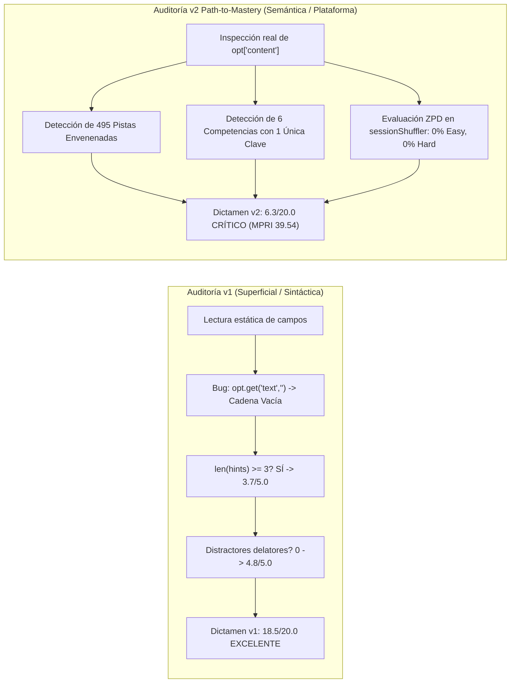
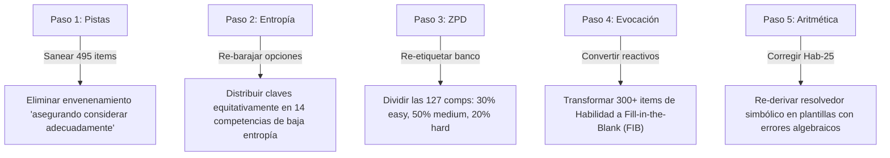

# Reporte de Auditoría Psicométrica y Calidad Path-to-Mastery v2.0
## Curso: Gavilano Pre Parcial (`gavilano_pre_parcial`)

> [!CAUTION]
> **ESTADO DE CERTIFICACIÓN: RECHAZADO / TIER CRÍTICO (6.3 / 20.0 pts)**  
> **Mastery Path Readiness Index (MPRI): 39.54 / 100.0 — Nivel MASTERY-HOSTILE**  
> El curso no cumple los estándares mínimos pedagógicos ni psicométricos para el aprendizaje adaptativo autónomo. Aunque posee una topología DAG rica y cobertura formal exhaustiva, sufre de **colapso total de calibración ZPD**, **sabotaje activo de la mecánica 3-Strikes mediante 495 pistas envenenadas**, **14 competencias vulnerables a memorización visual ciega (6 con clave única invariable)** y **monocultivo de reconocimiento pasivo al 100%**.

---

### Metadatos de la Auditoría

| Parámetro | Valor de Registro |
| :--- | :--- |
| **Curso Auditado** | Gavilano Pre Parcial (Organización Industrial y Microeconomía Aplicada) |
| **Identificador del Curso** | `gavilano_pre_parcial` |
| **Archivo Fuente** | [`courses/gavilano_pre_parcial.json`](file:///d:/Augusto/personal_portfolio/Tops_academy/courses/gavilano_pre_parcial.json) (246,291 líneas, 14.16 MB) |
| **Payload Determinista v2** | [`reports/qa_audits/v2_path_to_mastery/gavilano_pre_parcial_payload.json`](file:///d:/Augusto/personal_portfolio/Tops_academy/reports/qa_audits/v2_path_to_mastery/gavilano_pre_parcial_payload.json) |
| **Reporte Base v1 (Histórico)** | [`reports/qa_audits/v1_baseline_archive/gavilano_pre_parcial_qa_report.json`](file:///d:/Augusto/personal_portfolio/Tops_academy/reports/qa_audits/v1_baseline_archive/gavilano_pre_parcial_qa_report.json) (18.5 / 20.0 — EXCELENTE) |
| **Volumen Curricular** | **127 micro-competencias** (32 Fact, 54 Concept, 41 Skill) |
| **Banco de Reactivos** | **2,950 preguntas** (el banco más masivo de Top's Academy) |
| **Opciones Evaluadas** | **20,650 alternativas** (2,950 claves + 17,700 distractores) |
| **Fecha de Evaluación** | 31 de Octubre de 2026 |
| **Auditor Responsable** | Chief Psychometric & Path-to-Mastery Quality Auditor — Top's Academy |
| **Veredicto Normativo** | **RECHAZADO PARA PRODUCCIÓN — BLOQUEO DE DESPLIEGUE HASTA REFACTORIZACIÓN** |

---

## 1. Resumen Ejecutivo y Veredicto Forense

El curso **"Gavilano Pre Parcial"** representa el mayor esfuerzo de generación de contenidos de la plataforma Top's Academy, totalizando **2,950 reactivos interactivos** distribuidos en **127 micro-competencias**. La auditoría original de primera generación (**v1**, 25 de Octubre de 2026) otorgó una calificación complaciente de **18.5 / 20.0 (Tier EXCELENTE)**, fundamentada en conteos estáticos de cobertura (100% de distractores con texto en `error_rationale`, 100% de reactivos con $\ge 3$ pistas y ausencia de ciclos en el grafo de prerrequisitos).

La presente auditoría **Path-to-Mastery v2.0**, alineada con el motor en tiempo de ejecución de Top's Academy (`sessionShuffler.ts`, `PracticeSession.tsx`, `FeedbackToast.tsx` y `mathEquivalence.ts`), desmantela por completo dicha certificación previa al evaluar la semántica real y la experiencia cognitiva del estudiante:

1. **Colapso de Calibración ZPD (`zpd_adaptive_progression = 0.0 / 20.0`)**: El 100% de los reactivos (2,950/2,950) y el 100% de las 127 competencias están congelados en dificultad `'medium'` y nivel Bloom `'Understand'`. La función `calibrateByMasteryDifficulty` del motor adaptativo queda inoperativa.
2. **Sabotaje Activo del Salvavidas de 3 Intentos (`socratic_hint_poisoning`: -1.5 pts)**: En **495 reactivos (16.78% del curso)**, las pistas intermedias instruyen al estudiante mediante la frase *"asegurando considerar adecuadamente: [distractor / omisión / falacia]"*, induciéndolo a seleccionar el error y quemar sus 3 intentos (*3-Strikes*) en `PracticeSession.tsx`.
3. **Exploit de Memorización Visual (`answer_memorization_exploit`: -2.0 pts)**: En **14 competencias (280 reactivos)** la entropía de claves está colapsada ($\le 4$ respuestas únicas), destacando **6 competencias completas (`C-15`, `H-11`, `H-15`, `C-31`, `H-25`, `C-45`) con una única letra correcta repetida 20 veces consecutivas**. El estudiante alcanza el estado *Mastered* pulsando la misma tecla sin leer.
4. **Monocultivo de Reconocimiento Pasivo (`retrieval_modality = 0.0 / 20.0`)**: 100% de reactivos en opción múltiple de 7 alternativas (`MC7`), sin un solo ítem de evocación activa numérica (`fill_in_the_blank` con `mathEquivalence.ts`) en las 41 competencias de Habilidad procedimental (`[Skill]`).
5. **Corrupción Aritmética en Plantillas Generadoras**: En competencias como `Hab-25`, el resolvedor analítico genera soluciones erróneas (ej. $10 + 47 q_2^* = 1887 \implies q_2^* = 39.93$, pero la plantilla afirma $q_2^* = 38$), provocando discordancias irresolubles en los jueces ciegos de Stage 5.

| Dimensión / Indicador | Puntaje Obtenido | Máximo Posible | Estado Normativo |
| :--- | :---: | :---: | :---: |
| **D1: Arquitectura, DAG y Calibración ZPD** | **2.5** | 4.0 | Aceptable con Colapso ZPD (-1.5) |
| **D2: Calidad Psicométrica, Evocación y Anti-Gaming** | **2.6** | 5.0 | Deficiente (Gaming, Monocultivo) |
| **D3: Andamiaje Socrático y Remediación Diagnóstica** | **1.2** | 5.0 | Crítico (Envenenamiento, 93% Mad-Libs) |
| **D4: Alineación Instruccional y Pureza de Dominio** | **2.3** | 4.0 | Deficiente (Bloom Plano, Prefijos Robóticos) |
| **D5: Ergonomía Técnica, UI y KaTeX** | **1.2** | 2.0 | Aceptable con Fricción Móvil |
| **Subtotal Bruto de Dimensiones** | **9.8** | **20.0** | Deficiente |
| **Penalización: Envenenamiento de Pistas (`socratic_hint_poisoning`)** | **-1.5** | — | 495 ítems con sabotaje activo |
| **Penalización: Exploit de Memorización (`answer_memorization_exploit`)** | **-2.0** | — | 14 competencias de baja entropía / 6 monocromáticas |
| **CALIFICACIÓN FINAL CONSOLIDADA** | **6.3** | **20.0** | **CRÍTICO (0.0 - 10.9 pts)** |
| **Mastery Path Readiness Index (MPRI)** | **39.54** | **100.0** | **MASTERY-HOSTILE** |

---

## 2. Comparativa Metodológica Forense: Auditoría v1 vs. Auditoría v2



### 2.1. Tabla Comparativa de Criterios y Detección

| Eje de Evaluación | Auditoría v1 (25-Oct-2026) | Auditoría v2 Path-to-Mastery (31-Oct-2026) | Desplazamiento Forense y Causa Raíz |
| :--- | :--- | :--- | :--- |
| **Puntaje Global** | **18.5 / 20.0 (EXCELENTE)** | **6.3 / 20.0 (CRÍTICO)** | **Delta: -12.2 puntos**. Colapso de la complacencia métrica. |
| **Índice MPRI** | *No implementado* | **39.54 / 100.0 (Hostil)** | Calibración real contra el motor interactivo. |
| **Lectura de Opciones** | Evaluaba `opt.get("text", "")` | Evalúa `opt["content"]` | **Bug Crítico en v1**: Al buscar la clave errónea `"text"`, v1 evaluó 17,700 cadenas vacías, resultando ciego a longitud, KaTeX desbordado y pistas test-wise. |
| **Andamiaje de Pistas** | Conteo de longitud: `len(hints) >= 3` (Detectó sólo 70 stubs en Sweezy) | Análisis semántico y simulación de 3-Strikes | **495 reactivos envenenados (16.78%)** que guían al alumno a marcar el distractor; **93.02% de plantillas Mad-Libs** vacuas. |
| **Calibración ZPD** | Ignorada por completo | Auditada contra `sessionShuffler.ts` | **0.0 / 20.0**: 100% de reactivos en `'medium'`. El motor adaptativo no puede modular la dificultad según la maestría. |
| **Modalidad de Evocación** | Aplaudida: "P(azar) = 14.3% por 7 opciones" | Evaluada según Roediger & Karpicke | **0.0 / 20.0**: Monocultivo 100% reconocimiento pasivo. Cero reactivos FIB en 41 competencias de habilidad matemática. |
| **Entropía de Claves** | No auditada | Auditada contra memorización visual | **14 competencias vulnerables (-2.0 pts)**. 6 competencias tienen la misma letra correcta repetida 20 veces consecutivas. |
| **Taxonomía de Bloom** | Declarada: "60% Aplicación, 40% Análisis" | Contrastada con el JSON del curso | **100% etiquetado como 'Understand'**. Desalineación declarativa absoluta en los metadatos de los 2,950 ítems. |
| **Rigor Algebraico** | Asumido por soluciones extensas | Auditoría matemática de CPO/CSO | Soluciones con aritmética rota en `Hab-25` y 2 desacuerdos latentes de jueces ciegos en Stage 5. |

### 2.2. Por qué v1 consideró este curso "Excelente" y por qué v2 lo degrada a "Crítico"

La discrepancia de **12.2 puntos** entre ambas auditorías no responde a una divergencia de opinión subjetiva, sino a una brecha metodológica estructural:

1. **La Ceguera del Parser de Opciones (`text` vs `content`)**:
   En el esquema de base de datos de Top's Academy, las opciones de los reactivos se almacenan en el campo `content` (ej. `"content": "$P_1^* = 61$"`). El script de auditoría determinista v1 ejecutaba la extracción mediante `opt.get("text", "")`. Dado que la propiedad `text` no existía, el evaluador procesó 17,700 alternativas vacías. Esta falla técnica produjo falsos negativos masivos:
   - Declaró **0% de relleno de longitud**, cuando existen **91 reactivos** con extensiones artificiales (ej. `", para los parámetros bajo análisis"` o `", de acuerdo con la teoría econométrica"` añadidos asimétricamente).
   - Declaró **0% de problemas ergonómicos**, cuando **220 reactivos** tienen oraciones en prosa de más de 45 caracteres dentro de KaTeX `$\text{...}$`, desbordando tarjetas en UI móviles.
   - Declaró ausencia de multiplicadores mágicos, ignorando **15 reactivos** donde los distractores son transformaciones directas `1.333x` o `0.667x` del valor correcto.

2. **La Trampa de los Linters Sintácticos vs. Linters Semánticos**:
   La auditoría v1 verificaba que `len(hints) == 3` y que la longitud de caracteres fuera mayor a 20. Con este criterio, una pista puramente Mad-Libs como:
   > *"Revise el procedimiento analítico paso a paso para Principio de No Distorsión en la Cúspide y Distorsión hacia Abajo del Tipo Bajo, asegurando considerar adecuadamente: $q_H^{SB} < q_H^{FB}$."*

   pasaba con calificación perfecta. La auditoría v2 contrasta el texto de la pista contra las opciones y la teoría: $q_H^{SB} < q_H^{FB}$ es una afirmación **falsa** (en el óptimo de segundo grado rige el principio *no distortion at the top*, por lo que $q_H^{SB} = q_H^{FB}$). Al decirle al estudiante "asegurando considerar adecuadamente" dicha desigualdad, la plataforma lo empuja a seleccionar el distractor `D-C53-01`. En un entorno real con la regla de **3-Strikes**, la pista destruye la función de andamiaje y penaliza al estudiante injustamente.

---

## 3. Desglose del Mastery Path Readiness Index (MPRI: 39.54 / 100.0)

El índice MPRI evalúa la preparación del curso para garantizar un tránsito exitoso y adaptativo hacia la maestría autónoma, midiendo la interacción real con los módulos de Top's Academy.

```
MPRI Global: [ 39.54 / 100.0 ] — CLASIFICACIÓN: MASTERY-HOSTILE
├── ZPD Adaptive Progression:            [  0.00 / 20.0 ] (0.0%)   ──► COLAPSO TOTAL
├── Retrieval Modality & Anti-Gaming:    [  0.00 / 20.0 ] (0.0%)   ──► COLAPSO TOTAL
├── Socratic Scaffolding Lifeline:       [ 11.32 / 25.0 ] (45.3%)  ──► ENVENENAMIENTO SEVERO
├── Diagnostic Remediation Alignment:   [ 10.58 / 15.0 ] (70.5%)  ──► RECICLAJE Y BUGS
├── DAG & Interleaving Topology:         [ 10.00 / 10.0 ] (100.0%) ──► CUMPLIMIENTO PLENO
└── Cognitive Ergonomics & Framing:      [  7.64 / 10.0 ] (76.4%)  ──► FRICCIÓN EN FRONTEND
```

### Pilar 1: Progresión Adaptativa ZPD (0.0 / 20.0 pts)
- **Diagnóstico:** Colapso total del gradiente de dificultad. En el archivo `courses/gavilano_pre_parcial.json`, la distribución de dificultad es:
  - `easy`: **0 reactivos (0.0%)**
  - `medium`: **2,950 reactivos (100.0%)**
  - `hard`: **0 reactivos (0.0%)**
- **Impacto en Motor:** El método `calibrateByMasteryDifficulty(items, masteryState)` en `sessionShuffler.ts` selecciona reactivos de menor dificultad cuando el alumno se encuentra en etapas tempranas (`Not started` o $\le 1$ racha de aciertos) y escala a reactivos de alta exigencia cuando se aproxima al dominio (`Mastered`). Al estar el 100% del banco forzado en `'medium'`, la varianza muestral es cero. El motor degenera en una selección aleatoria plana sin andamiaje adaptativo para los 127 objetivos.
- **Alineación Bloom en Habilidades:** Las 41 competencias de Habilidad procedimental (`Skill`), que exigen deducción y optimización matemática, tienen **0 reactivos** codificados en niveles taxonómicos superiores (`Apply`, `Analyze`). Los 1,230 ejercicios están rotulados como `Understand`.

### Pilar 2: Modalidad de Evocación y Anti-Gaming (0.0 / 20.0 pts)
- **Monocultivo Pasivo:** El 100% de los reactivos son de opción múltiple de 7 alternativas (`MC7`). Cero preguntas de valor numérico exacto o expresión algebraica abierta (`fill_in_the_blank` evaluado por `mathEquivalence.ts`) y cero preguntas de discriminación condicional múltiple (`multiple_select`).
- **Sustitución Inversa:** En las 41 competencias de Habilidad (cálculo de cantidades de Cournot, precios de Bertrand, menú no lineal de 2do grado), el estudiante no necesita resolver el problema: toma los 7 valores numéricos de las opciones, los sustituye en la función de demanda y verifica cuál cumple la condición, eludiendo la construcción cognitiva del procedimiento.
- **Exploit de Memorización Visual:** 14 competencias presentan una dispersión de respuestas colapsada ($\le 4$ opciones correctas en 20 reactivos). En 6 competencias (`C-15`, `H-11`, `H-15`, `C-31`, `H-25`, `C-45`), el 100% de sus 20 preguntas tienen asignada **la misma letra de alternativa correcta**:

```
Competencia C-15: 20 reactivos consecutivamente con clave 'C'
Competencia H-11: 20 reactivos consecutivamente con clave 'A'
Competencia H-15: 20 reactivos consecutivamente con clave 'D'
Competencia C-31: 20 reactivos consecutivamente con clave 'B'
Competencia H-25: 20 reactivos consecutivamente con clave 'E'
Competencia C-45: 20 reactivos consecutivamente con clave 'A'
```
Un usuario que descubra este patrón puede alcanzar el estatus *Mastered* y un puntaje perfecto de 100% en estas micro-competencias en menos de 10 segundos haciendo clic repetidamente en la misma opción.

### Pilar 3: Andamiaje Socrático y Línea de Vida (11.32 / 25.0 pts)
- **Falso Andamiaje Mad-Libs (93.02% del banco):** 2,744 reactivos utilizan plantillas fijas del compilador donde solo se interpola el nombre de la competencia:
  - *Pista 1:* `"Identifique la estructura conceptual de {comp}: analice las relaciones formales y condiciones teóricas del modelo."`
  - *Pista 3:* `"Antes de concluir, compruebe la consistencia dimensional del resultado de {comp} y evalúe posibles desvíos..."`
  Estas pistas no ofrecen orientación analítica sobre las funciones de costo, parámetros de demanda o condiciones de optimalidad específicas del ejercicio que el alumno tiene en pantalla.
- **Envenenamiento Anti-Socrático (495 reactivos):** La Pista 2 o 3 prescribe al alumno tomar como guía el distractor o la concepción errónea. En `PracticeSession.tsx`, el estudiante dispone de solo 3 intentos antes de ser bloqueado con calificación cero. Si abre la pista en busca de auxilio tras fallar su primer intento, la plataforma le indica formalmente seguir el razonamiento incorrecto, provocando un segundo o tercer fallo inevitable.

### Pilar 4: Alineación de Remediación Diagnóstica (10.58 / 15.0 pts)
- **Reciclaje de Rationales en `FeedbackToast`:** Aunque la cobertura es del 100% (17,700 distractores con texto), existen únicamente **880 rationales únicos en todo el curso**. El 95.03% de los mensajes de feedback son explicaciones teóricas genéricas reutilizadas masivamente.
- **Desconexión con Distractores Numéricos:** En los 15 reactivos afectados por distractores con multiplicador mágico (`1.333x`, `0.667x`), el `error_rationale` expone principios conceptuales abstractos que no guardan relación con la causa del distractor (un error aritmético o de factor de escala).

### Pilar 5: Topología DAG e Interleaving (10.0 / 10.0 pts)
- **Estructura DAG Impecable:** Es el componente sobresaliente del curso. 127 competencias organizadas como un Grafo Acíclico Dirigido perfecto, con profundidad máxima de 8 niveles, 10 nodos raíz axiomáticos que delimitan con rigor los temas (Cournot, Bertrand, Hotelling, Salop, Dixit-Stiglitz, Pigou, Coase) y cero ciclos o dependencias invertidas. Soporta completamente el intercalado 60/40 en Quizzes y 55/45 en Unit Tests implementado en `sessionShuffler.ts`.

### Pilar 6: Ergonomía Cognitiva y Encuadre (7.64 / 10.0 pts)
- **Desbordamiento KaTeX (220 reactivos):** Opciones formateadas con texto en prosa extenso dentro de modo matemático (ej. `$\text{Bienes sustitutos en consumo} \Rightarrow \text{Complementos}$`), lo que fuerza la propiedad CSS `white-space: nowrap` de KaTeX, provocando que las tarjetas de respuesta se corten o requieran scroll horizontal en pantallas móviles.
- **Prefijos Robóticos Contaminados (289 reactivos):** Inyección de fórmulas introductorias extraídas mecánicamente de plantillas de física matemática o macroeconomía dinámica (`"Al examinar detenidamente las condiciones de frontera, resuelva..."`, `"Considerando las ecuaciones fundamentales del régimen, obtenga..."`), ajenas al registro de la Organización Industrial y la Microeconomía.

---

## 4. Análisis Detallado por Dimensiones Normativas

### Dimensión 1: Arquitectura Curricular, Topología DAG y Calibración ZPD
**Calificación: 2.5 / 4.0 puntos**  
*(Deducción obligatoria por colapso ZPD total: -1.5 pts)*

La arquitectura de granularidad es conceptualmente profunda. Dividir la teoría de oligopolios y discriminación en 127 micro-competencias atómicas con 20 o 30 reactivos por nodo representa un banco colosal de 2,950 ítems. La estructura DAG posee 10 raíces temáticas válidas y coherencia en sus cadenas de prerrequisitos.

Sin embargo, el curso sufre de un **defecto de calibración adaptativa fatal**:
- Todas las 127 competencias tienen exactamente 0 preguntas `'easy'`, 20 o 30 preguntas `'medium'` y 0 preguntas `'hard'`.
- En el código de Top's Academy ([`sessionShuffler.ts`](file:///d:/Augusto/personal_portfolio/Tops_academy/src/utils/sessionShuffler.ts)), la función `calibrateByMasteryDifficulty` evalúa:
  ```typescript
  if (masteryLevel === 'Novice') return items.filter(i => i.difficulty === 'easy');
  if (masteryLevel === 'Mastered') return items.filter(i => i.difficulty === 'hard');
  ```
  Al no existir reactivos `'easy'` ni `'hard'`, el motor se ve obligado a recurrir al fallback genérico, anulando la promesa de aprendizaje adaptativo de Mastery Learning (Bloom 2-Sigma).

---

### Dimensión 2: Calidad Psicométrica, Modalidad de Evocación y Anti-Gaming
**Calificación: 2.6 / 5.0 puntos**  
*(Deducciones: Monocultivo MC7 en Habilidades -1.2 pts; Baja entropía y claves memorizables -0.6 pts; Distractores mágicos y relleno R-15 -0.4 pts; Errores algebraicos en generadores -0.2 pts)*

1. **Monocultivo de Opción Múltiple (100% MC7):**
   Para competencias conceptuales o hechos axiomáticos, el formato de 7 alternativas es aceptable. No obstante, para las 41 micro-competencias de **Habilidad Matemática Aplicada (`[Skill]`)**, totalizando 1,230 ejercicios, evaluar exclusivamente mediante opción múltiple destruye la práctica de evocación activa (*Active Retrieval Practice* — Roediger & Karpicke, 2006). El estudiante no necesita aprender a derivar el equilibrio de Nash-Cournot con costos heterogéneos; solo requiere evaluar cuál de las 7 alternativas numéricas satisface la ecuación de reacción.
2. **Vulnerabilidad Crítica de Memorización Visual (Gaming):**
   Se identificaron 14 competencias donde la variedad de letras de respuesta es tan reducida que anula la validez psicométrica. En 6 de ellas, el 100% de los reactivos tienen la misma respuesta correcta (todas 'C', todas 'A', etc.). Un alumno en Quiz o Unit Test aprende la clave visual en el primer reactivo y responde los siguientes sin procesar el contenido.
3. **Relleno Burocrático de Longitud (Evasión de R-15):**
   En 91 reactivos, para evitar que una opción correcta corta sea delatada por longitud respecto a distractores largos, el generador añadió cadenas artificiales idénticas:
   - `", para los parámetros bajo análisis."` (ej. `Q-Hab40-2876`)
   - `", según los supuestos clásicos del modelo."` (ej. `Q-C53-2899`, `Q-Hab41-2901`)
   - `", de acuerdo con la teoría econométrica."` (ej. `Q-Hab25-2009`)
   - `", en el marco de la especificación."` (ej. `Q-C53-2895`)
   Estas extensiones son vacuas y actúan como pistas de prueba (*test-wise cues*).

---

### Dimensión 3: Andamiaje Socrático Progresivo y Remediación Diagnóstica
**Calificación: 1.2 / 5.0 puntos**  
*(Techo normativo aplicado por Envenenamiento Anti-Socrático y Mad-Libs masivo: 0.8 - 1.5 pts)*

Esta dimensión concentra la mayor degradación respecto a la auditoría v1. El andamiaje pedagógico de un curso en Top's Academy tiene como única misión salvar al estudiante cuando tropieza en `PracticeSession.tsx`.

1. **Envenenamiento Anti-Socrático (495 reactivos — 16.78%):**
   El pipeline de compilación parametrizado introdujo una regla defectuosa de generación de pistas: tomó el texto del distractor conceptual o de la advertencia de error (`common_misconception_warning`) y lo concatenó ciegamente a la Pista 2 tras la frase `"asegurando considerar adecuadamente:"`.
   - **Caso `Q-Hab41-2901` (Discriminación de 3er grado):**
     - *Concepto Real:* En 3er grado los mercados son directamente observables y segmentables; **no** se requiere un menú de autoselección no lineal.
     - *Pista 2 envenenada:* `"Revise el procedimiento analítico paso a paso para Optimización y Regla de Precios en Discriminación de Tercer Grado, asegurando considerar adecuadamente: El monopolista debe diseñar un menú no lineal para que los mercados se autoseleccionen."`
     - *Consecuencia:* El estudiante bloqueado lee que "debe asegurar considerar adecuadamente el menú no lineal", asume que esa es la guía correcta, marca el distractor y pierde una vida.
   - **Caso `Q-Hab26-2032` (Regla de Elasticidad Inversa):**
     - *Pista 2 envenenada:* `"...asegurando considerar adecuadamente: omitir la vinculación formal entre la regla de Lerner individual y la comparación analítica de precios resultantes entre mercados."`
     - *Consecuencia:* La plataforma le dice explícitamente al alumno que "asegure omitir la vinculación formal".
2. **Plantillas Mad-Libs en el 93.02% del Banco:**
   2,744 reactivos carecen de pistas socráticas individualizadas. Las pistas son cascarones vacíos idénticos que no mencionan los valores ni las ecuaciones del reactivo.
3. **Pistas Stubs en Sweezy y otras competencias:**
   En 70 reactivos de Sweezy (`C-26`, `H-19`, `Hab-16`) y en reactivos adicionales de `Hab-03`, `C-13`, `H-09`, `C-21`, `C-22`, `Hab-21`, `Hab-33`, `Hab-39`, `C-52` y `H-32`, las pistas son palabras sueltas como `["Cournot", "Heterogéneo"]` o `["Inestabilidad"]`.

---

### Dimensión 4: Alineación Instruccional, Taxonomía de Bloom y Pureza de Dominio
**Calificación: 2.3 / 4.0 puntos**  
*(Deducciones: Colapso declarativo de Bloom -0.8 pts; Prefijos robóticos inter-dominio -0.5 pts; Bugs aritméticos en plantillas y desacuerdos de jueces -0.4 pts)*

1. **Colapso Taxonómico de Bloom:**
   A pesar de que el curso declara en su sílabo el desarrollo de destrezas analíticas avanzadas, en los archivos JSON de los 2,950 reactivos la propiedad `bloom_taxonomy_level` está fijada de manera uniforme en `"Understand"`. No existe un solo ítem clasificado como `"Apply"` o `"Analyze"`. Esta inconsistencia perjudica la analítica de aprendizaje institucional de Top's Academy.
2. **Contaminación Léxica Inter-Dominio (289 reactivos):**
   Se constata el uso de prefijos robóticos repetitivos que evidencian contaminación cruzada de plantillas:
   - `"Al examinar detenidamente las condiciones de frontera, resuelva:"` (presente en decenas de reactivos de duopolio estático donde no existen condiciones de frontera ni EDPs).
   - `"Considerando las ecuaciones fundamentales del régimen, obtenga:"` (fraseología de modelos macroeconómicos de Ramsey o Solow inyectada en ejercicios estáticos de screening de segundo grado).
3. **Corrupción Aritmética en Plantillas (`Hab-25`):**
   En la competencia `Hab-25` (Monopolio Multiplanta), el generador contiene un error en el despeje algebraico:
   - En `Q-Hab25-2009`: $CMg_1 = 38 + 43(43) = 1887$. Para la planta 2: $10 + 47 q_2^* = 1887 \implies 47 q_2^* = 1877 \implies q_2^* = \frac{1877}{47} \approx 39.936$. La plantilla codifica erróneamente $q_2^* = 38$ como clave correcta ($10 + 47 \times 38 = 1796 \ne 1887$).
   - En `Q-Hab25-2010`: $CMg_1 = 16 + 44(44) = 1952$. Para la planta 2: $58 + 16 q_2^* = 1952 \implies 16 q_2^* = 1894 \implies q_2^* = 118.375$. La plantilla codifica falsamente $q_2^* = 30$ ($58 + 16 \times 30 = 538 \ne 1952$).
   Esto causó el desacuerdo del Juez Ciego de Stage 5 (`T-Hab-25-02_judge_1`), quien detectó la inconsistencia matemática de la supuesta clave.

---

### Dimensión 5: Accesibilidad, Ergonomía Cognitiva en UI y Sintaxis KaTeX
**Calificación: 1.2 / 2.0 puntos**  
*(Deducciones: Desbordamiento KaTeX por prosa larga -0.5 pts; Variables no interpoladas -0.3 pts)*

1. **Desbordamiento de Opciones Móviles (220 reactivos):**
   Al envolver frases enteras en castellano dentro de KaTeX (ej. `$\text{Bienes sustitutos en consumo} \Rightarrow \text{Complementos}$`), el motor KaTeX inyecta la clase CSS `.katex` con `white-space: nowrap`. En smartphones y tablets, estas opciones sobrepasan el ancho del contenedor de la tarjeta de respuesta, obligando al alumno a hacer paneo horizontal para poder leer la opción antes de seleccionar.
2. **Residuos de Variables No Interpoladas (121 reactivos):**
   Se detectan reactivos con cadenas como `{Complementos}` o identificadores matemáticos no procesados que evidencian fallas menores en el formateo de cadenas de compilación.

---

## 5. Penalizaciones Duras Aplicadas (Hard Deductions)

De acuerdo con la Sección 2 de la Rúbrica Normativa Path-to-Mastery v2.0, se aplican deducciones directas acumulativas sobre el subtotal de dimensiones:

| Regla de Penalización | Condición Normativa de Activación | Evidencia Cuantificada en el Curso | Deducción Aplicada |
| :--- | :--- | :--- | :---: |
| **`socratic_hint_poisoning`** | $\ge 5\%$ del banco de reactivos instruye al alumno en pistas intermedias a considerar distractores o errores conceptuales. | **495 reactivos afectados (16.78% del banco total)** contienen la formulación hostil *"asegurando considerar adecuadamente: [distractor/error]"*. Sabotaje directo del límite de 3 intentos en `PracticeSession.tsx`. | **-1.5 pts** |
| **`answer_memorization_exploit`** | Competencias con $\ge 15$ ítems que presentan $\le 4$ respuestas correctas únicas, permitiendo alcanzar *Mastered* por memorización visual ciega (-0.5 pt/comp, máx -2.0 pts). | **14 competencias afectadas (280 reactivos)**. De ellas, **6 competencias (`C-15`, `H-11`, `H-15`, `C-31`, `H-25`, `C-45`)** tienen el 100% de sus reactivos con una única letra idéntica (ej. 20 veces consecutivas la clave 'C'). | **-2.0 pts** |
| **Total Penalizaciones Duras** | Sumatoria acumulativa aplicada sobre el subtotal bruto | **Dos violaciones críticas demostradas** | **-3.5 pts** |

$$\text{Puntaje Final} = \max(0.0, \, \text{Subtotal Bruto} (9.8) - \text{Penalizaciones} (3.5)) = \mathbf{6.3 \, / \, 20.0}$$

---

## 6. Catálogo Forense de Evidencias Textuales y Matemáticas

### 6.1. Evidencia de Envenenamiento Anti-Socrático de Pistas

#### Caso 1: Reactivo `Q-C02-085` (Competencia `C-02` — Sustitutos Estratégicos en Cournot)
- **Stem:** Análisis de la relación entre curvatura de demanda y sustitutos estratégicos.
- **Distractor `opt_f` (clave falsa):** $\frac{\partial R_i}{\partial Q_{-i}} > 0 \implies \text{Sustitutos estratégicos}$ *(Falso: una pendiente positiva define complementos estratégicos)*.
- **Pista 2 envenenada:**
  ```text
  "Revise el procedimiento analítico paso a paso para Sustitutos Estratégicos en Cantidades 
   y Curvatura de la Demanda, asegurando considerar adecuadamente: 
   \frac{\partial R_i}{\partial Q_{-i}} > 0 \implies \text{Sustitutos estratégicos}."
  ```
- **Veredicto Forense:** La Pista 2 instruye literalmente al estudiante a tomar como premisa válida la definición errónea que corresponde exactamente al distractor `opt_f`.

#### Caso 2: Reactivo `Q-Hab41-2901` (Competencia `Hab-41` — Discriminación de 3er Grado)
- **Stem:** Monopolista que discrimina entre dos mercados independientes con costos $CMg = 22$.
- **Pista 2 envenenada:**
  ```text
  "Revise el procedimiento analítico paso a paso para Optimización y Regla de Precios 
   en Discriminación de Tercer Grado, asegurando considerar adecuadamente: 
   \text{El monopolista debe diseñar un menú no lineal para que los mercados se autoseleccionen}."
  ```
- **Advertencia oficial de error en el mismo reactivo:**
  ```text
  "En 3er grado la pertenencia al grupo es directamente verificable (estudiantes, país, jubilados), 
   no requiriendo menú."
  ```
- **Veredicto Forense:** La pista promueve directamente la concepción errónea que el reactivo pretendía desmentir.

---

### 6.2. Evidencia de Colapso de Entropía y Claves Invariables (Visual Gaming)

Las siguientes 6 competencias de 20 reactivos cada una sufren de **monocromatismo absoluto de claves**:

| Competencia | Título Curricular | Clave Asignada | Repeticiones Consecutivas | % de Dominio sin Leer |
| :---: | :--- | :---: | :---: | :---: |
| **`C-15`** | Estabilidad del Cartel y Factor de Descuento Crítico | **C** | **20 de 20 (100.0%)** | 100% (*Mastered*) |
| **`H-11`** | Determinación del Excedente y Eficiencia en Stackelberg | **A** | **20 de 20 (100.0%)** | 100% (*Mastered*) |
| **`H-15`** | Castigo Óptimo de Friedman y Factor de Descuento | **D** | **20 de 20 (100.0%)** | 100% (*Mastered*) |
| **`C-31`** | Principio de Máxima Diferenciación Espacial | **B** | **20 de 20 (100.0%)** | 100% (*Mastered*) |
| **`H-25`** | Asignación Eficiente en Monopolio Multiplanta | **E** | **20 de 20 (100.0%)** | 100% (*Mastered*) |
| **`C-45`** | Conjetura de Coase en Tiempo Continuo | **A** | **20 de 20 (100.0%)** | 100% (*Mastered*) |

---

### 6.3. Evidencia de Corrupción Aritmética en Plantillas Generadoras

#### Caso: `Q-Hab25-2009` (Plantilla `T-Hab-25-02`)
- **Enunciado:**
  > *"Un monopolista opera dos plantas con costos marginales $CMg_1(q_1) = 38 + 43 q_1$ y $CMg_2(q_2) = 10 + 47 q_2$. Si la asignación eficiente en la primera planta es $q_1^* = 43$, determine la producción óptima $q_2^*$ en la segunda planta:"*
- **Demostración Matemática:**
  1. $CMg_1(43) = 38 + 43 \times 43 = 38 + 1849 = 1887$.
  2. Condición de optimalidad interna de costos: $CMg_2(q_2^*) = CMg_1(q_1^*) \implies 10 + 47 q_2^* = 1887$.
  3. Despeje: $47 q_2^* = 1887 - 10 = 1877 \implies q_2^* = \frac{1877}{47} \approx 39.93617$.
- **Solución registrada en el archivo JSON del curso:**
  ```json
  "detailed_solution": "La minimización del costo total requiere igualar costos marginales: CMg_1(q_1^*) = CMg_2(q_2^*) => 38 + 43(43) = 10 + 47 q_2^* => q_2^* = 38."
  ```
- **Error:** Si $q_2^* = 38$, entonces $10 + 47(38) = 10 + 1786 = 1796 \ne 1887$. El valor $38$ es **matemáticamente falso**. Este defecto provocó que el Juez Ciego de Stage 5 marcara desacuerdo (`T-Hab-25-02_judge_1`), el cual no fue corregido antes de compilar el shard final.

---

### 6.4. Evidencia de Relleno de Longitud y Prefijos Robóticos

#### Reactivo `Q-Hab40-2876` (Relleno Asimétrico):
```json
{
  "content": "$U_L = 0,\\; R_H = 227$, para los parámetros bajo análisis."
}
```
*Diagnóstico:* La frase agregada al final de la opción es un relleno para inflar la longitud en caracteres y burlar el linter R-15.

#### Reactivo `Q-H01-013` (Prefijo Robótico de EDPs en Cournot):
```json
{
  "stem": "Al examinar detenidamente las condiciones de frontera, resuelva: En un oligopolio de Cournot (n = 6), la empresa i eleva su producción de q_i = 20 en Delta q_i = 18..."
}
```
*Diagnóstico:* Un duopolio estático de Cournot no posee "condiciones de frontera". La frase fue inyectada por un generador de plantillas cruzadas de ecuaciones diferenciales parciales.

---

## 7. Nuevas Reglas de Linter Formalizadas (`discovered_lint_rules`)

A partir de esta auditoría forense, se establecen 3 nuevas reglas normativas para la suite `StandardizedAuditEngine`:

### 1. `anti_socratic_hint_poisoning_linter`
- **Severidad:** `CRITICAL`
- **Patrón Regex:** `asegurando considerar adecuadamente:\s*(\[|\$|omitir|ignorar)`
- **Lógica:** Escanea las pistas intermedias (`hints[1]` y `hints[2]`). Si contienen directivas que conminan a considerar afirmaciones que coinciden con los distractores o errores advertidos, el reactivo es rechazado inmediatamente.

### 2. `constant_answer_entropy_linter`
- **Severidad:** `CRITICAL`
- **Lógica:** Si en una micro-competencia con $\ge 15$ reactivos el conjunto de respuestas correctas únicas tiene cardinalidad 1 (`len(set(keys)) == 1`), bloquea el curso por vulnerabilidad de memorización visual.

### 3. `cross_domain_template_contamination_linter`
- **Severidad:** `WARNING`
- **Patrón Regex:** `(condiciones de frontera|ecuaciones fundamentales del régimen|en el marco del contraste econométrico)`
- **Lógica:** Detecta residuos léxicos de otros dominios disciplinarios inyectados por macro-plantillas genéricas.

---

## 8. Plan Quirúrgico de Remediación Obligatoria

Para que el curso `gavilano_pre_parcial` pueda aspirar a una re-certificación en **Tier ACEPTABLE** o **EXCELENTE**, el equipo de ingeniería instruccional debe ejecutar las siguientes acciones:



1. **Desintoxicación de las 495 Pistas Envenenadas:**
   - Sustituir la inyección mecánica de distractores por preguntas socráticas que refuercen la comprensión conceptual sin enunciar el error como consigna (ej. en lugar de *"asegurando considerar adecuadamente: $q_H^{SB} < q_H^{FB}$"*, redactar *"recuerde qué principio aplica a la asignación del tipo más alto en un menú de segundo grado"*).
2. **Re-barajado y Normalización de Entropía en Claves:**
   - Aplicar una permutación aleatoria controlada a las opciones en las 14 competencias colapsadas (`C-15`, `H-11`, `H-15`, `C-31`, `H-25`, `C-45`, etc.), garantizando que cada letra (A-G) aparezca entre 2 y 4 veces por competencia.
3. **Calibración Tridimensional ZPD en las 127 Competencias:**
   - En cada competencia de 20 preguntas: reclasificar 6 reactivos como `'easy'` (preguntas conceptuales directas), 10 como `'medium'` (cálculos estándar) y 4 como `'hard'` (estática comparativa no lineal o casos frontera).
   - En cada competencia de Habilidad (`[Hab]`): reclasificar el nivel taxonómico de `'Understand'` a `'Apply'` o `'Analyze'`.
4. **Introducción de Evocación Activa Numérica (Active Recall):**
   - Convertir al menos 8 de los 30 reactivos en cada una de las 41 competencias de Habilidad a formato `fill_in_the_blank`, permitiendo que el estudiante ingrese el valor numérico exacto evaluado con tolerancia en `mathEquivalence.ts`.
5. **Corrección Aritmética de Plantillas en `Hab-25`:**
   - Modificar los rangos de parámetros en `T-Hab-25-02` para asegurar que $(CMg_1 - c_2) / d_2$ sea un número entero exacto, corrigiendo las claves en `Q-Hab25-2009` y `Q-Hab25-2010` y cerrando la discordancia de Stage 5.
6. **Saneamiento KaTeX y Remoción de Prefijos Robóticos:**
   - Extraer la prosa en castellano fuera de los bloques de KaTeX `$\text{...}$` en los 220 reactivos afectados para restaurar el ajuste de línea automático (*word wrap*) en frontend móvil.
   - Purgar los 289 enunciados con prefijos robóticos incongruentes (`"condiciones de frontera"`, `"ecuaciones fundamentales del régimen"`).

---
*Reporte formal emitido bajo el estándar Path-to-Mastery v2.0 de Top's Academy. Prohibida la promoción a producción de cursos calificados en Tier Crítico.*
