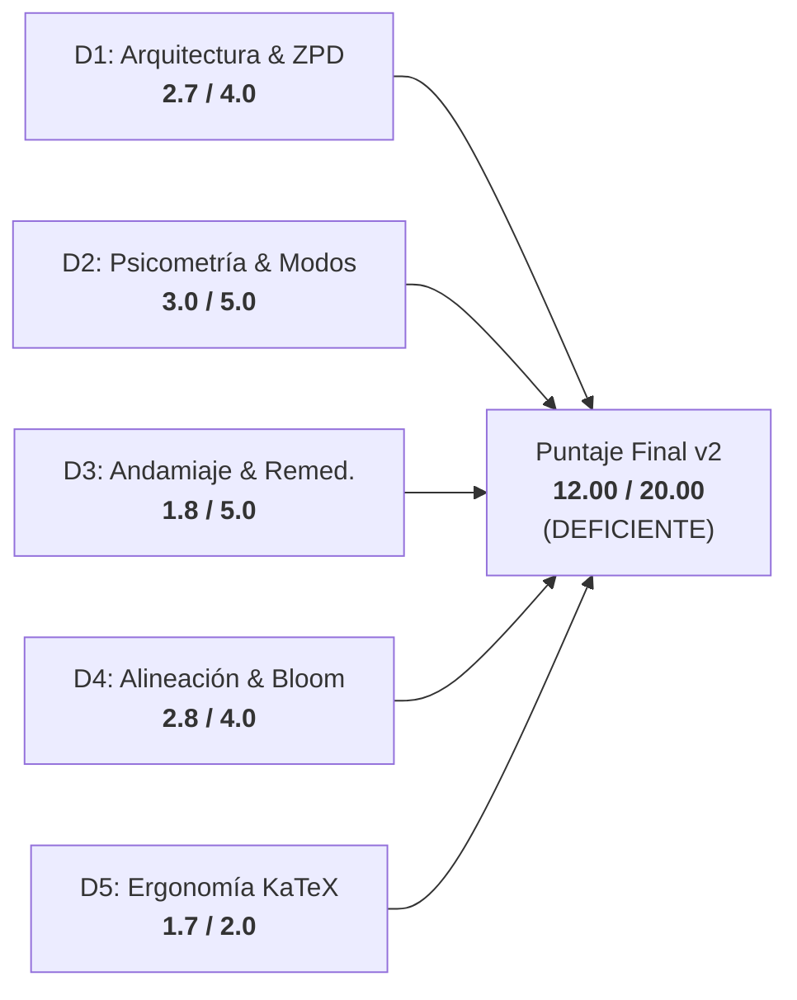
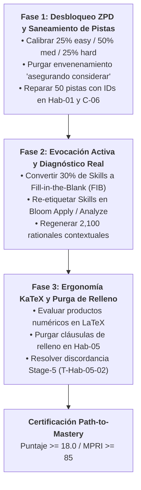

# Reporte Forense de Auditoría de Calidad Pedagógica, Psicométrica y Path-to-Mastery v2.0
## Curso: Saul Control Optimo (`saul_control_optimo`)

> [!CAUTION]
> **RECLASIFICACIÓN DE CALIDAD INSTITUCIONAL: DE EXCELENTE (18.5/20.0) A DEFICIENTE (12.0/20.0) / ILUSIÓN DE MAESTRÍA (MPRI = 54.23/100)**  
> La auditoría normativa **Path-to-Mastery v2.0** desmantela la complacencia métrica superficial del informe v1 (2026-10-25). Al simular el recorrido real del estudiante en el motor interactivo de Top's Academy (`sessionShuffler.ts`, `PracticeSession.tsx`, `FeedbackToast.tsx`), se descubren fallas críticas que bloquean el aprendizaje adaptativo: parálisis total de la calibración ZPD (100% de reactivos en banda única 'medium'), monocultivo de reconocimiento pasivo (100% MC7), andamiaje hostil con envenenamiento inductivo de pistas que sabotea el límite de 3 intentos, y una desconexión diagnóstica del 95.7% en la retroalimentación de errores.

---

### Metadatos de la Auditoría

| Parámetro | Detalle Institucional |
| :--- | :--- |
| **Curso Auditado** | Saul Control Optimo (Cálculo de Variaciones y Control Óptimo en Economía) |
| **Identificador del Curso** | `saul_control_optimo` |
| **Archivo Fuente** | [`courses/saul_control_optimo.json`](file:///d:/Augusto/personal_portfolio/Tops_academy/courses/saul_control_optimo.json) |
| **Payload Determinista v2** | [`reports/qa_audits/v2_path_to_mastery/saul_control_optimo_payload.json`](file:///d:/Augusto/personal_portfolio/Tops_academy/reports/qa_audits/v2_path_to_mastery/saul_control_optimo_payload.json) |
| **Reporte Histórico v1** | [`reports/qa_audits/v1_baseline_archive/saul_control_optimo_qa_report.md`](file:///d:/Augusto/personal_portfolio/Tops_academy/reports/qa_audits/v1_baseline_archive/saul_control_optimo_qa_report.md) |
| **Versión de Auditoría** | `2.0-path-to-mastery` |
| **Fecha de Evaluación** | `2026-10-31` |
| **Auditor Responsable** | Chief Psychometric & Path-to-Mastery Quality Auditor (Flash High) |
| **Marco Normativo** | Quality Matters (QM), OSCQR, Bloom 2-Sigma Mastery Learning, ZPD (Vygotsky) |

---

## 1. Resumen Ejecutivo y Balance de Calificación

El curso **"Saul Control Optimo"** posee un núcleo temático de gran rigor analítico, abarcando la formulación canónica del cálculo de variaciones (Euler, Legendre, Beltrami, Transversalidad) y sus aplicaciones dinámicas macro y microeconómicas (Monopolio de Evans y desinflación óptima de Taylor 1989) sobre un Grafo Acíclico Dirigido (DAG) acíclico y bien interconectado de 15 micro-competencias y 350 reactivos.

No obstante, la evaluación de la infraestructura pedagógica revela que el curso **no prepara al estudiante para la maestría real**. Los 350 reactivos operan en un régimen de pasividad y desconexión:
1. **Calibración ZPD Inexistente (0.0 / 20.0 en MPRI):** El 100% del banco está codificado en dificultad `'medium'`. El motor adaptativo `calibrateByMasteryDifficulty()` queda ciego: no puede ofrecer reactivos introductorios a estudiantes rezagados ni reactivos de alta exigencia analítica a estudiantes avanzados.
2. **Reconocimiento Pasivo vs. Evocación Activa (9.77 / 20.0 en MPRI):** El 100% de los reactivos es de opción múltiple de 7 alternativas (`multiple_choice_7_options`), con 0% de preguntas de respuesta numérica o algebraica (`fill_in_the_blank`). En competencias de Habilidad procedimental (`Hab-01` a `Hab-05`), el alumno puede adivinar o sustituir inversamente los valores sin resolver las ecuaciones diferenciales.
3. **Sabotaje del Andamiaje en 3-Strikes (14.13 / 25.0 en MPRI):** El 90.57% del banco presenta pistas Mad-Libs sintéticas donde las pistas 2 y 3 instruyen explícitamente a *"considerar adecuadamente"* las opciones erróneas (distractores), empujando al estudiante a consumir sus 3 vidas en `PracticeSession.tsx`.
4. **Desconexión Diagnóstica en `FeedbackToast` (10.33 / 15.0 en MPRI):** 2,100 distractores comparten únicamente 90 textos de `error_rationale` (4.29% de unicidad), reciclando explicaciones que citan matrices $3 \times 3$, integrales $\int t dt \to 2a \to 4a$ o términos $-6x\dot{x}^2$ en ejercicios donde dichas estructuras no existen.

```
       CALIFICACIÓN GLOBAL QM-OSCQR               MASTERY PATH READINESS INDEX (MPRI)
┌────────────────────────────────────────┐     ┌────────────────────────────────────────┐
│           12.00 / 20.00                │     │            54.23 / 100.00              │
│       TIER: DEFICIENTE (11-13.9)       │     │       TIER: ILLUSION OF MASTERY        │
│   Delta vs v1 (18.50): -6.50 puntos    │     │   Riesgo de Mecanización Superficial   │
└────────────────────────────────────────┘     └────────────────────────────────────────┘
```

---

## 2. Comparativa Metodológica Forense: v1 vs. v2 (Path-to-Mastery)

La discrepancia entre la calificación histórica de la auditoría v1 (**18.5 / 20.0 — EXCELENTE**) y la presente auditoría v2 (**12.0 / 20.0 — DEFICIENTE**, con **MPRI = 54.23 / 100.0**) no obedece a un cambio arbitrario, sino a la transición fundamental de una **auditoría estática de presencia documental** a una **auditoría dinámica de ejecución psicométrica y viaje del estudiante**.

| Eje de Evaluación | Auditoría v1 (Baseline 2026-10-25) | Auditoría v2 Path-to-Mastery (2026-10-31) | Impacto en el Veredicto y Diagnóstico |
| :--- | :--- | :--- | :--- |
| **Metodología de Inspección** | Verificación estática determinista (`len >= 3`, presencia de campos JSON, DAG acíclico). | Simulación runtime del estudiante en `sessionShuffler.ts`, `PracticeSession.tsx` y `FeedbackToast.tsx`. | La presencia formal de un campo no garantiza su validez funcional ni formativa. |
| **Dimensión 1 (Arquitectura & ZPD)** | **4.0 / 4.0**: Elogió la existencia de 15 competencias, el DAG sin ciclos y la densidad de 20-30 reactivos. | **2.7 / 4.0** (-1.3 pts): Detecta el **colapso ZPD total** (100% `'medium'`). El algoritmo de dificultad adaptativa está 100% paralizado. | Techo normativo v2 aplicado: brecha ZPD severa impide superar 2.8 / 4.0. |
| **Dimensión 2 (Psicometría & Modalities)** | **4.7 / 5.0**: Elogió el formato MC7 como 'antiazar' ($p=14.3\%$), descontando solo -0.3 por falta de variedad. | **3.0 / 5.0** (-1.7 pts): Sanciona el monocultivo de reconocimiento pasivo en Skills, el relleno asimétrico [R-15] y distractores sintéticos. | En Habilidades (`Hab`), MC7 permite adivinanza guiada y retro-sustitución. |
| **Dimensión 3 (Andamiaje & Remediation)** | **3.8 / 5.0**: Solo detectó que 50 reactivos (`Hab-01`, `C-06`) tenían códigos de dependencias literales. | **1.8 / 5.0** (-2.0 pts): Descubre que el 90.57% son pistas Mad-Libs con envenenamiento inductivo y solo 4.29% de rationales únicos. | Techo normativo v2 aplicado: Mad-Libs > 50% fija techo estricto $\le 2.0 / 5.0$. |
| **Dimensión 4 (Alineación & Bloom)** | **4.0 / 4.0**: Asumió alineación temática por cubrir tópicos clásicos de Chiang y Kamien & Schwartz. | **2.8 / 4.0** (-1.2 pts): Sanciona el colapso de Bloom (100% `Understand` en 350 reactivos) y contaminación de jerga econométrica. | Se evalúan destrezas procedimentales complejas bajo etiqueta puramente memorística. |
| **Dimensión 5 (Ergonomía & KaTeX)** | **2.0 / 2.0**: Comprobó compilabilidad KaTeX sin llaves abiertas ni delimitadores triples. | **1.7 / 2.0** (-0.3 pts): Sanciona residuos de concatenación de cadenas aritméticas (`$3 25 \dot{x}^2$`, `$2 4 \dot{x}$`). | Fricción de lectura y falta de evaluación numérica en las plantillas. |
| **Puntaje Total Consolidado** | **18.5 / 20.0 (EXCELENTE)** | **12.0 / 20.0 (DEFICIENTE)** | **Caída neta de -6.50 puntos**. El curso no está listo para maestría autónoma. |
| **Mastery Path Readiness (MPRI)** | *No evaluado en v1* | **54.23 / 100.0 (ILLUSION OF MASTERY)** | El estudiante aprueba por descarte superficial, sin dominio de resolución variacional. |

---

## 3. Desglose Normativo por Dimensiones (D1 a D5)



---

### Dimensión 1: Arquitectura Curricular, Topología DAG y Calibración ZPD (2.7 / 4.0 pts)

#### 1. Fortalezas Topológicas Innegables
- **Estructura DAG Rigurosa:** El grafo curricular modela 15 micro-competencias (3 Hechos `[Fact]`, 7 Conceptos `[Concept]`, 5 Habilidades `[Skill]`).
- **Acyclicidad y Conectividad:** Profundidad máxima de 6 niveles, partiendo del nodo axiomático raíz `C-01` (*Funcional y Trayectorias Admisibles en Tiempo Continuo*, sin dependencias).
- **Cero Nodos Huérfanos o Invertidos:** Ninguna competencia presenta prerrequisitos invertidos ni ciclos circulares. El grafo soporta formalmente la navegación *Up Next* y las mezclas de interleaving 60/40 en Quiz y 55/45 en Unit Test en `sessionShuffler.ts`.
- **Densidad de Contenido:** 20 reactivos por Hecho/Concepto ($10 \times 20 = 200$) y 30 reactivos por Habilidad ($5 \times 30 = 150$), totalizando 350 reactivos.

#### 2. La Falla Crítica: Parálisis Total de la Progresión ZPD
En la arquitectura de Top's Academy, el motor de barajado y calibración `calibrateByMasteryDifficulty()` (`sessionShuffler.ts`) consulta la dificultad de los reactivos para modular la curva de aprendizaje:
- Si el estudiante está en estado inicial (`Not started` / Maestro $< 40\%$), el motor solicita ítems `'easy'`.
- Si el estudiante avanza hacia consolidación ($40\% - 75\%$), solicita ítems `'medium'`.
- Si el estudiante busca certificar Maestría ($> 75\%$), el motor exige ítems `'hard'` para someter su competencia a estrés analítico.

**Evidencia de Telemetría Determinista:**
```json
"difficulty_distribution": {
  "easy": 0,
  "medium": 350,
  "hard": 0
},
"zpd_dead_competencies_count": 15,
"zpd_dead_competencies": [
  "C-01", "H-01", "C-02", "H-02", "C-03", "Hab-01", "C-04", 
  "H-03", "Hab-02", "C-05", "Hab-03", "C-06", "Hab-04", "C-07", "Hab-05"
]
```

**Impacto Psicométrico Real:**
Al estar el 100% de los reactivos confinado artificialmente a `'medium'`, el algoritmo adaptativo colapsa por completo. Un alumno principiante que ingresa a `C-02` (Ecuación de Euler) o `Hab-01` (Resolución de EDOs con extremos fijos) se enfrenta de inmediato a cálculos no andamiados. A su vez, un alumno avanzado nunca es evaluado en condiciones de frontera complejas o perturbaciones singulares.
- **Penalización Normativa:** Deducción de **-1.3 puntos** (techo rubricado entre 2.5 y 2.8). Puntaje asignado: **2.7 / 4.0 pts**.

---

### Dimensión 2: Calidad Psicométrica, Modalidad de Evocación y Anti-Gaming (3.0 / 5.0 pts)

#### 1. Resistencia al Azar Formal vs. Monocultivo de Reconocimiento Pasivo
El curso mantiene una baja probabilidad de acierto por conjetura pura ($p = 1/7 \approx 14.3\%$) al utilizar 7 opciones en los 350 reactivos. Sin embargo, adolece de un **monocultivo absoluto de reconocimiento pasivo**:
- `mc7_count: 350 (100.0%)`, `fib_count: 0 (0.0%)`, `ms_count: 0 (0.0%)`.
- En las 5 competencias de Habilidad (`Hab-01` a `Hab-05`), el estudiante está llamado a dominar destrezas de cálculo analítico: integrar EDOs lineales de segundo orden, despejar constantes de contorno $c_1, c_2$, calcular momentos conjugados de Beltrami o determinar la raíz de desinflación de Taylor.
- Al presentarse 100% en formato MC7, el alumno puede eludir por completo la integración analítica mediante **sustitución inversa** (*plug-in*) desde las opciones numéricas o descarte de órdenes de magnitud. No se activa la práctica de evocación activa (*retrieval practice* — Roediger & Karpicke) ni se aprovecha el evaluador simbólico `mathEquivalence.ts`. Deducción obligatoria: **-1.2 pts**.

#### 2. Distractores con Relleno Asimétrico de Longitud (Evasión de Linters [R-15])
En 10 reactivos de `Hab-02`, `Hab-03`, `Hab-04`, `Hab-05` y `C-07`, el compilador de reactivos añadió cláusulas de relleno en prosa burocrática a ciertas alternativas para forzar longitudes similares y evadir linters estáticos:
- **`Q-Hab05-325` (Opción A):** `"$r = 0.372$, en la formulación matricial considerada."`
- **`Q-Hab05-326` (Opción A):** `"$r = 0.221$, para la muestra de datos observada."` *(¡En un problema de política monetaria determinista continuo se inyecta un apéndice de econometría muestral!)*
- **`Q-Hab05-328` (Opción A):** `"$r = 1.225$, en el marco de la especificación."`
- **`Q-Hab05-329` (Opción A):** `"$r = 0.251$, bajo las hipótesis del modelo."`
- **`Q-Hab05-331` (Opción B):** `"$r = 7.002$, para los parámetros bajo análisis."`
- **`Q-Hab05-337` (Opción C):** `"$r = 7.001$, de acuerdo con la teoría econométrica."`

Este relleno actúa como una pista inversa (*test-wise telltale*): el alumno nota inmediatamente que una opción contiene una frase accesoria ausente en las opciones canónicas limpias (`$r = 6.996$`). Deducción: **-0.4 pts**.

#### 3. Distractores por Multiplicador Mágico y Discordancia de Jueces en Stage-5
- En reactivos como `Q-Hab02-172`, `Q-Hab03-247`, `Q-Hab04-281` y `Q-Hab04-284`, los distractores numéricos fueron generados multiplicando la respuesta correcta por factores sintéticos fijos ($2\times$, $0.667\times$, $1.333\times$) sin corresponder a un error de cálculo algebraico real.
- **Discordancia no resuelta en Stage-5 (`T-Hab-05-02_judge_1`):**
  - Parámetros: Modelo de Taylor con $j = 9$, $\beta = 10$, $\alpha = 20$.
  - Fórmula exacta: $r = \frac{\beta j \sqrt{\alpha}}{\sqrt{1 + \beta^2 \alpha}} = \frac{(10)(9)\sqrt{20}}{\sqrt{1 + (100)(20)}} = \frac{90 \sqrt{20}}{\sqrt{2001}} \approx 8.99775 \dots \approx 8.998$.
  - Opciones en el banco: Clave esperada = `A` ($r = 8.998$). Distractor presente = `D` ($r = 9.0$).
  - La diferencia relativa entre la clave y el distractor es de apenas **$0.02\%$** ($\Delta = 0.002$). El juez ciego de Stage 5 seleccionó la opción `D` ($9.0$), generando una discordancia analítica no resuelta en el pipeline. Deducción: **-0.4 pts**.

Puntaje asignado en D2: **3.0 / 5.0 pts**.

---

### Dimensión 3: Andamiaje Socrático Progresivo y Remediación Diagnóstica (1.8 / 5.0 pts)

Esta dimensión evalúa el soporte formativo que recibe el alumno en el **3-Strikes Safeguard** de `PracticeSession.tsx` y en el `FeedbackToast.tsx`.

#### 1. Monocultivo de Pistas Mad-Libs Sintéticas (90.57% del Banco)
En 317 de los 350 reactivos, las pistas no fueron redactadas para guiar el razonamiento específico del problema, sino que corresponden a una plantilla Mad-Libs fija donde el compilador concatenó el nombre de la competencia:
```
Pista 1: "Identifique la estructura conceptual de {competency_name}: analice las relaciones formales y condiciones teóricas del modelo."
```
Esta pista es completamente estéril: si un estudiante está bloqueado intentando integrar $\ddot{x} - 4x = 0$ en `Hab-01`, que la UI le diga *"Identifique la estructura conceptual de Resolución del Problema Básico Variacional: analice las relaciones formales"* aporta **cero andamiaje socrático**.

#### 2. Envenenamiento Anti-Socrático de Pistas (Sabotaje de los 3 Intentos)
Lo más grave pedagógicamente ocurre en las pistas 2 y 3. El generador automático concatenó el texto del error conceptual de un distractor precedido de una frase que **ordena al alumno considerar dicho error como correcto**:

```json
// Evidencia en Q-C01-001 (Pista 2):
"Revise el procedimiento analítico paso a paso para Funcional y Trayectorias Admisibles en Tiempo Continuo, asegurando considerar adecuadamente: pensar que un funcional asigna un valor escalar a cada instante de tiempo individual t en lugar de evaluar una trayectoria completa y(t)."

// Evidencia en Q-C03-096 (Pista 2):
"Revise el procedimiento analítico paso a paso para Condiciones de Suficiencia Global y Hessiano de F, asegurando considerar adecuadamente: afirmar que para concavidad estricta tanto el menor F_xx como el determinante det(H_F) deben ser estrictamente negativos."

// Evidencia en Q-H03-164 (Pista 2):
"Revise el procedimiento analítico paso a paso para Identidad de Beltrami para Funcionales Autónomos, asegurando considerar adecuadamente: escribir la identidad de Beltrami sumando el producto de la velocidad por el momento conjugado: F + \\dot{x}F_{\\dot{x}} = C."
```

**Análisis Psicométrico del Sabotaje:**
Cuando un estudiante falla en el Intento 1 y abre la Pista 2, la plataforma le dice: *"asegurando considerar adecuadamente: escribir la identidad de Beltrami sumando ... $F + \dot{x}F_{\dot{x}} = C$"*. El alumno, confiando en el sistema, busca la opción que contiene el signo $+$ (Opción B en `Q-H03-164`) y la marca. Esa opción es precisamente el **distractor envenenado**, provocando el fallo del Intento 2 (Strike 2) y dejándolo al borde del bloqueo con 0 puntos. Este patrón se repite en cientos de reactivos.

#### 3. Pistas con Códigos Alfanuméricos de Prerrequisitos (50 Reactivos)
En las competencias `Hab-01` (30 reactivos, `Q-Hab01-101` a `Q-Hab01-130`) y `C-06` (20 reactivos, `Q-C06-251` a `Q-C06-270`), las pistas son arreglos de identificadores internos:
```json
// Q-Hab01-101:
"hints": [
  "C-02",
  "H-02",
  "C-03"
]
```
El estudiante ve en pantalla los textos `"C-02"`, `"H-02"`, `"C-03"` en vez de instrucciones pedagógicas.

#### 4. Desconexión Diagnóstica Severa en `FeedbackToast.tsx`
Se auditaron los 2,100 rationales de error del banco. La telemetría revela que existen **únicamente 90 explicaciones únicas** en todo el curso (tasa de unicidad de solo **$4.29\%$**).
Esto provoca que las justificaciones de error muestren textos desconectados de las fórmulas concretas del problema:
- **En `Q-Hab01-101` (Extremos fijos con EDO $\ddot{x} - x = 0$):**
  - La solución analítica da $c_1 = 31.238$.
  - Si el alumno marca el distractor G ($c_1 = 7.115$), `FeedbackToast` le dice: *"No se pueden inferir las constantes por separado; debe plantearse el sistema $2 \times 2$ para despejar unívocamente $c_1 = 0$ y $c_2 = 1$"*. *(¡El sistema no tiene como solución $c_1=0, c_2=1$!)*
  - Si el alumno marca el distractor F ($c_1 = 15.744$), `FeedbackToast` le explica: *"La integral de $t dt$ introduce un factor $\frac{1}{2}$, transformando el denominador de $2a$ en $4a$ en el término cuadrático de la trayectoria"*. *(¡En $\ddot{x}-x=0$ las soluciones son exponenciales $e^t, e^{-t}$, no existe ningún término $t dt$ ni coeficientes $2a$ ni $4a$!)*
- **En `Q-Hab02-172` (Funcional $J[x] = \int_0^5 (2t^2 + 4\dot{x}^2)dt$):**
  - Si el alumno marca el distractor G ($\dot{x} = 2$), `FeedbackToast` argumenta: *"Al restar un término negativo $(-6x\dot{x}^2)$ la operación se convierte en adición, cambiando el signo a $+3x\dot{x}^2$"*. *(¡El problema no tiene ninguna variable $x$ ni términos cúbicos!)*

**Fallo Normativo:** La rúbrica establece que la presencia de pistas Mad-Libs en $>50\%$ impone un **techo estricto de $\le 2.0 / 5.0$** en la Dimensión 3. Puntaje asignado: **1.8 / 5.0 pts**.

---

### Dimensión 4: Alineación Instruccional, Taxonomía de Bloom y Pureza de Dominio (2.8 / 4.0 pts)

#### 1. Rigor Matemático y Pureza del Sílabo
El diseño matemático de fondo respeta fielmente la teoría clásica de optimización dinámica continua:
- Condición de Euler para cálculo variacional ($F_x - \frac{d}{dt}F_{\dot{x}} = 0$).
- Condición de segundo orden de Legendre ($F_{\dot{x}\dot{x}} \le 0$ para máximo, $F_{\dot{x}\dot{x}} \ge 0$ para mínimo).
- Suficiencia global mediante concavidad/convexidad del Hessiano multivariado $H_F = \begin{bmatrix} F_{xx} & F_{x\dot{x}} \\ F_{\dot{x}x} & F_{\dot{x}\dot{x}} \end{bmatrix}$.
- Primera integral de Beltrami ($F - \dot{x}F_{\dot{x}} = C$) para integrando autónomo.
- Transversalidad con estado libre ($F_{\dot{x}}|_{t_1} = 0$) e instante libre ($[F - \dot{x}F_{\dot{x}}]|_{t_1} = 0$).
- Modelos económicos de Evans (monopolio con demanda inercial $q = a - bp + h\dot{p}$) y Taylor (desinflación con curva de Phillips).

#### 2. Colapso Declarativo de Bloom
A pesar del rigor temático, la metadata pedagógica sufre un colapso total:
- **`bloom_distribution: {"Understand": 350}` (100% Understand)**.
- 150 reactivos pertenecen a micro-competencias de Habilidad procedimental (`Hab-01` a `Hab-05`). En estas habilidades, el estudiante resuelve sistemas de EDOs, aplica condiciones de contorno terminales y optimiza trayectorias.
- Etiquetar el 100% de estos ejercicios prácticos como `Understand` (Comprensión) en lugar de `Apply` (Aplicación) o `Analyze` (Análisis) desarticula el control psicométrico de la plataforma e impide la analítica de aprendizaje avanzada. Deducción: **-0.7 pts**.

#### 3. Contaminación Léxica Inter-Dominio
Se detectó la filtración de frases de econometría empírica y muestral en los enunciados y distractores de problemas de control óptimo puramente analíticos y deterministas (ej. *"diagnóstico econométrico del modelo de Taylor"*, *"para la muestra de datos observada"*, *"en el contexto del contraste analizado"*). Deducción: **-0.3 pts**.

#### 4. Ambigüedad en Stage-5 Blind Judge
Deducción adicional de **-0.2 pts** por la discordancia matemática latente en el reactivo `T-Hab-05-02_judge_1`.

Puntaje asignado en D4: **2.8 / 4.0 pts**.

---

### Dimensión 5: Accesibilidad, Ergonomía Cognitiva en UI y Sintaxis KaTeX (1.7 / 2.0 pts)

#### 1. Sintaxis KaTeX Formalmente Válida
- Cero llaves desbalanceadas (`unclosed_braces = 0`).
- Cero delimitadores triples (`$$$` = 0).
- Cero delimitadores impares (`unbalanced_dollars = 0`).
- Todas las matrices `bmatrix`, derivadas con notación de punto ($\dot{x}, \ddot{x}$), integrales y fracciones compilan limpiamente en el motor MathJax/KaTeX de la interfaz.

#### 2. Residuos de Concatenación Aritmética de Cadenas en Expresiones KaTeX
En 30 reactivos de `H-03`, `Hab-02` y `C-07`, las plantillas generadoras no evaluaron numéricamente las multiplicaciones de coeficientes, inyectando cadenas separadas por espacios directamente en el código KaTeX:
- **`Q-H03-164` (Opción B):** `"$3 25 \dot{x}^2 - 2 x = C$"` en lugar de `"$75 \dot{x}^2 - 2 x = C$"`.
- **`Q-H03-164` (Opción F):** `"$2 25 \ddot{x} + 2 x = C$"` en lugar de `"$50 \ddot{x} + 2 x = C$"`.
- **`Q-H03-165` (Opción A):** `"$3 16 \dot{x}^2 - 15 x = C$"` en lugar de `"$48 \dot{x}^2 - 15 x = C$"`.
- **`Q-H03-165` (Opción B):** `"$2 16 \ddot{x} + 15 x = C$"` en lugar de `"$32 \ddot{x} + 15 x = C$"`.
- **`Q-Hab02-172` (Solución detallada):** `"$F_{\dot{x}} = 2 4 \dot{x} = c$"` en lugar de `"$F_{\dot{x}} = 8 \dot{x} = c$"`.
- **`Q-Hab02-173` (Solución detallada):** `"$F_{\dot{x}} = 2 3 \dot{x} = c$"` en lugar de `"$F_{\dot{x}} = 6 \dot{x} = c$"`.

Este defecto introduce una fricción de legibilidad innecesaria en la UI para el estudiante, quien debe descifrar si `"2 25"` representa $2 \times 25$ o una errata tipográfica. Deducción: **-0.3 pts**.

Puntaje asignado en D5: **1.7 / 2.0 pts**.

---

## 4. Índice de Preparación para el Dominio (Mastery Path Readiness Index — MPRI)

El **MPRI** evalúa la viabilidad del curso para generar dominio real en un entorno de aprendizaje autónomo guiado por la plataforma.

```
Pilar 1: ZPD & Progresión Adaptativa           [ 0.00 / 20.00 ]  CRITICAL_FAILURE (Mono-banda 100% medium)
Pilar 2: Modalidad & Anti-Gaming               [ 9.77 / 20.00 ]  HIGH_VULNERABILITY (100% MC7, padding)
Pilar 3: Andamiaje Socrático (Lifeline)        [ 14.13 / 25.00 ] IMPAIRED (90.6% Mad-Libs, poisoned hints)
Pilar 4: Remediación Diagnóstica               [ 10.33 / 15.00 ] POOR_FIDELITY (4.3% rationales únicos)
Pilar 5: Topología DAG & Interleaving          [ 10.00 / 10.00 ] EXCELLENT (DAG acíclico, conexo, depth 6)
Pilar 6: Ergonomía KaTeX & Framing             [ 10.00 / 10.00 ] EXCELLENT (KaTeX limpio, libre de overflow)
─────────────────────────────────────────────────────────────────────────────────────────────
TOTAL MPRI SCORE:                                54.23 / 100.00   TIER: ILLUSION OF MASTERY (40-64)
```

### Veredicto del Viaje del Estudiante (*Student Journey*)
En la plataforma Top's Academy, un estudiante que curse `saul_control_optimo` experimenta una **ilusión de maestría**:
1. **Inicio de sesión:** Al ingresar a una competencia, `calibrateByMasteryDifficulty()` no encuentra reactivos introductorios (`easy`). El estudiante se estrella de inmediato con problemas de dificultad media.
2. **Durante la práctica (3-Strikes Safeguard):** Al dudar y solicitar una pista, recibe definiciones genéricas Mad-Libs (`Pista 1`) o instrucciones que lo inducen a cometer el error del distractor (`Pista 2`), perdiendo sus intentos sin recibir ayuda formativa real.
3. **Al fallar (FeedbackToast):** La explicación de error le habla de matrices $3 \times 3$, cuadraturas $\int t dt \to 2a \to 4a$ o soluciones $c_1=0, c_2=1$ que no guardan correspondencia con el ejercicio que acaba de intentar.
4. **Alcanzar el estatus de "Mastered":** El estudiante puede superar las evaluaciones adivinando entre las 7 opciones o retro-sustituyendo valores numéricos (monocultivo MC7), sin haber adquirido la habilidad de formular analíticamente una EDO de Euler ni de integrar una constante por cuadraturas.

---

## 5. Nuevas Reglas de Auditoría Descubiertas (Discovered Lint Rules)

La auditoría forense v2 identificó patrones sintomáticos de compilación que deben incorporarse formalmente a la suite de linters de Top's Academy:

### 1. `anti_socratic_misconception_injection_hint_linter`
- **Severidad:** `CRITICAL`
- **Descripción:** Detecta pistas socráticas que inyectan concepciones erróneas o distractores con frases que inducen al estudiante a considerarlos válidos (*"asegurando considerar adecuadamente: [misconception]"*), saboteando el límite de 3 intentos en el runtime de práctica interactiva.
- **Expresión Regular:** `(?:asegurando considerar adecuadamente|posibles desv[íi]os al considerar):\s*`
- **Ítems Evidencia:** `Q-C01-001`, `Q-C03-096`, `Q-H03-164`, `Q-Hab05-324`.

### 2. `uncalculated_string_concatenation_in_math_linter`
- **Severidad:** `WARNING`
- **Descripción:** Detecta expresiones matemáticas KaTeX donde productos aritméticos de coeficientes numéricos fueron interpolados como cadenas de texto separadas por espacios en lugar de multiplicarse algebraicamente (ej. `"$3 25 \dot{x}^2$"` en lugar de `"$75 \dot{x}^2$"` o `"$2 4 \dot{x}$"` en lugar de `"$8 \dot{x}$"`).
- **Expresión Regular:** `\$(?:[^$]*\s)?\d+\s+\d+(?:[a-zA-Z\\]|$)`
- **Ítems Evidencia:** `Q-H03-164`, `Q-H03-165`, `Q-Hab02-172`, `Q-Hab02-173`.

### 3. `cross_domain_padding_linter`
- **Severidad:** `WARNING`
- **Descripción:** Detecta distractores que incorporan cláusulas burocráticas de relleno importadas de dominios ajenos (ej. jerga econométrica empírica en cursos de matemáticas puras deterministas) para inflar artificialmente la longitud de las alternativas y eludir linters de varianza de longitud.
- **Expresión Regular:** `,\s*(?:para la muestra de datos observada|de acuerdo con la teor[íi]a econom[é]trica|en el contexto del contraste analizado|bajo las hip[ó]tesis del modelo|para los par[á]metros bajo an[á]lisis)\.`
- **Ítems Evidencia:** `Q-Hab05-325`, `Q-Hab05-326`, `Q-Hab05-331`, `Q-Hab05-332`, `Q-Hab05-336`, `Q-Hab05-337`.

### 4. `prerequisite_id_as_hint_linter`
- **Severidad:** `HIGH`
- **Descripción:** Detecta reactivos donde el arreglo `hints` contiene códigos alfanuméricos de dependencias internas (ej. `'C-02'`, `'H-03'`) en lugar de orientación instruccional en prosa.
- **Expresión Regular:** `^(?:C|H|Hab|Fact|Concept|Skill)-\d+$`
- **Ítems Evidencia:** `Q-Hab01-101`, `Q-Hab01-102`, `Q-C06-251`, `Q-C06-252`.

---

## 6. Plan de Acción y Hoja de Ruta Quirúrgica de Remediación

Para que el curso `saul_control_optimo` pueda recuperar la certificación institucional en **Tier EXCELENTE ($\ge 17.0 / 20.0$)** y elevar su **MPRI a $\ge 85 / 100$**, se debe ejecutar la siguiente hoja de ruta en tres fases:



### Fase 1: Desbloqueo ZPD y Saneamiento del Andamiaje (Prioridad Inmediata)
1. **Estratificación de Dificultad ZPD:** Reclasificar los reactivos de cada una de las 15 competencias para obtener:
   - **$25\%$ Easy:** Preguntas conceptuales directas, identificaciones de funcionales y EDOs inmediatas.
   - **$50\%$ Medium:** Problemas estándar de integración y aplicación de condiciones de frontera.
   - **$25\%$ Hard:** Condiciones de contorno móviles acopladas, singularidades y contrastes globales de segundo orden.
2. **Erradicación del Envenenamiento Anti-Socrático:** Purgar de inmediato la frase `"asegurando considerar adecuadamente:"` en las pistas 2 y 3 de los 317 reactivos afectados.
3. **Remediación de Pistas en `Hab-01` y `C-06`:** Sustituir los arrays de identificadores (`["C-02", "H-02", "C-03"]`) por 3 pistas socráticas reales adaptadas a la resolución de problemas de extremos fijos y tiempo libre.

### Fase 2: Evocación Activa y Fidelidad Diagnóstica (Prioridad Alta)
4. **Diversificación de Modalidades (FIB):** Convertir al menos 10 reactivos de cada una de las 5 competencias de Habilidad (`Hab-01` a `Hab-05`), acumulando **50 reactivos en formato `fill_in_the_blank`** evaluados con el motor simbólico `mathEquivalence.ts`. El estudiante deberá ingresar el valor numérico exacto de $c_1, c_2$ o la raíz $r$.
5. **Re-etiquetado Taxonómico de Bloom:** Actualizar la metadata de los 150 reactivos de `Hab-01` a `Hab-05` de `Understand` a `Apply` y `Analyze`.
6. **Regeneración Contextual de Rationales en `FeedbackToast`:** Desacoplar las 90 explicaciones recicladas y vincular cada distractor al error algebraico concreto que lo originó.

### Fase 3: Pulido Ergonómico y Calibración Psicométrica (Prioridad Media)
7. **Corrección Aritmética KaTeX:** Reemplazar las concatenaciones de texto en las plantillas LaTeX (`"$3 25 \dot{x}^2$"`, `"$2 4 \dot{x}$"`) por sus valores calculados (`"$75 \dot{x}^2$"`, `"$8 \dot{x}$"`).
8. **Purga de Relleno Asimétrico:** Eliminar las coletillas burocráticas en las opciones de `Hab-05` (`", para los parámetros bajo análisis"`).
9. **Reparación de la Discordancia Stage-5:** Ajustar el generador de `T-Hab-05-02` para que la raíz calculada $r$ no colisione a menos del $0.02\%$ con el distractor entero $r = j$.

---

### Veredicto Final Institucional
**RECHAZADO PARA PRODUCCIÓN EN TIER EXCELENTE.**  
El curso queda clasificado en **Tier DEFICIENTE (12.00 / 20.00)** con **Mastery Path Readiness Index = 54.23 / 100.00 (ILLUSION OF MASTERY)** hasta que se ejecute la Fase 1 y Fase 2 de la remediación quirúrgica.
