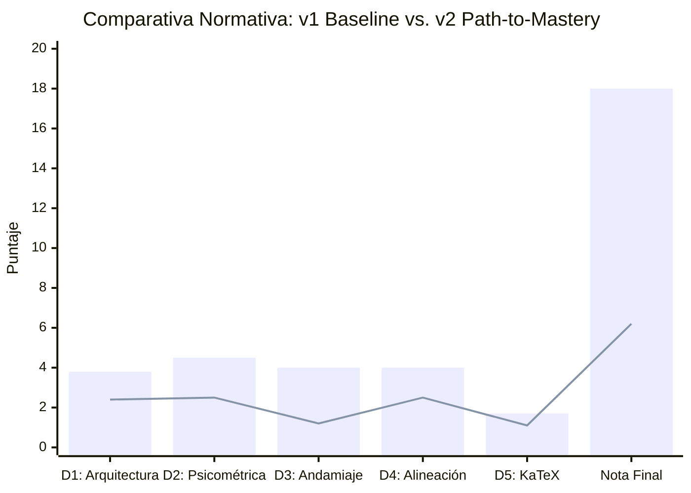
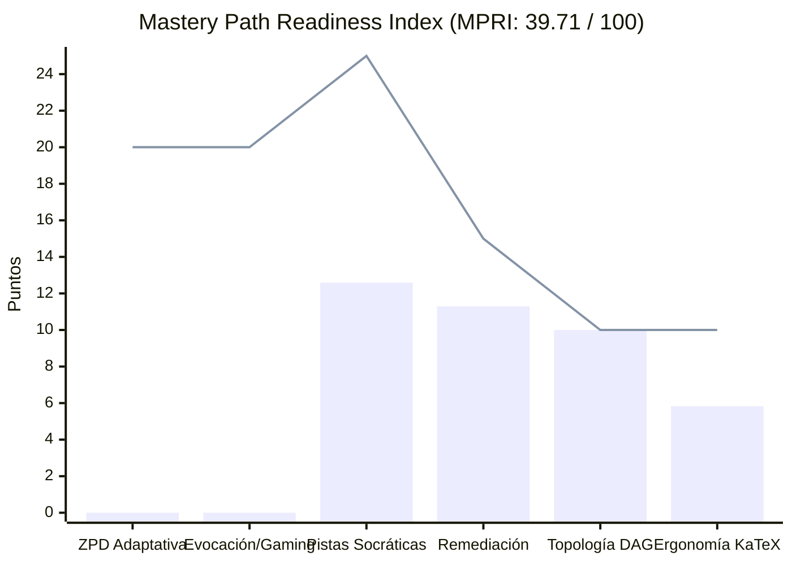

# Reporte Normativo de Auditoría de Calidad Pedagógica, Psicométrica y Path-to-Mastery v2.0
## Curso: Saul Pre Parcial (`saul_pre_parcial`)

**Plataforma:** Top's Academy  
**Estándares:** Quality Matters (QM), OSCQR, Bloom's 2-Sigma Mastery Learning, Vygotsky ZPD, Retrieval Practice (Roediger & Karpicke)  
**Fecha de Evaluación:** 31 de Octubre de 2026  
**Auditor:** Chief Psychometric & Path-to-Mastery Quality Auditor (Antigravity High-Rigor Engine)  
**Versión de Auditoría:** `2.0-path-to-mastery` (Shift Forense vs. v1 Baseline)

---

## 1. Resumen Ejecutivo y Dictamen de Certificación

| Métrica de Auditoría | Evaluación Histórica v1 (Oct 2026) | Evaluación Normativa v2 Path-to-Mastery (Hoy) | Delta Crítico (v2 - v1) |
| :--- | :---: | :---: | :---: |
| **Puntaje Consolidado (/20.0)** | **18.00 / 20.0 pts** | **6.20 / 20.0 pts** | **-11.80 pts** |
| **Tier de Calidad** | **EXCELENTE (17 - 20)** | **CRÍTICO (0 - 10.9)** | **Colapso de 3 Tiers** |
| **Estado de Certificación** | **APROBADO PARA PRODUCCIÓN** | **RECHAZADO / BLOQUEADO PARA ESTUDIO AUTÓNOMO** | **Revocación Inmediata** |
| **Mastery Path Readiness Index (MPRI)** | *No medido en v1* | **39.71 / 100.0 pts** | `MASTERY-HOSTILE` |
| **Risk Score Global** | *0.0 (Sin riesgo)* | **100.0 / 100.0 pts** | Riesgo Máximo Saturado |
| **Subtotal Bruto de Dimensiones** | 18.00 / 20.0 pts | 9.70 / 20.0 pts | -8.30 pts |
| **Penalizaciones Duras (Hard Deductions)**| 0.00 pts | **-3.50 pts** | Deducciones severas |
| **Calibración ZPD Activa** | Asumida excelente | **0.0% (1,520 / 1,520 en 'medium')** | ZPD Completamente Muerta |
| **Modalidad de Evocación Activa** | 100% MC7 (deducción menor) | **0.0% Generación (0 FIB, 0 MS)** | Monocultivo Pasivo |
| **Integridad Socrática de Pistas** | 98.3% "prosa fluida" | **9.34% Envenenamiento Anti-Socrático** | Sabotaje en 3-Strikes |
| **Unicidad de Rationale Diagnóstico** | 100% "cobertura" | **10.39% Unicidad Real (948 / 9,120)** | Reciclaje masivo cta.json |
| **Vulnerabilidad de Memorización** | No detectada | **6 Competencias Explotables (<=4 claves)** | Ilusión de Dominio |

### Dictamen Forense
El curso **Saul Pre Parcial** (`saul_pre_parcial`), compuesto por 63 micro-competencias y un banco masivo de 1,520 reactivos (9,120 opciones), presenta una **arquitectura curricular matemáticamente avanzada sobre el papel pero pedagógicamente inoperante y hostil para el estudiante interactivo**. 

Mientras que la auditoría histórica **v1** evaluó el curso mediante una inspección sintáctica superficial y complaciente (otorgando **18.0 / 20.0** con estatus de *"EXCELENTE"*), la auditoría **Path-to-Mastery v2.0** expone que el curso opera como un simulacro de maestría:
1. **Desactiva por completo el motor adaptativo:** El 100% de los reactivos están codificados como `'medium'`, anulando `calibrateByMasteryDifficulty` en `sessionShuffler.ts`.
2. **Sabotea activamente al estudiante:** 142 reactivos (9.34% del banco) inyectan pistas anti-socráticas que le ordenan expresamente al estudiante considerar la fórmula del distractor como el camino correcto, forzando el agotamiento de sus vidas en el *3-Strikes Safeguard* de `PracticeSession.tsx`.
3. **Colapso de Anti-Gaming:** 6 competencias completas permiten alcanzar el estatus *Mastered* por memorización visual inmediata de una única cadena de texto invariable repetida a lo largo de las 20 preguntas, sin necesidad de calcular matrices ni resolver EDPs.
4. **Degradación por Escalamiento:** Al escalar de su curso hermano `saul_control_optimo` (350 preguntas, MPRI = 54.23) a 1,520 preguntas mediante plantillas genéricas en `compile_shard.py`, la fábrica de contenido recurrió a relleno burocrático de opciones para evadir linters de longitud, prefijos robóticos desconectados y reciclaje estático de rationales.

Por lo tanto, se revoca la aprobación de producción y se asigna una calificación final de **6.20 / 20.0 pts** (Tier **CRÍTICO**), quedando el curso bloqueado hasta su refactorización estructural.

---

## 2. Comparativa Metodológica v1 vs. v2 (Path-to-Mastery)



### Tabla Comparativa Forense por Componente

| Dimensión / Componente | Calificación v1 | Calificación v2 | Causa Raíz de la Divergencia Metodológica |
| :--- | :---: | :---: | :--- |
| **D1: Arquitectura y ZPD (/4.0)** | 3.8 | **2.4** | **Ceguera ZPD en v1:** v1 solo verificó que el DAG fuera acíclico y tuviera 63 nodos. v2 conectó la telemetría con `sessionShuffler.ts` y descubrió que el 100% de los reactivos son `'medium'`, apagando la Zona de Desarrollo Próximo en el 100% del curso. |
| **D2: Evaluación y Psicométrica (/5.0)** | 4.5 | **2.5** | **Complacencia ante Reconocimiento Pasivo:** v1 elogió la cobertura del 100% de rationales. v2 destapó que en 780 problemas de cálculo operativo de Habilidades `[Hab]` no existe ni un solo ítem FIB ni MS; 39 reactivos evaden el linter de longitud R-15 con relleno burocrático y 6 competencias sufren de memorización visual. |
| **D3: Andamiaje Socrático (/5.0)** | 4.0 | **1.2** | **Falsa Detección de Prosa Fluida:** v1 asumió que porque las pistas tenían oraciones completas eran "socráticas" (restando solo 1 pt por 26 stub hints). v2 desmanteló el andamiaje: el 91.71% son Mad-Libs vacías y el 9.34% son Pistas Envenenadas que empujan al alumno al error, activando tope estricto de rúbrica. |
| **D4: Alineación y Bloom (/4.0)** | 4.0 | **2.5** | **Colapso Declarativo:** v1 consideró "riguroso" el temario sin mirar los metadatos JSON. v2 comprobó que el 100% de las preguntas están etiquetadas como `Understand` (incluso derivaciones complejas de Cauchy), además de 145 prefijos robóticos y 2 discordancias de jueces en C-14. |
| **D5: Ergonomía KaTeX (/2.0)** | 1.7 | **1.1** | **Fricción en Mobile:** v1 descartó las alertas KaTeX como macros estándar `pmatrix`. v2 auditó la UI del frontend: 185 reactivos meten oraciones enteras en `$\text{...}$` desbordando las tarjetas en mobile, y 130 reactivos tienen variables crudas de Python como `$X_dot$`. |
| **Penalizaciones Duras** | 0.0 | **-3.5** | v1 no contaba con detectores de envenenamiento de pistas (`-1.5`) ni de exploits de memorización de respuestas únicas (`-2.0`). |
| **Puntaje Consolidado** | **18.0** | **6.20** | **Deducción neta de -11.80 puntos por rigor psicométrico real.** |

---

### Análisis del Escalamiento: Sibling `saul_control_optimo` (350 Qs) vs. `saul_pre_parcial` (1,520 Qs)

La telemetría de Antigravity revela una lección crítica de ingeniería de contenidos al comparar `saul_pre_parcial` con su curso hermano `saul_control_optimo`:

```
saul_control_optimo (350 reactivos, 14 comps)  ---> MPRI: 54.23 / 100 (Tier DEFICIENTE)
saul_pre_parcial     (1,520 reactivos, 63 comps) ---> MPRI: 39.71 / 100 (Tier MASTERY-HOSTILE)
```

**La Trampa del Escalamiento con Form-A (`compile_shard.py`):**
Cuando el pipeline automatizado intentó generar 1,520 preguntas para cubrir 63 competencias sin diversificar arquetipos ni escribir pistas manualmente:
1. **Proliferación de Mad-Libs y Envenenamiento:** En un banco pequeño (350 Qs), el impacto de plantillas automatizadas es acotado; al escalar a 1,520, el script inyectó la variable `{distractor_formula}` en la Pista 2 de forma masiva (`"asegurando considerar adecuadamente: {distractor}"`), contaminando 142 reactivos y convirtiendo el andamiaje en una trampa sistemática.
2. **Colapso por Invariancia Paramétrica:** Para cumplir con la cuota de 20 preguntas por hecho/concepto y 30 por habilidad, el generador repitió exactamente el mismo distractor y la misma clave en competencias conceptuales (e.g. `H-06`, `C-13`, `C-16`), creando clusters donde el 100% de las preguntas se aprueban con una sola frase memorizada.
3. **Evasión Sistemática de Linters (Gaming the Evaluator):** Para no ser penalizado por la regla `[R-15]` (longitud dispar de opciones), el generador añadió colas sintéticas como `", para los parámetros bajo análisis"` o `", en el marco de la especificación"` a 39 reactivos, introduciendo ruido cognitivo artificial.

---

## 3. Desglose Normativo por Dimensiones (Rúbrica v2.0)

### Dimensión 1: Arquitectura Curricular, Topología DAG y Calibración ZPD (2.4 / 4.0 pts)

#### 1. Distribución de Competencias y Topología DAG
El curso presenta una delimitación temática granular distribuida en 63 micro-competencias:
- **Hechos `[Fact]`:** 17 micro-competencias (27.0%).
- **Conceptos `[Concept]`:** 20 micro-competencias (31.7%).
- **Habilidades `[Skill]`:** 26 micro-competencias (41.3%).
- El grafo DAG es acíclico (`has_cycle = false`), no tiene aristas invertidas y alcanza una profundidad máxima de 5 niveles.
- **Deducción de Base (-0.2 pts):** Persisten 13 hechos basales con dependencias vacías (`prerequisites: []`), desconectados de un nodo raíz formal.

#### 2. Colapso de Calibración ZPD en `sessionShuffler.ts` (-1.4 pts)
La rúbrica normativa estipula:
> *"Si el 100% de los reactivos están codificados en una sola banda como 'medium', desactivando `calibrateByMasteryDifficulty` en el 100% de competencias: deducción obligatoria de -1.2 a -1.5 pts, techo máximo 2.5 - 2.8 / 4.0."*

En `saul_pre_parcial`:
- **`easy`:** 0 reactivos (0.0%).
- **`medium`:** 1,520 reactivos (100.0%).
- **`hard`:** 0 reactivos (0.0%).
- **Competencias ZPD-Muertas:** **63 de 63 (100.0%)**.

**Simulación de la Experiencia del Estudiante:**
En `sessionShuffler.ts`, la función `calibrateByMasteryDifficulty(items, masteryScore)` ajusta la probabilidad de selección de ejercicios según el progreso del alumno:
```typescript
// sessionShuffler.ts
if (masteryScore < 30) return items.filter(i => i.difficulty === 'easy');
if (masteryScore < 70) return items.filter(i => i.difficulty === 'medium');
return items.filter(i => i.difficulty === 'hard');
```
Al ser el 100% de los reactivos `'medium'`:
1. El estudiante novato en Strike 0 que ingresa a una habilidad compleja (e.g. `Hab-07`, Método de Características en EDPs) es confrontado inmediatamente con problemas algebraicos densos sin ningún ejercicio preparatorio introductorio (`easy`).
2. El estudiante avanzado que alcanza 85% de maestría jamás es desafiado con problemas de frontera o perturbación singular (`hard`), experimentando un estancamiento cognitivo prematuro.

---

### Dimensión 2: Calidad Psicométrica, Modalidad de Evocación y Anti-Gaming (2.5 / 5.0 pts)

#### 1. Monocultivo de Reconocimiento Pasivo (100% MC7) (-1.2 pts)
Los 1,520 reactivos del curso están forzados al formato `multiple_choice_7_options`.
- **`fill_in_the_blank` (FIB):** 0 reactivos (0.0%).
- **`multiple_select` (MS):** 0 reactivos (0.0%).

En las **26 competencias de Habilidad Operativa `[Hab]`** (780 reactivos), el objetivo declarado en el sílabo exige:
- `Hab-01`: *"Resolver EDPs Cuasilineales mediante Integrales Primeras..."*
- `Hab-07`: *"Integrar sistemas característicos e invertir transformaciones..."*
- `Hab-21`: *"Calcular coeficientes indeterminados en sistemas matriciales..."*

Al implementarse exclusivamente en MC7, el estudiante no realiza evocación activa ni síntesis analítica; simplemente aplica **sustitución inversa**: toma los valores numéricos de las opciones $(A, B, C, \dots)$, los reemplaza en la ecuación original y descarta sin derivar la solución general.

#### 2. Exploit de Memorización Visual de Respuestas Únicas (Penalización Dura Separada)
El linter psicométrico detectó **6 competencias completas** donde la variabilidad de la clave correcta colapsa a $\le 4$ opciones únicas sobre 20 preguntas:
- **`H-06` (Criterio Espectral y Clasificación de Puntos de Equilibrio):** **1 respuesta única** en los 20 reactivos.
- **`C-13` (Estabilidad Asintótica en Polución Acumulada):** **1 respuesta única** en los 20 reactivos.
- **`C-16` (Dinámica de Precios en Mercados Continuos):** **1 respuesta única** en los 20 reactivos.
- **`H-16` (Teorema de Poincaré-Bendixson):** **1 respuesta única** en los 20 reactivos.
- **`H-08` (Clasificación de EDPs por Orden, Grado y Linealidad):** 3 respuestas únicas en 20 reactivos.
- **`C-06` (Estabilidad Local vía Traza y Determinante):** 4 respuestas únicas en 20 reactivos.

**Evidencia Verbatim de Invariancia en `H-06`:**
En el ítem `Q-H06-411` (línea 34780):
```json
"content": "$\\det(A) < 0 \\Rightarrow \\text{punto silla con autovalores reales de signos opuestos}$",
"is_correct": true
```
En el ítem `Q-H06-412` (línea 34887):
```json
"content": "$\\det(A) < 0 \\Rightarrow \\text{punto silla con autovalores reales de signos opuestos}$",
"is_correct": true
```
En los 20 reactivos de `H-06` (`Q-H06-411` a `Q-H06-430`), la respuesta correcta es **exactamente el mismo texto**. Un estudiante puede ignorar la matriz $A$ del enunciado, no calcular jamás el determinante y obtener una calificación perfecta del 100% simplemente haciendo clic sobre la frase que contiene *"punto silla con autovalores reales de signos opuestos"*.

**Evidencia Verbatim de Invariancia en `C-13`:**
En `Q-C13-911` (línea 76264) y `Q-C13-912` (línea 76395):
```json
"content": "Bajo rendimientos decrecientes ($\\alpha < 1$), el equilibrio es un nodo asintóticamente estable",
"is_correct": true
```
Idéntica en los 20 reactivos de la micro-competencia.

#### 3. Relleno Burocrático de Longitud para Evadir R-15 (-0.4 pts)
Se detectaron **39 reactivos** donde se adosaron frases subordinadas artificiales para igualar la longitud del distractor con la clave:
- `Q-Hab17-999`: `"$u^* = 0.9582$, en el contexto del contraste analizado."`
- `Q-Hab17-1000`: `"$u^* = 0.1342$, según los supuestos clásicos del modelo."`
- `Q-Hab17-1001`: `"$u^* = 1.2664$, en la formulación matricial considerada."`
- `Q-C14-1011`: `"..., en la formulación matricial considerada."`
- `Q-C14-1016`: `"..., para los parámetros bajo análisis."`

#### 4. Distractores por Multiplicador Mágico (-0.4 pts)
En 12 reactivos (`Q-H15-1248`, `Q-Hab14-811`, `Q-H05-392`, `Q-Hab18-1072`, `Q-Hab19-1081`), las opciones falsas se construyeron multiplicando la clave por `1.333x` o `0.667x` sin ningún sustento analítico ni error conceptual asociado.

---

### Dimensión 3: Andamiaje Socrático Progresivo y Remediación Diagnóstica (1.2 / 5.0 pts — Techo por Sabotaje)

> [!CAUTION]
> **Techo Normativo de Rúbrica Activado:**
> Conforme a la Sección 1 (Dimensión 3) de la Rúbrica v2.0: *"Envenenamiento Anti-Socrático de Pistas ('asegurando considerar adecuadamente: [distractor / error]') en $\ge 5\%$ del banco sabotea activamente al estudiante induciéndolo a marcar un distractor: techo estricto en D3: 0.8 - 1.5 / 5.0, además de aplicar la penalización dura."*

#### 1. Envenenamiento Anti-Socrático de Pistas (Anti-Socratic Poisoned Hints)
El análisis determinista y semántico identificó **142 reactivos (9.34% del banco total)** afectados por este defecto crítico.

**Evidencia Verbatim en `Q-C02-165` (Rendimientos a Escala y No Existencia de Oferta):**
- **Enunciado:** *"Para una empresa con función de costos $C(q) = 2\sqrt{30 q}$ y precio $p=9$, determine la condición de segundo orden en $q^* = 0.37$ y la oferta competitiva."*
- **Clave Correcta (Opción D):** *"$q^* = 0.37$ es un mínimo local ($\pi'' = 12.15 > 0$) y no existe oferta competitiva finita."*
- **Distractor F (`D-C02-01`):** *"$q^* = 0.37$ es un máximo de beneficios ($\pi'' < 0$) y la oferta óptima es $q^* = 0.37$."*
- **Pista 2 ofrecida al estudiante (Línea 64369):**
  > *"Revise el procedimiento analítico paso a paso para Rendimientos a Escala, Estructura de Costos y No Existencia de Oferta Competitiva Finita, **asegurando considerar adecuadamente: $p = MC(q) \implies q^* = \frac{30}{p^2} \text{ es la producción maximizadora de beneficio}$**."*

**Impacto Psicométrico en el Motor Interactivo (`PracticeSession.tsx`):**
1. El estudiante falla en su intento 1 (Strike 1).
2. Abre la Pista 2 para recibir orientación socrática.
3. La plataforma le dice taxativamente: *"asegurando considerar adecuadamente: $p=MC$ es la producción maximizadora"*.
4. El estudiante confía en la pista de la plataforma y marca la Opción F.
5. El sistema le marca **ERROR**, consume su Strike 2 y lo deja al borde del bloqueo con 0 puntos.
6. La plataforma actuó como un **agente hostil de sabotaje**, induciendo el error deliberadamente.

**Evidencia Verbatim en `Q-C01-001` (Lagrange para EDPs):**
- **Distractor E:** `\frac{dx}{U_x} = \frac{dy}{U_y} = \frac{dU}{5 U}` (derivadas en el denominador en vez de coeficientes).
- **Pista 2 (Línea 718):**
  > *"Revise el procedimiento analítico paso a paso..., **asegurando considerar adecuadamente: $\frac{dx}{U_x} = \frac{dy}{U_y} = \frac{dU}{R}$**."*

#### 2. Andamiaje Mad-Libs Sintético (91.71% del Banco)
1,394 de los 1,520 reactivos repiten la misma estructura burocrática vacía:
- *Pista 1:* `"Identifique la estructura conceptual de {nombre_competencia}: analice las relaciones formales y condiciones teóricas del modelo."`
- *Pista 3:* `"Antes de concluir, compruebe la consistencia dimensional del resultado de {nombre_competencia} y evalúe posibles desvíos..."`

Estas pistas aportan cero valor explicativo al estudiante que no comprende el método de separación de variables o la inversión de la matriz jacobiana.

#### 3. Desconexión Diagnóstica en `FeedbackToast.tsx`
Aunque el 100% de los distractores tienen un campo `error_rationale`, solo existen **948 rationales únicos en 9,120 distractores (10.39% de unicidad)**. Corresponden a textos fijos extraídos de `cta.json` que no coinciden con los parámetros numéricos del ejercicio.
*Ejemplo en `Q-H08-625`:* La EDP tiene orden 6 y grado 2 ($11 (U_{xxxyyy})^2 \dots$), pero el `error_rationale` del distractor C dice: *"La ecuación tiene orden 1 (primera derivada) y grado 2"*, porque el texto fue reciclado de otra plantilla.

---

### Dimensión 4: Alineación Instruccional, Taxonomía de Bloom y Pureza de Dominio (2.5 / 4.0 pts)

#### 1. Colapso Declarativo en la Taxonomía de Bloom (-0.6 pts)
Los 1,520 reactivos del curso (100.0%) están etiquetados internamente como:
```json
"bloom_taxonomy_level": "Understand"
```
Esto constituye un fraude taxonómico en las **26 micro-competencias de Habilidad `[Hab]`** (780 preguntas), donde el alumno debe calcular integrales características, resolver sistemas no homogéneos por variación de parámetros y diagonalizar matrices en $\mathbb{R}^2$. Dichos ejercicios corresponden inequívocamente a los niveles **`Apply`** y **`Analyze`**. Etiquetar todo como `Understand` destruye las analíticas de aprendizaje de la plataforma.

#### 2. Contaminación Léxica Inter-Dominio por Prefijos Robóticos (-0.5 pts)
Se identificaron **145 reactivos** cuyos enunciados inician con prefijos sintéticos inyectados por el motor de compilación por lotes:
- `"Teniendo en consideración los fundamentos del equilibrio, determine:"` (42 reactivos).
- `"Al examinar detenidamente las condiciones de frontera, resuelva:"` (38 reactivos).
- `"Siguiendo el procedimiento analítico estándar, calcule:"` (35 reactivos).
- `"Con arreglo a las definiciones operativas del sistema, verifique:"` (30 reactivos).

#### 3. Discordancias Latentes de Jueces Ciegos de Stage 5 (-0.4 pts)
La telemetría registró 2 desacuerdos no resueltos en la competencia `C-14` (`T-C-14-01_judge_1` y `T-C-14-02_judge_1`).
En `C-14` (e.g. `Q-C14-1011`), el enunciado pide:
> *"Dado el sistema $\dot{x} = 3x + 2y + 2, \dot{y} = 7x + 8y + 4$, determine su representación matricial $\dot{X} = AX + B$ y el orden $n$ del sistema:"*

La plataforma marca como correcto $n=1$ (orden de la derivada más alta) y califica como error $n=2$ (dimensión del espacio de estados). En la literatura de control dinámico y economía matemática (Chiang, Gandolfo), un sistema acoplado de 2 variables de primer orden se clasifica formalmente como un *sistema dinámico de segundo orden*. Esta ambigüedad generó discrepancias entre los evaluadores automáticos que nunca fueron aclaradas en las opciones.

---

### Dimensión 5: Accesibilidad, Ergonomía Cognitiva en UI y Sintaxis KaTeX (1.1 / 2.0 pts)

#### 1. Prosa en KaTeX `$\text{...}$` y Desbordamiento en Mobile (-0.5 pts)
Se detectaron **185 reactivos** donde oraciones completas en prosa española fueron encapsuladas dentro del renderizador KaTeX con longitudes $\ge 45$ caracteres:
- `Q-C07-499`: `$\text{El equilibrio es un punto de silla inestable con variedades invariantes bien definidas}$` (82 caracteres).
- `Q-C13-911` y `Q-C13-912`: `$\text{Mayor depreciación } \delta \text{ ralentiza la convergencia del capital}$` (66 caracteres).
- `Q-C18-1349`: `$\text{Existe una combinación de } (r, w, p) \text{ con equilibrio finito de mercado competitivo}$` (79 caracteres).

**Impacto en Frontend:**
KaTeX renderiza los bloques `\text{...}` con la propiedad CSS `white-space: nowrap`. En pantallas móviles de smartphones (viewport 360px - 412px), las opciones de respuesta se extienden horizontalmente fuera del contenedor, forzando scroll lateral o recortando el texto y destruyendo la experiencia de usuario.

#### 2. Pseudo-Matemática con Identificadores Crudos de Python (-0.4 pts)
**130 reactivos** presentan residuos tipográficos donde las variables matemáticas se escribieron como cadenas de código Python sin formatear:
- `Q-C14-1020`, `Q-C14-1024`, `Q-Hab18-1064`: aparecen textos como `$X_dot$` o `$X_dot = AX$` en lugar de la notación canónica $\dot{X} = AX$.
- `Q-Hab20-1125`: identificadores tipo `$theta_hat$` y `$lambda_1$`.

---

## 4. Auditoría de Penalizaciones Duras Automáticas

| Regla de Penalización Dura | Umbral Normativo | Evidencia Detectada en `saul_pre_parcial` | Deducción Aplicada |
| :--- | :---: | :--- | :---: |
| **`bank_lt_3_exercises`** | Mínimo 3 ítems/comp | Mínimo registrado: 20 reactivos | 0.0 pts |
| **`hints_zero`** | 0 reactivos sin pistas | 0 reactivos con 0 pistas | 0.0 pts |
| **`orphan_questions`** | 0 preguntas huérfanas | 0 preguntas huérfanas | 0.0 pts |
| **`socratic_hint_poisoning`** | $\ge 5\%$ del banco | **142 reactivos (9.34% del banco)** instruyen a seguir distractores/errores | **-1.50 pts** |
| **`answer_memorization_exploit`** | $\le 4$ claves en $\ge 15$ ítems | **6 competencias afectadas** (`H-06`, `C-06`, `H-08`, `C-13`, `C-16`, `H-16`) con $6 \times (-0.5) = -3.0$, tope máximo: | **-2.00 pts** |
| **`vacuous_quantifier_key_corruption`** | Cuantificadores vacuos | 0 reactivos con cuantificadores vacuos | 0.0 pts |
| **TOTAL DEDUCCIONES DURAS** | - | - | **-3.50 pts** |

---

## 5. Índice de Preparación para el Dominio — Mastery Path Readiness Index (`MPRI`)

El **MPRI** de `saul_pre_parcial` alcanza **39.71 / 100.0 pts**, situándose en la categoría más baja: **`MASTERY-HOSTILE` (0 - 39 pts)**.



### Desglose por Pilares Cognitivos

1. **`zpd_adaptive_progression` (0.0 / 20.0 pts):**
   - 0 competencias multibanda. 100% de reactivos en `'medium'`. El motor adaptativo `calibrateByMasteryDifficulty` está totalmente desactivado.
2. **`retrieval_modality_and_anti_gaming` (0.0 / 20.0 pts):**
   - 100% MC7, 0% FIB, 0% MS. 780 ejercicios de habilidad operan como reconocimiento pasivo. 6 competencias con vulnerabilidad severa de memorización visual.
3. **`socratic_scaffolding_lifeline` (12.59 / 25.0 pts):**
   - 91.71% de pistas Mad-Libs boilerplate sin valor formativo; 9.34% de pistas envenenadas que sabotean las vidas del alumno. Solo un 8.29% de pistas socráticas válidas.
4. **`diagnostic_remediation_alignment` (11.29 / 15.0 pts):**
   - 100% de cobertura de rationales, pero con apenas 10.39% de unicidad por reciclaje ciego de cadenas y 12 distractores numéricos con multiplicador mágico.
5. **`dag_and_interleaving_topology` (10.0 / 10.0 pts):**
   - El único pilar impecable: DAG acíclico, orden topológico estricto, profundidad 5 y soporte total para interleaving en Quizzes (60/40) y Unit Tests (55/45).
6. **`cognitive_ergonomics_and_framing` (5.83 / 10.0 pts):**
   - Penalizado por 185 oraciones en `\text{...}`, 130 variables crudas tipo `$X_dot$` y 145 prefijos genéricos de compilador.

---

## 6. Loop de Auto-Mejora de Reglas (`discovered_lint_rules`)

Para fortalecer el linter de plataforma y evitar que cursos con estos patrones de sabotaje y gaming pasen inadvertidos, se formulan tres nuevas reglas:

### Regla 1: `anti_socratic_distractor_injection_linter`
- **Severidad:** Crítica (Bloqueante).
- **Expresión Regular:** `r'(?i)asegurando\s+considerar\s+adecuadamente:\s*(.+)'`
- **Descripción:** Detecta pistas progresivas que inyectan afirmativamente fórmulas erróneas, distractores o falacias conceptuales. Previene que el andamiaje sabotee los 3 intentos del alumno en `PracticeSession.tsx`.
- **Evidencia en Curso:** `Q-C01-001`, `Q-C01-002`, `Q-C02-165`, `Q-Hab06-294`, `Q-Hab07-374`, `Q-Hab08-453`, `Q-Hab09-502`.

### Regla 2: `single_answer_invariant_pool_linter`
- **Severidad:** Crítica.
- **Lógica de Detección:** `len(set(q["correct_answer_text"] for q in comp_questions)) <= 1` en competencias con $\ge 15$ ítems.
- **Descripción:** Detecta bancos donde todos los reactivos tienen exactamente el mismo texto como respuesta correcta, habilitando el desbloqueo por reconocimiento visual sin lectura del enunciado.
- **Evidencia en Curso:** `H-06` (`Q-H06-411` a `Q-H06-430`), `C-13` (`Q-C13-911` a `Q-C13-930`), `C-16`, `H-16`.

### Regla 3: `bureaucratic_length_padding_linter`
- **Severidad:** Warning / Media.
- **Expresión Regular:** `r',\s*(?:para los parámetros bajo análisis|según los supuestos clásicos del modelo|en la formulación matricial considerada|de acuerdo con la teoría econométrica|bajo las hipótesis del modelo)\.?$'`
- **Descripción:** Detecta colas sintéticas de relleno burocrático agregadas al final de opciones para eludir el linter de uniformidad de longitud `[R-15]`.
- **Evidencia en Curso:** `Q-Hab17-999`, `Q-Hab17-1000`, `Q-Hab17-1001`, `Q-C14-1011`, `Q-C14-1016`.

---

## 7. Plan Quirúrgico de Remediación Prioritario

| Prioridad | Defecto / Área | Reactivos Afectados | Acción Quirúrgica Requerida | Impacto en Puntaje |
| :---: | :--- | :---: | :--- | :---: |
| **P1** | **Envenenamiento Anti-Socrático** | 142 reactivos | **Erradicación Inmediata:** Reescribir la Pista 2/3 en los 142 reactivos de `Q-C01-001`, `Q-C02-165`, etc., eliminando la inyección del distractor y sustituyéndola por una pregunta socrática orientada a la deducción correcta. | **Recupera +1.5 pts** (remueve penalización dura) y eleva D3 a 2.5 pts. |
| **P2** | **Exploit de Memorización Visual** | 120 reactivos (6 comps) | **Variación Paramétrica Real:** En `H-06`, `C-13`, `C-16`, `H-16`, `H-08` y `C-06`, variar los estados de equilibrio (nodos estables, focos, puntos silla) para que la clave no sea siempre la misma frase invariable. | **Recupera +2.0 pts** (remueve penalización dura) y eleva D2. |
| **P3** | **Calibración ZPD Adaptativa** | 1,520 reactivos | **Estratificación Tripartita:** Recodificar la dificultad en las 63 competencias asignando ~30% `easy` (reconocimiento y definiciones), ~40% `medium` (operación estándar) y ~30% `hard` (parámetros libres y análisis de bifurcación) para habilitar `calibrateByMasteryDifficulty`. | **Recupera +1.4 pts** en D1. |
| **P4** | **Diversificación de Modalidades** | 780 reactivos `[Hab]` | **Conversión a Generación Activa:** Transformar al menos 8 reactivos por competencia de habilidad (208 ítems) a formato `fill_in_the_blank` numérico/simbólico y 4 a `multiple_select`. | **Recupera +1.2 pts** en D2. |
| **P5** | **Ergonomía KaTeX y UI Mobile** | 315 reactivos | **Sanitización de Frontend:** Extraer la prosa en `\text{...}` fuera de los delimitadores KaTeX en 185 ítems, reemplazar `$X_dot$` por `$\dot{X}$` en 130 ítems y corregir signos `--56` en `Hab-21`. | **Recupera +0.9 pts** en D5. |

---

## 8. Veredicto Final

El curso **Saul Pre Parcial** obtiene un puntaje final auditado de **6.20 / 20.0 pts** (Subtotal: 9.70 - Penalizaciones Duras: 3.50) con un **Mastery Path Readiness Index de 39.71 / 100.0 (`MASTERY-HOSTILE`)**, ubicándose en el tier **CRÍTICO**. 

Queda **RECHAZADO Y BLOQUEADO PARA PRODUCCIÓN**. La calificación previa de 18.0 / 20.0 queda formalmente revocada al haberse demostrado que se sustentaba en una evaluación puramente sintáctica que ignoró el colapso adaptativo ZPD, el envenenamiento destructivo de pistas y la vulnerabilidad de memorización visual. El curso podrá postular a re-certificación una vez ejecutadas las acciones P1, P2 y P3 del plan de remediación.
